# derived-five-lakes：逐查询逻辑计划

[返回总表](README.md)

图从下往上读：输入 → 算子 → 输出。S为语义算子；R为确定性关系/辅助步骤。检索与未决节点在标签中单独注明。

## annoctr-Q1-v1

来源：[原件](</Volumes/Element/Github2/semantic-workload-bench/workloads/annoctr-batch/queries.json>) · `local_derived` · `registered_not_executed` · `substantive_relational`

```text

For every supplied mention and its context, use its complete report and frozen definitions to return the ATT&CK technique ID(s) it denotes. Boundaries and technical-mention selection are given. This is conditional linking of published positive annotations, not end-to-end detection, negative detection, or a complete report inventory. Preserve subtechnique specificity: use Txxxx.xxx, without collapsing to the parent. Return a duplicate-free list.

```

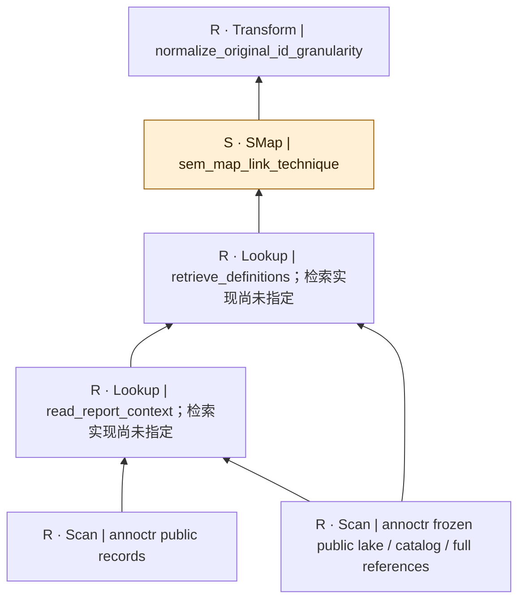

DEVELOPMENT_CONDITIONAL_LINKING_ONLY；本地派生任务，非原benchmark官方查询；没有模型执行或K测量。专家技术URL映射为ATT&CK ID；不按父技术折叠，粒度与论文部分实验不同

## annoctr-Q2-v1

来源：[原件](</Volumes/Element/Github2/semantic-workload-bench/workloads/annoctr-batch/queries.json>) · `local_derived` · `registered_not_executed` · `substantive_relational`

```text

返回链接到指定技术的提及清单，并关联所属报告

```

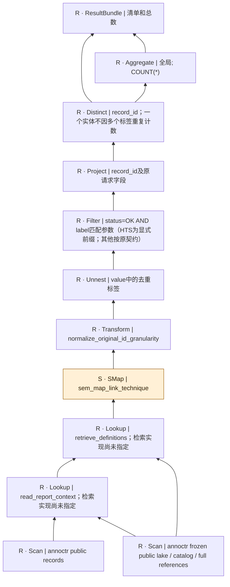

DEVELOPMENT_CONDITIONAL_LINKING_ONLY；本地派生任务，非原benchmark官方查询；没有模型执行或K测量。Derived from the same Q1 labels; not independent gold

## annoctr-Q3-v1

来源：[原件](</Volumes/Element/Github2/semantic-workload-bench/workloads/annoctr-batch/queries.json>) · `local_derived` · `registered_not_executed` · `substantive_relational`

```text

对本批给定提及按报告归并技术集合，同时区分提及数与报告数

```

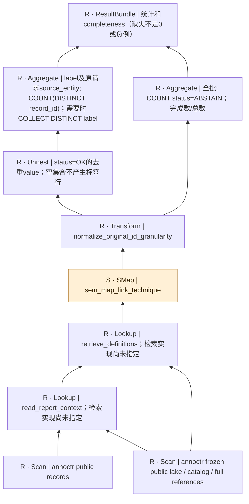

DEVELOPMENT_CONDITIONAL_LINKING_ONLY；本地派生任务，非原benchmark官方查询；没有模型执行或K测量。Derived from Q1; partial groups explicitly marked incomplete

## annoctr-Q4-v1

来源：[原件](</Volumes/Element/Github2/semantic-workload-bench/workloads/annoctr-batch/queries.json>) · `local_derived` · `registered_not_executed` · `substantive_relational`

```text

返回未完成记录及原因，并报告全量coverage；缺事实和运行失败均需保留原因，不当负例。

```

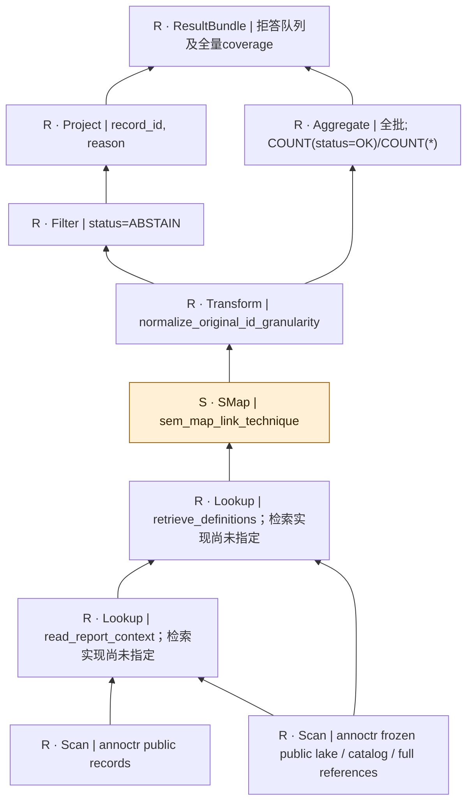

DEVELOPMENT_CONDITIONAL_LINKING_ONLY；本地派生任务，非原benchmark官方查询；没有模型执行或K测量。No independent gold; this is execution accounting, not missing-fact correctness 运行管理派生，不新增独立语义问题。

## codiesp-Q1-v1

来源：[原件](</Volumes/Element/Github2/semantic-workload-bench/workloads/codiesp-batch/queries.json>) · `local_derived` · `registered_not_executed` · `substantive_relational`

```text

For every complete Spanish case report, return a ranked, duplicate-free list of procedure codes under the supplied CodiEsp guidelines and frozen 2018 coding resources. Use lowercase codes and preserve allowed four- or seven-character specificity; do not invent missing axes. Code mention scope under the task guidelines, not whether a procedure actually occurred. Include all reports; an empty completed list means no selected codable mentions, not absence of real procedures. This task is P, not D or X.

```

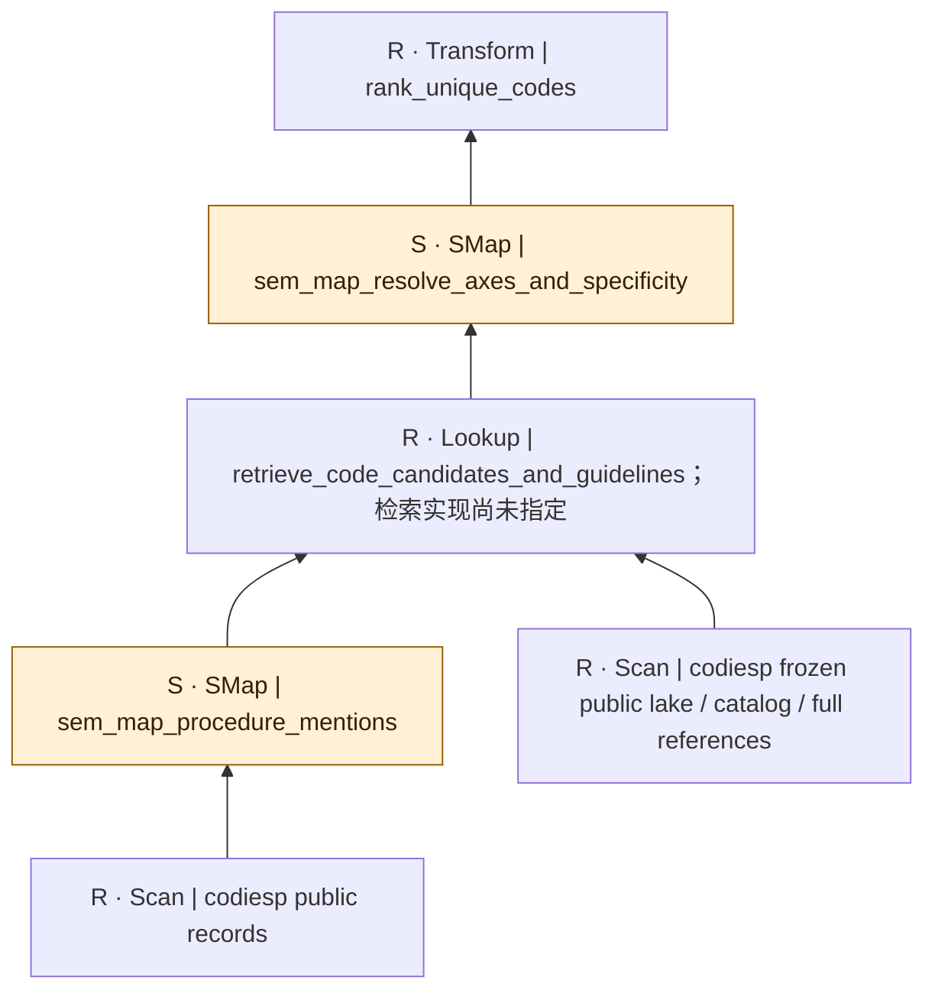

DEVELOPMENT_SOURCE_LABEL_REPRODUCTION_ONLY；本地派生任务，非原benchmark官方查询；没有模型执行或K测量。源P病例-code集合，保留全部标签；原排序预测任务主指标MAP，集合为补充

## codiesp-Q2-v1

来源：[原件](</Volumes/Element/Github2/semantic-workload-bench/workloads/codiesp-batch/queries.json>) · `local_derived` · `registered_not_executed` · `substantive_relational`

```text

返回含指定操作代码提及的报告清单；不解释为患者接受该操作

```

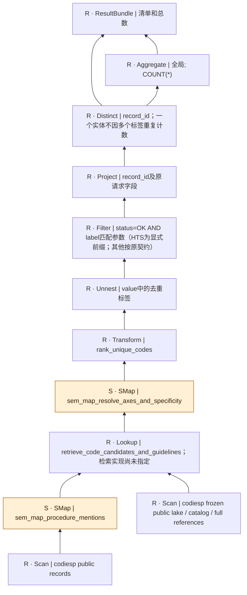

DEVELOPMENT_SOURCE_LABEL_REPRODUCTION_ONLY；本地派生任务，非原benchmark官方查询；没有模型执行或K测量。Derived from the same Q1 labels; not independent gold

## codiesp-Q3-v1

来源：[原件](</Volumes/Element/Github2/semantic-workload-bench/workloads/codiesp-batch/queries.json>) · `local_derived` · `registered_not_executed` · `substantive_relational`

```text

按操作代码统计报告数；不把重复提及或同论文病例算成独立患者

```

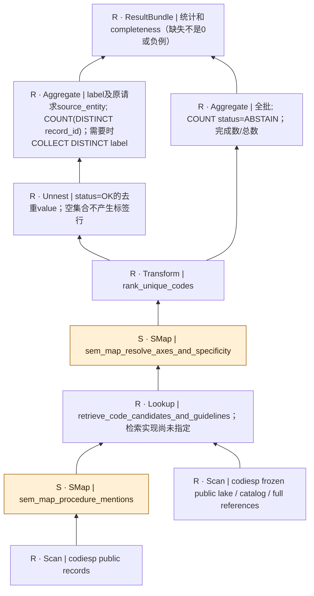

DEVELOPMENT_SOURCE_LABEL_REPRODUCTION_ONLY；本地派生任务，非原benchmark官方查询；没有模型执行或K测量。Derived from Q1; partial groups explicitly marked incomplete

## codiesp-Q4-v1

来源：[原件](</Volumes/Element/Github2/semantic-workload-bench/workloads/codiesp-batch/queries.json>) · `local_derived` · `registered_not_executed` · `substantive_relational`

```text

返回未完成记录及原因，并报告全量coverage；缺事实和运行失败均需保留原因，不当负例。

```

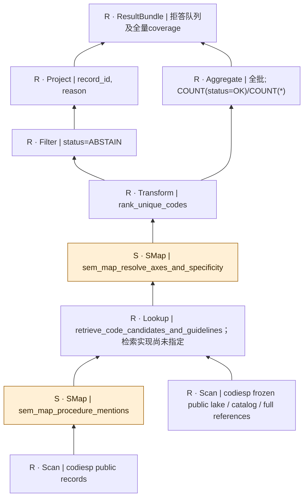

DEVELOPMENT_SOURCE_LABEL_REPRODUCTION_ONLY；本地派生任务，非原benchmark官方查询；没有模型执行或K测量。No independent gold; this is execution accounting, not missing-fact correctness 运行管理派生，不新增独立语义问题。

## hscodecomp-Q1-v1

来源：[原件](</Volumes/Element/Github2/semantic-workload-bench/workloads/hscodecomp-batch/queries.json>) · `local_derived` · `registered_not_executed` · `substantive_relational`

```text

For every product in records.json, use its published title, attributes, price, currency and marketplace categories with frozen HTS 2025 Revision 15 to return one 10-digit HTS code as a singleton string list. Consult hierarchy, unnumbered parent rows and full notes. Do not assume price is per item, invent photos, convert currency without evidence, or reconstruct missing product facts. If a supported classification cannot be completed, ABSTAIN with null value and a concrete reason. The source-label task supplies no independent UNKNOWN gold.

```

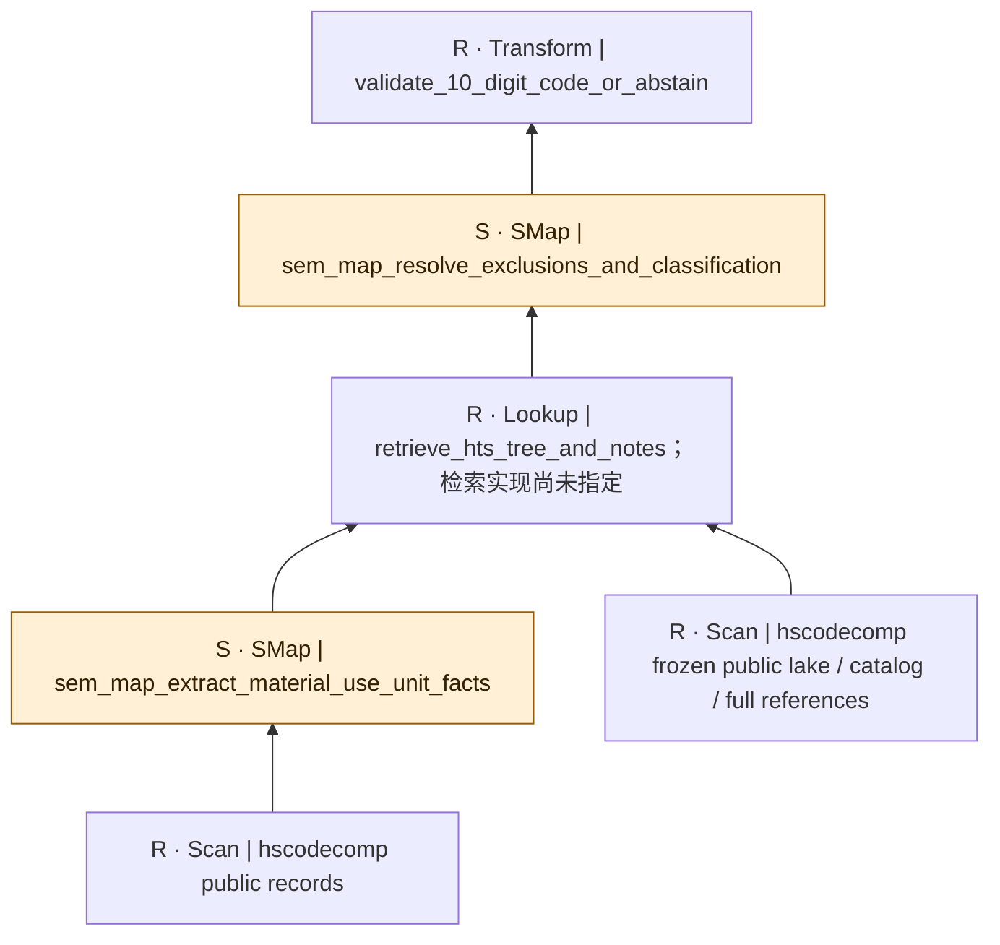

DEVELOPMENT_INCOMPLETE_INPUT_DIAGNOSTIC；本地派生任务，非原benchmark官方查询；没有模型执行或K测量。独立专家10位码；前缀目标由同一标签派生

## hscodecomp-Q2-v1

来源：[原件](</Volumes/Element/Github2/semantic-workload-bench/workloads/hscodecomp-batch/queries.json>) · `local_derived` · `registered_not_executed` · `substantive_relational`

```text

按参数化2/4/6/8/10位编码前缀返回商品清单及数量

```

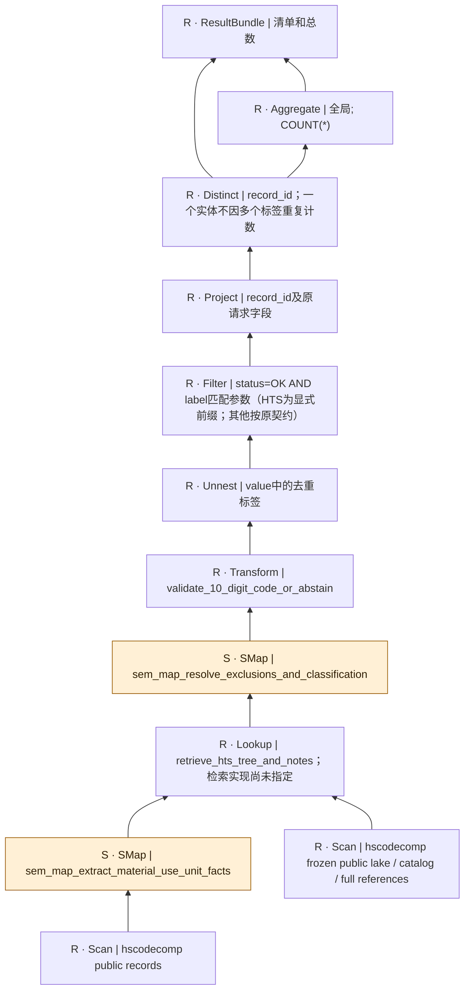

DEVELOPMENT_INCOMPLETE_INPUT_DIAGNOSTIC；本地派生任务，非原benchmark官方查询；没有模型执行或K测量。Derived from the same Q1 labels; not independent gold

## hscodecomp-Q3-v1

来源：[原件](</Volumes/Element/Github2/semantic-workload-bench/workloads/hscodecomp-batch/queries.json>) · `local_derived` · `registered_not_executed` · `substantive_relational`

```text

按预测完整编码统计商品数；前缀筛选为派生诊断，不是独立专家gold

```

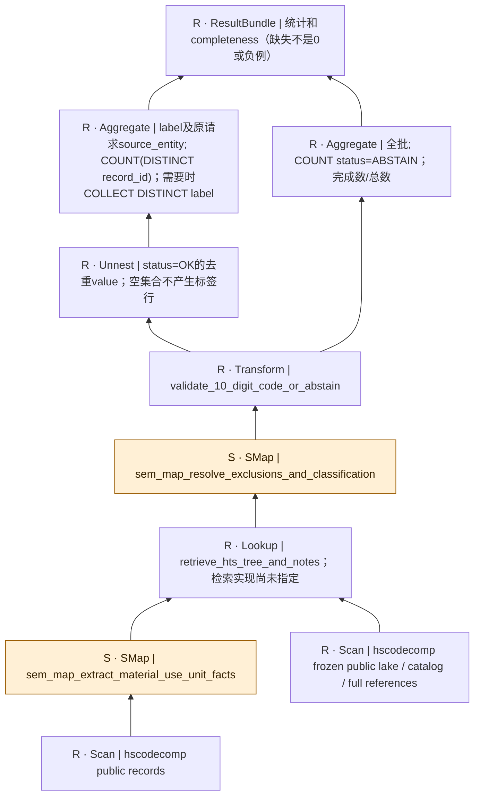

DEVELOPMENT_INCOMPLETE_INPUT_DIAGNOSTIC；本地派生任务，非原benchmark官方查询；没有模型执行或K测量。Derived from Q1; partial groups explicitly marked incomplete

## hscodecomp-Q4-v1

来源：[原件](</Volumes/Element/Github2/semantic-workload-bench/workloads/hscodecomp-batch/queries.json>) · `local_derived` · `registered_not_executed` · `substantive_relational`

```text

返回未完成记录及原因，并报告全量coverage；缺事实和运行失败均需保留原因，不当负例。

```

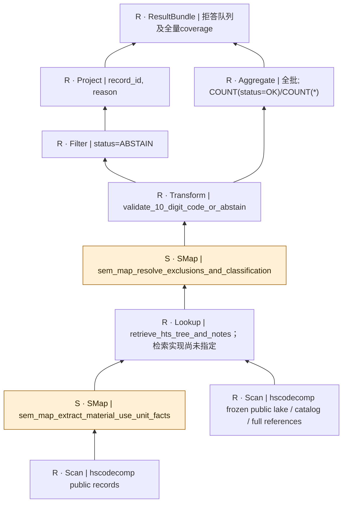

DEVELOPMENT_INCOMPLETE_INPUT_DIAGNOSTIC；本地派生任务，非原benchmark官方查询；没有模型执行或K测量。No independent gold; this is execution accounting, not missing-fact correctness 运行管理派生，不新增独立语义问题。

## stard-Q1-v1

来源：[原件](</Volumes/Element/Github2/semantic-workload-bench/workloads/stard-batch/queries.json>) · `local_derived` · `registered_not_executed` · `substantive_relational`

```text

For every question in records.json, return a ranked, duplicate-free list of relevant article IDs from lake/catalog.jsonl. Use the frozen article corpus. This is relevant-article retrieval, not a legal ruling or a complete legal answer. Do not infer that unannotated or unreturned articles are legally inapplicable.

```

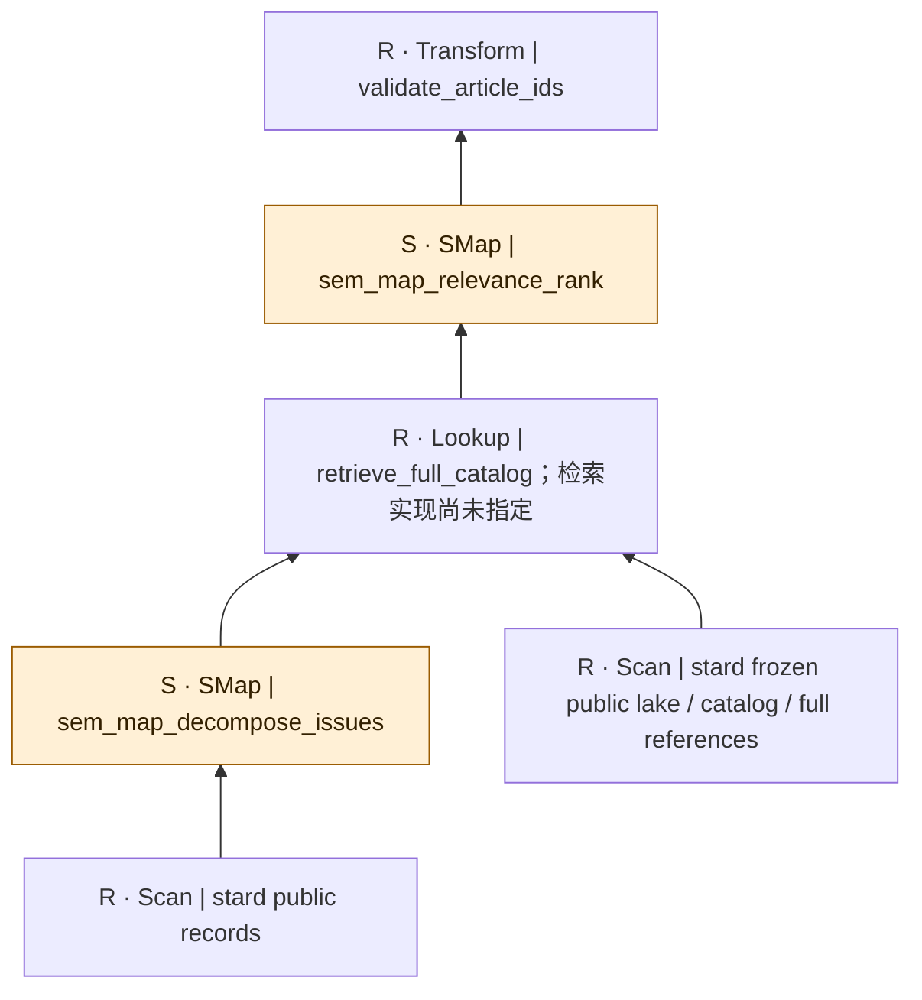

DEVELOPMENT_RETRIEVAL_ONLY；本地派生任务，非原benchmark官方查询；没有模型执行或K测量。人工相关法条集合；排名指标可对无序qrels评估，非原gold顺序

## stard-Q2-v1

来源：[原件](</Volumes/Element/Github2/semantic-workload-bench/workloads/stard-batch/queries.json>) · `local_derived` · `registered_not_executed` · `substantive_relational`

```text

返回涉及指定法条的咨询记录清单与数量

```

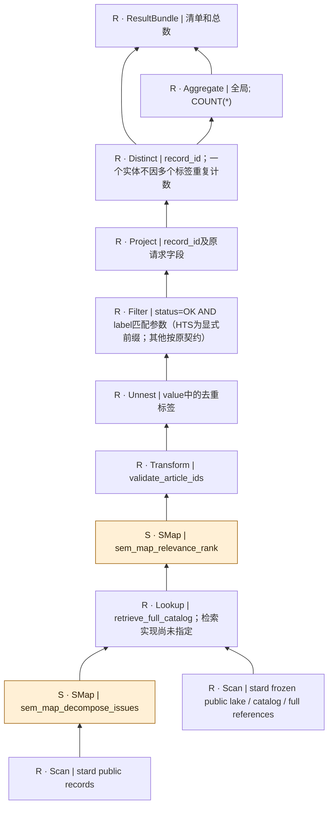

DEVELOPMENT_RETRIEVAL_ONLY；本地派生任务，非原benchmark官方查询；没有模型执行或K测量。Derived from the same Q1 labels; not independent gold

## stard-Q3-v1

来源：[原件](</Volumes/Element/Github2/semantic-workload-bench/workloads/stard-batch/queries.json>) · `local_derived` · `registered_not_executed` · `substantive_relational`

```text

按法条统计命中的咨询数，生成咨询—法条索引

```

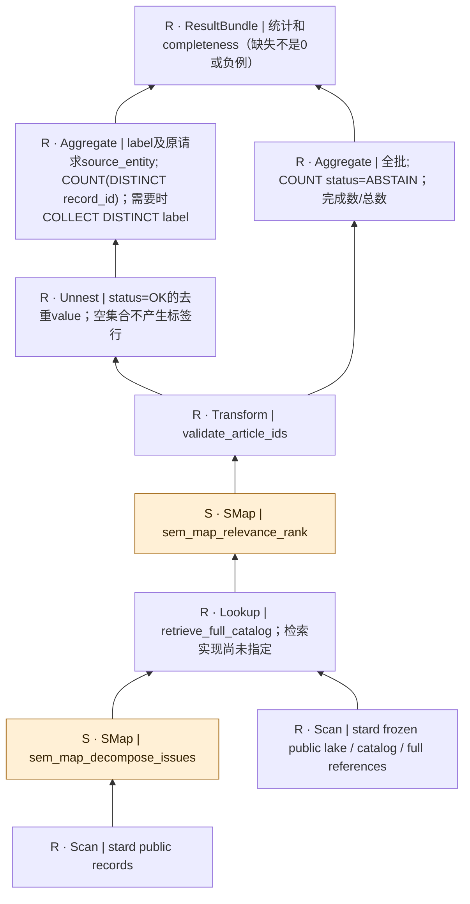

DEVELOPMENT_RETRIEVAL_ONLY；本地派生任务，非原benchmark官方查询；没有模型执行或K测量。Derived from Q1; partial groups explicitly marked incomplete

## stard-Q4-v1

来源：[原件](</Volumes/Element/Github2/semantic-workload-bench/workloads/stard-batch/queries.json>) · `local_derived` · `registered_not_executed` · `substantive_relational`

```text

返回未完成记录及原因，并报告全量coverage；缺事实和运行失败均需保留原因，不当负例。

```

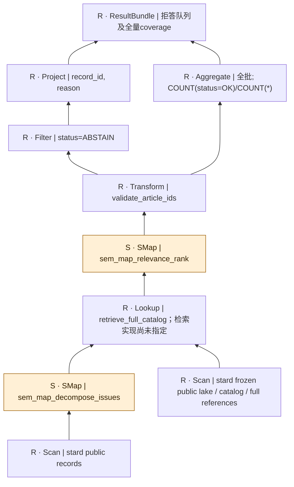

DEVELOPMENT_RETRIEVAL_ONLY；本地派生任务，非原benchmark官方查询；没有模型执行或K测量。No independent gold; this is execution accounting, not missing-fact correctness 运行管理派生，不新增独立语义问题。

## udrp-Q1-v1

来源：[原件](</Volumes/Element/Github2/semantic-workload-bench/workloads/udrp-batch/queries.json>) · `local_derived` · `inspection_only` · `substantive_relational`

```text

For each supplied case, apply the frozen WIPO Overview 3.0 to attributed party contentions and recorded facts, and return a singleton list containing RELIEF_GRANTED or DENIED. Missing support is not a denial: ABSTAIN with null value and a reason when unable to complete. These are retrospective pre-analysis case extracts, not original filings. This query is registered for inspection: residual answer leakage and external-fact gaps remain, so it is not an evaluation-ready prediction benchmark.

```

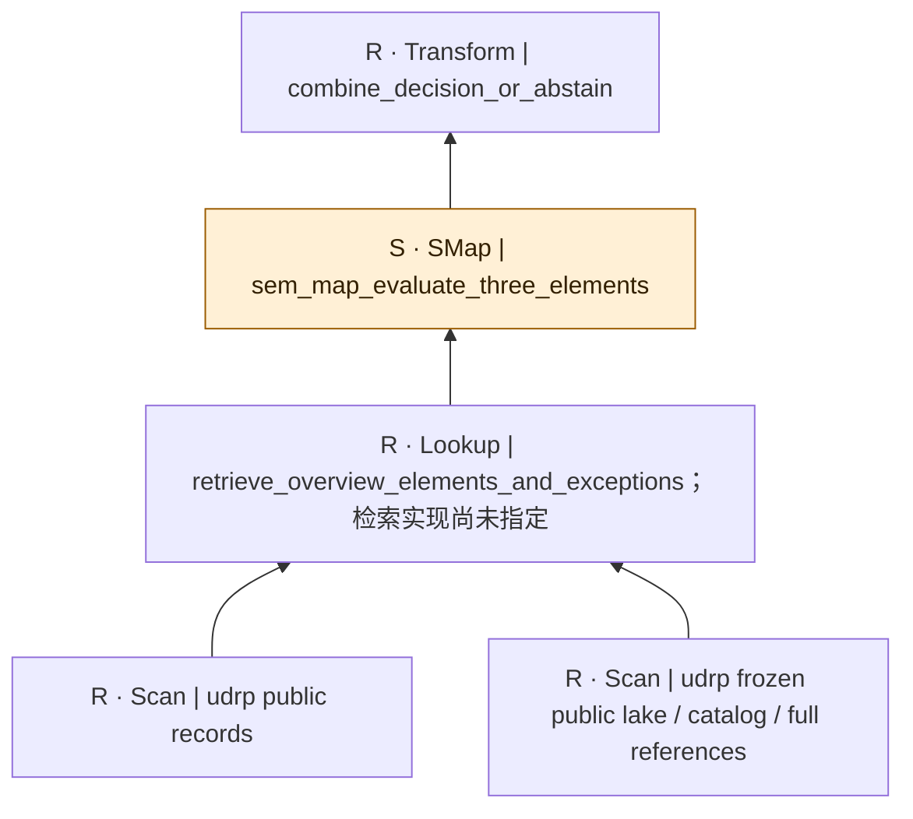

INSPECTION_ONLY_LEAKAGE_AND_FACT_GAPS；本地派生任务，非原benchmark官方查询；没有模型执行或K测量。正式命令的规则抽取标签；保留正式原文，非新独立人工复核标签

## udrp-Q2-v1

来源：[原件](</Volumes/Element/Github2/semantic-workload-bench/workloads/udrp-batch/queries.json>) · `local_derived` · `inspection_only` · `substantive_relational`

```text

筛出预测驳回案件，生成需复核的少数类清单

```

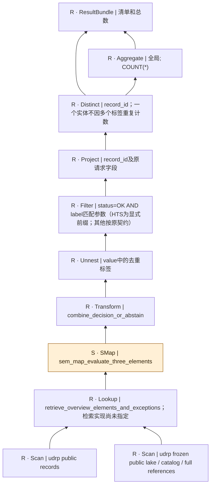

INSPECTION_ONLY_LEAKAGE_AND_FACT_GAPS；本地派生任务，非原benchmark官方查询；没有模型执行或K测量。Derived from the same Q1 labels; not independent gold

## udrp-Q3-v1

来源：[原件](</Volumes/Element/Github2/semantic-workload-bench/workloads/udrp-batch/queries.json>) · `local_derived` · `inspection_only` · `substantive_relational`

```text

统计两种预测决定及未完成数量；不得只报多数类准确率

```

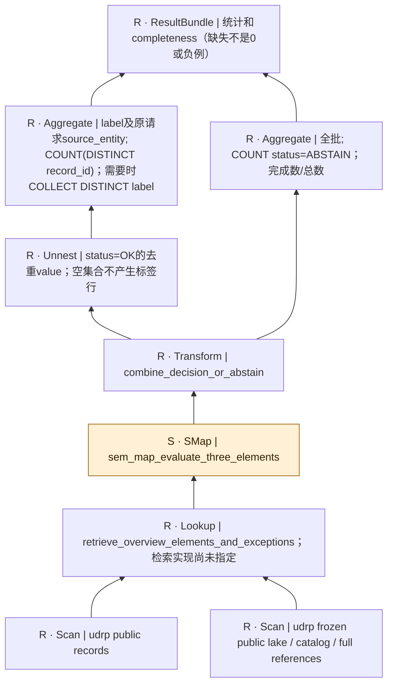

INSPECTION_ONLY_LEAKAGE_AND_FACT_GAPS；本地派生任务，非原benchmark官方查询；没有模型执行或K测量。Derived from Q1; partial groups explicitly marked incomplete

## udrp-Q4-v1

来源：[原件](</Volumes/Element/Github2/semantic-workload-bench/workloads/udrp-batch/queries.json>) · `local_derived` · `inspection_only` · `substantive_relational`

```text

返回未完成记录及原因，并报告全量coverage；缺事实和运行失败均需保留原因，不当负例。

```

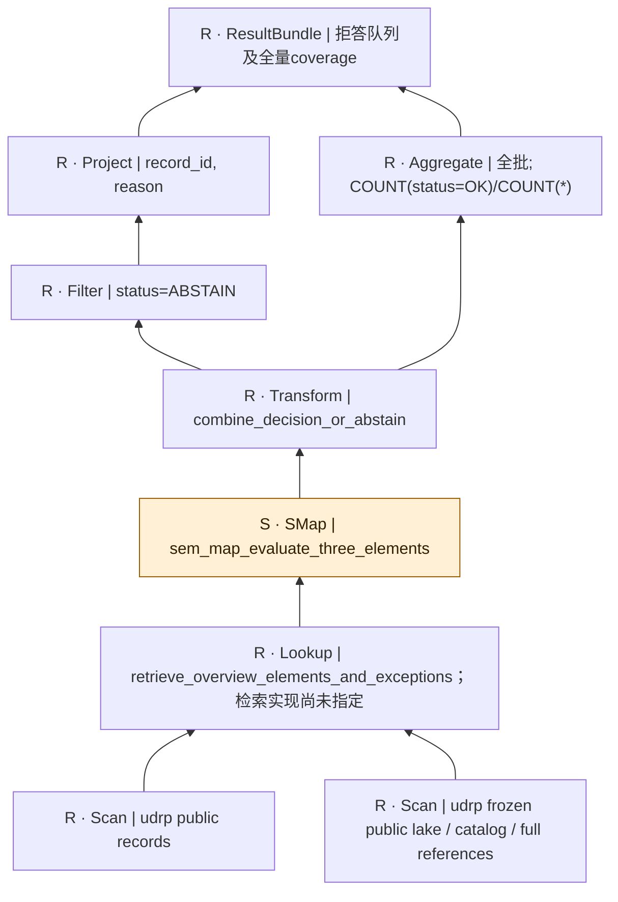

INSPECTION_ONLY_LEAKAGE_AND_FACT_GAPS；本地派生任务，非原benchmark官方查询；没有模型执行或K测量。No independent gold; this is execution accounting, not missing-fact correctness 运行管理派生，不新增独立语义问题。
