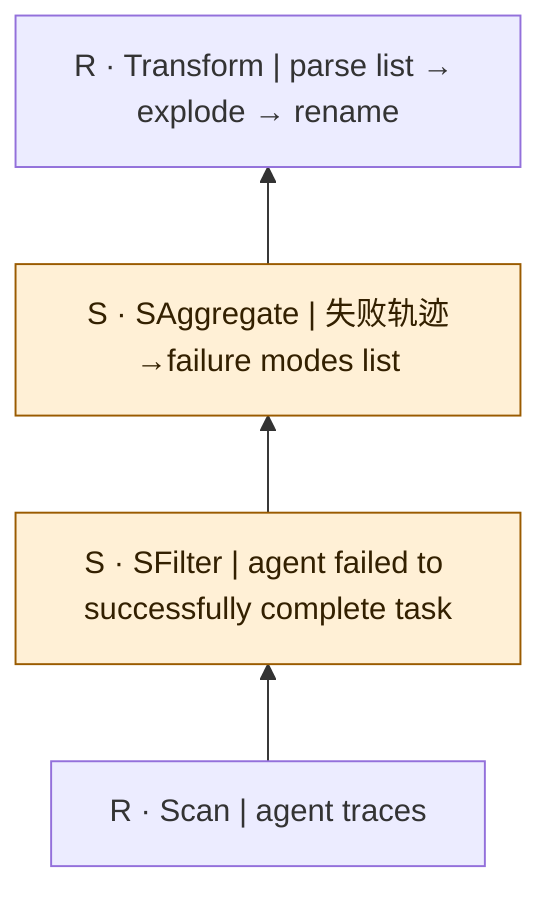
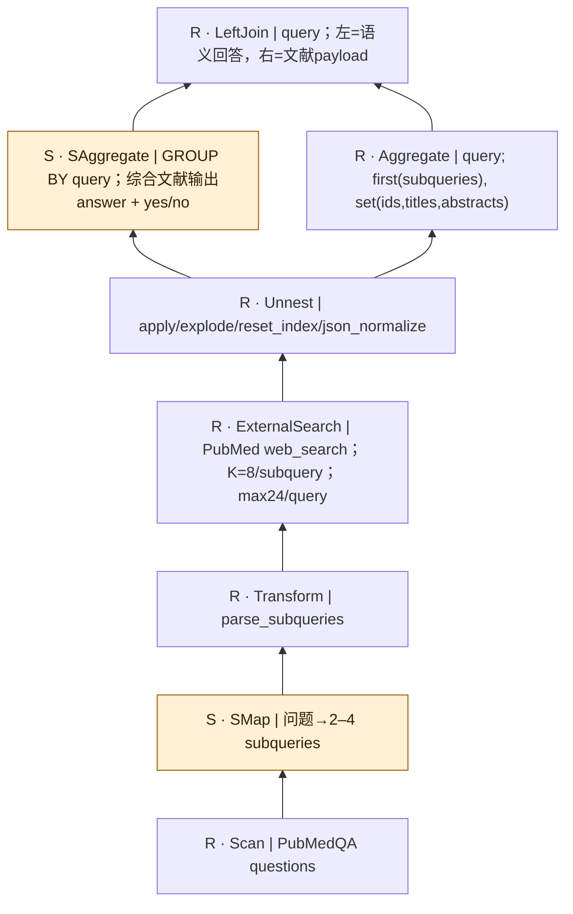
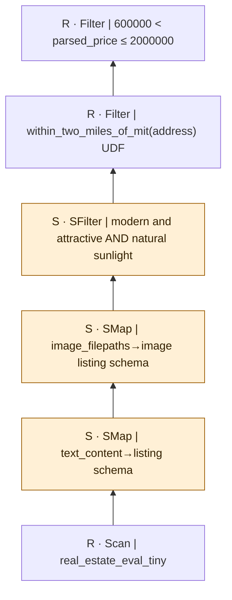

# implementation-examples：逐查询逻辑计划

[返回总表](README.md)

图从下往上读：输入 → 算子 → 输出。S为语义算子；R为确定性关系/辅助步骤。检索与未决节点在标签中单独注明。

## lotus/failure-mode-discovery

来源：[原件](</Volumes/Element/Github2/Awesome-Sem-Filter-Bench/baseline/LOTUS/repository/LOTUS/benchmarks/failure_mode_discovery/pipeline.py>) · `observed_source_pipeline` · `logical_only` · `substantive_relational`

```text

从失败的Agent轨迹归纳失败模式并展开为行。

```



SAggregate是语义归纳，不等于SQL COUNT/SUM；结构部分主要是解析、展开。未执行。

## lotus/rag-pubmedqa

来源：[原件](</Volumes/Element/Github2/Awesome-Sem-Filter-Bench/baseline/LOTUS/repository/LOTUS/benchmarks/rag_pubmedqa/pipeline.py>) · `observed_source_pipeline` · `logical_only` · `substantive_relational`

```text

分解问题、检索PubMed文献、按问题汇总证据并生成回答。

```



基于本地当前pipeline文件，不声称是某篇早期论文原始查询。ExternalSearch是外部检索依赖，非普通数据库Join；最终merge是结构左连接。

## palimpzest/real-estate

来源：[原件](</Volumes/Element/Github2/Awesome-Sem-Filter-Bench/baseline/Palimpzest/repository/Palimpzest/tests/pytest/fixtures/workloads.py>) · `observed_source_pipeline` · `logical_only` · `substantive_relational`

```text

根据室内照片、房源文字、地址与价格筛选房源。

```



保留fixture源码顺序。距离函数实际使用街道黑名单近似，不是真实地理距离计算；不可把结果称为2英里精确查询。
