# quest-lcr：逐查询逻辑计划

[返回总表](README.md)

图从下往上读：输入 → 算子 → 输出。S为语义算子；R为确定性关系/辅助步骤。检索与未决节点在标签中单独注明。

## quest/LCR/01

来源：[原件](</Volumes/Element/Github2/Awesome-Sem-Filter-Bench/baseline/QUEST/repository/QUEST/query/LCR.txt:2>) · `pseudo_sql_plus_proposed_extraction` · `pseudo_sql_only` · `substantive_relational`

```sql

SELECT court_name,hearing_year,legal_basis FROM LCR WHERE hearing_year = 2006

```


原库列出的伪SQL；保留未加引号的文本字面量和原始拼写。谓词作为原文整体显示，没有假称可执行SQL或已验证类型绑定；语义抽取为逻辑补充。列表中的省略号表示这里不是全部可能查询。

## quest/LCR/02

来源：[原件](</Volumes/Element/Github2/Awesome-Sem-Filter-Bench/baseline/QUEST/repository/QUEST/query/LCR.txt:3>) · `pseudo_sql_plus_proposed_extraction` · `pseudo_sql_only` · `substantive_relational`

```sql

SELECT court_name,hearing_year,legal_basis FROM LCR WHERE hearing_year = 2008

```

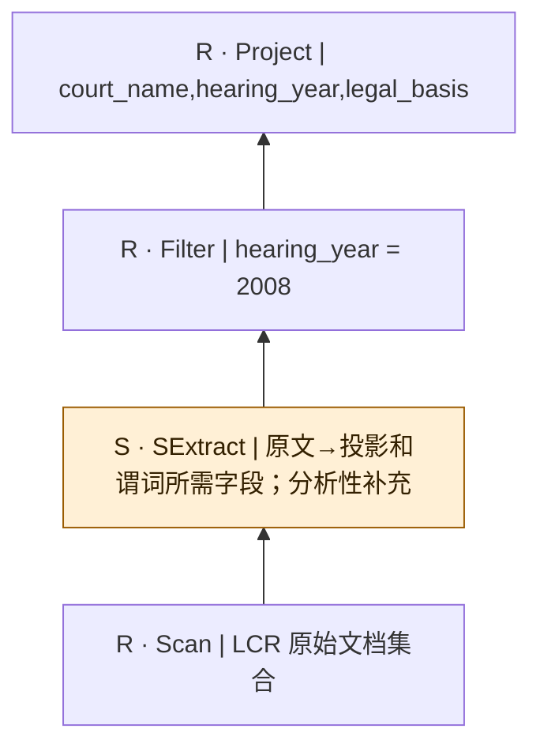

原库列出的伪SQL；保留未加引号的文本字面量和原始拼写。谓词作为原文整体显示，没有假称可执行SQL或已验证类型绑定；语义抽取为逻辑补充。列表中的省略号表示这里不是全部可能查询。

## quest/LCR/03

来源：[原件](</Volumes/Element/Github2/Awesome-Sem-Filter-Bench/baseline/QUEST/repository/QUEST/query/LCR.txt:4>) · `pseudo_sql_plus_proposed_extraction` · `pseudo_sql_only` · `substantive_relational`

```sql

SELECT court_name,judge_name,hearing_year,judgment_year FROM LCR WHERE judgment_year >= 2009

```

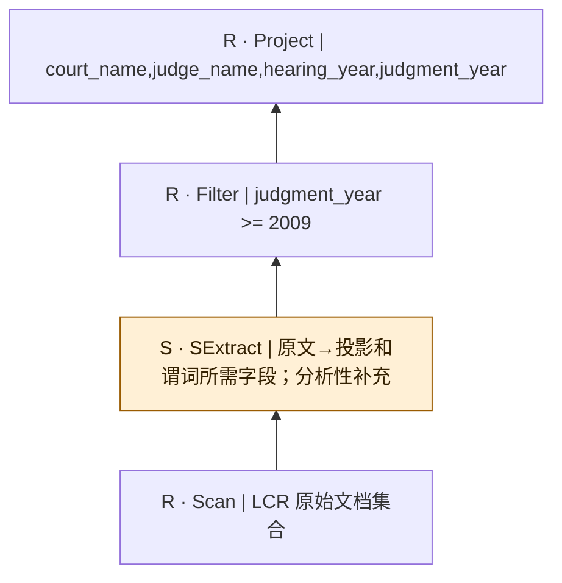

原库列出的伪SQL；保留未加引号的文本字面量和原始拼写。谓词作为原文整体显示，没有假称可执行SQL或已验证类型绑定；语义抽取为逻辑补充。列表中的省略号表示这里不是全部可能查询。

## quest/LCR/04

来源：[原件](</Volumes/Element/Github2/Awesome-Sem-Filter-Bench/baseline/QUEST/repository/QUEST/query/LCR.txt:5>) · `pseudo_sql_plus_proposed_extraction` · `pseudo_sql_only` · `substantive_relational`

```sql

SELECT court_name,judge_name,hearing_year,judgment_year FROM LCR WHERE judgment_year <= 2007

```


原库列出的伪SQL；保留未加引号的文本字面量和原始拼写。谓词作为原文整体显示，没有假称可执行SQL或已验证类型绑定；语义抽取为逻辑补充。列表中的省略号表示这里不是全部可能查询。

## quest/LCR/05

来源：[原件](</Volumes/Element/Github2/Awesome-Sem-Filter-Bench/baseline/QUEST/repository/QUEST/query/LCR.txt:6>) · `pseudo_sql_plus_proposed_extraction` · `pseudo_sql_only` · `substantive_relational`

```sql

SELECT court_name,judge_name,judgment_year FROM LCR WHERE court_name = Federal Court

```

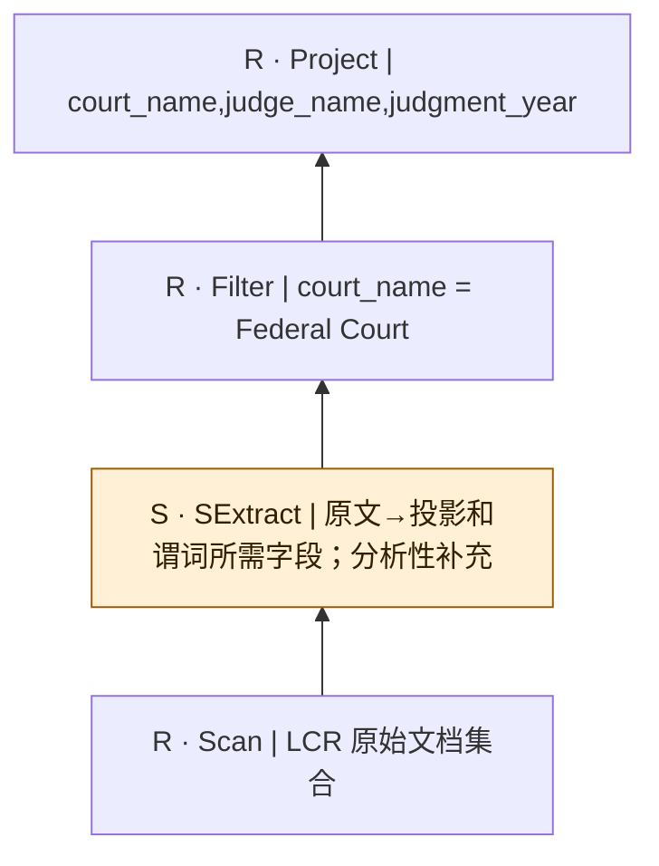

原库列出的伪SQL；保留未加引号的文本字面量和原始拼写。谓词作为原文整体显示，没有假称可执行SQL或已验证类型绑定；语义抽取为逻辑补充。列表中的省略号表示这里不是全部可能查询。

## quest/LCR/06

来源：[原件](</Volumes/Element/Github2/Awesome-Sem-Filter-Bench/baseline/QUEST/repository/QUEST/query/LCR.txt:7>) · `pseudo_sql_plus_proposed_extraction` · `pseudo_sql_only` · `substantive_relational`

```sql

SELECT court_name,judge_name FROM LCR WHERE judge_name = Jacobson

```

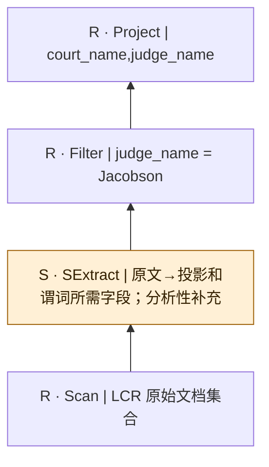

原库列出的伪SQL；保留未加引号的文本字面量和原始拼写。谓词作为原文整体显示，没有假称可执行SQL或已验证类型绑定；语义抽取为逻辑补充。列表中的省略号表示这里不是全部可能查询。

## quest/LCR/07

来源：[原件](</Volumes/Element/Github2/Awesome-Sem-Filter-Bench/baseline/QUEST/repository/QUEST/query/LCR.txt:8>) · `pseudo_sql_plus_proposed_extraction` · `pseudo_sql_only` · `substantive_relational`

```sql

SELECT court_name,hearing_year,legal_basis FROM LCR WHERE legal_basis = Trade Practices Act 1974 (Cth)

```

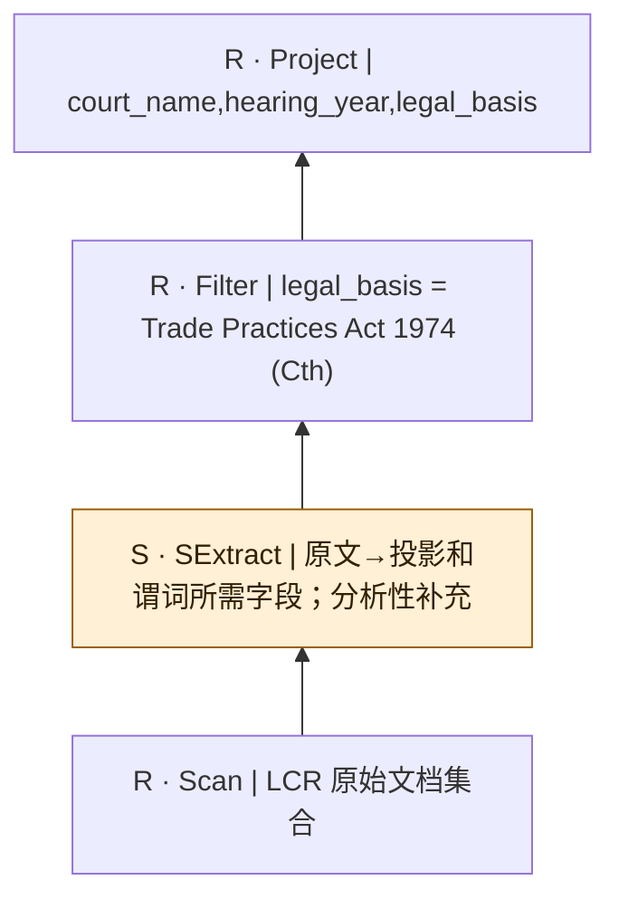

原库列出的伪SQL；保留未加引号的文本字面量和原始拼写。谓词作为原文整体显示，没有假称可执行SQL或已验证类型绑定；语义抽取为逻辑补充。列表中的省略号表示这里不是全部可能查询。

## quest/LCR/08

来源：[原件](</Volumes/Element/Github2/Awesome-Sem-Filter-Bench/baseline/QUEST/repository/QUEST/query/LCR.txt:9>) · `pseudo_sql_plus_proposed_extraction` · `pseudo_sql_only` · `substantive_relational`

```sql

SELECT court_name,judge_name,hearing_year,judgment_year FROM LCR WHERE verdict = dismissed

```

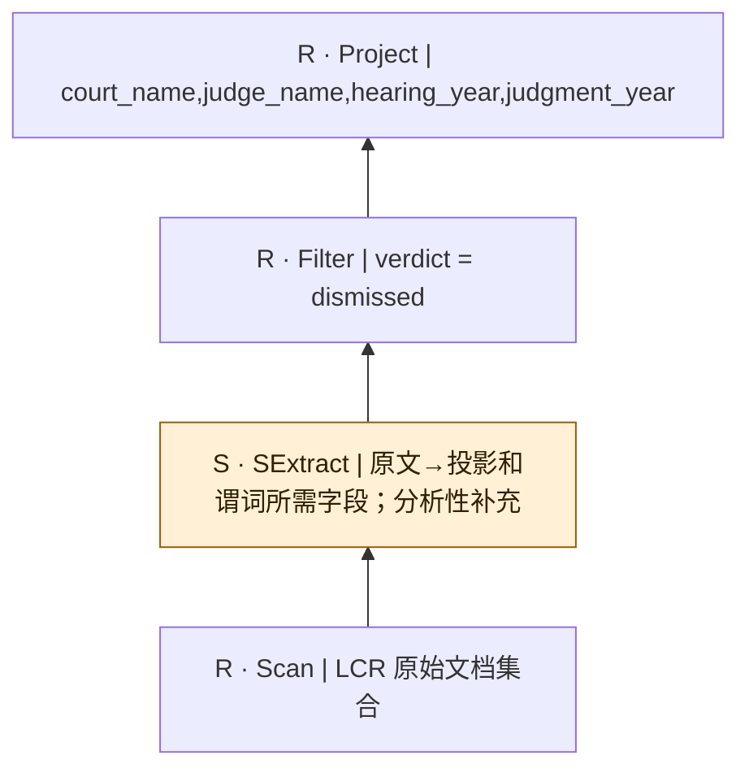

原库列出的伪SQL；保留未加引号的文本字面量和原始拼写。谓词作为原文整体显示，没有假称可执行SQL或已验证类型绑定；语义抽取为逻辑补充。列表中的省略号表示这里不是全部可能查询。

## quest/LCR/09

来源：[原件](</Volumes/Element/Github2/Awesome-Sem-Filter-Bench/baseline/QUEST/repository/QUEST/query/LCR.txt:10>) · `pseudo_sql_plus_proposed_extraction` · `pseudo_sql_only` · `substantive_relational`

```sql

SELECT court_name,judge_name FROM LCR WHERE hearing_year >= 2006

```

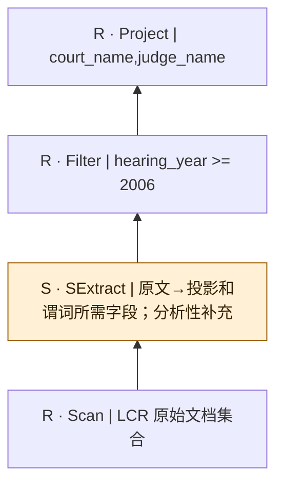

原库列出的伪SQL；保留未加引号的文本字面量和原始拼写。谓词作为原文整体显示，没有假称可执行SQL或已验证类型绑定；语义抽取为逻辑补充。列表中的省略号表示这里不是全部可能查询。

## quest/LCR/10

来源：[原件](</Volumes/Element/Github2/Awesome-Sem-Filter-Bench/baseline/QUEST/repository/QUEST/query/LCR.txt:11>) · `pseudo_sql_plus_proposed_extraction` · `pseudo_sql_only` · `substantive_relational`

```sql

SELECT court_name,judge_name,hearing_year,judgment_year FROM LCR WHERE charges = Breaches of ss 52 and 53 of the Trade Practices Act 1974 (Cth)

```

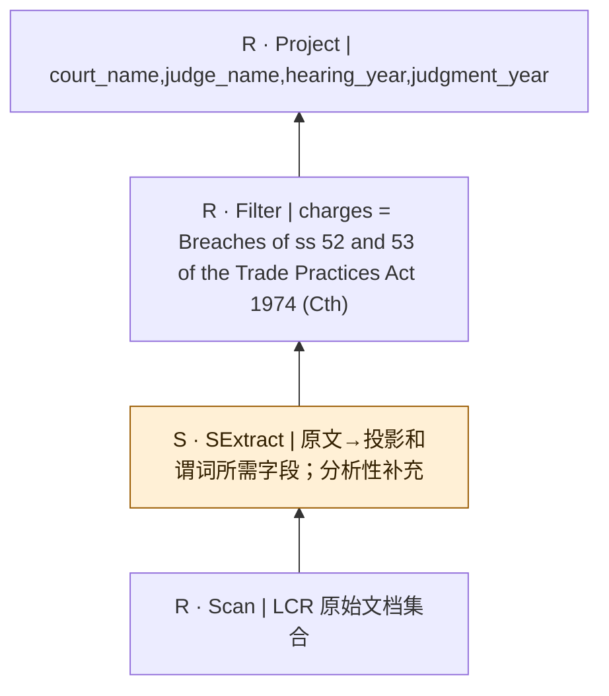

原库列出的伪SQL；保留未加引号的文本字面量和原始拼写。谓词作为原文整体显示，没有假称可执行SQL或已验证类型绑定；语义抽取为逻辑补充。列表中的省略号表示这里不是全部可能查询。

## quest/LCR/11

来源：[原件](</Volumes/Element/Github2/Awesome-Sem-Filter-Bench/baseline/QUEST/repository/QUEST/query/LCR.txt:12>) · `pseudo_sql_plus_proposed_extraction` · `pseudo_sql_only` · `substantive_relational`

```sql

SELECT court_name,judge_name,hearing_year,judgment_year FROM LCR WHERE charges = infringement of Australian Patent No 713628

```

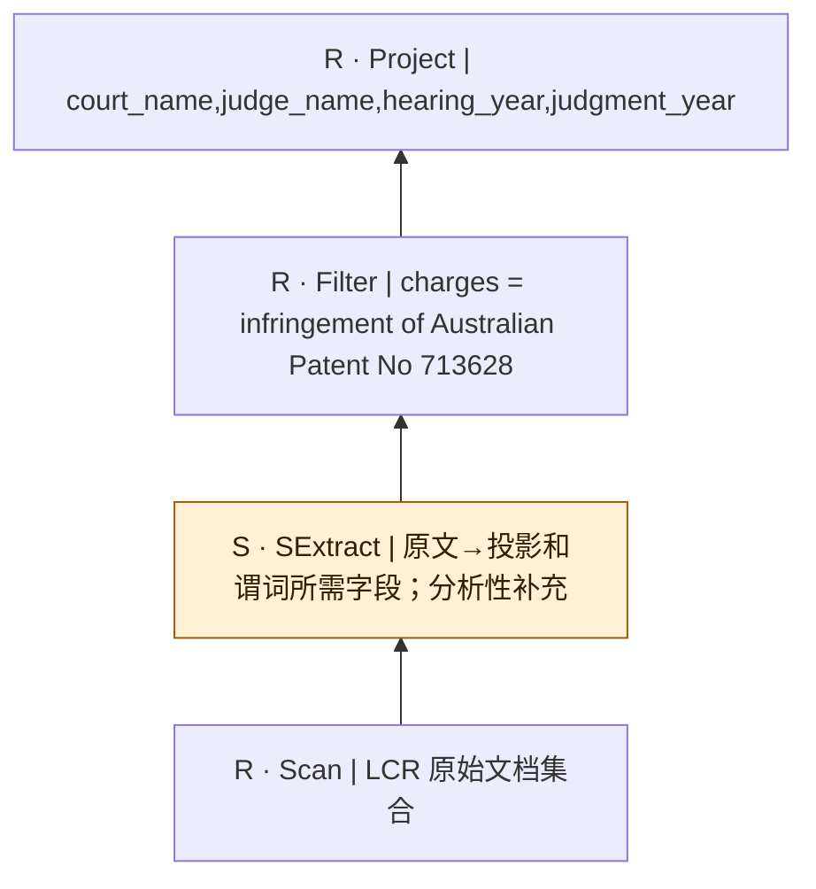

原库列出的伪SQL；保留未加引号的文本字面量和原始拼写。谓词作为原文整体显示，没有假称可执行SQL或已验证类型绑定；语义抽取为逻辑补充。列表中的省略号表示这里不是全部可能查询。

## quest/LCR/12

来源：[原件](</Volumes/Element/Github2/Awesome-Sem-Filter-Bench/baseline/QUEST/repository/QUEST/query/LCR.txt:13>) · `pseudo_sql_plus_proposed_extraction` · `pseudo_sql_only` · `substantive_relational`

```sql

SELECT court_name,judge_name,hearing_year,judgment_year FROM LCR WHERE charges = unlawful industrial action in contravention of s 38 of the BCII Act

```

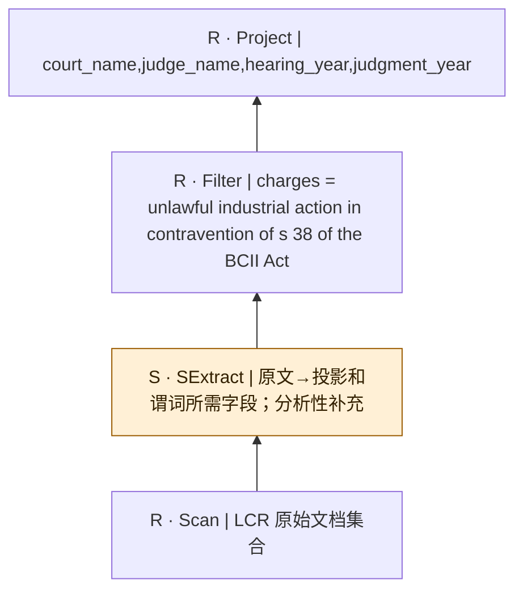

原库列出的伪SQL；保留未加引号的文本字面量和原始拼写。谓词作为原文整体显示，没有假称可执行SQL或已验证类型绑定；语义抽取为逻辑补充。列表中的省略号表示这里不是全部可能查询。

## quest/LCR/13

来源：[原件](</Volumes/Element/Github2/Awesome-Sem-Filter-Bench/baseline/QUEST/repository/QUEST/query/LCR.txt:16>) · `pseudo_sql_plus_proposed_extraction` · `pseudo_sql_only` · `substantive_relational`

```sql

SELECT court_name,judge_name,judgment_year FROM LCR WHERE judgment_year >= 2009 AND court_name = Federal Court

```

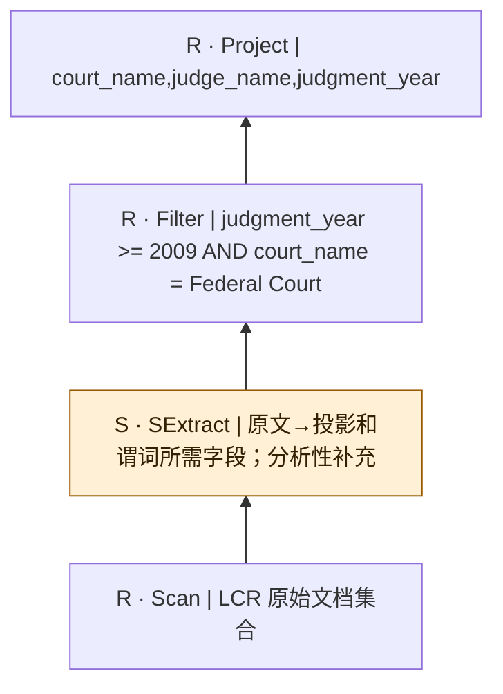

原库列出的伪SQL；保留未加引号的文本字面量和原始拼写。谓词作为原文整体显示，没有假称可执行SQL或已验证类型绑定；语义抽取为逻辑补充。列表中的省略号表示这里不是全部可能查询。

## quest/LCR/14

来源：[原件](</Volumes/Element/Github2/Awesome-Sem-Filter-Bench/baseline/QUEST/repository/QUEST/query/LCR.txt:17>) · `pseudo_sql_plus_proposed_extraction` · `pseudo_sql_only` · `substantive_relational`

```sql

SELECT court_name,judge_name,judgment_year,verdict FROM LCR WHERE judgment_year = 2009 AND verdict = dismissed

```

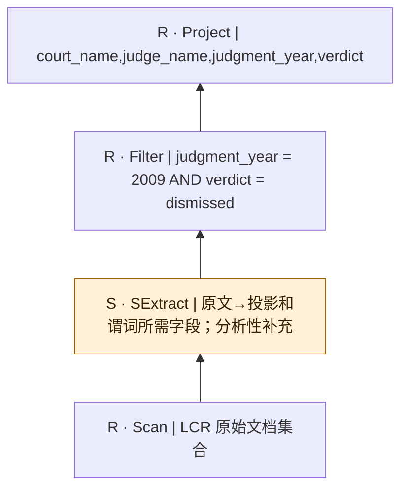

原库列出的伪SQL；保留未加引号的文本字面量和原始拼写。谓词作为原文整体显示，没有假称可执行SQL或已验证类型绑定；语义抽取为逻辑补充。列表中的省略号表示这里不是全部可能查询。

## quest/LCR/15

来源：[原件](</Volumes/Element/Github2/Awesome-Sem-Filter-Bench/baseline/QUEST/repository/QUEST/query/LCR.txt:18>) · `pseudo_sql_plus_proposed_extraction` · `pseudo_sql_only` · `substantive_relational`

```sql

SELECT court_name,hearing_year,judgment_year FROM LCR WHERE hearing_year = 2006 OR court_name = Federal Court

```

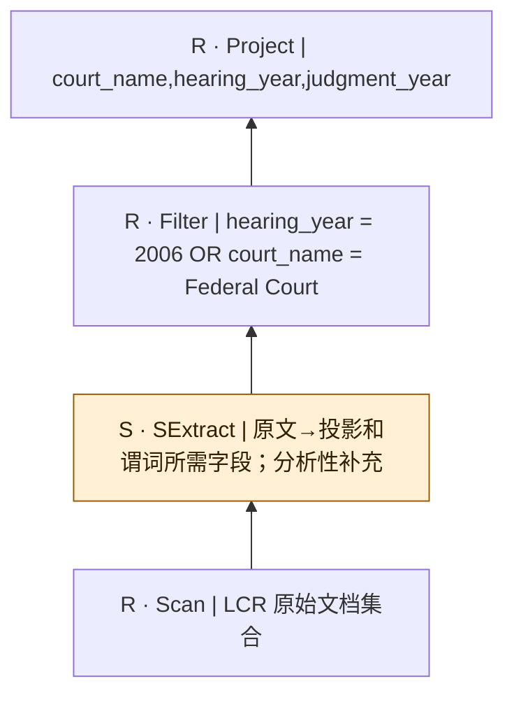

原库列出的伪SQL；保留未加引号的文本字面量和原始拼写。谓词作为原文整体显示，没有假称可执行SQL或已验证类型绑定；语义抽取为逻辑补充。列表中的省略号表示这里不是全部可能查询。

## quest/LCR/16

来源：[原件](</Volumes/Element/Github2/Awesome-Sem-Filter-Bench/baseline/QUEST/repository/QUEST/query/LCR.txt:19>) · `pseudo_sql_plus_proposed_extraction` · `pseudo_sql_only` · `substantive_relational`

```sql

SELECT court_name,hearing_year,verdict FROM LCR WHERE hearing_year = 2006 AND verdict = dismissed

```

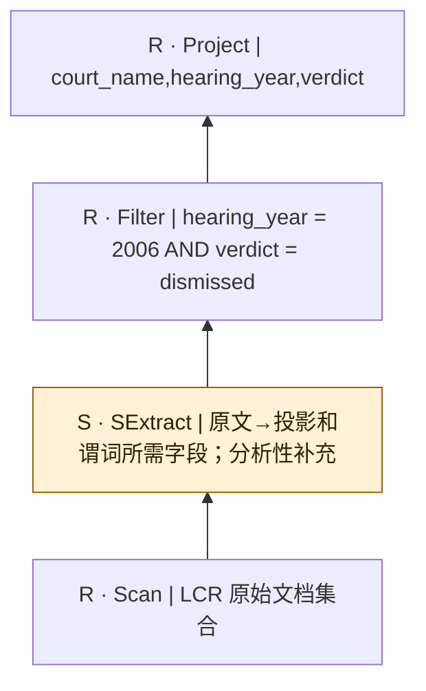

原库列出的伪SQL；保留未加引号的文本字面量和原始拼写。谓词作为原文整体显示，没有假称可执行SQL或已验证类型绑定；语义抽取为逻辑补充。列表中的省略号表示这里不是全部可能查询。

## quest/LCR/17

来源：[原件](</Volumes/Element/Github2/Awesome-Sem-Filter-Bench/baseline/QUEST/repository/QUEST/query/LCR.txt:20>) · `pseudo_sql_plus_proposed_extraction` · `pseudo_sql_only` · `substantive_relational`

```sql

SELECT court_name,judge_name FROM LCR WHERE judge_name = Jacobson AND hearing_year >= 2006

```

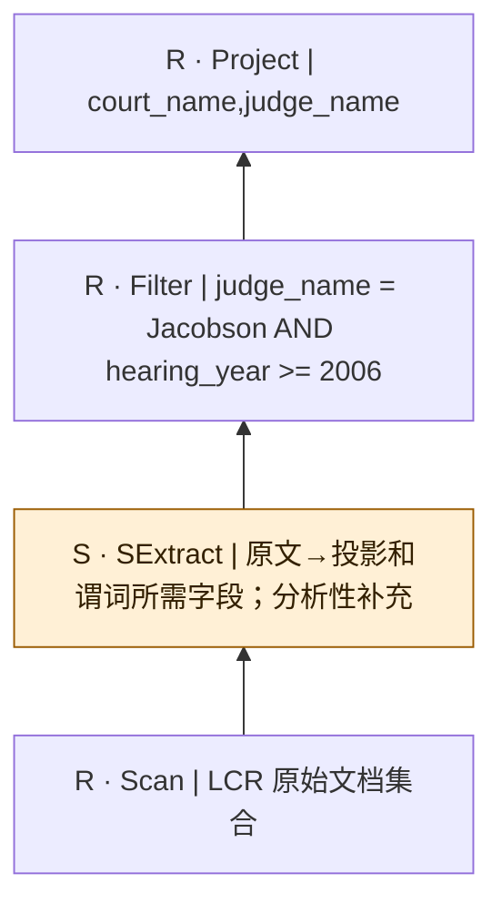

原库列出的伪SQL；保留未加引号的文本字面量和原始拼写。谓词作为原文整体显示，没有假称可执行SQL或已验证类型绑定；语义抽取为逻辑补充。列表中的省略号表示这里不是全部可能查询。

## quest/LCR/18

来源：[原件](</Volumes/Element/Github2/Awesome-Sem-Filter-Bench/baseline/QUEST/repository/QUEST/query/LCR.txt:21>) · `pseudo_sql_plus_proposed_extraction` · `pseudo_sql_only` · `substantive_relational`

```sql

SELECT court_name,judge_name FROM LCR WHERE judgment_year = 2009 AND hearing_year = 2009

```

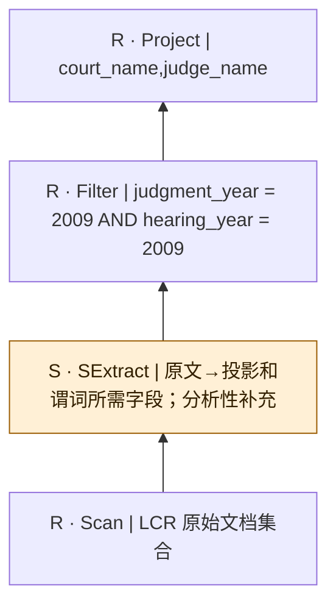

原库列出的伪SQL；保留未加引号的文本字面量和原始拼写。谓词作为原文整体显示，没有假称可执行SQL或已验证类型绑定；语义抽取为逻辑补充。列表中的省略号表示这里不是全部可能查询。

## quest/LCR/19

来源：[原件](</Volumes/Element/Github2/Awesome-Sem-Filter-Bench/baseline/QUEST/repository/QUEST/query/LCR.txt:22>) · `pseudo_sql_plus_proposed_extraction` · `pseudo_sql_only` · `substantive_relational`

```sql

SELECT court_name,hearing_year,legal_basis FROM LCR WHERE hearing_year = 2006 AND legal_basis = Trade Practices Act 1974 (Cth)

```

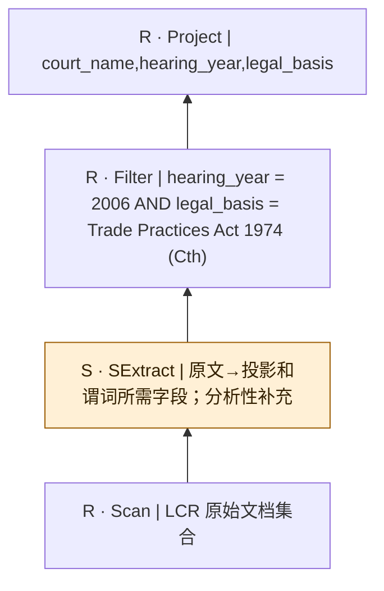

原库列出的伪SQL；保留未加引号的文本字面量和原始拼写。谓词作为原文整体显示，没有假称可执行SQL或已验证类型绑定；语义抽取为逻辑补充。列表中的省略号表示这里不是全部可能查询。

## quest/LCR/20

来源：[原件](</Volumes/Element/Github2/Awesome-Sem-Filter-Bench/baseline/QUEST/repository/QUEST/query/LCR.txt:23>) · `pseudo_sql_plus_proposed_extraction` · `pseudo_sql_only` · `substantive_relational`

```sql

SELECT court_name,hearing_year,charges FROM LCR WHERE hearing_year >= 2006 AND hearing_year <= 2009 AND legal_basis = Trade Practices Act 1974 (Cth)

```

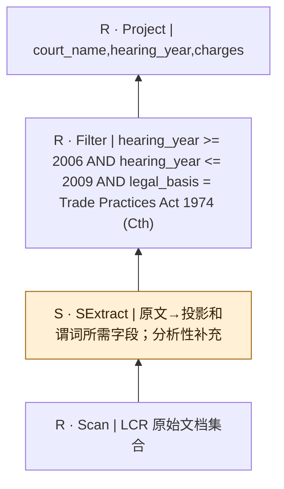

原库列出的伪SQL；保留未加引号的文本字面量和原始拼写。谓词作为原文整体显示，没有假称可执行SQL或已验证类型绑定；语义抽取为逻辑补充。列表中的省略号表示这里不是全部可能查询。

## quest/LCR/21

来源：[原件](</Volumes/Element/Github2/Awesome-Sem-Filter-Bench/baseline/QUEST/repository/QUEST/query/LCR.txt:24>) · `pseudo_sql_plus_proposed_extraction` · `pseudo_sql_only` · `substantive_relational`

```sql

SELECT court_name,judge_name,hearing_year,judgment_year FROM LCR WHERE hearing_year = 2009 OR hearing_year = 2008

```

```mermaid
flowchart BT
  n0["R · Project | court_name,judge_name,hearing_year,judgment_year"]
  n1["R · Filter | hearing_year = 2009 OR hearing_year = 2008"]
  n2["S · SExtract | 原文→投影和谓词所需字段；分析性补充"]
  n3["R · Scan | LCR 原始文档集合"]
  n3 --> n2
  n2 --> n1
  n1 --> n0
  classDef semantic fill:#fff0d6,stroke:#9a5b00,color:#332000;
  class n2 semantic;
```

原库列出的伪SQL；保留未加引号的文本字面量和原始拼写。谓词作为原文整体显示，没有假称可执行SQL或已验证类型绑定；语义抽取为逻辑补充。列表中的省略号表示这里不是全部可能查询。

## quest/LCR/22

来源：[原件](</Volumes/Element/Github2/Awesome-Sem-Filter-Bench/baseline/QUEST/repository/QUEST/query/LCR.txt:25>) · `pseudo_sql_plus_proposed_extraction` · `pseudo_sql_only` · `substantive_relational`

```sql

SELECT court_name,judge_name,hearing_year,judgment_year FROM LCR WHERE hearing_year >= 2008 AND judgment_year >= 2009

```

```mermaid
flowchart BT
  n0["R · Project | court_name,judge_name,hearing_year,judgment_year"]
  n1["R · Filter | hearing_year &gt;= 2008 AND judgment_year &gt;= 2009"]
  n2["S · SExtract | 原文→投影和谓词所需字段；分析性补充"]
  n3["R · Scan | LCR 原始文档集合"]
  n3 --> n2
  n2 --> n1
  n1 --> n0
  classDef semantic fill:#fff0d6,stroke:#9a5b00,color:#332000;
  class n2 semantic;
```

原库列出的伪SQL；保留未加引号的文本字面量和原始拼写。谓词作为原文整体显示，没有假称可执行SQL或已验证类型绑定；语义抽取为逻辑补充。列表中的省略号表示这里不是全部可能查询。

## quest/LCR/23

来源：[原件](</Volumes/Element/Github2/Awesome-Sem-Filter-Bench/baseline/QUEST/repository/QUEST/query/LCR.txt:28>) · `pseudo_sql_plus_proposed_extraction` · `pseudo_sql_only` · `substantive_relational`

```sql

SELECT court_name,judge_name,hearing_year,judgment_year FROM LCR WHERE hearing_year = 2006 OR hearing_year = 2007 OR hearing_year = 2008 OR hearing_year = 2009

```

```mermaid
flowchart BT
  n0["R · Project | court_name,judge_name,hearing_year,judgment_year"]
  n1["R · Filter | hearing_year = 2006 OR hearing_year = 2007 OR hearing_year = 2008 OR hearing_year = 2009"]
  n2["S · SExtract | 原文→投影和谓词所需字段；分析性补充"]
  n3["R · Scan | LCR 原始文档集合"]
  n3 --> n2
  n2 --> n1
  n1 --> n0
  classDef semantic fill:#fff0d6,stroke:#9a5b00,color:#332000;
  class n2 semantic;
```

原库列出的伪SQL；保留未加引号的文本字面量和原始拼写。谓词作为原文整体显示，没有假称可执行SQL或已验证类型绑定；语义抽取为逻辑补充。列表中的省略号表示这里不是全部可能查询。

## quest/LCR/24

来源：[原件](</Volumes/Element/Github2/Awesome-Sem-Filter-Bench/baseline/QUEST/repository/QUEST/query/LCR.txt:29>) · `pseudo_sql_plus_proposed_extraction` · `pseudo_sql_only` · `substantive_relational`

```sql

SELECT court_name,judge_name,hearing_year,judgment_year FROM LCR WHERE hearing_year >= 2009 OR verdict = dismissed OR judgment_year >= 2009 OR judge_name = Jacobson

```

```mermaid
flowchart BT
  n0["R · Project | court_name,judge_name,hearing_year,judgment_year"]
  n1["R · Filter | hearing_year &gt;= 2009 OR verdict = dismissed OR judgment_year &gt;= 2009 OR judge_name = Jacobson"]
  n2["S · SExtract | 原文→投影和谓词所需字段；分析性补充"]
  n3["R · Scan | LCR 原始文档集合"]
  n3 --> n2
  n2 --> n1
  n1 --> n0
  classDef semantic fill:#fff0d6,stroke:#9a5b00,color:#332000;
  class n2 semantic;
```

原库列出的伪SQL；保留未加引号的文本字面量和原始拼写。谓词作为原文整体显示，没有假称可执行SQL或已验证类型绑定；语义抽取为逻辑补充。列表中的省略号表示这里不是全部可能查询。

## quest/LCR/25

来源：[原件](</Volumes/Element/Github2/Awesome-Sem-Filter-Bench/baseline/QUEST/repository/QUEST/query/LCR.txt:30>) · `pseudo_sql_plus_proposed_extraction` · `source_incomplete` · `substantive_relational`

```sql

SELECT court_name,hearing_year,legal_basis FROM hearing_year >= 2006  AND judgment_year >= 2006 AND legal_basis = Trade Practices Act 1974 AND court_name = Federal Court

```

```mermaid
flowchart BT
  n0["R · Unresolved | 源句缺FROM/WHERE等；无法构造可信完整计划"]
  n1["R · Scan | LCR 原始文档集合"]
  n1 --> n0
  classDef semantic fill:#fff0d6,stroke:#9a5b00,color:#332000;
```

原库列出的伪SQL；保留未加引号的文本字面量和原始拼写。谓词作为原文整体显示，没有假称可执行SQL或已验证类型绑定；语义抽取为逻辑补充。列表中的省略号表示这里不是全部可能查询。 此条仅展示不完整计划，不计作可执行混合查询。

## quest/LCR/26

来源：[原件](</Volumes/Element/Github2/Awesome-Sem-Filter-Bench/baseline/QUEST/repository/QUEST/query/LCR.txt:31>) · `pseudo_sql_plus_proposed_extraction` · `pseudo_sql_only` · `substantive_relational`

```sql

SELECT court_name,judge_name,hearing_year,judgment_year FROM LCR WHERE hearing_year = 2009 OR hearing_year = 2008 OR court_name = Federal Court OR verdict = dismissed

```

```mermaid
flowchart BT
  n0["R · Project | court_name,judge_name,hearing_year,judgment_year"]
  n1["R · Filter | hearing_year = 2009 OR hearing_year = 2008 OR court_name = Federal Court OR verdict = dismissed"]
  n2["S · SExtract | 原文→投影和谓词所需字段；分析性补充"]
  n3["R · Scan | LCR 原始文档集合"]
  n3 --> n2
  n2 --> n1
  n1 --> n0
  classDef semantic fill:#fff0d6,stroke:#9a5b00,color:#332000;
  class n2 semantic;
```

原库列出的伪SQL；保留未加引号的文本字面量和原始拼写。谓词作为原文整体显示，没有假称可执行SQL或已验证类型绑定；语义抽取为逻辑补充。列表中的省略号表示这里不是全部可能查询。

## quest/LCR/27

来源：[原件](</Volumes/Element/Github2/Awesome-Sem-Filter-Bench/baseline/QUEST/repository/QUEST/query/LCR.txt:32>) · `pseudo_sql_plus_proposed_extraction` · `source_incomplete` · `substantive_relational`

```sql

SELECT court_name,judge_name,hearing_year,judgment_year FROM LCR WHERE hearing_year >= 2006 OR judge_name = Jacobson OR legal_basis = Trade Practices Act 1974 (Cth) OR

```

```mermaid
flowchart BT
  n0["R · Unresolved | 原句连接条件缺失/截断；禁止自动补齐"]
  n1["R · Project | court_name,judge_name,hearing_year,judgment_year"]
  n2["R · Filter | hearing_year &gt;= 2006 OR judge_name = Jacobson OR legal_basis = Trade Practices Act 1974 (Cth) OR"]
  n3["S · SExtract | 原文→投影和谓词所需字段；分析性补充"]
  n4["R · Scan | LCR 原始文档集合"]
  n4 --> n3
  n3 --> n2
  n2 --> n1
  n1 --> n0
  classDef semantic fill:#fff0d6,stroke:#9a5b00,color:#332000;
  class n3 semantic;
```

原库列出的伪SQL；保留未加引号的文本字面量和原始拼写。谓词作为原文整体显示，没有假称可执行SQL或已验证类型绑定；语义抽取为逻辑补充。列表中的省略号表示这里不是全部可能查询。 此条仅展示不完整计划，不计作可执行混合查询。
