# quest-swde：逐查询逻辑计划

[返回总表](README.md)

图从下往上读：输入 → 算子 → 输出。S为语义算子；R为确定性关系/辅助步骤。检索与未决节点在标签中单独注明。

## quest/SWDE/01

来源：[原件](</Volumes/Element/Github2/Awesome-Sem-Filter-Bench/baseline/QUEST/repository/QUEST/query/SWDE.txt:2>) · `pseudo_sql_plus_proposed_extraction` · `pseudo_sql_only` · `substantive_relational`

```sql

SELECT university_name,rank FROM University WHERE rank <= 3

```

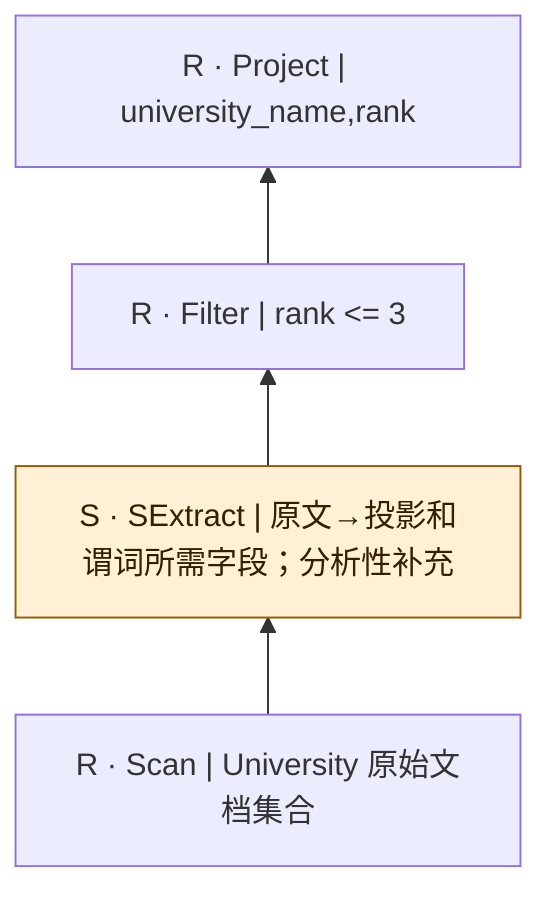

原库列出的伪SQL；保留未加引号的文本字面量和原始拼写。谓词作为原文整体显示，没有假称可执行SQL或已验证类型绑定；语义抽取为逻辑补充。列表中的省略号表示这里不是全部可能查询。

## quest/SWDE/02

来源：[原件](</Volumes/Element/Github2/Awesome-Sem-Filter-Bench/baseline/QUEST/repository/QUEST/query/SWDE.txt:3>) · `pseudo_sql_plus_proposed_extraction` · `pseudo_sql_only` · `substantive_relational`

```sql

SELECT university_name,rank FROM University WHERE year_founded < 1850

```

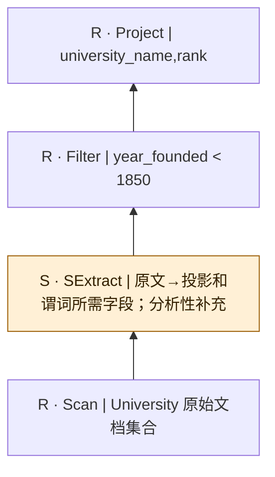

原库列出的伪SQL；保留未加引号的文本字面量和原始拼写。谓词作为原文整体显示，没有假称可执行SQL或已验证类型绑定；语义抽取为逻辑补充。列表中的省略号表示这里不是全部可能查询。

## quest/SWDE/03

来源：[原件](</Volumes/Element/Github2/Awesome-Sem-Filter-Bench/baseline/QUEST/repository/QUEST/query/SWDE.txt:4>) · `pseudo_sql_plus_proposed_extraction` · `pseudo_sql_only` · `substantive_relational`

```sql

SELECT university_name,total_undergraduate_enrollment FROM University WHERE total_undergraduate_enrollment < 1890

```

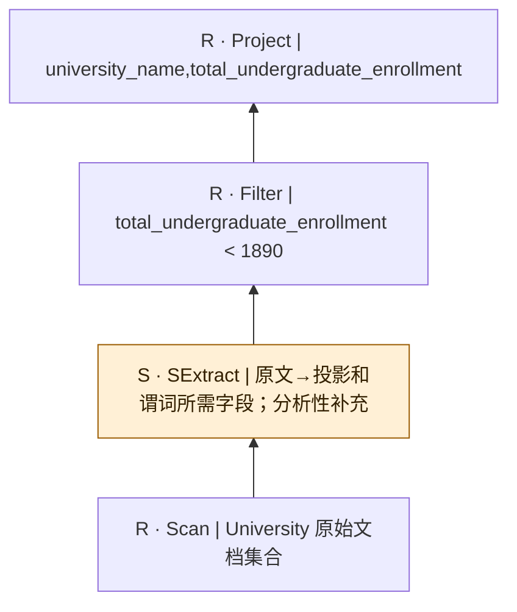

原库列出的伪SQL；保留未加引号的文本字面量和原始拼写。谓词作为原文整体显示，没有假称可执行SQL或已验证类型绑定；语义抽取为逻辑补充。列表中的省略号表示这里不是全部可能查询。

## quest/SWDE/04

来源：[原件](</Volumes/Element/Github2/Awesome-Sem-Filter-Bench/baseline/QUEST/repository/QUEST/query/SWDE.txt:5>) · `pseudo_sql_plus_proposed_extraction` · `pseudo_sql_only` · `substantive_relational`

```sql

SELECT university_name,rank FROM University WHERE rank >= 13

```

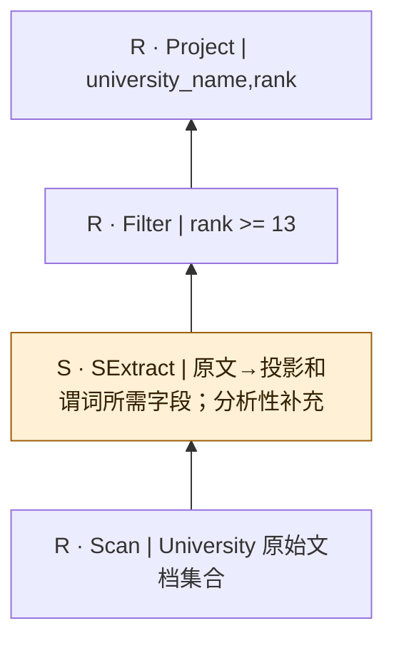

原库列出的伪SQL；保留未加引号的文本字面量和原始拼写。谓词作为原文整体显示，没有假称可执行SQL或已验证类型绑定；语义抽取为逻辑补充。列表中的省略号表示这里不是全部可能查询。

## quest/SWDE/05

来源：[原件](</Volumes/Element/Github2/Awesome-Sem-Filter-Bench/baseline/QUEST/repository/QUEST/query/SWDE.txt:6>) · `pseudo_sql_plus_proposed_extraction` · `pseudo_sql_only` · `substantive_relational`

```sql

SELECT university_name, academic_calendar, setting FROM University WHERE academic_calendar = semester

```

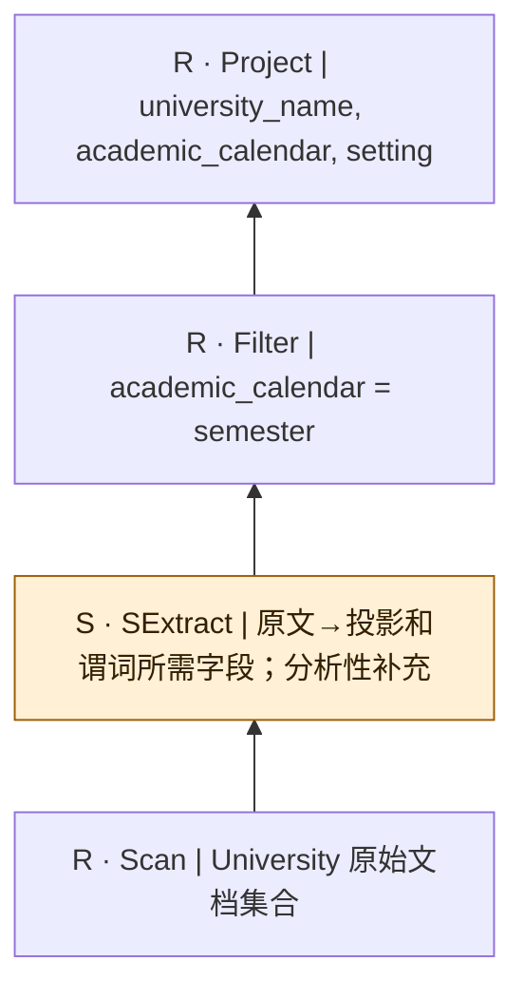

原库列出的伪SQL；保留未加引号的文本字面量和原始拼写。谓词作为原文整体显示，没有假称可执行SQL或已验证类型绑定；语义抽取为逻辑补充。列表中的省略号表示这里不是全部可能查询。

## quest/SWDE/06

来源：[原件](</Volumes/Element/Github2/Awesome-Sem-Filter-Bench/baseline/QUEST/repository/QUEST/query/SWDE.txt:7>) · `pseudo_sql_plus_proposed_extraction` · `pseudo_sql_only` · `substantive_relational`

```sql

SELECT university_name, college_category FROM University WHERE college_category = Private Institution

```

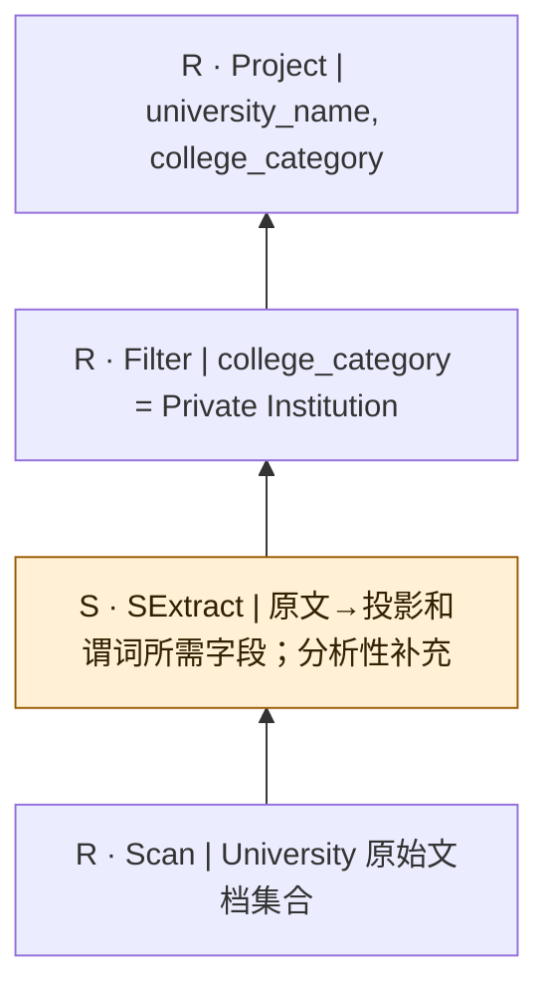

原库列出的伪SQL；保留未加引号的文本字面量和原始拼写。谓词作为原文整体显示，没有假称可执行SQL或已验证类型绑定；语义抽取为逻辑补充。列表中的省略号表示这里不是全部可能查询。

## quest/SWDE/07

来源：[原件](</Volumes/Element/Github2/Awesome-Sem-Filter-Bench/baseline/QUEST/repository/QUEST/query/SWDE.txt:8>) · `pseudo_sql_plus_proposed_extraction` · `pseudo_sql_only` · `substantive_relational`

```sql

SELECT university_name, in_state_tuition_fees FROM University WHERE in_state_tuition_fees > $5,876

```

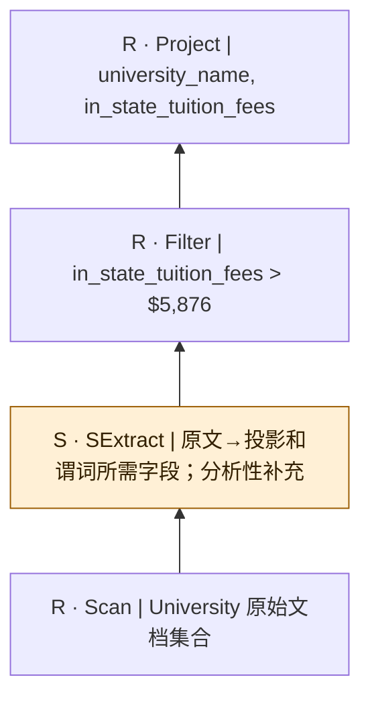

原库列出的伪SQL；保留未加引号的文本字面量和原始拼写。谓词作为原文整体显示，没有假称可执行SQL或已验证类型绑定；语义抽取为逻辑补充。列表中的省略号表示这里不是全部可能查询。

## quest/SWDE/08

来源：[原件](</Volumes/Element/Github2/Awesome-Sem-Filter-Bench/baseline/QUEST/repository/QUEST/query/SWDE.txt:9>) · `pseudo_sql_plus_proposed_extraction` · `pseudo_sql_only` · `substantive_relational`

```sql

SELECT university_name, out_of_state_tuition_fees FROM University WHERE out_of_state_tuition_fees < $16,445

```

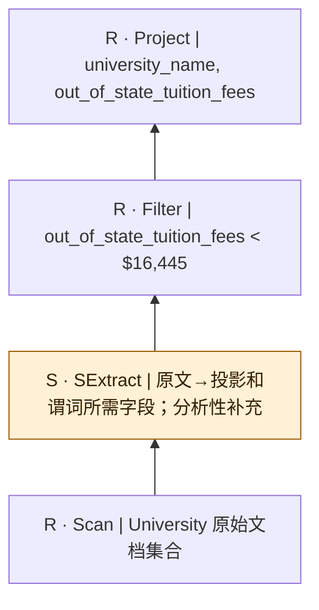

原库列出的伪SQL；保留未加引号的文本字面量和原始拼写。谓词作为原文整体显示，没有假称可执行SQL或已验证类型绑定；语义抽取为逻辑补充。列表中的省略号表示这里不是全部可能查询。

## quest/SWDE/09

来源：[原件](</Volumes/Element/Github2/Awesome-Sem-Filter-Bench/baseline/QUEST/repository/QUEST/query/SWDE.txt:10>) · `pseudo_sql_plus_proposed_extraction` · `pseudo_sql_only` · `substantive_relational`

```sql

SELECT university_name, institutional_control FROM University WHERE institutional_control = public

```

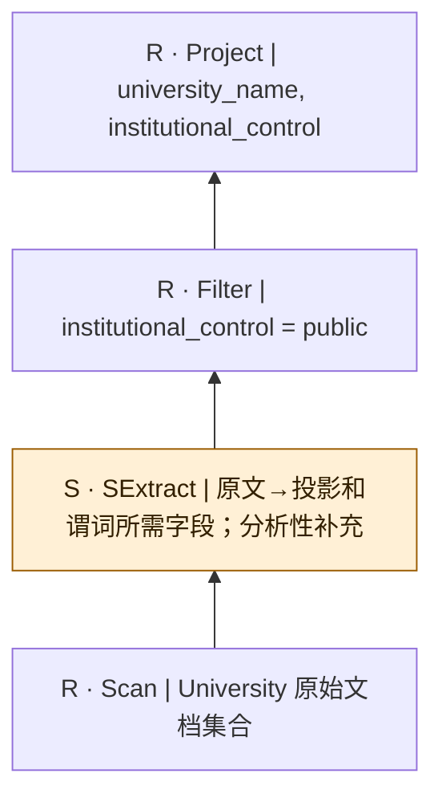

原库列出的伪SQL；保留未加引号的文本字面量和原始拼写。谓词作为原文整体显示，没有假称可执行SQL或已验证类型绑定；语义抽取为逻辑补充。列表中的省略号表示这里不是全部可能查询。

## quest/SWDE/10

来源：[原件](</Volumes/Element/Github2/Awesome-Sem-Filter-Bench/baseline/QUEST/repository/QUEST/query/SWDE.txt:11>) · `pseudo_sql_plus_proposed_extraction` · `pseudo_sql_only` · `substantive_relational`

```sql

SELECT university_name, setting FROM University WHERE setting = urban

```

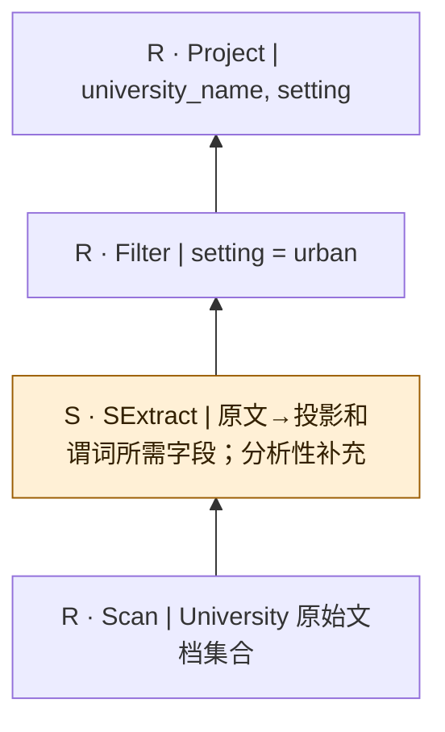

原库列出的伪SQL；保留未加引号的文本字面量和原始拼写。谓词作为原文整体显示，没有假称可执行SQL或已验证类型绑定；语义抽取为逻辑补充。列表中的省略号表示这里不是全部可能查询。

## quest/SWDE/11

来源：[原件](</Volumes/Element/Github2/Awesome-Sem-Filter-Bench/baseline/QUEST/repository/QUEST/query/SWDE.txt:14>) · `pseudo_sql_plus_proposed_extraction` · `pseudo_sql_only` · `substantive_relational`

```sql

SELECT university_name, year_founded, rank FROM University WHERE year_founded < 1900 AND rank < 20 AND rank > 10

```

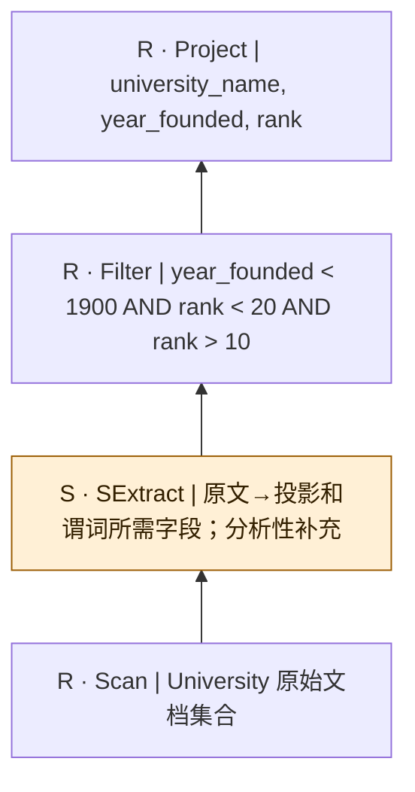

原库列出的伪SQL；保留未加引号的文本字面量和原始拼写。谓词作为原文整体显示，没有假称可执行SQL或已验证类型绑定；语义抽取为逻辑补充。列表中的省略号表示这里不是全部可能查询。

## quest/SWDE/12

来源：[原件](</Volumes/Element/Github2/Awesome-Sem-Filter-Bench/baseline/QUEST/repository/QUEST/query/SWDE.txt:15>) · `pseudo_sql_plus_proposed_extraction` · `pseudo_sql_only` · `substantive_relational`

```sql

SELECT university_name, setting, total_undergraduate_enrollment FROM University WHERE setting = urban AND total_undergraduate_enrollment < 2000

```

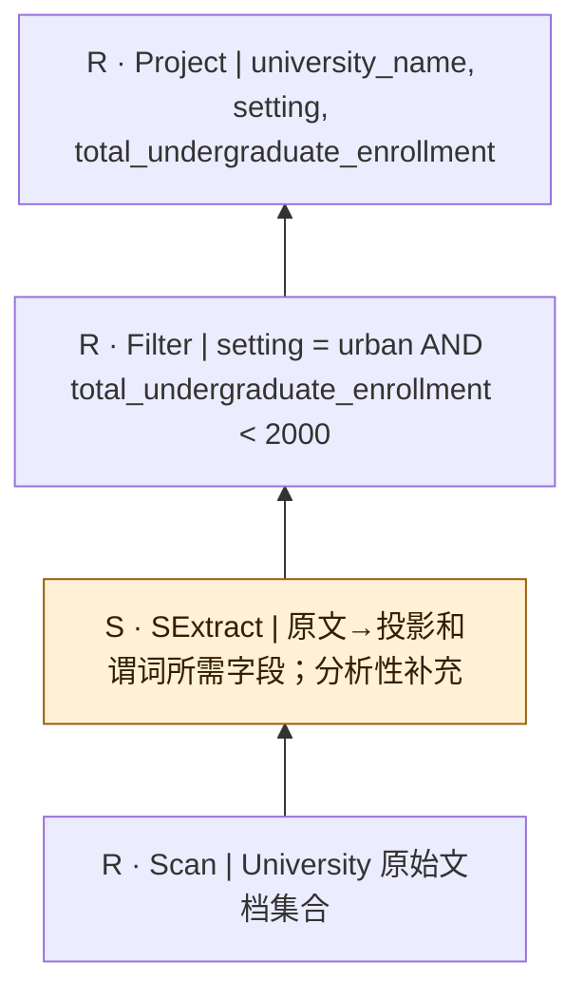

原库列出的伪SQL；保留未加引号的文本字面量和原始拼写。谓词作为原文整体显示，没有假称可执行SQL或已验证类型绑定；语义抽取为逻辑补充。列表中的省略号表示这里不是全部可能查询。

## quest/SWDE/13

来源：[原件](</Volumes/Element/Github2/Awesome-Sem-Filter-Bench/baseline/QUEST/repository/QUEST/query/SWDE.txt:16>) · `pseudo_sql_plus_proposed_extraction` · `pseudo_sql_only` · `substantive_relational`

```sql

SELECT university_name, year_founded, setting FROM University WHERE year_founded >= 1900 AND setting = suburban

```

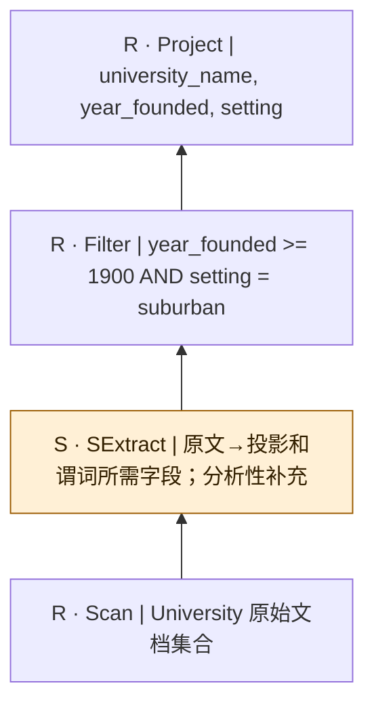

原库列出的伪SQL；保留未加引号的文本字面量和原始拼写。谓词作为原文整体显示，没有假称可执行SQL或已验证类型绑定；语义抽取为逻辑补充。列表中的省略号表示这里不是全部可能查询。

## quest/SWDE/14

来源：[原件](</Volumes/Element/Github2/Awesome-Sem-Filter-Bench/baseline/QUEST/repository/QUEST/query/SWDE.txt:17>) · `pseudo_sql_plus_proposed_extraction` · `pseudo_sql_only` · `substantive_relational`

```sql

SELECT university_name, rank FROM University WHERE rank <= 10 AND rank >= 5

```

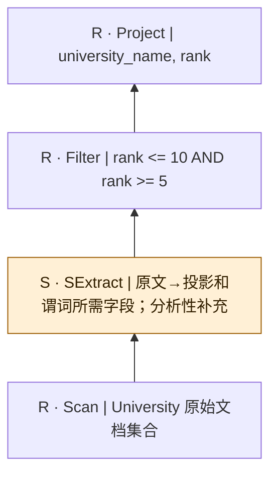

原库列出的伪SQL；保留未加引号的文本字面量和原始拼写。谓词作为原文整体显示，没有假称可执行SQL或已验证类型绑定；语义抽取为逻辑补充。列表中的省略号表示这里不是全部可能查询。

## quest/SWDE/15

来源：[原件](</Volumes/Element/Github2/Awesome-Sem-Filter-Bench/baseline/QUEST/repository/QUEST/query/SWDE.txt:18>) · `pseudo_sql_plus_proposed_extraction` · `pseudo_sql_only` · `substantive_relational`

```sql

SELECT university_name, academic_calendar, setting FROM University WHERE academic_calendar = quarter-based AND setting = urban AND year_founded >= 1900

```

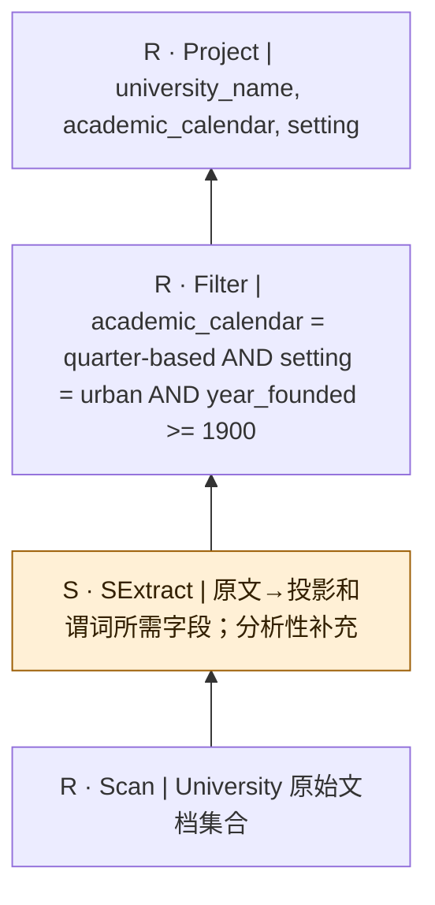

原库列出的伪SQL；保留未加引号的文本字面量和原始拼写。谓词作为原文整体显示，没有假称可执行SQL或已验证类型绑定；语义抽取为逻辑补充。列表中的省略号表示这里不是全部可能查询。

## quest/SWDE/16

来源：[原件](</Volumes/Element/Github2/Awesome-Sem-Filter-Bench/baseline/QUEST/repository/QUEST/query/SWDE.txt:19>) · `pseudo_sql_plus_proposed_extraction` · `pseudo_sql_only` · `substantive_relational`

```sql

SELECT university_name, academic_calendar, total_undergraduate_enrollment FROM University WHERE academic_calendar = semester AND total_undergraduate_enrollment < 2000

```

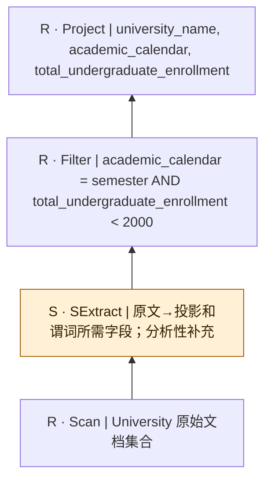

原库列出的伪SQL；保留未加引号的文本字面量和原始拼写。谓词作为原文整体显示，没有假称可执行SQL或已验证类型绑定；语义抽取为逻辑补充。列表中的省略号表示这里不是全部可能查询。

## quest/SWDE/17

来源：[原件](</Volumes/Element/Github2/Awesome-Sem-Filter-Bench/baseline/QUEST/repository/QUEST/query/SWDE.txt:20>) · `pseudo_sql_plus_proposed_extraction` · `pseudo_sql_only` · `substantive_relational`

```sql

SELECT university_name, rank, year_founded FROM University WHERE rank < 5 AND year_founded >= 1800

```

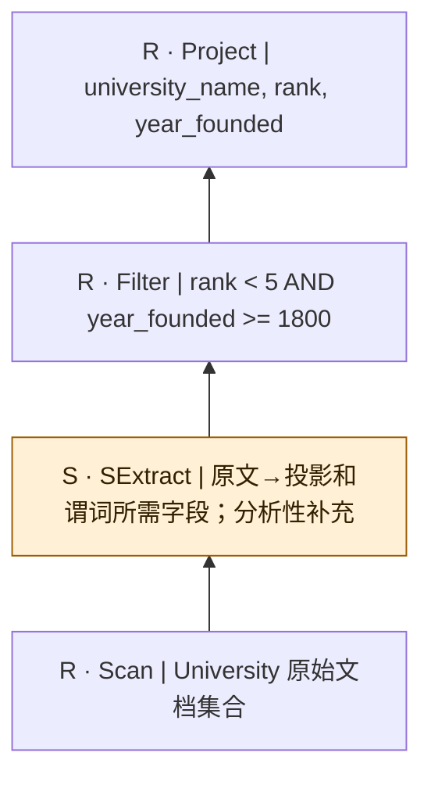

原库列出的伪SQL；保留未加引号的文本字面量和原始拼写。谓词作为原文整体显示，没有假称可执行SQL或已验证类型绑定；语义抽取为逻辑补充。列表中的省略号表示这里不是全部可能查询。

## quest/SWDE/18

来源：[原件](</Volumes/Element/Github2/Awesome-Sem-Filter-Bench/baseline/QUEST/repository/QUEST/query/SWDE.txt:21>) · `pseudo_sql_plus_proposed_extraction` · `pseudo_sql_only` · `substantive_relational`

```sql

SELECT university_name, setting, rank FROM University WHERE setting = rural AND rank <= 10

```

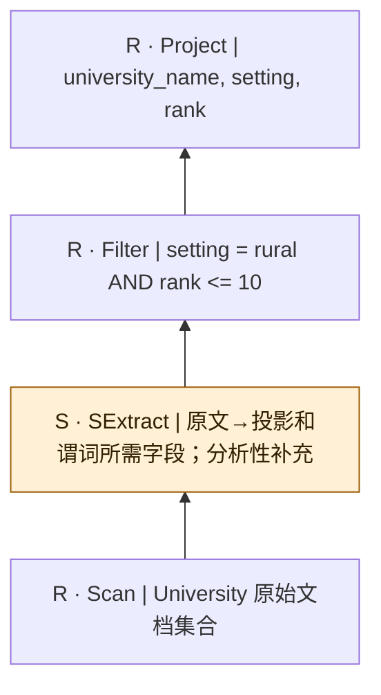

原库列出的伪SQL；保留未加引号的文本字面量和原始拼写。谓词作为原文整体显示，没有假称可执行SQL或已验证类型绑定；语义抽取为逻辑补充。列表中的省略号表示这里不是全部可能查询。

## quest/SWDE/19

来源：[原件](</Volumes/Element/Github2/Awesome-Sem-Filter-Bench/baseline/QUEST/repository/QUEST/query/SWDE.txt:22>) · `pseudo_sql_plus_proposed_extraction` · `pseudo_sql_only` · `substantive_relational`

```sql

SELECT university_name, setting, year_founded FROM University WHERE setting = rural AND year_founded >= 1950

```

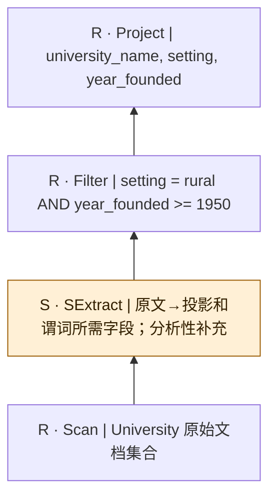

原库列出的伪SQL；保留未加引号的文本字面量和原始拼写。谓词作为原文整体显示，没有假称可执行SQL或已验证类型绑定；语义抽取为逻辑补充。列表中的省略号表示这里不是全部可能查询。

## quest/SWDE/20

来源：[原件](</Volumes/Element/Github2/Awesome-Sem-Filter-Bench/baseline/QUEST/repository/QUEST/query/SWDE.txt:23>) · `pseudo_sql_plus_proposed_extraction` · `pseudo_sql_only` · `substantive_relational`

```sql

SELECT university_name, setting FROM University WHERE setting = urban OR institutional_control = public

```

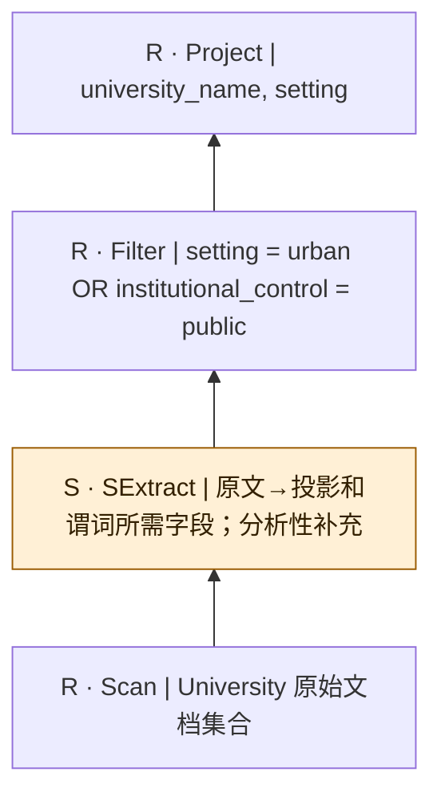

原库列出的伪SQL；保留未加引号的文本字面量和原始拼写。谓词作为原文整体显示，没有假称可执行SQL或已验证类型绑定；语义抽取为逻辑补充。列表中的省略号表示这里不是全部可能查询。

## quest/SWDE/21

来源：[原件](</Volumes/Element/Github2/Awesome-Sem-Filter-Bench/baseline/QUEST/repository/QUEST/query/SWDE.txt:26>) · `pseudo_sql_plus_proposed_extraction` · `pseudo_sql_only` · `substantive_relational`

```sql

SELECT university_name, academic_calendar, campus_size FROM University WHERE academic_calendar = 4-1-4-based AND (year_founded < 1900 OR total_undergraduate_enrollment < 2000)

```

```mermaid
flowchart BT
  n0["R · Project | university_name, academic_calendar, campus_size"]
  n1["R · Filter | academic_calendar = 4-1-4-based AND (year_founded &lt; 1900 OR total_undergraduate_enrollment &lt; 2000)"]
  n2["S · SExtract | 原文→投影和谓词所需字段；分析性补充"]
  n3["R · Scan | University 原始文档集合"]
  n3 --> n2
  n2 --> n1
  n1 --> n0
  classDef semantic fill:#fff0d6,stroke:#9a5b00,color:#332000;
  class n2 semantic;
```

原库列出的伪SQL；保留未加引号的文本字面量和原始拼写。谓词作为原文整体显示，没有假称可执行SQL或已验证类型绑定；语义抽取为逻辑补充。列表中的省略号表示这里不是全部可能查询。

## quest/SWDE/22

来源：[原件](</Volumes/Element/Github2/Awesome-Sem-Filter-Bench/baseline/QUEST/repository/QUEST/query/SWDE.txt:27>) · `pseudo_sql_plus_proposed_extraction` · `pseudo_sql_only` · `substantive_relational`

```sql

SELECT university_name, academic_calendar, rank FROM University WHERE academic_calendar = semester AND (year_founded < 1900 OR total_undergraduate_enrollment < 2000) AND rank < 100

```

```mermaid
flowchart BT
  n0["R · Project | university_name, academic_calendar, rank"]
  n1["R · Filter | academic_calendar = semester AND (year_founded &lt; 1900 OR total_undergraduate_enrollment &lt; 2000) AND rank &lt; 100"]
  n2["S · SExtract | 原文→投影和谓词所需字段；分析性补充"]
  n3["R · Scan | University 原始文档集合"]
  n3 --> n2
  n2 --> n1
  n1 --> n0
  classDef semantic fill:#fff0d6,stroke:#9a5b00,color:#332000;
  class n2 semantic;
```

原库列出的伪SQL；保留未加引号的文本字面量和原始拼写。谓词作为原文整体显示，没有假称可执行SQL或已验证类型绑定；语义抽取为逻辑补充。列表中的省略号表示这里不是全部可能查询。

## quest/SWDE/23

来源：[原件](</Volumes/Element/Github2/Awesome-Sem-Filter-Bench/baseline/QUEST/repository/QUEST/query/SWDE.txt:28>) · `pseudo_sql_plus_proposed_extraction` · `pseudo_sql_only` · `substantive_relational`

```sql

SELECT university_name, academic_calendar, rank FROM University WHERE academic_calendar = 4-1-4-based AND (year_founded < 1900 OR total_undergraduate_enrollment < 1500) AND rank < 20

```

```mermaid
flowchart BT
  n0["R · Project | university_name, academic_calendar, rank"]
  n1["R · Filter | academic_calendar = 4-1-4-based AND (year_founded &lt; 1900 OR total_undergraduate_enrollment &lt; 1500) AND rank &lt; 20"]
  n2["S · SExtract | 原文→投影和谓词所需字段；分析性补充"]
  n3["R · Scan | University 原始文档集合"]
  n3 --> n2
  n2 --> n1
  n1 --> n0
  classDef semantic fill:#fff0d6,stroke:#9a5b00,color:#332000;
  class n2 semantic;
```

原库列出的伪SQL；保留未加引号的文本字面量和原始拼写。谓词作为原文整体显示，没有假称可执行SQL或已验证类型绑定；语义抽取为逻辑补充。列表中的省略号表示这里不是全部可能查询。

## quest/SWDE/24

来源：[原件](</Volumes/Element/Github2/Awesome-Sem-Filter-Bench/baseline/QUEST/repository/QUEST/query/SWDE.txt:29>) · `pseudo_sql_plus_proposed_extraction` · `pseudo_sql_only` · `substantive_relational`

```sql

SELECT university_name, year_founded, rank FROM University WHERE year_founded > 1900 AND year_founded < 2000 AND rank < 100 AND rank > 10

```

```mermaid
flowchart BT
  n0["R · Project | university_name, year_founded, rank"]
  n1["R · Filter | year_founded &gt; 1900 AND year_founded &lt; 2000 AND rank &lt; 100 AND rank &gt; 10"]
  n2["S · SExtract | 原文→投影和谓词所需字段；分析性补充"]
  n3["R · Scan | University 原始文档集合"]
  n3 --> n2
  n2 --> n1
  n1 --> n0
  classDef semantic fill:#fff0d6,stroke:#9a5b00,color:#332000;
  class n2 semantic;
```

原库列出的伪SQL；保留未加引号的文本字面量和原始拼写。谓词作为原文整体显示，没有假称可执行SQL或已验证类型绑定；语义抽取为逻辑补充。列表中的省略号表示这里不是全部可能查询。

## quest/SWDE/25

来源：[原件](</Volumes/Element/Github2/Awesome-Sem-Filter-Bench/baseline/QUEST/repository/QUEST/query/SWDE.txt:30>) · `pseudo_sql_plus_proposed_extraction` · `pseudo_sql_only` · `substantive_relational`

```sql

SELECT university_name, year_founded, rank FROM University WHERE setting = urban AND year_founded < 2000 AND rank < 100 AND rtotal_undergraduate_enrollment < 2000

```

```mermaid
flowchart BT
  n0["R · Project | university_name, year_founded, rank"]
  n1["R · Filter | setting = urban AND year_founded &lt; 2000 AND rank &lt; 100 AND rtotal_undergraduate_enrollment &lt; 2000"]
  n2["S · SExtract | 原文→投影和谓词所需字段；分析性补充"]
  n3["R · Scan | University 原始文档集合"]
  n3 --> n2
  n2 --> n1
  n1 --> n0
  classDef semantic fill:#fff0d6,stroke:#9a5b00,color:#332000;
  class n2 semantic;
```

原库列出的伪SQL；保留未加引号的文本字面量和原始拼写。谓词作为原文整体显示，没有假称可执行SQL或已验证类型绑定；语义抽取为逻辑补充。列表中的省略号表示这里不是全部可能查询。

## quest/SWDE/26

来源：[原件](</Volumes/Element/Github2/Awesome-Sem-Filter-Bench/baseline/QUEST/repository/QUEST/query/SWDE.txt:31>) · `pseudo_sql_plus_proposed_extraction` · `source_incomplete` · `substantive_relational`

```sql

SELECT university_name, year_founded, rank FROM University WHERE setting = urban OR year_founded < 1820 OR year_founded > 2000 OR  rank <= 3 OR ran > 100 OR total_undergraduate_enrollment < 1800 OR total_undergraduate_enrollment > 6000 OR academic_calendar = 4-1-4-based academic_calendar = quarter-based OR academic_calendar = semester

```

```mermaid
flowchart BT
  n0["R · Unresolved | 原句连接条件缺失/截断；禁止自动补齐"]
  n1["R · Project | university_name, year_founded, rank"]
  n2["R · Filter | setting = urban OR year_founded &lt; 1820 OR year_founded &gt; 2000 OR  rank &lt;= 3 OR ran &gt; 100 OR total_undergraduate_enrollment &lt; 1800 OR total_undergraduate_enrollment &gt; 6000 OR academic_calendar = 4-1-4-based academic_calendar = quarter-based OR academic_calendar = semester"]
  n3["S · SExtract | 原文→投影和谓词所需字段；分析性补充"]
  n4["R · Scan | University 原始文档集合"]
  n4 --> n3
  n3 --> n2
  n2 --> n1
  n1 --> n0
  classDef semantic fill:#fff0d6,stroke:#9a5b00,color:#332000;
  class n3 semantic;
```

原库列出的伪SQL；保留未加引号的文本字面量和原始拼写。谓词作为原文整体显示，没有假称可执行SQL或已验证类型绑定；语义抽取为逻辑补充。列表中的省略号表示这里不是全部可能查询。 此条仅展示不完整计划，不计作可执行混合查询。

## quest/SWDE/27

来源：[原件](</Volumes/Element/Github2/Awesome-Sem-Filter-Bench/baseline/QUEST/repository/QUEST/query/SWDE.txt:32>) · `pseudo_sql_plus_proposed_extraction` · `pseudo_sql_only` · `substantive_relational`

```sql

SELECT university_name, setting FROM University WHERE setting = urban OR institutional_control = public AND setting = rural AND year_founded >= 1950

```

```mermaid
flowchart BT
  n0["R · Project | university_name, setting"]
  n1["R · Filter | setting = urban OR institutional_control = public AND setting = rural AND year_founded &gt;= 1950"]
  n2["S · SExtract | 原文→投影和谓词所需字段；分析性补充"]
  n3["R · Scan | University 原始文档集合"]
  n3 --> n2
  n2 --> n1
  n1 --> n0
  classDef semantic fill:#fff0d6,stroke:#9a5b00,color:#332000;
  class n2 semantic;
```

原库列出的伪SQL；保留未加引号的文本字面量和原始拼写。谓词作为原文整体显示，没有假称可执行SQL或已验证类型绑定；语义抽取为逻辑补充。列表中的省略号表示这里不是全部可能查询。
