# quest-wikitext：逐查询逻辑计划

[返回总表](README.md)

图从下往上读：输入 → 算子 → 输出。S为语义算子；R为确定性关系/辅助步骤。检索与未决节点在标签中单独注明。

## quest/WikiText/01

来源：[原件](</Volumes/Element/Github2/Awesome-Sem-Filter-Bench/baseline/QUEST/repository/QUEST/query/WikiText.txt:2>) · `pseudo_sql_plus_proposed_extraction` · `pseudo_sql_only` · `substantive_relational`

```sql

SELECT name, age, team FROM WikiText WHERE age < 25

```

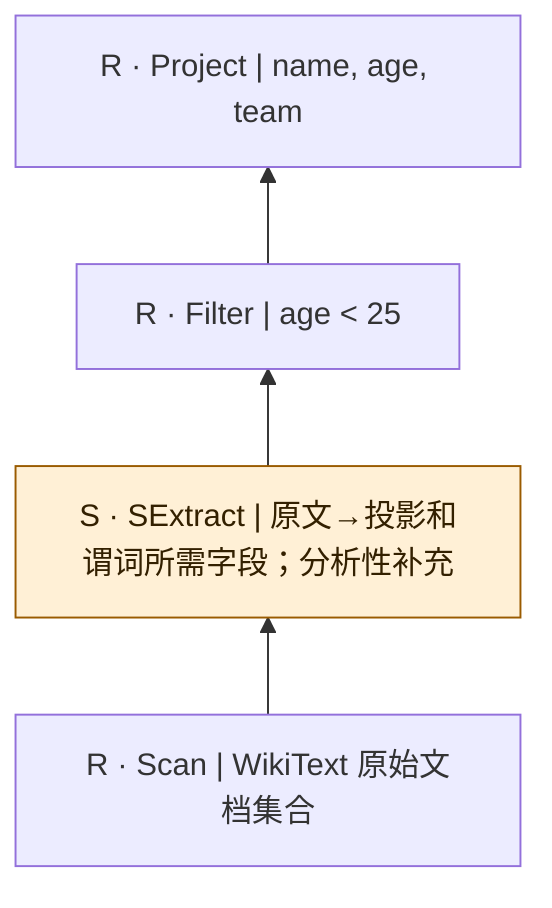

原库列出的伪SQL；保留未加引号的文本字面量和原始拼写。谓词作为原文整体显示，没有假称可执行SQL或已验证类型绑定；语义抽取为逻辑补充。列表中的省略号表示这里不是全部可能查询。

## quest/WikiText/02

来源：[原件](</Volumes/Element/Github2/Awesome-Sem-Filter-Bench/baseline/QUEST/repository/QUEST/query/WikiText.txt:3>) · `pseudo_sql_plus_proposed_extraction` · `pseudo_sql_only` · `substantive_relational`

```sql

SELECT name, age, team FROM WikiText WHERE nationality = USA

```

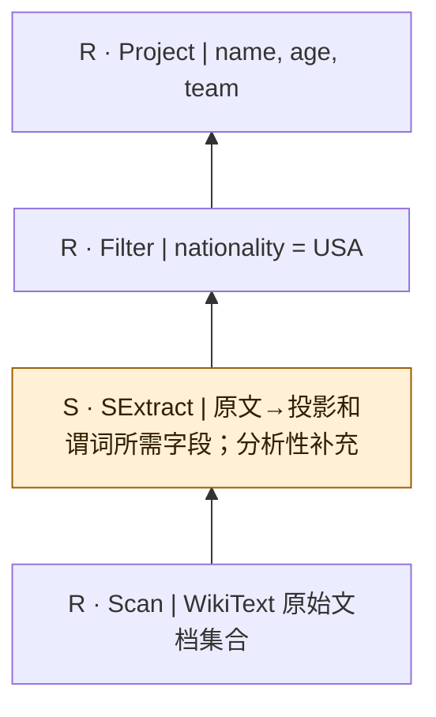

原库列出的伪SQL；保留未加引号的文本字面量和原始拼写。谓词作为原文整体显示，没有假称可执行SQL或已验证类型绑定；语义抽取为逻辑补充。列表中的省略号表示这里不是全部可能查询。

## quest/WikiText/03

来源：[原件](</Volumes/Element/Github2/Awesome-Sem-Filter-Bench/baseline/QUEST/repository/QUEST/query/WikiText.txt:4>) · `pseudo_sql_plus_proposed_extraction` · `pseudo_sql_only` · `substantive_relational`

```sql

SELECT name, age, team FROM WikiText WHERE team = Los Angeles Lakers

```

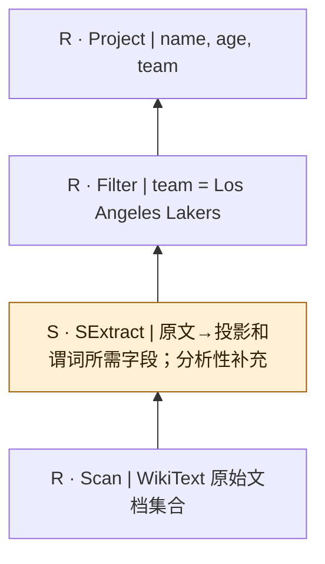

原库列出的伪SQL；保留未加引号的文本字面量和原始拼写。谓词作为原文整体显示，没有假称可执行SQL或已验证类型绑定；语义抽取为逻辑补充。列表中的省略号表示这里不是全部可能查询。

## quest/WikiText/04

来源：[原件](</Volumes/Element/Github2/Awesome-Sem-Filter-Bench/baseline/QUEST/repository/QUEST/query/WikiText.txt:5>) · `pseudo_sql_plus_proposed_extraction` · `pseudo_sql_only` · `substantive_relational`

```sql

SELECT name, age, team FROM WikiText WHERE NBA_championships > 2

```

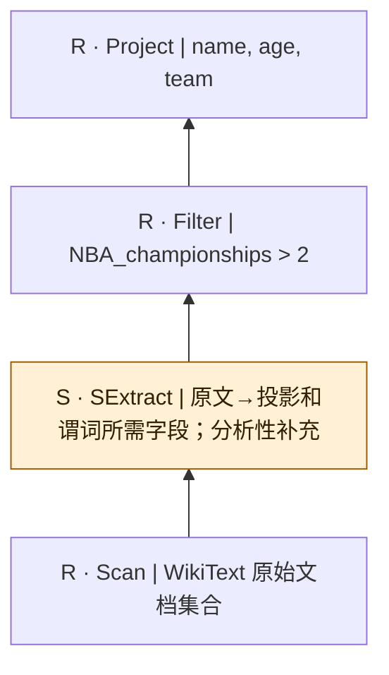

原库列出的伪SQL；保留未加引号的文本字面量和原始拼写。谓词作为原文整体显示，没有假称可执行SQL或已验证类型绑定；语义抽取为逻辑补充。列表中的省略号表示这里不是全部可能查询。

## quest/WikiText/05

来源：[原件](</Volumes/Element/Github2/Awesome-Sem-Filter-Bench/baseline/QUEST/repository/QUEST/query/WikiText.txt:6>) · `pseudo_sql_plus_proposed_extraction` · `pseudo_sql_only` · `substantive_relational`

```sql

SELECT name, position FROM WikiText WHERE position = forward

```

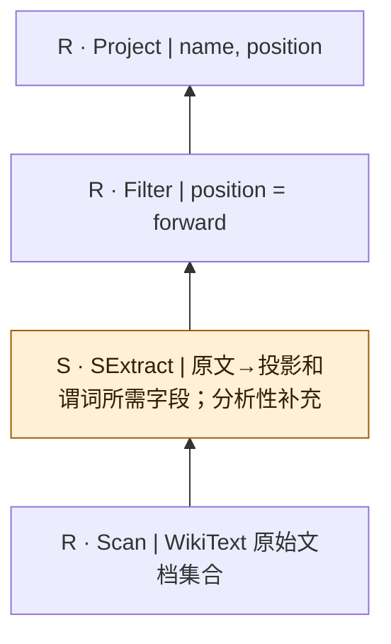

原库列出的伪SQL；保留未加引号的文本字面量和原始拼写。谓词作为原文整体显示，没有假称可执行SQL或已验证类型绑定；语义抽取为逻辑补充。列表中的省略号表示这里不是全部可能查询。

## quest/WikiText/06

来源：[原件](</Volumes/Element/Github2/Awesome-Sem-Filter-Bench/baseline/QUEST/repository/QUEST/query/WikiText.txt:7>) · `pseudo_sql_plus_proposed_extraction` · `pseudo_sql_only` · `substantive_relational`

```sql

SELECT name, draft_pick FROM WikiText WHERE draft_pick > 10

```

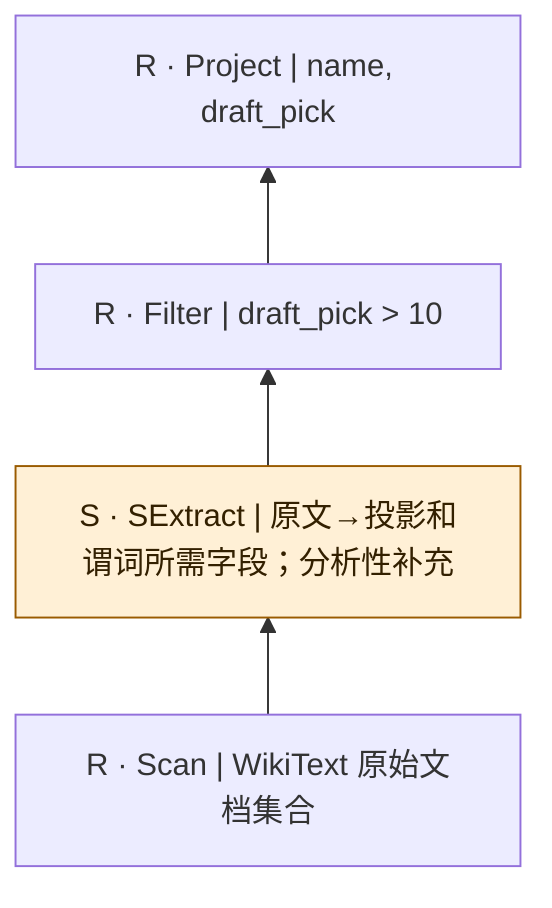

原库列出的伪SQL；保留未加引号的文本字面量和原始拼写。谓词作为原文整体显示，没有假称可执行SQL或已验证类型绑定；语义抽取为逻辑补充。列表中的省略号表示这里不是全部可能查询。

## quest/WikiText/07

来源：[原件](</Volumes/Element/Github2/Awesome-Sem-Filter-Bench/baseline/QUEST/repository/QUEST/query/WikiText.txt:8>) · `pseudo_sql_plus_proposed_extraction` · `pseudo_sql_only` · `substantive_relational`

```sql

SELECT name, draft_year FROM WikiText WHERE draft_year > 2010

```

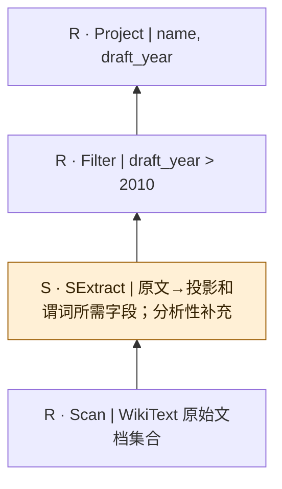

原库列出的伪SQL；保留未加引号的文本字面量和原始拼写。谓词作为原文整体显示，没有假称可执行SQL或已验证类型绑定；语义抽取为逻辑补充。列表中的省略号表示这里不是全部可能查询。

## quest/WikiText/08

来源：[原件](</Volumes/Element/Github2/Awesome-Sem-Filter-Bench/baseline/QUEST/repository/QUEST/query/WikiText.txt:9>) · `pseudo_sql_plus_proposed_extraction` · `pseudo_sql_only` · `substantive_relational`

```sql

SELECT name, college FROM WikiText WHERE college = University of Notre Dame

```

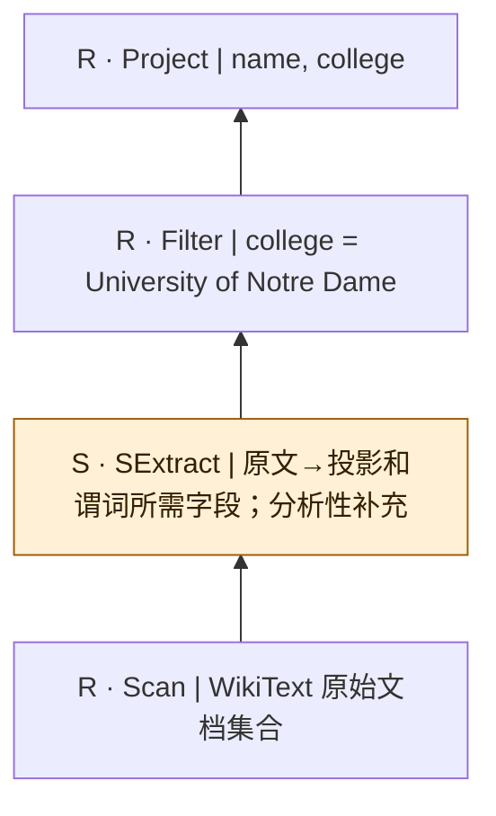

原库列出的伪SQL；保留未加引号的文本字面量和原始拼写。谓词作为原文整体显示，没有假称可执行SQL或已验证类型绑定；语义抽取为逻辑补充。列表中的省略号表示这里不是全部可能查询。

## quest/WikiText/09

来源：[原件](</Volumes/Element/Github2/Awesome-Sem-Filter-Bench/baseline/QUEST/repository/QUEST/query/WikiText.txt:10>) · `pseudo_sql_plus_proposed_extraction` · `pseudo_sql_only` · `substantive_relational`

```sql

SELECT name, mvp_awards FROM WikiText WHERE mvp_awards > 0

```

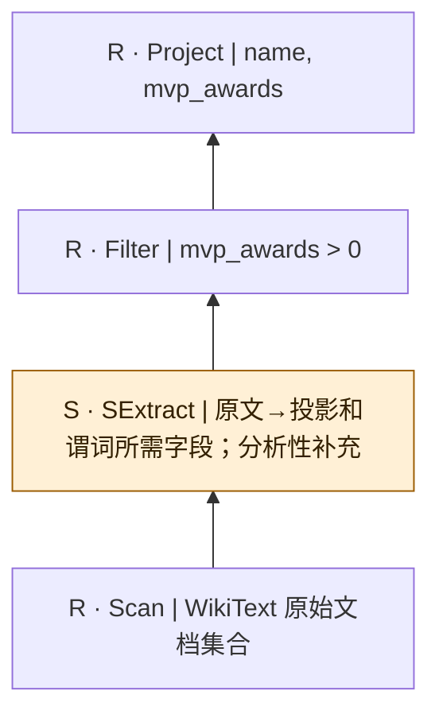

原库列出的伪SQL；保留未加引号的文本字面量和原始拼写。谓词作为原文整体显示，没有假称可执行SQL或已验证类型绑定；语义抽取为逻辑补充。列表中的省略号表示这里不是全部可能查询。

## quest/WikiText/10

来源：[原件](</Volumes/Element/Github2/Awesome-Sem-Filter-Bench/baseline/QUEST/repository/QUEST/query/WikiText.txt:11>) · `pseudo_sql_plus_proposed_extraction` · `pseudo_sql_only` · `substantive_relational`

```sql

SELECT name, olympic_gold_medals FROM WikiText WHERE olympic_gold_medals > 0

```

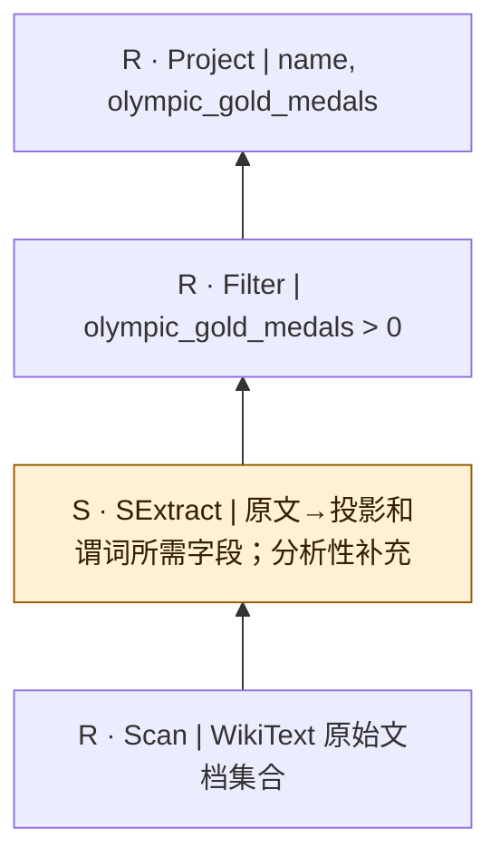

原库列出的伪SQL；保留未加引号的文本字面量和原始拼写。谓词作为原文整体显示，没有假称可执行SQL或已验证类型绑定；语义抽取为逻辑补充。列表中的省略号表示这里不是全部可能查询。

## quest/WikiText/11

来源：[原件](</Volumes/Element/Github2/Awesome-Sem-Filter-Bench/baseline/QUEST/repository/QUEST/query/WikiText.txt:14>) · `pseudo_sql_plus_proposed_extraction` · `pseudo_sql_only` · `substantive_relational`

```sql

SELECT name, age, team FROM WikiText WHERE nationality = USA AND age < 40

```

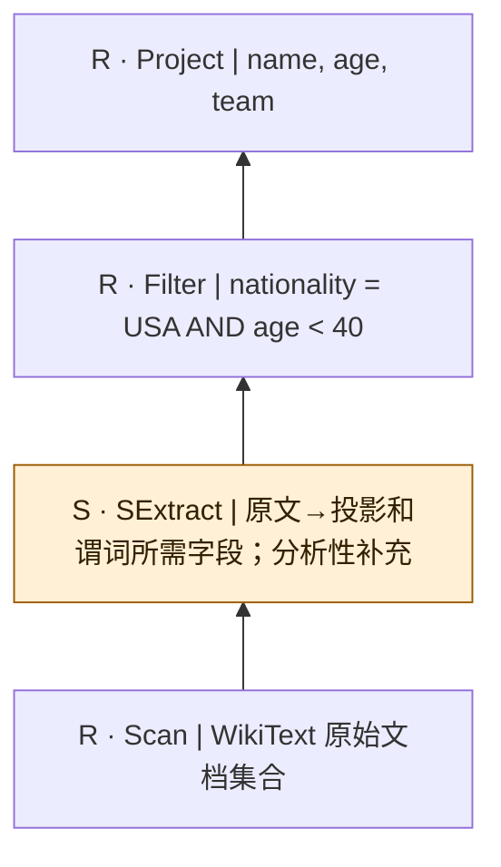

原库列出的伪SQL；保留未加引号的文本字面量和原始拼写。谓词作为原文整体显示，没有假称可执行SQL或已验证类型绑定；语义抽取为逻辑补充。列表中的省略号表示这里不是全部可能查询。

## quest/WikiText/12

来源：[原件](</Volumes/Element/Github2/Awesome-Sem-Filter-Bench/baseline/QUEST/repository/QUEST/query/WikiText.txt:15>) · `pseudo_sql_plus_proposed_extraction` · `pseudo_sql_only` · `substantive_relational`

```sql

SELECT name, age, mvp_awards FROM WikiText WHERE mvp_awards >= 1 AND (age > 30 OR team = New York Knicks)

```

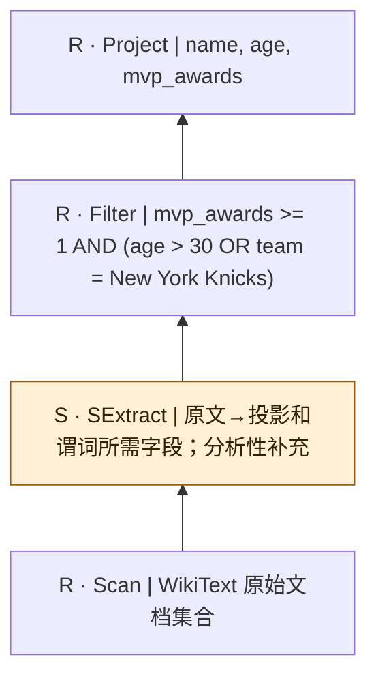

原库列出的伪SQL；保留未加引号的文本字面量和原始拼写。谓词作为原文整体显示，没有假称可执行SQL或已验证类型绑定；语义抽取为逻辑补充。列表中的省略号表示这里不是全部可能查询。

## quest/WikiText/13

来源：[原件](</Volumes/Element/Github2/Awesome-Sem-Filter-Bench/baseline/QUEST/repository/QUEST/query/WikiText.txt:16>) · `pseudo_sql_plus_proposed_extraction` · `pseudo_sql_only` · `substantive_relational`

```sql

SELECT name, draft_pick, draft_year FROM WikiText WHERE draft_year >= 2000 AND (draft_pick <= 15 OR team = Philadelphia 76ers)

```

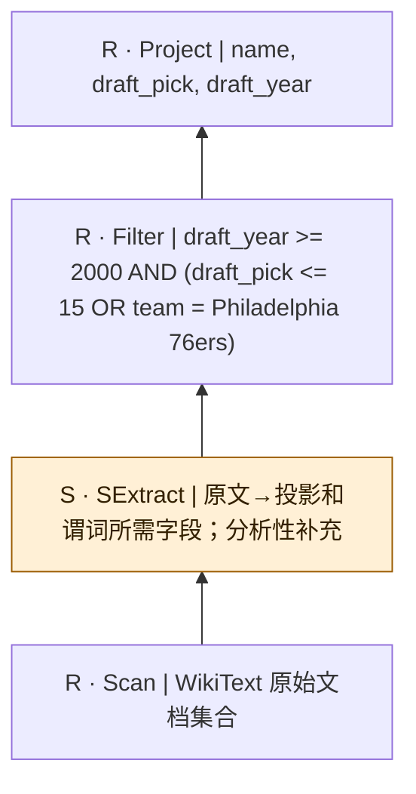

原库列出的伪SQL；保留未加引号的文本字面量和原始拼写。谓词作为原文整体显示，没有假称可执行SQL或已验证类型绑定；语义抽取为逻辑补充。列表中的省略号表示这里不是全部可能查询。

## quest/WikiText/14

来源：[原件](</Volumes/Element/Github2/Awesome-Sem-Filter-Bench/baseline/QUEST/repository/QUEST/query/WikiText.txt:17>) · `pseudo_sql_plus_proposed_extraction` · `pseudo_sql_only` · `substantive_relational`

```sql

SELECT name, team, NBA_championships FROM WikiText WHERE NBA_championships >= 3 OR team = Los Angeles Lakers OR team = Houston Rockets

```

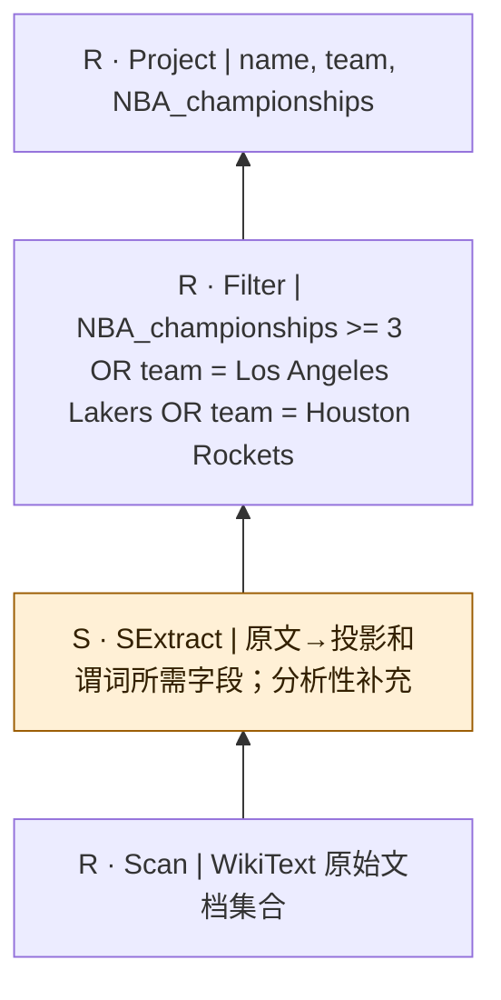

原库列出的伪SQL；保留未加引号的文本字面量和原始拼写。谓词作为原文整体显示，没有假称可执行SQL或已验证类型绑定；语义抽取为逻辑补充。列表中的省略号表示这里不是全部可能查询。

## quest/WikiText/15

来源：[原件](</Volumes/Element/Github2/Awesome-Sem-Filter-Bench/baseline/QUEST/repository/QUEST/query/WikiText.txt:18>) · `pseudo_sql_plus_proposed_extraction` · `pseudo_sql_only` · `substantive_relational`

```sql

SELECT name, draft_pick, draft_year,NBA_championships FROM WikiText WHERE  (draft_year >= 2010 OR draft_pick <= 15) AND NBA_championships > 0

```

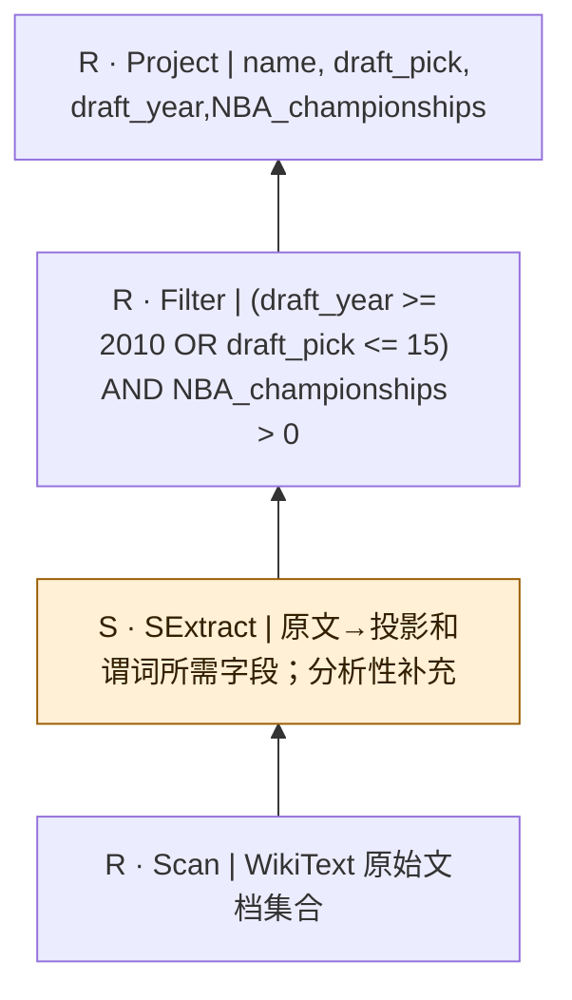

原库列出的伪SQL；保留未加引号的文本字面量和原始拼写。谓词作为原文整体显示，没有假称可执行SQL或已验证类型绑定；语义抽取为逻辑补充。列表中的省略号表示这里不是全部可能查询。

## quest/WikiText/16

来源：[原件](</Volumes/Element/Github2/Awesome-Sem-Filter-Bench/baseline/QUEST/repository/QUEST/query/WikiText.txt:19>) · `pseudo_sql_plus_proposed_extraction` · `pseudo_sql_only` · `substantive_relational`

```sql

SELECT name FROM WikiText WHERE NBA_championships > 0 AND mvp_awards > 0 AND olympic_gold_medals > 0 AND age < 40

```

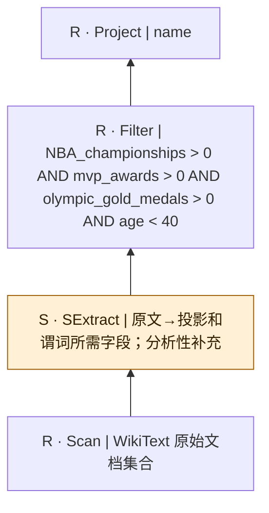

原库列出的伪SQL；保留未加引号的文本字面量和原始拼写。谓词作为原文整体显示，没有假称可执行SQL或已验证类型绑定；语义抽取为逻辑补充。列表中的省略号表示这里不是全部可能查询。

## quest/WikiText/17

来源：[原件](</Volumes/Element/Github2/Awesome-Sem-Filter-Bench/baseline/QUEST/repository/QUEST/query/WikiText.txt:20>) · `pseudo_sql_plus_proposed_extraction` · `pseudo_sql_only` · `substantive_relational`

```sql

SELECT name, age, team FROM WikiText WHERE NBA_championships > 2 OR college = University of Notre Dame

```

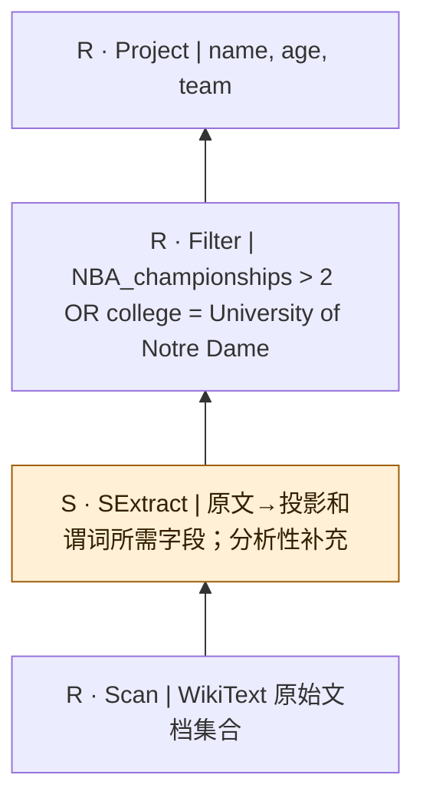

原库列出的伪SQL；保留未加引号的文本字面量和原始拼写。谓词作为原文整体显示，没有假称可执行SQL或已验证类型绑定；语义抽取为逻辑补充。列表中的省略号表示这里不是全部可能查询。

## quest/WikiText/18

来源：[原件](</Volumes/Element/Github2/Awesome-Sem-Filter-Bench/baseline/QUEST/repository/QUEST/query/WikiText.txt:21>) · `pseudo_sql_plus_proposed_extraction` · `pseudo_sql_only` · `substantive_relational`

```sql

SELECT name, college FROM WikiText WHERE career_highest_score > 40 AND career_highest_assists > 10

```

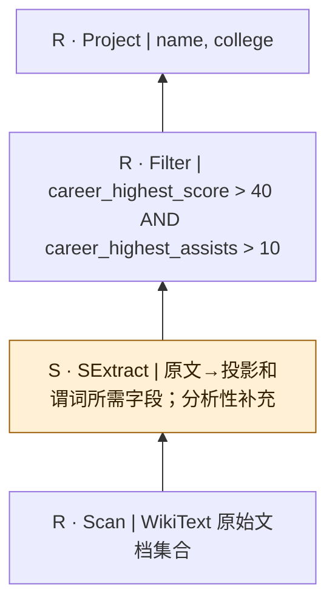

原库列出的伪SQL；保留未加引号的文本字面量和原始拼写。谓词作为原文整体显示，没有假称可执行SQL或已验证类型绑定；语义抽取为逻辑补充。列表中的省略号表示这里不是全部可能查询。

## quest/WikiText/19

来源：[原件](</Volumes/Element/Github2/Awesome-Sem-Filter-Bench/baseline/QUEST/repository/QUEST/query/WikiText.txt:22>) · `pseudo_sql_plus_proposed_extraction` · `pseudo_sql_only` · `substantive_relational`

```sql

SELECT name, career_highest_score, career_highest_assists FROM WikiText WHERE olympic_gold_medals > 0 AND  mvp_awards > 0

```

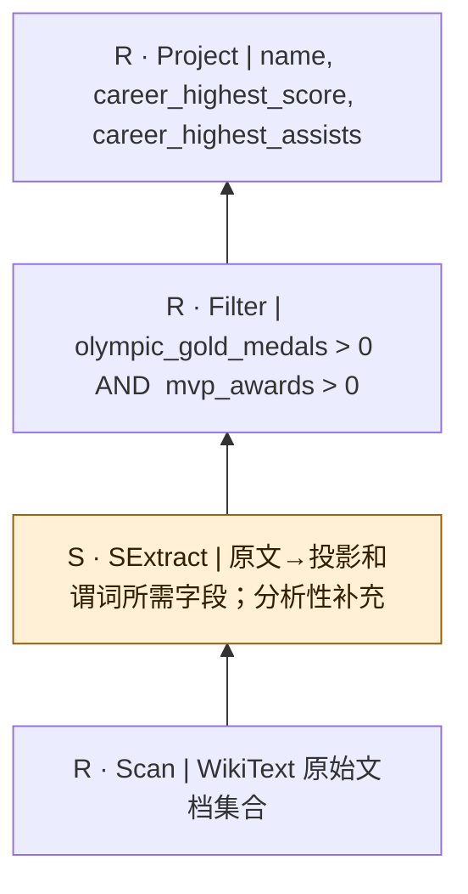

原库列出的伪SQL；保留未加引号的文本字面量和原始拼写。谓词作为原文整体显示，没有假称可执行SQL或已验证类型绑定；语义抽取为逻辑补充。列表中的省略号表示这里不是全部可能查询。

## quest/WikiText/20

来源：[原件](</Volumes/Element/Github2/Awesome-Sem-Filter-Bench/baseline/QUEST/repository/QUEST/query/WikiText.txt:23>) · `pseudo_sql_plus_proposed_extraction` · `pseudo_sql_only` · `substantive_relational`

```sql

SELECT name, age, team FROM WikiText WHERE NBA_championships > 2 OR career_average_score > 10

```

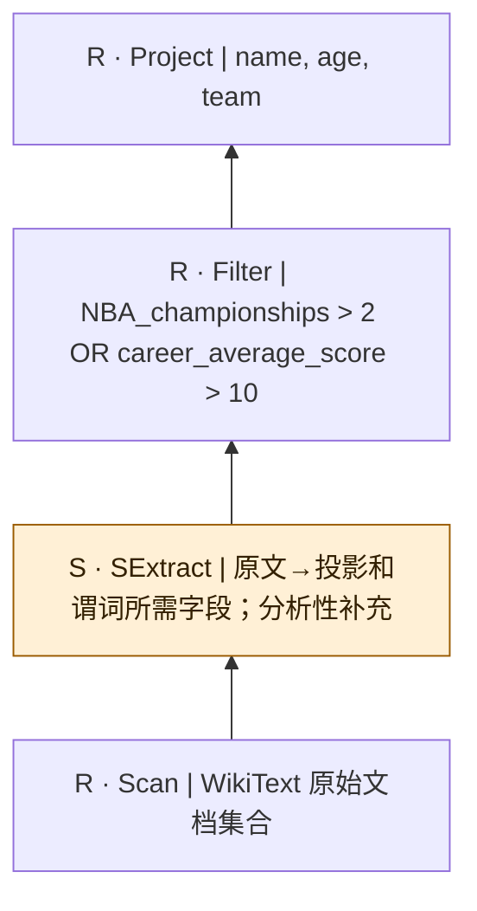

原库列出的伪SQL；保留未加引号的文本字面量和原始拼写。谓词作为原文整体显示，没有假称可执行SQL或已验证类型绑定；语义抽取为逻辑补充。列表中的省略号表示这里不是全部可能查询。

## quest/WikiText/21

来源：[原件](</Volumes/Element/Github2/Awesome-Sem-Filter-Bench/baseline/QUEST/repository/QUEST/query/WikiText.txt:26>) · `pseudo_sql_plus_proposed_extraction` · `pseudo_sql_only` · `substantive_relational`

```sql

SELECT name, position, draft_year FROM WikiText WHERE draft_pick <= 10 AND draft_year > 2000 AND nationality = USA AND age > 20

```

```mermaid
flowchart BT
  n0["R · Project | name, position, draft_year"]
  n1["R · Filter | draft_pick &lt;= 10 AND draft_year &gt; 2000 AND nationality = USA AND age &gt; 20"]
  n2["S · SExtract | 原文→投影和谓词所需字段；分析性补充"]
  n3["R · Scan | WikiText 原始文档集合"]
  n3 --> n2
  n2 --> n1
  n1 --> n0
  classDef semantic fill:#fff0d6,stroke:#9a5b00,color:#332000;
  class n2 semantic;
```

原库列出的伪SQL；保留未加引号的文本字面量和原始拼写。谓词作为原文整体显示，没有假称可执行SQL或已验证类型绑定；语义抽取为逻辑补充。列表中的省略号表示这里不是全部可能查询。

## quest/WikiText/22

来源：[原件](</Volumes/Element/Github2/Awesome-Sem-Filter-Bench/baseline/QUEST/repository/QUEST/query/WikiText.txt:27>) · `pseudo_sql_plus_proposed_extraction` · `pseudo_sql_only` · `substantive_relational`

```sql

SELECT name, age, college FROM WikiText WHERE age > 20 AND age < 40 AND (team = Los Angeles Lakers OR college = University of Nebraska)

```

```mermaid
flowchart BT
  n0["R · Project | name, age, college"]
  n1["R · Filter | age &gt; 20 AND age &lt; 40 AND (team = Los Angeles Lakers OR college = University of Nebraska)"]
  n2["S · SExtract | 原文→投影和谓词所需字段；分析性补充"]
  n3["R · Scan | WikiText 原始文档集合"]
  n3 --> n2
  n2 --> n1
  n1 --> n0
  classDef semantic fill:#fff0d6,stroke:#9a5b00,color:#332000;
  class n2 semantic;
```

原库列出的伪SQL；保留未加引号的文本字面量和原始拼写。谓词作为原文整体显示，没有假称可执行SQL或已验证类型绑定；语义抽取为逻辑补充。列表中的省略号表示这里不是全部可能查询。

## quest/WikiText/23

来源：[原件](</Volumes/Element/Github2/Awesome-Sem-Filter-Bench/baseline/QUEST/repository/QUEST/query/WikiText.txt:28>) · `pseudo_sql_plus_proposed_extraction` · `pseudo_sql_only` · `substantive_relational`

```sql

SELECT name, team, position FROM WikiText WHERE (team = Los Angeles Lakers AND position = forward) OR (position = guard AND age < 50)

```

```mermaid
flowchart BT
  n0["R · Project | name, team, position"]
  n1["R · Filter | (team = Los Angeles Lakers AND position = forward) OR (position = guard AND age &lt; 50)"]
  n2["S · SExtract | 原文→投影和谓词所需字段；分析性补充"]
  n3["R · Scan | WikiText 原始文档集合"]
  n3 --> n2
  n2 --> n1
  n1 --> n0
  classDef semantic fill:#fff0d6,stroke:#9a5b00,color:#332000;
  class n2 semantic;
```

原库列出的伪SQL；保留未加引号的文本字面量和原始拼写。谓词作为原文整体显示，没有假称可执行SQL或已验证类型绑定；语义抽取为逻辑补充。列表中的省略号表示这里不是全部可能查询。

## quest/WikiText/24

来源：[原件](</Volumes/Element/Github2/Awesome-Sem-Filter-Bench/baseline/QUEST/repository/QUEST/query/WikiText.txt:29>) · `pseudo_sql_plus_proposed_extraction` · `pseudo_sql_only` · `substantive_relational`

```sql

SELECT name, draft_pick, draft_year FROM WikiText WHERE draft_year >= 2000 AND draft_year <= 2010 AND draft_pick <= 15 AND draft_pick >= 5

```

```mermaid
flowchart BT
  n0["R · Project | name, draft_pick, draft_year"]
  n1["R · Filter | draft_year &gt;= 2000 AND draft_year &lt;= 2010 AND draft_pick &lt;= 15 AND draft_pick &gt;= 5"]
  n2["S · SExtract | 原文→投影和谓词所需字段；分析性补充"]
  n3["R · Scan | WikiText 原始文档集合"]
  n3 --> n2
  n2 --> n1
  n1 --> n0
  classDef semantic fill:#fff0d6,stroke:#9a5b00,color:#332000;
  class n2 semantic;
```

原库列出的伪SQL；保留未加引号的文本字面量和原始拼写。谓词作为原文整体显示，没有假称可执行SQL或已验证类型绑定；语义抽取为逻辑补充。列表中的省略号表示这里不是全部可能查询。

## quest/WikiText/25

来源：[原件](</Volumes/Element/Github2/Awesome-Sem-Filter-Bench/baseline/QUEST/repository/QUEST/query/WikiText.txt:30>) · `pseudo_sql_plus_proposed_extraction` · `pseudo_sql_only` · `substantive_relational`

```sql

SELECT name, age, draft_pick,NBA_championships FROM WikiText WHERE age < 40 AND draft_pick <= 15 AND NBA_championships > 2 AND age > 20

```

```mermaid
flowchart BT
  n0["R · Project | name, age, draft_pick,NBA_championships"]
  n1["R · Filter | age &lt; 40 AND draft_pick &lt;= 15 AND NBA_championships &gt; 2 AND age &gt; 20"]
  n2["S · SExtract | 原文→投影和谓词所需字段；分析性补充"]
  n3["R · Scan | WikiText 原始文档集合"]
  n3 --> n2
  n2 --> n1
  n1 --> n0
  classDef semantic fill:#fff0d6,stroke:#9a5b00,color:#332000;
  class n2 semantic;
```

原库列出的伪SQL；保留未加引号的文本字面量和原始拼写。谓词作为原文整体显示，没有假称可执行SQL或已验证类型绑定；语义抽取为逻辑补充。列表中的省略号表示这里不是全部可能查询。

## quest/WikiText/26

来源：[原件](</Volumes/Element/Github2/Awesome-Sem-Filter-Bench/baseline/QUEST/repository/QUEST/query/WikiText.txt:31>) · `pseudo_sql_plus_proposed_extraction` · `pseudo_sql_only` · `substantive_relational`

```sql

SELECT name FROM WikiText WHERE NBA_championships > 0 AND mvp_awards > 0 AND olympic_gold_medals > 0 AND age < 40

```

```mermaid
flowchart BT
  n0["R · Project | name"]
  n1["R · Filter | NBA_championships &gt; 0 AND mvp_awards &gt; 0 AND olympic_gold_medals &gt; 0 AND age &lt; 40"]
  n2["S · SExtract | 原文→投影和谓词所需字段；分析性补充"]
  n3["R · Scan | WikiText 原始文档集合"]
  n3 --> n2
  n2 --> n1
  n1 --> n0
  classDef semantic fill:#fff0d6,stroke:#9a5b00,color:#332000;
  class n2 semantic;
```

原库列出的伪SQL；保留未加引号的文本字面量和原始拼写。谓词作为原文整体显示，没有假称可执行SQL或已验证类型绑定；语义抽取为逻辑补充。列表中的省略号表示这里不是全部可能查询。

## quest/WikiText/27

来源：[原件](</Volumes/Element/Github2/Awesome-Sem-Filter-Bench/baseline/QUEST/repository/QUEST/query/WikiText.txt:32>) · `pseudo_sql_plus_proposed_extraction` · `pseudo_sql_only` · `substantive_relational`

```sql

SELECT name, college, NBA_championships, mvp_awards, olympic_gold_medals FROM WikiText WHERE age < 30 AND NBA_championships >= 1 AND mvp_awards > 0 AND olympic_gold_medals > 0 AND nationality = American

```

```mermaid
flowchart BT
  n0["R · Project | name, college, NBA_championships, mvp_awards, olympic_gold_medals"]
  n1["R · Filter | age &lt; 30 AND NBA_championships &gt;= 1 AND mvp_awards &gt; 0 AND olympic_gold_medals &gt; 0 AND nationality = American"]
  n2["S · SExtract | 原文→投影和谓词所需字段；分析性补充"]
  n3["R · Scan | WikiText 原始文档集合"]
  n3 --> n2
  n2 --> n1
  n1 --> n0
  classDef semantic fill:#fff0d6,stroke:#9a5b00,color:#332000;
  class n2 semantic;
```

原库列出的伪SQL；保留未加引号的文本字面量和原始拼写。谓词作为原文整体显示，没有假称可执行SQL或已验证类型绑定；语义抽取为逻辑补充。列表中的省略号表示这里不是全部可能查询。

## quest/WikiText/28

来源：[原件](</Volumes/Element/Github2/Awesome-Sem-Filter-Bench/baseline/QUEST/repository/QUEST/query/WikiText.txt:33>) · `pseudo_sql_plus_proposed_extraction` · `pseudo_sql_only` · `substantive_relational`

```sql

SELECT name, draft_year, draft_pick, age, team FROM WikiText WHERE draft_year >= 2000 AND draft_pick <= 15 AND age > 25 AND nationality = American AND NBA_championships > 0

```

```mermaid
flowchart BT
  n0["R · Project | name, draft_year, draft_pick, age, team"]
  n1["R · Filter | draft_year &gt;= 2000 AND draft_pick &lt;= 15 AND age &gt; 25 AND nationality = American AND NBA_championships &gt; 0"]
  n2["S · SExtract | 原文→投影和谓词所需字段；分析性补充"]
  n3["R · Scan | WikiText 原始文档集合"]
  n3 --> n2
  n2 --> n1
  n1 --> n0
  classDef semantic fill:#fff0d6,stroke:#9a5b00,color:#332000;
  class n2 semantic;
```

原库列出的伪SQL；保留未加引号的文本字面量和原始拼写。谓词作为原文整体显示，没有假称可执行SQL或已验证类型绑定；语义抽取为逻辑补充。列表中的省略号表示这里不是全部可能查询。

## quest/WikiText/29

来源：[原件](</Volumes/Element/Github2/Awesome-Sem-Filter-Bench/baseline/QUEST/repository/QUEST/query/WikiText.txt:34>) · `pseudo_sql_plus_proposed_extraction` · `pseudo_sql_only` · `substantive_relational`

```sql

SELECT name, age, NBA_championships, mvp_awards, olympic_gold_medals FROM WikiText WHERE age < 40 AND NBA_championships > 2 AND mvp_awards > 1 AND olympic_gold_medals > 0 AND nationality = Serbian

```

```mermaid
flowchart BT
  n0["R · Project | name, age, NBA_championships, mvp_awards, olympic_gold_medals"]
  n1["R · Filter | age &lt; 40 AND NBA_championships &gt; 2 AND mvp_awards &gt; 1 AND olympic_gold_medals &gt; 0 AND nationality = Serbian"]
  n2["S · SExtract | 原文→投影和谓词所需字段；分析性补充"]
  n3["R · Scan | WikiText 原始文档集合"]
  n3 --> n2
  n2 --> n1
  n1 --> n0
  classDef semantic fill:#fff0d6,stroke:#9a5b00,color:#332000;
  class n2 semantic;
```

原库列出的伪SQL；保留未加引号的文本字面量和原始拼写。谓词作为原文整体显示，没有假称可执行SQL或已验证类型绑定；语义抽取为逻辑补充。列表中的省略号表示这里不是全部可能查询。

## quest/WikiText/30

来源：[原件](</Volumes/Element/Github2/Awesome-Sem-Filter-Bench/baseline/QUEST/repository/QUEST/query/WikiText.txt:35>) · `pseudo_sql_plus_proposed_extraction` · `pseudo_sql_only` · `substantive_relational`

```sql

SELECT name, team, draft_year, draft_pick, college FROM WikiText WHERE draft_year >= 2005 AND draft_pick <= 10 AND team = Los Angeles Lakers AND college = Michigan State Spartans AND age > 30

```

```mermaid
flowchart BT
  n0["R · Project | name, team, draft_year, draft_pick, college"]
  n1["R · Filter | draft_year &gt;= 2005 AND draft_pick &lt;= 10 AND team = Los Angeles Lakers AND college = Michigan State Spartans AND age &gt; 30"]
  n2["S · SExtract | 原文→投影和谓词所需字段；分析性补充"]
  n3["R · Scan | WikiText 原始文档集合"]
  n3 --> n2
  n2 --> n1
  n1 --> n0
  classDef semantic fill:#fff0d6,stroke:#9a5b00,color:#332000;
  class n2 semantic;
```

原库列出的伪SQL；保留未加引号的文本字面量和原始拼写。谓词作为原文整体显示，没有假称可执行SQL或已验证类型绑定；语义抽取为逻辑补充。列表中的省略号表示这里不是全部可能查询。
