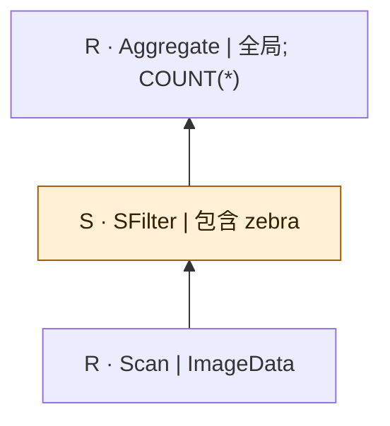
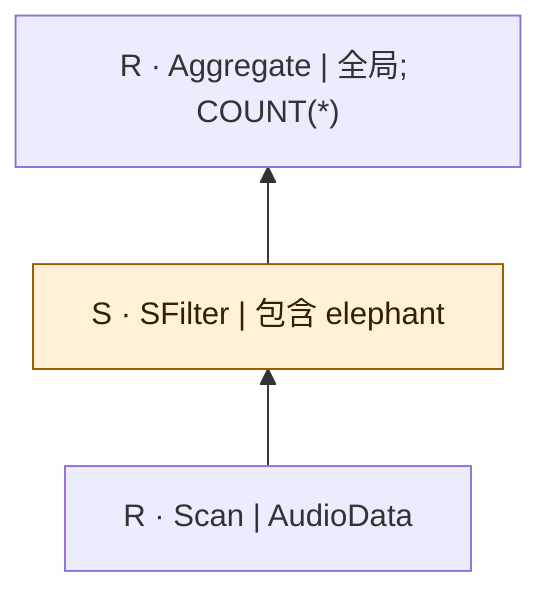
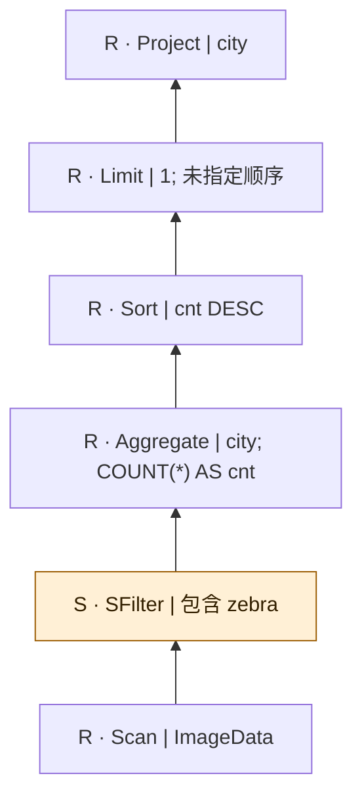
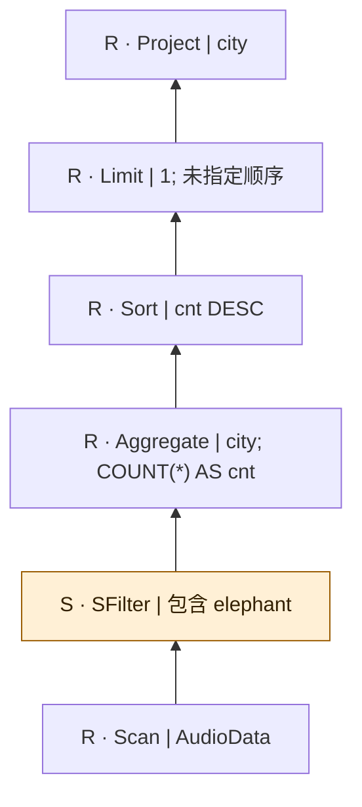
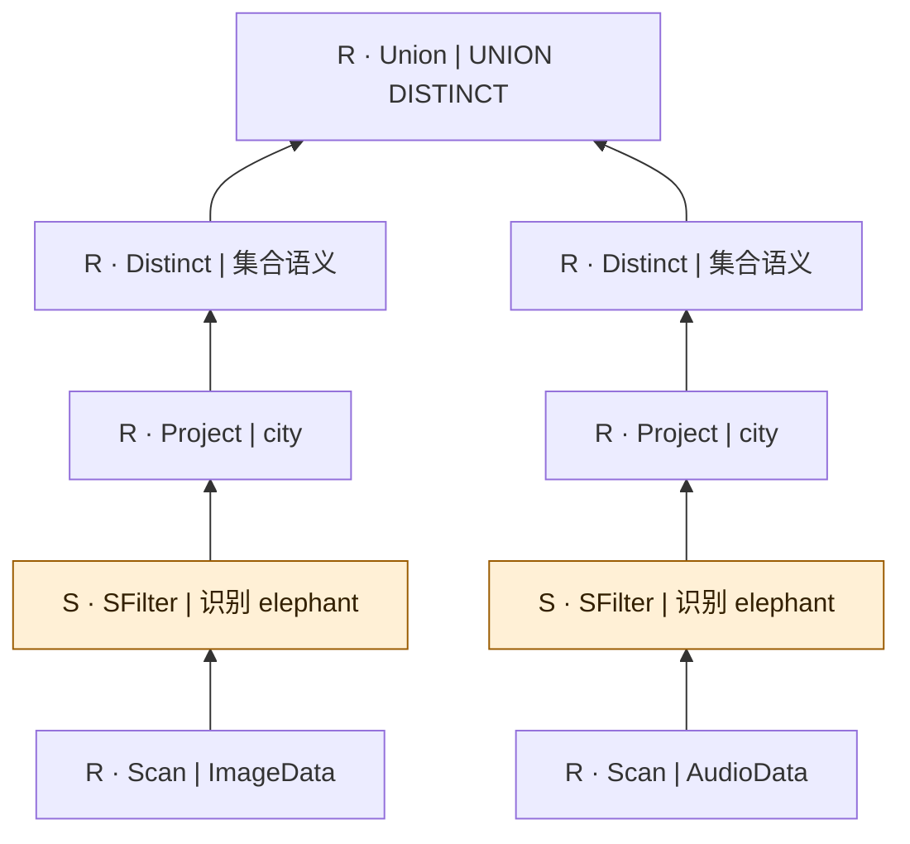
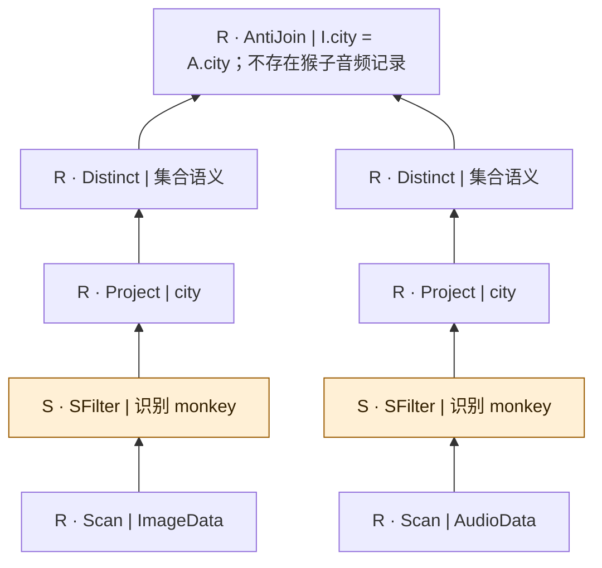
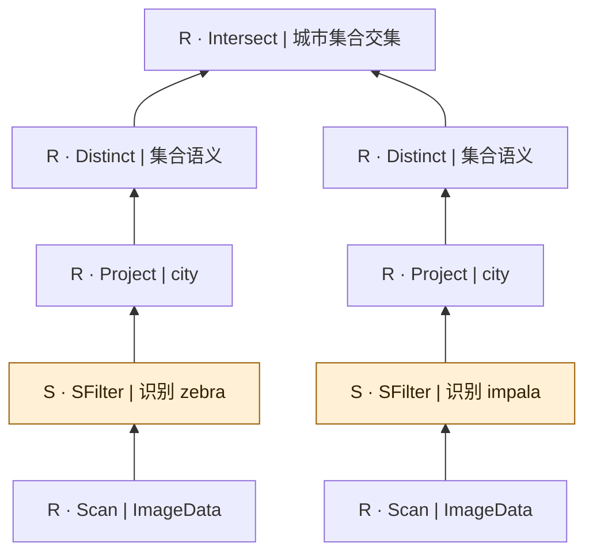
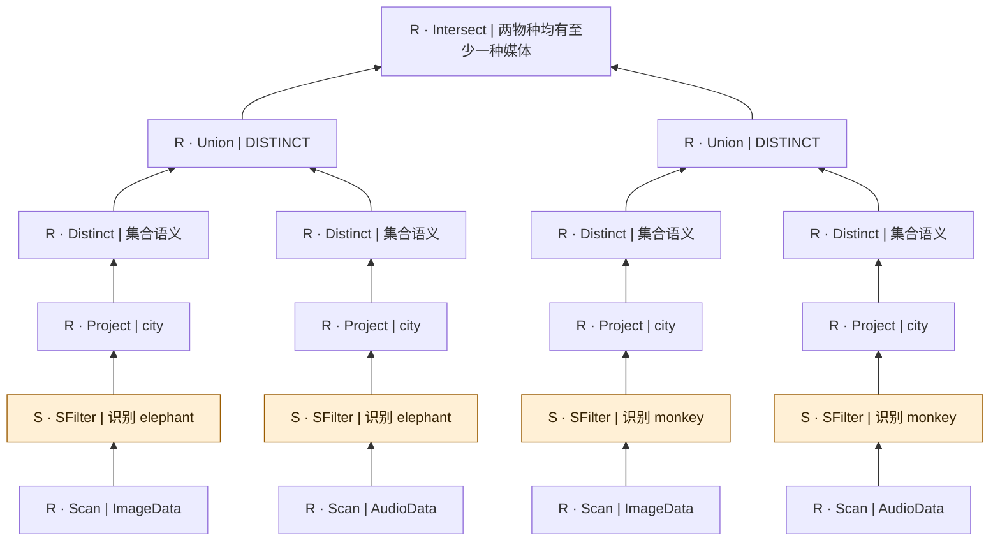
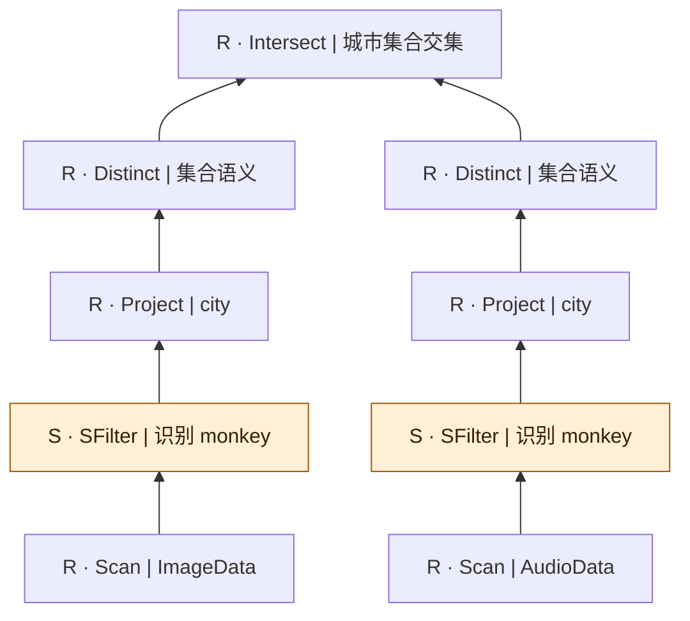
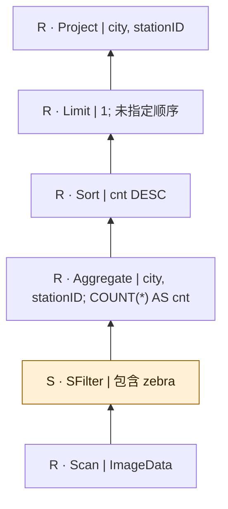

# sembench-animals：逐查询逻辑计划

[返回总表](README.md)

图从下往上读：输入 → 算子 → 输出。S为语义算子；R为确定性关系/辅助步骤。检索与未决节点在标签中单独注明。

## sembench/animals/Q1

来源：[原件](</Volumes/Element/Github2/semantic-workload-bench/data/semantic-query-discovery-20260908/sembench/checkout/files/animals/query/natural_language/Q1.txt>) · `native_nl_reconstructed` · `logical_only` · `substantive_relational`

```text

How many pictures of zebras do we have in our database?

```



 图依据原自然语言重建；扫描中的关联媒体是概念输入，不假定已核对物理表名/外键。

## sembench/animals/Q2

来源：[原件](</Volumes/Element/Github2/semantic-workload-bench/data/semantic-query-discovery-20260908/sembench/checkout/files/animals/query/natural_language/Q2.txt>) · `native_nl_reconstructed` · `logical_only` · `substantive_relational`

```text

How many sound recordings of elephants do we have in our database?

```



 图依据原自然语言重建；扫描中的关联媒体是概念输入，不假定已核对物理表名/外键。

## sembench/animals/Q3

来源：[原件](</Volumes/Element/Github2/semantic-workload-bench/data/semantic-query-discovery-20260908/sembench/checkout/files/animals/query/natural_language/Q3.txt>) · `native_nl_reconstructed` · `logical_only` · `substantive_relational`

```text

What is the city where we captured most pictures of zebras (ties are broken arbitrarily, consider only cities with at least one zebra picture)?

```



NL允许任意打破并列；随库gold SQL用cnt=MAX(cnt)返回所有并列。图按NL保留一项；不能称二者完全等价。 图依据原自然语言重建；扫描中的关联媒体是概念输入，不假定已核对物理表名/外键。

## sembench/animals/Q4

来源：[原件](</Volumes/Element/Github2/semantic-workload-bench/data/semantic-query-discovery-20260908/sembench/checkout/files/animals/query/natural_language/Q4.txt>) · `native_nl_reconstructed` · `logical_only` · `substantive_relational`

```text

What is the city for which we have most recordings of elephants (ties are broken arbitrarily, consider only cities with at least one elephant recording)?

```



NL允许任意打破并列；随库gold SQL用cnt=MAX(cnt)返回所有并列。图按NL保留一项；不能称二者完全等价。 图依据原自然语言重建；扫描中的关联媒体是概念输入，不假定已核对物理表名/外键。

## sembench/animals/Q5

来源：[原件](</Volumes/Element/Github2/semantic-workload-bench/data/semantic-query-discovery-20260908/sembench/checkout/files/animals/query/natural_language/Q5.txt>) · `native_nl_reconstructed` · `logical_only` · `substantive_relational`

```text

What is the list of cities for which we have either images or audio recordings of elephants?

```



 图依据原自然语言重建；扫描中的关联媒体是概念输入，不假定已核对物理表名/外键。

## sembench/animals/Q6

来源：[原件](</Volumes/Element/Github2/semantic-workload-bench/data/semantic-query-discovery-20260908/sembench/checkout/files/animals/query/natural_language/Q6.txt>) · `native_nl_reconstructed` · `logical_only` · `substantive_relational`

```text

For which cities do we have images of monkeys but no audio recordings of monkeys?

```



 图依据原自然语言重建；扫描中的关联媒体是概念输入，不假定已核对物理表名/外键。

## sembench/animals/Q7

来源：[原件](</Volumes/Element/Github2/semantic-workload-bench/data/semantic-query-discovery-20260908/sembench/checkout/files/animals/query/natural_language/Q7.txt>) · `native_nl_reconstructed` · `logical_only` · `substantive_relational`

```text

What are the cities for which zebras and impala co-occur, i.e., we have at least one image of a zebra and at least one image of an impala?

```



 图依据原自然语言重建；扫描中的关联媒体是概念输入，不假定已核对物理表名/外键。

## sembench/animals/Q8

来源：[原件](</Volumes/Element/Github2/semantic-workload-bench/data/semantic-query-discovery-20260908/sembench/checkout/files/animals/query/natural_language/Q8.txt>) · `native_nl_reconstructed` · `logical_only` · `substantive_relational`

```text

What is the list of cities for which we found at least one image or audio recording of elephants and at least one image or audio recording of monkeys?

```



 图依据原自然语言重建；扫描中的关联媒体是概念输入，不假定已核对物理表名/外键。

## sembench/animals/Q9

来源：[原件](</Volumes/Element/Github2/semantic-workload-bench/data/semantic-query-discovery-20260908/sembench/checkout/files/animals/query/natural_language/Q9.txt>) · `native_nl_reconstructed` · `logical_only` · `substantive_relational`

```text

What is the list of cities for which we have both images and audio recordings of monkeys?

```



 图依据原自然语言重建；扫描中的关联媒体是概念输入，不假定已核对物理表名/外键。

## sembench/animals/Q10

来源：[原件](</Volumes/Element/Github2/semantic-workload-bench/data/semantic-query-discovery-20260908/sembench/checkout/files/animals/query/natural_language/Q10.txt>) · `native_nl_reconstructed` · `logical_only` · `substantive_relational`

```text

What is the city and station with most associated pictures showing zebras (ties are broken arbitrarily, only consider cities with at least one zebra picture)?

```



NL允许任意打破并列；随库gold SQL用cnt=MAX(cnt)返回所有并列。图按NL保留一项；不能称二者完全等价。 图依据原自然语言重建；扫描中的关联媒体是概念输入，不假定已核对物理表名/外键。
