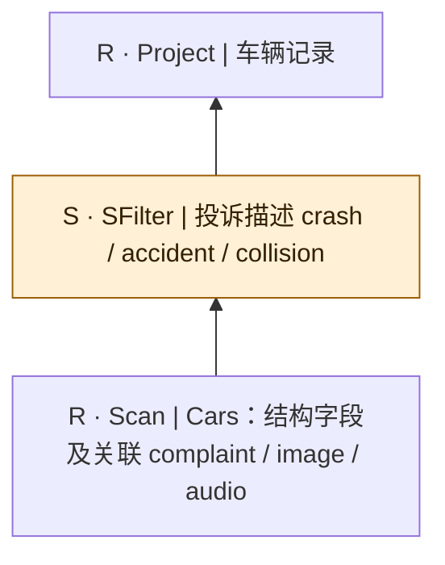
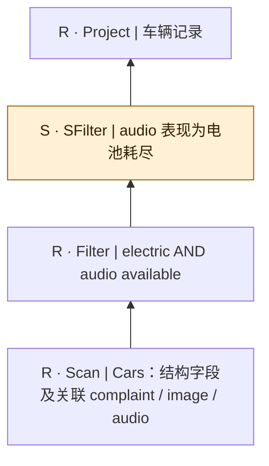
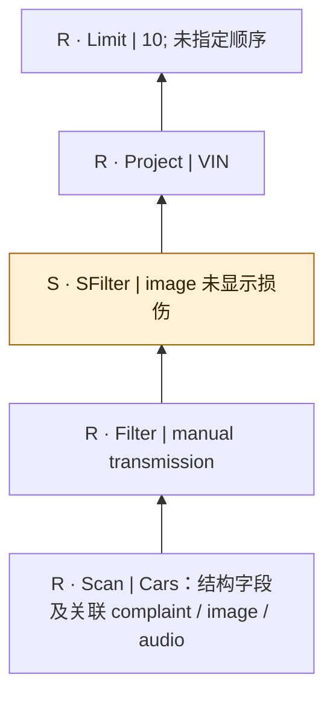
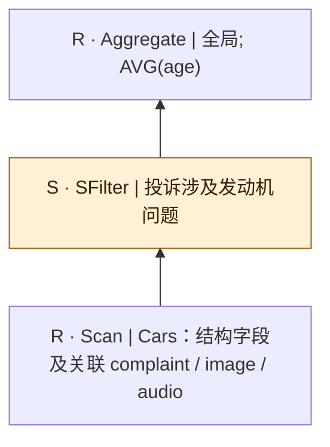
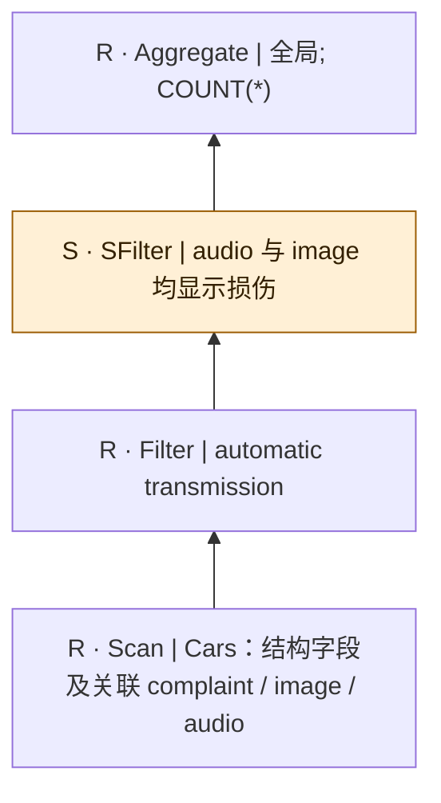
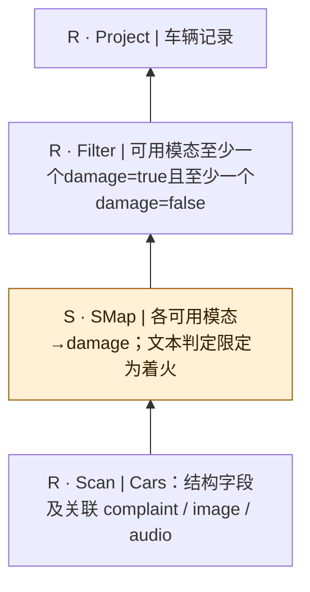
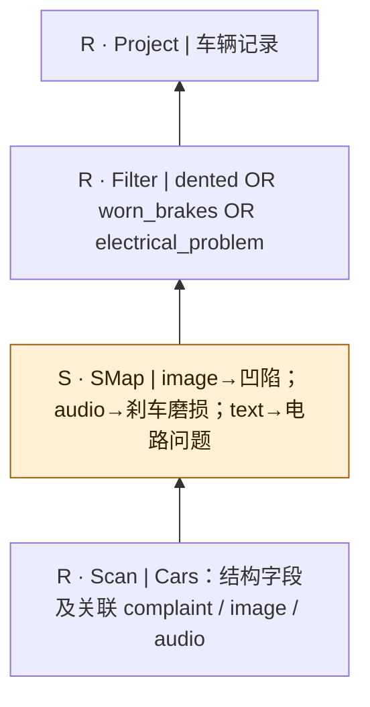
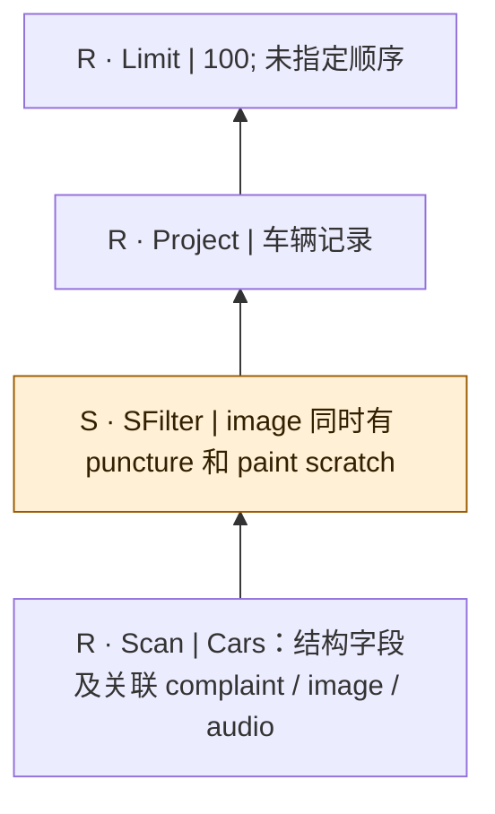
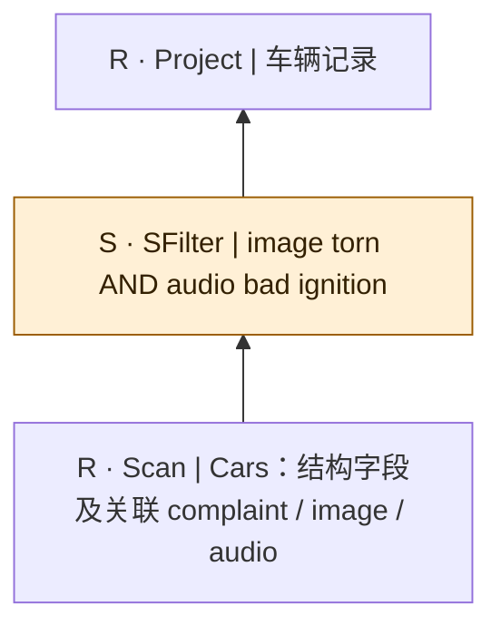
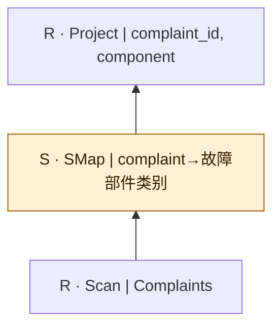

# sembench-cars：逐查询逻辑计划

[返回总表](README.md)

图从下往上读：输入 → 算子 → 输出。S为语义算子；R为确定性关系/辅助步骤。检索与未决节点在标签中单独注明。

## sembench/cars/Q1

来源：[原件](</Volumes/Element/Github2/semantic-workload-bench/data/semantic-query-discovery-20260908/sembench/checkout/files/cars/query/natural_language/Q1.txt>) · `native_nl_reconstructed` · `logical_only` · `scan_projection_only`

```text

Find cars that were in a crash/accident/collision.

```



 图依据原自然语言重建；扫描中的关联媒体是概念输入，不假定已核对物理表名/外键。

## sembench/cars/Q2

来源：[原件](</Volumes/Element/Github2/semantic-workload-bench/data/semantic-query-discovery-20260908/sembench/checkout/files/cars/query/natural_language/Q2.txt>) · `native_nl_reconstructed` · `logical_only` · `substantive_relational`

```text

Find electric cars with available audio recordings that show a dead battery.

```



 图依据原自然语言重建；扫描中的关联媒体是概念输入，不假定已核对物理表名/外键。

## sembench/cars/Q3

来源：[原件](</Volumes/Element/Github2/semantic-workload-bench/data/semantic-query-discovery-20260908/sembench/checkout/files/cars/query/natural_language/Q3.txt>) · `native_nl_reconstructed` · `logical_only` · `substantive_relational`

```text

Find ten cars with manual transmission that are not damaged according to images. Return the VIN.

```



 图依据原自然语言重建；扫描中的关联媒体是概念输入，不假定已核对物理表名/外键。

## sembench/cars/Q4

来源：[原件](</Volumes/Element/Github2/semantic-workload-bench/data/semantic-query-discovery-20260908/sembench/checkout/files/cars/query/natural_language/Q4.txt>) · `native_nl_reconstructed` · `logical_only` · `substantive_relational`

```text

What is the average age of cars with engine problems?

```



 图依据原自然语言重建；扫描中的关联媒体是概念输入，不假定已核对物理表名/外键。

## sembench/cars/Q5

来源：[原件](</Volumes/Element/Github2/semantic-workload-bench/data/semantic-query-discovery-20260908/sembench/checkout/files/cars/query/natural_language/Q5.txt>) · `native_nl_reconstructed` · `logical_only` · `substantive_relational`

```text

How many automatic cars are damaged according to both audio and images?

```



 图依据原自然语言重建；扫描中的关联媒体是概念输入，不假定已核对物理表名/外键。

## sembench/cars/Q6

来源：[原件](</Volumes/Element/Github2/semantic-workload-bench/data/semantic-query-discovery-20260908/sembench/checkout/files/cars/query/natural_language/Q6.txt>) · `native_nl_reconstructed` · `logical_only` · `substantive_relational`

```text

Find cars that are damaged according to one modality but not the other. For this query, for complaints, check if the car was on fire.

```



图采用可用模态间有真有假的逻辑解释；缺媒体不视作健康/否定。原NL的one modality/the other需固定模态范围后执行。 图依据原自然语言重建；扫描中的关联媒体是概念输入，不假定已核对物理表名/外键。

## sembench/cars/Q7

来源：[原件](</Volumes/Element/Github2/semantic-workload-bench/data/semantic-query-discovery-20260908/sembench/checkout/files/cars/query/natural_language/Q7.txt>) · `native_nl_reconstructed` · `logical_only` · `substantive_relational`

```text

Find cars that are either dented (image), have worn out brakes (audio), or have electrical system problems (text), i.e., damaged at least according to a single modality.

```



 图依据原自然语言重建；扫描中的关联媒体是概念输入，不假定已核对物理表名/外键。

## sembench/cars/Q8

来源：[原件](</Volumes/Element/Github2/semantic-workload-bench/data/semantic-query-discovery-20260908/sembench/checkout/files/cars/query/natural_language/Q8.txt>) · `native_nl_reconstructed` · `logical_only` · `substantive_relational`

```text

Find a hundred cars with punctures and paint scratches on images.

```



 图依据原自然语言重建；扫描中的关联媒体是概念输入，不假定已核对物理表名/外键。

## sembench/cars/Q9

来源：[原件](</Volumes/Element/Github2/semantic-workload-bench/data/semantic-query-discovery-20260908/sembench/checkout/files/cars/query/natural_language/Q9.txt>) · `native_nl_reconstructed` · `logical_only` · `scan_projection_only`

```text

Find cars that are torn according to images and have bad ignition according to audio.

```



 图依据原自然语言重建；扫描中的关联媒体是概念输入，不假定已核对物理表名/外键。

## sembench/cars/Q10

来源：[原件](</Volumes/Element/Github2/semantic-workload-bench/data/semantic-query-discovery-20260908/sembench/checkout/files/cars/query/natural_language/Q10.txt>) · `native_nl_reconstructed` · `logical_only` · `scan_projection_only`

```text

For all complaints, classify which car component is problematic according to the complaint.

```



 图依据原自然语言重建；扫描中的关联媒体是概念输入，不假定已核对物理表名/外键。
