# sembench-ecomm：逐查询逻辑计划

[返回总表](README.md)

图从下往上读：输入 → 算子 → 输出。S为语义算子；R为确定性关系/辅助步骤。检索与未决节点在标签中单独注明。

## sembench/ecomm/Q1

来源：[原件](</Volumes/Element/Github2/semantic-workload-bench/data/semantic-query-discovery-20260908/sembench/checkout/files/ecomm/queries/q1.toml>) · `native_nl_reconstructed` · `logical_only` · `scan_projection_only`

```text

Based on the textual description and the title of the product,
find the product ids of products that are backpacks from Reebok.

```

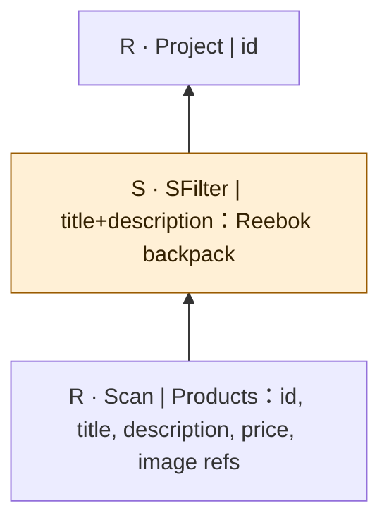

源SQL只传description，NL同时要求title；图按NL。 图依据原自然语言重建；扫描中的关联媒体是概念输入，不假定已核对物理表名/外键。

## sembench/ecomm/Q2

来源：[原件](</Volumes/Element/Github2/semantic-workload-bench/data/semantic-query-discovery-20260908/sembench/checkout/files/ecomm/queries/q2.toml>) · `native_nl_reconstructed` · `logical_only` · `scan_projection_only`

```text

Based on the image representation of the product,
find the product ids of products where the image shows
a pair of sports shoes that are predominantly yellow and silver.

```

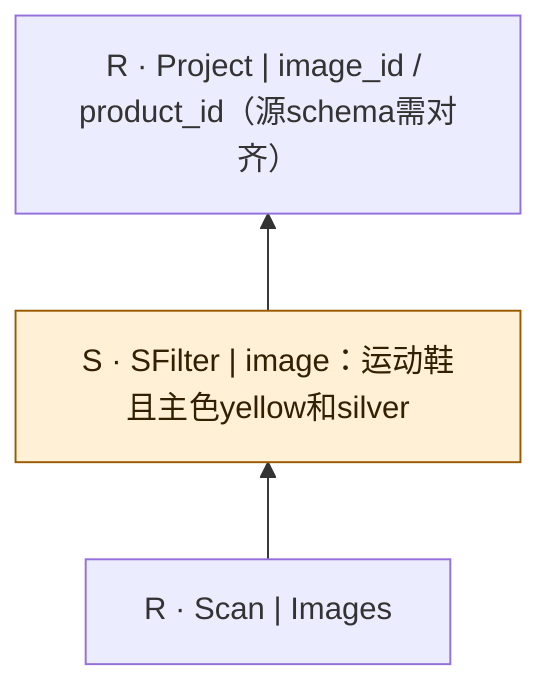

 图依据原自然语言重建；扫描中的关联媒体是概念输入，不假定已核对物理表名/外键。

## sembench/ecomm/Q3

来源：[原件](</Volumes/Element/Github2/semantic-workload-bench/data/semantic-query-discovery-20260908/sembench/checkout/files/ecomm/queries/q3.toml>) · `native_nl_reconstructed` · `logical_only` · `scan_projection_only`

```text

For each product, extract the brand name from the product description and title.
Return the product id and the brand in a column titled 'category'.

```

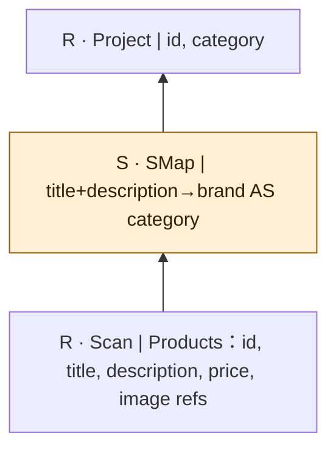

 图依据原自然语言重建；扫描中的关联媒体是概念输入，不假定已核对物理表名/外键。

## sembench/ecomm/Q4

来源：[原件](</Volumes/Element/Github2/semantic-workload-bench/data/semantic-query-discovery-20260908/sembench/checkout/files/ecomm/queries/q4.toml>) · `native_nl_reconstructed` · `logical_only` · `scan_projection_only`

```text

For each product, extract the primary color of the depicted product.
Return the product id and the primary color in a column titled 'category'.

```

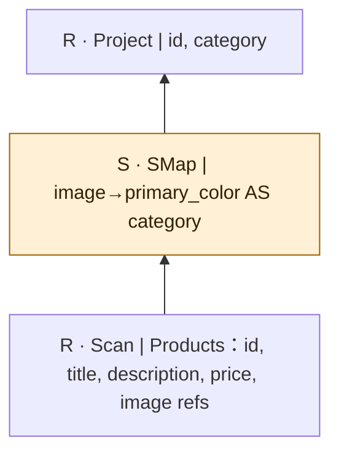

 图依据原自然语言重建；扫描中的关联媒体是概念输入，不假定已核对物理表名/外键。

## sembench/ecomm/Q5

来源：[原件](</Volumes/Element/Github2/semantic-workload-bench/data/semantic-query-discovery-20260908/sembench/checkout/files/ecomm/queries/q5.toml>) · `native_nl_reconstructed` · `logical_only` · `scan_projection_only`

```text

Based solely on the title and description of the product, classify each product into one of the following categories:

Dress: A dress is a one-piece outer garment that is worn on the torso, hangs down over the legs, and often consist of a bodice attached to a skirt.
Bottomwear: Bottomwear refers to clothing worn on the lower part of the body, such as trousers, jeans, skirts, shorts, and leggings.
Socks: Socks are a type of clothing worn on the feet, typically made of soft fabric, designed to provide comfort and warmth.
Topwear: Topwear refers to clothing worn on the upper part of the body, such as shirts, blouses, t-shirts, and jackets.
Innerwear: Innerwear refers to clothing worn beneath outer garments, typically close to the skin, such as underwear, bras, and undershirts.

Each product can only have one category.
Return the id of the product as well as its category.

```

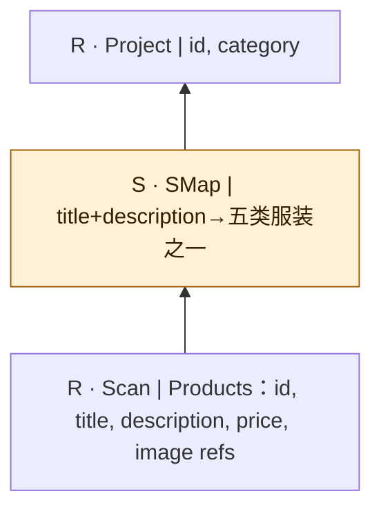

Q5/Q6源SQL有表名/提示词或语法不一致；图依原NL的模态定义。 图依据原自然语言重建；扫描中的关联媒体是概念输入，不假定已核对物理表名/外键。

## sembench/ecomm/Q6

来源：[原件](</Volumes/Element/Github2/semantic-workload-bench/data/semantic-query-discovery-20260908/sembench/checkout/files/ecomm/queries/q6.toml>) · `native_nl_reconstructed` · `logical_only` · `scan_projection_only`

```text

Based solely on the image of the product, classify each product into one of the following categories:

Dress: A dress is a one-piece outer garment that is worn on the torso, hangs down over the legs, and often consist of a bodice attached to a skirt.
Bottomwear: Bottomwear refers to clothing worn on the lower part of the body, such as trousers, jeans, skirts, shorts, and leggings.
Socks: Socks are a type of clothing worn on the feet, typically made of soft fabric, designed to provide comfort and warmth.
Topwear: Topwear refers to clothing worn on the upper part of the body, such as shirts, blouses, t-shirts, and jackets.
Innerwear: Innerwear refers to clothing worn beneath outer garments, typically close to the skin, such as underwear, bras, and undershirts.

Each product can only have one category.
Return the id of the product as well as its category.

```

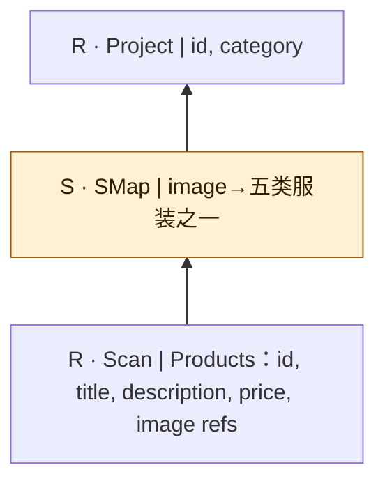

Q5/Q6源SQL有表名/提示词或语法不一致；图依原NL的模态定义。 图依据原自然语言重建；扫描中的关联媒体是概念输入，不假定已核对物理表名/外键。

## sembench/ecomm/Q7

来源：[原件](</Volumes/Element/Github2/semantic-workload-bench/data/semantic-query-discovery-20260908/sembench/checkout/files/ecomm/queries/q7.toml>) · `native_nl_reconstructed` · `logical_only` · `substantive_relational`

```text

Find all pairs of products priced at $5 or less where both products
are of the same category and from the same brand based on their descriptions.

```

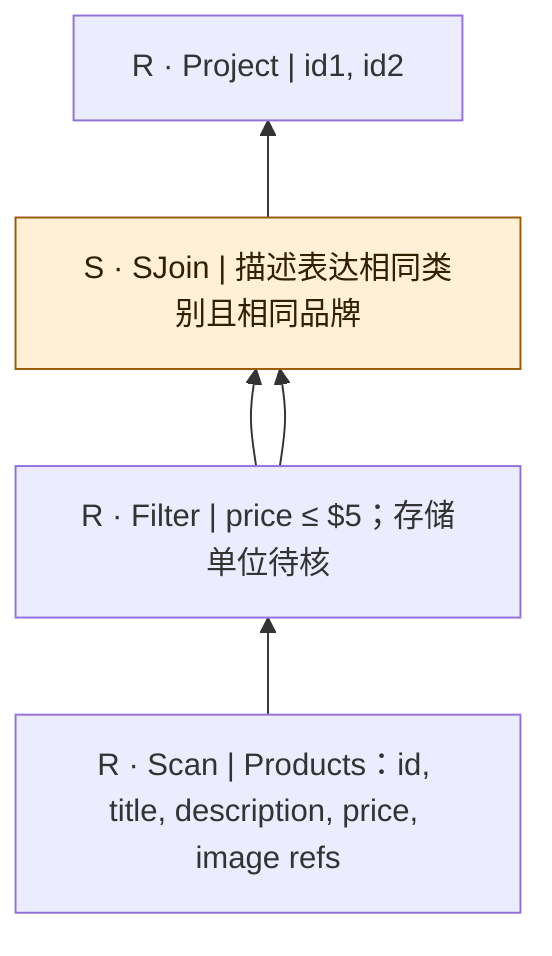

gold SQL用price≤500；未声明单位换算。原gold允许自配对及(a,b)/(b,a)，NL未要求distinct，本图不擅加id1≠id2。 图依据原自然语言重建；扫描中的关联媒体是概念输入，不假定已核对物理表名/外键。

## sembench/ecomm/Q8

来源：[原件](</Volumes/Element/Github2/semantic-workload-bench/data/semantic-query-discovery-20260908/sembench/checkout/files/ecomm/queries/q8.toml>) · `native_nl_reconstructed` · `logical_only` · `substantive_relational`

```text

Perform a self-join of the dataset.
For each product with a product description having at least 3000 characters,
find the matching product images based on the title and the description
of the product.

```

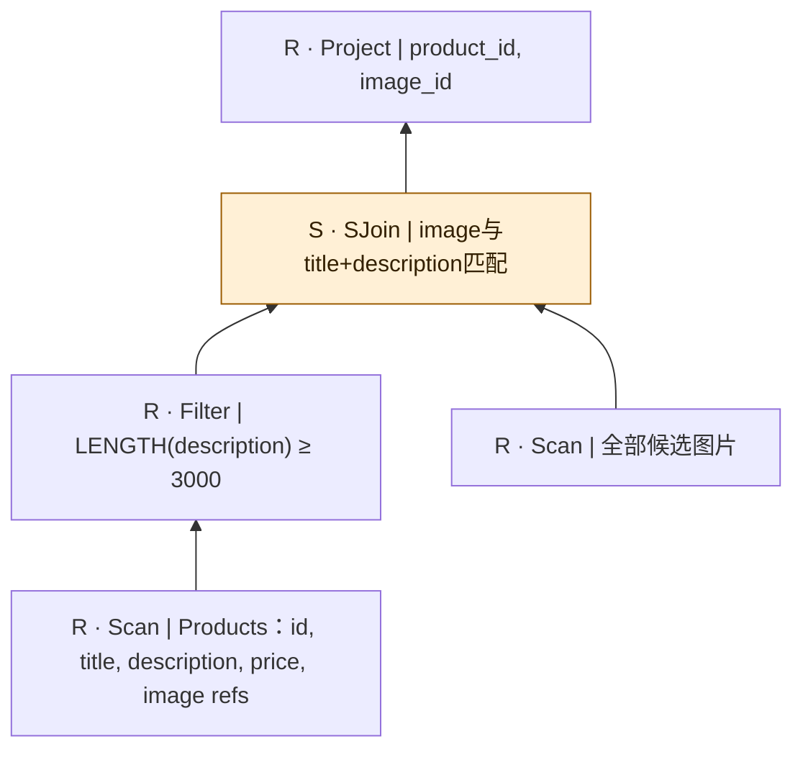

NL允许多个匹配图；gold只返回id-id原配图。原配对不能自动证明其他语义匹配图全错。 图依据原自然语言重建；扫描中的关联媒体是概念输入，不假定已核对物理表名/外键。

## sembench/ecomm/Q9

来源：[原件](</Volumes/Element/Github2/semantic-workload-bench/data/semantic-query-discovery-20260908/sembench/checkout/files/ecomm/queries/q9.toml>) · `native_nl_reconstructed` · `logical_only` · `substantive_relational`

```text

Based on product images, find pairs of distinct products under $8
in a single base color (Black, Blue, Red, White, Orange, or Green)
that depict objects of the same category and the same dominant surface color.

```

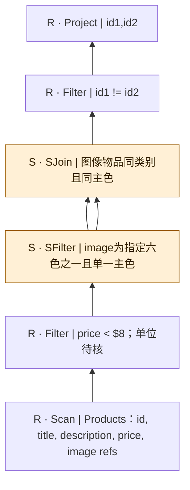

gold price<800，且用baseColour/colour1/colour2人工字段预筛。模型只能通过公开模态或明确开放字段得到这些事实。 图依据原自然语言重建；扫描中的关联媒体是概念输入，不假定已核对物理表名/外键。

## sembench/ecomm/Q10

来源：[原件](</Volumes/Element/Github2/semantic-workload-bench/data/semantic-query-discovery-20260908/sembench/checkout/files/ecomm/queries/q10.toml>) · `native_nl_reconstructed` · `logical_only` · `substantive_relational`

```text

Based on product images, find matching outfits consisting of shoes,
bottomwear, and topwear in Black, Blue, Red, or White,
where all three items are from the same brand, same color,
and each is priced at $10 or less.

```

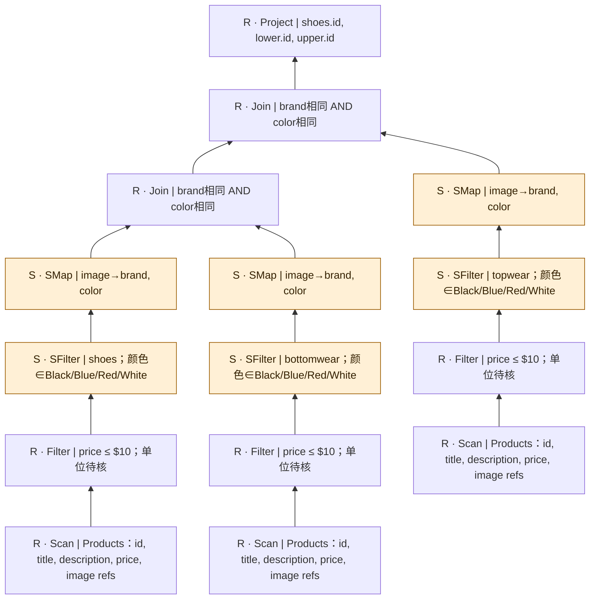

此图选用先语义抽属性、再结构等值join的合法实现；直接SJoin是另一方案。gold price≤1000而NL≤$10，单位未核。 图依据原自然语言重建；扫描中的关联媒体是概念输入，不假定已核对物理表名/外键。

## sembench/ecomm/Q11

来源：[原件](</Volumes/Element/Github2/semantic-workload-bench/data/semantic-query-discovery-20260908/sembench/checkout/files/ecomm/queries/q11.toml>) · `native_nl_reconstructed` · `logical_only` · `substantive_relational`

```text

Based on product images and descriptions, find matching all-black outfits
consisting of shoes, bottomwear (excluding swimwear), topwear (excluding swimwear),
and an accessory (watch, jewellery, or bag priced at $5 or less),
where all four items are from the same brand.

```

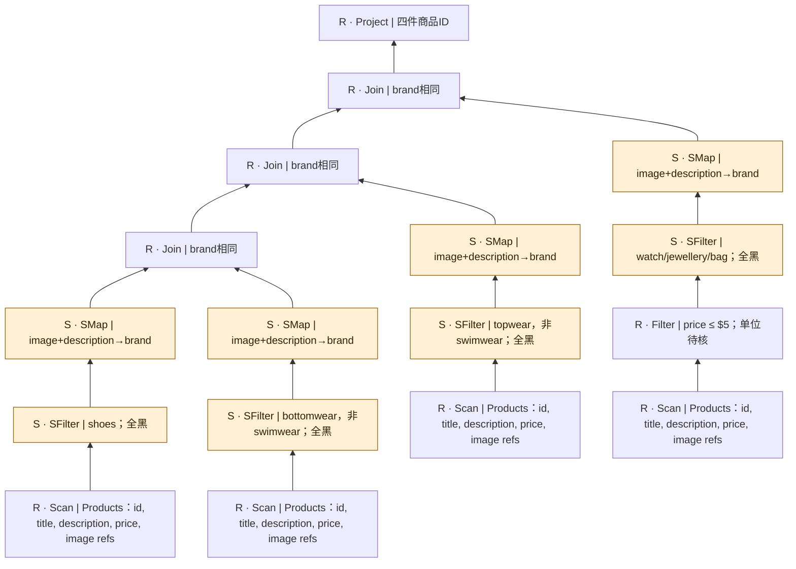

按NL all-black要求四类都黑；gold accessories分支缺Black过滤。价格仅限制配饰，不扩展到全部四件。 图依据原自然语言重建；扫描中的关联媒体是概念输入，不假定已核对物理表名/外键。

## sembench/ecomm/Q12

来源：[原件](</Volumes/Element/Github2/semantic-workload-bench/data/semantic-query-discovery-20260908/sembench/checkout/files/ecomm/queries/q12.toml>) · `native_nl_reconstructed` · `logical_only` · `scan_projection_only`

```text

For each Adidas or Puma product, use the product image and description
to generate a JSON object with the product id, brand name (lowercase),
and master category classified as 'accessories', 'apparel', or 'footwear'.

```

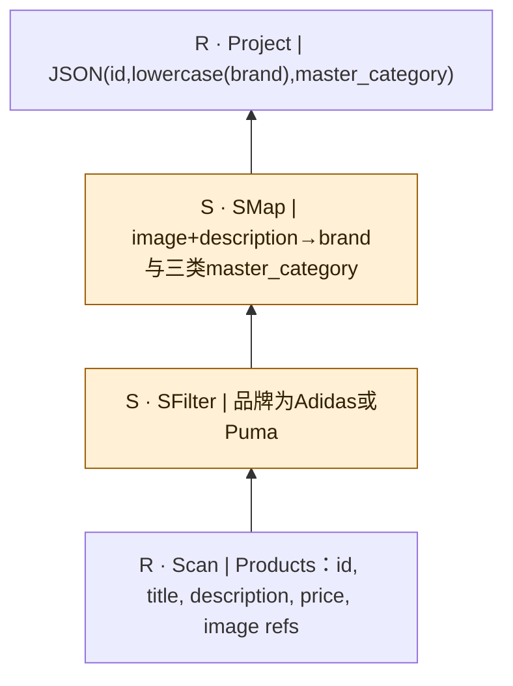

 图依据原自然语言重建；扫描中的关联媒体是概念输入，不假定已核对物理表名/外键。

## sembench/ecomm/Q13

来源：[原件](</Volumes/Element/Github2/semantic-workload-bench/data/semantic-query-discovery-20260908/sembench/checkout/files/ecomm/queries/q13.toml>) · `native_nl_reconstructed` · `logical_only` · `scan_projection_only`

```text

Based on product images and descriptions, find men's running shirts
with round neck and short sleeves, in blue or black (not bright colors
like white, and definitely not green), with a striped design,
suitable for outdoor running in warm weather.

```

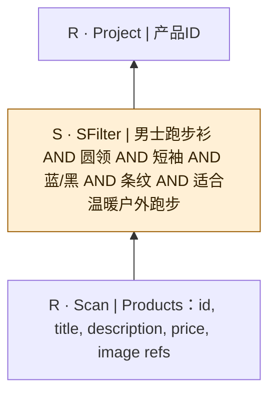

 图依据原自然语言重建；扫描中的关联媒体是概念输入，不假定已核对物理表名/外键。

## sembench/ecomm/Q14

来源：[原件](</Volumes/Element/Github2/semantic-workload-bench/data/semantic-query-discovery-20260908/sembench/checkout/files/ecomm/queries/q14.toml>) · `native_nl_reconstructed` · `logical_only` · `substantive_relational`

```text

For each fashion product that costs less than 130,
find the single image that best matches the product's textual description
(including the product name and full description),
but only if that image also depicts white socks.

```

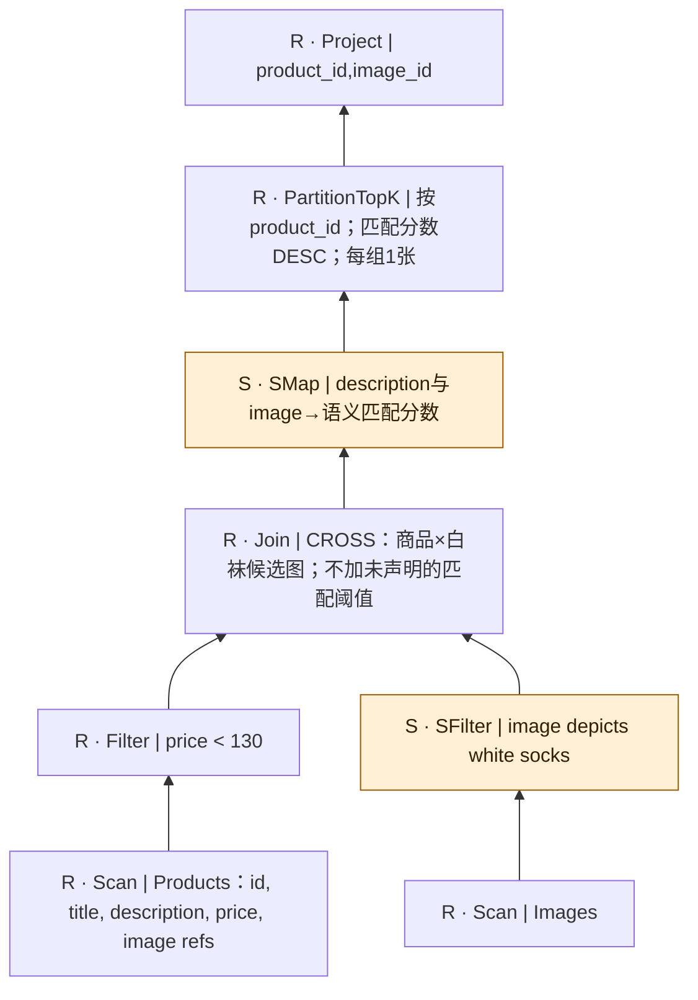

按NL best使用每产品Top1，不是全局LIMIT 1。源SQL AI.SCORE的ORDER BY未写DESC，且gold仅筛原商品属性；二者不能未经核验认定等价。 图依据原自然语言重建；扫描中的关联媒体是概念输入，不假定已核对物理表名/外键。
