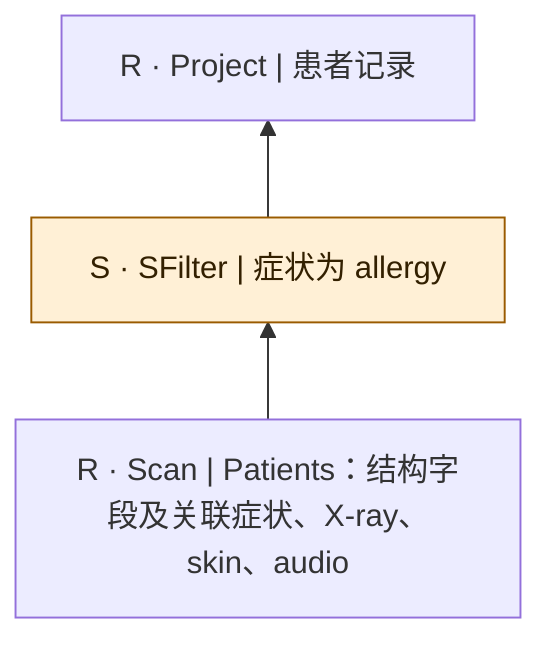
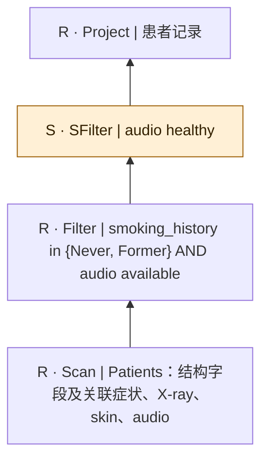
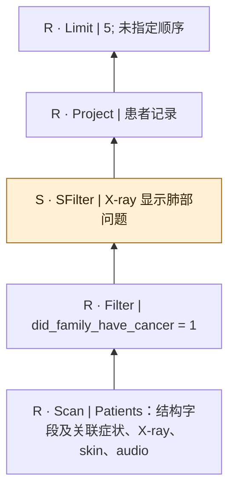
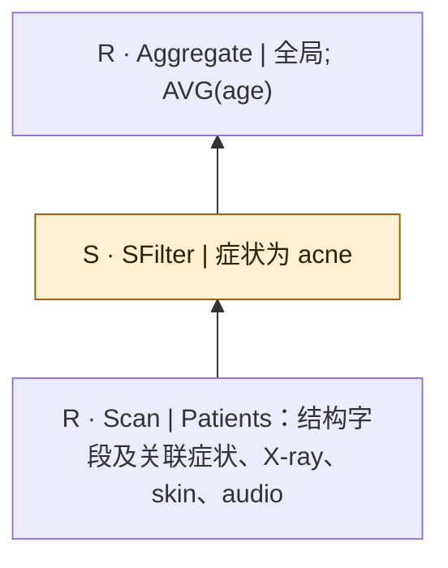
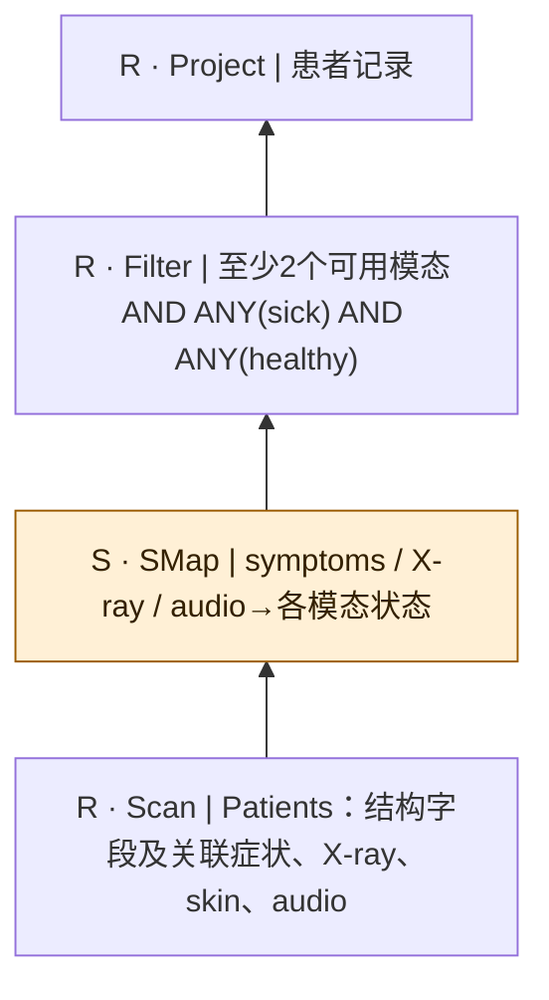
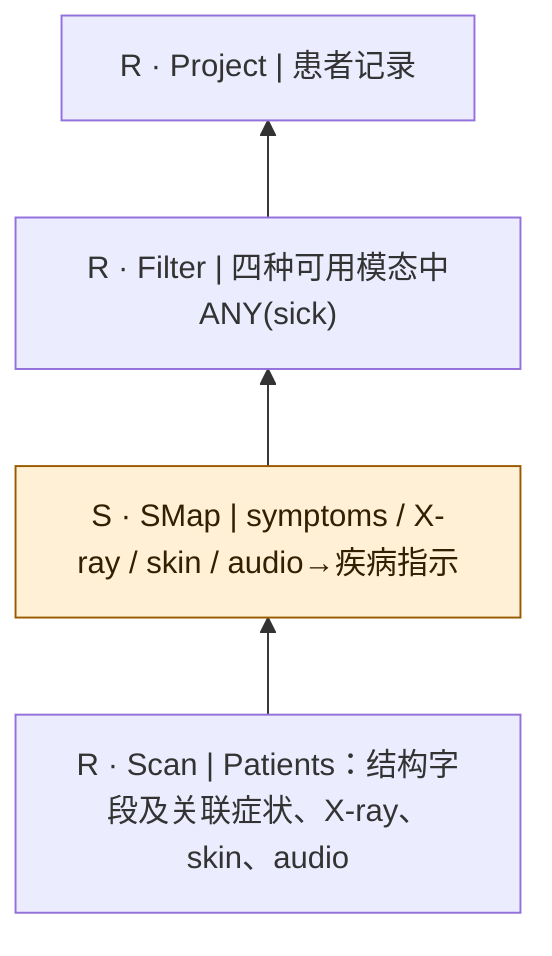
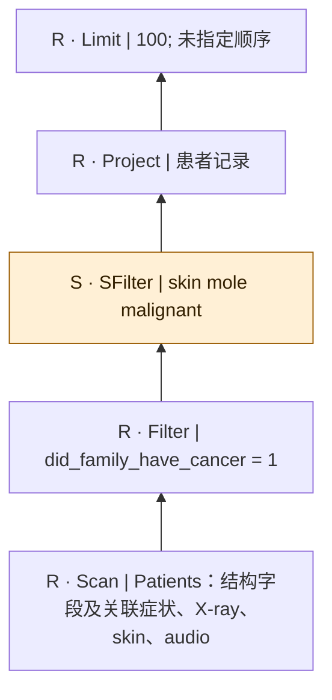
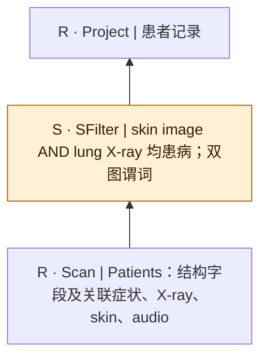
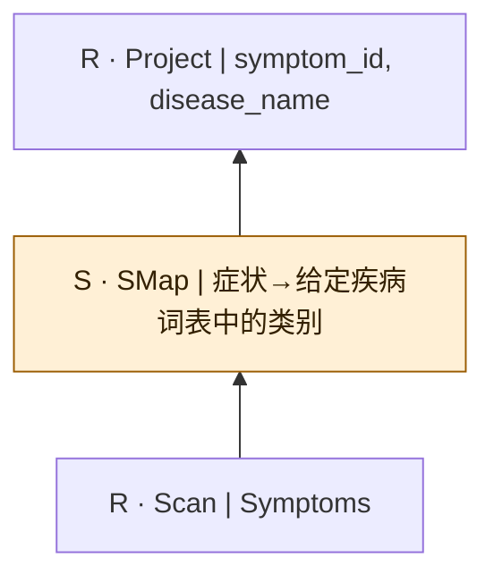

# sembench-medical：逐查询逻辑计划

[返回总表](README.md)

图从下往上读：输入 → 算子 → 输出。S为语义算子；R为确定性关系/辅助步骤。检索与未决节点在标签中单独注明。

## sembench/medical/Q1

来源：[原件](</Volumes/Element/Github2/semantic-workload-bench/data/semantic-query-discovery-20260908/sembench/checkout/files/medical/query/natural_language/Q1.txt>) · `native_nl_reconstructed` · `logical_only` · `scan_projection_only`

```text

Which patients have symptoms of allergy in our database?

```



 图依据原自然语言重建；扫描中的关联媒体是概念输入，不假定已核对物理表名/外键。

## sembench/medical/Q2

来源：[原件](</Volumes/Element/Github2/semantic-workload-bench/data/semantic-query-discovery-20260908/sembench/checkout/files/medical/query/natural_language/Q2.txt>) · `native_nl_reconstructed` · `logical_only` · `substantive_relational`

```text

Find patients with available audio sound who are non-smokers (never smoked or stopped smoking) and healthy considering the sound recordings in our database.

```



 图依据原自然语言重建；扫描中的关联媒体是概念输入，不假定已核对物理表名/外键。

## sembench/medical/Q3

来源：[原件](</Volumes/Element/Github2/semantic-workload-bench/data/semantic-query-discovery-20260908/sembench/checkout/files/medical/query/natural_language/Q3.txt>) · `native_nl_reconstructed` · `logical_only` · `substantive_relational`

```text

Find five patients who have cancer in their family history and have lung problems according to their X-ray images (considered sick).

```



 图依据原自然语言重建；扫描中的关联媒体是概念输入，不假定已核对物理表名/外键。

## sembench/medical/Q4

来源：[原件](</Volumes/Element/Github2/semantic-workload-bench/data/semantic-query-discovery-20260908/sembench/checkout/files/medical/query/natural_language/Q4.txt>) · `native_nl_reconstructed` · `logical_only` · `substantive_relational`

```text

What is an average age of patients with acne?

```



 图依据原自然语言重建；扫描中的关联媒体是概念输入，不假定已核对物理表名/外键。

## sembench/medical/Q5

来源：[原件](</Volumes/Element/Github2/semantic-workload-bench/data/semantic-query-discovery-20260908/sembench/checkout/files/medical/query/natural_language/Q5.txt>) · `native_nl_reconstructed` · `logical_only` · `substantive_relational`

```text

Count patients who are actively smoking ("Current") and whose audio and X-Ray image suggest lung diseases.

```



```mermaid
flowchart BT
  n0["R · Aggregate | 全局; COUNT(*)"]
  n1["S · SFilter | audio 与 X-ray 均提示肺病"]
  n2["R · Filter | smoking_history = &#x27;Current&#x27;"]
  n3["R · Scan | Patients：结构字段及关联症状、X-ray、skin、audio"]
  n3 --> n2
  n2 --> n1
  n1 --> n0
  classDef semantic fill:#fff0d6,stroke:#9a5b00,color:#332000;
  class n1 semantic;
```

明确冲突：NL要求Current，随库gold SQL筛Never并分组。图按NL；原gold不可直接作为此图执行真值。 图依据原自然语言重建；扫描中的关联媒体是概念输入，不假定已核对物理表名/外键。

## sembench/medical/Q6

来源：[原件](</Volumes/Element/Github2/semantic-workload-bench/data/semantic-query-discovery-20260908/sembench/checkout/files/medical/query/natural_language/Q6.txt>) · `native_nl_reconstructed` · `logical_only` · `substantive_relational`

```text

Find patients who are sick according to at least one modality but healthy according to another modality, consider only patients with two or more available modalities. Consider only symptoms, x-ray images, and lung audio recordings.

```



随库gold SQL额外ORDER BY age LIMIT 1，且未显式落实至少两个模态；图按NL，不套其截断。 图依据原自然语言重建；扫描中的关联媒体是概念输入，不假定已核对物理表名/外键。

## sembench/medical/Q7

来源：[原件](</Volumes/Element/Github2/semantic-workload-bench/data/semantic-query-discovery-20260908/sembench/checkout/files/medical/query/natural_language/Q7.txt>) · `native_nl_reconstructed` · `logical_only` · `substantive_relational`

```text

Find patients with any sickness in our database (consider all symptoms, x-ray images, skin moles images, and lung audio recordings)?

```



明确冲突：NL要患者清单，随库Q7.sql返回AVG(age)。图按NL。 图依据原自然语言重建；扫描中的关联媒体是概念输入，不假定已核对物理表名/外键。

## sembench/medical/Q8

来源：[原件](</Volumes/Element/Github2/semantic-workload-bench/data/semantic-query-discovery-20260908/sembench/checkout/files/medical/query/natural_language/Q8.txt>) · `native_nl_reconstructed` · `logical_only` · `substantive_relational`

```text

Find hundred patients with malignant skin moles and cancer in the family history.

```



 图依据原自然语言重建；扫描中的关联媒体是概念输入，不假定已核对物理表名/外键。

## sembench/medical/Q9

来源：[原件](</Volumes/Element/Github2/semantic-workload-bench/data/semantic-query-discovery-20260908/sembench/checkout/files/medical/query/natural_language/Q9.txt>) · `native_nl_reconstructed` · `logical_only` · `scan_projection_only`

```text

Find patients who are sick according to both skin moles image and lung X-Ray image (semantic filter/join with two images in one prompt).

```



 图依据原自然语言重建；扫描中的关联媒体是概念输入，不假定已核对物理表名/外键。

## sembench/medical/Q10

来源：[原件](</Volumes/Element/Github2/semantic-workload-bench/data/semantic-query-discovery-20260908/sembench/checkout/files/medical/query/natural_language/Q10.txt>) · `native_nl_reconstructed` · `logical_only` · `scan_projection_only`

```text

For all symptoms, generate disease name from a given list of diseases.

```



 图依据原自然语言重建；扫描中的关联媒体是概念输入，不假定已核对物理表名/外键。
