# sembench-mmqa：逐查询逻辑计划

[返回总表](README.md)

图从下往上读：输入 → 算子 → 输出。S为语义算子；R为确定性关系/辅助步骤。检索与未决节点在标签中单独注明。

## sembench/mmqa/Q1

来源：[原件](</Volumes/Element/Github2/semantic-workload-bench/data/semantic-query-discovery-20260908/sembench/checkout/files/mmqa/query/natural_language/q1.json>) · `native_nl_reconstructed` · `logical_only` · `substantive_relational`

```text

Who is the director of the movie that has Ben Piazza in the role of Bob Whitewood?

```

```mermaid
flowchart BT
  n0["R · Project | director"]
  n1["S · SMap | 查所选电影的导演"]
  n2["R · Filter | actor=&#x27;Ben Piazza&#x27; AND role=&#x27;Bob Whitewood&#x27;"]
  n3["S · SMap | 表格/文本→(film, actor, role)"]
  n4["R · Scan | 电影表与关联证据"]
  n4 --> n3
  n3 --> n2
  n2 --> n1
  n1 --> n0
  classDef semantic fill:#fff0d6,stroke:#9a5b00,color:#332000;
  class n1,n3 semantic;
```

 图依据原自然语言重建；扫描中的关联媒体是概念输入，不假定已核对物理表名/外键。

## sembench/mmqa/Q2A

来源：[原件](</Volumes/Element/Github2/semantic-workload-bench/data/semantic-query-discovery-20260908/sembench/checkout/files/mmqa/query/natural_language/q2a.json>) · `native_nl_reconstructed` · `logical_only` · `substantive_relational`

```text

Identify the images containing logos, if available, for each racetrack in which A.P. Warrior was a contender.

```

```mermaid
flowchart BT
  n0["R · Project | racetrack, logo_image"]
  n1["S · SLeftJoin | logo图片对应赛马场；无logo保留空值"]
  n2["R · Distinct | 集合语义"]
  n3["R · Project | racetrack"]
  n4["R · Filter | contender=&#x27;A.P. Warrior&#x27;"]
  n5["S · SMap | 比赛表→(racetrack, contender)"]
  n6["R · Scan | 赛马表与关联证据"]
  n7["R · Scan | 图片与相关文本"]
  n6 --> n5
  n5 --> n4
  n4 --> n3
  n3 --> n2
  n2 --> n1
  n7 --> n1
  n1 --> n0
  classDef semantic fill:#fff0d6,stroke:#9a5b00,color:#332000;
  class n1,n5 semantic;
```

 图依据原自然语言重建；扫描中的关联媒体是概念输入，不假定已核对物理表名/外键。

## sembench/mmqa/Q2B

来源：[原件](</Volumes/Element/Github2/semantic-workload-bench/data/semantic-query-discovery-20260908/sembench/checkout/files/mmqa/query/natural_language/q2b.json>) · `native_nl_reconstructed` · `logical_only` · `substantive_relational`

```text

Identify the images containing logos, if available, for each racetrack in which A.P. Warrior was a contender. What is the color of each logo?

```

```mermaid
flowchart BT
  n0["R · Project | racetrack, logo_image, color"]
  n1["S · SMap | 非空logo→颜色；空logo保留NULL"]
  n2["S · SLeftJoin | logo对应赛马场；if available"]
  n3["R · Distinct | 集合语义"]
  n4["R · Project | racetrack"]
  n5["R · Filter | contender=&#x27;A.P. Warrior&#x27;"]
  n6["S · SMap | 比赛表→(racetrack, contender)"]
  n7["R · Scan | 赛马表与关联证据"]
  n8["R · Scan | 图片与相关文本"]
  n7 --> n6
  n6 --> n5
  n5 --> n4
  n4 --> n3
  n3 --> n2
  n8 --> n2
  n2 --> n1
  n1 --> n0
  classDef semantic fill:#fff0d6,stroke:#9a5b00,color:#332000;
  class n1,n2,n6 semantic;
```

 图依据原自然语言重建；扫描中的关联媒体是概念输入，不假定已核对物理表名/外键。

## sembench/mmqa/Q3A

来源：[原件](</Volumes/Element/Github2/semantic-workload-bench/data/semantic-query-discovery-20260908/sembench/checkout/files/mmqa/query/natural_language/q3a.json>) · `native_nl_reconstructed` · `logical_only` · `scan_projection_only`

```text

Which movies are comedies?

```


 图依据原自然语言重建；扫描中的关联媒体是概念输入，不假定已核对物理表名/外键。

## sembench/mmqa/Q3B

来源：[原件](</Volumes/Element/Github2/semantic-workload-bench/data/semantic-query-discovery-20260908/sembench/checkout/files/mmqa/query/natural_language/q3b.json>) · `native_nl_reconstructed` · `logical_only` · `scan_projection_only`

```text

Which movies are sci-fi?

```

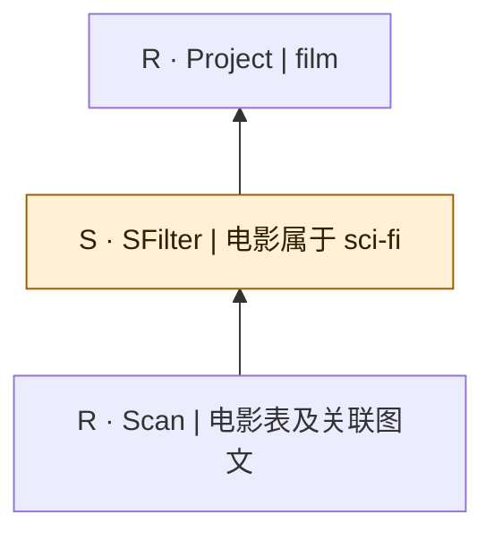

 图依据原自然语言重建；扫描中的关联媒体是概念输入，不假定已核对物理表名/外键。

## sembench/mmqa/Q3C

来源：[原件](</Volumes/Element/Github2/semantic-workload-bench/data/semantic-query-discovery-20260908/sembench/checkout/files/mmqa/query/natural_language/q3c.json>) · `native_nl_reconstructed` · `logical_only` · `scan_projection_only`

```text

Which movies are romances?

```

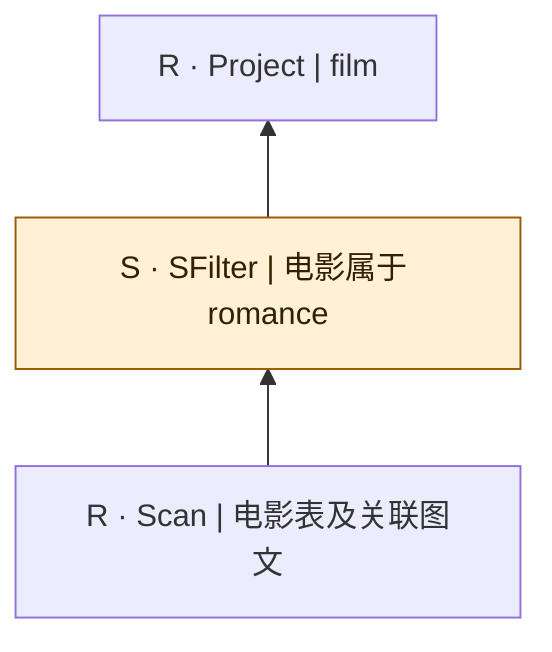

 图依据原自然语言重建；扫描中的关联媒体是概念输入，不假定已核对物理表名/外键。

## sembench/mmqa/Q3D

来源：[原件](</Volumes/Element/Github2/semantic-workload-bench/data/semantic-query-discovery-20260908/sembench/checkout/files/mmqa/query/natural_language/q3d.json>) · `native_nl_reconstructed` · `logical_only` · `scan_projection_only`

```text

Which movies are horror?

```

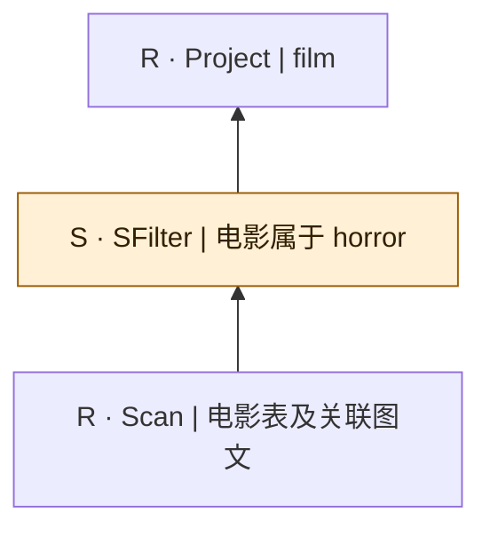

 图依据原自然语言重建；扫描中的关联媒体是概念输入，不假定已核对物理表名/外键。

## sembench/mmqa/Q3E

来源：[原件](</Volumes/Element/Github2/semantic-workload-bench/data/semantic-query-discovery-20260908/sembench/checkout/files/mmqa/query/natural_language/q3e.json>) · `native_nl_reconstructed` · `logical_only` · `scan_projection_only`

```text

Which movies are heist movies?

```


 图依据原自然语言重建；扫描中的关联媒体是概念输入，不假定已核对物理表名/外键。

## sembench/mmqa/Q3F

来源：[原件](</Volumes/Element/Github2/semantic-workload-bench/data/semantic-query-discovery-20260908/sembench/checkout/files/mmqa/query/natural_language/q3f.json>) · `native_nl_reconstructed` · `logical_only` · `scan_projection_only`

```text

Which movies are romantic comedies?

```

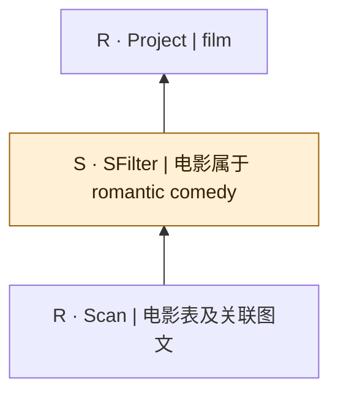

 图依据原自然语言重建；扫描中的关联媒体是概念输入，不假定已核对物理表名/外键。

## sembench/mmqa/Q3G

来源：[原件](</Volumes/Element/Github2/semantic-workload-bench/data/semantic-query-discovery-20260908/sembench/checkout/files/mmqa/query/natural_language/q3g.json>) · `native_nl_reconstructed` · `logical_only` · `scan_projection_only`

```text

Which movies are biographical comedies?

```

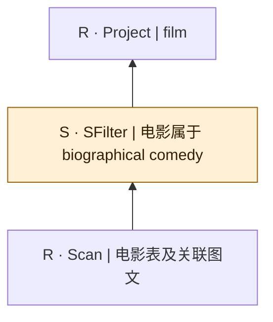

 图依据原自然语言重建；扫描中的关联媒体是概念输入，不假定已核对物理表名/外键。

## sembench/mmqa/Q4

来源：[原件](</Volumes/Element/Github2/semantic-workload-bench/data/semantic-query-discovery-20260908/sembench/checkout/files/mmqa/query/natural_language/q4.json>) · `native_nl_reconstructed` · `logical_only` · `substantive_relational`

```text

Categorize the movies in the table by their genre. If a movie belongs to multiple genres, list it under each applicable genre.

```

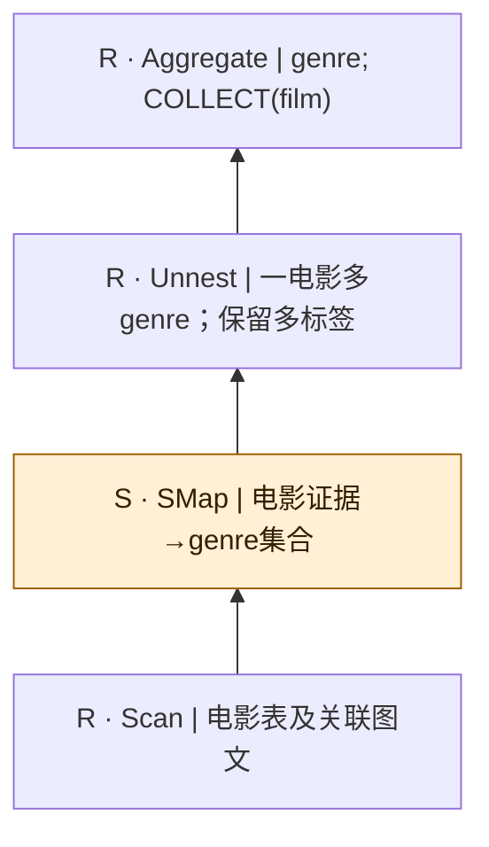

 图依据原自然语言重建；扫描中的关联媒体是概念输入，不假定已核对物理表名/外键。

## sembench/mmqa/Q5

来源：[原件](</Volumes/Element/Github2/semantic-workload-bench/data/semantic-query-discovery-20260908/sembench/checkout/files/mmqa/query/natural_language/q5.json>) · `native_nl_reconstructed` · `logical_only` · `substantive_relational`

```text

Who has played a role in all the following movies: 'Love Is the Drug', 'Crashing', 'Cloverfield', 'My Best Friend's Girl', 'Hot Tub Time Machine', 'The Last Rites of Ransom Pride', 'Save the Date', 'Bachelorette', '3, 2, 1... Frankie Go Boom', 'Queens of Country', 'Item 47', 'The Night Before', 'Now You See Me 2', 'Allied', 'Extinction', and 'Cobweb'?

```

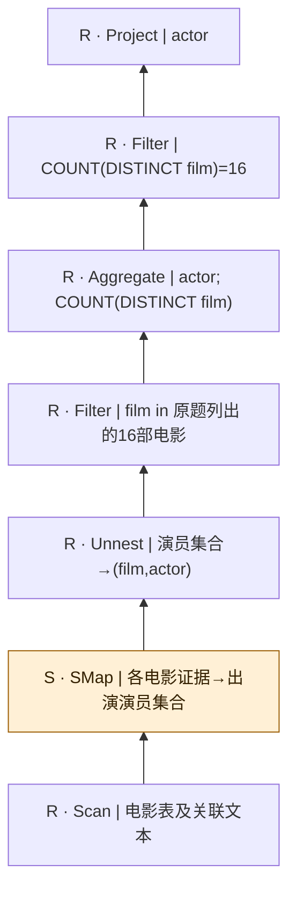

这是关系除法的GROUP BY/HAVING实现：必须覆盖全部16部电影，COUNT(*)会被重复出演记录误导。 图依据原自然语言重建；扫描中的关联媒体是概念输入，不假定已核对物理表名/外键。

## sembench/mmqa/Q6A

来源：[原件](</Volumes/Element/Github2/semantic-workload-bench/data/semantic-query-discovery-20260908/sembench/checkout/files/mmqa/query/natural_language/q6a.json>) · `native_nl_reconstructed` · `logical_only` · `substantive_relational`

```text

Which airlines have destinations in Frankfurt?

```


 图依据原自然语言重建；扫描中的关联媒体是概念输入，不假定已核对物理表名/外键。

## sembench/mmqa/Q6B

来源：[原件](</Volumes/Element/Github2/semantic-workload-bench/data/semantic-query-discovery-20260908/sembench/checkout/files/mmqa/query/natural_language/q6b.json>) · `native_nl_reconstructed` · `logical_only` · `substantive_relational`

```text

Which airlines have destinations in Germany?

```

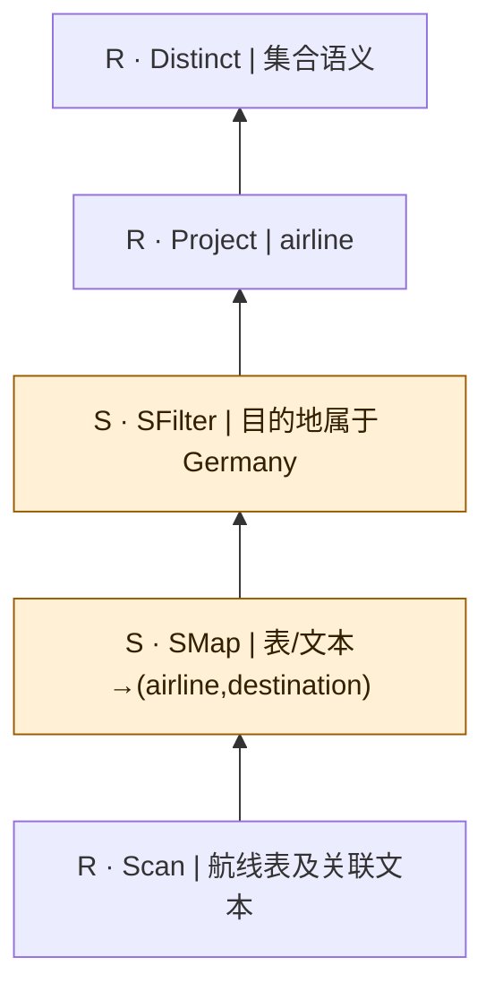

 图依据原自然语言重建；扫描中的关联媒体是概念输入，不假定已核对物理表名/外键。

## sembench/mmqa/Q6C

来源：[原件](</Volumes/Element/Github2/semantic-workload-bench/data/semantic-query-discovery-20260908/sembench/checkout/files/mmqa/query/natural_language/q6c.json>) · `native_nl_reconstructed` · `logical_only` · `substantive_relational`

```text

Which airlines have destinations in Europe?

```


 图依据原自然语言重建；扫描中的关联媒体是概念输入，不假定已核对物理表名/外键。

## sembench/mmqa/Q7

来源：[原件](</Volumes/Element/Github2/semantic-workload-bench/data/semantic-query-discovery-20260908/sembench/checkout/files/mmqa/query/natural_language/q7.json>) · `native_nl_reconstructed` · `logical_only` · `substantive_relational`

```text

For each airline with destinations in Europe, find its logo if one exists.

```

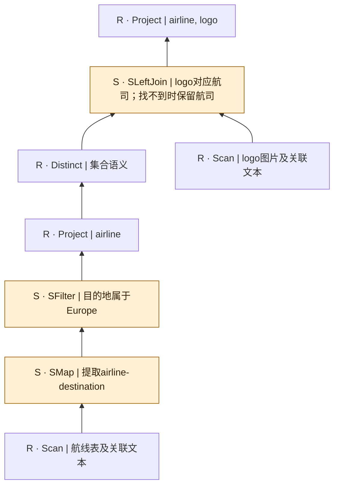

if one exists用左连接保留无logo航司；若实现用inner join会改变请求。 图依据原自然语言重建；扫描中的关联媒体是概念输入，不假定已核对物理表名/外键。
