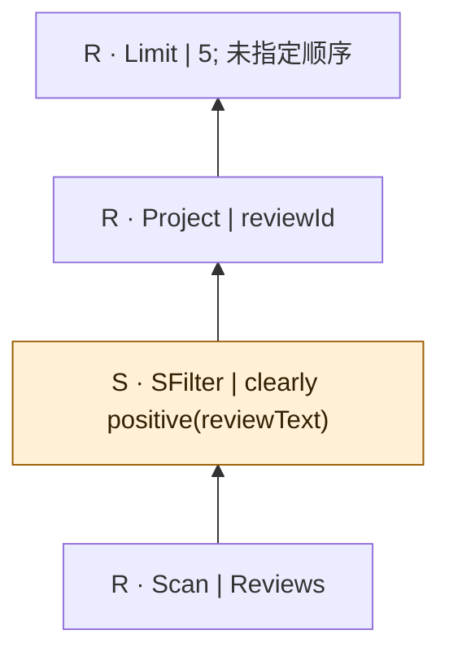
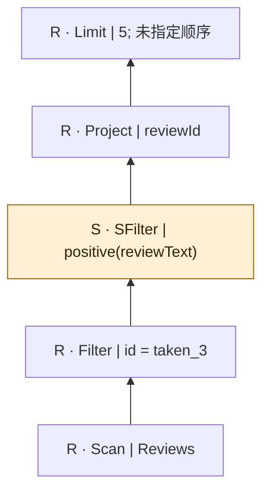
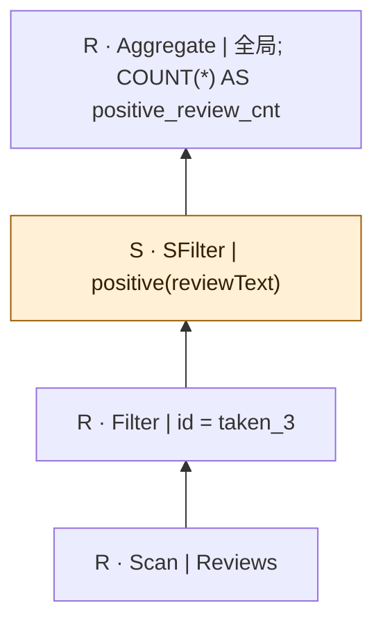
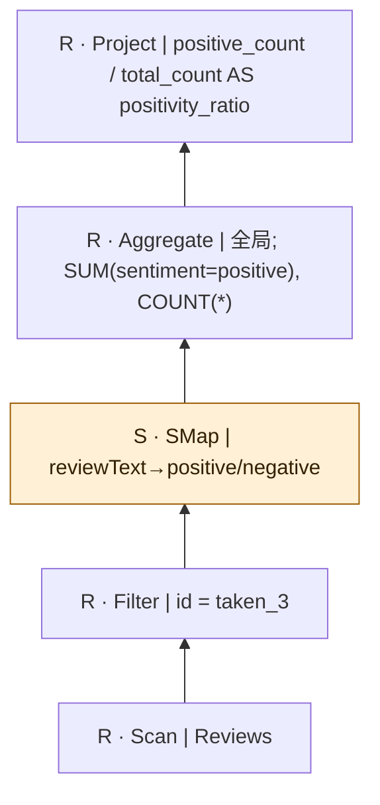
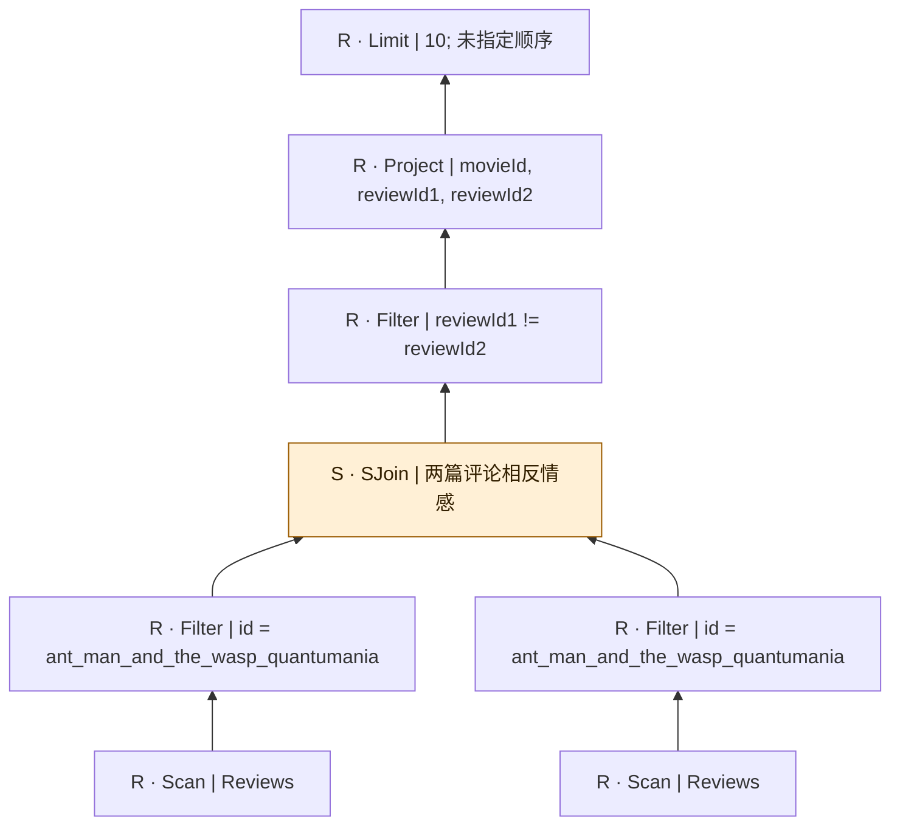
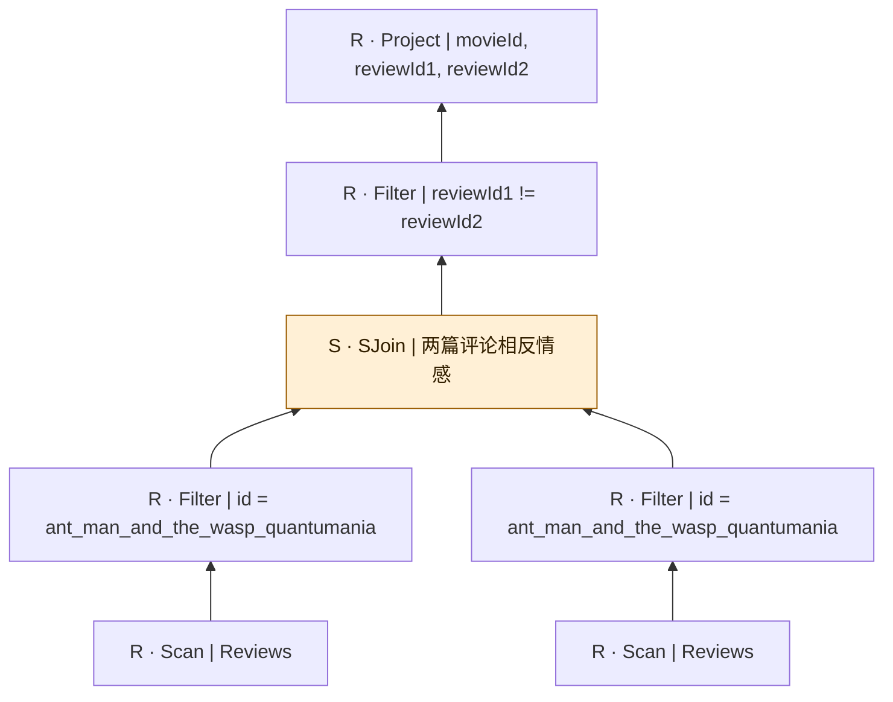
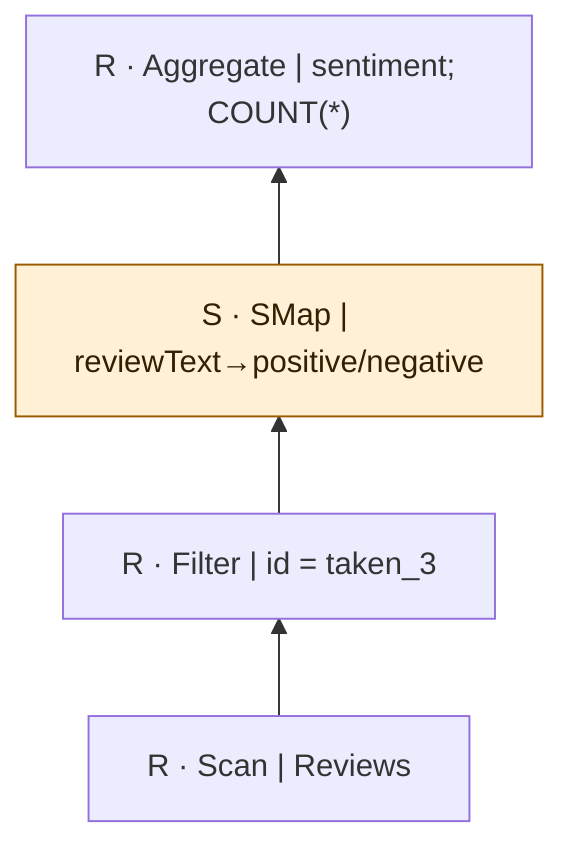
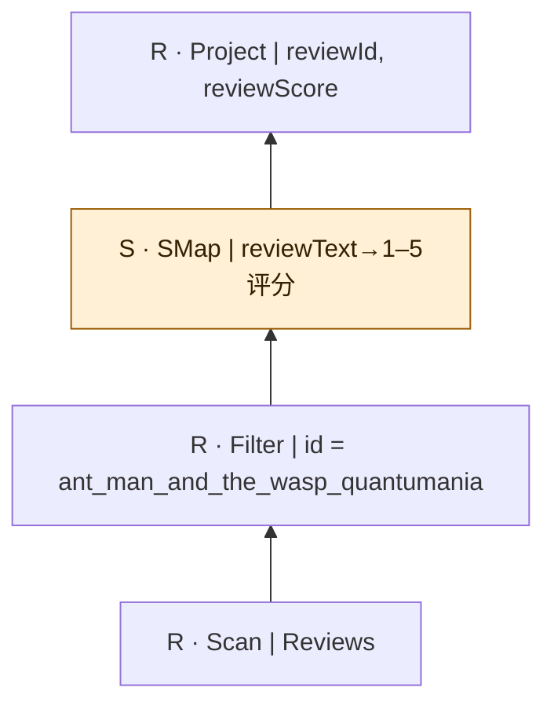
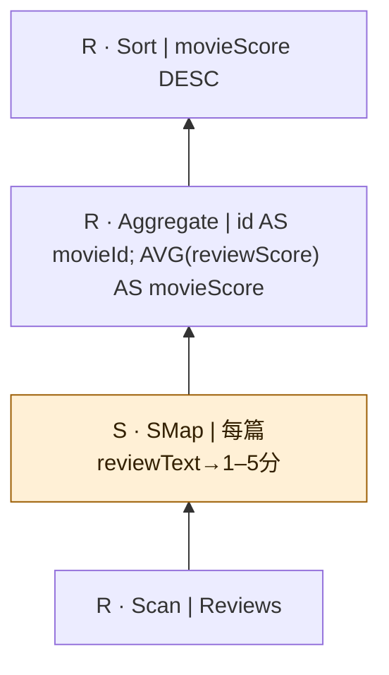

# sembench-movie：逐查询逻辑计划

[返回总表](README.md)

图从下往上读：输入 → 算子 → 输出。S为语义算子；R为确定性关系/辅助步骤。检索与未决节点在标签中单独注明。

## sembench/movie/Q1

来源：[原件](</Volumes/Element/Github2/semantic-workload-bench/data/semantic-query-discovery-20260908/sembench/checkout/files/movie/query/natural_language/Q1.txt>) · `native_nl_reconstructed` · `logical_only` · `substantive_relational`

```text

Five clearly positive reviews (any movie). Return reviewId.

```



NL要任意5条；gold SQL未写LIMIT。 图依据原自然语言重建；扫描中的关联媒体是概念输入，不假定已核对物理表名/外键。

## sembench/movie/Q2

来源：[原件](</Volumes/Element/Github2/semantic-workload-bench/data/semantic-query-discovery-20260908/sembench/checkout/files/movie/query/natural_language/Q2.txt>) · `native_nl_reconstructed` · `logical_only` · `substantive_relational`

```text

Five positive reviews for movie "taken_3". Return reviewId.

```



NL要5条；gold SQL未写LIMIT。 图依据原自然语言重建；扫描中的关联媒体是概念输入，不假定已核对物理表名/外键。

## sembench/movie/Q3

来源：[原件](</Volumes/Element/Github2/semantic-workload-bench/data/semantic-query-discovery-20260908/sembench/checkout/files/movie/query/natural_language/Q3.txt>) · `native_nl_reconstructed` · `logical_only` · `substantive_relational`

```text

Count of positive reviews for movie "taken_3". Return the count as positive_review_cnt.

```



 图依据原自然语言重建；扫描中的关联媒体是概念输入，不假定已核对物理表名/外键。

## sembench/movie/Q4

来源：[原件](</Volumes/Element/Github2/semantic-workload-bench/data/semantic-query-discovery-20260908/sembench/checkout/files/movie/query/natural_language/Q4.txt>) · `native_nl_reconstructed` · `logical_only` · `substantive_relational`

```text

Positivity ratio of reviews for movie "taken_3". Return the ratio as positivity_ratio.

```



必须在全部目标评论上计算分母，不能先过滤正向再COUNT当分母。空输入分母按SQL保持未定义/NULL，不伪造0%。 图依据原自然语言重建；扫描中的关联媒体是概念输入，不假定已核对物理表名/外键。

## sembench/movie/Q5

来源：[原件](</Volumes/Element/Github2/semantic-workload-bench/data/semantic-query-discovery-20260908/sembench/checkout/files/movie/query/natural_language/Q5.txt>) · `native_nl_reconstructed` · `logical_only` · `substantive_relational`

```text

Ten Pairs of reviews that express the *same* sentiment (both are positive or both are negative) for movie with id 'ant_man_and_the_wasp_quantumania'. Return id, reviewId from first review, reviewId from second review.

```


按原gold的有序对保留(a,b)/(b,a)，不擅自去成无序对；Q5/Q6的NL限10，gold SQL未限。直接SJoin可替换为两侧SMap情感后等值/不等连接，但需验证质量等价。 图依据原自然语言重建；扫描中的关联媒体是概念输入，不假定已核对物理表名/外键。

## sembench/movie/Q6

来源：[原件](</Volumes/Element/Github2/semantic-workload-bench/data/semantic-query-discovery-20260908/sembench/checkout/files/movie/query/natural_language/Q6.txt>) · `native_nl_reconstructed` · `logical_only` · `substantive_relational`

```text

Ten Pairs of reviews that express the *opposite* sentiment (one is positive and the other is negative) for movie with id 'ant_man_and_the_wasp_quantumania'. Return id, reviewId from first review, reviewId from second review.

```



按原gold的有序对保留(a,b)/(b,a)，不擅自去成无序对；Q5/Q6的NL限10，gold SQL未限。直接SJoin可替换为两侧SMap情感后等值/不等连接，但需验证质量等价。 图依据原自然语言重建；扫描中的关联媒体是概念输入，不假定已核对物理表名/外键。

## sembench/movie/Q7

来源：[原件](</Volumes/Element/Github2/semantic-workload-bench/data/semantic-query-discovery-20260908/sembench/checkout/files/movie/query/natural_language/Q7.txt>) · `native_nl_reconstructed` · `logical_only` · `substantive_relational`

```text

All Pairs of reviews that express the *opposite* sentiment (one is positive and the other is negative) for movie with id 'ant_man_and_the_wasp_quantumania'. Return id, reviewId from first review, reviewId from second review.

```



按原gold的有序对保留(a,b)/(b,a)，不擅自去成无序对；Q5/Q6的NL限10，gold SQL未限。直接SJoin可替换为两侧SMap情感后等值/不等连接，但需验证质量等价。 图依据原自然语言重建；扫描中的关联媒体是概念输入，不假定已核对物理表名/外键。

## sembench/movie/Q8

来源：[原件](</Volumes/Element/Github2/semantic-workload-bench/data/semantic-query-discovery-20260908/sembench/checkout/files/movie/query/natural_language/Q8.txt>) · `native_nl_reconstructed` · `logical_only` · `substantive_relational`

```text

Calculate the number of positive and negative reviews for movie "taken_3". Return scoreSentiment and count.

```



 图依据原自然语言重建；扫描中的关联媒体是概念输入，不假定已核对物理表名/外键。

## sembench/movie/Q9

来源：[原件](</Volumes/Element/Github2/semantic-workload-bench/data/semantic-query-discovery-20260908/sembench/checkout/files/movie/query/natural_language/Q9.txt>) · `native_nl_reconstructed` · `logical_only` · `substantive_relational`

```text

Score from 1 to 5 how much did the reviewer like the movie based on the movie reviews for movie 'ant_man_and_the_wasp_quantumania'. Return reviewId, reviewScore.

```



gold SQL从originalScore截取分子，不一定统一到1–5。图按NL语义评分，不能将源评分解析当已验证等价。 图依据原自然语言重建；扫描中的关联媒体是概念输入，不假定已核对物理表名/外键。

## sembench/movie/Q10

来源：[原件](</Volumes/Element/Github2/semantic-workload-bench/data/semantic-query-discovery-20260908/sembench/checkout/files/movie/query/natural_language/Q10.txt>) · `native_nl_reconstructed` · `logical_only` · `substantive_relational`

```text

Rank the movies based on movie reviews. For each movie, score every review of it from 1 to 5, then calculate the average score of these reviews for each movie. Return movieId, movieScore.

```



明确冲突：NL按逐影评评分求均值和排名，gold SQL直接读Movies.audienceScore，未AVG且未ORDER BY。 图依据原自然语言重建；扫描中的关联媒体是概念输入，不假定已核对物理表名/外键。
