# uda-art：逐查询逻辑计划

[返回总表](README.md)

图从下往上读：输入 → 算子 → 输出。S为语义算子；R为确定性关系/辅助步骤。检索与未决节点在标签中单独注明。

## bench-u/Art/Agg/agg_queries_Art/1

来源：[原件](</Volumes/Element/Github2/semantic-workload-bench/data/semantic-query-discovery-20260908/bench-u/checkout/Query/Art/Agg/agg_queries_Art.sql>) · `sql_plus_proposed_extraction` · `logical_only` · `substantive_relational`

```sql

SELECT teaching, MAX(awards) AS max_awards FROM art GROUP BY teaching;

```

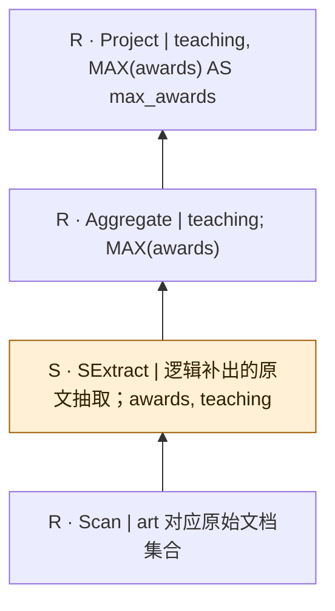

SQL本身只有结构化算子；SExtract是从原文到关系的分析性补充，不是源SQL的显式调用，也不表明每个字段必须由LLM抽取。字段类型、NULL及一对多抽取契约须在执行前固定。

## bench-u/Art/Agg/agg_queries_Art/2

来源：[原件](</Volumes/Element/Github2/semantic-workload-bench/data/semantic-query-discovery-20260908/bench-u/checkout/Query/Art/Agg/agg_queries_Art.sql>) · `sql_plus_proposed_extraction` · `logical_only` · `substantive_relational`

```sql

SELECT zodiac, COUNT(name) AS count_name FROM art GROUP BY zodiac;

```

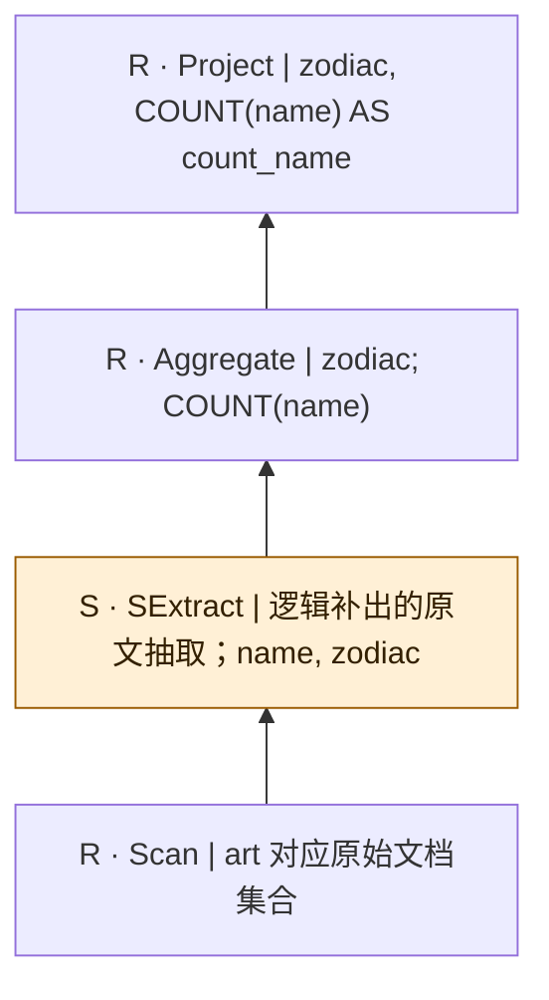

SQL本身只有结构化算子；SExtract是从原文到关系的分析性补充，不是源SQL的显式调用，也不表明每个字段必须由LLM抽取。字段类型、NULL及一对多抽取契约须在执行前固定。

## bench-u/Art/Agg/agg_queries_Art/3

来源：[原件](</Volumes/Element/Github2/semantic-workload-bench/data/semantic-query-discovery-20260908/bench-u/checkout/Query/Art/Agg/agg_queries_Art.sql>) · `sql_plus_proposed_extraction` · `logical_only` · `substantive_relational`

```sql

SELECT image_genre, AVG(age) AS avg_age FROM art GROUP BY image_genre;

```

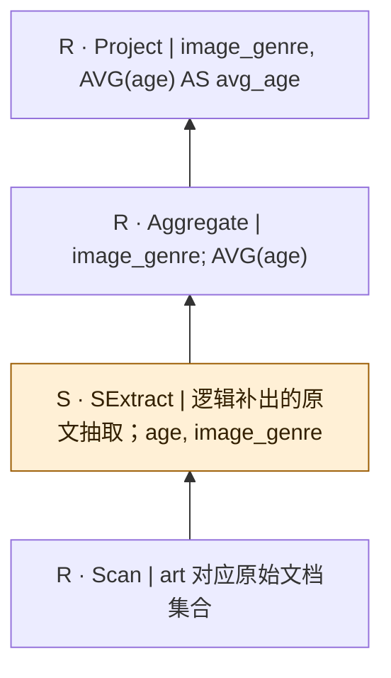

SQL本身只有结构化算子；SExtract是从原文到关系的分析性补充，不是源SQL的显式调用，也不表明每个字段必须由LLM抽取。字段类型、NULL及一对多抽取契约须在执行前固定。

## bench-u/Art/Agg/agg_queries_Art/4

来源：[原件](</Volumes/Element/Github2/semantic-workload-bench/data/semantic-query-discovery-20260908/bench-u/checkout/Query/Art/Agg/agg_queries_Art.sql>) · `sql_plus_proposed_extraction` · `logical_only` · `substantive_relational`

```sql

SELECT color, AVG(age) AS avg_age FROM art GROUP BY color;

```


SQL本身只有结构化算子；SExtract是从原文到关系的分析性补充，不是源SQL的显式调用，也不表明每个字段必须由LLM抽取。字段类型、NULL及一对多抽取契约须在执行前固定。

## bench-u/Art/Agg/agg_queries_Art/5

来源：[原件](</Volumes/Element/Github2/semantic-workload-bench/data/semantic-query-discovery-20260908/bench-u/checkout/Query/Art/Agg/agg_queries_Art.sql>) · `sql_plus_proposed_extraction` · `logical_only` · `substantive_relational`

```sql

SELECT zodiac, COUNT(art_institution) AS count_art_institution FROM art GROUP BY zodiac;

```

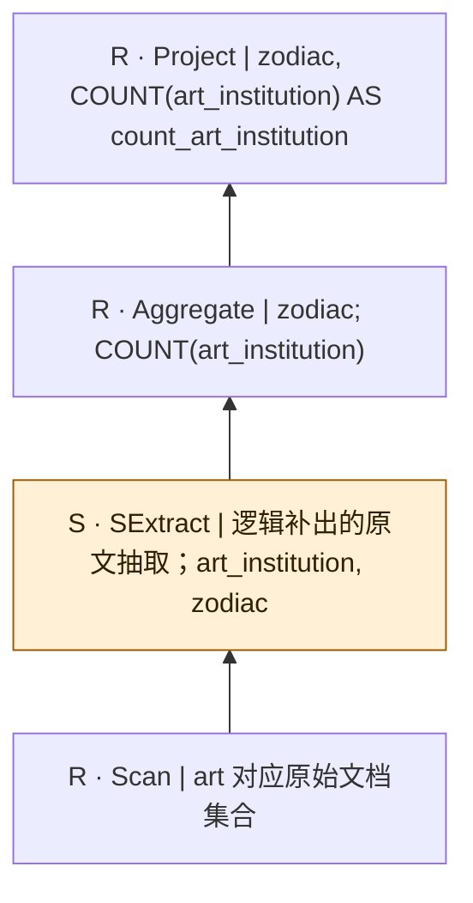

SQL本身只有结构化算子；SExtract是从原文到关系的分析性补充，不是源SQL的显式调用，也不表明每个字段必须由LLM抽取。字段类型、NULL及一对多抽取契约须在执行前固定。

## bench-u/Art/Agg/agg_queries_Art/6

来源：[原件](</Volumes/Element/Github2/semantic-workload-bench/data/semantic-query-discovery-20260908/bench-u/checkout/Query/Art/Agg/agg_queries_Art.sql>) · `sql_plus_proposed_extraction` · `logical_only` · `substantive_relational`

```sql

SELECT teaching, MIN(age) AS min_age FROM art GROUP BY teaching;

```

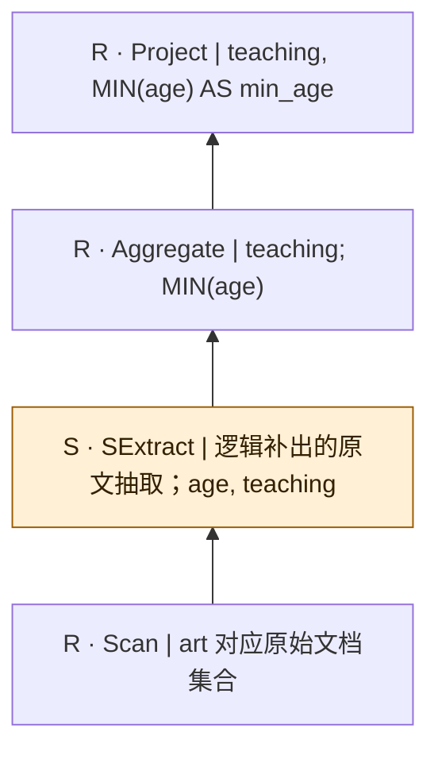

SQL本身只有结构化算子；SExtract是从原文到关系的分析性补充，不是源SQL的显式调用，也不表明每个字段必须由LLM抽取。字段类型、NULL及一对多抽取契约须在执行前固定。

## bench-u/Art/Agg/agg_queries_Art/7

来源：[原件](</Volumes/Element/Github2/semantic-workload-bench/data/semantic-query-discovery-20260908/bench-u/checkout/Query/Art/Agg/agg_queries_Art.sql>) · `sql_plus_proposed_extraction` · `logical_only` · `substantive_relational`

```sql

SELECT color, MAX(age) AS max_age FROM art GROUP BY color;

```

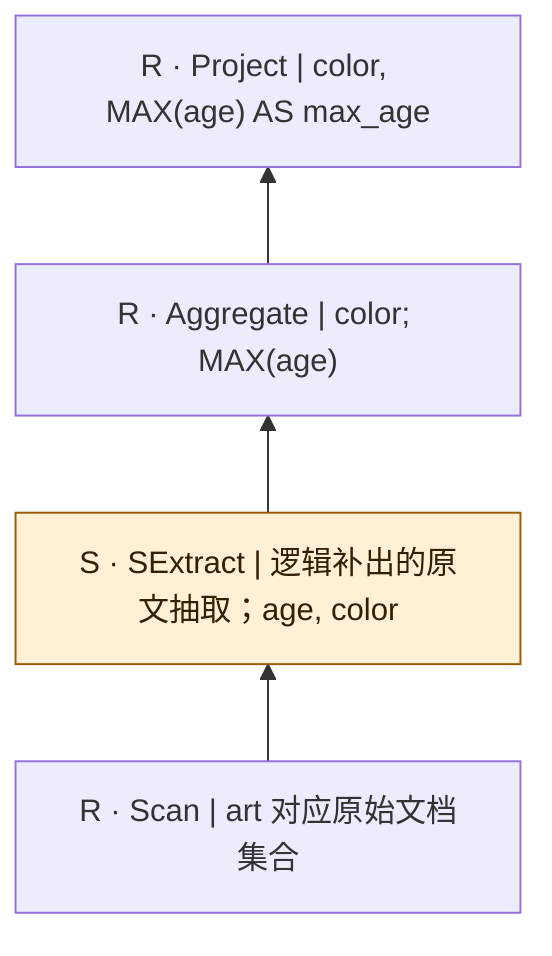

SQL本身只有结构化算子；SExtract是从原文到关系的分析性补充，不是源SQL的显式调用，也不表明每个字段必须由LLM抽取。字段类型、NULL及一对多抽取契约须在执行前固定。

## bench-u/Art/Agg/agg_queries_Art/8

来源：[原件](</Volumes/Element/Github2/semantic-workload-bench/data/semantic-query-discovery-20260908/bench-u/checkout/Query/Art/Agg/agg_queries_Art.sql>) · `sql_plus_proposed_extraction` · `logical_only` · `substantive_relational`

```sql

SELECT birth_continent, SUM(age) AS sum_age FROM art GROUP BY birth_continent;

```


SQL本身只有结构化算子；SExtract是从原文到关系的分析性补充，不是源SQL的显式调用，也不表明每个字段必须由LLM抽取。字段类型、NULL及一对多抽取契约须在执行前固定。

## bench-u/Art/Agg/agg_queries_Art/9

来源：[原件](</Volumes/Element/Github2/semantic-workload-bench/data/semantic-query-discovery-20260908/bench-u/checkout/Query/Art/Agg/agg_queries_Art.sql>) · `sql_plus_proposed_extraction` · `logical_only` · `substantive_relational`

```sql

SELECT birth_continent, MIN(age) AS min_age FROM art GROUP BY birth_continent;

```

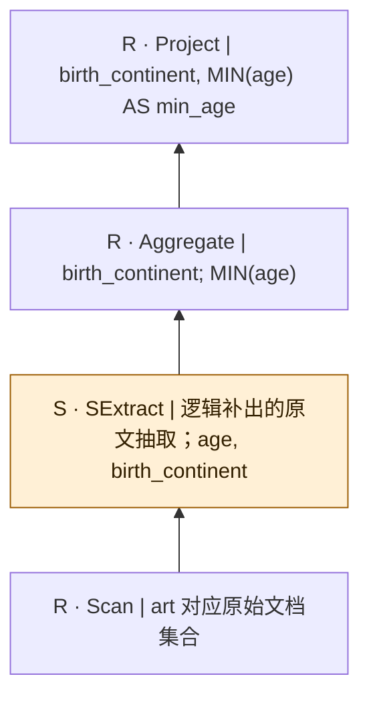

SQL本身只有结构化算子；SExtract是从原文到关系的分析性补充，不是源SQL的显式调用，也不表明每个字段必须由LLM抽取。字段类型、NULL及一对多抽取契约须在执行前固定。

## bench-u/Art/Agg/agg_queries_Art/10

来源：[原件](</Volumes/Element/Github2/semantic-workload-bench/data/semantic-query-discovery-20260908/bench-u/checkout/Query/Art/Agg/agg_queries_Art.sql>) · `sql_plus_proposed_extraction` · `logical_only` · `substantive_relational`

```sql

SELECT color, MIN(age) AS min_age FROM art GROUP BY color;

```

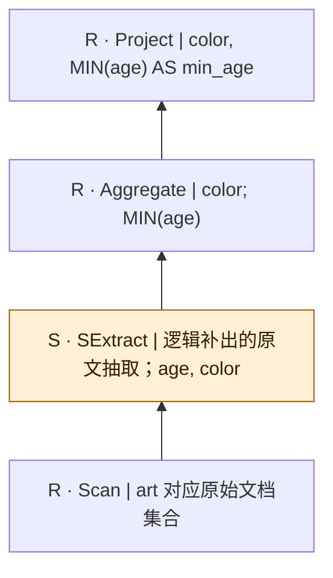

SQL本身只有结构化算子；SExtract是从原文到关系的分析性补充，不是源SQL的显式调用，也不表明每个字段必须由LLM抽取。字段类型、NULL及一对多抽取契约须在执行前固定。

## bench-u/Art/Filter/filter_queries/1

来源：[原件](</Volumes/Element/Github2/semantic-workload-bench/data/semantic-query-discovery-20260908/bench-u/checkout/Query/Art/Filter/filter_queries.sql>) · `sql_plus_proposed_extraction` · `logical_only` · `substantive_relational`

```sql

SELECT composition, birth_date, field FROM Art WHERE field != 'Other';

```

```mermaid
flowchart BT
  n0["R · Project | composition, birth_date, field"]
  n1["R · Filter | field &lt;&gt; &#x27;Other&#x27;"]
  n2["S · SExtract | 逻辑补出的原文抽取；birth_date, composition, field"]
  n3["R · Scan | Art 对应原始文档集合"]
  n3 --> n2
  n2 --> n1
  n1 --> n0
  classDef semantic fill:#fff0d6,stroke:#9a5b00,color:#332000;
  class n2 semantic;
```

SQL本身只有结构化算子；SExtract是从原文到关系的分析性补充，不是源SQL的显式调用，也不表明每个字段必须由LLM抽取。字段类型、NULL及一对多抽取契约须在执行前固定。

## bench-u/Art/Filter/filter_queries/2

来源：[原件](</Volumes/Element/Github2/semantic-workload-bench/data/semantic-query-discovery-20260908/bench-u/checkout/Query/Art/Filter/filter_queries.sql>) · `sql_plus_proposed_extraction` · `logical_only` · `substantive_relational`

```sql

SELECT death_country, death_date, image_genre FROM Art WHERE zodiac = 'Libra';

```

```mermaid
flowchart BT
  n0["R · Project | death_country, death_date, image_genre"]
  n1["R · Filter | zodiac = &#x27;Libra&#x27;"]
  n2["S · SExtract | 逻辑补出的原文抽取；death_country, death_date, image_genre, zodiac"]
  n3["R · Scan | Art 对应原始文档集合"]
  n3 --> n2
  n2 --> n1
  n1 --> n0
  classDef semantic fill:#fff0d6,stroke:#9a5b00,color:#332000;
  class n2 semantic;
```

SQL本身只有结构化算子；SExtract是从原文到关系的分析性补充，不是源SQL的显式调用，也不表明每个字段必须由LLM抽取。字段类型、NULL及一对多抽取契约须在执行前固定。

## bench-u/Art/Filter/filter_queries/3

来源：[原件](</Volumes/Element/Github2/semantic-workload-bench/data/semantic-query-discovery-20260908/bench-u/checkout/Query/Art/Filter/filter_queries.sql>) · `sql_plus_proposed_extraction` · `logical_only` · `substantive_relational`

```sql

SELECT tone, field, nationality FROM Art WHERE nationality != 'Japanese';

```

```mermaid
flowchart BT
  n0["R · Project | tone, field, nationality"]
  n1["R · Filter | nationality &lt;&gt; &#x27;Japanese&#x27;"]
  n2["S · SExtract | 逻辑补出的原文抽取；field, nationality, tone"]
  n3["R · Scan | Art 对应原始文档集合"]
  n3 --> n2
  n2 --> n1
  n1 --> n0
  classDef semantic fill:#fff0d6,stroke:#9a5b00,color:#332000;
  class n2 semantic;
```

SQL本身只有结构化算子；SExtract是从原文到关系的分析性补充，不是源SQL的显式调用，也不表明每个字段必须由LLM抽取。字段类型、NULL及一对多抽取契约须在执行前固定。

## bench-u/Art/Filter/filter_queries/4

来源：[原件](</Volumes/Element/Github2/semantic-workload-bench/data/semantic-query-discovery-20260908/bench-u/checkout/Query/Art/Filter/filter_queries.sql>) · `sql_plus_proposed_extraction` · `logical_only` · `substantive_relational`

```sql

SELECT zodiac, art_movement, theme FROM Art WHERE birth_country = 'Bulgaria';

```

```mermaid
flowchart BT
  n0["R · Project | zodiac, art_movement, theme"]
  n1["R · Filter | birth_country = &#x27;Bulgaria&#x27;"]
  n2["S · SExtract | 逻辑补出的原文抽取；art_movement, birth_country, theme, zodiac"]
  n3["R · Scan | Art 对应原始文档集合"]
  n3 --> n2
  n2 --> n1
  n1 --> n0
  classDef semantic fill:#fff0d6,stroke:#9a5b00,color:#332000;
  class n2 semantic;
```

SQL本身只有结构化算子；SExtract是从原文到关系的分析性补充，不是源SQL的显式调用，也不表明每个字段必须由LLM抽取。字段类型、NULL及一对多抽取契约须在执行前固定。

## bench-u/Art/Filter/filter_queries/5

来源：[原件](</Volumes/Element/Github2/semantic-workload-bench/data/semantic-query-discovery-20260908/bench-u/checkout/Query/Art/Filter/filter_queries.sql>) · `sql_plus_proposed_extraction` · `logical_only` · `substantive_relational`

```sql

SELECT birth_date, color, teaching FROM Art WHERE birth_date = '1905/4/19';

```

```mermaid
flowchart BT
  n0["R · Project | birth_date, color, teaching"]
  n1["R · Filter | birth_date = &#x27;1905/4/19&#x27;"]
  n2["S · SExtract | 逻辑补出的原文抽取；birth_date, color, teaching"]
  n3["R · Scan | Art 对应原始文档集合"]
  n3 --> n2
  n2 --> n1
  n1 --> n0
  classDef semantic fill:#fff0d6,stroke:#9a5b00,color:#332000;
  class n2 semantic;
```

SQL本身只有结构化算子；SExtract是从原文到关系的分析性补充，不是源SQL的显式调用，也不表明每个字段必须由LLM抽取。字段类型、NULL及一对多抽取契约须在执行前固定。

## bench-u/Art/Filter/filter_queries/6

来源：[原件](</Volumes/Element/Github2/semantic-workload-bench/data/semantic-query-discovery-20260908/bench-u/checkout/Query/Art/Filter/filter_queries.sql>) · `sql_plus_proposed_extraction` · `logical_only` · `substantive_relational`

```sql

SELECT art_institution, style, marriage FROM Art WHERE art_movement = 'Pop Art';

```

```mermaid
flowchart BT
  n0["R · Project | art_institution, style, marriage"]
  n1["R · Filter | art_movement = &#x27;Pop Art&#x27;"]
  n2["S · SExtract | 逻辑补出的原文抽取；art_institution, art_movement, marriage, style"]
  n3["R · Scan | Art 对应原始文档集合"]
  n3 --> n2
  n2 --> n1
  n1 --> n0
  classDef semantic fill:#fff0d6,stroke:#9a5b00,color:#332000;
  class n2 semantic;
```

SQL本身只有结构化算子；SExtract是从原文到关系的分析性补充，不是源SQL的显式调用，也不表明每个字段必须由LLM抽取。字段类型、NULL及一对多抽取契约须在执行前固定。

## bench-u/Art/Filter/filter_queries/7

来源：[原件](</Volumes/Element/Github2/semantic-workload-bench/data/semantic-query-discovery-20260908/bench-u/checkout/Query/Art/Filter/filter_queries.sql>) · `sql_plus_proposed_extraction` · `logical_only` · `substantive_relational`

```sql

SELECT marriage, birth_city, composition FROM Art WHERE birth_city = 'Boston';

```

```mermaid
flowchart BT
  n0["R · Project | marriage, birth_city, composition"]
  n1["R · Filter | birth_city = &#x27;Boston&#x27;"]
  n2["S · SExtract | 逻辑补出的原文抽取；birth_city, composition, marriage"]
  n3["R · Scan | Art 对应原始文档集合"]
  n3 --> n2
  n2 --> n1
  n1 --> n0
  classDef semantic fill:#fff0d6,stroke:#9a5b00,color:#332000;
  class n2 semantic;
```

SQL本身只有结构化算子；SExtract是从原文到关系的分析性补充，不是源SQL的显式调用，也不表明每个字段必须由LLM抽取。字段类型、NULL及一对多抽取契约须在执行前固定。

## bench-u/Art/Filter/filter_queries/8

来源：[原件](</Volumes/Element/Github2/semantic-workload-bench/data/semantic-query-discovery-20260908/bench-u/checkout/Query/Art/Filter/filter_queries.sql>) · `sql_plus_proposed_extraction` · `logical_only` · `substantive_relational`

```sql

SELECT awards, zodiac, theme FROM Art WHERE death_country = 'Italy';

```

```mermaid
flowchart BT
  n0["R · Project | awards, zodiac, theme"]
  n1["R · Filter | death_country = &#x27;Italy&#x27;"]
  n2["S · SExtract | 逻辑补出的原文抽取；awards, death_country, theme, zodiac"]
  n3["R · Scan | Art 对应原始文档集合"]
  n3 --> n2
  n2 --> n1
  n1 --> n0
  classDef semantic fill:#fff0d6,stroke:#9a5b00,color:#332000;
  class n2 semantic;
```

SQL本身只有结构化算子；SExtract是从原文到关系的分析性补充，不是源SQL的显式调用，也不表明每个字段必须由LLM抽取。字段类型、NULL及一对多抽取契约须在执行前固定。

## bench-u/Art/Filter/filter_queries/9

来源：[原件](</Volumes/Element/Github2/semantic-workload-bench/data/semantic-query-discovery-20260908/bench-u/checkout/Query/Art/Filter/filter_queries.sql>) · `sql_plus_proposed_extraction` · `logical_only` · `substantive_relational`

```sql

SELECT birth_date, birth_country, color FROM Art WHERE art_institution = 'University of Minnesota';

```

```mermaid
flowchart BT
  n0["R · Project | birth_date, birth_country, color"]
  n1["R · Filter | art_institution = &#x27;University of Minnesota&#x27;"]
  n2["S · SExtract | 逻辑补出的原文抽取；art_institution, birth_country, birth_date, color"]
  n3["R · Scan | Art 对应原始文档集合"]
  n3 --> n2
  n2 --> n1
  n1 --> n0
  classDef semantic fill:#fff0d6,stroke:#9a5b00,color:#332000;
  class n2 semantic;
```

SQL本身只有结构化算子；SExtract是从原文到关系的分析性补充，不是源SQL的显式调用，也不表明每个字段必须由LLM抽取。字段类型、NULL及一对多抽取契约须在执行前固定。

## bench-u/Art/Filter/filter_queries/10

来源：[原件](</Volumes/Element/Github2/semantic-workload-bench/data/semantic-query-discovery-20260908/bench-u/checkout/Query/Art/Filter/filter_queries.sql>) · `sql_plus_proposed_extraction` · `logical_only` · `substantive_relational`

```sql

SELECT genre, style, age FROM Art WHERE name != 'Christiaan Karel Appel';

```

```mermaid
flowchart BT
  n0["R · Project | genre, style, age"]
  n1["R · Filter | name &lt;&gt; &#x27;Christiaan Karel Appel&#x27;"]
  n2["S · SExtract | 逻辑补出的原文抽取；age, genre, name, style"]
  n3["R · Scan | Art 对应原始文档集合"]
  n3 --> n2
  n2 --> n1
  n1 --> n0
  classDef semantic fill:#fff0d6,stroke:#9a5b00,color:#332000;
  class n2 semantic;
```

SQL本身只有结构化算子；SExtract是从原文到关系的分析性补充，不是源SQL的显式调用，也不表明每个字段必须由LLM抽取。字段类型、NULL及一对多抽取契约须在执行前固定。

## bench-u/Art/Filter/filter_queries/11

来源：[原件](</Volumes/Element/Github2/semantic-workload-bench/data/semantic-query-discovery-20260908/bench-u/checkout/Query/Art/Filter/filter_queries.sql>) · `sql_plus_proposed_extraction` · `logical_only` · `substantive_relational`

```sql

SELECT marriage, object, nationality FROM Art WHERE genre != 'Symbolic' AND age >= 75;

```

```mermaid
flowchart BT
  n0["R · Project | marriage, object, nationality"]
  n1["R · Filter | genre &lt;&gt; &#x27;Symbolic&#x27; AND age &gt;= 75"]
  n2["S · SExtract | 逻辑补出的原文抽取；age, genre, marriage, nationality, object"]
  n3["R · Scan | Art 对应原始文档集合"]
  n3 --> n2
  n2 --> n1
  n1 --> n0
  classDef semantic fill:#fff0d6,stroke:#9a5b00,color:#332000;
  class n2 semantic;
```

SQL本身只有结构化算子；SExtract是从原文到关系的分析性补充，不是源SQL的显式调用，也不表明每个字段必须由LLM抽取。字段类型、NULL及一对多抽取契约须在执行前固定。

## bench-u/Art/Filter/filter_queries/12

来源：[原件](</Volumes/Element/Github2/semantic-workload-bench/data/semantic-query-discovery-20260908/bench-u/checkout/Query/Art/Filter/filter_queries.sql>) · `sql_plus_proposed_extraction` · `logical_only` · `substantive_relational`

```sql

SELECT birth_continent, composition, zodiac FROM Art WHERE birth_continent = 'North America' AND birth_city = 'Rochester';

```

```mermaid
flowchart BT
  n0["R · Project | birth_continent, composition, zodiac"]
  n1["R · Filter | birth_continent = &#x27;North America&#x27; AND birth_city = &#x27;Rochester&#x27;"]
  n2["S · SExtract | 逻辑补出的原文抽取；birth_city, birth_continent, composition, zodiac"]
  n3["R · Scan | Art 对应原始文档集合"]
  n3 --> n2
  n2 --> n1
  n1 --> n0
  classDef semantic fill:#fff0d6,stroke:#9a5b00,color:#332000;
  class n2 semantic;
```

SQL本身只有结构化算子；SExtract是从原文到关系的分析性补充，不是源SQL的显式调用，也不表明每个字段必须由LLM抽取。字段类型、NULL及一对多抽取契约须在执行前固定。

## bench-u/Art/Filter/filter_queries/13

来源：[原件](</Volumes/Element/Github2/semantic-workload-bench/data/semantic-query-discovery-20260908/bench-u/checkout/Query/Art/Filter/filter_queries.sql>) · `sql_plus_proposed_extraction` · `logical_only` · `substantive_relational`

```sql

SELECT object, birth_continent, birth_country FROM Art WHERE field != 'Ceramics' AND death_city != 'New York City';

```

```mermaid
flowchart BT
  n0["R · Project | object, birth_continent, birth_country"]
  n1["R · Filter | field &lt;&gt; &#x27;Ceramics&#x27; AND death_city &lt;&gt; &#x27;New York City&#x27;"]
  n2["S · SExtract | 逻辑补出的原文抽取；birth_continent, birth_country, death_city, field, object"]
  n3["R · Scan | Art 对应原始文档集合"]
  n3 --> n2
  n2 --> n1
  n1 --> n0
  classDef semantic fill:#fff0d6,stroke:#9a5b00,color:#332000;
  class n2 semantic;
```

SQL本身只有结构化算子；SExtract是从原文到关系的分析性补充，不是源SQL的显式调用，也不表明每个字段必须由LLM抽取。字段类型、NULL及一对多抽取契约须在执行前固定。

## bench-u/Art/Filter/filter_queries/14

来源：[原件](</Volumes/Element/Github2/semantic-workload-bench/data/semantic-query-discovery-20260908/bench-u/checkout/Query/Art/Filter/filter_queries.sql>) · `sql_plus_proposed_extraction` · `logical_only` · `substantive_relational`

```sql

SELECT image_genre, birth_date, art_institution FROM Art WHERE zodiac != 'Cancer' AND death_city = 'Saint Petersburg';

```

```mermaid
flowchart BT
  n0["R · Project | image_genre, birth_date, art_institution"]
  n1["R · Filter | zodiac &lt;&gt; &#x27;Cancer&#x27; AND death_city = &#x27;Saint Petersburg&#x27;"]
  n2["S · SExtract | 逻辑补出的原文抽取；art_institution, birth_date, death_city, image_genre, zodiac"]
  n3["R · Scan | Art 对应原始文档集合"]
  n3 --> n2
  n2 --> n1
  n1 --> n0
  classDef semantic fill:#fff0d6,stroke:#9a5b00,color:#332000;
  class n2 semantic;
```

SQL本身只有结构化算子；SExtract是从原文到关系的分析性补充，不是源SQL的显式调用，也不表明每个字段必须由LLM抽取。字段类型、NULL及一对多抽取契约须在执行前固定。

## bench-u/Art/Filter/filter_queries/15

来源：[原件](</Volumes/Element/Github2/semantic-workload-bench/data/semantic-query-discovery-20260908/bench-u/checkout/Query/Art/Filter/filter_queries.sql>) · `sql_plus_proposed_extraction` · `logical_only` · `substantive_relational`

```sql

SELECT awards, composition, birth_date FROM Art WHERE birth_date != '1905/4/27' AND art_movement != 'Cubism';

```

```mermaid
flowchart BT
  n0["R · Project | awards, composition, birth_date"]
  n1["R · Filter | birth_date &lt;&gt; &#x27;1905/4/27&#x27; AND art_movement &lt;&gt; &#x27;Cubism&#x27;"]
  n2["S · SExtract | 逻辑补出的原文抽取；art_movement, awards, birth_date, composition"]
  n3["R · Scan | Art 对应原始文档集合"]
  n3 --> n2
  n2 --> n1
  n1 --> n0
  classDef semantic fill:#fff0d6,stroke:#9a5b00,color:#332000;
  class n2 semantic;
```

SQL本身只有结构化算子；SExtract是从原文到关系的分析性补充，不是源SQL的显式调用，也不表明每个字段必须由LLM抽取。字段类型、NULL及一对多抽取契约须在执行前固定。

## bench-u/Art/Filter/filter_queries/16

来源：[原件](</Volumes/Element/Github2/semantic-workload-bench/data/semantic-query-discovery-20260908/bench-u/checkout/Query/Art/Filter/filter_queries.sql>) · `sql_plus_proposed_extraction` · `logical_only` · `substantive_relational`

```sql

SELECT tone, death_country, birth_date FROM Art WHERE birth_date != '1848/1/13' AND death_country = 'Nigeria';

```

```mermaid
flowchart BT
  n0["R · Project | tone, death_country, birth_date"]
  n1["R · Filter | birth_date &lt;&gt; &#x27;1848/1/13&#x27; AND death_country = &#x27;Nigeria&#x27;"]
  n2["S · SExtract | 逻辑补出的原文抽取；birth_date, death_country, tone"]
  n3["R · Scan | Art 对应原始文档集合"]
  n3 --> n2
  n2 --> n1
  n1 --> n0
  classDef semantic fill:#fff0d6,stroke:#9a5b00,color:#332000;
  class n2 semantic;
```

SQL本身只有结构化算子；SExtract是从原文到关系的分析性补充，不是源SQL的显式调用，也不表明每个字段必须由LLM抽取。字段类型、NULL及一对多抽取契约须在执行前固定。

## bench-u/Art/Filter/filter_queries/17

来源：[原件](</Volumes/Element/Github2/semantic-workload-bench/data/semantic-query-discovery-20260908/bench-u/checkout/Query/Art/Filter/filter_queries.sql>) · `sql_plus_proposed_extraction` · `logical_only` · `substantive_relational`

```sql

SELECT image_genre, century, birth_continent FROM Art WHERE death_date != '2005/1/14' AND birth_city = 'Boulogne-sur-Mer';

```

```mermaid
flowchart BT
  n0["R · Project | image_genre, century, birth_continent"]
  n1["R · Filter | death_date &lt;&gt; &#x27;2005/1/14&#x27; AND birth_city = &#x27;Boulogne-sur-Mer&#x27;"]
  n2["S · SExtract | 逻辑补出的原文抽取；birth_city, birth_continent, century, death_date, image_genre"]
  n3["R · Scan | Art 对应原始文档集合"]
  n3 --> n2
  n2 --> n1
  n1 --> n0
  classDef semantic fill:#fff0d6,stroke:#9a5b00,color:#332000;
  class n2 semantic;
```

SQL本身只有结构化算子；SExtract是从原文到关系的分析性补充，不是源SQL的显式调用，也不表明每个字段必须由LLM抽取。字段类型、NULL及一对多抽取契约须在执行前固定。

## bench-u/Art/Filter/filter_queries/18

来源：[原件](</Volumes/Element/Github2/semantic-workload-bench/data/semantic-query-discovery-20260908/bench-u/checkout/Query/Art/Filter/filter_queries.sql>) · `sql_plus_proposed_extraction` · `logical_only` · `substantive_relational`

```sql

SELECT marriage, composition, zodiac FROM Art WHERE zodiac = 'Cancer' AND birth_city != 'Los Angeles';

```

```mermaid
flowchart BT
  n0["R · Project | marriage, composition, zodiac"]
  n1["R · Filter | zodiac = &#x27;Cancer&#x27; AND birth_city &lt;&gt; &#x27;Los Angeles&#x27;"]
  n2["S · SExtract | 逻辑补出的原文抽取；birth_city, composition, marriage, zodiac"]
  n3["R · Scan | Art 对应原始文档集合"]
  n3 --> n2
  n2 --> n1
  n1 --> n0
  classDef semantic fill:#fff0d6,stroke:#9a5b00,color:#332000;
  class n2 semantic;
```

SQL本身只有结构化算子；SExtract是从原文到关系的分析性补充，不是源SQL的显式调用，也不表明每个字段必须由LLM抽取。字段类型、NULL及一对多抽取契约须在执行前固定。

## bench-u/Art/Filter/filter_queries/19

来源：[原件](</Volumes/Element/Github2/semantic-workload-bench/data/semantic-query-discovery-20260908/bench-u/checkout/Query/Art/Filter/filter_queries.sql>) · `sql_plus_proposed_extraction` · `logical_only` · `substantive_relational`

```sql

SELECT object, genre, art_institution FROM Art WHERE genre != 'Conceptual' AND teaching < 0;

```

```mermaid
flowchart BT
  n0["R · Project | object, genre, art_institution"]
  n1["R · Filter | genre &lt;&gt; &#x27;Conceptual&#x27; AND teaching &lt; 0"]
  n2["S · SExtract | 逻辑补出的原文抽取；art_institution, genre, object, teaching"]
  n3["R · Scan | Art 对应原始文档集合"]
  n3 --> n2
  n2 --> n1
  n1 --> n0
  classDef semantic fill:#fff0d6,stroke:#9a5b00,color:#332000;
  class n2 semantic;
```

SQL本身只有结构化算子；SExtract是从原文到关系的分析性补充，不是源SQL的显式调用，也不表明每个字段必须由LLM抽取。字段类型、NULL及一对多抽取契约须在执行前固定。

## bench-u/Art/Filter/filter_queries/20

来源：[原件](</Volumes/Element/Github2/semantic-workload-bench/data/semantic-query-discovery-20260908/bench-u/checkout/Query/Art/Filter/filter_queries.sql>) · `sql_plus_proposed_extraction` · `logical_only` · `substantive_relational`

```sql

SELECT birth_continent, composition, birth_date FROM Art WHERE birth_date = '1848/1/13' AND marriage != 'Married';

```

```mermaid
flowchart BT
  n0["R · Project | birth_continent, composition, birth_date"]
  n1["R · Filter | birth_date = &#x27;1848/1/13&#x27; AND marriage &lt;&gt; &#x27;Married&#x27;"]
  n2["S · SExtract | 逻辑补出的原文抽取；birth_continent, birth_date, composition, marriage"]
  n3["R · Scan | Art 对应原始文档集合"]
  n3 --> n2
  n2 --> n1
  n1 --> n0
  classDef semantic fill:#fff0d6,stroke:#9a5b00,color:#332000;
  class n2 semantic;
```

SQL本身只有结构化算子；SExtract是从原文到关系的分析性补充，不是源SQL的显式调用，也不表明每个字段必须由LLM抽取。字段类型、NULL及一对多抽取契约须在执行前固定。

## bench-u/Art/Filter/filter_queries/21

来源：[原件](</Volumes/Element/Github2/semantic-workload-bench/data/semantic-query-discovery-20260908/bench-u/checkout/Query/Art/Filter/filter_queries.sql>) · `sql_plus_proposed_extraction` · `logical_only` · `substantive_relational`

```sql

SELECT birth_city, death_date, tone FROM Art WHERE death_date != '1904/4/13' OR birth_city != 'Hastings';

```

```mermaid
flowchart BT
  n0["R · Project | birth_city, death_date, tone"]
  n1["R · Filter | death_date &lt;&gt; &#x27;1904/4/13&#x27; OR birth_city &lt;&gt; &#x27;Hastings&#x27;"]
  n2["S · SExtract | 逻辑补出的原文抽取；birth_city, death_date, tone"]
  n3["R · Scan | Art 对应原始文档集合"]
  n3 --> n2
  n2 --> n1
  n1 --> n0
  classDef semantic fill:#fff0d6,stroke:#9a5b00,color:#332000;
  class n2 semantic;
```

SQL本身只有结构化算子；SExtract是从原文到关系的分析性补充，不是源SQL的显式调用，也不表明每个字段必须由LLM抽取。字段类型、NULL及一对多抽取契约须在执行前固定。

## bench-u/Art/Filter/filter_queries/22

来源：[原件](</Volumes/Element/Github2/semantic-workload-bench/data/semantic-query-discovery-20260908/bench-u/checkout/Query/Art/Filter/filter_queries.sql>) · `sql_plus_proposed_extraction` · `logical_only` · `substantive_relational`

```sql

SELECT object, zodiac, genre FROM Art WHERE marriage != 'Cohabiting' OR art_institution != 'Chouinard Art Institute';

```

```mermaid
flowchart BT
  n0["R · Project | object, zodiac, genre"]
  n1["R · Filter | marriage &lt;&gt; &#x27;Cohabiting&#x27; OR art_institution &lt;&gt; &#x27;Chouinard Art Institute&#x27;"]
  n2["S · SExtract | 逻辑补出的原文抽取；art_institution, genre, marriage, object, zodiac"]
  n3["R · Scan | Art 对应原始文档集合"]
  n3 --> n2
  n2 --> n1
  n1 --> n0
  classDef semantic fill:#fff0d6,stroke:#9a5b00,color:#332000;
  class n2 semantic;
```

SQL本身只有结构化算子；SExtract是从原文到关系的分析性补充，不是源SQL的显式调用，也不表明每个字段必须由LLM抽取。字段类型、NULL及一对多抽取契约须在执行前固定。

## bench-u/Art/Filter/filter_queries/23

来源：[原件](</Volumes/Element/Github2/semantic-workload-bench/data/semantic-query-discovery-20260908/bench-u/checkout/Query/Art/Filter/filter_queries.sql>) · `sql_plus_proposed_extraction` · `logical_only` · `substantive_relational`

```sql

SELECT teaching, death_date, color FROM Art WHERE teaching != 0 OR age != 90;

```

```mermaid
flowchart BT
  n0["R · Project | teaching, death_date, color"]
  n1["R · Filter | teaching &lt;&gt; 0 OR age &lt;&gt; 90"]
  n2["S · SExtract | 逻辑补出的原文抽取；age, color, death_date, teaching"]
  n3["R · Scan | Art 对应原始文档集合"]
  n3 --> n2
  n2 --> n1
  n1 --> n0
  classDef semantic fill:#fff0d6,stroke:#9a5b00,color:#332000;
  class n2 semantic;
```

SQL本身只有结构化算子；SExtract是从原文到关系的分析性补充，不是源SQL的显式调用，也不表明每个字段必须由LLM抽取。字段类型、NULL及一对多抽取契约须在执行前固定。

## bench-u/Art/Filter/filter_queries/24

来源：[原件](</Volumes/Element/Github2/semantic-workload-bench/data/semantic-query-discovery-20260908/bench-u/checkout/Query/Art/Filter/filter_queries.sql>) · `sql_plus_proposed_extraction` · `logical_only` · `substantive_relational`

```sql

SELECT art_movement, birth_date, style FROM Art WHERE art_movement = 'Generación de la Ruptura' OR death_country != 'Brazil';

```

```mermaid
flowchart BT
  n0["R · Project | art_movement, birth_date, style"]
  n1["R · Filter | art_movement = &#x27;Generación de la Ruptura&#x27; OR death_country &lt;&gt; &#x27;Brazil&#x27;"]
  n2["S · SExtract | 逻辑补出的原文抽取；art_movement, birth_date, death_country, style"]
  n3["R · Scan | Art 对应原始文档集合"]
  n3 --> n2
  n2 --> n1
  n1 --> n0
  classDef semantic fill:#fff0d6,stroke:#9a5b00,color:#332000;
  class n2 semantic;
```

SQL本身只有结构化算子；SExtract是从原文到关系的分析性补充，不是源SQL的显式调用，也不表明每个字段必须由LLM抽取。字段类型、NULL及一对多抽取契约须在执行前固定。

## bench-u/Art/Filter/filter_queries/25

来源：[原件](</Volumes/Element/Github2/semantic-workload-bench/data/semantic-query-discovery-20260908/bench-u/checkout/Query/Art/Filter/filter_queries.sql>) · `sql_plus_proposed_extraction` · `logical_only` · `substantive_relational`

```sql

SELECT teaching, object, death_city FROM Art WHERE field = 'Drawing' OR death_country != 'France';

```

```mermaid
flowchart BT
  n0["R · Project | teaching, object, death_city"]
  n1["R · Filter | field = &#x27;Drawing&#x27; OR death_country &lt;&gt; &#x27;France&#x27;"]
  n2["S · SExtract | 逻辑补出的原文抽取；death_city, death_country, field, object, teaching"]
  n3["R · Scan | Art 对应原始文档集合"]
  n3 --> n2
  n2 --> n1
  n1 --> n0
  classDef semantic fill:#fff0d6,stroke:#9a5b00,color:#332000;
  class n2 semantic;
```

SQL本身只有结构化算子；SExtract是从原文到关系的分析性补充，不是源SQL的显式调用，也不表明每个字段必须由LLM抽取。字段类型、NULL及一对多抽取契约须在执行前固定。

## bench-u/Art/Filter/filter_queries/26

来源：[原件](</Volumes/Element/Github2/semantic-workload-bench/data/semantic-query-discovery-20260908/bench-u/checkout/Query/Art/Filter/filter_queries.sql>) · `sql_plus_proposed_extraction` · `logical_only` · `substantive_relational`

```sql

SELECT death_country, tone, century FROM Art WHERE century != '20th-21st' OR name != 'Agnes Lawrence Pelton';

```

```mermaid
flowchart BT
  n0["R · Project | death_country, tone, century"]
  n1["R · Filter | century &lt;&gt; &#x27;20th-21st&#x27; OR name &lt;&gt; &#x27;Agnes Lawrence Pelton&#x27;"]
  n2["S · SExtract | 逻辑补出的原文抽取；century, death_country, name, tone"]
  n3["R · Scan | Art 对应原始文档集合"]
  n3 --> n2
  n2 --> n1
  n1 --> n0
  classDef semantic fill:#fff0d6,stroke:#9a5b00,color:#332000;
  class n2 semantic;
```

SQL本身只有结构化算子；SExtract是从原文到关系的分析性补充，不是源SQL的显式调用，也不表明每个字段必须由LLM抽取。字段类型、NULL及一对多抽取契约须在执行前固定。

## bench-u/Art/Filter/filter_queries/27

来源：[原件](</Volumes/Element/Github2/semantic-workload-bench/data/semantic-query-discovery-20260908/bench-u/checkout/Query/Art/Filter/filter_queries.sql>) · `sql_plus_proposed_extraction` · `logical_only` · `substantive_relational`

```sql

SELECT color, genre, zodiac FROM Art WHERE zodiac != 'Cancer' OR death_city = 'Munich';

```

```mermaid
flowchart BT
  n0["R · Project | color, genre, zodiac"]
  n1["R · Filter | zodiac &lt;&gt; &#x27;Cancer&#x27; OR death_city = &#x27;Munich&#x27;"]
  n2["S · SExtract | 逻辑补出的原文抽取；color, death_city, genre, zodiac"]
  n3["R · Scan | Art 对应原始文档集合"]
  n3 --> n2
  n2 --> n1
  n1 --> n0
  classDef semantic fill:#fff0d6,stroke:#9a5b00,color:#332000;
  class n2 semantic;
```

SQL本身只有结构化算子；SExtract是从原文到关系的分析性补充，不是源SQL的显式调用，也不表明每个字段必须由LLM抽取。字段类型、NULL及一对多抽取契约须在执行前固定。

## bench-u/Art/Filter/filter_queries/28

来源：[原件](</Volumes/Element/Github2/semantic-workload-bench/data/semantic-query-discovery-20260908/bench-u/checkout/Query/Art/Filter/filter_queries.sql>) · `sql_plus_proposed_extraction` · `logical_only` · `substantive_relational`

```sql

SELECT death_country, style, teaching FROM Art WHERE art_movement = 'Space' OR name != 'Raoul De Keyser';

```

```mermaid
flowchart BT
  n0["R · Project | death_country, style, teaching"]
  n1["R · Filter | art_movement = &#x27;Space&#x27; OR name &lt;&gt; &#x27;Raoul De Keyser&#x27;"]
  n2["S · SExtract | 逻辑补出的原文抽取；art_movement, death_country, name, style, teaching"]
  n3["R · Scan | Art 对应原始文档集合"]
  n3 --> n2
  n2 --> n1
  n1 --> n0
  classDef semantic fill:#fff0d6,stroke:#9a5b00,color:#332000;
  class n2 semantic;
```

SQL本身只有结构化算子；SExtract是从原文到关系的分析性补充，不是源SQL的显式调用，也不表明每个字段必须由LLM抽取。字段类型、NULL及一对多抽取契约须在执行前固定。

## bench-u/Art/Filter/filter_queries/29

来源：[原件](</Volumes/Element/Github2/semantic-workload-bench/data/semantic-query-discovery-20260908/bench-u/checkout/Query/Art/Filter/filter_queries.sql>) · `sql_plus_proposed_extraction` · `logical_only` · `substantive_relational`

```sql

SELECT image_genre, death_city, death_country FROM Art WHERE zodiac != 'Cancer' OR teaching != 0;

```

```mermaid
flowchart BT
  n0["R · Project | image_genre, death_city, death_country"]
  n1["R · Filter | zodiac &lt;&gt; &#x27;Cancer&#x27; OR teaching &lt;&gt; 0"]
  n2["S · SExtract | 逻辑补出的原文抽取；death_city, death_country, image_genre, teaching, zodiac"]
  n3["R · Scan | Art 对应原始文档集合"]
  n3 --> n2
  n2 --> n1
  n1 --> n0
  classDef semantic fill:#fff0d6,stroke:#9a5b00,color:#332000;
  class n2 semantic;
```

SQL本身只有结构化算子；SExtract是从原文到关系的分析性补充，不是源SQL的显式调用，也不表明每个字段必须由LLM抽取。字段类型、NULL及一对多抽取契约须在执行前固定。

## bench-u/Art/Filter/filter_queries/30

来源：[原件](</Volumes/Element/Github2/semantic-workload-bench/data/semantic-query-discovery-20260908/bench-u/checkout/Query/Art/Filter/filter_queries.sql>) · `sql_plus_proposed_extraction` · `logical_only` · `substantive_relational`

```sql

SELECT composition, death_country, age FROM Art WHERE death_country = 'Ethiopia' OR birth_date = '1905/5/14';

```

```mermaid
flowchart BT
  n0["R · Project | composition, death_country, age"]
  n1["R · Filter | death_country = &#x27;Ethiopia&#x27; OR birth_date = &#x27;1905/5/14&#x27;"]
  n2["S · SExtract | 逻辑补出的原文抽取；age, birth_date, composition, death_country"]
  n3["R · Scan | Art 对应原始文档集合"]
  n3 --> n2
  n2 --> n1
  n1 --> n0
  classDef semantic fill:#fff0d6,stroke:#9a5b00,color:#332000;
  class n2 semantic;
```

SQL本身只有结构化算子；SExtract是从原文到关系的分析性补充，不是源SQL的显式调用，也不表明每个字段必须由LLM抽取。字段类型、NULL及一对多抽取契约须在执行前固定。

## bench-u/Art/Filter/filter_queries/31

来源：[原件](</Volumes/Element/Github2/semantic-workload-bench/data/semantic-query-discovery-20260908/bench-u/checkout/Query/Art/Filter/filter_queries.sql>) · `sql_plus_proposed_extraction` · `logical_only` · `substantive_relational`

```sql

SELECT field, object, genre FROM Art WHERE field = 'Calligraphy' AND art_institution != 'NY' AND death_city != 'New York' AND death_country != 'Russia';

```

```mermaid
flowchart BT
  n0["R · Project | field, object, genre"]
  n1["R · Filter | field = &#x27;Calligraphy&#x27; AND art_institution &lt;&gt; &#x27;NY&#x27; AND death_city &lt;&gt; &#x27;New York&#x27; AND death_country &lt;&gt; &#x27;Russia&#x27;"]
  n2["S · SExtract | 逻辑补出的原文抽取；art_institution, death_city, death_country, field, genre, object"]
  n3["R · Scan | Art 对应原始文档集合"]
  n3 --> n2
  n2 --> n1
  n1 --> n0
  classDef semantic fill:#fff0d6,stroke:#9a5b00,color:#332000;
  class n2 semantic;
```

SQL本身只有结构化算子；SExtract是从原文到关系的分析性补充，不是源SQL的显式调用，也不表明每个字段必须由LLM抽取。字段类型、NULL及一对多抽取契约须在执行前固定。

## bench-u/Art/Filter/filter_queries/32

来源：[原件](</Volumes/Element/Github2/semantic-workload-bench/data/semantic-query-discovery-20260908/bench-u/checkout/Query/Art/Filter/filter_queries.sql>) · `sql_plus_proposed_extraction` · `logical_only` · `substantive_relational`

```sql

SELECT nationality, color, art_institution FROM Art WHERE awards > 1 AND awards >= 0 AND age = 90 AND awards <= 0;

```

```mermaid
flowchart BT
  n0["R · Project | nationality, color, art_institution"]
  n1["R · Filter | awards &gt; 1 AND awards &gt;= 0 AND age = 90 AND awards &lt;= 0"]
  n2["S · SExtract | 逻辑补出的原文抽取；age, art_institution, awards, color, nationality"]
  n3["R · Scan | Art 对应原始文档集合"]
  n3 --> n2
  n2 --> n1
  n1 --> n0
  classDef semantic fill:#fff0d6,stroke:#9a5b00,color:#332000;
  class n2 semantic;
```

SQL本身只有结构化算子；SExtract是从原文到关系的分析性补充，不是源SQL的显式调用，也不表明每个字段必须由LLM抽取。字段类型、NULL及一对多抽取契约须在执行前固定。

## bench-u/Art/Filter/filter_queries/33

来源：[原件](</Volumes/Element/Github2/semantic-workload-bench/data/semantic-query-discovery-20260908/bench-u/checkout/Query/Art/Filter/filter_queries.sql>) · `sql_plus_proposed_extraction` · `logical_only` · `substantive_relational`

```sql

SELECT zodiac, tone, teaching FROM Art WHERE zodiac = 'Virgo' AND century != '19th-20th' AND teaching >= 0 AND death_country != 'South Africa';

```

```mermaid
flowchart BT
  n0["R · Project | zodiac, tone, teaching"]
  n1["R · Filter | zodiac = &#x27;Virgo&#x27; AND century &lt;&gt; &#x27;19th-20th&#x27; AND teaching &gt;= 0 AND death_country &lt;&gt; &#x27;South Africa&#x27;"]
  n2["S · SExtract | 逻辑补出的原文抽取；century, death_country, teaching, tone, zodiac"]
  n3["R · Scan | Art 对应原始文档集合"]
  n3 --> n2
  n2 --> n1
  n1 --> n0
  classDef semantic fill:#fff0d6,stroke:#9a5b00,color:#332000;
  class n2 semantic;
```

SQL本身只有结构化算子；SExtract是从原文到关系的分析性补充，不是源SQL的显式调用，也不表明每个字段必须由LLM抽取。字段类型、NULL及一对多抽取契约须在执行前固定。

## bench-u/Art/Filter/filter_queries/34

来源：[原件](</Volumes/Element/Github2/semantic-workload-bench/data/semantic-query-discovery-20260908/bench-u/checkout/Query/Art/Filter/filter_queries.sql>) · `sql_plus_proposed_extraction` · `logical_only` · `substantive_relational`

```sql

SELECT death_city, tone, death_country FROM Art WHERE death_city = 'Moscow' AND art_institution = 'Hunter College' AND death_country != 'Hungary' AND death_date = '1943/1/13';

```

```mermaid
flowchart BT
  n0["R · Project | death_city, tone, death_country"]
  n1["R · Filter | death_city = &#x27;Moscow&#x27; AND art_institution = &#x27;Hunter College&#x27; AND death_country &lt;&gt; &#x27;Hungary&#x27; AND death_date = &#x27;1943/1/13&#x27;"]
  n2["S · SExtract | 逻辑补出的原文抽取；art_institution, death_city, death_country, death_date, tone"]
  n3["R · Scan | Art 对应原始文档集合"]
  n3 --> n2
  n2 --> n1
  n1 --> n0
  classDef semantic fill:#fff0d6,stroke:#9a5b00,color:#332000;
  class n2 semantic;
```

SQL本身只有结构化算子；SExtract是从原文到关系的分析性补充，不是源SQL的显式调用，也不表明每个字段必须由LLM抽取。字段类型、NULL及一对多抽取契约须在执行前固定。

## bench-u/Art/Filter/filter_queries/35

来源：[原件](</Volumes/Element/Github2/semantic-workload-bench/data/semantic-query-discovery-20260908/bench-u/checkout/Query/Art/Filter/filter_queries.sql>) · `sql_plus_proposed_extraction` · `logical_only` · `substantive_relational`

```sql

SELECT art_movement, style, death_city FROM Art WHERE birth_date != '1905/4/20' AND art_institution = 'Claremont Graduate University' AND zodiac = 'Pisces' AND death_city = 'London';

```

```mermaid
flowchart BT
  n0["R · Project | art_movement, style, death_city"]
  n1["R · Filter | birth_date &lt;&gt; &#x27;1905/4/20&#x27; AND art_institution = &#x27;Claremont Graduate University&#x27; AND zodiac = &#x27;Pisces&#x27; AND death_city = &#x27;London&#x27;"]
  n2["S · SExtract | 逻辑补出的原文抽取；art_institution, art_movement, birth_date, death_city, style, zodiac"]
  n3["R · Scan | Art 对应原始文档集合"]
  n3 --> n2
  n2 --> n1
  n1 --> n0
  classDef semantic fill:#fff0d6,stroke:#9a5b00,color:#332000;
  class n2 semantic;
```

SQL本身只有结构化算子；SExtract是从原文到关系的分析性补充，不是源SQL的显式调用，也不表明每个字段必须由LLM抽取。字段类型、NULL及一对多抽取契约须在执行前固定。

## bench-u/Art/Filter/filter_queries/36

来源：[原件](</Volumes/Element/Github2/semantic-workload-bench/data/semantic-query-discovery-20260908/bench-u/checkout/Query/Art/Filter/filter_queries.sql>) · `sql_plus_proposed_extraction` · `logical_only` · `substantive_relational`

```sql

SELECT image_genre, death_city, birth_city FROM Art WHERE age <= 83 AND death_city != 'Cape Town' AND birth_date = '1924/2/9' AND genre = 'Figurative';

```

```mermaid
flowchart BT
  n0["R · Project | image_genre, death_city, birth_city"]
  n1["R · Filter | age &lt;= 83 AND death_city &lt;&gt; &#x27;Cape Town&#x27; AND birth_date = &#x27;1924/2/9&#x27; AND genre = &#x27;Figurative&#x27;"]
  n2["S · SExtract | 逻辑补出的原文抽取；age, birth_city, birth_date, death_city, genre, image_genre"]
  n3["R · Scan | Art 对应原始文档集合"]
  n3 --> n2
  n2 --> n1
  n1 --> n0
  classDef semantic fill:#fff0d6,stroke:#9a5b00,color:#332000;
  class n2 semantic;
```

SQL本身只有结构化算子；SExtract是从原文到关系的分析性补充，不是源SQL的显式调用，也不表明每个字段必须由LLM抽取。字段类型、NULL及一对多抽取契约须在执行前固定。

## bench-u/Art/Filter/filter_queries/37

来源：[原件](</Volumes/Element/Github2/semantic-workload-bench/data/semantic-query-discovery-20260908/bench-u/checkout/Query/Art/Filter/filter_queries.sql>) · `sql_plus_proposed_extraction` · `logical_only` · `substantive_relational`

```sql

SELECT color, teaching, century FROM Art WHERE awards >= 1 AND awards <= 0 AND birth_city != 'Birmingham' AND death_country = 'Switzerland';

```

```mermaid
flowchart BT
  n0["R · Project | color, teaching, century"]
  n1["R · Filter | awards &gt;= 1 AND awards &lt;= 0 AND birth_city &lt;&gt; &#x27;Birmingham&#x27; AND death_country = &#x27;Switzerland&#x27;"]
  n2["S · SExtract | 逻辑补出的原文抽取；awards, birth_city, century, color, death_country, teaching"]
  n3["R · Scan | Art 对应原始文档集合"]
  n3 --> n2
  n2 --> n1
  n1 --> n0
  classDef semantic fill:#fff0d6,stroke:#9a5b00,color:#332000;
  class n2 semantic;
```

SQL本身只有结构化算子；SExtract是从原文到关系的分析性补充，不是源SQL的显式调用，也不表明每个字段必须由LLM抽取。字段类型、NULL及一对多抽取契约须在执行前固定。

## bench-u/Art/Filter/filter_queries/38

来源：[原件](</Volumes/Element/Github2/semantic-workload-bench/data/semantic-query-discovery-20260908/bench-u/checkout/Query/Art/Filter/filter_queries.sql>) · `sql_plus_proposed_extraction` · `logical_only` · `substantive_relational`

```sql

SELECT death_city, style, art_movement FROM Art WHERE name != 'Eduardo Chillida Juantegui' AND age > 90 AND birth_continent != 'Africa' AND birth_country = 'United States';

```

```mermaid
flowchart BT
  n0["R · Project | death_city, style, art_movement"]
  n1["R · Filter | name &lt;&gt; &#x27;Eduardo Chillida Juantegui&#x27; AND age &gt; 90 AND birth_continent &lt;&gt; &#x27;Africa&#x27; AND birth_country = &#x27;United States&#x27;"]
  n2["S · SExtract | 逻辑补出的原文抽取；age, art_movement, birth_continent, birth_country, death_city, name, style"]
  n3["R · Scan | Art 对应原始文档集合"]
  n3 --> n2
  n2 --> n1
  n1 --> n0
  classDef semantic fill:#fff0d6,stroke:#9a5b00,color:#332000;
  class n2 semantic;
```

SQL本身只有结构化算子；SExtract是从原文到关系的分析性补充，不是源SQL的显式调用，也不表明每个字段必须由LLM抽取。字段类型、NULL及一对多抽取契约须在执行前固定。

## bench-u/Art/Filter/filter_queries/39

来源：[原件](</Volumes/Element/Github2/semantic-workload-bench/data/semantic-query-discovery-20260908/bench-u/checkout/Query/Art/Filter/filter_queries.sql>) · `sql_plus_proposed_extraction` · `logical_only` · `substantive_relational`

```sql

SELECT birth_city, zodiac, color FROM Art WHERE birth_city = 'Bronxville' AND death_city != 'Tigre' AND birth_country = 'Switzerland' AND teaching < 0;

```

```mermaid
flowchart BT
  n0["R · Project | birth_city, zodiac, color"]
  n1["R · Filter | birth_city = &#x27;Bronxville&#x27; AND death_city &lt;&gt; &#x27;Tigre&#x27; AND birth_country = &#x27;Switzerland&#x27; AND teaching &lt; 0"]
  n2["S · SExtract | 逻辑补出的原文抽取；birth_city, birth_country, color, death_city, teaching, zodiac"]
  n3["R · Scan | Art 对应原始文档集合"]
  n3 --> n2
  n2 --> n1
  n1 --> n0
  classDef semantic fill:#fff0d6,stroke:#9a5b00,color:#332000;
  class n2 semantic;
```

SQL本身只有结构化算子；SExtract是从原文到关系的分析性补充，不是源SQL的显式调用，也不表明每个字段必须由LLM抽取。字段类型、NULL及一对多抽取契约须在执行前固定。

## bench-u/Art/Filter/filter_queries/40

来源：[原件](</Volumes/Element/Github2/semantic-workload-bench/data/semantic-query-discovery-20260908/bench-u/checkout/Query/Art/Filter/filter_queries.sql>) · `sql_plus_proposed_extraction` · `logical_only` · `substantive_relational`

```sql

SELECT marriage, theme, awards FROM Art WHERE birth_country != 'Spain' AND nationality != 'Jewish' AND teaching >= 0 AND teaching <= 0;

```

```mermaid
flowchart BT
  n0["R · Project | marriage, theme, awards"]
  n1["R · Filter | birth_country &lt;&gt; &#x27;Spain&#x27; AND nationality &lt;&gt; &#x27;Jewish&#x27; AND teaching &gt;= 0 AND teaching &lt;= 0"]
  n2["S · SExtract | 逻辑补出的原文抽取；awards, birth_country, marriage, nationality, teaching, theme"]
  n3["R · Scan | Art 对应原始文档集合"]
  n3 --> n2
  n2 --> n1
  n1 --> n0
  classDef semantic fill:#fff0d6,stroke:#9a5b00,color:#332000;
  class n2 semantic;
```

SQL本身只有结构化算子；SExtract是从原文到关系的分析性补充，不是源SQL的显式调用，也不表明每个字段必须由LLM抽取。字段类型、NULL及一对多抽取契约须在执行前固定。

## bench-u/Art/Filter/filter_queries/41

来源：[原件](</Volumes/Element/Github2/semantic-workload-bench/data/semantic-query-discovery-20260908/bench-u/checkout/Query/Art/Filter/filter_queries.sql>) · `sql_plus_proposed_extraction` · `logical_only` · `substantive_relational`

```sql

SELECT death_city, image_genre, death_country FROM Art WHERE zodiac != 'Cancer' OR birth_date = '1908/12/22' OR art_institution != 'Art Students League' OR awards = 1;

```

```mermaid
flowchart BT
  n0["R · Project | death_city, image_genre, death_country"]
  n1["R · Filter | zodiac &lt;&gt; &#x27;Cancer&#x27; OR birth_date = &#x27;1908/12/22&#x27; OR art_institution &lt;&gt; &#x27;Art Students League&#x27; OR awards = 1"]
  n2["S · SExtract | 逻辑补出的原文抽取；art_institution, awards, birth_date, death_city, death_country, image_genre, zodiac"]
  n3["R · Scan | Art 对应原始文档集合"]
  n3 --> n2
  n2 --> n1
  n1 --> n0
  classDef semantic fill:#fff0d6,stroke:#9a5b00,color:#332000;
  class n2 semantic;
```

SQL本身只有结构化算子；SExtract是从原文到关系的分析性补充，不是源SQL的显式调用，也不表明每个字段必须由LLM抽取。字段类型、NULL及一对多抽取契约须在执行前固定。

## bench-u/Art/Filter/filter_queries/42

来源：[原件](</Volumes/Element/Github2/semantic-workload-bench/data/semantic-query-discovery-20260908/bench-u/checkout/Query/Art/Filter/filter_queries.sql>) · `sql_plus_proposed_extraction` · `logical_only` · `substantive_relational`

```sql

SELECT art_institution, nationality, image_genre FROM Art WHERE century = '19th-20th' OR birth_date != '1905/4/25' OR birth_country = 'Chile' OR birth_continent != 'South America';

```

```mermaid
flowchart BT
  n0["R · Project | art_institution, nationality, image_genre"]
  n1["R · Filter | century = &#x27;19th-20th&#x27; OR birth_date &lt;&gt; &#x27;1905/4/25&#x27; OR birth_country = &#x27;Chile&#x27; OR birth_continent &lt;&gt; &#x27;South America&#x27;"]
  n2["S · SExtract | 逻辑补出的原文抽取；art_institution, birth_continent, birth_country, birth_date, century, image_genre, nationality"]
  n3["R · Scan | Art 对应原始文档集合"]
  n3 --> n2
  n2 --> n1
  n1 --> n0
  classDef semantic fill:#fff0d6,stroke:#9a5b00,color:#332000;
  class n2 semantic;
```

SQL本身只有结构化算子；SExtract是从原文到关系的分析性补充，不是源SQL的显式调用，也不表明每个字段必须由LLM抽取。字段类型、NULL及一对多抽取契约须在执行前固定。

## bench-u/Art/Filter/filter_queries/43

来源：[原件](</Volumes/Element/Github2/semantic-workload-bench/data/semantic-query-discovery-20260908/bench-u/checkout/Query/Art/Filter/filter_queries.sql>) · `sql_plus_proposed_extraction` · `logical_only` · `substantive_relational`

```sql

SELECT color, birth_city, nationality FROM Art WHERE awards = 0 OR birth_city = 'Budapest' OR zodiac != 'Aries' OR age >= 90;

```

```mermaid
flowchart BT
  n0["R · Project | color, birth_city, nationality"]
  n1["R · Filter | awards = 0 OR birth_city = &#x27;Budapest&#x27; OR zodiac &lt;&gt; &#x27;Aries&#x27; OR age &gt;= 90"]
  n2["S · SExtract | 逻辑补出的原文抽取；age, awards, birth_city, color, nationality, zodiac"]
  n3["R · Scan | Art 对应原始文档集合"]
  n3 --> n2
  n2 --> n1
  n1 --> n0
  classDef semantic fill:#fff0d6,stroke:#9a5b00,color:#332000;
  class n2 semantic;
```

SQL本身只有结构化算子；SExtract是从原文到关系的分析性补充，不是源SQL的显式调用，也不表明每个字段必须由LLM抽取。字段类型、NULL及一对多抽取契约须在执行前固定。

## bench-u/Art/Filter/filter_queries/44

来源：[原件](</Volumes/Element/Github2/semantic-workload-bench/data/semantic-query-discovery-20260908/bench-u/checkout/Query/Art/Filter/filter_queries.sql>) · `sql_plus_proposed_extraction` · `logical_only` · `substantive_relational`

```sql

SELECT marriage, image_genre, death_date FROM Art WHERE century != '19th' OR name != 'Ben Shahn' OR art_institution = 'Pennsylvania Academy of the Fine Arts' OR teaching > 0;

```

```mermaid
flowchart BT
  n0["R · Project | marriage, image_genre, death_date"]
  n1["R · Filter | century &lt;&gt; &#x27;19th&#x27; OR name &lt;&gt; &#x27;Ben Shahn&#x27; OR art_institution = &#x27;Pennsylvania Academy of the Fine Arts&#x27; OR teaching &gt; 0"]
  n2["S · SExtract | 逻辑补出的原文抽取；art_institution, century, death_date, image_genre, marriage, name, teaching"]
  n3["R · Scan | Art 对应原始文档集合"]
  n3 --> n2
  n2 --> n1
  n1 --> n0
  classDef semantic fill:#fff0d6,stroke:#9a5b00,color:#332000;
  class n2 semantic;
```

SQL本身只有结构化算子；SExtract是从原文到关系的分析性补充，不是源SQL的显式调用，也不表明每个字段必须由LLM抽取。字段类型、NULL及一对多抽取契约须在执行前固定。

## bench-u/Art/Filter/filter_queries/45

来源：[原件](</Volumes/Element/Github2/semantic-workload-bench/data/semantic-query-discovery-20260908/bench-u/checkout/Query/Art/Filter/filter_queries.sql>) · `sql_plus_proposed_extraction` · `logical_only` · `substantive_relational`

```sql

SELECT image_genre, zodiac, birth_city FROM Art WHERE zodiac = 'Leo' OR marriage = 'Cohabiting' OR marriage != 'Separated' OR death_country != 'Cuba';

```

```mermaid
flowchart BT
  n0["R · Project | image_genre, zodiac, birth_city"]
  n1["R · Filter | zodiac = &#x27;Leo&#x27; OR marriage = &#x27;Cohabiting&#x27; OR marriage &lt;&gt; &#x27;Separated&#x27; OR death_country &lt;&gt; &#x27;Cuba&#x27;"]
  n2["S · SExtract | 逻辑补出的原文抽取；birth_city, death_country, image_genre, marriage, zodiac"]
  n3["R · Scan | Art 对应原始文档集合"]
  n3 --> n2
  n2 --> n1
  n1 --> n0
  classDef semantic fill:#fff0d6,stroke:#9a5b00,color:#332000;
  class n2 semantic;
```

SQL本身只有结构化算子；SExtract是从原文到关系的分析性补充，不是源SQL的显式调用，也不表明每个字段必须由LLM抽取。字段类型、NULL及一对多抽取契约须在执行前固定。

## bench-u/Art/Filter/filter_queries/46

来源：[原件](</Volumes/Element/Github2/semantic-workload-bench/data/semantic-query-discovery-20260908/bench-u/checkout/Query/Art/Filter/filter_queries.sql>) · `sql_plus_proposed_extraction` · `logical_only` · `substantive_relational`

```sql

SELECT theme, death_country, age FROM Art WHERE death_country != 'United Kingdom' OR field != 'Collage' OR nationality != 'Australian' OR awards >= 1;

```

```mermaid
flowchart BT
  n0["R · Project | theme, death_country, age"]
  n1["R · Filter | death_country &lt;&gt; &#x27;United Kingdom&#x27; OR field &lt;&gt; &#x27;Collage&#x27; OR nationality &lt;&gt; &#x27;Australian&#x27; OR awards &gt;= 1"]
  n2["S · SExtract | 逻辑补出的原文抽取；age, awards, death_country, field, nationality, theme"]
  n3["R · Scan | Art 对应原始文档集合"]
  n3 --> n2
  n2 --> n1
  n1 --> n0
  classDef semantic fill:#fff0d6,stroke:#9a5b00,color:#332000;
  class n2 semantic;
```

SQL本身只有结构化算子；SExtract是从原文到关系的分析性补充，不是源SQL的显式调用，也不表明每个字段必须由LLM抽取。字段类型、NULL及一对多抽取契约须在执行前固定。

## bench-u/Art/Filter/filter_queries/47

来源：[原件](</Volumes/Element/Github2/semantic-workload-bench/data/semantic-query-discovery-20260908/bench-u/checkout/Query/Art/Filter/filter_queries.sql>) · `sql_plus_proposed_extraction` · `logical_only` · `substantive_relational`

```sql

SELECT object, name, age FROM Art WHERE field != 'Calligraphy' OR birth_city = 'Paris' OR nationality != 'Indian' OR awards <= 1;

```

```mermaid
flowchart BT
  n0["R · Project | object, name, age"]
  n1["R · Filter | field &lt;&gt; &#x27;Calligraphy&#x27; OR birth_city = &#x27;Paris&#x27; OR nationality &lt;&gt; &#x27;Indian&#x27; OR awards &lt;= 1"]
  n2["S · SExtract | 逻辑补出的原文抽取；age, awards, birth_city, field, name, nationality, object"]
  n3["R · Scan | Art 对应原始文档集合"]
  n3 --> n2
  n2 --> n1
  n1 --> n0
  classDef semantic fill:#fff0d6,stroke:#9a5b00,color:#332000;
  class n2 semantic;
```

SQL本身只有结构化算子；SExtract是从原文到关系的分析性补充，不是源SQL的显式调用，也不表明每个字段必须由LLM抽取。字段类型、NULL及一对多抽取契约须在执行前固定。

## bench-u/Art/Filter/filter_queries/48

来源：[原件](</Volumes/Element/Github2/semantic-workload-bench/data/semantic-query-discovery-20260908/bench-u/checkout/Query/Art/Filter/filter_queries.sql>) · `sql_plus_proposed_extraction` · `logical_only` · `substantive_relational`

```sql

SELECT field, teaching, style FROM Art WHERE birth_date != '1905/4/19' OR nationality != 'Irish' OR birth_city != 'Vienna' OR age >= 75;

```

```mermaid
flowchart BT
  n0["R · Project | field, teaching, style"]
  n1["R · Filter | birth_date &lt;&gt; &#x27;1905/4/19&#x27; OR nationality &lt;&gt; &#x27;Irish&#x27; OR birth_city &lt;&gt; &#x27;Vienna&#x27; OR age &gt;= 75"]
  n2["S · SExtract | 逻辑补出的原文抽取；age, birth_city, birth_date, field, nationality, style, teaching"]
  n3["R · Scan | Art 对应原始文档集合"]
  n3 --> n2
  n2 --> n1
  n1 --> n0
  classDef semantic fill:#fff0d6,stroke:#9a5b00,color:#332000;
  class n2 semantic;
```

SQL本身只有结构化算子；SExtract是从原文到关系的分析性补充，不是源SQL的显式调用，也不表明每个字段必须由LLM抽取。字段类型、NULL及一对多抽取契约须在执行前固定。

## bench-u/Art/Filter/filter_queries/49

来源：[原件](</Volumes/Element/Github2/semantic-workload-bench/data/semantic-query-discovery-20260908/bench-u/checkout/Query/Art/Filter/filter_queries.sql>) · `sql_plus_proposed_extraction` · `logical_only` · `substantive_relational`

```sql

SELECT theme, birth_date, death_country FROM Art WHERE birth_city = 'Havana' OR marriage != 'Widowed' OR teaching != 0 OR birth_city = 'Paris';

```

```mermaid
flowchart BT
  n0["R · Project | theme, birth_date, death_country"]
  n1["R · Filter | birth_city = &#x27;Havana&#x27; OR marriage &lt;&gt; &#x27;Widowed&#x27; OR teaching &lt;&gt; 0 OR birth_city = &#x27;Paris&#x27;"]
  n2["S · SExtract | 逻辑补出的原文抽取；birth_city, birth_date, death_country, marriage, teaching, theme"]
  n3["R · Scan | Art 对应原始文档集合"]
  n3 --> n2
  n2 --> n1
  n1 --> n0
  classDef semantic fill:#fff0d6,stroke:#9a5b00,color:#332000;
  class n2 semantic;
```

SQL本身只有结构化算子；SExtract是从原文到关系的分析性补充，不是源SQL的显式调用，也不表明每个字段必须由LLM抽取。字段类型、NULL及一对多抽取契约须在执行前固定。

## bench-u/Art/Filter/filter_queries/50

来源：[原件](</Volumes/Element/Github2/semantic-workload-bench/data/semantic-query-discovery-20260908/bench-u/checkout/Query/Art/Filter/filter_queries.sql>) · `sql_plus_proposed_extraction` · `logical_only` · `substantive_relational`

```sql

SELECT name, marriage, tone FROM Art WHERE marriage != 'Cohabiting' OR field = 'Painting' OR art_movement = 'Art Nouveau' OR field = 'Ceramics';

```

```mermaid
flowchart BT
  n0["R · Project | name, marriage, tone"]
  n1["R · Filter | marriage &lt;&gt; &#x27;Cohabiting&#x27; OR field = &#x27;Painting&#x27; OR art_movement = &#x27;Art Nouveau&#x27; OR field = &#x27;Ceramics&#x27;"]
  n2["S · SExtract | 逻辑补出的原文抽取；art_movement, field, marriage, name, tone"]
  n3["R · Scan | Art 对应原始文档集合"]
  n3 --> n2
  n2 --> n1
  n1 --> n0
  classDef semantic fill:#fff0d6,stroke:#9a5b00,color:#332000;
  class n2 semantic;
```

SQL本身只有结构化算子；SExtract是从原文到关系的分析性补充，不是源SQL的显式调用，也不表明每个字段必须由LLM抽取。字段类型、NULL及一对多抽取契约须在执行前固定。

## bench-u/Art/Filter/filter_queries/51

来源：[原件](</Volumes/Element/Github2/semantic-workload-bench/data/semantic-query-discovery-20260908/bench-u/checkout/Query/Art/Filter/filter_queries.sql>) · `sql_plus_proposed_extraction` · `logical_only` · `substantive_relational`

```sql

SELECT birth_country, image_genre, age FROM Art WHERE (age >= 64 AND age = 64) OR (death_city != 'Montreal' AND field != 'Calligraphy');

```

```mermaid
flowchart BT
  n0["R · Project | birth_country, image_genre, age"]
  n1["R · Filter | (age &gt;= 64 AND age = 64) OR (death_city &lt;&gt; &#x27;Montreal&#x27; AND field &lt;&gt; &#x27;Calligraphy&#x27;)"]
  n2["S · SExtract | 逻辑补出的原文抽取；age, birth_country, death_city, field, image_genre"]
  n3["R · Scan | Art 对应原始文档集合"]
  n3 --> n2
  n2 --> n1
  n1 --> n0
  classDef semantic fill:#fff0d6,stroke:#9a5b00,color:#332000;
  class n2 semantic;
```

SQL本身只有结构化算子；SExtract是从原文到关系的分析性补充，不是源SQL的显式调用，也不表明每个字段必须由LLM抽取。字段类型、NULL及一对多抽取契约须在执行前固定。

## bench-u/Art/Filter/filter_queries/52

来源：[原件](</Volumes/Element/Github2/semantic-workload-bench/data/semantic-query-discovery-20260908/bench-u/checkout/Query/Art/Filter/filter_queries.sql>) · `sql_plus_proposed_extraction` · `logical_only` · `substantive_relational`

```sql

SELECT composition, age, name FROM Art WHERE (age > 90 AND genre != 'Conceptual') OR (death_city = 'Paris' AND zodiac != 'Aries');

```

```mermaid
flowchart BT
  n0["R · Project | composition, age, name"]
  n1["R · Filter | (age &gt; 90 AND genre &lt;&gt; &#x27;Conceptual&#x27;) OR (death_city = &#x27;Paris&#x27; AND zodiac &lt;&gt; &#x27;Aries&#x27;)"]
  n2["S · SExtract | 逻辑补出的原文抽取；age, composition, death_city, genre, name, zodiac"]
  n3["R · Scan | Art 对应原始文档集合"]
  n3 --> n2
  n2 --> n1
  n1 --> n0
  classDef semantic fill:#fff0d6,stroke:#9a5b00,color:#332000;
  class n2 semantic;
```

SQL本身只有结构化算子；SExtract是从原文到关系的分析性补充，不是源SQL的显式调用，也不表明每个字段必须由LLM抽取。字段类型、NULL及一对多抽取契约须在执行前固定。

## bench-u/Art/Filter/filter_queries/53

来源：[原件](</Volumes/Element/Github2/semantic-workload-bench/data/semantic-query-discovery-20260908/bench-u/checkout/Query/Art/Filter/filter_queries.sql>) · `sql_plus_proposed_extraction` · `logical_only` · `substantive_relational`

```sql

SELECT teaching, image_genre, death_country FROM Art WHERE (zodiac = 'Aquarius' AND field = 'Ceramics') OR (teaching != 0 AND birth_city != 'San Francisco');

```

```mermaid
flowchart BT
  n0["R · Project | teaching, image_genre, death_country"]
  n1["R · Filter | (zodiac = &#x27;Aquarius&#x27; AND field = &#x27;Ceramics&#x27;) OR (teaching &lt;&gt; 0 AND birth_city &lt;&gt; &#x27;San Francisco&#x27;)"]
  n2["S · SExtract | 逻辑补出的原文抽取；birth_city, death_country, field, image_genre, teaching, zodiac"]
  n3["R · Scan | Art 对应原始文档集合"]
  n3 --> n2
  n2 --> n1
  n1 --> n0
  classDef semantic fill:#fff0d6,stroke:#9a5b00,color:#332000;
  class n2 semantic;
```

SQL本身只有结构化算子；SExtract是从原文到关系的分析性补充，不是源SQL的显式调用，也不表明每个字段必须由LLM抽取。字段类型、NULL及一对多抽取契约须在执行前固定。

## bench-u/Art/Filter/filter_queries/54

来源：[原件](</Volumes/Element/Github2/semantic-workload-bench/data/semantic-query-discovery-20260908/bench-u/checkout/Query/Art/Filter/filter_queries.sql>) · `sql_plus_proposed_extraction` · `logical_only` · `substantive_relational`

```sql

SELECT death_date, nationality, object FROM Art WHERE (marriage = 'Cohabiting' AND birth_continent = 'Asia') OR (awards > 0 AND death_country != 'Venezuela');

```

```mermaid
flowchart BT
  n0["R · Project | death_date, nationality, object"]
  n1["R · Filter | (marriage = &#x27;Cohabiting&#x27; AND birth_continent = &#x27;Asia&#x27;) OR (awards &gt; 0 AND death_country &lt;&gt; &#x27;Venezuela&#x27;)"]
  n2["S · SExtract | 逻辑补出的原文抽取；awards, birth_continent, death_country, death_date, marriage, nationality, object"]
  n3["R · Scan | Art 对应原始文档集合"]
  n3 --> n2
  n2 --> n1
  n1 --> n0
  classDef semantic fill:#fff0d6,stroke:#9a5b00,color:#332000;
  class n2 semantic;
```

SQL本身只有结构化算子；SExtract是从原文到关系的分析性补充，不是源SQL的显式调用，也不表明每个字段必须由LLM抽取。字段类型、NULL及一对多抽取契约须在执行前固定。

## bench-u/Art/Filter/filter_queries/55

来源：[原件](</Volumes/Element/Github2/semantic-workload-bench/data/semantic-query-discovery-20260908/bench-u/checkout/Query/Art/Filter/filter_queries.sql>) · `sql_plus_proposed_extraction` · `logical_only` · `substantive_relational`

```sql

SELECT style, genre, zodiac FROM Art WHERE (birth_date = '1905/4/15' AND genre != 'Allegorical') OR (teaching != 0 AND birth_city = 'Havana');

```

```mermaid
flowchart BT
  n0["R · Project | style, genre, zodiac"]
  n1["R · Filter | (birth_date = &#x27;1905/4/15&#x27; AND genre &lt;&gt; &#x27;Allegorical&#x27;) OR (teaching &lt;&gt; 0 AND birth_city = &#x27;Havana&#x27;)"]
  n2["S · SExtract | 逻辑补出的原文抽取；birth_city, birth_date, genre, style, teaching, zodiac"]
  n3["R · Scan | Art 对应原始文档集合"]
  n3 --> n2
  n2 --> n1
  n1 --> n0
  classDef semantic fill:#fff0d6,stroke:#9a5b00,color:#332000;
  class n2 semantic;
```

SQL本身只有结构化算子；SExtract是从原文到关系的分析性补充，不是源SQL的显式调用，也不表明每个字段必须由LLM抽取。字段类型、NULL及一对多抽取契约须在执行前固定。

## bench-u/Art/Filter/filter_queries/56

来源：[原件](</Volumes/Element/Github2/semantic-workload-bench/data/semantic-query-discovery-20260908/bench-u/checkout/Query/Art/Filter/filter_queries.sql>) · `sql_plus_proposed_extraction` · `logical_only` · `substantive_relational`

```sql

SELECT age, style, century FROM Art WHERE (birth_date != '1905/4/25' AND death_date = '2010/7/15') OR (awards <= 1 AND century != '20th-21st');

```

```mermaid
flowchart BT
  n0["R · Project | age, style, century"]
  n1["R · Filter | (birth_date &lt;&gt; &#x27;1905/4/25&#x27; AND death_date = &#x27;2010/7/15&#x27;) OR (awards &lt;= 1 AND century &lt;&gt; &#x27;20th-21st&#x27;)"]
  n2["S · SExtract | 逻辑补出的原文抽取；age, awards, birth_date, century, death_date, style"]
  n3["R · Scan | Art 对应原始文档集合"]
  n3 --> n2
  n2 --> n1
  n1 --> n0
  classDef semantic fill:#fff0d6,stroke:#9a5b00,color:#332000;
  class n2 semantic;
```

SQL本身只有结构化算子；SExtract是从原文到关系的分析性补充，不是源SQL的显式调用，也不表明每个字段必须由LLM抽取。字段类型、NULL及一对多抽取契约须在执行前固定。

## bench-u/Art/Filter/filter_queries/57

来源：[原件](</Volumes/Element/Github2/semantic-workload-bench/data/semantic-query-discovery-20260908/bench-u/checkout/Query/Art/Filter/filter_queries.sql>) · `sql_plus_proposed_extraction` · `logical_only` · `substantive_relational`

```sql

SELECT object, death_city, teaching FROM Art WHERE (field = 'Ceramics' AND birth_country != 'British India') OR (name = 'Oscar Agustín Alejandro Schulz Solari' AND nationality != 'Ukrainian');

```

```mermaid
flowchart BT
  n0["R · Project | object, death_city, teaching"]
  n1["R · Filter | (field = &#x27;Ceramics&#x27; AND birth_country &lt;&gt; &#x27;British India&#x27;) OR (name = &#x27;Oscar Agustín Alejandro Schulz Solari&#x27; AND nationality &lt;&gt; &#x27;Ukrainian&#x27;)"]
  n2["S · SExtract | 逻辑补出的原文抽取；birth_country, death_city, field, name, nationality, object, teaching"]
  n3["R · Scan | Art 对应原始文档集合"]
  n3 --> n2
  n2 --> n1
  n1 --> n0
  classDef semantic fill:#fff0d6,stroke:#9a5b00,color:#332000;
  class n2 semantic;
```

SQL本身只有结构化算子；SExtract是从原文到关系的分析性补充，不是源SQL的显式调用，也不表明每个字段必须由LLM抽取。字段类型、NULL及一对多抽取契约须在执行前固定。

## bench-u/Art/Filter/filter_queries/58

来源：[原件](</Volumes/Element/Github2/semantic-workload-bench/data/semantic-query-discovery-20260908/bench-u/checkout/Query/Art/Filter/filter_queries.sql>) · `sql_plus_proposed_extraction` · `logical_only` · `substantive_relational`

```sql

SELECT composition, birth_country, art_movement FROM Art WHERE (art_movement != 'Abstract' AND birth_continent != 'South America') OR (death_country != 'Jordan' AND birth_date != '1905/4/15');

```

```mermaid
flowchart BT
  n0["R · Project | composition, birth_country, art_movement"]
  n1["R · Filter | (art_movement &lt;&gt; &#x27;Abstract&#x27; AND birth_continent &lt;&gt; &#x27;South America&#x27;) OR (death_country &lt;&gt; &#x27;Jordan&#x27; AND birth_date &lt;&gt; &#x27;1905/4/15&#x27;)"]
  n2["S · SExtract | 逻辑补出的原文抽取；art_movement, birth_continent, birth_country, birth_date, composition, death_country"]
  n3["R · Scan | Art 对应原始文档集合"]
  n3 --> n2
  n2 --> n1
  n1 --> n0
  classDef semantic fill:#fff0d6,stroke:#9a5b00,color:#332000;
  class n2 semantic;
```

SQL本身只有结构化算子；SExtract是从原文到关系的分析性补充，不是源SQL的显式调用，也不表明每个字段必须由LLM抽取。字段类型、NULL及一对多抽取契约须在执行前固定。

## bench-u/Art/Filter/filter_queries/59

来源：[原件](</Volumes/Element/Github2/semantic-workload-bench/data/semantic-query-discovery-20260908/bench-u/checkout/Query/Art/Filter/filter_queries.sql>) · `sql_plus_proposed_extraction` · `logical_only` · `substantive_relational`

```sql

SELECT field, color, nationality FROM Art WHERE (field = 'Textile art' AND teaching > 0) OR (age > 90 AND marriage = 'Cohabiting');

```

```mermaid
flowchart BT
  n0["R · Project | field, color, nationality"]
  n1["R · Filter | (field = &#x27;Textile art&#x27; AND teaching &gt; 0) OR (age &gt; 90 AND marriage = &#x27;Cohabiting&#x27;)"]
  n2["S · SExtract | 逻辑补出的原文抽取；age, color, field, marriage, nationality, teaching"]
  n3["R · Scan | Art 对应原始文档集合"]
  n3 --> n2
  n2 --> n1
  n1 --> n0
  classDef semantic fill:#fff0d6,stroke:#9a5b00,color:#332000;
  class n2 semantic;
```

SQL本身只有结构化算子；SExtract是从原文到关系的分析性补充，不是源SQL的显式调用，也不表明每个字段必须由LLM抽取。字段类型、NULL及一对多抽取契约须在执行前固定。

## bench-u/Art/Filter/filter_queries/60

来源：[原件](</Volumes/Element/Github2/semantic-workload-bench/data/semantic-query-discovery-20260908/bench-u/checkout/Query/Art/Filter/filter_queries.sql>) · `sql_plus_proposed_extraction` · `logical_only` · `substantive_relational`

```sql

SELECT century, birth_city, object FROM Art WHERE (field = 'Photography' AND nationality != 'Japanese') OR (death_date = '2010/7/15' AND awards != 0);

```

```mermaid
flowchart BT
  n0["R · Project | century, birth_city, object"]
  n1["R · Filter | (field = &#x27;Photography&#x27; AND nationality &lt;&gt; &#x27;Japanese&#x27;) OR (death_date = &#x27;2010/7/15&#x27; AND awards &lt;&gt; 0)"]
  n2["S · SExtract | 逻辑补出的原文抽取；awards, birth_city, century, death_date, field, nationality, object"]
  n3["R · Scan | Art 对应原始文档集合"]
  n3 --> n2
  n2 --> n1
  n1 --> n0
  classDef semantic fill:#fff0d6,stroke:#9a5b00,color:#332000;
  class n2 semantic;
```

SQL本身只有结构化算子；SExtract是从原文到关系的分析性补充，不是源SQL的显式调用，也不表明每个字段必须由LLM抽取。字段类型、NULL及一对多抽取契约须在执行前固定。

## bench-u/Art/Mixed/mixed_queries/1

来源：[原件](</Volumes/Element/Github2/semantic-workload-bench/data/semantic-query-discovery-20260908/bench-u/checkout/Query/Art/Mixed/mixed_queries.sql>) · `sql_plus_proposed_extraction` · `logical_only` · `substantive_relational`

```sql

SELECT field, AVG(age) AS avg_age FROM art WHERE century = '19th-20th' GROUP BY field;

```

```mermaid
flowchart BT
  n0["R · Project | field, AVG(age) AS avg_age"]
  n1["R · Aggregate | field; AVG(age)"]
  n2["R · Filter | century = &#x27;19th-20th&#x27;"]
  n3["S · SExtract | 逻辑补出的原文抽取；age, century, field"]
  n4["R · Scan | art 对应原始文档集合"]
  n4 --> n3
  n3 --> n2
  n2 --> n1
  n1 --> n0
  classDef semantic fill:#fff0d6,stroke:#9a5b00,color:#332000;
  class n3 semantic;
```

SQL本身只有结构化算子；SExtract是从原文到关系的分析性补充，不是源SQL的显式调用，也不表明每个字段必须由LLM抽取。字段类型、NULL及一对多抽取契约须在执行前固定。

## bench-u/Art/Mixed/mixed_queries/2

来源：[原件](</Volumes/Element/Github2/semantic-workload-bench/data/semantic-query-discovery-20260908/bench-u/checkout/Query/Art/Mixed/mixed_queries.sql>) · `sql_plus_proposed_extraction` · `logical_only` · `substantive_relational`

```sql

SELECT nationality, COUNT(birth_continent) AS count_birth_continent FROM art WHERE nationality = 'Japanese' AND birth_continent != 'Australia' GROUP BY nationality;

```

```mermaid
flowchart BT
  n0["R · Project | nationality, COUNT(birth_continent) AS count_birth_continent"]
  n1["R · Aggregate | nationality; COUNT(birth_continent)"]
  n2["R · Filter | nationality = &#x27;Japanese&#x27; AND birth_continent &lt;&gt; &#x27;Australia&#x27;"]
  n3["S · SExtract | 逻辑补出的原文抽取；birth_continent, nationality"]
  n4["R · Scan | art 对应原始文档集合"]
  n4 --> n3
  n3 --> n2
  n2 --> n1
  n1 --> n0
  classDef semantic fill:#fff0d6,stroke:#9a5b00,color:#332000;
  class n3 semantic;
```

SQL本身只有结构化算子；SExtract是从原文到关系的分析性补充，不是源SQL的显式调用，也不表明每个字段必须由LLM抽取。字段类型、NULL及一对多抽取契约须在执行前固定。

## bench-u/Art/Mixed/mixed_queries/3

来源：[原件](</Volumes/Element/Github2/semantic-workload-bench/data/semantic-query-discovery-20260908/bench-u/checkout/Query/Art/Mixed/mixed_queries.sql>) · `sql_plus_proposed_extraction` · `logical_only` · `substantive_relational`

```sql

SELECT genre, AVG(age) AS avg_age FROM art WHERE birth_country = 'British India' OR teaching != 0 GROUP BY genre;

```

```mermaid
flowchart BT
  n0["R · Project | genre, AVG(age) AS avg_age"]
  n1["R · Aggregate | genre; AVG(age)"]
  n2["R · Filter | birth_country = &#x27;British India&#x27; OR teaching &lt;&gt; 0"]
  n3["S · SExtract | 逻辑补出的原文抽取；age, birth_country, genre, teaching"]
  n4["R · Scan | art 对应原始文档集合"]
  n4 --> n3
  n3 --> n2
  n2 --> n1
  n1 --> n0
  classDef semantic fill:#fff0d6,stroke:#9a5b00,color:#332000;
  class n3 semantic;
```

SQL本身只有结构化算子；SExtract是从原文到关系的分析性补充，不是源SQL的显式调用，也不表明每个字段必须由LLM抽取。字段类型、NULL及一对多抽取契约须在执行前固定。

## bench-u/Art/Mixed/mixed_queries/4

来源：[原件](</Volumes/Element/Github2/semantic-workload-bench/data/semantic-query-discovery-20260908/bench-u/checkout/Query/Art/Mixed/mixed_queries.sql>) · `sql_plus_proposed_extraction` · `logical_only` · `substantive_relational`

```sql

SELECT image_genre, MAX(awards) AS max_awards FROM art WHERE art_institution != 'National Academy of Design' AND name != 'Emma Amos' AND birth_date = '1905/5/11' GROUP BY image_genre;

```

```mermaid
flowchart BT
  n0["R · Project | image_genre, MAX(awards) AS max_awards"]
  n1["R · Aggregate | image_genre; MAX(awards)"]
  n2["R · Filter | art_institution &lt;&gt; &#x27;National Academy of Design&#x27; AND name &lt;&gt; &#x27;Emma Amos&#x27; AND birth_date = &#x27;1905/5/11&#x27;"]
  n3["S · SExtract | 逻辑补出的原文抽取；art_institution, awards, birth_date, image_genre, name"]
  n4["R · Scan | art 对应原始文档集合"]
  n4 --> n3
  n3 --> n2
  n2 --> n1
  n1 --> n0
  classDef semantic fill:#fff0d6,stroke:#9a5b00,color:#332000;
  class n3 semantic;
```

SQL本身只有结构化算子；SExtract是从原文到关系的分析性补充，不是源SQL的显式调用，也不表明每个字段必须由LLM抽取。字段类型、NULL及一对多抽取契约须在执行前固定。

## bench-u/Art/Mixed/mixed_queries/5

来源：[原件](</Volumes/Element/Github2/semantic-workload-bench/data/semantic-query-discovery-20260908/bench-u/checkout/Query/Art/Mixed/mixed_queries.sql>) · `sql_plus_proposed_extraction` · `logical_only` · `substantive_relational`

```sql

SELECT color, MAX(awards) AS max_awards FROM art WHERE awards > 0 OR birth_country = 'Kingdom of Hungary' OR birth_country = 'Italy' GROUP BY color;

```

```mermaid
flowchart BT
  n0["R · Project | color, MAX(awards) AS max_awards"]
  n1["R · Aggregate | color; MAX(awards)"]
  n2["R · Filter | awards &gt; 0 OR birth_country = &#x27;Kingdom of Hungary&#x27; OR birth_country = &#x27;Italy&#x27;"]
  n3["S · SExtract | 逻辑补出的原文抽取；awards, birth_country, color"]
  n4["R · Scan | art 对应原始文档集合"]
  n4 --> n3
  n3 --> n2
  n2 --> n1
  n1 --> n0
  classDef semantic fill:#fff0d6,stroke:#9a5b00,color:#332000;
  class n3 semantic;
```

SQL本身只有结构化算子；SExtract是从原文到关系的分析性补充，不是源SQL的显式调用，也不表明每个字段必须由LLM抽取。字段类型、NULL及一对多抽取契约须在执行前固定。

## bench-u/Art/Mixed/mixed_queries/6

来源：[原件](</Volumes/Element/Github2/semantic-workload-bench/data/semantic-query-discovery-20260908/bench-u/checkout/Query/Art/Mixed/mixed_queries.sql>) · `sql_plus_proposed_extraction` · `logical_only` · `substantive_relational`

```sql

SELECT nationality, COUNT(nationality) AS count_nationality FROM art WHERE (nationality = 'German-American' AND teaching = 1) OR (birth_continent != 'Australia' AND birth_date = '1905/5/15') GROUP BY nationality;

```

```mermaid
flowchart BT
  n0["R · Project | nationality, COUNT(nationality) AS count_nationality"]
  n1["R · Aggregate | nationality; COUNT(nationality)"]
  n2["R · Filter | (nationality = &#x27;German-American&#x27; AND teaching = 1) OR (birth_continent &lt;&gt; &#x27;Australia&#x27; AND birth_date = &#x27;1905/5/15&#x27;)"]
  n3["S · SExtract | 逻辑补出的原文抽取；birth_continent, birth_date, nationality, teaching"]
  n4["R · Scan | art 对应原始文档集合"]
  n4 --> n3
  n3 --> n2
  n2 --> n1
  n1 --> n0
  classDef semantic fill:#fff0d6,stroke:#9a5b00,color:#332000;
  class n3 semantic;
```

SQL本身只有结构化算子；SExtract是从原文到关系的分析性补充，不是源SQL的显式调用，也不表明每个字段必须由LLM抽取。字段类型、NULL及一对多抽取契约须在执行前固定。

## bench-u/Art/Select/select_queries/1

来源：[原件](</Volumes/Element/Github2/semantic-workload-bench/data/semantic-query-discovery-20260908/bench-u/checkout/Query/Art/Select/select_queries.sql>) · `sql_plus_proposed_extraction` · `logical_only` · `scan_projection_only`

```sql

SELECT color FROM art;

```

```mermaid
flowchart BT
  n0["R · Project | color"]
  n1["S · SExtract | 逻辑补出的原文抽取；color"]
  n2["R · Scan | art 对应原始文档集合"]
  n2 --> n1
  n1 --> n0
  classDef semantic fill:#fff0d6,stroke:#9a5b00,color:#332000;
  class n1 semantic;
```

SQL本身只有结构化算子；SExtract是从原文到关系的分析性补充，不是源SQL的显式调用，也不表明每个字段必须由LLM抽取。字段类型、NULL及一对多抽取契约须在执行前固定。

## bench-u/Art/Select/select_queries/2

来源：[原件](</Volumes/Element/Github2/semantic-workload-bench/data/semantic-query-discovery-20260908/bench-u/checkout/Query/Art/Select/select_queries.sql>) · `sql_plus_proposed_extraction` · `logical_only` · `scan_projection_only`

```sql

SELECT composition, name FROM art;

```

```mermaid
flowchart BT
  n0["R · Project | composition, name"]
  n1["S · SExtract | 逻辑补出的原文抽取；composition, name"]
  n2["R · Scan | art 对应原始文档集合"]
  n2 --> n1
  n1 --> n0
  classDef semantic fill:#fff0d6,stroke:#9a5b00,color:#332000;
  class n1 semantic;
```

SQL本身只有结构化算子；SExtract是从原文到关系的分析性补充，不是源SQL的显式调用，也不表明每个字段必须由LLM抽取。字段类型、NULL及一对多抽取契约须在执行前固定。

## bench-u/Art/Select/select_queries/3

来源：[原件](</Volumes/Element/Github2/semantic-workload-bench/data/semantic-query-discovery-20260908/bench-u/checkout/Query/Art/Select/select_queries.sql>) · `sql_plus_proposed_extraction` · `logical_only` · `scan_projection_only`

```sql

SELECT name FROM art;

```

```mermaid
flowchart BT
  n0["R · Project | name"]
  n1["S · SExtract | 逻辑补出的原文抽取；name"]
  n2["R · Scan | art 对应原始文档集合"]
  n2 --> n1
  n1 --> n0
  classDef semantic fill:#fff0d6,stroke:#9a5b00,color:#332000;
  class n1 semantic;
```

SQL本身只有结构化算子；SExtract是从原文到关系的分析性补充，不是源SQL的显式调用，也不表明每个字段必须由LLM抽取。字段类型、NULL及一对多抽取契约须在执行前固定。

## bench-u/Art/Select/select_queries/4

来源：[原件](</Volumes/Element/Github2/semantic-workload-bench/data/semantic-query-discovery-20260908/bench-u/checkout/Query/Art/Select/select_queries.sql>) · `sql_plus_proposed_extraction` · `logical_only` · `scan_projection_only`

```sql

SELECT nationality FROM art;

```

```mermaid
flowchart BT
  n0["R · Project | nationality"]
  n1["S · SExtract | 逻辑补出的原文抽取；nationality"]
  n2["R · Scan | art 对应原始文档集合"]
  n2 --> n1
  n1 --> n0
  classDef semantic fill:#fff0d6,stroke:#9a5b00,color:#332000;
  class n1 semantic;
```

SQL本身只有结构化算子；SExtract是从原文到关系的分析性补充，不是源SQL的显式调用，也不表明每个字段必须由LLM抽取。字段类型、NULL及一对多抽取契约须在执行前固定。

## bench-u/Art/Select/select_queries/5

来源：[原件](</Volumes/Element/Github2/semantic-workload-bench/data/semantic-query-discovery-20260908/bench-u/checkout/Query/Art/Select/select_queries.sql>) · `sql_plus_proposed_extraction` · `logical_only` · `scan_projection_only`

```sql

SELECT composition, art_institution FROM art;

```

```mermaid
flowchart BT
  n0["R · Project | composition, art_institution"]
  n1["S · SExtract | 逻辑补出的原文抽取；art_institution, composition"]
  n2["R · Scan | art 对应原始文档集合"]
  n2 --> n1
  n1 --> n0
  classDef semantic fill:#fff0d6,stroke:#9a5b00,color:#332000;
  class n1 semantic;
```

SQL本身只有结构化算子；SExtract是从原文到关系的分析性补充，不是源SQL的显式调用，也不表明每个字段必须由LLM抽取。字段类型、NULL及一对多抽取契约须在执行前固定。

## bench-u/Art/Select/select_queries/6

来源：[原件](</Volumes/Element/Github2/semantic-workload-bench/data/semantic-query-discovery-20260908/bench-u/checkout/Query/Art/Select/select_queries.sql>) · `sql_plus_proposed_extraction` · `logical_only` · `scan_projection_only`

```sql

SELECT name, death_city, color FROM art;

```

```mermaid
flowchart BT
  n0["R · Project | name, death_city, color"]
  n1["S · SExtract | 逻辑补出的原文抽取；color, death_city, name"]
  n2["R · Scan | art 对应原始文档集合"]
  n2 --> n1
  n1 --> n0
  classDef semantic fill:#fff0d6,stroke:#9a5b00,color:#332000;
  class n1 semantic;
```

SQL本身只有结构化算子；SExtract是从原文到关系的分析性补充，不是源SQL的显式调用，也不表明每个字段必须由LLM抽取。字段类型、NULL及一对多抽取契约须在执行前固定。

## bench-u/Art/Select/select_queries/7

来源：[原件](</Volumes/Element/Github2/semantic-workload-bench/data/semantic-query-discovery-20260908/bench-u/checkout/Query/Art/Select/select_queries.sql>) · `sql_plus_proposed_extraction` · `logical_only` · `scan_projection_only`

```sql

SELECT name, tone, birth_city FROM art;

```

```mermaid
flowchart BT
  n0["R · Project | name, tone, birth_city"]
  n1["S · SExtract | 逻辑补出的原文抽取；birth_city, name, tone"]
  n2["R · Scan | art 对应原始文档集合"]
  n2 --> n1
  n1 --> n0
  classDef semantic fill:#fff0d6,stroke:#9a5b00,color:#332000;
  class n1 semantic;
```

SQL本身只有结构化算子；SExtract是从原文到关系的分析性补充，不是源SQL的显式调用，也不表明每个字段必须由LLM抽取。字段类型、NULL及一对多抽取契约须在执行前固定。

## bench-u/Art/Select/select_queries/8

来源：[原件](</Volumes/Element/Github2/semantic-workload-bench/data/semantic-query-discovery-20260908/bench-u/checkout/Query/Art/Select/select_queries.sql>) · `sql_plus_proposed_extraction` · `logical_only` · `scan_projection_only`

```sql

SELECT nationality, marriage, image_genre FROM art;

```

```mermaid
flowchart BT
  n0["R · Project | nationality, marriage, image_genre"]
  n1["S · SExtract | 逻辑补出的原文抽取；image_genre, marriage, nationality"]
  n2["R · Scan | art 对应原始文档集合"]
  n2 --> n1
  n1 --> n0
  classDef semantic fill:#fff0d6,stroke:#9a5b00,color:#332000;
  class n1 semantic;
```

SQL本身只有结构化算子；SExtract是从原文到关系的分析性补充，不是源SQL的显式调用，也不表明每个字段必须由LLM抽取。字段类型、NULL及一对多抽取契约须在执行前固定。

## bench-u/Art/Select/select_queries/9

来源：[原件](</Volumes/Element/Github2/semantic-workload-bench/data/semantic-query-discovery-20260908/bench-u/checkout/Query/Art/Select/select_queries.sql>) · `sql_plus_proposed_extraction` · `logical_only` · `scan_projection_only`

```sql

SELECT century, teaching, style FROM art;

```

```mermaid
flowchart BT
  n0["R · Project | century, teaching, style"]
  n1["S · SExtract | 逻辑补出的原文抽取；century, style, teaching"]
  n2["R · Scan | art 对应原始文档集合"]
  n2 --> n1
  n1 --> n0
  classDef semantic fill:#fff0d6,stroke:#9a5b00,color:#332000;
  class n1 semantic;
```

SQL本身只有结构化算子；SExtract是从原文到关系的分析性补充，不是源SQL的显式调用，也不表明每个字段必须由LLM抽取。字段类型、NULL及一对多抽取契约须在执行前固定。

## bench-u/Art/Select/select_queries/10

来源：[原件](</Volumes/Element/Github2/semantic-workload-bench/data/semantic-query-discovery-20260908/bench-u/checkout/Query/Art/Select/select_queries.sql>) · `sql_plus_proposed_extraction` · `logical_only` · `scan_projection_only`

```sql

SELECT style, birth_city, death_city FROM art;

```

```mermaid
flowchart BT
  n0["R · Project | style, birth_city, death_city"]
  n1["S · SExtract | 逻辑补出的原文抽取；birth_city, death_city, style"]
  n2["R · Scan | art 对应原始文档集合"]
  n2 --> n1
  n1 --> n0
  classDef semantic fill:#fff0d6,stroke:#9a5b00,color:#332000;
  class n1 semantic;
```

SQL本身只有结构化算子；SExtract是从原文到关系的分析性补充，不是源SQL的显式调用，也不表明每个字段必须由LLM抽取。字段类型、NULL及一对多抽取契约须在执行前固定。
