# uda-cspaper：逐查询逻辑计划

[返回总表](README.md)

图从下往上读：输入 → 算子 → 输出。S为语义算子；R为确定性关系/辅助步骤。检索与未决节点在标签中单独注明。

## bench-u/CSPaper/Agg/agg_queries_CSPaper/1

来源：[原件](</Volumes/Element/Github2/semantic-workload-bench/data/semantic-query-discovery-20260908/bench-u/checkout/Query/CSPaper/Agg/agg_queries_CSPaper.sql>) · `sql_plus_proposed_extraction` · `logical_only` · `substantive_relational`

```sql

SELECT use_agent, MIN(baseline_amount) AS min_baseline_amount FROM cspaper GROUP BY use_agent;

```

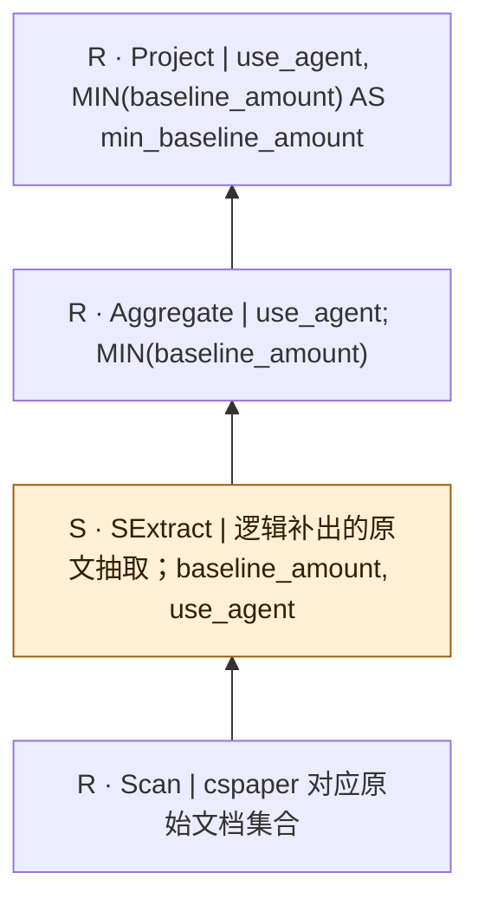

SQL本身只有结构化算子；SExtract是从原文到关系的分析性补充，不是源SQL的显式调用，也不表明每个字段必须由LLM抽取。字段类型、NULL及一对多抽取契约须在执行前固定。

## bench-u/CSPaper/Agg/agg_queries_CSPaper/2

来源：[原件](</Volumes/Element/Github2/semantic-workload-bench/data/semantic-query-discovery-20260908/bench-u/checkout/Query/CSPaper/Agg/agg_queries_CSPaper.sql>) · `sql_plus_proposed_extraction` · `logical_only` · `substantive_relational`

```sql

SELECT uses_knowledge_graph, COUNT(topic) AS count_topic FROM cspaper GROUP BY uses_knowledge_graph;

```

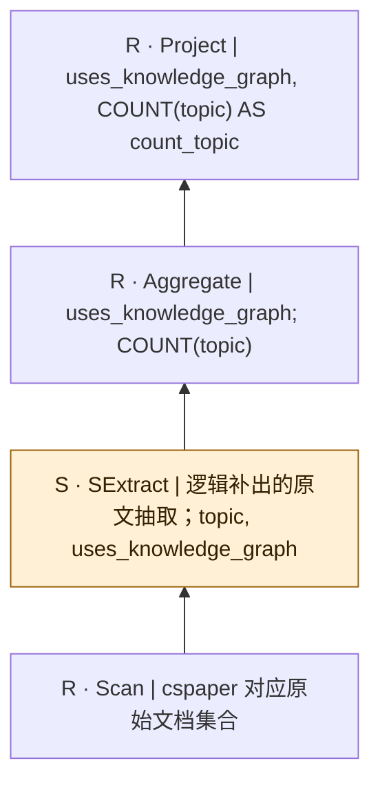

SQL本身只有结构化算子；SExtract是从原文到关系的分析性补充，不是源SQL的显式调用，也不表明每个字段必须由LLM抽取。字段类型、NULL及一对多抽取契约须在执行前固定。

## bench-u/CSPaper/Agg/agg_queries_CSPaper/3

来源：[原件](</Volumes/Element/Github2/semantic-workload-bench/data/semantic-query-discovery-20260908/bench-u/checkout/Query/CSPaper/Agg/agg_queries_CSPaper.sql>) · `sql_plus_proposed_extraction` · `logical_only` · `substantive_relational`

```sql

SELECT uses_reranker, AVG(baseline_amount) AS avg_baseline_amount FROM cspaper GROUP BY uses_reranker;

```

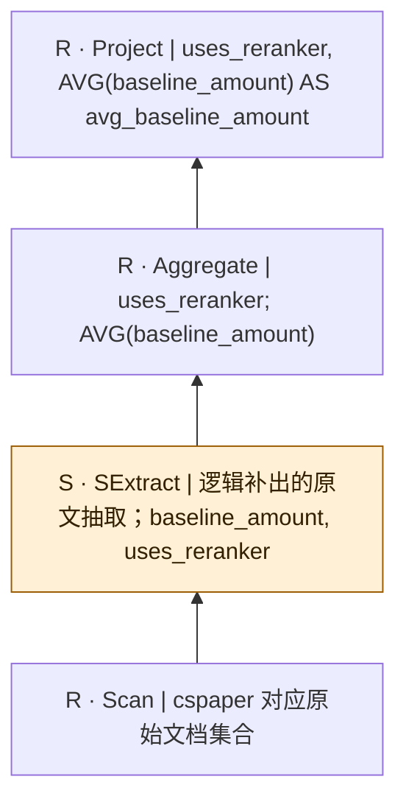

SQL本身只有结构化算子；SExtract是从原文到关系的分析性补充，不是源SQL的显式调用，也不表明每个字段必须由LLM抽取。字段类型、NULL及一对多抽取契约须在执行前固定。

## bench-u/CSPaper/Agg/agg_queries_CSPaper/4

来源：[原件](</Volumes/Element/Github2/semantic-workload-bench/data/semantic-query-discovery-20260908/bench-u/checkout/Query/CSPaper/Agg/agg_queries_CSPaper.sql>) · `sql_plus_proposed_extraction` · `logical_only` · `substantive_relational`

```sql

SELECT topic, MAX(baseline_amount) AS max_baseline_amount FROM cspaper GROUP BY topic;

```

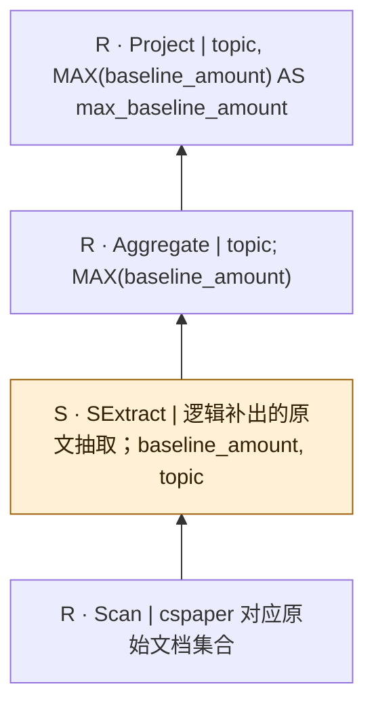

SQL本身只有结构化算子；SExtract是从原文到关系的分析性补充，不是源SQL的显式调用，也不表明每个字段必须由LLM抽取。字段类型、NULL及一对多抽取契约须在执行前固定。

## bench-u/CSPaper/Agg/agg_queries_CSPaper/5

来源：[原件](</Volumes/Element/Github2/semantic-workload-bench/data/semantic-query-discovery-20260908/bench-u/checkout/Query/CSPaper/Agg/agg_queries_CSPaper.sql>) · `sql_plus_proposed_extraction` · `logical_only` · `substantive_relational`

```sql

SELECT uses_knowledge_graph, COUNT(baseline_amount) AS count_baseline_amount FROM cspaper GROUP BY uses_knowledge_graph;

```

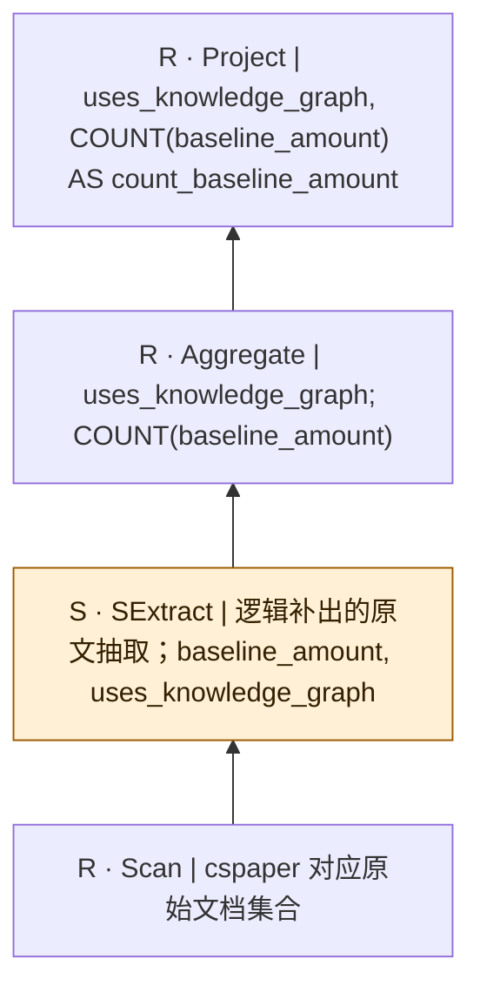

SQL本身只有结构化算子；SExtract是从原文到关系的分析性补充，不是源SQL的显式调用，也不表明每个字段必须由LLM抽取。字段类型、NULL及一对多抽取契约须在执行前固定。

## bench-u/CSPaper/Agg/agg_queries_CSPaper/6

来源：[原件](</Volumes/Element/Github2/semantic-workload-bench/data/semantic-query-discovery-20260908/bench-u/checkout/Query/CSPaper/Agg/agg_queries_CSPaper.sql>) · `sql_plus_proposed_extraction` · `logical_only` · `substantive_relational`

```sql

SELECT use_agent, MIN(baseline_amount) AS min_baseline_amount FROM cspaper GROUP BY use_agent;

```


SQL本身只有结构化算子；SExtract是从原文到关系的分析性补充，不是源SQL的显式调用，也不表明每个字段必须由LLM抽取。字段类型、NULL及一对多抽取契约须在执行前固定。

## bench-u/CSPaper/Agg/agg_queries_CSPaper/7

来源：[原件](</Volumes/Element/Github2/semantic-workload-bench/data/semantic-query-discovery-20260908/bench-u/checkout/Query/CSPaper/Agg/agg_queries_CSPaper.sql>) · `sql_plus_proposed_extraction` · `logical_only` · `substantive_relational`

```sql

SELECT topic, MAX(baseline_amount) AS max_baseline_amount FROM cspaper GROUP BY topic;

```


SQL本身只有结构化算子；SExtract是从原文到关系的分析性补充，不是源SQL的显式调用，也不表明每个字段必须由LLM抽取。字段类型、NULL及一对多抽取契约须在执行前固定。

## bench-u/CSPaper/Agg/agg_queries_CSPaper/8

来源：[原件](</Volumes/Element/Github2/semantic-workload-bench/data/semantic-query-discovery-20260908/bench-u/checkout/Query/CSPaper/Agg/agg_queries_CSPaper.sql>) · `sql_plus_proposed_extraction` · `logical_only` · `substantive_relational`

```sql

SELECT reasoning_depth, SUM(baseline_amount) AS sum_baseline_amount FROM cspaper GROUP BY reasoning_depth;

```

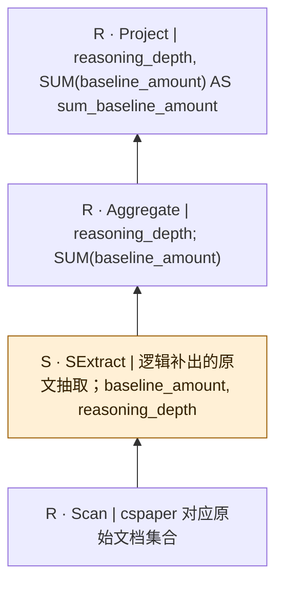

SQL本身只有结构化算子；SExtract是从原文到关系的分析性补充，不是源SQL的显式调用，也不表明每个字段必须由LLM抽取。字段类型、NULL及一对多抽取契约须在执行前固定。

## bench-u/CSPaper/Agg/agg_queries_CSPaper/9

来源：[原件](</Volumes/Element/Github2/semantic-workload-bench/data/semantic-query-discovery-20260908/bench-u/checkout/Query/CSPaper/Agg/agg_queries_CSPaper.sql>) · `sql_plus_proposed_extraction` · `logical_only` · `substantive_relational`

```sql

SELECT topic, COUNT(uses_reranker) AS count_uses_reranker FROM cspaper GROUP BY topic;

```

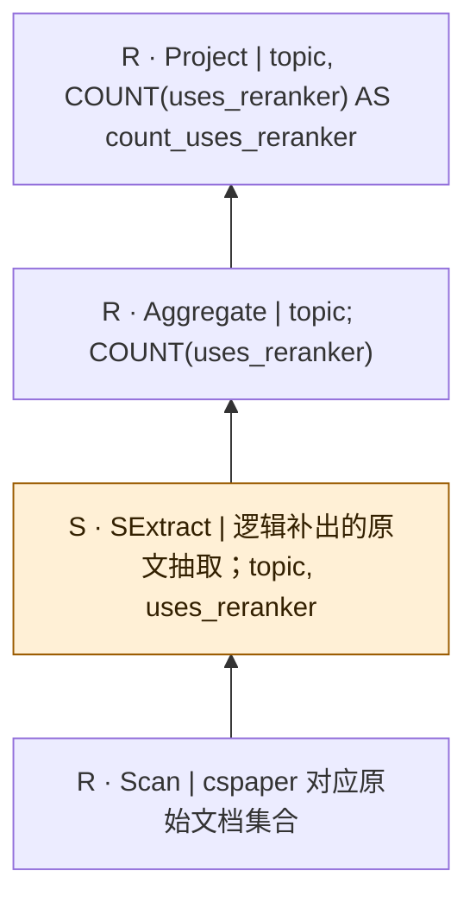

SQL本身只有结构化算子；SExtract是从原文到关系的分析性补充，不是源SQL的显式调用，也不表明每个字段必须由LLM抽取。字段类型、NULL及一对多抽取契约须在执行前固定。

## bench-u/CSPaper/Agg/agg_queries_CSPaper/10

来源：[原件](</Volumes/Element/Github2/semantic-workload-bench/data/semantic-query-discovery-20260908/bench-u/checkout/Query/CSPaper/Agg/agg_queries_CSPaper.sql>) · `sql_plus_proposed_extraction` · `logical_only` · `substantive_relational`

```sql

SELECT topic, COUNT(evaluation_metric) AS count_evaluation_metric FROM cspaper GROUP BY topic;

```

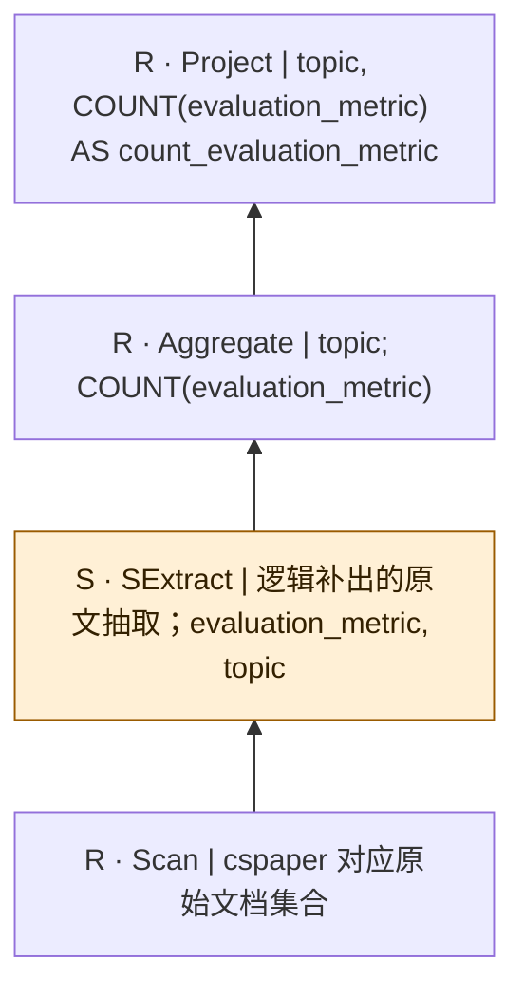

SQL本身只有结构化算子；SExtract是从原文到关系的分析性补充，不是源SQL的显式调用，也不表明每个字段必须由LLM抽取。字段类型、NULL及一对多抽取契约须在执行前固定。

## bench-u/CSPaper/Filter/filter_queries_CSPaper/1

来源：[原件](</Volumes/Element/Github2/semantic-workload-bench/data/semantic-query-discovery-20260908/bench-u/checkout/Query/CSPaper/Filter/filter_queries_CSPaper.sql>) · `sql_plus_proposed_extraction` · `logical_only` · `substantive_relational`

```sql

SELECT uses_reranker, performance_on_hotpotqa, baseline FROM cspaper WHERE performance_on_hotpotqa != 'KILT-EM: 27.3 (T5-Base); KILT-EM: 31.1 (T5-XL)';

```

```mermaid
flowchart BT
  n0["R · Project | uses_reranker, performance_on_hotpotqa, baseline"]
  n1["R · Filter | performance_on_hotpotqa &lt;&gt; &#x27;KILT-EM: 27.3 (T5-Base); KILT-EM: 31.1 (T5-XL)&#x27;"]
  n2["S · SExtract | 逻辑补出的原文抽取；baseline, performance_on_hotpotqa, uses_reranker"]
  n3["R · Scan | cspaper 对应原始文档集合"]
  n3 --> n2
  n2 --> n1
  n1 --> n0
  classDef semantic fill:#fff0d6,stroke:#9a5b00,color:#332000;
  class n2 semantic;
```

SQL本身只有结构化算子；SExtract是从原文到关系的分析性补充，不是源SQL的显式调用，也不表明每个字段必须由LLM抽取。字段类型、NULL及一对多抽取契约须在执行前固定。

## bench-u/CSPaper/Filter/filter_queries_CSPaper/2

来源：[原件](</Volumes/Element/Github2/semantic-workload-bench/data/semantic-query-discovery-20260908/bench-u/checkout/Query/CSPaper/Filter/filter_queries_CSPaper.sql>) · `sql_plus_proposed_extraction` · `logical_only` · `substantive_relational`

```sql

SELECT generator_model, retrieval_method, data_modality FROM cspaper WHERE data_modality = 'Text,Image';

```

```mermaid
flowchart BT
  n0["R · Project | generator_model, retrieval_method, data_modality"]
  n1["R · Filter | data_modality = &#x27;Text,Image&#x27;"]
  n2["S · SExtract | 逻辑补出的原文抽取；data_modality, generator_model, retrieval_method"]
  n3["R · Scan | cspaper 对应原始文档集合"]
  n3 --> n2
  n2 --> n1
  n1 --> n0
  classDef semantic fill:#fff0d6,stroke:#9a5b00,color:#332000;
  class n2 semantic;
```

SQL本身只有结构化算子；SExtract是从原文到关系的分析性补充，不是源SQL的显式调用，也不表明每个字段必须由LLM抽取。字段类型、NULL及一对多抽取契约须在执行前固定。

## bench-u/CSPaper/Filter/filter_queries_CSPaper/3

来源：[原件](</Volumes/Element/Github2/semantic-workload-bench/data/semantic-query-discovery-20260908/bench-u/checkout/Query/CSPaper/Filter/filter_queries_CSPaper.sql>) · `sql_plus_proposed_extraction` · `logical_only` · `substantive_relational`

```sql

SELECT uses_reranker, uses_knowledge_graph, performance_on_hotpotqa FROM cspaper WHERE uses_knowledge_graph != 'Yes';

```

```mermaid
flowchart BT
  n0["R · Project | uses_reranker, uses_knowledge_graph, performance_on_hotpotqa"]
  n1["R · Filter | uses_knowledge_graph &lt;&gt; &#x27;Yes&#x27;"]
  n2["S · SExtract | 逻辑补出的原文抽取；performance_on_hotpotqa, uses_knowledge_graph, uses_reranker"]
  n3["R · Scan | cspaper 对应原始文档集合"]
  n3 --> n2
  n2 --> n1
  n1 --> n0
  classDef semantic fill:#fff0d6,stroke:#9a5b00,color:#332000;
  class n2 semantic;
```

SQL本身只有结构化算子；SExtract是从原文到关系的分析性补充，不是源SQL的显式调用，也不表明每个字段必须由LLM抽取。字段类型、NULL及一对多抽取契约须在执行前固定。

## bench-u/CSPaper/Filter/filter_queries_CSPaper/4

来源：[原件](</Volumes/Element/Github2/semantic-workload-bench/data/semantic-query-discovery-20260908/bench-u/checkout/Query/CSPaper/Filter/filter_queries_CSPaper.sql>) · `sql_plus_proposed_extraction` · `logical_only` · `substantive_relational`

```sql

SELECT baseline, reasoning_depth, evaluation_dataset FROM cspaper WHERE evaluation_dataset = 'MufassirQAS';

```

```mermaid
flowchart BT
  n0["R · Project | baseline, reasoning_depth, evaluation_dataset"]
  n1["R · Filter | evaluation_dataset = &#x27;MufassirQAS&#x27;"]
  n2["S · SExtract | 逻辑补出的原文抽取；baseline, evaluation_dataset, reasoning_depth"]
  n3["R · Scan | cspaper 对应原始文档集合"]
  n3 --> n2
  n2 --> n1
  n1 --> n0
  classDef semantic fill:#fff0d6,stroke:#9a5b00,color:#332000;
  class n2 semantic;
```

SQL本身只有结构化算子；SExtract是从原文到关系的分析性补充，不是源SQL的显式调用，也不表明每个字段必须由LLM抽取。字段类型、NULL及一对多抽取契约须在执行前固定。

## bench-u/CSPaper/Filter/filter_queries_CSPaper/5

来源：[原件](</Volumes/Element/Github2/semantic-workload-bench/data/semantic-query-discovery-20260908/bench-u/checkout/Query/CSPaper/Filter/filter_queries_CSPaper.sql>) · `sql_plus_proposed_extraction` · `logical_only` · `substantive_relational`

```sql

SELECT data_modality, baseline, evaluation_metric FROM cspaper WHERE baseline = 'Zero-Shot; Few-Shot; Dynamic Few-Shot';

```

```mermaid
flowchart BT
  n0["R · Project | data_modality, baseline, evaluation_metric"]
  n1["R · Filter | baseline = &#x27;Zero-Shot; Few-Shot; Dynamic Few-Shot&#x27;"]
  n2["S · SExtract | 逻辑补出的原文抽取；baseline, data_modality, evaluation_metric"]
  n3["R · Scan | cspaper 对应原始文档集合"]
  n3 --> n2
  n2 --> n1
  n1 --> n0
  classDef semantic fill:#fff0d6,stroke:#9a5b00,color:#332000;
  class n2 semantic;
```

SQL本身只有结构化算子；SExtract是从原文到关系的分析性补充，不是源SQL的显式调用，也不表明每个字段必须由LLM抽取。字段类型、NULL及一对多抽取契约须在执行前固定。

## bench-u/CSPaper/Filter/filter_queries_CSPaper/6

来源：[原件](</Volumes/Element/Github2/semantic-workload-bench/data/semantic-query-discovery-20260908/bench-u/checkout/Query/CSPaper/Filter/filter_queries_CSPaper.sql>) · `sql_plus_proposed_extraction` · `logical_only` · `substantive_relational`

```sql

SELECT multi_turn_retrieval, evaluation_metric, reasoning_depth FROM cspaper WHERE reasoning_depth = 'multi-hop';

```

```mermaid
flowchart BT
  n0["R · Project | multi_turn_retrieval, evaluation_metric, reasoning_depth"]
  n1["R · Filter | reasoning_depth = &#x27;multi-hop&#x27;"]
  n2["S · SExtract | 逻辑补出的原文抽取；evaluation_metric, multi_turn_retrieval, reasoning_depth"]
  n3["R · Scan | cspaper 对应原始文档集合"]
  n3 --> n2
  n2 --> n1
  n1 --> n0
  classDef semantic fill:#fff0d6,stroke:#9a5b00,color:#332000;
  class n2 semantic;
```

SQL本身只有结构化算子；SExtract是从原文到关系的分析性补充，不是源SQL的显式调用，也不表明每个字段必须由LLM抽取。字段类型、NULL及一对多抽取契约须在执行前固定。

## bench-u/CSPaper/Filter/filter_queries_CSPaper/7

来源：[原件](</Volumes/Element/Github2/semantic-workload-bench/data/semantic-query-discovery-20260908/bench-u/checkout/Query/CSPaper/Filter/filter_queries_CSPaper.sql>) · `sql_plus_proposed_extraction` · `logical_only` · `substantive_relational`

```sql

SELECT evaluation_metric, multi_turn_retrieval, topic FROM cspaper WHERE evaluation_metric = 'Accuracy; Succinctness; Correctness; Recall';

```

```mermaid
flowchart BT
  n0["R · Project | evaluation_metric, multi_turn_retrieval, topic"]
  n1["R · Filter | evaluation_metric = &#x27;Accuracy; Succinctness; Correctness; Recall&#x27;"]
  n2["S · SExtract | 逻辑补出的原文抽取；evaluation_metric, multi_turn_retrieval, topic"]
  n3["R · Scan | cspaper 对应原始文档集合"]
  n3 --> n2
  n2 --> n1
  n1 --> n0
  classDef semantic fill:#fff0d6,stroke:#9a5b00,color:#332000;
  class n2 semantic;
```

SQL本身只有结构化算子；SExtract是从原文到关系的分析性补充，不是源SQL的显式调用，也不表明每个字段必须由LLM抽取。字段类型、NULL及一对多抽取契约须在执行前固定。

## bench-u/CSPaper/Filter/filter_queries_CSPaper/8

来源：[原件](</Volumes/Element/Github2/semantic-workload-bench/data/semantic-query-discovery-20260908/bench-u/checkout/Query/CSPaper/Filter/filter_queries_CSPaper.sql>) · `sql_plus_proposed_extraction` · `logical_only` · `substantive_relational`

```sql

SELECT data_modality, use_agent, topic FROM cspaper WHERE use_agent = 'No';

```

```mermaid
flowchart BT
  n0["R · Project | data_modality, use_agent, topic"]
  n1["R · Filter | use_agent = &#x27;No&#x27;"]
  n2["S · SExtract | 逻辑补出的原文抽取；data_modality, topic, use_agent"]
  n3["R · Scan | cspaper 对应原始文档集合"]
  n3 --> n2
  n2 --> n1
  n1 --> n0
  classDef semantic fill:#fff0d6,stroke:#9a5b00,color:#332000;
  class n2 semantic;
```

SQL本身只有结构化算子；SExtract是从原文到关系的分析性补充，不是源SQL的显式调用，也不表明每个字段必须由LLM抽取。字段类型、NULL及一对多抽取契约须在执行前固定。

## bench-u/CSPaper/Filter/filter_queries_CSPaper/9

来源：[原件](</Volumes/Element/Github2/semantic-workload-bench/data/semantic-query-discovery-20260908/bench-u/checkout/Query/CSPaper/Filter/filter_queries_CSPaper.sql>) · `sql_plus_proposed_extraction` · `logical_only` · `substantive_relational`

```sql

SELECT baseline, retrieval_method, baseline_amount FROM cspaper WHERE baseline_amount < 10;

```

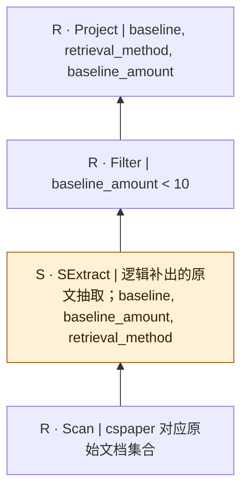

SQL本身只有结构化算子；SExtract是从原文到关系的分析性补充，不是源SQL的显式调用，也不表明每个字段必须由LLM抽取。字段类型、NULL及一对多抽取契约须在执行前固定。

## bench-u/CSPaper/Filter/filter_queries_CSPaper/10

来源：[原件](</Volumes/Element/Github2/semantic-workload-bench/data/semantic-query-discovery-20260908/bench-u/checkout/Query/CSPaper/Filter/filter_queries_CSPaper.sql>) · `sql_plus_proposed_extraction` · `logical_only` · `substantive_relational`

```sql

SELECT data_modality, topic, generator_model FROM cspaper WHERE topic != 'SFT';

```

```mermaid
flowchart BT
  n0["R · Project | data_modality, topic, generator_model"]
  n1["R · Filter | topic &lt;&gt; &#x27;SFT&#x27;"]
  n2["S · SExtract | 逻辑补出的原文抽取；data_modality, generator_model, topic"]
  n3["R · Scan | cspaper 对应原始文档集合"]
  n3 --> n2
  n2 --> n1
  n1 --> n0
  classDef semantic fill:#fff0d6,stroke:#9a5b00,color:#332000;
  class n2 semantic;
```

SQL本身只有结构化算子；SExtract是从原文到关系的分析性补充，不是源SQL的显式调用，也不表明每个字段必须由LLM抽取。字段类型、NULL及一对多抽取契约须在执行前固定。

## bench-u/CSPaper/Filter/filter_queries_CSPaper/11

来源：[原件](</Volumes/Element/Github2/semantic-workload-bench/data/semantic-query-discovery-20260908/bench-u/checkout/Query/CSPaper/Filter/filter_queries_CSPaper.sql>) · `sql_plus_proposed_extraction` · `logical_only` · `substantive_relational`

```sql

SELECT performance_on_NQ, agent_framework, uses_knowledge_graph FROM cspaper WHERE performance_on_NQ != 'Llama-3.1-8B-Instruct-4K: Hit@1: 61.75, EM: 45.90; Llama-3.1-70B-Instruct-4K: Hit@1: 60.50, EM: 45.26' AND generator_model != 'gpt-3.5-turbo-16k-0613';

```

```mermaid
flowchart BT
  n0["R · Project | performance_on_NQ, agent_framework, uses_knowledge_graph"]
  n1["R · Filter | performance_on_NQ &lt;&gt; &#x27;Llama-3.1-8B-Instruct-4K: Hit@1: 61.75, EM: 45.90; Llama-3.1-70B-Instruct-4K: Hit@1: 60.50, EM: 45.26&#x27; AND generator_model &lt;&gt; &#x27;gpt-3.5-turbo-16k-0613&#x27;"]
  n2["S · SExtract | 逻辑补出的原文抽取；agent_framework, generator_model, performance_on_NQ, uses_knowledge_graph"]
  n3["R · Scan | cspaper 对应原始文档集合"]
  n3 --> n2
  n2 --> n1
  n1 --> n0
  classDef semantic fill:#fff0d6,stroke:#9a5b00,color:#332000;
  class n2 semantic;
```

SQL本身只有结构化算子；SExtract是从原文到关系的分析性补充，不是源SQL的显式调用，也不表明每个字段必须由LLM抽取。字段类型、NULL及一对多抽取契约须在执行前固定。

## bench-u/CSPaper/Filter/filter_queries_CSPaper/12

来源：[原件](</Volumes/Element/Github2/semantic-workload-bench/data/semantic-query-discovery-20260908/bench-u/checkout/Query/CSPaper/Filter/filter_queries_CSPaper.sql>) · `sql_plus_proposed_extraction` · `logical_only` · `substantive_relational`

```sql

SELECT evaluation_dataset, data_modality, application_domain FROM cspaper WHERE application_domain = 'Education' AND evaluation_metric = 'recall@k; Preprocessing Time; Query processing time';

```

```mermaid
flowchart BT
  n0["R · Project | evaluation_dataset, data_modality, application_domain"]
  n1["R · Filter | application_domain = &#x27;Education&#x27; AND evaluation_metric = &#x27;recall@k; Preprocessing Time; Query processing time&#x27;"]
  n2["S · SExtract | 逻辑补出的原文抽取；application_domain, data_modality, evaluation_dataset, evaluation_metric"]
  n3["R · Scan | cspaper 对应原始文档集合"]
  n3 --> n2
  n2 --> n1
  n1 --> n0
  classDef semantic fill:#fff0d6,stroke:#9a5b00,color:#332000;
  class n2 semantic;
```

SQL本身只有结构化算子；SExtract是从原文到关系的分析性补充，不是源SQL的显式调用，也不表明每个字段必须由LLM抽取。字段类型、NULL及一对多抽取契约须在执行前固定。

## bench-u/CSPaper/Filter/filter_queries_CSPaper/13

来源：[原件](</Volumes/Element/Github2/semantic-workload-bench/data/semantic-query-discovery-20260908/bench-u/checkout/Query/CSPaper/Filter/filter_queries_CSPaper.sql>) · `sql_plus_proposed_extraction` · `logical_only` · `substantive_relational`

```sql

SELECT performance_on_hotpotqa, evaluation_metric, evaluation_dataset FROM cspaper WHERE performance_on_hotpotqa != 'Clean ACC: Mistral-7B 51.0, Llama2-C 46.0, GPT-4o 47.6; Robust RACC/ASR (PIA Attack, AVF α=5): Mistral-7B 53.0/8.0, Llama2-C 34.0/11.4, GPT-4o 42.6/9.8' AND agent_framework != 'Multi-Agent Collaboration';

```

```mermaid
flowchart BT
  n0["R · Project | performance_on_hotpotqa, evaluation_metric, evaluation_dataset"]
  n1["R · Filter | performance_on_hotpotqa &lt;&gt; &#x27;Clean ACC: Mistral-7B 51.0, Llama2-C 46.0, GPT-4o 47.6; Robust RACC/ASR (PIA Attack, AVF α=5): Mistral-7B 53.0/8.0, Llama2-C 34.0/11.4, GPT-4o 42.6/9.8&#x27; AND agent_framework &lt;&gt; &#x27;Multi-Agent Collaboration&#x27;"]
  n2["S · SExtract | 逻辑补出的原文抽取；agent_framework, evaluation_dataset, evaluation_metric, performance_on_hotpotqa"]
  n3["R · Scan | cspaper 对应原始文档集合"]
  n3 --> n2
  n2 --> n1
  n1 --> n0
  classDef semantic fill:#fff0d6,stroke:#9a5b00,color:#332000;
  class n2 semantic;
```

SQL本身只有结构化算子；SExtract是从原文到关系的分析性补充，不是源SQL的显式调用，也不表明每个字段必须由LLM抽取。字段类型、NULL及一对多抽取契约须在执行前固定。

## bench-u/CSPaper/Filter/filter_queries_CSPaper/14

来源：[原件](</Volumes/Element/Github2/semantic-workload-bench/data/semantic-query-discovery-20260908/bench-u/checkout/Query/CSPaper/Filter/filter_queries_CSPaper.sql>) · `sql_plus_proposed_extraction` · `logical_only` · `substantive_relational`

```sql

SELECT data_modality, baseline, evaluation_dataset FROM cspaper WHERE data_modality != 'Table; Text' AND agent_framework != 'Other';

```

```mermaid
flowchart BT
  n0["R · Project | data_modality, baseline, evaluation_dataset"]
  n1["R · Filter | data_modality &lt;&gt; &#x27;Table; Text&#x27; AND agent_framework &lt;&gt; &#x27;Other&#x27;"]
  n2["S · SExtract | 逻辑补出的原文抽取；agent_framework, baseline, data_modality, evaluation_dataset"]
  n3["R · Scan | cspaper 对应原始文档集合"]
  n3 --> n2
  n2 --> n1
  n1 --> n0
  classDef semantic fill:#fff0d6,stroke:#9a5b00,color:#332000;
  class n2 semantic;
```

SQL本身只有结构化算子；SExtract是从原文到关系的分析性补充，不是源SQL的显式调用，也不表明每个字段必须由LLM抽取。字段类型、NULL及一对多抽取契约须在执行前固定。

## bench-u/CSPaper/Filter/filter_queries_CSPaper/15

来源：[原件](</Volumes/Element/Github2/semantic-workload-bench/data/semantic-query-discovery-20260908/bench-u/checkout/Query/CSPaper/Filter/filter_queries_CSPaper.sql>) · `sql_plus_proposed_extraction` · `logical_only` · `substantive_relational`

```sql

SELECT retrieval_method, baseline_amount, baseline FROM cspaper WHERE baseline != 'GPT-3; GPT-4;LLaMA2; LAMBADA; PALM' AND reasoning_depth != 'multi-hop';

```

```mermaid
flowchart BT
  n0["R · Project | retrieval_method, baseline_amount, baseline"]
  n1["R · Filter | baseline &lt;&gt; &#x27;GPT-3; GPT-4;LLaMA2; LAMBADA; PALM&#x27; AND reasoning_depth &lt;&gt; &#x27;multi-hop&#x27;"]
  n2["S · SExtract | 逻辑补出的原文抽取；baseline, baseline_amount, reasoning_depth, retrieval_method"]
  n3["R · Scan | cspaper 对应原始文档集合"]
  n3 --> n2
  n2 --> n1
  n1 --> n0
  classDef semantic fill:#fff0d6,stroke:#9a5b00,color:#332000;
  class n2 semantic;
```

SQL本身只有结构化算子；SExtract是从原文到关系的分析性补充，不是源SQL的显式调用，也不表明每个字段必须由LLM抽取。字段类型、NULL及一对多抽取契约须在执行前固定。

## bench-u/CSPaper/Filter/filter_queries_CSPaper/16

来源：[原件](</Volumes/Element/Github2/semantic-workload-bench/data/semantic-query-discovery-20260908/bench-u/checkout/Query/CSPaper/Filter/filter_queries_CSPaper.sql>) · `sql_plus_proposed_extraction` · `logical_only` · `substantive_relational`

```sql

SELECT baseline, uses_reranker, use_agent FROM cspaper WHERE baseline != 'VanillaRAG; GraphRAG; Long-Context LLM; Normal SFT' AND use_agent = 'Yes';

```

```mermaid
flowchart BT
  n0["R · Project | baseline, uses_reranker, use_agent"]
  n1["R · Filter | baseline &lt;&gt; &#x27;VanillaRAG; GraphRAG; Long-Context LLM; Normal SFT&#x27; AND use_agent = &#x27;Yes&#x27;"]
  n2["S · SExtract | 逻辑补出的原文抽取；baseline, use_agent, uses_reranker"]
  n3["R · Scan | cspaper 对应原始文档集合"]
  n3 --> n2
  n2 --> n1
  n1 --> n0
  classDef semantic fill:#fff0d6,stroke:#9a5b00,color:#332000;
  class n2 semantic;
```

SQL本身只有结构化算子；SExtract是从原文到关系的分析性补充，不是源SQL的显式调用，也不表明每个字段必须由LLM抽取。字段类型、NULL及一对多抽取契约须在执行前固定。

## bench-u/CSPaper/Filter/filter_queries_CSPaper/17

来源：[原件](</Volumes/Element/Github2/semantic-workload-bench/data/semantic-query-discovery-20260908/bench-u/checkout/Query/CSPaper/Filter/filter_queries_CSPaper.sql>) · `sql_plus_proposed_extraction` · `logical_only` · `substantive_relational`

```sql

SELECT retrieval_method, baseline, application_domain FROM cspaper WHERE retrieval_method != 'Web Search; Dense Retrieval' AND evaluation_metric = 'Accuracy; match score; F1 score';

```

```mermaid
flowchart BT
  n0["R · Project | retrieval_method, baseline, application_domain"]
  n1["R · Filter | retrieval_method &lt;&gt; &#x27;Web Search; Dense Retrieval&#x27; AND evaluation_metric = &#x27;Accuracy; match score; F1 score&#x27;"]
  n2["S · SExtract | 逻辑补出的原文抽取；application_domain, baseline, evaluation_metric, retrieval_method"]
  n3["R · Scan | cspaper 对应原始文档集合"]
  n3 --> n2
  n2 --> n1
  n1 --> n0
  classDef semantic fill:#fff0d6,stroke:#9a5b00,color:#332000;
  class n2 semantic;
```

SQL本身只有结构化算子；SExtract是从原文到关系的分析性补充，不是源SQL的显式调用，也不表明每个字段必须由LLM抽取。字段类型、NULL及一对多抽取契约须在执行前固定。

## bench-u/CSPaper/Filter/filter_queries_CSPaper/18

来源：[原件](</Volumes/Element/Github2/semantic-workload-bench/data/semantic-query-discovery-20260908/bench-u/checkout/Query/CSPaper/Filter/filter_queries_CSPaper.sql>) · `sql_plus_proposed_extraction` · `logical_only` · `substantive_relational`

```sql

SELECT uses_reranker, multi_turn_retrieval, data_modality FROM cspaper WHERE data_modality = 'Text; Image; Audio' AND evaluation_metric != 'AUROC; AUPRC; min(+P, Se); F1';

```

```mermaid
flowchart BT
  n0["R · Project | uses_reranker, multi_turn_retrieval, data_modality"]
  n1["R · Filter | data_modality = &#x27;Text; Image; Audio&#x27; AND evaluation_metric &lt;&gt; &#x27;AUROC; AUPRC; min(+P, Se); F1&#x27;"]
  n2["S · SExtract | 逻辑补出的原文抽取；data_modality, evaluation_metric, multi_turn_retrieval, uses_reranker"]
  n3["R · Scan | cspaper 对应原始文档集合"]
  n3 --> n2
  n2 --> n1
  n1 --> n0
  classDef semantic fill:#fff0d6,stroke:#9a5b00,color:#332000;
  class n2 semantic;
```

SQL本身只有结构化算子；SExtract是从原文到关系的分析性补充，不是源SQL的显式调用，也不表明每个字段必须由LLM抽取。字段类型、NULL及一对多抽取契约须在执行前固定。

## bench-u/CSPaper/Filter/filter_queries_CSPaper/19

来源：[原件](</Volumes/Element/Github2/semantic-workload-bench/data/semantic-query-discovery-20260908/bench-u/checkout/Query/CSPaper/Filter/filter_queries_CSPaper.sql>) · `sql_plus_proposed_extraction` · `logical_only` · `substantive_relational`

```sql

SELECT performance_on_NQ, baseline_amount, evaluation_dataset FROM cspaper WHERE performance_on_NQ != 'Retrieval Acc@5: 80.5; Retrieval Acc@20: 88.0; Generation ExactMatch: 56.2' AND use_agent = 'Yes';

```

```mermaid
flowchart BT
  n0["R · Project | performance_on_NQ, baseline_amount, evaluation_dataset"]
  n1["R · Filter | performance_on_NQ &lt;&gt; &#x27;Retrieval Acc@5: 80.5; Retrieval Acc@20: 88.0; Generation ExactMatch: 56.2&#x27; AND use_agent = &#x27;Yes&#x27;"]
  n2["S · SExtract | 逻辑补出的原文抽取；baseline_amount, evaluation_dataset, performance_on_NQ, use_agent"]
  n3["R · Scan | cspaper 对应原始文档集合"]
  n3 --> n2
  n2 --> n1
  n1 --> n0
  classDef semantic fill:#fff0d6,stroke:#9a5b00,color:#332000;
  class n2 semantic;
```

SQL本身只有结构化算子；SExtract是从原文到关系的分析性补充，不是源SQL的显式调用，也不表明每个字段必须由LLM抽取。字段类型、NULL及一对多抽取契约须在执行前固定。

## bench-u/CSPaper/Filter/filter_queries_CSPaper/20

来源：[原件](</Volumes/Element/Github2/semantic-workload-bench/data/semantic-query-discovery-20260908/bench-u/checkout/Query/CSPaper/Filter/filter_queries_CSPaper.sql>) · `sql_plus_proposed_extraction` · `logical_only` · `substantive_relational`

```sql

SELECT uses_reranker, application_domain, baseline FROM cspaper WHERE baseline = 'Direct; DSP; Self-RAG; ReAct; Self-Ask' AND multi_turn_retrieval != 'No';

```

```mermaid
flowchart BT
  n0["R · Project | uses_reranker, application_domain, baseline"]
  n1["R · Filter | baseline = &#x27;Direct; DSP; Self-RAG; ReAct; Self-Ask&#x27; AND multi_turn_retrieval &lt;&gt; &#x27;No&#x27;"]
  n2["S · SExtract | 逻辑补出的原文抽取；application_domain, baseline, multi_turn_retrieval, uses_reranker"]
  n3["R · Scan | cspaper 对应原始文档集合"]
  n3 --> n2
  n2 --> n1
  n1 --> n0
  classDef semantic fill:#fff0d6,stroke:#9a5b00,color:#332000;
  class n2 semantic;
```

SQL本身只有结构化算子；SExtract是从原文到关系的分析性补充，不是源SQL的显式调用，也不表明每个字段必须由LLM抽取。字段类型、NULL及一对多抽取契约须在执行前固定。

## bench-u/CSPaper/Filter/filter_queries_CSPaper/21

来源：[原件](</Volumes/Element/Github2/semantic-workload-bench/data/semantic-query-discovery-20260908/bench-u/checkout/Query/CSPaper/Filter/filter_queries_CSPaper.sql>) · `sql_plus_proposed_extraction` · `logical_only` · `substantive_relational`

```sql

SELECT retrieval_method, uses_knowledge_graph, evaluation_metric FROM cspaper WHERE retrieval_method != 'Web Search; Dense Retrieval' OR evaluation_metric != 'recall@1; recall@5; recall@20; BLEU-4; BERTScore; Inform Rate';

```

```mermaid
flowchart BT
  n0["R · Project | retrieval_method, uses_knowledge_graph, evaluation_metric"]
  n1["R · Filter | retrieval_method &lt;&gt; &#x27;Web Search; Dense Retrieval&#x27; OR evaluation_metric &lt;&gt; &#x27;recall@1; recall@5; recall@20; BLEU-4; BERTScore; Inform Rate&#x27;"]
  n2["S · SExtract | 逻辑补出的原文抽取；evaluation_metric, retrieval_method, uses_knowledge_graph"]
  n3["R · Scan | cspaper 对应原始文档集合"]
  n3 --> n2
  n2 --> n1
  n1 --> n0
  classDef semantic fill:#fff0d6,stroke:#9a5b00,color:#332000;
  class n2 semantic;
```

SQL本身只有结构化算子；SExtract是从原文到关系的分析性补充，不是源SQL的显式调用，也不表明每个字段必须由LLM抽取。字段类型、NULL及一对多抽取契约须在执行前固定。

## bench-u/CSPaper/Filter/filter_queries_CSPaper/22

来源：[原件](</Volumes/Element/Github2/semantic-workload-bench/data/semantic-query-discovery-20260908/bench-u/checkout/Query/CSPaper/Filter/filter_queries_CSPaper.sql>) · `sql_plus_proposed_extraction` · `logical_only` · `substantive_relational`

```sql

SELECT multi_turn_retrieval, data_modality, baseline_amount FROM cspaper WHERE multi_turn_retrieval != 'Yes' OR baseline_amount = 6;

```

```mermaid
flowchart BT
  n0["R · Project | multi_turn_retrieval, data_modality, baseline_amount"]
  n1["R · Filter | multi_turn_retrieval &lt;&gt; &#x27;Yes&#x27; OR baseline_amount = 6"]
  n2["S · SExtract | 逻辑补出的原文抽取；baseline_amount, data_modality, multi_turn_retrieval"]
  n3["R · Scan | cspaper 对应原始文档集合"]
  n3 --> n2
  n2 --> n1
  n1 --> n0
  classDef semantic fill:#fff0d6,stroke:#9a5b00,color:#332000;
  class n2 semantic;
```

SQL本身只有结构化算子；SExtract是从原文到关系的分析性补充，不是源SQL的显式调用，也不表明每个字段必须由LLM抽取。字段类型、NULL及一对多抽取契约须在执行前固定。

## bench-u/CSPaper/Filter/filter_queries_CSPaper/23

来源：[原件](</Volumes/Element/Github2/semantic-workload-bench/data/semantic-query-discovery-20260908/bench-u/checkout/Query/CSPaper/Filter/filter_queries_CSPaper.sql>) · `sql_plus_proposed_extraction` · `logical_only` · `substantive_relational`

```sql

SELECT uses_knowledge_graph, generator_model, retrieval_method FROM cspaper WHERE retrieval_method = 'Web Search; Other' OR performance_on_hotpotqa != 'Accuracy: ~0.62';

```

```mermaid
flowchart BT
  n0["R · Project | uses_knowledge_graph, generator_model, retrieval_method"]
  n1["R · Filter | retrieval_method = &#x27;Web Search; Other&#x27; OR performance_on_hotpotqa &lt;&gt; &#x27;Accuracy: ~0.62&#x27;"]
  n2["S · SExtract | 逻辑补出的原文抽取；generator_model, performance_on_hotpotqa, retrieval_method, uses_knowledge_graph"]
  n3["R · Scan | cspaper 对应原始文档集合"]
  n3 --> n2
  n2 --> n1
  n1 --> n0
  classDef semantic fill:#fff0d6,stroke:#9a5b00,color:#332000;
  class n2 semantic;
```

SQL本身只有结构化算子；SExtract是从原文到关系的分析性补充，不是源SQL的显式调用，也不表明每个字段必须由LLM抽取。字段类型、NULL及一对多抽取契约须在执行前固定。

## bench-u/CSPaper/Filter/filter_queries_CSPaper/24

来源：[原件](</Volumes/Element/Github2/semantic-workload-bench/data/semantic-query-discovery-20260908/bench-u/checkout/Query/CSPaper/Filter/filter_queries_CSPaper.sql>) · `sql_plus_proposed_extraction` · `logical_only` · `substantive_relational`

```sql

SELECT baseline, performance_on_NQ, reasoning_depth FROM cspaper WHERE reasoning_depth = 'single-hop' OR use_agent != 'No';

```

```mermaid
flowchart BT
  n0["R · Project | baseline, performance_on_NQ, reasoning_depth"]
  n1["R · Filter | reasoning_depth = &#x27;single-hop&#x27; OR use_agent &lt;&gt; &#x27;No&#x27;"]
  n2["S · SExtract | 逻辑补出的原文抽取；baseline, performance_on_NQ, reasoning_depth, use_agent"]
  n3["R · Scan | cspaper 对应原始文档集合"]
  n3 --> n2
  n2 --> n1
  n1 --> n0
  classDef semantic fill:#fff0d6,stroke:#9a5b00,color:#332000;
  class n2 semantic;
```

SQL本身只有结构化算子；SExtract是从原文到关系的分析性补充，不是源SQL的显式调用，也不表明每个字段必须由LLM抽取。字段类型、NULL及一对多抽取契约须在执行前固定。

## bench-u/CSPaper/Filter/filter_queries_CSPaper/25

来源：[原件](</Volumes/Element/Github2/semantic-workload-bench/data/semantic-query-discovery-20260908/bench-u/checkout/Query/CSPaper/Filter/filter_queries_CSPaper.sql>) · `sql_plus_proposed_extraction` · `logical_only` · `substantive_relational`

```sql

SELECT evaluation_dataset, agent_framework, performance_on_hotpotqa FROM cspaper WHERE performance_on_hotpotqa = 'F1: 40.8' OR use_agent != 'No';

```

```mermaid
flowchart BT
  n0["R · Project | evaluation_dataset, agent_framework, performance_on_hotpotqa"]
  n1["R · Filter | performance_on_hotpotqa = &#x27;F1: 40.8&#x27; OR use_agent &lt;&gt; &#x27;No&#x27;"]
  n2["S · SExtract | 逻辑补出的原文抽取；agent_framework, evaluation_dataset, performance_on_hotpotqa, use_agent"]
  n3["R · Scan | cspaper 对应原始文档集合"]
  n3 --> n2
  n2 --> n1
  n1 --> n0
  classDef semantic fill:#fff0d6,stroke:#9a5b00,color:#332000;
  class n2 semantic;
```

SQL本身只有结构化算子；SExtract是从原文到关系的分析性补充，不是源SQL的显式调用，也不表明每个字段必须由LLM抽取。字段类型、NULL及一对多抽取契约须在执行前固定。

## bench-u/CSPaper/Filter/filter_queries_CSPaper/26

来源：[原件](</Volumes/Element/Github2/semantic-workload-bench/data/semantic-query-discovery-20260908/bench-u/checkout/Query/CSPaper/Filter/filter_queries_CSPaper.sql>) · `sql_plus_proposed_extraction` · `logical_only` · `substantive_relational`

```sql

SELECT use_agent, uses_reranker, retrieval_method FROM cspaper WHERE uses_reranker != 'Yes' OR topic != 'Data Selection';

```

```mermaid
flowchart BT
  n0["R · Project | use_agent, uses_reranker, retrieval_method"]
  n1["R · Filter | uses_reranker &lt;&gt; &#x27;Yes&#x27; OR topic &lt;&gt; &#x27;Data Selection&#x27;"]
  n2["S · SExtract | 逻辑补出的原文抽取；retrieval_method, topic, use_agent, uses_reranker"]
  n3["R · Scan | cspaper 对应原始文档集合"]
  n3 --> n2
  n2 --> n1
  n1 --> n0
  classDef semantic fill:#fff0d6,stroke:#9a5b00,color:#332000;
  class n2 semantic;
```

SQL本身只有结构化算子；SExtract是从原文到关系的分析性补充，不是源SQL的显式调用，也不表明每个字段必须由LLM抽取。字段类型、NULL及一对多抽取契约须在执行前固定。

## bench-u/CSPaper/Filter/filter_queries_CSPaper/27

来源：[原件](</Volumes/Element/Github2/semantic-workload-bench/data/semantic-query-discovery-20260908/bench-u/checkout/Query/CSPaper/Filter/filter_queries_CSPaper.sql>) · `sql_plus_proposed_extraction` · `logical_only` · `substantive_relational`

```sql

SELECT data_modality, uses_reranker, performance_on_NQ FROM cspaper WHERE data_modality != 'Text; Code; Audio' OR agent_framework = 'ToT';

```

```mermaid
flowchart BT
  n0["R · Project | data_modality, uses_reranker, performance_on_NQ"]
  n1["R · Filter | data_modality &lt;&gt; &#x27;Text; Code; Audio&#x27; OR agent_framework = &#x27;ToT&#x27;"]
  n2["S · SExtract | 逻辑补出的原文抽取；agent_framework, data_modality, performance_on_NQ, uses_reranker"]
  n3["R · Scan | cspaper 对应原始文档集合"]
  n3 --> n2
  n2 --> n1
  n1 --> n0
  classDef semantic fill:#fff0d6,stroke:#9a5b00,color:#332000;
  class n2 semantic;
```

SQL本身只有结构化算子；SExtract是从原文到关系的分析性补充，不是源SQL的显式调用，也不表明每个字段必须由LLM抽取。字段类型、NULL及一对多抽取契约须在执行前固定。

## bench-u/CSPaper/Filter/filter_queries_CSPaper/28

来源：[原件](</Volumes/Element/Github2/semantic-workload-bench/data/semantic-query-discovery-20260908/bench-u/checkout/Query/CSPaper/Filter/filter_queries_CSPaper.sql>) · `sql_plus_proposed_extraction` · `logical_only` · `substantive_relational`

```sql

SELECT use_agent, reasoning_depth, multi_turn_retrieval FROM cspaper WHERE reasoning_depth = 'single-hop' OR data_modality != 'Text; Table; Image';

```

```mermaid
flowchart BT
  n0["R · Project | use_agent, reasoning_depth, multi_turn_retrieval"]
  n1["R · Filter | reasoning_depth = &#x27;single-hop&#x27; OR data_modality &lt;&gt; &#x27;Text; Table; Image&#x27;"]
  n2["S · SExtract | 逻辑补出的原文抽取；data_modality, multi_turn_retrieval, reasoning_depth, use_agent"]
  n3["R · Scan | cspaper 对应原始文档集合"]
  n3 --> n2
  n2 --> n1
  n1 --> n0
  classDef semantic fill:#fff0d6,stroke:#9a5b00,color:#332000;
  class n2 semantic;
```

SQL本身只有结构化算子；SExtract是从原文到关系的分析性补充，不是源SQL的显式调用，也不表明每个字段必须由LLM抽取。字段类型、NULL及一对多抽取契约须在执行前固定。

## bench-u/CSPaper/Filter/filter_queries_CSPaper/29

来源：[原件](</Volumes/Element/Github2/semantic-workload-bench/data/semantic-query-discovery-20260908/bench-u/checkout/Query/CSPaper/Filter/filter_queries_CSPaper.sql>) · `sql_plus_proposed_extraction` · `logical_only` · `substantive_relational`

```sql

SELECT data_modality, agent_framework, generator_model FROM cspaper WHERE data_modality != 'Text,Image' OR evaluation_metric = 'relevance; readability; informativeness; Response time';

```

```mermaid
flowchart BT
  n0["R · Project | data_modality, agent_framework, generator_model"]
  n1["R · Filter | data_modality &lt;&gt; &#x27;Text,Image&#x27; OR evaluation_metric = &#x27;relevance; readability; informativeness; Response time&#x27;"]
  n2["S · SExtract | 逻辑补出的原文抽取；agent_framework, data_modality, evaluation_metric, generator_model"]
  n3["R · Scan | cspaper 对应原始文档集合"]
  n3 --> n2
  n2 --> n1
  n1 --> n0
  classDef semantic fill:#fff0d6,stroke:#9a5b00,color:#332000;
  class n2 semantic;
```

SQL本身只有结构化算子；SExtract是从原文到关系的分析性补充，不是源SQL的显式调用，也不表明每个字段必须由LLM抽取。字段类型、NULL及一对多抽取契约须在执行前固定。

## bench-u/CSPaper/Filter/filter_queries_CSPaper/30

来源：[原件](</Volumes/Element/Github2/semantic-workload-bench/data/semantic-query-discovery-20260908/bench-u/checkout/Query/CSPaper/Filter/filter_queries_CSPaper.sql>) · `sql_plus_proposed_extraction` · `logical_only` · `substantive_relational`

```sql

SELECT application_domain, use_agent, generator_model FROM cspaper WHERE use_agent = 'Yes' OR baseline = 'OpenAI models';

```

```mermaid
flowchart BT
  n0["R · Project | application_domain, use_agent, generator_model"]
  n1["R · Filter | use_agent = &#x27;Yes&#x27; OR baseline = &#x27;OpenAI models&#x27;"]
  n2["S · SExtract | 逻辑补出的原文抽取；application_domain, baseline, generator_model, use_agent"]
  n3["R · Scan | cspaper 对应原始文档集合"]
  n3 --> n2
  n2 --> n1
  n1 --> n0
  classDef semantic fill:#fff0d6,stroke:#9a5b00,color:#332000;
  class n2 semantic;
```

SQL本身只有结构化算子；SExtract是从原文到关系的分析性补充，不是源SQL的显式调用，也不表明每个字段必须由LLM抽取。字段类型、NULL及一对多抽取契约须在执行前固定。

## bench-u/CSPaper/Filter/filter_queries_CSPaper/31

来源：[原件](</Volumes/Element/Github2/semantic-workload-bench/data/semantic-query-discovery-20260908/bench-u/checkout/Query/CSPaper/Filter/filter_queries_CSPaper.sql>) · `sql_plus_proposed_extraction` · `logical_only` · `substantive_relational`

```sql

SELECT performance_on_NQ, performance_on_hotpotqa, baseline_amount FROM cspaper WHERE performance_on_hotpotqa = 'EM:0.667;F1：0.795' AND baseline_amount >= 3 AND performance_on_NQ = 'Accuracy: 0.6294; Accuracy: 0.6033' AND use_agent = 'Yes';

```

```mermaid
flowchart BT
  n0["R · Project | performance_on_NQ, performance_on_hotpotqa, baseline_amount"]
  n1["R · Filter | performance_on_hotpotqa = &#x27;EM:0.667;F1：0.795&#x27; AND baseline_amount &gt;= 3 AND performance_on_NQ = &#x27;Accuracy: 0.6294; Accuracy: 0.6033&#x27; AND use_agent = &#x27;Yes&#x27;"]
  n2["S · SExtract | 逻辑补出的原文抽取；baseline_amount, performance_on_NQ, performance_on_hotpotqa, use_agent"]
  n3["R · Scan | cspaper 对应原始文档集合"]
  n3 --> n2
  n2 --> n1
  n1 --> n0
  classDef semantic fill:#fff0d6,stroke:#9a5b00,color:#332000;
  class n2 semantic;
```

SQL本身只有结构化算子；SExtract是从原文到关系的分析性补充，不是源SQL的显式调用，也不表明每个字段必须由LLM抽取。字段类型、NULL及一对多抽取契约须在执行前固定。

## bench-u/CSPaper/Filter/filter_queries_CSPaper/32

来源：[原件](</Volumes/Element/Github2/semantic-workload-bench/data/semantic-query-discovery-20260908/bench-u/checkout/Query/CSPaper/Filter/filter_queries_CSPaper.sql>) · `sql_plus_proposed_extraction` · `logical_only` · `substantive_relational`

```sql

SELECT reasoning_depth, generator_model, uses_knowledge_graph FROM cspaper WHERE uses_knowledge_graph = 'No' AND topic = 'SFT' AND reasoning_depth != 'multi-hop' AND baseline != 'LLaMa3.1-8b; Qwen2.5-7b; Longcite; RAG-Ex';

```

```mermaid
flowchart BT
  n0["R · Project | reasoning_depth, generator_model, uses_knowledge_graph"]
  n1["R · Filter | uses_knowledge_graph = &#x27;No&#x27; AND topic = &#x27;SFT&#x27; AND reasoning_depth &lt;&gt; &#x27;multi-hop&#x27; AND baseline &lt;&gt; &#x27;LLaMa3.1-8b; Qwen2.5-7b; Longcite; RAG-Ex&#x27;"]
  n2["S · SExtract | 逻辑补出的原文抽取；baseline, generator_model, reasoning_depth, topic, uses_knowledge_graph"]
  n3["R · Scan | cspaper 对应原始文档集合"]
  n3 --> n2
  n2 --> n1
  n1 --> n0
  classDef semantic fill:#fff0d6,stroke:#9a5b00,color:#332000;
  class n2 semantic;
```

SQL本身只有结构化算子；SExtract是从原文到关系的分析性补充，不是源SQL的显式调用，也不表明每个字段必须由LLM抽取。字段类型、NULL及一对多抽取契约须在执行前固定。

## bench-u/CSPaper/Filter/filter_queries_CSPaper/33

来源：[原件](</Volumes/Element/Github2/semantic-workload-bench/data/semantic-query-discovery-20260908/bench-u/checkout/Query/CSPaper/Filter/filter_queries_CSPaper.sql>) · `sql_plus_proposed_extraction` · `logical_only` · `substantive_relational`

```sql

SELECT use_agent, retrieval_method, data_modality FROM cspaper WHERE data_modality = 'Text; Image; Audio' AND uses_reranker != 'Yes' AND use_agent != 'No' AND data_modality != 'Text';

```

```mermaid
flowchart BT
  n0["R · Project | use_agent, retrieval_method, data_modality"]
  n1["R · Filter | data_modality = &#x27;Text; Image; Audio&#x27; AND uses_reranker &lt;&gt; &#x27;Yes&#x27; AND use_agent &lt;&gt; &#x27;No&#x27; AND data_modality &lt;&gt; &#x27;Text&#x27;"]
  n2["S · SExtract | 逻辑补出的原文抽取；data_modality, retrieval_method, use_agent, uses_reranker"]
  n3["R · Scan | cspaper 对应原始文档集合"]
  n3 --> n2
  n2 --> n1
  n1 --> n0
  classDef semantic fill:#fff0d6,stroke:#9a5b00,color:#332000;
  class n2 semantic;
```

SQL本身只有结构化算子；SExtract是从原文到关系的分析性补充，不是源SQL的显式调用，也不表明每个字段必须由LLM抽取。字段类型、NULL及一对多抽取契约须在执行前固定。

## bench-u/CSPaper/Filter/filter_queries_CSPaper/34

来源：[原件](</Volumes/Element/Github2/semantic-workload-bench/data/semantic-query-discovery-20260908/bench-u/checkout/Query/CSPaper/Filter/filter_queries_CSPaper.sql>) · `sql_plus_proposed_extraction` · `logical_only` · `substantive_relational`

```sql

SELECT evaluation_metric, use_agent, agent_framework FROM cspaper WHERE agent_framework != 'Other' AND uses_knowledge_graph != 'No' AND agent_framework = 'ToT' AND uses_knowledge_graph != 'No';

```

```mermaid
flowchart BT
  n0["R · Project | evaluation_metric, use_agent, agent_framework"]
  n1["R · Filter | agent_framework &lt;&gt; &#x27;Other&#x27; AND uses_knowledge_graph &lt;&gt; &#x27;No&#x27; AND agent_framework = &#x27;ToT&#x27; AND uses_knowledge_graph &lt;&gt; &#x27;No&#x27;"]
  n2["S · SExtract | 逻辑补出的原文抽取；agent_framework, evaluation_metric, use_agent, uses_knowledge_graph"]
  n3["R · Scan | cspaper 对应原始文档集合"]
  n3 --> n2
  n2 --> n1
  n1 --> n0
  classDef semantic fill:#fff0d6,stroke:#9a5b00,color:#332000;
  class n2 semantic;
```

SQL本身只有结构化算子；SExtract是从原文到关系的分析性补充，不是源SQL的显式调用，也不表明每个字段必须由LLM抽取。字段类型、NULL及一对多抽取契约须在执行前固定。

## bench-u/CSPaper/Filter/filter_queries_CSPaper/35

来源：[原件](</Volumes/Element/Github2/semantic-workload-bench/data/semantic-query-discovery-20260908/bench-u/checkout/Query/CSPaper/Filter/filter_queries_CSPaper.sql>) · `sql_plus_proposed_extraction` · `logical_only` · `substantive_relational`

```sql

SELECT uses_knowledge_graph, baseline, agent_framework FROM cspaper WHERE baseline != 'RAG; DPR + FiD; KGI; Re2G; Hindsight; SEAL + FiD; Re3val; GripRank; PLATO; FiD-Light (T5-Base, k = 64); FiD-Light (T5-XL, k = 8)' AND baseline_amount < 10 AND generator_model = 'Mistral-7B-Instruct; Llama2-7B-Chat; GPT-3.5-turbo' AND topic = 'Information Retrieval';

```

```mermaid
flowchart BT
  n0["R · Project | uses_knowledge_graph, baseline, agent_framework"]
  n1["R · Filter | baseline &lt;&gt; &#x27;RAG; DPR + FiD; KGI; Re2G; Hindsight; SEAL + FiD; Re3val; GripRank; PLATO; FiD-Light (T5-Base, k = 64); FiD-Light (T5-XL, k = 8)&#x27; AND baseline_amount &lt; 10 AND generator_model = &#x27;Mistral-7B-Instruct; Llama2-7B-Chat; GPT-3.5-turbo&#x27; AND topic = &#x27;Information Retrieval&#x27;"]
  n2["S · SExtract | 逻辑补出的原文抽取；agent_framework, baseline, baseline_amount, generator_model, topic, uses_knowledge_graph"]
  n3["R · Scan | cspaper 对应原始文档集合"]
  n3 --> n2
  n2 --> n1
  n1 --> n0
  classDef semantic fill:#fff0d6,stroke:#9a5b00,color:#332000;
  class n2 semantic;
```

SQL本身只有结构化算子；SExtract是从原文到关系的分析性补充，不是源SQL的显式调用，也不表明每个字段必须由LLM抽取。字段类型、NULL及一对多抽取契约须在执行前固定。

## bench-u/CSPaper/Filter/filter_queries_CSPaper/36

来源：[原件](</Volumes/Element/Github2/semantic-workload-bench/data/semantic-query-discovery-20260908/bench-u/checkout/Query/CSPaper/Filter/filter_queries_CSPaper.sql>) · `sql_plus_proposed_extraction` · `logical_only` · `substantive_relational`

```sql

SELECT generator_model, uses_reranker, evaluation_metric FROM cspaper WHERE generator_model != 'Phi-3.5-mini-instruct' AND agent_framework != 'ToT' AND baseline = 'RAG' AND performance_on_NQ = 'RE-RAGbase: EM: 49.9, Acc: 53.1, F1: 56.9; RE-RAGFlan-base: EM: 51.9, Acc: 55.2, F1: 58.9; RE-RAGlarge: EM: 54.0, Acc: 56.7, F1: 61.0; RE-RAGFlan-large: EM: 55.4, Acc: 58.3, F1: 62.5; Llama27b + RE: EM: 45.7, Acc: 48.4, F1: 54.3; Llama213b + RE: EM: 46.6, Acc: 49.8, F1: 55.6; Llama3gb +RE: EM: 49.6, Acc: 54.5, F1: 59.0; Llama270b + RE: EM: 48.0, Acc: 52.0, F1: 57.6; Llama370b + RE: EM: 50.8, Acc: 54.8, F1: 60.1; ChatGPT+RE: EM: 49.3, Acc: 55.2, F1: 59.6';

```

```mermaid
flowchart BT
  n0["R · Project | generator_model, uses_reranker, evaluation_metric"]
  n1["R · Filter | generator_model &lt;&gt; &#x27;Phi-3.5-mini-instruct&#x27; AND agent_framework &lt;&gt; &#x27;ToT&#x27; AND baseline = &#x27;RAG&#x27; AND performance_on_NQ = &#x27;RE-RAGbase: EM: 49.9, Acc: 53.1, F1: 56.9; RE-RAGFlan-base: EM: 51.9, Acc: 55.2, F1: 58.9; RE-RAGlarge: EM: 54.0, Acc: 56.7, F1: 61.0; RE-RAGFlan-large: EM: 55.4, Acc: 58.3, F1: 62.5; Llama27b + RE: EM: 45.7, Acc: 48.4, F1: 54.3; Llama213b + RE: EM: 46.6, Acc: 49.8, F1: 55.6; Llama3gb +RE: EM: 49.6, Acc: 54.5, F1: 59.0; Llama270b + RE: EM: 48.0, Acc: 52.0, F1: 57.6; Llama370b + RE: EM: 50.8, Acc: 54.8, F1: 60.1; ChatGPT+RE: EM: 49.3, Acc: 55.2, F1: 59.6&#x27;"]
  n2["S · SExtract | 逻辑补出的原文抽取；agent_framework, baseline, evaluation_metric, generator_model, performance_on_NQ, uses_reranker"]
  n3["R · Scan | cspaper 对应原始文档集合"]
  n3 --> n2
  n2 --> n1
  n1 --> n0
  classDef semantic fill:#fff0d6,stroke:#9a5b00,color:#332000;
  class n2 semantic;
```

SQL本身只有结构化算子；SExtract是从原文到关系的分析性补充，不是源SQL的显式调用，也不表明每个字段必须由LLM抽取。字段类型、NULL及一对多抽取契约须在执行前固定。

## bench-u/CSPaper/Filter/filter_queries_CSPaper/37

来源：[原件](</Volumes/Element/Github2/semantic-workload-bench/data/semantic-query-discovery-20260908/bench-u/checkout/Query/CSPaper/Filter/filter_queries_CSPaper.sql>) · `sql_plus_proposed_extraction` · `logical_only` · `substantive_relational`

```sql

SELECT uses_reranker, performance_on_hotpotqa, use_agent FROM cspaper WHERE uses_reranker != 'Yes' AND multi_turn_retrieval != 'Yes' AND baseline_amount <= 1 AND generator_model = 'GPT-4';

```

```mermaid
flowchart BT
  n0["R · Project | uses_reranker, performance_on_hotpotqa, use_agent"]
  n1["R · Filter | uses_reranker &lt;&gt; &#x27;Yes&#x27; AND multi_turn_retrieval &lt;&gt; &#x27;Yes&#x27; AND baseline_amount &lt;= 1 AND generator_model = &#x27;GPT-4&#x27;"]
  n2["S · SExtract | 逻辑补出的原文抽取；baseline_amount, generator_model, multi_turn_retrieval, performance_on_hotpotqa, use_agent, uses_reranker"]
  n3["R · Scan | cspaper 对应原始文档集合"]
  n3 --> n2
  n2 --> n1
  n1 --> n0
  classDef semantic fill:#fff0d6,stroke:#9a5b00,color:#332000;
  class n2 semantic;
```

SQL本身只有结构化算子；SExtract是从原文到关系的分析性补充，不是源SQL的显式调用，也不表明每个字段必须由LLM抽取。字段类型、NULL及一对多抽取契约须在执行前固定。

## bench-u/CSPaper/Filter/filter_queries_CSPaper/38

来源：[原件](</Volumes/Element/Github2/semantic-workload-bench/data/semantic-query-discovery-20260908/bench-u/checkout/Query/CSPaper/Filter/filter_queries_CSPaper.sql>) · `sql_plus_proposed_extraction` · `logical_only` · `substantive_relational`

```sql

SELECT topic, application_domain, reasoning_depth FROM cspaper WHERE topic != 'SFT' AND generator_model != 'Mistral-7B-Instruct; Llama2-7B-Chat; GPT-3.5-turbo' AND multi_turn_retrieval != 'Yes' AND topic != 'SFT';

```

```mermaid
flowchart BT
  n0["R · Project | topic, application_domain, reasoning_depth"]
  n1["R · Filter | topic &lt;&gt; &#x27;SFT&#x27; AND generator_model &lt;&gt; &#x27;Mistral-7B-Instruct; Llama2-7B-Chat; GPT-3.5-turbo&#x27; AND multi_turn_retrieval &lt;&gt; &#x27;Yes&#x27; AND topic &lt;&gt; &#x27;SFT&#x27;"]
  n2["S · SExtract | 逻辑补出的原文抽取；application_domain, generator_model, multi_turn_retrieval, reasoning_depth, topic"]
  n3["R · Scan | cspaper 对应原始文档集合"]
  n3 --> n2
  n2 --> n1
  n1 --> n0
  classDef semantic fill:#fff0d6,stroke:#9a5b00,color:#332000;
  class n2 semantic;
```

SQL本身只有结构化算子；SExtract是从原文到关系的分析性补充，不是源SQL的显式调用，也不表明每个字段必须由LLM抽取。字段类型、NULL及一对多抽取契约须在执行前固定。

## bench-u/CSPaper/Filter/filter_queries_CSPaper/39

来源：[原件](</Volumes/Element/Github2/semantic-workload-bench/data/semantic-query-discovery-20260908/bench-u/checkout/Query/CSPaper/Filter/filter_queries_CSPaper.sql>) · `sql_plus_proposed_extraction` · `logical_only` · `substantive_relational`

```sql

SELECT baseline, data_modality, evaluation_metric FROM cspaper WHERE evaluation_metric = 'AUROC; AUPRC; min(+P, Se); F1' AND agent_framework != 'ToT' AND evaluation_dataset = 'FAQ dataset' AND evaluation_metric != 'AUROC; AUPRC; min(+P, Se); F1';

```

```mermaid
flowchart BT
  n0["R · Project | baseline, data_modality, evaluation_metric"]
  n1["R · Filter | evaluation_metric = &#x27;AUROC; AUPRC; min(+P, Se); F1&#x27; AND agent_framework &lt;&gt; &#x27;ToT&#x27; AND evaluation_dataset = &#x27;FAQ dataset&#x27; AND evaluation_metric &lt;&gt; &#x27;AUROC; AUPRC; min(+P, Se); F1&#x27;"]
  n2["S · SExtract | 逻辑补出的原文抽取；agent_framework, baseline, data_modality, evaluation_dataset, evaluation_metric"]
  n3["R · Scan | cspaper 对应原始文档集合"]
  n3 --> n2
  n2 --> n1
  n1 --> n0
  classDef semantic fill:#fff0d6,stroke:#9a5b00,color:#332000;
  class n2 semantic;
```

SQL本身只有结构化算子；SExtract是从原文到关系的分析性补充，不是源SQL的显式调用，也不表明每个字段必须由LLM抽取。字段类型、NULL及一对多抽取契约须在执行前固定。

## bench-u/CSPaper/Filter/filter_queries_CSPaper/40

来源：[原件](</Volumes/Element/Github2/semantic-workload-bench/data/semantic-query-discovery-20260908/bench-u/checkout/Query/CSPaper/Filter/filter_queries_CSPaper.sql>) · `sql_plus_proposed_extraction` · `logical_only` · `substantive_relational`

```sql

SELECT performance_on_hotpotqa, evaluation_dataset, multi_turn_retrieval FROM cspaper WHERE evaluation_dataset != 'Custom Agriculture Dataset (USA, Brazil, India); Washington state benchmark dataset' AND uses_knowledge_graph != 'Yes' AND agent_framework = 'CoT' AND generator_model = 'Llama2-13B-Chat';

```

```mermaid
flowchart BT
  n0["R · Project | performance_on_hotpotqa, evaluation_dataset, multi_turn_retrieval"]
  n1["R · Filter | evaluation_dataset &lt;&gt; &#x27;Custom Agriculture Dataset (USA, Brazil, India); Washington state benchmark dataset&#x27; AND uses_knowledge_graph &lt;&gt; &#x27;Yes&#x27; AND agent_framework = &#x27;CoT&#x27; AND generator_model = &#x27;Llama2-13B-Chat&#x27;"]
  n2["S · SExtract | 逻辑补出的原文抽取；agent_framework, evaluation_dataset, generator_model, multi_turn_retrieval, performance_on_hotpotqa, uses_knowledge_graph"]
  n3["R · Scan | cspaper 对应原始文档集合"]
  n3 --> n2
  n2 --> n1
  n1 --> n0
  classDef semantic fill:#fff0d6,stroke:#9a5b00,color:#332000;
  class n2 semantic;
```

SQL本身只有结构化算子；SExtract是从原文到关系的分析性补充，不是源SQL的显式调用，也不表明每个字段必须由LLM抽取。字段类型、NULL及一对多抽取契约须在执行前固定。

## bench-u/CSPaper/Filter/filter_queries_CSPaper/41

来源：[原件](</Volumes/Element/Github2/semantic-workload-bench/data/semantic-query-discovery-20260908/bench-u/checkout/Query/CSPaper/Filter/filter_queries_CSPaper.sql>) · `sql_plus_proposed_extraction` · `logical_only` · `substantive_relational`

```sql

SELECT data_modality, agent_framework, use_agent FROM cspaper WHERE data_modality != 'Text; Image; Audio' OR baseline = 'M3Care; MPIM; UMM; VecoCare; GRAM; KAME; CGL; KerPrint' OR baseline_amount > 6 OR evaluation_dataset = 'Natural Questions; TriviaQA';

```

```mermaid
flowchart BT
  n0["R · Project | data_modality, agent_framework, use_agent"]
  n1["R · Filter | data_modality &lt;&gt; &#x27;Text; Image; Audio&#x27; OR baseline = &#x27;M3Care; MPIM; UMM; VecoCare; GRAM; KAME; CGL; KerPrint&#x27; OR baseline_amount &gt; 6 OR evaluation_dataset = &#x27;Natural Questions; TriviaQA&#x27;"]
  n2["S · SExtract | 逻辑补出的原文抽取；agent_framework, baseline, baseline_amount, data_modality, evaluation_dataset, use_agent"]
  n3["R · Scan | cspaper 对应原始文档集合"]
  n3 --> n2
  n2 --> n1
  n1 --> n0
  classDef semantic fill:#fff0d6,stroke:#9a5b00,color:#332000;
  class n2 semantic;
```

SQL本身只有结构化算子；SExtract是从原文到关系的分析性补充，不是源SQL的显式调用，也不表明每个字段必须由LLM抽取。字段类型、NULL及一对多抽取契约须在执行前固定。

## bench-u/CSPaper/Filter/filter_queries_CSPaper/42

来源：[原件](</Volumes/Element/Github2/semantic-workload-bench/data/semantic-query-discovery-20260908/bench-u/checkout/Query/CSPaper/Filter/filter_queries_CSPaper.sql>) · `sql_plus_proposed_extraction` · `logical_only` · `substantive_relational`

```sql

SELECT uses_knowledge_graph, uses_reranker, reasoning_depth FROM cspaper WHERE uses_reranker = 'No' OR baseline != 'e5-base-v2; gpt-2' OR evaluation_dataset = 'Custom Korean Medicine (KM) questions' OR application_domain != 'Other; Other; Finance';

```

```mermaid
flowchart BT
  n0["R · Project | uses_knowledge_graph, uses_reranker, reasoning_depth"]
  n1["R · Filter | uses_reranker = &#x27;No&#x27; OR baseline &lt;&gt; &#x27;e5-base-v2; gpt-2&#x27; OR evaluation_dataset = &#x27;Custom Korean Medicine (KM) questions&#x27; OR application_domain &lt;&gt; &#x27;Other; Other; Finance&#x27;"]
  n2["S · SExtract | 逻辑补出的原文抽取；application_domain, baseline, evaluation_dataset, reasoning_depth, uses_knowledge_graph, uses_reranker"]
  n3["R · Scan | cspaper 对应原始文档集合"]
  n3 --> n2
  n2 --> n1
  n1 --> n0
  classDef semantic fill:#fff0d6,stroke:#9a5b00,color:#332000;
  class n2 semantic;
```

SQL本身只有结构化算子；SExtract是从原文到关系的分析性补充，不是源SQL的显式调用，也不表明每个字段必须由LLM抽取。字段类型、NULL及一对多抽取契约须在执行前固定。

## bench-u/CSPaper/Filter/filter_queries_CSPaper/43

来源：[原件](</Volumes/Element/Github2/semantic-workload-bench/data/semantic-query-discovery-20260908/bench-u/checkout/Query/CSPaper/Filter/filter_queries_CSPaper.sql>) · `sql_plus_proposed_extraction` · `logical_only` · `substantive_relational`

```sql

SELECT uses_knowledge_graph, evaluation_metric, retrieval_method FROM cspaper WHERE uses_knowledge_graph != 'Yes' OR retrieval_method = 'Sparse Retrieval; Dense Retrieval' OR evaluation_metric != 'top-1 accuracy; top-3 accuracy;Accuracy' OR performance_on_NQ = 'Ideal Setting (4√+1x): Qwen1.5-7B (EM: 29.10, F1 score: 41.02); Llama2-13B (EM: 33.60, F1 score: 44.62); Llama3-8B (EM: 36.90, F1 score: 48.45). GPT Setting (4√+1x): Qwen1.5-7B (EM: 23.10, F1 score: 34.84); Llama2-13B (EM: 25.10, F1 score: 35.56); Llama3-8B (EM: 30.70, F1 score: 41.71).';

```

```mermaid
flowchart BT
  n0["R · Project | uses_knowledge_graph, evaluation_metric, retrieval_method"]
  n1["R · Filter | uses_knowledge_graph &lt;&gt; &#x27;Yes&#x27; OR retrieval_method = &#x27;Sparse Retrieval; Dense Retrieval&#x27; OR evaluation_metric &lt;&gt; &#x27;top-1 accuracy; top-3 accuracy;Accuracy&#x27; OR performance_on_NQ = &#x27;Ideal Setting (4√+1x): Qwen1.5-7B (EM: 29.10, F1 score: 41.02); Llama2-13B (EM: 33.60, F1 score: 44.62); Llama3-8B (EM: 36.90, F1 score: 48.45). GPT Setting (4√+1x): Qwen1.5-7B (EM: 23.10, F1 score: 34.84); Llama2-13B (EM: 25.10, F1 score: 35.56); Llama3-8B (EM: 30.70, F1 score: 41.71).&#x27;"]
  n2["S · SExtract | 逻辑补出的原文抽取；evaluation_metric, performance_on_NQ, retrieval_method, uses_knowledge_graph"]
  n3["R · Scan | cspaper 对应原始文档集合"]
  n3 --> n2
  n2 --> n1
  n1 --> n0
  classDef semantic fill:#fff0d6,stroke:#9a5b00,color:#332000;
  class n2 semantic;
```

SQL本身只有结构化算子；SExtract是从原文到关系的分析性补充，不是源SQL的显式调用，也不表明每个字段必须由LLM抽取。字段类型、NULL及一对多抽取契约须在执行前固定。

## bench-u/CSPaper/Filter/filter_queries_CSPaper/44

来源：[原件](</Volumes/Element/Github2/semantic-workload-bench/data/semantic-query-discovery-20260908/bench-u/checkout/Query/CSPaper/Filter/filter_queries_CSPaper.sql>) · `sql_plus_proposed_extraction` · `logical_only` · `substantive_relational`

```sql

SELECT data_modality, uses_reranker, retrieval_method FROM cspaper WHERE uses_reranker != 'Yes' OR topic != 'Data Selection' OR baseline_amount >= 1 OR uses_knowledge_graph = 'No';

```

```mermaid
flowchart BT
  n0["R · Project | data_modality, uses_reranker, retrieval_method"]
  n1["R · Filter | uses_reranker &lt;&gt; &#x27;Yes&#x27; OR topic &lt;&gt; &#x27;Data Selection&#x27; OR baseline_amount &gt;= 1 OR uses_knowledge_graph = &#x27;No&#x27;"]
  n2["S · SExtract | 逻辑补出的原文抽取；baseline_amount, data_modality, retrieval_method, topic, uses_knowledge_graph, uses_reranker"]
  n3["R · Scan | cspaper 对应原始文档集合"]
  n3 --> n2
  n2 --> n1
  n1 --> n0
  classDef semantic fill:#fff0d6,stroke:#9a5b00,color:#332000;
  class n2 semantic;
```

SQL本身只有结构化算子；SExtract是从原文到关系的分析性补充，不是源SQL的显式调用，也不表明每个字段必须由LLM抽取。字段类型、NULL及一对多抽取契约须在执行前固定。

## bench-u/CSPaper/Filter/filter_queries_CSPaper/45

来源：[原件](</Volumes/Element/Github2/semantic-workload-bench/data/semantic-query-discovery-20260908/bench-u/checkout/Query/CSPaper/Filter/filter_queries_CSPaper.sql>) · `sql_plus_proposed_extraction` · `logical_only` · `substantive_relational`

```sql

SELECT evaluation_metric, data_modality, multi_turn_retrieval FROM cspaper WHERE data_modality = 'Text; Code' OR multi_turn_retrieval = 'Yes' OR multi_turn_retrieval != 'Yes' OR use_agent != 'Yes';

```

```mermaid
flowchart BT
  n0["R · Project | evaluation_metric, data_modality, multi_turn_retrieval"]
  n1["R · Filter | data_modality = &#x27;Text; Code&#x27; OR multi_turn_retrieval = &#x27;Yes&#x27; OR multi_turn_retrieval &lt;&gt; &#x27;Yes&#x27; OR use_agent &lt;&gt; &#x27;Yes&#x27;"]
  n2["S · SExtract | 逻辑补出的原文抽取；data_modality, evaluation_metric, multi_turn_retrieval, use_agent"]
  n3["R · Scan | cspaper 对应原始文档集合"]
  n3 --> n2
  n2 --> n1
  n1 --> n0
  classDef semantic fill:#fff0d6,stroke:#9a5b00,color:#332000;
  class n2 semantic;
```

SQL本身只有结构化算子；SExtract是从原文到关系的分析性补充，不是源SQL的显式调用，也不表明每个字段必须由LLM抽取。字段类型、NULL及一对多抽取契约须在执行前固定。

## bench-u/CSPaper/Filter/filter_queries_CSPaper/46

来源：[原件](</Volumes/Element/Github2/semantic-workload-bench/data/semantic-query-discovery-20260908/bench-u/checkout/Query/CSPaper/Filter/filter_queries_CSPaper.sql>) · `sql_plus_proposed_extraction` · `logical_only` · `substantive_relational`

```sql

SELECT use_agent, multi_turn_retrieval, generator_model FROM cspaper WHERE use_agent != 'No' OR performance_on_hotpotqa != 'Gemma-2b: EM 21.8, ACC 39.4; Mistral-7b: EM 22.4, ACC 38.6' OR uses_knowledge_graph != 'No' OR data_modality = 'Code';

```

```mermaid
flowchart BT
  n0["R · Project | use_agent, multi_turn_retrieval, generator_model"]
  n1["R · Filter | use_agent &lt;&gt; &#x27;No&#x27; OR performance_on_hotpotqa &lt;&gt; &#x27;Gemma-2b: EM 21.8, ACC 39.4; Mistral-7b: EM 22.4, ACC 38.6&#x27; OR uses_knowledge_graph &lt;&gt; &#x27;No&#x27; OR data_modality = &#x27;Code&#x27;"]
  n2["S · SExtract | 逻辑补出的原文抽取；data_modality, generator_model, multi_turn_retrieval, performance_on_hotpotqa, use_agent, uses_knowledge_graph"]
  n3["R · Scan | cspaper 对应原始文档集合"]
  n3 --> n2
  n2 --> n1
  n1 --> n0
  classDef semantic fill:#fff0d6,stroke:#9a5b00,color:#332000;
  class n2 semantic;
```

SQL本身只有结构化算子；SExtract是从原文到关系的分析性补充，不是源SQL的显式调用，也不表明每个字段必须由LLM抽取。字段类型、NULL及一对多抽取契约须在执行前固定。

## bench-u/CSPaper/Filter/filter_queries_CSPaper/47

来源：[原件](</Volumes/Element/Github2/semantic-workload-bench/data/semantic-query-discovery-20260908/bench-u/checkout/Query/CSPaper/Filter/filter_queries_CSPaper.sql>) · `sql_plus_proposed_extraction` · `logical_only` · `substantive_relational`

```sql

SELECT agent_framework, topic, performance_on_hotpotqa FROM cspaper WHERE performance_on_hotpotqa != 'F1: 57.59; Hit Rate: 50.00' OR evaluation_metric = 'Accuracy' OR uses_knowledge_graph != 'Yes' OR data_modality != 'Text; Image; Audio';

```

```mermaid
flowchart BT
  n0["R · Project | agent_framework, topic, performance_on_hotpotqa"]
  n1["R · Filter | performance_on_hotpotqa &lt;&gt; &#x27;F1: 57.59; Hit Rate: 50.00&#x27; OR evaluation_metric = &#x27;Accuracy&#x27; OR uses_knowledge_graph &lt;&gt; &#x27;Yes&#x27; OR data_modality &lt;&gt; &#x27;Text; Image; Audio&#x27;"]
  n2["S · SExtract | 逻辑补出的原文抽取；agent_framework, data_modality, evaluation_metric, performance_on_hotpotqa, topic, uses_knowledge_graph"]
  n3["R · Scan | cspaper 对应原始文档集合"]
  n3 --> n2
  n2 --> n1
  n1 --> n0
  classDef semantic fill:#fff0d6,stroke:#9a5b00,color:#332000;
  class n2 semantic;
```

SQL本身只有结构化算子；SExtract是从原文到关系的分析性补充，不是源SQL的显式调用，也不表明每个字段必须由LLM抽取。字段类型、NULL及一对多抽取契约须在执行前固定。

## bench-u/CSPaper/Filter/filter_queries_CSPaper/48

来源：[原件](</Volumes/Element/Github2/semantic-workload-bench/data/semantic-query-discovery-20260908/bench-u/checkout/Query/CSPaper/Filter/filter_queries_CSPaper.sql>) · `sql_plus_proposed_extraction` · `logical_only` · `substantive_relational`

```sql

SELECT baseline, topic, performance_on_hotpotqa FROM cspaper WHERE baseline != 'Zero-Shot; Few-Shot; Dynamic Few-Shot' OR uses_knowledge_graph != 'Yes' OR evaluation_metric != 'Hallucination Count; Incompleteness Count' OR generator_model = 'Llama2-13B-chat; Vicuna-13B-v1.5-16k; GPT-4; Llama2 13B';

```

```mermaid
flowchart BT
  n0["R · Project | baseline, topic, performance_on_hotpotqa"]
  n1["R · Filter | baseline &lt;&gt; &#x27;Zero-Shot; Few-Shot; Dynamic Few-Shot&#x27; OR uses_knowledge_graph &lt;&gt; &#x27;Yes&#x27; OR evaluation_metric &lt;&gt; &#x27;Hallucination Count; Incompleteness Count&#x27; OR generator_model = &#x27;Llama2-13B-chat; Vicuna-13B-v1.5-16k; GPT-4; Llama2 13B&#x27;"]
  n2["S · SExtract | 逻辑补出的原文抽取；baseline, evaluation_metric, generator_model, performance_on_hotpotqa, topic, uses_knowledge_graph"]
  n3["R · Scan | cspaper 对应原始文档集合"]
  n3 --> n2
  n2 --> n1
  n1 --> n0
  classDef semantic fill:#fff0d6,stroke:#9a5b00,color:#332000;
  class n2 semantic;
```

SQL本身只有结构化算子；SExtract是从原文到关系的分析性补充，不是源SQL的显式调用，也不表明每个字段必须由LLM抽取。字段类型、NULL及一对多抽取契约须在执行前固定。

## bench-u/CSPaper/Filter/filter_queries_CSPaper/49

来源：[原件](</Volumes/Element/Github2/semantic-workload-bench/data/semantic-query-discovery-20260908/bench-u/checkout/Query/CSPaper/Filter/filter_queries_CSPaper.sql>) · `sql_plus_proposed_extraction` · `logical_only` · `substantive_relational`

```sql

SELECT use_agent, evaluation_metric, agent_framework FROM cspaper WHERE evaluation_metric = 'precision; α-nDCG; Citation Support; Nugget Coverage; Sentence Support; recall' OR multi_turn_retrieval != 'No' OR uses_reranker = 'No' OR evaluation_dataset = 'Coffee Leaf Diseases YOLO';

```

```mermaid
flowchart BT
  n0["R · Project | use_agent, evaluation_metric, agent_framework"]
  n1["R · Filter | evaluation_metric = &#x27;precision; α-nDCG; Citation Support; Nugget Coverage; Sentence Support; recall&#x27; OR multi_turn_retrieval &lt;&gt; &#x27;No&#x27; OR uses_reranker = &#x27;No&#x27; OR evaluation_dataset = &#x27;Coffee Leaf Diseases YOLO&#x27;"]
  n2["S · SExtract | 逻辑补出的原文抽取；agent_framework, evaluation_dataset, evaluation_metric, multi_turn_retrieval, use_agent, uses_reranker"]
  n3["R · Scan | cspaper 对应原始文档集合"]
  n3 --> n2
  n2 --> n1
  n1 --> n0
  classDef semantic fill:#fff0d6,stroke:#9a5b00,color:#332000;
  class n2 semantic;
```

SQL本身只有结构化算子；SExtract是从原文到关系的分析性补充，不是源SQL的显式调用，也不表明每个字段必须由LLM抽取。字段类型、NULL及一对多抽取契约须在执行前固定。

## bench-u/CSPaper/Filter/filter_queries_CSPaper/50

来源：[原件](</Volumes/Element/Github2/semantic-workload-bench/data/semantic-query-discovery-20260908/bench-u/checkout/Query/CSPaper/Filter/filter_queries_CSPaper.sql>) · `sql_plus_proposed_extraction` · `logical_only` · `substantive_relational`

```sql

SELECT performance_on_hotpotqa, topic, multi_turn_retrieval FROM cspaper WHERE multi_turn_retrieval != 'No' OR performance_on_hotpotqa = 'F1: 62.6' OR reasoning_depth = 'multi-hop' OR performance_on_hotpotqa = 'R-1: 64.98; R-L: 64.95; B-1: 68.42; Met.: 57.74';

```

```mermaid
flowchart BT
  n0["R · Project | performance_on_hotpotqa, topic, multi_turn_retrieval"]
  n1["R · Filter | multi_turn_retrieval &lt;&gt; &#x27;No&#x27; OR performance_on_hotpotqa = &#x27;F1: 62.6&#x27; OR reasoning_depth = &#x27;multi-hop&#x27; OR performance_on_hotpotqa = &#x27;R-1: 64.98; R-L: 64.95; B-1: 68.42; Met.: 57.74&#x27;"]
  n2["S · SExtract | 逻辑补出的原文抽取；multi_turn_retrieval, performance_on_hotpotqa, reasoning_depth, topic"]
  n3["R · Scan | cspaper 对应原始文档集合"]
  n3 --> n2
  n2 --> n1
  n1 --> n0
  classDef semantic fill:#fff0d6,stroke:#9a5b00,color:#332000;
  class n2 semantic;
```

SQL本身只有结构化算子；SExtract是从原文到关系的分析性补充，不是源SQL的显式调用，也不表明每个字段必须由LLM抽取。字段类型、NULL及一对多抽取契约须在执行前固定。

## bench-u/CSPaper/Filter/filter_queries_CSPaper/51

来源：[原件](</Volumes/Element/Github2/semantic-workload-bench/data/semantic-query-discovery-20260908/bench-u/checkout/Query/CSPaper/Filter/filter_queries_CSPaper.sql>) · `sql_plus_proposed_extraction` · `logical_only` · `substantive_relational`

```sql

SELECT evaluation_dataset, generator_model, reasoning_depth FROM cspaper WHERE (generator_model = 'Qwen-32B' AND application_domain = 'Medical') OR (agent_framework != 'Multi-Agent Collaboration' AND performance_on_hotpotqa != 'Accuracy: 52.29');

```

```mermaid
flowchart BT
  n0["R · Project | evaluation_dataset, generator_model, reasoning_depth"]
  n1["R · Filter | (generator_model = &#x27;Qwen-32B&#x27; AND application_domain = &#x27;Medical&#x27;) OR (agent_framework &lt;&gt; &#x27;Multi-Agent Collaboration&#x27; AND performance_on_hotpotqa &lt;&gt; &#x27;Accuracy: 52.29&#x27;)"]
  n2["S · SExtract | 逻辑补出的原文抽取；agent_framework, application_domain, evaluation_dataset, generator_model, performance_on_hotpotqa, reasoning_depth"]
  n3["R · Scan | cspaper 对应原始文档集合"]
  n3 --> n2
  n2 --> n1
  n1 --> n0
  classDef semantic fill:#fff0d6,stroke:#9a5b00,color:#332000;
  class n2 semantic;
```

SQL本身只有结构化算子；SExtract是从原文到关系的分析性补充，不是源SQL的显式调用，也不表明每个字段必须由LLM抽取。字段类型、NULL及一对多抽取契约须在执行前固定。

## bench-u/CSPaper/Filter/filter_queries_CSPaper/52

来源：[原件](</Volumes/Element/Github2/semantic-workload-bench/data/semantic-query-discovery-20260908/bench-u/checkout/Query/CSPaper/Filter/filter_queries_CSPaper.sql>) · `sql_plus_proposed_extraction` · `logical_only` · `substantive_relational`

```sql

SELECT evaluation_dataset, generator_model, topic FROM cspaper WHERE (generator_model != 'GPT-4 Turbo 1106-Preview' AND uses_reranker != 'Yes') OR (uses_knowledge_graph = 'No' AND uses_knowledge_graph = 'Yes');

```

```mermaid
flowchart BT
  n0["R · Project | evaluation_dataset, generator_model, topic"]
  n1["R · Filter | (generator_model &lt;&gt; &#x27;GPT-4 Turbo 1106-Preview&#x27; AND uses_reranker &lt;&gt; &#x27;Yes&#x27;) OR (uses_knowledge_graph = &#x27;No&#x27; AND uses_knowledge_graph = &#x27;Yes&#x27;)"]
  n2["S · SExtract | 逻辑补出的原文抽取；evaluation_dataset, generator_model, topic, uses_knowledge_graph, uses_reranker"]
  n3["R · Scan | cspaper 对应原始文档集合"]
  n3 --> n2
  n2 --> n1
  n1 --> n0
  classDef semantic fill:#fff0d6,stroke:#9a5b00,color:#332000;
  class n2 semantic;
```

SQL本身只有结构化算子；SExtract是从原文到关系的分析性补充，不是源SQL的显式调用，也不表明每个字段必须由LLM抽取。字段类型、NULL及一对多抽取契约须在执行前固定。

## bench-u/CSPaper/Filter/filter_queries_CSPaper/53

来源：[原件](</Volumes/Element/Github2/semantic-workload-bench/data/semantic-query-discovery-20260908/bench-u/checkout/Query/CSPaper/Filter/filter_queries_CSPaper.sql>) · `sql_plus_proposed_extraction` · `logical_only` · `substantive_relational`

```sql

SELECT multi_turn_retrieval, use_agent, data_modality FROM cspaper WHERE (data_modality = 'Audio; Text' AND performance_on_hotpotqa = 'Clean ACC (AVF α=∞): Mistral-7B 51.0, Llama2-C 46.0, GPT-4o 47.6; Robust RACC/ASR (PIA Attack, AVF α=5): Mistral-7B 53.0/8.0, Llama2-C 34.0/11.4, GPT-4o 42.6/9.8') OR (evaluation_dataset != 'FAQ dataset' AND agent_framework != 'ToT');

```

```mermaid
flowchart BT
  n0["R · Project | multi_turn_retrieval, use_agent, data_modality"]
  n1["R · Filter | (data_modality = &#x27;Audio; Text&#x27; AND performance_on_hotpotqa = &#x27;Clean ACC (AVF α=∞): Mistral-7B 51.0, Llama2-C 46.0, GPT-4o 47.6; Robust RACC/ASR (PIA Attack, AVF α=5): Mistral-7B 53.0/8.0, Llama2-C 34.0/11.4, GPT-4o 42.6/9.8&#x27;) OR (evaluation_dataset &lt;&gt; &#x27;FAQ dataset&#x27; AND agent_framework &lt;&gt; &#x27;ToT&#x27;)"]
  n2["S · SExtract | 逻辑补出的原文抽取；agent_framework, data_modality, evaluation_dataset, multi_turn_retrieval, performance_on_hotpotqa, use_agent"]
  n3["R · Scan | cspaper 对应原始文档集合"]
  n3 --> n2
  n2 --> n1
  n1 --> n0
  classDef semantic fill:#fff0d6,stroke:#9a5b00,color:#332000;
  class n2 semantic;
```

SQL本身只有结构化算子；SExtract是从原文到关系的分析性补充，不是源SQL的显式调用，也不表明每个字段必须由LLM抽取。字段类型、NULL及一对多抽取契约须在执行前固定。

## bench-u/CSPaper/Filter/filter_queries_CSPaper/54

来源：[原件](</Volumes/Element/Github2/semantic-workload-bench/data/semantic-query-discovery-20260908/bench-u/checkout/Query/CSPaper/Filter/filter_queries_CSPaper.sql>) · `sql_plus_proposed_extraction` · `logical_only` · `substantive_relational`

```sql

SELECT reasoning_depth, uses_knowledge_graph, multi_turn_retrieval FROM cspaper WHERE (multi_turn_retrieval = 'No' AND application_domain = 'General; Medical') OR (performance_on_hotpotqa != 'EM: 48.58; F1: 62.87; Acc: 55.68' AND retrieval_method = 'Dense Retrieval; Hybrid Retrieval; Sparse Retrieval');

```

```mermaid
flowchart BT
  n0["R · Project | reasoning_depth, uses_knowledge_graph, multi_turn_retrieval"]
  n1["R · Filter | (multi_turn_retrieval = &#x27;No&#x27; AND application_domain = &#x27;General; Medical&#x27;) OR (performance_on_hotpotqa &lt;&gt; &#x27;EM: 48.58; F1: 62.87; Acc: 55.68&#x27; AND retrieval_method = &#x27;Dense Retrieval; Hybrid Retrieval; Sparse Retrieval&#x27;)"]
  n2["S · SExtract | 逻辑补出的原文抽取；application_domain, multi_turn_retrieval, performance_on_hotpotqa, reasoning_depth, retrieval_method, uses_knowledge_graph"]
  n3["R · Scan | cspaper 对应原始文档集合"]
  n3 --> n2
  n2 --> n1
  n1 --> n0
  classDef semantic fill:#fff0d6,stroke:#9a5b00,color:#332000;
  class n2 semantic;
```

SQL本身只有结构化算子；SExtract是从原文到关系的分析性补充，不是源SQL的显式调用，也不表明每个字段必须由LLM抽取。字段类型、NULL及一对多抽取契约须在执行前固定。

## bench-u/CSPaper/Filter/filter_queries_CSPaper/55

来源：[原件](</Volumes/Element/Github2/semantic-workload-bench/data/semantic-query-discovery-20260908/bench-u/checkout/Query/CSPaper/Filter/filter_queries_CSPaper.sql>) · `sql_plus_proposed_extraction` · `logical_only` · `substantive_relational`

```sql

SELECT baseline, performance_on_NQ, baseline_amount FROM cspaper WHERE (baseline = 'Llama2-7b-Chat; GPT-3.5-turbo' AND performance_on_NQ = 'EM: 36.48; F1: 49.81') OR (evaluation_dataset = 'Custom Agriculture Dataset (USA, Brazil, India); Washington state benchmark dataset' AND generator_model = 'LLama 3.1 8B; Phi-3.5 mini; LLama 3.2 3B; LLaMA 3.2 1B; GPT-4o-mini');

```

```mermaid
flowchart BT
  n0["R · Project | baseline, performance_on_NQ, baseline_amount"]
  n1["R · Filter | (baseline = &#x27;Llama2-7b-Chat; GPT-3.5-turbo&#x27; AND performance_on_NQ = &#x27;EM: 36.48; F1: 49.81&#x27;) OR (evaluation_dataset = &#x27;Custom Agriculture Dataset (USA, Brazil, India); Washington state benchmark dataset&#x27; AND generator_model = &#x27;LLama 3.1 8B; Phi-3.5 mini; LLama 3.2 3B; LLaMA 3.2 1B; GPT-4o-mini&#x27;)"]
  n2["S · SExtract | 逻辑补出的原文抽取；baseline, baseline_amount, evaluation_dataset, generator_model, performance_on_NQ"]
  n3["R · Scan | cspaper 对应原始文档集合"]
  n3 --> n2
  n2 --> n1
  n1 --> n0
  classDef semantic fill:#fff0d6,stroke:#9a5b00,color:#332000;
  class n2 semantic;
```

SQL本身只有结构化算子；SExtract是从原文到关系的分析性补充，不是源SQL的显式调用，也不表明每个字段必须由LLM抽取。字段类型、NULL及一对多抽取契约须在执行前固定。

## bench-u/CSPaper/Filter/filter_queries_CSPaper/56

来源：[原件](</Volumes/Element/Github2/semantic-workload-bench/data/semantic-query-discovery-20260908/bench-u/checkout/Query/CSPaper/Filter/filter_queries_CSPaper.sql>) · `sql_plus_proposed_extraction` · `logical_only` · `substantive_relational`

```sql

SELECT reasoning_depth, baseline, uses_reranker FROM cspaper WHERE (baseline != 'ChatGPT' AND retrieval_method = 'Hybrid Retrieval; Dense Retrieval') OR (baseline = 'RAPTOR; Embed' AND baseline != 'Llama2-7B; Llama2-13B; SAIL-7B; Alpaca-7B; Alpaca-13B; ChatGPT; CoVE65B; RAG-ChatGPT; RAG 2.0; RAG-Command R+; RQ-RAG7B(ToT); Perplexity.ai; Self-RAG-7B; Self-RAG-13B; LongChat-13B');

```

```mermaid
flowchart BT
  n0["R · Project | reasoning_depth, baseline, uses_reranker"]
  n1["R · Filter | (baseline &lt;&gt; &#x27;ChatGPT&#x27; AND retrieval_method = &#x27;Hybrid Retrieval; Dense Retrieval&#x27;) OR (baseline = &#x27;RAPTOR; Embed&#x27; AND baseline &lt;&gt; &#x27;Llama2-7B; Llama2-13B; SAIL-7B; Alpaca-7B; Alpaca-13B; ChatGPT; CoVE65B; RAG-ChatGPT; RAG 2.0; RAG-Command R+; RQ-RAG7B(ToT); Perplexity.ai; Self-RAG-7B; Self-RAG-13B; LongChat-13B&#x27;)"]
  n2["S · SExtract | 逻辑补出的原文抽取；baseline, reasoning_depth, retrieval_method, uses_reranker"]
  n3["R · Scan | cspaper 对应原始文档集合"]
  n3 --> n2
  n2 --> n1
  n1 --> n0
  classDef semantic fill:#fff0d6,stroke:#9a5b00,color:#332000;
  class n2 semantic;
```

SQL本身只有结构化算子；SExtract是从原文到关系的分析性补充，不是源SQL的显式调用，也不表明每个字段必须由LLM抽取。字段类型、NULL及一对多抽取契约须在执行前固定。

## bench-u/CSPaper/Filter/filter_queries_CSPaper/57

来源：[原件](</Volumes/Element/Github2/semantic-workload-bench/data/semantic-query-discovery-20260908/bench-u/checkout/Query/CSPaper/Filter/filter_queries_CSPaper.sql>) · `sql_plus_proposed_extraction` · `logical_only` · `substantive_relational`

```sql

SELECT performance_on_hotpotqa, agent_framework, evaluation_dataset FROM cspaper WHERE (performance_on_hotpotqa = 'Clean ACC (AVF α=∞): Mistral-7B 51.0, Llama2-C 46.0, GPT-4o 47.6; Robust RACC/ASR (PIA Attack, AVF α=5): Mistral-7B 53.0/8.0, Llama2-C 34.0/11.4, GPT-4o 42.6/9.8' AND evaluation_dataset != 'Enron Email; HealthcareMagic-101;') OR (topic = 'Information Retrieval' AND uses_knowledge_graph != 'Yes');

```

```mermaid
flowchart BT
  n0["R · Project | performance_on_hotpotqa, agent_framework, evaluation_dataset"]
  n1["R · Filter | (performance_on_hotpotqa = &#x27;Clean ACC (AVF α=∞): Mistral-7B 51.0, Llama2-C 46.0, GPT-4o 47.6; Robust RACC/ASR (PIA Attack, AVF α=5): Mistral-7B 53.0/8.0, Llama2-C 34.0/11.4, GPT-4o 42.6/9.8&#x27; AND evaluation_dataset &lt;&gt; &#x27;Enron Email; HealthcareMagic-101;&#x27;) OR (topic = &#x27;Information Retrieval&#x27; AND uses_knowledge_graph &lt;&gt; &#x27;Yes&#x27;)"]
  n2["S · SExtract | 逻辑补出的原文抽取；agent_framework, evaluation_dataset, performance_on_hotpotqa, topic, uses_knowledge_graph"]
  n3["R · Scan | cspaper 对应原始文档集合"]
  n3 --> n2
  n2 --> n1
  n1 --> n0
  classDef semantic fill:#fff0d6,stroke:#9a5b00,color:#332000;
  class n2 semantic;
```

SQL本身只有结构化算子；SExtract是从原文到关系的分析性补充，不是源SQL的显式调用，也不表明每个字段必须由LLM抽取。字段类型、NULL及一对多抽取契约须在执行前固定。

## bench-u/CSPaper/Filter/filter_queries_CSPaper/58

来源：[原件](</Volumes/Element/Github2/semantic-workload-bench/data/semantic-query-discovery-20260908/bench-u/checkout/Query/CSPaper/Filter/filter_queries_CSPaper.sql>) · `sql_plus_proposed_extraction` · `logical_only` · `substantive_relational`

```sql

SELECT reasoning_depth, evaluation_dataset, generator_model FROM cspaper WHERE (reasoning_depth != 'multi-hop' AND multi_turn_retrieval = 'Yes') OR (performance_on_NQ = 'Ideal Setting (4√+1x): Qwen1.5-7B (EM: 29.10, F1 score: 41.02); Llama2-13B (EM: 33.60, F1 score: 44.62); Llama3-8B (EM: 36.90, F1 score: 48.45). GPT Setting (4√+1x): Qwen1.5-7B (EM: 23.10, F1 score: 34.84); Llama2-13B (EM: 25.10, F1 score: 35.56); Llama3-8B (EM: 30.70, F1 score: 41.71).' AND performance_on_NQ = 'TeaRAG-8B: EM: 50.06; F1: 59.71; TeaRAG-14B: EM: 50.33; F1: 60.31');

```

```mermaid
flowchart BT
  n0["R · Project | reasoning_depth, evaluation_dataset, generator_model"]
  n1["R · Filter | (reasoning_depth &lt;&gt; &#x27;multi-hop&#x27; AND multi_turn_retrieval = &#x27;Yes&#x27;) OR (performance_on_NQ = &#x27;Ideal Setting (4√+1x): Qwen1.5-7B (EM: 29.10, F1 score: 41.02); Llama2-13B (EM: 33.60, F1 score: 44.62); Llama3-8B (EM: 36.90, F1 score: 48.45). GPT Setting (4√+1x): Qwen1.5-7B (EM: 23.10, F1 score: 34.84); Llama2-13B (EM: 25.10, F1 score: 35.56); Llama3-8B (EM: 30.70, F1 score: 41.71).&#x27; AND performance_on_NQ = &#x27;TeaRAG-8B: EM: 50.06; F1: 59.71; TeaRAG-14B: EM: 50.33; F1: 60.31&#x27;)"]
  n2["S · SExtract | 逻辑补出的原文抽取；evaluation_dataset, generator_model, multi_turn_retrieval, performance_on_NQ, reasoning_depth"]
  n3["R · Scan | cspaper 对应原始文档集合"]
  n3 --> n2
  n2 --> n1
  n1 --> n0
  classDef semantic fill:#fff0d6,stroke:#9a5b00,color:#332000;
  class n2 semantic;
```

SQL本身只有结构化算子；SExtract是从原文到关系的分析性补充，不是源SQL的显式调用，也不表明每个字段必须由LLM抽取。字段类型、NULL及一对多抽取契约须在执行前固定。

## bench-u/CSPaper/Filter/filter_queries_CSPaper/59

来源：[原件](</Volumes/Element/Github2/semantic-workload-bench/data/semantic-query-discovery-20260908/bench-u/checkout/Query/CSPaper/Filter/filter_queries_CSPaper.sql>) · `sql_plus_proposed_extraction` · `logical_only` · `substantive_relational`

```sql

SELECT application_domain, uses_knowledge_graph, performance_on_hotpotqa FROM cspaper WHERE (performance_on_hotpotqa != 'EM: 63.3; F1: 76.9' AND evaluation_metric = 'F1') OR (baseline_amount <= 3 AND data_modality != 'Text; Image; Audio');

```

```mermaid
flowchart BT
  n0["R · Project | application_domain, uses_knowledge_graph, performance_on_hotpotqa"]
  n1["R · Filter | (performance_on_hotpotqa &lt;&gt; &#x27;EM: 63.3; F1: 76.9&#x27; AND evaluation_metric = &#x27;F1&#x27;) OR (baseline_amount &lt;= 3 AND data_modality &lt;&gt; &#x27;Text; Image; Audio&#x27;)"]
  n2["S · SExtract | 逻辑补出的原文抽取；application_domain, baseline_amount, data_modality, evaluation_metric, performance_on_hotpotqa, uses_knowledge_graph"]
  n3["R · Scan | cspaper 对应原始文档集合"]
  n3 --> n2
  n2 --> n1
  n1 --> n0
  classDef semantic fill:#fff0d6,stroke:#9a5b00,color:#332000;
  class n2 semantic;
```

SQL本身只有结构化算子；SExtract是从原文到关系的分析性补充，不是源SQL的显式调用，也不表明每个字段必须由LLM抽取。字段类型、NULL及一对多抽取契约须在执行前固定。

## bench-u/CSPaper/Filter/filter_queries_CSPaper/60

来源：[原件](</Volumes/Element/Github2/semantic-workload-bench/data/semantic-query-discovery-20260908/bench-u/checkout/Query/CSPaper/Filter/filter_queries_CSPaper.sql>) · `sql_plus_proposed_extraction` · `logical_only` · `substantive_relational`

```sql

SELECT evaluation_metric, performance_on_hotpotqa, performance_on_NQ FROM cspaper WHERE (performance_on_hotpotqa = 'EM (x4 compression): 0.430; EM (x16 compression): 0.426; EM (x128 compression): 0.378' AND uses_knowledge_graph != 'Yes') OR (retrieval_method = 'Hybrid Retrieval; Dense Retrieval' AND evaluation_dataset != 'MMCU-Medical; CMB-Exam; CMB-Clin');

```

```mermaid
flowchart BT
  n0["R · Project | evaluation_metric, performance_on_hotpotqa, performance_on_NQ"]
  n1["R · Filter | (performance_on_hotpotqa = &#x27;EM (x4 compression): 0.430; EM (x16 compression): 0.426; EM (x128 compression): 0.378&#x27; AND uses_knowledge_graph &lt;&gt; &#x27;Yes&#x27;) OR (retrieval_method = &#x27;Hybrid Retrieval; Dense Retrieval&#x27; AND evaluation_dataset &lt;&gt; &#x27;MMCU-Medical; CMB-Exam; CMB-Clin&#x27;)"]
  n2["S · SExtract | 逻辑补出的原文抽取；evaluation_dataset, evaluation_metric, performance_on_NQ, performance_on_hotpotqa, retrieval_method, uses_knowledge_graph"]
  n3["R · Scan | cspaper 对应原始文档集合"]
  n3 --> n2
  n2 --> n1
  n1 --> n0
  classDef semantic fill:#fff0d6,stroke:#9a5b00,color:#332000;
  class n2 semantic;
```

SQL本身只有结构化算子；SExtract是从原文到关系的分析性补充，不是源SQL的显式调用，也不表明每个字段必须由LLM抽取。字段类型、NULL及一对多抽取契约须在执行前固定。

## bench-u/CSPaper/Mixed/mixed_queries/1

来源：[原件](</Volumes/Element/Github2/semantic-workload-bench/data/semantic-query-discovery-20260908/bench-u/checkout/Query/CSPaper/Mixed/mixed_queries.sql>) · `sql_plus_proposed_extraction` · `logical_only` · `substantive_relational`

```sql

SELECT uses_knowledge_graph, COUNT(evaluation_metric) AS count_evaluation_metric FROM cspaper WHERE reasoning_depth = 'multi-hop' GROUP BY uses_knowledge_graph;

```

```mermaid
flowchart BT
  n0["R · Project | uses_knowledge_graph, COUNT(evaluation_metric) AS count_evaluation_metric"]
  n1["R · Aggregate | uses_knowledge_graph; COUNT(evaluation_metric)"]
  n2["R · Filter | reasoning_depth = &#x27;multi-hop&#x27;"]
  n3["S · SExtract | 逻辑补出的原文抽取；evaluation_metric, reasoning_depth, uses_knowledge_graph"]
  n4["R · Scan | cspaper 对应原始文档集合"]
  n4 --> n3
  n3 --> n2
  n2 --> n1
  n1 --> n0
  classDef semantic fill:#fff0d6,stroke:#9a5b00,color:#332000;
  class n3 semantic;
```

SQL本身只有结构化算子；SExtract是从原文到关系的分析性补充，不是源SQL的显式调用，也不表明每个字段必须由LLM抽取。字段类型、NULL及一对多抽取契约须在执行前固定。

## bench-u/CSPaper/Mixed/mixed_queries/2

来源：[原件](</Volumes/Element/Github2/semantic-workload-bench/data/semantic-query-discovery-20260908/bench-u/checkout/Query/CSPaper/Mixed/mixed_queries.sql>) · `sql_plus_proposed_extraction` · `logical_only` · `substantive_relational`

```sql

SELECT reasoning_depth, SUM(baseline_amount) AS sum_baseline_amount FROM cspaper WHERE retrieval_method = 'Web Search; Dense Retrieval' AND use_agent = 'No' GROUP BY reasoning_depth;

```

```mermaid
flowchart BT
  n0["R · Project | reasoning_depth, SUM(baseline_amount) AS sum_baseline_amount"]
  n1["R · Aggregate | reasoning_depth; SUM(baseline_amount)"]
  n2["R · Filter | retrieval_method = &#x27;Web Search; Dense Retrieval&#x27; AND use_agent = &#x27;No&#x27;"]
  n3["S · SExtract | 逻辑补出的原文抽取；baseline_amount, reasoning_depth, retrieval_method, use_agent"]
  n4["R · Scan | cspaper 对应原始文档集合"]
  n4 --> n3
  n3 --> n2
  n2 --> n1
  n1 --> n0
  classDef semantic fill:#fff0d6,stroke:#9a5b00,color:#332000;
  class n3 semantic;
```

SQL本身只有结构化算子；SExtract是从原文到关系的分析性补充，不是源SQL的显式调用，也不表明每个字段必须由LLM抽取。字段类型、NULL及一对多抽取契约须在执行前固定。

## bench-u/CSPaper/Mixed/mixed_queries/3

来源：[原件](</Volumes/Element/Github2/semantic-workload-bench/data/semantic-query-discovery-20260908/bench-u/checkout/Query/CSPaper/Mixed/mixed_queries.sql>) · `sql_plus_proposed_extraction` · `logical_only` · `substantive_relational`

```sql

SELECT data_modality, AVG(baseline_amount) AS avg_baseline_amount FROM cspaper WHERE application_domain != 'Education' OR use_agent = 'Yes' GROUP BY data_modality;

```

```mermaid
flowchart BT
  n0["R · Project | data_modality, AVG(baseline_amount) AS avg_baseline_amount"]
  n1["R · Aggregate | data_modality; AVG(baseline_amount)"]
  n2["R · Filter | application_domain &lt;&gt; &#x27;Education&#x27; OR use_agent = &#x27;Yes&#x27;"]
  n3["S · SExtract | 逻辑补出的原文抽取；application_domain, baseline_amount, data_modality, use_agent"]
  n4["R · Scan | cspaper 对应原始文档集合"]
  n4 --> n3
  n3 --> n2
  n2 --> n1
  n1 --> n0
  classDef semantic fill:#fff0d6,stroke:#9a5b00,color:#332000;
  class n3 semantic;
```

SQL本身只有结构化算子；SExtract是从原文到关系的分析性补充，不是源SQL的显式调用，也不表明每个字段必须由LLM抽取。字段类型、NULL及一对多抽取契约须在执行前固定。

## bench-u/CSPaper/Mixed/mixed_queries/4

来源：[原件](</Volumes/Element/Github2/semantic-workload-bench/data/semantic-query-discovery-20260908/bench-u/checkout/Query/CSPaper/Mixed/mixed_queries.sql>) · `sql_plus_proposed_extraction` · `logical_only` · `substantive_relational`

```sql

SELECT data_modality, AVG(baseline_amount) AS avg_baseline_amount FROM cspaper WHERE use_agent = 'Yes' AND retrieval_method != 'Web Search; Dense Retrieval' AND data_modality != 'Table; Text' GROUP BY data_modality;

```

```mermaid
flowchart BT
  n0["R · Project | data_modality, AVG(baseline_amount) AS avg_baseline_amount"]
  n1["R · Aggregate | data_modality; AVG(baseline_amount)"]
  n2["R · Filter | use_agent = &#x27;Yes&#x27; AND retrieval_method &lt;&gt; &#x27;Web Search; Dense Retrieval&#x27; AND data_modality &lt;&gt; &#x27;Table; Text&#x27;"]
  n3["S · SExtract | 逻辑补出的原文抽取；baseline_amount, data_modality, retrieval_method, use_agent"]
  n4["R · Scan | cspaper 对应原始文档集合"]
  n4 --> n3
  n3 --> n2
  n2 --> n1
  n1 --> n0
  classDef semantic fill:#fff0d6,stroke:#9a5b00,color:#332000;
  class n3 semantic;
```

SQL本身只有结构化算子；SExtract是从原文到关系的分析性补充，不是源SQL的显式调用，也不表明每个字段必须由LLM抽取。字段类型、NULL及一对多抽取契约须在执行前固定。

## bench-u/CSPaper/Mixed/mixed_queries/5

来源：[原件](</Volumes/Element/Github2/semantic-workload-bench/data/semantic-query-discovery-20260908/bench-u/checkout/Query/CSPaper/Mixed/mixed_queries.sql>) · `sql_plus_proposed_extraction` · `logical_only` · `substantive_relational`

```sql

SELECT retrieval_method, SUM(baseline_amount) AS sum_baseline_amount FROM cspaper WHERE uses_reranker = 'No' OR performance_on_hotpotqa = 'KILT-EM: 27.3 (T5-Base); KILT-EM: 31.1 (T5-XL)' OR baseline = 'Traditional RAG' GROUP BY retrieval_method;

```

```mermaid
flowchart BT
  n0["R · Project | retrieval_method, SUM(baseline_amount) AS sum_baseline_amount"]
  n1["R · Aggregate | retrieval_method; SUM(baseline_amount)"]
  n2["R · Filter | uses_reranker = &#x27;No&#x27; OR performance_on_hotpotqa = &#x27;KILT-EM: 27.3 (T5-Base); KILT-EM: 31.1 (T5-XL)&#x27; OR baseline = &#x27;Traditional RAG&#x27;"]
  n3["S · SExtract | 逻辑补出的原文抽取；baseline, baseline_amount, performance_on_hotpotqa, retrieval_method, uses_reranker"]
  n4["R · Scan | cspaper 对应原始文档集合"]
  n4 --> n3
  n3 --> n2
  n2 --> n1
  n1 --> n0
  classDef semantic fill:#fff0d6,stroke:#9a5b00,color:#332000;
  class n3 semantic;
```

SQL本身只有结构化算子；SExtract是从原文到关系的分析性补充，不是源SQL的显式调用，也不表明每个字段必须由LLM抽取。字段类型、NULL及一对多抽取契约须在执行前固定。

## bench-u/CSPaper/Mixed/mixed_queries/6

来源：[原件](</Volumes/Element/Github2/semantic-workload-bench/data/semantic-query-discovery-20260908/bench-u/checkout/Query/CSPaper/Mixed/mixed_queries.sql>) · `sql_plus_proposed_extraction` · `logical_only` · `substantive_relational`

```sql

SELECT uses_knowledge_graph, COUNT(reasoning_depth) AS count_reasoning_depth FROM cspaper WHERE (baseline = 'e5-base-v2; gpt-2' AND topic = 'SFT') OR (data_modality = 'Image; Table; Text' AND topic != 'SFT') GROUP BY uses_knowledge_graph;

```

```mermaid
flowchart BT
  n0["R · Project | uses_knowledge_graph, COUNT(reasoning_depth) AS count_reasoning_depth"]
  n1["R · Aggregate | uses_knowledge_graph; COUNT(reasoning_depth)"]
  n2["R · Filter | (baseline = &#x27;e5-base-v2; gpt-2&#x27; AND topic = &#x27;SFT&#x27;) OR (data_modality = &#x27;Image; Table; Text&#x27; AND topic &lt;&gt; &#x27;SFT&#x27;)"]
  n3["S · SExtract | 逻辑补出的原文抽取；baseline, data_modality, reasoning_depth, topic, uses_knowledge_graph"]
  n4["R · Scan | cspaper 对应原始文档集合"]
  n4 --> n3
  n3 --> n2
  n2 --> n1
  n1 --> n0
  classDef semantic fill:#fff0d6,stroke:#9a5b00,color:#332000;
  class n3 semantic;
```

SQL本身只有结构化算子；SExtract是从原文到关系的分析性补充，不是源SQL的显式调用，也不表明每个字段必须由LLM抽取。字段类型、NULL及一对多抽取契约须在执行前固定。

## bench-u/CSPaper/Select/select_queries/1

来源：[原件](</Volumes/Element/Github2/semantic-workload-bench/data/semantic-query-discovery-20260908/bench-u/checkout/Query/CSPaper/Select/select_queries.sql>) · `sql_plus_proposed_extraction` · `logical_only` · `scan_projection_only`

```sql

SELECT uses_reranker, multi_turn_retrieval, agent_framework FROM cspaper;

```

```mermaid
flowchart BT
  n0["R · Project | uses_reranker, multi_turn_retrieval, agent_framework"]
  n1["S · SExtract | 逻辑补出的原文抽取；agent_framework, multi_turn_retrieval, uses_reranker"]
  n2["R · Scan | cspaper 对应原始文档集合"]
  n2 --> n1
  n1 --> n0
  classDef semantic fill:#fff0d6,stroke:#9a5b00,color:#332000;
  class n1 semantic;
```

SQL本身只有结构化算子；SExtract是从原文到关系的分析性补充，不是源SQL的显式调用，也不表明每个字段必须由LLM抽取。字段类型、NULL及一对多抽取契约须在执行前固定。

## bench-u/CSPaper/Select/select_queries/2

来源：[原件](</Volumes/Element/Github2/semantic-workload-bench/data/semantic-query-discovery-20260908/bench-u/checkout/Query/CSPaper/Select/select_queries.sql>) · `sql_plus_proposed_extraction` · `logical_only` · `scan_projection_only`

```sql

SELECT use_agent, baseline, topic FROM cspaper;

```

```mermaid
flowchart BT
  n0["R · Project | use_agent, baseline, topic"]
  n1["S · SExtract | 逻辑补出的原文抽取；baseline, topic, use_agent"]
  n2["R · Scan | cspaper 对应原始文档集合"]
  n2 --> n1
  n1 --> n0
  classDef semantic fill:#fff0d6,stroke:#9a5b00,color:#332000;
  class n1 semantic;
```

SQL本身只有结构化算子；SExtract是从原文到关系的分析性补充，不是源SQL的显式调用，也不表明每个字段必须由LLM抽取。字段类型、NULL及一对多抽取契约须在执行前固定。

## bench-u/CSPaper/Select/select_queries/3

来源：[原件](</Volumes/Element/Github2/semantic-workload-bench/data/semantic-query-discovery-20260908/bench-u/checkout/Query/CSPaper/Select/select_queries.sql>) · `sql_plus_proposed_extraction` · `logical_only` · `scan_projection_only`

```sql

SELECT agent_framework, performance_on_NQ, evaluation_metric FROM cspaper;

```

```mermaid
flowchart BT
  n0["R · Project | agent_framework, performance_on_NQ, evaluation_metric"]
  n1["S · SExtract | 逻辑补出的原文抽取；agent_framework, evaluation_metric, performance_on_NQ"]
  n2["R · Scan | cspaper 对应原始文档集合"]
  n2 --> n1
  n1 --> n0
  classDef semantic fill:#fff0d6,stroke:#9a5b00,color:#332000;
  class n1 semantic;
```

SQL本身只有结构化算子；SExtract是从原文到关系的分析性补充，不是源SQL的显式调用，也不表明每个字段必须由LLM抽取。字段类型、NULL及一对多抽取契约须在执行前固定。

## bench-u/CSPaper/Select/select_queries/4

来源：[原件](</Volumes/Element/Github2/semantic-workload-bench/data/semantic-query-discovery-20260908/bench-u/checkout/Query/CSPaper/Select/select_queries.sql>) · `sql_plus_proposed_extraction` · `logical_only` · `scan_projection_only`

```sql

SELECT performance_on_NQ, uses_knowledge_graph, evaluation_metric FROM cspaper;

```

```mermaid
flowchart BT
  n0["R · Project | performance_on_NQ, uses_knowledge_graph, evaluation_metric"]
  n1["S · SExtract | 逻辑补出的原文抽取；evaluation_metric, performance_on_NQ, uses_knowledge_graph"]
  n2["R · Scan | cspaper 对应原始文档集合"]
  n2 --> n1
  n1 --> n0
  classDef semantic fill:#fff0d6,stroke:#9a5b00,color:#332000;
  class n1 semantic;
```

SQL本身只有结构化算子；SExtract是从原文到关系的分析性补充，不是源SQL的显式调用，也不表明每个字段必须由LLM抽取。字段类型、NULL及一对多抽取契约须在执行前固定。

## bench-u/CSPaper/Select/select_queries/5

来源：[原件](</Volumes/Element/Github2/semantic-workload-bench/data/semantic-query-discovery-20260908/bench-u/checkout/Query/CSPaper/Select/select_queries.sql>) · `sql_plus_proposed_extraction` · `logical_only` · `scan_projection_only`

```sql

SELECT generator_model, baseline, evaluation_dataset FROM cspaper;

```

```mermaid
flowchart BT
  n0["R · Project | generator_model, baseline, evaluation_dataset"]
  n1["S · SExtract | 逻辑补出的原文抽取；baseline, evaluation_dataset, generator_model"]
  n2["R · Scan | cspaper 对应原始文档集合"]
  n2 --> n1
  n1 --> n0
  classDef semantic fill:#fff0d6,stroke:#9a5b00,color:#332000;
  class n1 semantic;
```

SQL本身只有结构化算子；SExtract是从原文到关系的分析性补充，不是源SQL的显式调用，也不表明每个字段必须由LLM抽取。字段类型、NULL及一对多抽取契约须在执行前固定。

## bench-u/CSPaper/Select/select_queries/6

来源：[原件](</Volumes/Element/Github2/semantic-workload-bench/data/semantic-query-discovery-20260908/bench-u/checkout/Query/CSPaper/Select/select_queries.sql>) · `sql_plus_proposed_extraction` · `logical_only` · `scan_projection_only`

```sql

SELECT agent_framework, topic, application_domain FROM cspaper;

```

```mermaid
flowchart BT
  n0["R · Project | agent_framework, topic, application_domain"]
  n1["S · SExtract | 逻辑补出的原文抽取；agent_framework, application_domain, topic"]
  n2["R · Scan | cspaper 对应原始文档集合"]
  n2 --> n1
  n1 --> n0
  classDef semantic fill:#fff0d6,stroke:#9a5b00,color:#332000;
  class n1 semantic;
```

SQL本身只有结构化算子；SExtract是从原文到关系的分析性补充，不是源SQL的显式调用，也不表明每个字段必须由LLM抽取。字段类型、NULL及一对多抽取契约须在执行前固定。

## bench-u/CSPaper/Select/select_queries/7

来源：[原件](</Volumes/Element/Github2/semantic-workload-bench/data/semantic-query-discovery-20260908/bench-u/checkout/Query/CSPaper/Select/select_queries.sql>) · `sql_plus_proposed_extraction` · `logical_only` · `scan_projection_only`

```sql

SELECT application_domain, topic, retrieval_method FROM cspaper;

```

```mermaid
flowchart BT
  n0["R · Project | application_domain, topic, retrieval_method"]
  n1["S · SExtract | 逻辑补出的原文抽取；application_domain, retrieval_method, topic"]
  n2["R · Scan | cspaper 对应原始文档集合"]
  n2 --> n1
  n1 --> n0
  classDef semantic fill:#fff0d6,stroke:#9a5b00,color:#332000;
  class n1 semantic;
```

SQL本身只有结构化算子；SExtract是从原文到关系的分析性补充，不是源SQL的显式调用，也不表明每个字段必须由LLM抽取。字段类型、NULL及一对多抽取契约须在执行前固定。

## bench-u/CSPaper/Select/select_queries/8

来源：[原件](</Volumes/Element/Github2/semantic-workload-bench/data/semantic-query-discovery-20260908/bench-u/checkout/Query/CSPaper/Select/select_queries.sql>) · `sql_plus_proposed_extraction` · `logical_only` · `scan_projection_only`

```sql

SELECT topic, data_modality, generator_model FROM cspaper;

```

```mermaid
flowchart BT
  n0["R · Project | topic, data_modality, generator_model"]
  n1["S · SExtract | 逻辑补出的原文抽取；data_modality, generator_model, topic"]
  n2["R · Scan | cspaper 对应原始文档集合"]
  n2 --> n1
  n1 --> n0
  classDef semantic fill:#fff0d6,stroke:#9a5b00,color:#332000;
  class n1 semantic;
```

SQL本身只有结构化算子；SExtract是从原文到关系的分析性补充，不是源SQL的显式调用，也不表明每个字段必须由LLM抽取。字段类型、NULL及一对多抽取契约须在执行前固定。

## bench-u/CSPaper/Select/select_queries/9

来源：[原件](</Volumes/Element/Github2/semantic-workload-bench/data/semantic-query-discovery-20260908/bench-u/checkout/Query/CSPaper/Select/select_queries.sql>) · `sql_plus_proposed_extraction` · `logical_only` · `scan_projection_only`

```sql

SELECT agent_framework, topic, use_agent FROM cspaper;

```

```mermaid
flowchart BT
  n0["R · Project | agent_framework, topic, use_agent"]
  n1["S · SExtract | 逻辑补出的原文抽取；agent_framework, topic, use_agent"]
  n2["R · Scan | cspaper 对应原始文档集合"]
  n2 --> n1
  n1 --> n0
  classDef semantic fill:#fff0d6,stroke:#9a5b00,color:#332000;
  class n1 semantic;
```

SQL本身只有结构化算子；SExtract是从原文到关系的分析性补充，不是源SQL的显式调用，也不表明每个字段必须由LLM抽取。字段类型、NULL及一对多抽取契约须在执行前固定。

## bench-u/CSPaper/Select/select_queries/10

来源：[原件](</Volumes/Element/Github2/semantic-workload-bench/data/semantic-query-discovery-20260908/bench-u/checkout/Query/CSPaper/Select/select_queries.sql>) · `sql_plus_proposed_extraction` · `logical_only` · `scan_projection_only`

```sql

SELECT topic, use_agent, retrieval_method FROM cspaper;

```

```mermaid
flowchart BT
  n0["R · Project | topic, use_agent, retrieval_method"]
  n1["S · SExtract | 逻辑补出的原文抽取；retrieval_method, topic, use_agent"]
  n2["R · Scan | cspaper 对应原始文档集合"]
  n2 --> n1
  n1 --> n0
  classDef semantic fill:#fff0d6,stroke:#9a5b00,color:#332000;
  class n1 semantic;
```

SQL本身只有结构化算子；SExtract是从原文到关系的分析性补充，不是源SQL的显式调用，也不表明每个字段必须由LLM抽取。字段类型、NULL及一对多抽取契约须在执行前固定。
