# uda-finan：逐查询逻辑计划

[返回总表](README.md)

图从下往上读：输入 → 算子 → 输出。S为语义算子；R为确定性关系/辅助步骤。检索与未决节点在标签中单独注明。

## bench-u/Finan/Agg/agg_queries_finance/1

来源：[原件](</Volumes/Element/Github2/semantic-workload-bench/data/semantic-query-discovery-20260908/bench-u/checkout/Query/Finan/Agg/agg_queries_finance.sql>) · `sql_plus_proposed_extraction` · `logical_only` · `substantive_relational`

```sql

SELECT auditor, MIN(business_segments_num) AS min_business_segments_num FROM finance GROUP BY auditor;

```

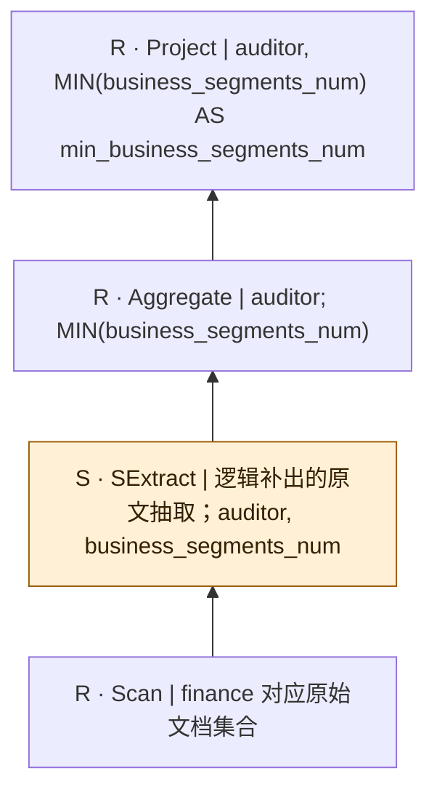

SQL本身只有结构化算子；SExtract是从原文到关系的分析性补充，不是源SQL的显式调用，也不表明每个字段必须由LLM抽取。字段类型、NULL及一对多抽取契约须在执行前固定。

## bench-u/Finan/Agg/agg_queries_finance/2

来源：[原件](</Volumes/Element/Github2/semantic-workload-bench/data/semantic-query-discovery-20260908/bench-u/checkout/Query/Finan/Agg/agg_queries_finance.sql>) · `sql_plus_proposed_extraction` · `logical_only` · `substantive_relational`

```sql

SELECT exchange_code, COUNT(company_name) AS count_company_name FROM finance GROUP BY exchange_code;

```

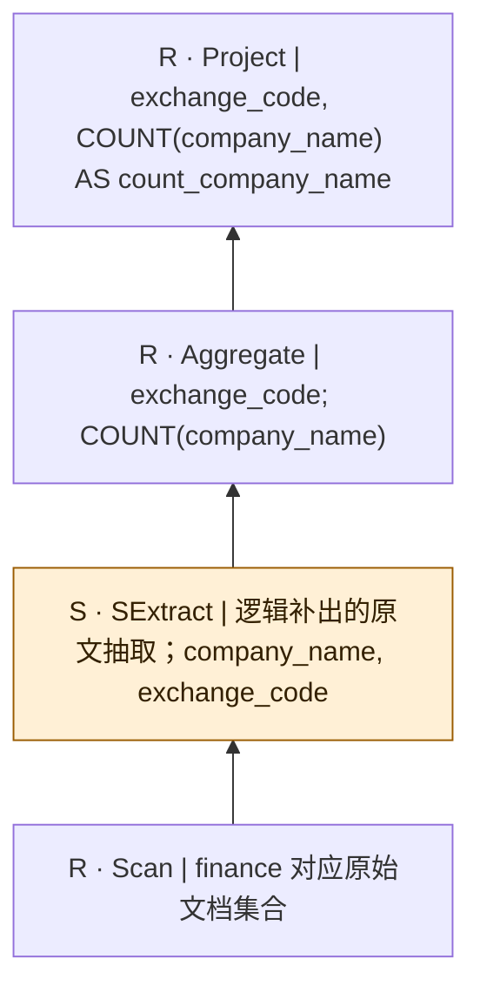

SQL本身只有结构化算子；SExtract是从原文到关系的分析性补充，不是源SQL的显式调用，也不表明每个字段必须由LLM抽取。字段类型、NULL及一对多抽取契约须在执行前固定。

## bench-u/Finan/Agg/agg_queries_finance/3

来源：[原件](</Volumes/Element/Github2/semantic-workload-bench/data/semantic-query-discovery-20260908/bench-u/checkout/Query/Finan/Agg/agg_queries_finance.sql>) · `sql_plus_proposed_extraction` · `logical_only` · `substantive_relational`

```sql

SELECT remuneration_policy, AVG(business_segments_num) AS avg_business_segments_num FROM finance GROUP BY remuneration_policy;

```

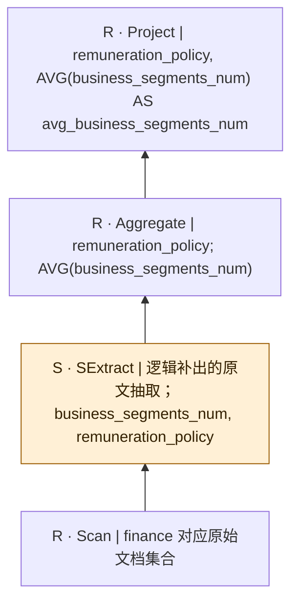

SQL本身只有结构化算子；SExtract是从原文到关系的分析性补充，不是源SQL的显式调用，也不表明每个字段必须由LLM抽取。字段类型、NULL及一对多抽取契约须在执行前固定。

## bench-u/Finan/Agg/agg_queries_finance/4

来源：[原件](</Volumes/Element/Github2/semantic-workload-bench/data/semantic-query-discovery-20260908/bench-u/checkout/Query/Finan/Agg/agg_queries_finance.sql>) · `sql_plus_proposed_extraction` · `logical_only` · `substantive_relational`

```sql

SELECT exchange_code, MAX(revenue) AS max_revenue FROM finance GROUP BY exchange_code;

```

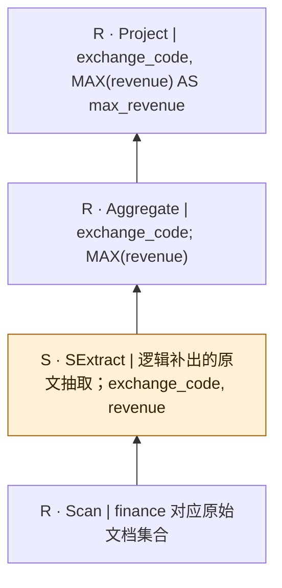

SQL本身只有结构化算子；SExtract是从原文到关系的分析性补充，不是源SQL的显式调用，也不表明每个字段必须由LLM抽取。字段类型、NULL及一对多抽取契约须在执行前固定。

## bench-u/Finan/Agg/agg_queries_finance/5

来源：[原件](</Volumes/Element/Github2/semantic-workload-bench/data/semantic-query-discovery-20260908/bench-u/checkout/Query/Finan/Agg/agg_queries_finance.sql>) · `sql_plus_proposed_extraction` · `logical_only` · `substantive_relational`

```sql

SELECT exchange_code, COUNT(major_equity_changes) AS count_major_equity_changes FROM finance GROUP BY exchange_code;

```

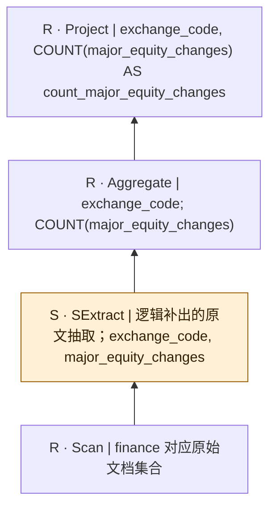

SQL本身只有结构化算子；SExtract是从原文到关系的分析性补充，不是源SQL的显式调用，也不表明每个字段必须由LLM抽取。字段类型、NULL及一对多抽取契约须在执行前固定。

## bench-u/Finan/Agg/agg_queries_finance/6

来源：[原件](</Volumes/Element/Github2/semantic-workload-bench/data/semantic-query-discovery-20260908/bench-u/checkout/Query/Finan/Agg/agg_queries_finance.sql>) · `sql_plus_proposed_extraction` · `logical_only` · `substantive_relational`

```sql

SELECT auditor, MIN(revenue) AS min_revenue FROM finance GROUP BY auditor;

```

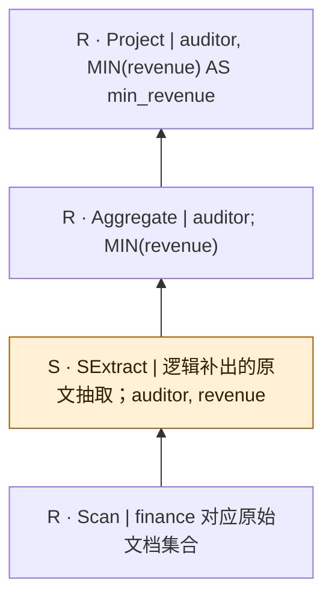

SQL本身只有结构化算子；SExtract是从原文到关系的分析性补充，不是源SQL的显式调用，也不表明每个字段必须由LLM抽取。字段类型、NULL及一对多抽取契约须在执行前固定。

## bench-u/Finan/Agg/agg_queries_finance/7

来源：[原件](</Volumes/Element/Github2/semantic-workload-bench/data/semantic-query-discovery-20260908/bench-u/checkout/Query/Finan/Agg/agg_queries_finance.sql>) · `sql_plus_proposed_extraction` · `logical_only` · `substantive_relational`

```sql

SELECT exchange_code, MAX(revenue) AS max_revenue FROM finance GROUP BY exchange_code;

```


SQL本身只有结构化算子；SExtract是从原文到关系的分析性补充，不是源SQL的显式调用，也不表明每个字段必须由LLM抽取。字段类型、NULL及一对多抽取契约须在执行前固定。

## bench-u/Finan/Agg/agg_queries_finance/8

来源：[原件](</Volumes/Element/Github2/semantic-workload-bench/data/semantic-query-discovery-20260908/bench-u/checkout/Query/Finan/Agg/agg_queries_finance.sql>) · `sql_plus_proposed_extraction` · `logical_only` · `substantive_relational`

```sql

SELECT major_equity_changes, SUM(revenue) AS sum_revenue FROM finance GROUP BY major_equity_changes;

```

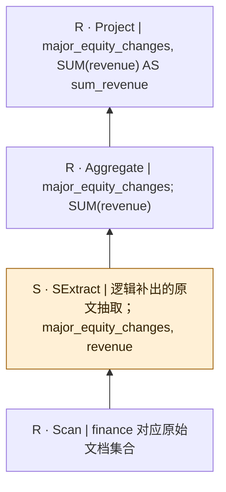

SQL本身只有结构化算子；SExtract是从原文到关系的分析性补充，不是源SQL的显式调用，也不表明每个字段必须由LLM抽取。字段类型、NULL及一对多抽取契约须在执行前固定。

## bench-u/Finan/Agg/agg_queries_finance/9

来源：[原件](</Volumes/Element/Github2/semantic-workload-bench/data/semantic-query-discovery-20260908/bench-u/checkout/Query/Finan/Agg/agg_queries_finance.sql>) · `sql_plus_proposed_extraction` · `logical_only` · `substantive_relational`

```sql

SELECT exchange_code, COUNT(auditor) AS count_auditor FROM finance GROUP BY exchange_code;

```

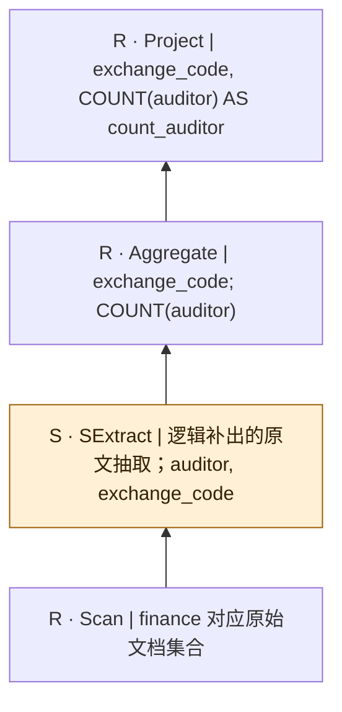

SQL本身只有结构化算子；SExtract是从原文到关系的分析性补充，不是源SQL的显式调用，也不表明每个字段必须由LLM抽取。字段类型、NULL及一对多抽取契约须在执行前固定。

## bench-u/Finan/Agg/agg_queries_finance/10

来源：[原件](</Volumes/Element/Github2/semantic-workload-bench/data/semantic-query-discovery-20260908/bench-u/checkout/Query/Finan/Agg/agg_queries_finance.sql>) · `sql_plus_proposed_extraction` · `logical_only` · `substantive_relational`

```sql

SELECT exchange_code, COUNT(total_assets) AS count_total_assets FROM finance GROUP BY exchange_code;

```

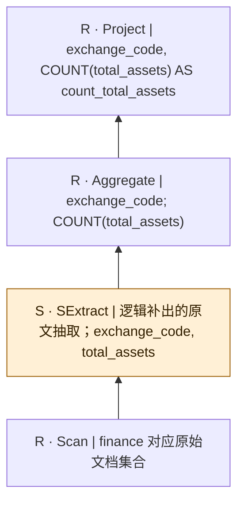

SQL本身只有结构化算子；SExtract是从原文到关系的分析性补充，不是源SQL的显式调用，也不表明每个字段必须由LLM抽取。字段类型、NULL及一对多抽取契约须在执行前固定。

## bench-u/Finan/Filter/filter_queries_Finan/1

来源：[原件](</Volumes/Element/Github2/semantic-workload-bench/data/semantic-query-discovery-20260908/bench-u/checkout/Query/Finan/Filter/filter_queries_Finan.sql>) · `sql_plus_proposed_extraction` · `logical_only` · `substantive_relational`

```sql

SELECT business_segments_num, dividend_per_share, auditor FROM Finance WHERE auditor = 'PKF Littlejohn LLP';

```

```mermaid
flowchart BT
  n0["R · Project | business_segments_num, dividend_per_share, auditor"]
  n1["R · Filter | auditor = &#x27;PKF Littlejohn LLP&#x27;"]
  n2["S · SExtract | 逻辑补出的原文抽取；auditor, business_segments_num, dividend_per_share"]
  n3["R · Scan | Finance 对应原始文档集合"]
  n3 --> n2
  n2 --> n1
  n1 --> n0
  classDef semantic fill:#fff0d6,stroke:#9a5b00,color:#332000;
  class n2 semantic;
```

SQL本身只有结构化算子；SExtract是从原文到关系的分析性补充，不是源SQL的显式调用，也不表明每个字段必须由LLM抽取。字段类型、NULL及一对多抽取契约须在执行前固定。

## bench-u/Finan/Filter/filter_queries_Finan/2

来源：[原件](</Volumes/Element/Github2/semantic-workload-bench/data/semantic-query-discovery-20260908/bench-u/checkout/Query/Finan/Filter/filter_queries_Finan.sql>) · `sql_plus_proposed_extraction` · `logical_only` · `substantive_relational`

```sql

SELECT net_assets, board_members, net_profit_or_loss FROM Finance WHERE net_profit_or_loss > '1460000000';

```

```mermaid
flowchart BT
  n0["R · Project | net_assets, board_members, net_profit_or_loss"]
  n1["R · Filter | net_profit_or_loss &gt; &#x27;1460000000&#x27;"]
  n2["S · SExtract | 逻辑补出的原文抽取；board_members, net_assets, net_profit_or_loss"]
  n3["R · Scan | Finance 对应原始文档集合"]
  n3 --> n2
  n2 --> n1
  n1 --> n0
  classDef semantic fill:#fff0d6,stroke:#9a5b00,color:#332000;
  class n2 semantic;
```

SQL本身只有结构化算子；SExtract是从原文到关系的分析性补充，不是源SQL的显式调用，也不表明每个字段必须由LLM抽取。字段类型、NULL及一对多抽取契约须在执行前固定。

## bench-u/Finan/Filter/filter_queries_Finan/3

来源：[原件](</Volumes/Element/Github2/semantic-workload-bench/data/semantic-query-discovery-20260908/bench-u/checkout/Query/Finan/Filter/filter_queries_Finan.sql>) · `sql_plus_proposed_extraction` · `logical_only` · `substantive_relational`

```sql

SELECT bussiness_cost, remuneration_policy, registered_office FROM Finance WHERE bussiness_cost <= '2129327000';

```

```mermaid
flowchart BT
  n0["R · Project | bussiness_cost, remuneration_policy, registered_office"]
  n1["R · Filter | bussiness_cost &lt;= &#x27;2129327000&#x27;"]
  n2["S · SExtract | 逻辑补出的原文抽取；bussiness_cost, registered_office, remuneration_policy"]
  n3["R · Scan | Finance 对应原始文档集合"]
  n3 --> n2
  n2 --> n1
  n1 --> n0
  classDef semantic fill:#fff0d6,stroke:#9a5b00,color:#332000;
  class n2 semantic;
```

SQL本身只有结构化算子；SExtract是从原文到关系的分析性补充，不是源SQL的显式调用，也不表明每个字段必须由LLM抽取。字段类型、NULL及一对多抽取契约须在执行前固定。

## bench-u/Finan/Filter/filter_queries_Finan/4

来源：[原件](</Volumes/Element/Github2/semantic-workload-bench/data/semantic-query-discovery-20260908/bench-u/checkout/Query/Finan/Filter/filter_queries_Finan.sql>) · `sql_plus_proposed_extraction` · `logical_only` · `substantive_relational`

```sql

SELECT net_profit_or_loss, exchange_code, total_Debt FROM Finance WHERE total_Debt = '21325000000';

```

```mermaid
flowchart BT
  n0["R · Project | net_profit_or_loss, exchange_code, total_Debt"]
  n1["R · Filter | total_Debt = &#x27;21325000000&#x27;"]
  n2["S · SExtract | 逻辑补出的原文抽取；exchange_code, net_profit_or_loss, total_Debt"]
  n3["R · Scan | Finance 对应原始文档集合"]
  n3 --> n2
  n2 --> n1
  n1 --> n0
  classDef semantic fill:#fff0d6,stroke:#9a5b00,color:#332000;
  class n2 semantic;
```

SQL本身只有结构化算子；SExtract是从原文到关系的分析性补充，不是源SQL的显式调用，也不表明每个字段必须由LLM抽取。字段类型、NULL及一对多抽取契约须在执行前固定。

## bench-u/Finan/Filter/filter_queries_Finan/5

来源：[原件](</Volumes/Element/Github2/semantic-workload-bench/data/semantic-query-discovery-20260908/bench-u/checkout/Query/Finan/Filter/filter_queries_Finan.sql>) · `sql_plus_proposed_extraction` · `logical_only` · `substantive_relational`

```sql

SELECT principal_activities, bussiness_profit, major_events FROM Finance WHERE bussiness_profit > '230400000';

```

```mermaid
flowchart BT
  n0["R · Project | principal_activities, bussiness_profit, major_events"]
  n1["R · Filter | bussiness_profit &gt; &#x27;230400000&#x27;"]
  n2["S · SExtract | 逻辑补出的原文抽取；bussiness_profit, major_events, principal_activities"]
  n3["R · Scan | Finance 对应原始文档集合"]
  n3 --> n2
  n2 --> n1
  n1 --> n0
  classDef semantic fill:#fff0d6,stroke:#9a5b00,color:#332000;
  class n2 semantic;
```

SQL本身只有结构化算子；SExtract是从原文到关系的分析性补充，不是源SQL的显式调用，也不表明每个字段必须由LLM抽取。字段类型、NULL及一对多抽取契约须在执行前固定。

## bench-u/Finan/Filter/filter_queries_Finan/6

来源：[原件](</Volumes/Element/Github2/semantic-workload-bench/data/semantic-query-discovery-20260908/bench-u/checkout/Query/Finan/Filter/filter_queries_Finan.sql>) · `sql_plus_proposed_extraction` · `logical_only` · `substantive_relational`

```sql

SELECT major_equity_changes, exchange_code, the_highest_ownership_stake FROM Finance WHERE exchange_code = 'RFT';

```

```mermaid
flowchart BT
  n0["R · Project | major_equity_changes, exchange_code, the_highest_ownership_stake"]
  n1["R · Filter | exchange_code = &#x27;RFT&#x27;"]
  n2["S · SExtract | 逻辑补出的原文抽取；exchange_code, major_equity_changes, the_highest_ownership_stake"]
  n3["R · Scan | Finance 对应原始文档集合"]
  n3 --> n2
  n2 --> n1
  n1 --> n0
  classDef semantic fill:#fff0d6,stroke:#9a5b00,color:#332000;
  class n2 semantic;
```

SQL本身只有结构化算子；SExtract是从原文到关系的分析性补充，不是源SQL的显式调用，也不表明每个字段必须由LLM抽取。字段类型、NULL及一对多抽取契约须在执行前固定。

## bench-u/Finan/Filter/filter_queries_Finan/7

来源：[原件](</Volumes/Element/Github2/semantic-workload-bench/data/semantic-query-discovery-20260908/bench-u/checkout/Query/Finan/Filter/filter_queries_Finan.sql>) · `sql_plus_proposed_extraction` · `logical_only` · `substantive_relational`

```sql

SELECT bussiness_profit, auditor, total_assets FROM Finance WHERE auditor != 'PKF Littlejohn LLP';

```

```mermaid
flowchart BT
  n0["R · Project | bussiness_profit, auditor, total_assets"]
  n1["R · Filter | auditor &lt;&gt; &#x27;PKF Littlejohn LLP&#x27;"]
  n2["S · SExtract | 逻辑补出的原文抽取；auditor, bussiness_profit, total_assets"]
  n3["R · Scan | Finance 对应原始文档集合"]
  n3 --> n2
  n2 --> n1
  n1 --> n0
  classDef semantic fill:#fff0d6,stroke:#9a5b00,color:#332000;
  class n2 semantic;
```

SQL本身只有结构化算子；SExtract是从原文到关系的分析性补充，不是源SQL的显式调用，也不表明每个字段必须由LLM抽取。字段类型、NULL及一对多抽取契约须在执行前固定。

## bench-u/Finan/Filter/filter_queries_Finan/8

来源：[原件](</Volumes/Element/Github2/semantic-workload-bench/data/semantic-query-discovery-20260908/bench-u/checkout/Query/Finan/Filter/filter_queries_Finan.sql>) · `sql_plus_proposed_extraction` · `logical_only` · `substantive_relational`

```sql

SELECT bussiness_sales, net_profit_or_loss, net_assets FROM Finance WHERE net_assets != 249398000;

```

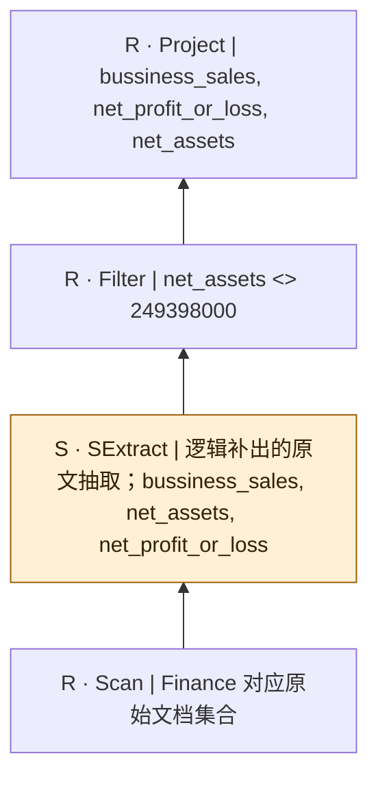

SQL本身只有结构化算子；SExtract是从原文到关系的分析性补充，不是源SQL的显式调用，也不表明每个字段必须由LLM抽取。字段类型、NULL及一对多抽取契约须在执行前固定。

## bench-u/Finan/Filter/filter_queries_Finan/9

来源：[原件](</Volumes/Element/Github2/semantic-workload-bench/data/semantic-query-discovery-20260908/bench-u/checkout/Query/Finan/Filter/filter_queries_Finan.sql>) · `sql_plus_proposed_extraction` · `logical_only` · `substantive_relational`

```sql

SELECT principal_activities, total_Debt, major_equity_changes FROM Finance WHERE major_equity_changes != 'Yes';

```

```mermaid
flowchart BT
  n0["R · Project | principal_activities, total_Debt, major_equity_changes"]
  n1["R · Filter | major_equity_changes &lt;&gt; &#x27;Yes&#x27;"]
  n2["S · SExtract | 逻辑补出的原文抽取；major_equity_changes, principal_activities, total_Debt"]
  n3["R · Scan | Finance 对应原始文档集合"]
  n3 --> n2
  n2 --> n1
  n1 --> n0
  classDef semantic fill:#fff0d6,stroke:#9a5b00,color:#332000;
  class n2 semantic;
```

SQL本身只有结构化算子；SExtract是从原文到关系的分析性补充，不是源SQL的显式调用，也不表明每个字段必须由LLM抽取。字段类型、NULL及一对多抽取契约须在执行前固定。

## bench-u/Finan/Filter/filter_queries_Finan/10

来源：[原件](</Volumes/Element/Github2/semantic-workload-bench/data/semantic-query-discovery-20260908/bench-u/checkout/Query/Finan/Filter/filter_queries_Finan.sql>) · `sql_plus_proposed_extraction` · `logical_only` · `substantive_relational`

```sql

SELECT largest_shareholder, company_name, executive_profiles FROM Finance WHERE company_name != 'NuCana plc';

```

```mermaid
flowchart BT
  n0["R · Project | largest_shareholder, company_name, executive_profiles"]
  n1["R · Filter | company_name &lt;&gt; &#x27;NuCana plc&#x27;"]
  n2["S · SExtract | 逻辑补出的原文抽取；company_name, executive_profiles, largest_shareholder"]
  n3["R · Scan | Finance 对应原始文档集合"]
  n3 --> n2
  n2 --> n1
  n1 --> n0
  classDef semantic fill:#fff0d6,stroke:#9a5b00,color:#332000;
  class n2 semantic;
```

SQL本身只有结构化算子；SExtract是从原文到关系的分析性补充，不是源SQL的显式调用，也不表明每个字段必须由LLM抽取。字段类型、NULL及一对多抽取契约须在执行前固定。

## bench-u/Finan/Filter/filter_queries_Finan/11

来源：[原件](</Volumes/Element/Github2/semantic-workload-bench/data/semantic-query-discovery-20260908/bench-u/checkout/Query/Finan/Filter/filter_queries_Finan.sql>) · `sql_plus_proposed_extraction` · `logical_only` · `substantive_relational`

```sql

SELECT largest_shareholder, auditor, registered_office FROM Finance WHERE largest_shareholder != 'Kelly Investments 1 PTY Ltd' AND business_risks = 'Environmental Risk';

```

```mermaid
flowchart BT
  n0["R · Project | largest_shareholder, auditor, registered_office"]
  n1["R · Filter | largest_shareholder &lt;&gt; &#x27;Kelly Investments 1 PTY Ltd&#x27; AND business_risks = &#x27;Environmental Risk&#x27;"]
  n2["S · SExtract | 逻辑补出的原文抽取；auditor, business_risks, largest_shareholder, registered_office"]
  n3["R · Scan | Finance 对应原始文档集合"]
  n3 --> n2
  n2 --> n1
  n1 --> n0
  classDef semantic fill:#fff0d6,stroke:#9a5b00,color:#332000;
  class n2 semantic;
```

SQL本身只有结构化算子；SExtract是从原文到关系的分析性补充，不是源SQL的显式调用，也不表明每个字段必须由LLM抽取。字段类型、NULL及一对多抽取契约须在执行前固定。

## bench-u/Finan/Filter/filter_queries_Finan/12

来源：[原件](</Volumes/Element/Github2/semantic-workload-bench/data/semantic-query-discovery-20260908/bench-u/checkout/Query/Finan/Filter/filter_queries_Finan.sql>) · `sql_plus_proposed_extraction` · `logical_only` · `substantive_relational`

```sql

SELECT cash_reserves, bussiness_profit, auditor FROM Finance WHERE auditor = 'PKF Littlejohn LLP' AND major_equity_changes = 'Yes';

```

```mermaid
flowchart BT
  n0["R · Project | cash_reserves, bussiness_profit, auditor"]
  n1["R · Filter | auditor = &#x27;PKF Littlejohn LLP&#x27; AND major_equity_changes = &#x27;Yes&#x27;"]
  n2["S · SExtract | 逻辑补出的原文抽取；auditor, bussiness_profit, cash_reserves, major_equity_changes"]
  n3["R · Scan | Finance 对应原始文档集合"]
  n3 --> n2
  n2 --> n1
  n1 --> n0
  classDef semantic fill:#fff0d6,stroke:#9a5b00,color:#332000;
  class n2 semantic;
```

SQL本身只有结构化算子；SExtract是从原文到关系的分析性补充，不是源SQL的显式调用，也不表明每个字段必须由LLM抽取。字段类型、NULL及一对多抽取契约须在执行前固定。

## bench-u/Finan/Filter/filter_queries_Finan/13

来源：[原件](</Volumes/Element/Github2/semantic-workload-bench/data/semantic-query-discovery-20260908/bench-u/checkout/Query/Finan/Filter/filter_queries_Finan.sql>) · `sql_plus_proposed_extraction` · `logical_only` · `substantive_relational`

```sql

SELECT dividend_per_share, bussiness_profit, total_Debt FROM Finance WHERE dividend_per_share < 0.40 AND earnings_per_share >= 0.49;

```

```mermaid
flowchart BT
  n0["R · Project | dividend_per_share, bussiness_profit, total_Debt"]
  n1["R · Filter | dividend_per_share &lt; 0.40 AND earnings_per_share &gt;= 0.49"]
  n2["S · SExtract | 逻辑补出的原文抽取；bussiness_profit, dividend_per_share, earnings_per_share, total_Debt"]
  n3["R · Scan | Finance 对应原始文档集合"]
  n3 --> n2
  n2 --> n1
  n1 --> n0
  classDef semantic fill:#fff0d6,stroke:#9a5b00,color:#332000;
  class n2 semantic;
```

SQL本身只有结构化算子；SExtract是从原文到关系的分析性补充，不是源SQL的显式调用，也不表明每个字段必须由LLM抽取。字段类型、NULL及一对多抽取契约须在执行前固定。

## bench-u/Finan/Filter/filter_queries_Finan/14

来源：[原件](</Volumes/Element/Github2/semantic-workload-bench/data/semantic-query-discovery-20260908/bench-u/checkout/Query/Finan/Filter/filter_queries_Finan.sql>) · `sql_plus_proposed_extraction` · `logical_only` · `substantive_relational`

```sql

SELECT net_profit_or_loss, principal_activities, major_equity_changes FROM Finance WHERE net_profit_or_loss >= '2823562' AND total_Debt > '14437351';

```

```mermaid
flowchart BT
  n0["R · Project | net_profit_or_loss, principal_activities, major_equity_changes"]
  n1["R · Filter | net_profit_or_loss &gt;= &#x27;2823562&#x27; AND total_Debt &gt; &#x27;14437351&#x27;"]
  n2["S · SExtract | 逻辑补出的原文抽取；major_equity_changes, net_profit_or_loss, principal_activities, total_Debt"]
  n3["R · Scan | Finance 对应原始文档集合"]
  n3 --> n2
  n2 --> n1
  n1 --> n0
  classDef semantic fill:#fff0d6,stroke:#9a5b00,color:#332000;
  class n2 semantic;
```

SQL本身只有结构化算子；SExtract是从原文到关系的分析性补充，不是源SQL的显式调用，也不表明每个字段必须由LLM抽取。字段类型、NULL及一对多抽取契约须在执行前固定。

## bench-u/Finan/Filter/filter_queries_Finan/15

来源：[原件](</Volumes/Element/Github2/semantic-workload-bench/data/semantic-query-discovery-20260908/bench-u/checkout/Query/Finan/Filter/filter_queries_Finan.sql>) · `sql_plus_proposed_extraction` · `logical_only` · `substantive_relational`

```sql

SELECT total_assets, bussiness_profit, principal_activities FROM Finance WHERE principal_activities != 'Finance' AND exchange_code != 'AIM';

```

```mermaid
flowchart BT
  n0["R · Project | total_assets, bussiness_profit, principal_activities"]
  n1["R · Filter | principal_activities &lt;&gt; &#x27;Finance&#x27; AND exchange_code &lt;&gt; &#x27;AIM&#x27;"]
  n2["S · SExtract | 逻辑补出的原文抽取；bussiness_profit, exchange_code, principal_activities, total_assets"]
  n3["R · Scan | Finance 对应原始文档集合"]
  n3 --> n2
  n2 --> n1
  n1 --> n0
  classDef semantic fill:#fff0d6,stroke:#9a5b00,color:#332000;
  class n2 semantic;
```

SQL本身只有结构化算子；SExtract是从原文到关系的分析性补充，不是源SQL的显式调用，也不表明每个字段必须由LLM抽取。字段类型、NULL及一对多抽取契约须在执行前固定。

## bench-u/Finan/Filter/filter_queries_Finan/16

来源：[原件](</Volumes/Element/Github2/semantic-workload-bench/data/semantic-query-discovery-20260908/bench-u/checkout/Query/Finan/Filter/filter_queries_Finan.sql>) · `sql_plus_proposed_extraction` · `logical_only` · `substantive_relational`

```sql

SELECT remuneration_policy, net_assets, principal_activities FROM Finance WHERE remuneration_policy != 'Stock Option' AND total_assets >= 136955488;

```

```mermaid
flowchart BT
  n0["R · Project | remuneration_policy, net_assets, principal_activities"]
  n1["R · Filter | remuneration_policy &lt;&gt; &#x27;Stock Option&#x27; AND total_assets &gt;= 136955488"]
  n2["S · SExtract | 逻辑补出的原文抽取；net_assets, principal_activities, remuneration_policy, total_assets"]
  n3["R · Scan | Finance 对应原始文档集合"]
  n3 --> n2
  n2 --> n1
  n1 --> n0
  classDef semantic fill:#fff0d6,stroke:#9a5b00,color:#332000;
  class n2 semantic;
```

SQL本身只有结构化算子；SExtract是从原文到关系的分析性补充，不是源SQL的显式调用，也不表明每个字段必须由LLM抽取。字段类型、NULL及一对多抽取契约须在执行前固定。

## bench-u/Finan/Filter/filter_queries_Finan/17

来源：[原件](</Volumes/Element/Github2/semantic-workload-bench/data/semantic-query-discovery-20260908/bench-u/checkout/Query/Finan/Filter/filter_queries_Finan.sql>) · `sql_plus_proposed_extraction` · `logical_only` · `substantive_relational`

```sql

SELECT board_members, revenue, cash_reserves FROM Finance WHERE board_members != 'Keith Bradley' AND business_segments_num < 1;

```

```mermaid
flowchart BT
  n0["R · Project | board_members, revenue, cash_reserves"]
  n1["R · Filter | board_members &lt;&gt; &#x27;Keith Bradley&#x27; AND business_segments_num &lt; 1"]
  n2["S · SExtract | 逻辑补出的原文抽取；board_members, business_segments_num, cash_reserves, revenue"]
  n3["R · Scan | Finance 对应原始文档集合"]
  n3 --> n2
  n2 --> n1
  n1 --> n0
  classDef semantic fill:#fff0d6,stroke:#9a5b00,color:#332000;
  class n2 semantic;
```

SQL本身只有结构化算子；SExtract是从原文到关系的分析性补充，不是源SQL的显式调用，也不表明每个字段必须由LLM抽取。字段类型、NULL及一对多抽取契约须在执行前固定。

## bench-u/Finan/Filter/filter_queries_Finan/18

来源：[原件](</Volumes/Element/Github2/semantic-workload-bench/data/semantic-query-discovery-20260908/bench-u/checkout/Query/Finan/Filter/filter_queries_Finan.sql>) · `sql_plus_proposed_extraction` · `logical_only` · `substantive_relational`

```sql

SELECT earnings_per_share, the_highest_ownership_stake, net_profit_or_loss FROM Finance WHERE net_profit_or_loss != '165500000' AND bussiness_cost >= '993529';

```

```mermaid
flowchart BT
  n0["R · Project | earnings_per_share, the_highest_ownership_stake, net_profit_or_loss"]
  n1["R · Filter | net_profit_or_loss &lt;&gt; &#x27;165500000&#x27; AND bussiness_cost &gt;= &#x27;993529&#x27;"]
  n2["S · SExtract | 逻辑补出的原文抽取；bussiness_cost, earnings_per_share, net_profit_or_loss, the_highest_ownership_stake"]
  n3["R · Scan | Finance 对应原始文档集合"]
  n3 --> n2
  n2 --> n1
  n1 --> n0
  classDef semantic fill:#fff0d6,stroke:#9a5b00,color:#332000;
  class n2 semantic;
```

SQL本身只有结构化算子；SExtract是从原文到关系的分析性补充，不是源SQL的显式调用，也不表明每个字段必须由LLM抽取。字段类型、NULL及一对多抽取契约须在执行前固定。

## bench-u/Finan/Filter/filter_queries_Finan/19

来源：[原件](</Volumes/Element/Github2/semantic-workload-bench/data/semantic-query-discovery-20260908/bench-u/checkout/Query/Finan/Filter/filter_queries_Finan.sql>) · `sql_plus_proposed_extraction` · `logical_only` · `substantive_relational`

```sql

SELECT largest_shareholder, auditor, major_equity_changes FROM Finance WHERE largest_shareholder != 'Drake Private Investments' AND business_risks != 'Credit Risk';

```

```mermaid
flowchart BT
  n0["R · Project | largest_shareholder, auditor, major_equity_changes"]
  n1["R · Filter | largest_shareholder &lt;&gt; &#x27;Drake Private Investments&#x27; AND business_risks &lt;&gt; &#x27;Credit Risk&#x27;"]
  n2["S · SExtract | 逻辑补出的原文抽取；auditor, business_risks, largest_shareholder, major_equity_changes"]
  n3["R · Scan | Finance 对应原始文档集合"]
  n3 --> n2
  n2 --> n1
  n1 --> n0
  classDef semantic fill:#fff0d6,stroke:#9a5b00,color:#332000;
  class n2 semantic;
```

SQL本身只有结构化算子；SExtract是从原文到关系的分析性补充，不是源SQL的显式调用，也不表明每个字段必须由LLM抽取。字段类型、NULL及一对多抽取契约须在执行前固定。

## bench-u/Finan/Filter/filter_queries_Finan/20

来源：[原件](</Volumes/Element/Github2/semantic-workload-bench/data/semantic-query-discovery-20260908/bench-u/checkout/Query/Finan/Filter/filter_queries_Finan.sql>) · `sql_plus_proposed_extraction` · `logical_only` · `substantive_relational`

```sql

SELECT earnings_per_share, cash_reserves, principal_activities FROM Finance WHERE principal_activities = 'Agriculture' AND the_highest_ownership_stake > 11.63;

```

```mermaid
flowchart BT
  n0["R · Project | earnings_per_share, cash_reserves, principal_activities"]
  n1["R · Filter | principal_activities = &#x27;Agriculture&#x27; AND the_highest_ownership_stake &gt; 11.63"]
  n2["S · SExtract | 逻辑补出的原文抽取；cash_reserves, earnings_per_share, principal_activities, the_highest_ownership_stake"]
  n3["R · Scan | Finance 对应原始文档集合"]
  n3 --> n2
  n2 --> n1
  n1 --> n0
  classDef semantic fill:#fff0d6,stroke:#9a5b00,color:#332000;
  class n2 semantic;
```

SQL本身只有结构化算子；SExtract是从原文到关系的分析性补充，不是源SQL的显式调用，也不表明每个字段必须由LLM抽取。字段类型、NULL及一对多抽取契约须在执行前固定。

## bench-u/Finan/Filter/filter_queries_Finan/21

来源：[原件](</Volumes/Element/Github2/semantic-workload-bench/data/semantic-query-discovery-20260908/bench-u/checkout/Query/Finan/Filter/filter_queries_Finan.sql>) · `sql_plus_proposed_extraction` · `logical_only` · `substantive_relational`

```sql

SELECT total_assets, board_members, bussiness_cost FROM Finance WHERE bussiness_cost = '10978000000' OR total_Debt != '168459000';

```

```mermaid
flowchart BT
  n0["R · Project | total_assets, board_members, bussiness_cost"]
  n1["R · Filter | bussiness_cost = &#x27;10978000000&#x27; OR total_Debt &lt;&gt; &#x27;168459000&#x27;"]
  n2["S · SExtract | 逻辑补出的原文抽取；board_members, bussiness_cost, total_Debt, total_assets"]
  n3["R · Scan | Finance 对应原始文档集合"]
  n3 --> n2
  n2 --> n1
  n1 --> n0
  classDef semantic fill:#fff0d6,stroke:#9a5b00,color:#332000;
  class n2 semantic;
```

SQL本身只有结构化算子；SExtract是从原文到关系的分析性补充，不是源SQL的显式调用，也不表明每个字段必须由LLM抽取。字段类型、NULL及一对多抽取契约须在执行前固定。

## bench-u/Finan/Filter/filter_queries_Finan/22

来源：[原件](</Volumes/Element/Github2/semantic-workload-bench/data/semantic-query-discovery-20260908/bench-u/checkout/Query/Finan/Filter/filter_queries_Finan.sql>) · `sql_plus_proposed_extraction` · `logical_only` · `substantive_relational`

```sql

SELECT the_highest_ownership_stake, net_profit_or_loss, largest_shareholder FROM Finance WHERE the_highest_ownership_stake <= 49.28 OR remuneration_policy != 'Fixed';

```

```mermaid
flowchart BT
  n0["R · Project | the_highest_ownership_stake, net_profit_or_loss, largest_shareholder"]
  n1["R · Filter | the_highest_ownership_stake &lt;= 49.28 OR remuneration_policy &lt;&gt; &#x27;Fixed&#x27;"]
  n2["S · SExtract | 逻辑补出的原文抽取；largest_shareholder, net_profit_or_loss, remuneration_policy, the_highest_ownership_stake"]
  n3["R · Scan | Finance 对应原始文档集合"]
  n3 --> n2
  n2 --> n1
  n1 --> n0
  classDef semantic fill:#fff0d6,stroke:#9a5b00,color:#332000;
  class n2 semantic;
```

SQL本身只有结构化算子；SExtract是从原文到关系的分析性补充，不是源SQL的显式调用，也不表明每个字段必须由LLM抽取。字段类型、NULL及一对多抽取契约须在执行前固定。

## bench-u/Finan/Filter/filter_queries_Finan/23

来源：[原件](</Volumes/Element/Github2/semantic-workload-bench/data/semantic-query-discovery-20260908/bench-u/checkout/Query/Finan/Filter/filter_queries_Finan.sql>) · `sql_plus_proposed_extraction` · `logical_only` · `substantive_relational`

```sql

SELECT auditor, board_members, major_events FROM Finance WHERE major_events = 'Other' OR principal_activities != 'Biopharmaceuticals';

```

```mermaid
flowchart BT
  n0["R · Project | auditor, board_members, major_events"]
  n1["R · Filter | major_events = &#x27;Other&#x27; OR principal_activities &lt;&gt; &#x27;Biopharmaceuticals&#x27;"]
  n2["S · SExtract | 逻辑补出的原文抽取；auditor, board_members, major_events, principal_activities"]
  n3["R · Scan | Finance 对应原始文档集合"]
  n3 --> n2
  n2 --> n1
  n1 --> n0
  classDef semantic fill:#fff0d6,stroke:#9a5b00,color:#332000;
  class n2 semantic;
```

SQL本身只有结构化算子；SExtract是从原文到关系的分析性补充，不是源SQL的显式调用，也不表明每个字段必须由LLM抽取。字段类型、NULL及一对多抽取契约须在执行前固定。

## bench-u/Finan/Filter/filter_queries_Finan/24

来源：[原件](</Volumes/Element/Github2/semantic-workload-bench/data/semantic-query-discovery-20260908/bench-u/checkout/Query/Finan/Filter/filter_queries_Finan.sql>) · `sql_plus_proposed_extraction` · `logical_only` · `substantive_relational`

```sql

SELECT exchange_code, executive_profiles, principal_activities FROM Finance WHERE exchange_code = 'MTA' OR net_assets >= 41673000;

```

```mermaid
flowchart BT
  n0["R · Project | exchange_code, executive_profiles, principal_activities"]
  n1["R · Filter | exchange_code = &#x27;MTA&#x27; OR net_assets &gt;= 41673000"]
  n2["S · SExtract | 逻辑补出的原文抽取；exchange_code, executive_profiles, net_assets, principal_activities"]
  n3["R · Scan | Finance 对应原始文档集合"]
  n3 --> n2
  n2 --> n1
  n1 --> n0
  classDef semantic fill:#fff0d6,stroke:#9a5b00,color:#332000;
  class n2 semantic;
```

SQL本身只有结构化算子；SExtract是从原文到关系的分析性补充，不是源SQL的显式调用，也不表明每个字段必须由LLM抽取。字段类型、NULL及一对多抽取契约须在执行前固定。

## bench-u/Finan/Filter/filter_queries_Finan/25

来源：[原件](</Volumes/Element/Github2/semantic-workload-bench/data/semantic-query-discovery-20260908/bench-u/checkout/Query/Finan/Filter/filter_queries_Finan.sql>) · `sql_plus_proposed_extraction` · `logical_only` · `substantive_relational`

```sql

SELECT major_events, dividend_per_share, earnings_per_share FROM Finance WHERE dividend_per_share <= 0.00 OR major_equity_changes = 'Yes';

```

```mermaid
flowchart BT
  n0["R · Project | major_events, dividend_per_share, earnings_per_share"]
  n1["R · Filter | dividend_per_share &lt;= 0.00 OR major_equity_changes = &#x27;Yes&#x27;"]
  n2["S · SExtract | 逻辑补出的原文抽取；dividend_per_share, earnings_per_share, major_equity_changes, major_events"]
  n3["R · Scan | Finance 对应原始文档集合"]
  n3 --> n2
  n2 --> n1
  n1 --> n0
  classDef semantic fill:#fff0d6,stroke:#9a5b00,color:#332000;
  class n2 semantic;
```

SQL本身只有结构化算子；SExtract是从原文到关系的分析性补充，不是源SQL的显式调用，也不表明每个字段必须由LLM抽取。字段类型、NULL及一对多抽取契约须在执行前固定。

## bench-u/Finan/Filter/filter_queries_Finan/26

来源：[原件](</Volumes/Element/Github2/semantic-workload-bench/data/semantic-query-discovery-20260908/bench-u/checkout/Query/Finan/Filter/filter_queries_Finan.sql>) · `sql_plus_proposed_extraction` · `logical_only` · `substantive_relational`

```sql

SELECT remuneration_policy, bussiness_sales, revenue FROM Finance WHERE remuneration_policy != 'Fixed' OR total_Debt < '0';

```

```mermaid
flowchart BT
  n0["R · Project | remuneration_policy, bussiness_sales, revenue"]
  n1["R · Filter | remuneration_policy &lt;&gt; &#x27;Fixed&#x27; OR total_Debt &lt; &#x27;0&#x27;"]
  n2["S · SExtract | 逻辑补出的原文抽取；bussiness_sales, remuneration_policy, revenue, total_Debt"]
  n3["R · Scan | Finance 对应原始文档集合"]
  n3 --> n2
  n2 --> n1
  n1 --> n0
  classDef semantic fill:#fff0d6,stroke:#9a5b00,color:#332000;
  class n2 semantic;
```

SQL本身只有结构化算子；SExtract是从原文到关系的分析性补充，不是源SQL的显式调用，也不表明每个字段必须由LLM抽取。字段类型、NULL及一对多抽取契约须在执行前固定。

## bench-u/Finan/Filter/filter_queries_Finan/27

来源：[原件](</Volumes/Element/Github2/semantic-workload-bench/data/semantic-query-discovery-20260908/bench-u/checkout/Query/Finan/Filter/filter_queries_Finan.sql>) · `sql_plus_proposed_extraction` · `logical_only` · `substantive_relational`

```sql

SELECT bussiness_profit, largest_shareholder, net_profit_or_loss FROM Finance WHERE bussiness_profit <= '122600000' OR cash_reserves >= 476657130;

```

```mermaid
flowchart BT
  n0["R · Project | bussiness_profit, largest_shareholder, net_profit_or_loss"]
  n1["R · Filter | bussiness_profit &lt;= &#x27;122600000&#x27; OR cash_reserves &gt;= 476657130"]
  n2["S · SExtract | 逻辑补出的原文抽取；bussiness_profit, cash_reserves, largest_shareholder, net_profit_or_loss"]
  n3["R · Scan | Finance 对应原始文档集合"]
  n3 --> n2
  n2 --> n1
  n1 --> n0
  classDef semantic fill:#fff0d6,stroke:#9a5b00,color:#332000;
  class n2 semantic;
```

SQL本身只有结构化算子；SExtract是从原文到关系的分析性补充，不是源SQL的显式调用，也不表明每个字段必须由LLM抽取。字段类型、NULL及一对多抽取契约须在执行前固定。

## bench-u/Finan/Filter/filter_queries_Finan/28

来源：[原件](</Volumes/Element/Github2/semantic-workload-bench/data/semantic-query-discovery-20260908/bench-u/checkout/Query/Finan/Filter/filter_queries_Finan.sql>) · `sql_plus_proposed_extraction` · `logical_only` · `substantive_relational`

```sql

SELECT net_assets, exchange_code, remuneration_policy FROM Finance WHERE exchange_code = 'ASE' OR company_name != 'Playtech plc';

```

```mermaid
flowchart BT
  n0["R · Project | net_assets, exchange_code, remuneration_policy"]
  n1["R · Filter | exchange_code = &#x27;ASE&#x27; OR company_name &lt;&gt; &#x27;Playtech plc&#x27;"]
  n2["S · SExtract | 逻辑补出的原文抽取；company_name, exchange_code, net_assets, remuneration_policy"]
  n3["R · Scan | Finance 对应原始文档集合"]
  n3 --> n2
  n2 --> n1
  n1 --> n0
  classDef semantic fill:#fff0d6,stroke:#9a5b00,color:#332000;
  class n2 semantic;
```

SQL本身只有结构化算子；SExtract是从原文到关系的分析性补充，不是源SQL的显式调用，也不表明每个字段必须由LLM抽取。字段类型、NULL及一对多抽取契约须在执行前固定。

## bench-u/Finan/Filter/filter_queries_Finan/29

来源：[原件](</Volumes/Element/Github2/semantic-workload-bench/data/semantic-query-discovery-20260908/bench-u/checkout/Query/Finan/Filter/filter_queries_Finan.sql>) · `sql_plus_proposed_extraction` · `logical_only` · `substantive_relational`

```sql

SELECT net_profit_or_loss, earnings_per_share, net_assets FROM Finance WHERE net_profit_or_loss > '53392000' OR largest_shareholder = 'Aurora Founders';

```

```mermaid
flowchart BT
  n0["R · Project | net_profit_or_loss, earnings_per_share, net_assets"]
  n1["R · Filter | net_profit_or_loss &gt; &#x27;53392000&#x27; OR largest_shareholder = &#x27;Aurora Founders&#x27;"]
  n2["S · SExtract | 逻辑补出的原文抽取；earnings_per_share, largest_shareholder, net_assets, net_profit_or_loss"]
  n3["R · Scan | Finance 对应原始文档集合"]
  n3 --> n2
  n2 --> n1
  n1 --> n0
  classDef semantic fill:#fff0d6,stroke:#9a5b00,color:#332000;
  class n2 semantic;
```

SQL本身只有结构化算子；SExtract是从原文到关系的分析性补充，不是源SQL的显式调用，也不表明每个字段必须由LLM抽取。字段类型、NULL及一对多抽取契约须在执行前固定。

## bench-u/Finan/Filter/filter_queries_Finan/30

来源：[原件](</Volumes/Element/Github2/semantic-workload-bench/data/semantic-query-discovery-20260908/bench-u/checkout/Query/Finan/Filter/filter_queries_Finan.sql>) · `sql_plus_proposed_extraction` · `logical_only` · `substantive_relational`

```sql

SELECT net_assets, business_risks, auditor FROM Finance WHERE auditor = 'KPMG' OR bussiness_cost = '31755000';

```

```mermaid
flowchart BT
  n0["R · Project | net_assets, business_risks, auditor"]
  n1["R · Filter | auditor = &#x27;KPMG&#x27; OR bussiness_cost = &#x27;31755000&#x27;"]
  n2["S · SExtract | 逻辑补出的原文抽取；auditor, business_risks, bussiness_cost, net_assets"]
  n3["R · Scan | Finance 对应原始文档集合"]
  n3 --> n2
  n2 --> n1
  n1 --> n0
  classDef semantic fill:#fff0d6,stroke:#9a5b00,color:#332000;
  class n2 semantic;
```

SQL本身只有结构化算子；SExtract是从原文到关系的分析性补充，不是源SQL的显式调用，也不表明每个字段必须由LLM抽取。字段类型、NULL及一对多抽取契约须在执行前固定。

## bench-u/Finan/Filter/filter_queries_Finan/31

来源：[原件](</Volumes/Element/Github2/semantic-workload-bench/data/semantic-query-discovery-20260908/bench-u/checkout/Query/Finan/Filter/filter_queries_Finan.sql>) · `sql_plus_proposed_extraction` · `logical_only` · `substantive_relational`

```sql

SELECT business_risks, largest_shareholder, dividend_per_share FROM Finance WHERE dividend_per_share >= 0.40 AND net_profit_or_loss < '681000000' AND earnings_per_share = 0.49 AND net_assets = 1362019954;

```

```mermaid
flowchart BT
  n0["R · Project | business_risks, largest_shareholder, dividend_per_share"]
  n1["R · Filter | dividend_per_share &gt;= 0.40 AND net_profit_or_loss &lt; &#x27;681000000&#x27; AND earnings_per_share = 0.49 AND net_assets = 1362019954"]
  n2["S · SExtract | 逻辑补出的原文抽取；business_risks, dividend_per_share, earnings_per_share, largest_shareholder, net_assets, net_profit_or_loss"]
  n3["R · Scan | Finance 对应原始文档集合"]
  n3 --> n2
  n2 --> n1
  n1 --> n0
  classDef semantic fill:#fff0d6,stroke:#9a5b00,color:#332000;
  class n2 semantic;
```

SQL本身只有结构化算子；SExtract是从原文到关系的分析性补充，不是源SQL的显式调用，也不表明每个字段必须由LLM抽取。字段类型、NULL及一对多抽取契约须在执行前固定。

## bench-u/Finan/Filter/filter_queries_Finan/32

来源：[原件](</Volumes/Element/Github2/semantic-workload-bench/data/semantic-query-discovery-20260908/bench-u/checkout/Query/Finan/Filter/filter_queries_Finan.sql>) · `sql_plus_proposed_extraction` · `logical_only` · `substantive_relational`

```sql

SELECT registered_office, bussiness_sales, major_equity_changes FROM Finance WHERE bussiness_sales >= '1793368000' AND bussiness_sales != '5268700000' AND company_name != 'Guaranty Bancshares, Inc.' AND revenue < 12857200000;

```

```mermaid
flowchart BT
  n0["R · Project | registered_office, bussiness_sales, major_equity_changes"]
  n1["R · Filter | bussiness_sales &gt;= &#x27;1793368000&#x27; AND bussiness_sales &lt;&gt; &#x27;5268700000&#x27; AND company_name &lt;&gt; &#x27;Guaranty Bancshares, Inc.&#x27; AND revenue &lt; 12857200000"]
  n2["S · SExtract | 逻辑补出的原文抽取；bussiness_sales, company_name, major_equity_changes, registered_office, revenue"]
  n3["R · Scan | Finance 对应原始文档集合"]
  n3 --> n2
  n2 --> n1
  n1 --> n0
  classDef semantic fill:#fff0d6,stroke:#9a5b00,color:#332000;
  class n2 semantic;
```

SQL本身只有结构化算子；SExtract是从原文到关系的分析性补充，不是源SQL的显式调用，也不表明每个字段必须由LLM抽取。字段类型、NULL及一对多抽取契约须在执行前固定。

## bench-u/Finan/Filter/filter_queries_Finan/33

来源：[原件](</Volumes/Element/Github2/semantic-workload-bench/data/semantic-query-discovery-20260908/bench-u/checkout/Query/Finan/Filter/filter_queries_Finan.sql>) · `sql_plus_proposed_extraction` · `logical_only` · `substantive_relational`

```sql

SELECT net_profit_or_loss, business_risks, business_segments_num FROM Finance WHERE business_risks = 'Strategic Risk' AND business_risks != 'Legal/Compliance Risk' AND earnings_per_share > 0.49 AND remuneration_policy = 'Stock Option';

```

```mermaid
flowchart BT
  n0["R · Project | net_profit_or_loss, business_risks, business_segments_num"]
  n1["R · Filter | business_risks = &#x27;Strategic Risk&#x27; AND business_risks &lt;&gt; &#x27;Legal/Compliance Risk&#x27; AND earnings_per_share &gt; 0.49 AND remuneration_policy = &#x27;Stock Option&#x27;"]
  n2["S · SExtract | 逻辑补出的原文抽取；business_risks, business_segments_num, earnings_per_share, net_profit_or_loss, remuneration_policy"]
  n3["R · Scan | Finance 对应原始文档集合"]
  n3 --> n2
  n2 --> n1
  n1 --> n0
  classDef semantic fill:#fff0d6,stroke:#9a5b00,color:#332000;
  class n2 semantic;
```

SQL本身只有结构化算子；SExtract是从原文到关系的分析性补充，不是源SQL的显式调用，也不表明每个字段必须由LLM抽取。字段类型、NULL及一对多抽取契约须在执行前固定。

## bench-u/Finan/Filter/filter_queries_Finan/34

来源：[原件](</Volumes/Element/Github2/semantic-workload-bench/data/semantic-query-discovery-20260908/bench-u/checkout/Query/Finan/Filter/filter_queries_Finan.sql>) · `sql_plus_proposed_extraction` · `logical_only` · `substantive_relational`

```sql

SELECT earnings_per_share, business_risks, net_assets FROM Finance WHERE business_risks = 'Operational Risk' AND business_segments_num < 2 AND bussiness_sales = '2236000000' AND total_Debt > '3254939000';

```

```mermaid
flowchart BT
  n0["R · Project | earnings_per_share, business_risks, net_assets"]
  n1["R · Filter | business_risks = &#x27;Operational Risk&#x27; AND business_segments_num &lt; 2 AND bussiness_sales = &#x27;2236000000&#x27; AND total_Debt &gt; &#x27;3254939000&#x27;"]
  n2["S · SExtract | 逻辑补出的原文抽取；business_risks, business_segments_num, bussiness_sales, earnings_per_share, net_assets, total_Debt"]
  n3["R · Scan | Finance 对应原始文档集合"]
  n3 --> n2
  n2 --> n1
  n1 --> n0
  classDef semantic fill:#fff0d6,stroke:#9a5b00,color:#332000;
  class n2 semantic;
```

SQL本身只有结构化算子；SExtract是从原文到关系的分析性补充，不是源SQL的显式调用，也不表明每个字段必须由LLM抽取。字段类型、NULL及一对多抽取契约须在执行前固定。

## bench-u/Finan/Filter/filter_queries_Finan/35

来源：[原件](</Volumes/Element/Github2/semantic-workload-bench/data/semantic-query-discovery-20260908/bench-u/checkout/Query/Finan/Filter/filter_queries_Finan.sql>) · `sql_plus_proposed_extraction` · `logical_only` · `substantive_relational`

```sql

SELECT exchange_code, principal_activities, earnings_per_share FROM Finance WHERE principal_activities != 'Media' AND major_equity_changes != 'Yes' AND net_profit_or_loss = '1723000000' AND earnings_per_share != 0.49;

```

```mermaid
flowchart BT
  n0["R · Project | exchange_code, principal_activities, earnings_per_share"]
  n1["R · Filter | principal_activities &lt;&gt; &#x27;Media&#x27; AND major_equity_changes &lt;&gt; &#x27;Yes&#x27; AND net_profit_or_loss = &#x27;1723000000&#x27; AND earnings_per_share &lt;&gt; 0.49"]
  n2["S · SExtract | 逻辑补出的原文抽取；earnings_per_share, exchange_code, major_equity_changes, net_profit_or_loss, principal_activities"]
  n3["R · Scan | Finance 对应原始文档集合"]
  n3 --> n2
  n2 --> n1
  n1 --> n0
  classDef semantic fill:#fff0d6,stroke:#9a5b00,color:#332000;
  class n2 semantic;
```

SQL本身只有结构化算子；SExtract是从原文到关系的分析性补充，不是源SQL的显式调用，也不表明每个字段必须由LLM抽取。字段类型、NULL及一对多抽取契约须在执行前固定。

## bench-u/Finan/Filter/filter_queries_Finan/36

来源：[原件](</Volumes/Element/Github2/semantic-workload-bench/data/semantic-query-discovery-20260908/bench-u/checkout/Query/Finan/Filter/filter_queries_Finan.sql>) · `sql_plus_proposed_extraction` · `logical_only` · `substantive_relational`

```sql

SELECT executive_profiles, total_assets, auditor FROM Finance WHERE executive_profiles != 'Nancy L. Erba' AND business_risks != 'Market Risk' AND remuneration_policy = 'Mixed' AND business_segments_num = 2;

```

```mermaid
flowchart BT
  n0["R · Project | executive_profiles, total_assets, auditor"]
  n1["R · Filter | executive_profiles &lt;&gt; &#x27;Nancy L. Erba&#x27; AND business_risks &lt;&gt; &#x27;Market Risk&#x27; AND remuneration_policy = &#x27;Mixed&#x27; AND business_segments_num = 2"]
  n2["S · SExtract | 逻辑补出的原文抽取；auditor, business_risks, business_segments_num, executive_profiles, remuneration_policy, total_assets"]
  n3["R · Scan | Finance 对应原始文档集合"]
  n3 --> n2
  n2 --> n1
  n1 --> n0
  classDef semantic fill:#fff0d6,stroke:#9a5b00,color:#332000;
  class n2 semantic;
```

SQL本身只有结构化算子；SExtract是从原文到关系的分析性补充，不是源SQL的显式调用，也不表明每个字段必须由LLM抽取。字段类型、NULL及一对多抽取契约须在执行前固定。

## bench-u/Finan/Filter/filter_queries_Finan/37

来源：[原件](</Volumes/Element/Github2/semantic-workload-bench/data/semantic-query-discovery-20260908/bench-u/checkout/Query/Finan/Filter/filter_queries_Finan.sql>) · `sql_plus_proposed_extraction` · `logical_only` · `substantive_relational`

```sql

SELECT bussiness_sales, auditor, revenue FROM Finance WHERE bussiness_sales > '-171254' AND dividend_per_share >= 0.00 AND total_assets < 4345662000 AND major_equity_changes = 'No';

```

```mermaid
flowchart BT
  n0["R · Project | bussiness_sales, auditor, revenue"]
  n1["R · Filter | bussiness_sales &gt; &#x27;-171254&#x27; AND dividend_per_share &gt;= 0.00 AND total_assets &lt; 4345662000 AND major_equity_changes = &#x27;No&#x27;"]
  n2["S · SExtract | 逻辑补出的原文抽取；auditor, bussiness_sales, dividend_per_share, major_equity_changes, revenue, total_assets"]
  n3["R · Scan | Finance 对应原始文档集合"]
  n3 --> n2
  n2 --> n1
  n1 --> n0
  classDef semantic fill:#fff0d6,stroke:#9a5b00,color:#332000;
  class n2 semantic;
```

SQL本身只有结构化算子；SExtract是从原文到关系的分析性补充，不是源SQL的显式调用，也不表明每个字段必须由LLM抽取。字段类型、NULL及一对多抽取契约须在执行前固定。

## bench-u/Finan/Filter/filter_queries_Finan/38

来源：[原件](</Volumes/Element/Github2/semantic-workload-bench/data/semantic-query-discovery-20260908/bench-u/checkout/Query/Finan/Filter/filter_queries_Finan.sql>) · `sql_plus_proposed_extraction` · `logical_only` · `substantive_relational`

```sql

SELECT company_name, business_segments_num, exchange_code FROM Finance WHERE company_name != 'Swiss Water Decaffeinated Coffee Inc.' AND executive_profiles != 'Shayne Currie' AND the_highest_ownership_stake <= 49.28 AND total_Debt != '0';

```

```mermaid
flowchart BT
  n0["R · Project | company_name, business_segments_num, exchange_code"]
  n1["R · Filter | company_name &lt;&gt; &#x27;Swiss Water Decaffeinated Coffee Inc.&#x27; AND executive_profiles &lt;&gt; &#x27;Shayne Currie&#x27; AND the_highest_ownership_stake &lt;= 49.28 AND total_Debt &lt;&gt; &#x27;0&#x27;"]
  n2["S · SExtract | 逻辑补出的原文抽取；business_segments_num, company_name, exchange_code, executive_profiles, the_highest_ownership_stake, total_Debt"]
  n3["R · Scan | Finance 对应原始文档集合"]
  n3 --> n2
  n2 --> n1
  n1 --> n0
  classDef semantic fill:#fff0d6,stroke:#9a5b00,color:#332000;
  class n2 semantic;
```

SQL本身只有结构化算子；SExtract是从原文到关系的分析性补充，不是源SQL的显式调用，也不表明每个字段必须由LLM抽取。字段类型、NULL及一对多抽取契约须在执行前固定。

## bench-u/Finan/Filter/filter_queries_Finan/39

来源：[原件](</Volumes/Element/Github2/semantic-workload-bench/data/semantic-query-discovery-20260908/bench-u/checkout/Query/Finan/Filter/filter_queries_Finan.sql>) · `sql_plus_proposed_extraction` · `logical_only` · `substantive_relational`

```sql

SELECT total_assets, net_profit_or_loss, bussiness_profit FROM Finance WHERE bussiness_profit != '470734000' AND registered_office != '225 NE Mizner Blvd, Suite 640, Boca Raton, FL 33432' AND largest_shareholder = 'The Master Trust Bank 
of Japan, Ltd. (Trust 
account)' AND net_profit_or_loss = '27299000';

```

```mermaid
flowchart BT
  n0["R · Project | total_assets, net_profit_or_loss, bussiness_profit"]
  n1["R · Filter | bussiness_profit &lt;&gt; &#x27;470734000&#x27; AND registered_office &lt;&gt; &#x27;225 NE Mizner Blvd, Suite 640, Boca Raton, FL 33432&#x27; AND largest_shareholder = &#x27;The Master Trust Bank  of Japan, Ltd. (Trust  account)&#x27; AND net_profit_or_loss = &#x27;27299000&#x27;"]
  n2["S · SExtract | 逻辑补出的原文抽取；bussiness_profit, largest_shareholder, net_profit_or_loss, registered_office, total_assets"]
  n3["R · Scan | Finance 对应原始文档集合"]
  n3 --> n2
  n2 --> n1
  n1 --> n0
  classDef semantic fill:#fff0d6,stroke:#9a5b00,color:#332000;
  class n2 semantic;
```

SQL本身只有结构化算子；SExtract是从原文到关系的分析性补充，不是源SQL的显式调用，也不表明每个字段必须由LLM抽取。字段类型、NULL及一对多抽取契约须在执行前固定。

## bench-u/Finan/Filter/filter_queries_Finan/40

来源：[原件](</Volumes/Element/Github2/semantic-workload-bench/data/semantic-query-discovery-20260908/bench-u/checkout/Query/Finan/Filter/filter_queries_Finan.sql>) · `sql_plus_proposed_extraction` · `logical_only` · `substantive_relational`

```sql

SELECT total_Debt, bussiness_sales, business_segments_num FROM Finance WHERE total_Debt <= '258804000' AND registered_office != '340 Madison Avenue, Suite 3C, New York, New York, 10173' AND major_events != 'Other' AND net_profit_or_loss >= '40423000';

```

```mermaid
flowchart BT
  n0["R · Project | total_Debt, bussiness_sales, business_segments_num"]
  n1["R · Filter | total_Debt &lt;= &#x27;258804000&#x27; AND registered_office &lt;&gt; &#x27;340 Madison Avenue, Suite 3C, New York, New York, 10173&#x27; AND major_events &lt;&gt; &#x27;Other&#x27; AND net_profit_or_loss &gt;= &#x27;40423000&#x27;"]
  n2["S · SExtract | 逻辑补出的原文抽取；business_segments_num, bussiness_sales, major_events, net_profit_or_loss, registered_office, total_Debt"]
  n3["R · Scan | Finance 对应原始文档集合"]
  n3 --> n2
  n2 --> n1
  n1 --> n0
  classDef semantic fill:#fff0d6,stroke:#9a5b00,color:#332000;
  class n2 semantic;
```

SQL本身只有结构化算子；SExtract是从原文到关系的分析性补充，不是源SQL的显式调用，也不表明每个字段必须由LLM抽取。字段类型、NULL及一对多抽取契约须在执行前固定。

## bench-u/Finan/Filter/filter_queries_Finan/41

来源：[原件](</Volumes/Element/Github2/semantic-workload-bench/data/semantic-query-discovery-20260908/bench-u/checkout/Query/Finan/Filter/filter_queries_Finan.sql>) · `sql_plus_proposed_extraction` · `logical_only` · `substantive_relational`

```sql

SELECT earnings_per_share, net_profit_or_loss, net_assets FROM Finance WHERE net_profit_or_loss <= '165500000' OR principal_activities = 'Other' OR major_equity_changes = 'Yes' OR total_Debt = '8613673';

```

```mermaid
flowchart BT
  n0["R · Project | earnings_per_share, net_profit_or_loss, net_assets"]
  n1["R · Filter | net_profit_or_loss &lt;= &#x27;165500000&#x27; OR principal_activities = &#x27;Other&#x27; OR major_equity_changes = &#x27;Yes&#x27; OR total_Debt = &#x27;8613673&#x27;"]
  n2["S · SExtract | 逻辑补出的原文抽取；earnings_per_share, major_equity_changes, net_assets, net_profit_or_loss, principal_activities, total_Debt"]
  n3["R · Scan | Finance 对应原始文档集合"]
  n3 --> n2
  n2 --> n1
  n1 --> n0
  classDef semantic fill:#fff0d6,stroke:#9a5b00,color:#332000;
  class n2 semantic;
```

SQL本身只有结构化算子；SExtract是从原文到关系的分析性补充，不是源SQL的显式调用，也不表明每个字段必须由LLM抽取。字段类型、NULL及一对多抽取契约须在执行前固定。

## bench-u/Finan/Filter/filter_queries_Finan/42

来源：[原件](</Volumes/Element/Github2/semantic-workload-bench/data/semantic-query-discovery-20260908/bench-u/checkout/Query/Finan/Filter/filter_queries_Finan.sql>) · `sql_plus_proposed_extraction` · `logical_only` · `substantive_relational`

```sql

SELECT auditor, revenue, remuneration_policy FROM Finance WHERE revenue > 391926000 OR registered_office != '1654 Smallman St., Pittsburgh, Pennsylvania 15222' OR company_name = 'Bionano Genomics, Inc.' OR auditor != 'BDO LLP';

```

```mermaid
flowchart BT
  n0["R · Project | auditor, revenue, remuneration_policy"]
  n1["R · Filter | revenue &gt; 391926000 OR registered_office &lt;&gt; &#x27;1654 Smallman St., Pittsburgh, Pennsylvania 15222&#x27; OR company_name = &#x27;Bionano Genomics, Inc.&#x27; OR auditor &lt;&gt; &#x27;BDO LLP&#x27;"]
  n2["S · SExtract | 逻辑补出的原文抽取；auditor, company_name, registered_office, remuneration_policy, revenue"]
  n3["R · Scan | Finance 对应原始文档集合"]
  n3 --> n2
  n2 --> n1
  n1 --> n0
  classDef semantic fill:#fff0d6,stroke:#9a5b00,color:#332000;
  class n2 semantic;
```

SQL本身只有结构化算子；SExtract是从原文到关系的分析性补充，不是源SQL的显式调用，也不表明每个字段必须由LLM抽取。字段类型、NULL及一对多抽取契约须在执行前固定。

## bench-u/Finan/Filter/filter_queries_Finan/43

来源：[原件](</Volumes/Element/Github2/semantic-workload-bench/data/semantic-query-discovery-20260908/bench-u/checkout/Query/Finan/Filter/filter_queries_Finan.sql>) · `sql_plus_proposed_extraction` · `logical_only` · `substantive_relational`

```sql

SELECT bussiness_sales, registered_office, remuneration_policy FROM Finance WHERE bussiness_sales < '0' OR total_assets >= 1358991000 OR the_highest_ownership_stake != 49.28 OR company_name = 'Guaranty Bancshares, Inc.';

```

```mermaid
flowchart BT
  n0["R · Project | bussiness_sales, registered_office, remuneration_policy"]
  n1["R · Filter | bussiness_sales &lt; &#x27;0&#x27; OR total_assets &gt;= 1358991000 OR the_highest_ownership_stake &lt;&gt; 49.28 OR company_name = &#x27;Guaranty Bancshares, Inc.&#x27;"]
  n2["S · SExtract | 逻辑补出的原文抽取；bussiness_sales, company_name, registered_office, remuneration_policy, the_highest_ownership_stake, total_assets"]
  n3["R · Scan | Finance 对应原始文档集合"]
  n3 --> n2
  n2 --> n1
  n1 --> n0
  classDef semantic fill:#fff0d6,stroke:#9a5b00,color:#332000;
  class n2 semantic;
```

SQL本身只有结构化算子；SExtract是从原文到关系的分析性补充，不是源SQL的显式调用，也不表明每个字段必须由LLM抽取。字段类型、NULL及一对多抽取契约须在执行前固定。

## bench-u/Finan/Filter/filter_queries_Finan/44

来源：[原件](</Volumes/Element/Github2/semantic-workload-bench/data/semantic-query-discovery-20260908/bench-u/checkout/Query/Finan/Filter/filter_queries_Finan.sql>) · `sql_plus_proposed_extraction` · `logical_only` · `substantive_relational`

```sql

SELECT the_highest_ownership_stake, revenue, board_members FROM Finance WHERE revenue <= 12857200000 OR total_assets > 33746800000 OR executive_profiles != 'Christine Oldridge' OR company_name = 'Rectifier Technologies Ltd';

```

```mermaid
flowchart BT
  n0["R · Project | the_highest_ownership_stake, revenue, board_members"]
  n1["R · Filter | revenue &lt;= 12857200000 OR total_assets &gt; 33746800000 OR executive_profiles &lt;&gt; &#x27;Christine Oldridge&#x27; OR company_name = &#x27;Rectifier Technologies Ltd&#x27;"]
  n2["S · SExtract | 逻辑补出的原文抽取；board_members, company_name, executive_profiles, revenue, the_highest_ownership_stake, total_assets"]
  n3["R · Scan | Finance 对应原始文档集合"]
  n3 --> n2
  n2 --> n1
  n1 --> n0
  classDef semantic fill:#fff0d6,stroke:#9a5b00,color:#332000;
  class n2 semantic;
```

SQL本身只有结构化算子；SExtract是从原文到关系的分析性补充，不是源SQL的显式调用，也不表明每个字段必须由LLM抽取。字段类型、NULL及一对多抽取契约须在执行前固定。

## bench-u/Finan/Filter/filter_queries_Finan/45

来源：[原件](</Volumes/Element/Github2/semantic-workload-bench/data/semantic-query-discovery-20260908/bench-u/checkout/Query/Finan/Filter/filter_queries_Finan.sql>) · `sql_plus_proposed_extraction` · `logical_only` · `substantive_relational`

```sql

SELECT remuneration_policy, net_profit_or_loss, business_risks FROM Finance WHERE net_profit_or_loss > '27299000' OR business_risks != 'Legal/Compliance Risk' OR company_name != 'Odyssey Gold Limited' OR earnings_per_share < -0.04;

```

```mermaid
flowchart BT
  n0["R · Project | remuneration_policy, net_profit_or_loss, business_risks"]
  n1["R · Filter | net_profit_or_loss &gt; &#x27;27299000&#x27; OR business_risks &lt;&gt; &#x27;Legal/Compliance Risk&#x27; OR company_name &lt;&gt; &#x27;Odyssey Gold Limited&#x27; OR earnings_per_share &lt; -0.04"]
  n2["S · SExtract | 逻辑补出的原文抽取；business_risks, company_name, earnings_per_share, net_profit_or_loss, remuneration_policy"]
  n3["R · Scan | Finance 对应原始文档集合"]
  n3 --> n2
  n2 --> n1
  n1 --> n0
  classDef semantic fill:#fff0d6,stroke:#9a5b00,color:#332000;
  class n2 semantic;
```

SQL本身只有结构化算子；SExtract是从原文到关系的分析性补充，不是源SQL的显式调用，也不表明每个字段必须由LLM抽取。字段类型、NULL及一对多抽取契约须在执行前固定。

## bench-u/Finan/Filter/filter_queries_Finan/46

来源：[原件](</Volumes/Element/Github2/semantic-workload-bench/data/semantic-query-discovery-20260908/bench-u/checkout/Query/Finan/Filter/filter_queries_Finan.sql>) · `sql_plus_proposed_extraction` · `logical_only` · `substantive_relational`

```sql

SELECT net_assets, executive_profiles, business_risks FROM Finance WHERE net_assets != 249398000 OR net_assets = 1362019954 OR cash_reserves >= 87043000 OR company_name = 'Empire Company Limited';

```

```mermaid
flowchart BT
  n0["R · Project | net_assets, executive_profiles, business_risks"]
  n1["R · Filter | net_assets &lt;&gt; 249398000 OR net_assets = 1362019954 OR cash_reserves &gt;= 87043000 OR company_name = &#x27;Empire Company Limited&#x27;"]
  n2["S · SExtract | 逻辑补出的原文抽取；business_risks, cash_reserves, company_name, executive_profiles, net_assets"]
  n3["R · Scan | Finance 对应原始文档集合"]
  n3 --> n2
  n2 --> n1
  n1 --> n0
  classDef semantic fill:#fff0d6,stroke:#9a5b00,color:#332000;
  class n2 semantic;
```

SQL本身只有结构化算子；SExtract是从原文到关系的分析性补充，不是源SQL的显式调用，也不表明每个字段必须由LLM抽取。字段类型、NULL及一对多抽取契约须在执行前固定。

## bench-u/Finan/Filter/filter_queries_Finan/47

来源：[原件](</Volumes/Element/Github2/semantic-workload-bench/data/semantic-query-discovery-20260908/bench-u/checkout/Query/Finan/Filter/filter_queries_Finan.sql>) · `sql_plus_proposed_extraction` · `logical_only` · `substantive_relational`

```sql

SELECT dividend_per_share, company_name, executive_profiles FROM Finance WHERE dividend_per_share != 1.12 OR bussiness_cost < '682929600' OR bussiness_profit = '27299000' OR earnings_per_share > 2.18;

```

```mermaid
flowchart BT
  n0["R · Project | dividend_per_share, company_name, executive_profiles"]
  n1["R · Filter | dividend_per_share &lt;&gt; 1.12 OR bussiness_cost &lt; &#x27;682929600&#x27; OR bussiness_profit = &#x27;27299000&#x27; OR earnings_per_share &gt; 2.18"]
  n2["S · SExtract | 逻辑补出的原文抽取；bussiness_cost, bussiness_profit, company_name, dividend_per_share, earnings_per_share, executive_profiles"]
  n3["R · Scan | Finance 对应原始文档集合"]
  n3 --> n2
  n2 --> n1
  n1 --> n0
  classDef semantic fill:#fff0d6,stroke:#9a5b00,color:#332000;
  class n2 semantic;
```

SQL本身只有结构化算子；SExtract是从原文到关系的分析性补充，不是源SQL的显式调用，也不表明每个字段必须由LLM抽取。字段类型、NULL及一对多抽取契约须在执行前固定。

## bench-u/Finan/Filter/filter_queries_Finan/48

来源：[原件](</Volumes/Element/Github2/semantic-workload-bench/data/semantic-query-discovery-20260908/bench-u/checkout/Query/Finan/Filter/filter_queries_Finan.sql>) · `sql_plus_proposed_extraction` · `logical_only` · `substantive_relational`

```sql

SELECT bussiness_profit, principal_activities, major_events FROM Finance WHERE principal_activities != 'Transportation' OR registered_office != '2 Prologis Blvd., Suite 500, Mississauga, Ontario, L5W 0G8' OR dividend_per_share < 0.40 OR major_events = 'Leadership Change';

```

```mermaid
flowchart BT
  n0["R · Project | bussiness_profit, principal_activities, major_events"]
  n1["R · Filter | principal_activities &lt;&gt; &#x27;Transportation&#x27; OR registered_office &lt;&gt; &#x27;2 Prologis Blvd., Suite 500, Mississauga, Ontario, L5W 0G8&#x27; OR dividend_per_share &lt; 0.40 OR major_events = &#x27;Leadership Change&#x27;"]
  n2["S · SExtract | 逻辑补出的原文抽取；bussiness_profit, dividend_per_share, major_events, principal_activities, registered_office"]
  n3["R · Scan | Finance 对应原始文档集合"]
  n3 --> n2
  n2 --> n1
  n1 --> n0
  classDef semantic fill:#fff0d6,stroke:#9a5b00,color:#332000;
  class n2 semantic;
```

SQL本身只有结构化算子；SExtract是从原文到关系的分析性补充，不是源SQL的显式调用，也不表明每个字段必须由LLM抽取。字段类型、NULL及一对多抽取契约须在执行前固定。

## bench-u/Finan/Filter/filter_queries_Finan/49

来源：[原件](</Volumes/Element/Github2/semantic-workload-bench/data/semantic-query-discovery-20260908/bench-u/checkout/Query/Finan/Filter/filter_queries_Finan.sql>) · `sql_plus_proposed_extraction` · `logical_only` · `substantive_relational`

```sql

SELECT net_assets, total_assets, auditor FROM Finance WHERE total_assets <= 136955488 OR total_assets >= 33746800000 OR major_equity_changes = 'No' OR major_events != 'Major Contract';

```

```mermaid
flowchart BT
  n0["R · Project | net_assets, total_assets, auditor"]
  n1["R · Filter | total_assets &lt;= 136955488 OR total_assets &gt;= 33746800000 OR major_equity_changes = &#x27;No&#x27; OR major_events &lt;&gt; &#x27;Major Contract&#x27;"]
  n2["S · SExtract | 逻辑补出的原文抽取；auditor, major_equity_changes, major_events, net_assets, total_assets"]
  n3["R · Scan | Finance 对应原始文档集合"]
  n3 --> n2
  n2 --> n1
  n1 --> n0
  classDef semantic fill:#fff0d6,stroke:#9a5b00,color:#332000;
  class n2 semantic;
```

SQL本身只有结构化算子；SExtract是从原文到关系的分析性补充，不是源SQL的显式调用，也不表明每个字段必须由LLM抽取。字段类型、NULL及一对多抽取契约须在执行前固定。

## bench-u/Finan/Filter/filter_queries_Finan/50

来源：[原件](</Volumes/Element/Github2/semantic-workload-bench/data/semantic-query-discovery-20260908/bench-u/checkout/Query/Finan/Filter/filter_queries_Finan.sql>) · `sql_plus_proposed_extraction` · `logical_only` · `substantive_relational`

```sql

SELECT company_name, the_highest_ownership_stake, business_segments_num FROM Finance WHERE business_segments_num = 1 OR earnings_per_share != -0.04 OR exchange_code = 'WHLR' OR dividend_per_share = 0.40;

```

```mermaid
flowchart BT
  n0["R · Project | company_name, the_highest_ownership_stake, business_segments_num"]
  n1["R · Filter | business_segments_num = 1 OR earnings_per_share &lt;&gt; -0.04 OR exchange_code = &#x27;WHLR&#x27; OR dividend_per_share = 0.40"]
  n2["S · SExtract | 逻辑补出的原文抽取；business_segments_num, company_name, dividend_per_share, earnings_per_share, exchange_code, the_highest_ownership_stake"]
  n3["R · Scan | Finance 对应原始文档集合"]
  n3 --> n2
  n2 --> n1
  n1 --> n0
  classDef semantic fill:#fff0d6,stroke:#9a5b00,color:#332000;
  class n2 semantic;
```

SQL本身只有结构化算子；SExtract是从原文到关系的分析性补充，不是源SQL的显式调用，也不表明每个字段必须由LLM抽取。字段类型、NULL及一对多抽取契约须在执行前固定。

## bench-u/Finan/Filter/filter_queries_Finan/51

来源：[原件](</Volumes/Element/Github2/semantic-workload-bench/data/semantic-query-discovery-20260908/bench-u/checkout/Query/Finan/Filter/filter_queries_Finan.sql>) · `sql_plus_proposed_extraction` · `logical_only` · `substantive_relational`

```sql

SELECT remuneration_policy, total_Debt, executive_profiles FROM Finance WHERE (executive_profiles = 'Jakob Pfaudler' AND cash_reserves != 87043000) OR (registered_office != 'Beechfield, Hollinhurst Road, Radcliffe, Manchester, M26 1JN' AND auditor != 'BDO Audit Pty Ltd');

```

```mermaid
flowchart BT
  n0["R · Project | remuneration_policy, total_Debt, executive_profiles"]
  n1["R · Filter | (executive_profiles = &#x27;Jakob Pfaudler&#x27; AND cash_reserves &lt;&gt; 87043000) OR (registered_office &lt;&gt; &#x27;Beechfield, Hollinhurst Road, Radcliffe, Manchester, M26 1JN&#x27; AND auditor &lt;&gt; &#x27;BDO Audit Pty Ltd&#x27;)"]
  n2["S · SExtract | 逻辑补出的原文抽取；auditor, cash_reserves, executive_profiles, registered_office, remuneration_policy, total_Debt"]
  n3["R · Scan | Finance 对应原始文档集合"]
  n3 --> n2
  n2 --> n1
  n1 --> n0
  classDef semantic fill:#fff0d6,stroke:#9a5b00,color:#332000;
  class n2 semantic;
```

SQL本身只有结构化算子；SExtract是从原文到关系的分析性补充，不是源SQL的显式调用，也不表明每个字段必须由LLM抽取。字段类型、NULL及一对多抽取契约须在执行前固定。

## bench-u/Finan/Filter/filter_queries_Finan/52

来源：[原件](</Volumes/Element/Github2/semantic-workload-bench/data/semantic-query-discovery-20260908/bench-u/checkout/Query/Finan/Filter/filter_queries_Finan.sql>) · `sql_plus_proposed_extraction` · `logical_only` · `substantive_relational`

```sql

SELECT executive_profiles, business_risks, auditor FROM Finance WHERE (auditor = 'PricewaterhouseCoopers LLP' AND major_equity_changes = 'No') OR (business_risks != 'Legal/Compliance Risk' AND bussiness_sales >= '0');

```

```mermaid
flowchart BT
  n0["R · Project | executive_profiles, business_risks, auditor"]
  n1["R · Filter | (auditor = &#x27;PricewaterhouseCoopers LLP&#x27; AND major_equity_changes = &#x27;No&#x27;) OR (business_risks &lt;&gt; &#x27;Legal/Compliance Risk&#x27; AND bussiness_sales &gt;= &#x27;0&#x27;)"]
  n2["S · SExtract | 逻辑补出的原文抽取；auditor, business_risks, bussiness_sales, executive_profiles, major_equity_changes"]
  n3["R · Scan | Finance 对应原始文档集合"]
  n3 --> n2
  n2 --> n1
  n1 --> n0
  classDef semantic fill:#fff0d6,stroke:#9a5b00,color:#332000;
  class n2 semantic;
```

SQL本身只有结构化算子；SExtract是从原文到关系的分析性补充，不是源SQL的显式调用，也不表明每个字段必须由LLM抽取。字段类型、NULL及一对多抽取契约须在执行前固定。

## bench-u/Finan/Filter/filter_queries_Finan/53

来源：[原件](</Volumes/Element/Github2/semantic-workload-bench/data/semantic-query-discovery-20260908/bench-u/checkout/Query/Finan/Filter/filter_queries_Finan.sql>) · `sql_plus_proposed_extraction` · `logical_only` · `substantive_relational`

```sql

SELECT major_events, net_profit_or_loss, net_assets FROM Finance WHERE (net_profit_or_loss >= '44060000' AND net_profit_or_loss >= '-1981676') OR (cash_reserves >= 87043000 AND principal_activities = 'Retail');

```

```mermaid
flowchart BT
  n0["R · Project | major_events, net_profit_or_loss, net_assets"]
  n1["R · Filter | (net_profit_or_loss &gt;= &#x27;44060000&#x27; AND net_profit_or_loss &gt;= &#x27;-1981676&#x27;) OR (cash_reserves &gt;= 87043000 AND principal_activities = &#x27;Retail&#x27;)"]
  n2["S · SExtract | 逻辑补出的原文抽取；cash_reserves, major_events, net_assets, net_profit_or_loss, principal_activities"]
  n3["R · Scan | Finance 对应原始文档集合"]
  n3 --> n2
  n2 --> n1
  n1 --> n0
  classDef semantic fill:#fff0d6,stroke:#9a5b00,color:#332000;
  class n2 semantic;
```

SQL本身只有结构化算子；SExtract是从原文到关系的分析性补充，不是源SQL的显式调用，也不表明每个字段必须由LLM抽取。字段类型、NULL及一对多抽取契约须在执行前固定。

## bench-u/Finan/Filter/filter_queries_Finan/54

来源：[原件](</Volumes/Element/Github2/semantic-workload-bench/data/semantic-query-discovery-20260908/bench-u/checkout/Query/Finan/Filter/filter_queries_Finan.sql>) · `sql_plus_proposed_extraction` · `logical_only` · `substantive_relational`

```sql

SELECT board_members, registered_office, the_highest_ownership_stake FROM Finance WHERE (the_highest_ownership_stake != 49.28 AND executive_profiles != 'D N Fletcher') OR (registered_office = '169 Inverness Dr W, Suite 300, Englewood, Colorado 80112' AND bussiness_profit != '1925000000');

```

```mermaid
flowchart BT
  n0["R · Project | board_members, registered_office, the_highest_ownership_stake"]
  n1["R · Filter | (the_highest_ownership_stake &lt;&gt; 49.28 AND executive_profiles &lt;&gt; &#x27;D N Fletcher&#x27;) OR (registered_office = &#x27;169 Inverness Dr W, Suite 300, Englewood, Colorado 80112&#x27; AND bussiness_profit &lt;&gt; &#x27;1925000000&#x27;)"]
  n2["S · SExtract | 逻辑补出的原文抽取；board_members, bussiness_profit, executive_profiles, registered_office, the_highest_ownership_stake"]
  n3["R · Scan | Finance 对应原始文档集合"]
  n3 --> n2
  n2 --> n1
  n1 --> n0
  classDef semantic fill:#fff0d6,stroke:#9a5b00,color:#332000;
  class n2 semantic;
```

SQL本身只有结构化算子；SExtract是从原文到关系的分析性补充，不是源SQL的显式调用，也不表明每个字段必须由LLM抽取。字段类型、NULL及一对多抽取契约须在执行前固定。

## bench-u/Finan/Filter/filter_queries_Finan/55

来源：[原件](</Volumes/Element/Github2/semantic-workload-bench/data/semantic-query-discovery-20260908/bench-u/checkout/Query/Finan/Filter/filter_queries_Finan.sql>) · `sql_plus_proposed_extraction` · `logical_only` · `substantive_relational`

```sql

SELECT principal_activities, remuneration_policy, business_segments_num FROM Finance WHERE (principal_activities = 'Real Estate' AND business_risks != 'Other') OR (net_profit_or_loss <= '1658085550' AND major_events != 'Leadership Change');

```

```mermaid
flowchart BT
  n0["R · Project | principal_activities, remuneration_policy, business_segments_num"]
  n1["R · Filter | (principal_activities = &#x27;Real Estate&#x27; AND business_risks &lt;&gt; &#x27;Other&#x27;) OR (net_profit_or_loss &lt;= &#x27;1658085550&#x27; AND major_events &lt;&gt; &#x27;Leadership Change&#x27;)"]
  n2["S · SExtract | 逻辑补出的原文抽取；business_risks, business_segments_num, major_events, net_profit_or_loss, principal_activities, remuneration_policy"]
  n3["R · Scan | Finance 对应原始文档集合"]
  n3 --> n2
  n2 --> n1
  n1 --> n0
  classDef semantic fill:#fff0d6,stroke:#9a5b00,color:#332000;
  class n2 semantic;
```

SQL本身只有结构化算子；SExtract是从原文到关系的分析性补充，不是源SQL的显式调用，也不表明每个字段必须由LLM抽取。字段类型、NULL及一对多抽取契约须在执行前固定。

## bench-u/Finan/Filter/filter_queries_Finan/56

来源：[原件](</Volumes/Element/Github2/semantic-workload-bench/data/semantic-query-discovery-20260908/bench-u/checkout/Query/Finan/Filter/filter_queries_Finan.sql>) · `sql_plus_proposed_extraction` · `logical_only` · `substantive_relational`

```sql

SELECT executive_profiles, principal_activities, revenue FROM Finance WHERE (principal_activities != 'Agriculture' AND board_members = 'Nigel Machin') OR (bussiness_sales != '176940000' AND exchange_code != 'NYSE');

```

```mermaid
flowchart BT
  n0["R · Project | executive_profiles, principal_activities, revenue"]
  n1["R · Filter | (principal_activities &lt;&gt; &#x27;Agriculture&#x27; AND board_members = &#x27;Nigel Machin&#x27;) OR (bussiness_sales &lt;&gt; &#x27;176940000&#x27; AND exchange_code &lt;&gt; &#x27;NYSE&#x27;)"]
  n2["S · SExtract | 逻辑补出的原文抽取；board_members, bussiness_sales, exchange_code, executive_profiles, principal_activities, revenue"]
  n3["R · Scan | Finance 对应原始文档集合"]
  n3 --> n2
  n2 --> n1
  n1 --> n0
  classDef semantic fill:#fff0d6,stroke:#9a5b00,color:#332000;
  class n2 semantic;
```

SQL本身只有结构化算子；SExtract是从原文到关系的分析性补充，不是源SQL的显式调用，也不表明每个字段必须由LLM抽取。字段类型、NULL及一对多抽取契约须在执行前固定。

## bench-u/Finan/Filter/filter_queries_Finan/57

来源：[原件](</Volumes/Element/Github2/semantic-workload-bench/data/semantic-query-discovery-20260908/bench-u/checkout/Query/Finan/Filter/filter_queries_Finan.sql>) · `sql_plus_proposed_extraction` · `logical_only` · `substantive_relational`

```sql

SELECT dividend_per_share, earnings_per_share, major_events FROM Finance WHERE (dividend_per_share > 0.40 AND revenue < 35299000) OR (cash_reserves != 1987600000 AND company_name != 'Beazley plc');

```

```mermaid
flowchart BT
  n0["R · Project | dividend_per_share, earnings_per_share, major_events"]
  n1["R · Filter | (dividend_per_share &gt; 0.40 AND revenue &lt; 35299000) OR (cash_reserves &lt;&gt; 1987600000 AND company_name &lt;&gt; &#x27;Beazley plc&#x27;)"]
  n2["S · SExtract | 逻辑补出的原文抽取；cash_reserves, company_name, dividend_per_share, earnings_per_share, major_events, revenue"]
  n3["R · Scan | Finance 对应原始文档集合"]
  n3 --> n2
  n2 --> n1
  n1 --> n0
  classDef semantic fill:#fff0d6,stroke:#9a5b00,color:#332000;
  class n2 semantic;
```

SQL本身只有结构化算子；SExtract是从原文到关系的分析性补充，不是源SQL的显式调用，也不表明每个字段必须由LLM抽取。字段类型、NULL及一对多抽取契约须在执行前固定。

## bench-u/Finan/Filter/filter_queries_Finan/58

来源：[原件](</Volumes/Element/Github2/semantic-workload-bench/data/semantic-query-discovery-20260908/bench-u/checkout/Query/Finan/Filter/filter_queries_Finan.sql>) · `sql_plus_proposed_extraction` · `logical_only` · `substantive_relational`

```sql

SELECT exchange_code, bussiness_profit, business_segments_num FROM Finance WHERE (exchange_code != 'MTA' AND cash_reserves <= 87043000) OR (total_Debt <= '0' AND bussiness_sales >= '42963764');

```

```mermaid
flowchart BT
  n0["R · Project | exchange_code, bussiness_profit, business_segments_num"]
  n1["R · Filter | (exchange_code &lt;&gt; &#x27;MTA&#x27; AND cash_reserves &lt;= 87043000) OR (total_Debt &lt;= &#x27;0&#x27; AND bussiness_sales &gt;= &#x27;42963764&#x27;)"]
  n2["S · SExtract | 逻辑补出的原文抽取；business_segments_num, bussiness_profit, bussiness_sales, cash_reserves, exchange_code, total_Debt"]
  n3["R · Scan | Finance 对应原始文档集合"]
  n3 --> n2
  n2 --> n1
  n1 --> n0
  classDef semantic fill:#fff0d6,stroke:#9a5b00,color:#332000;
  class n2 semantic;
```

SQL本身只有结构化算子；SExtract是从原文到关系的分析性补充，不是源SQL的显式调用，也不表明每个字段必须由LLM抽取。字段类型、NULL及一对多抽取契约须在执行前固定。

## bench-u/Finan/Filter/filter_queries_Finan/59

来源：[原件](</Volumes/Element/Github2/semantic-workload-bench/data/semantic-query-discovery-20260908/bench-u/checkout/Query/Finan/Filter/filter_queries_Finan.sql>) · `sql_plus_proposed_extraction` · `logical_only` · `substantive_relational`

```sql

SELECT dividend_per_share, bussiness_profit, registered_office FROM Finance WHERE (bussiness_profit >= '1102000000' AND net_profit_or_loss <= '1745099230') OR (total_assets != 1358991000 AND revenue >= 391926000);

```

```mermaid
flowchart BT
  n0["R · Project | dividend_per_share, bussiness_profit, registered_office"]
  n1["R · Filter | (bussiness_profit &gt;= &#x27;1102000000&#x27; AND net_profit_or_loss &lt;= &#x27;1745099230&#x27;) OR (total_assets &lt;&gt; 1358991000 AND revenue &gt;= 391926000)"]
  n2["S · SExtract | 逻辑补出的原文抽取；bussiness_profit, dividend_per_share, net_profit_or_loss, registered_office, revenue, total_assets"]
  n3["R · Scan | Finance 对应原始文档集合"]
  n3 --> n2
  n2 --> n1
  n1 --> n0
  classDef semantic fill:#fff0d6,stroke:#9a5b00,color:#332000;
  class n2 semantic;
```

SQL本身只有结构化算子；SExtract是从原文到关系的分析性补充，不是源SQL的显式调用，也不表明每个字段必须由LLM抽取。字段类型、NULL及一对多抽取契约须在执行前固定。

## bench-u/Finan/Filter/filter_queries_Finan/60

来源：[原件](</Volumes/Element/Github2/semantic-workload-bench/data/semantic-query-discovery-20260908/bench-u/checkout/Query/Finan/Filter/filter_queries_Finan.sql>) · `sql_plus_proposed_extraction` · `logical_only` · `substantive_relational`

```sql

SELECT business_segments_num, dividend_per_share, total_assets FROM Finance WHERE (dividend_per_share < 0.00 AND bussiness_sales >= '5268700000') OR (business_risks != 'Legal/Compliance Risk' AND board_members = 'Nigel Machin');

```

```mermaid
flowchart BT
  n0["R · Project | business_segments_num, dividend_per_share, total_assets"]
  n1["R · Filter | (dividend_per_share &lt; 0.00 AND bussiness_sales &gt;= &#x27;5268700000&#x27;) OR (business_risks &lt;&gt; &#x27;Legal/Compliance Risk&#x27; AND board_members = &#x27;Nigel Machin&#x27;)"]
  n2["S · SExtract | 逻辑补出的原文抽取；board_members, business_risks, business_segments_num, bussiness_sales, dividend_per_share, total_assets"]
  n3["R · Scan | Finance 对应原始文档集合"]
  n3 --> n2
  n2 --> n1
  n1 --> n0
  classDef semantic fill:#fff0d6,stroke:#9a5b00,color:#332000;
  class n2 semantic;
```

SQL本身只有结构化算子；SExtract是从原文到关系的分析性补充，不是源SQL的显式调用，也不表明每个字段必须由LLM抽取。字段类型、NULL及一对多抽取契约须在执行前固定。

## bench-u/Finan/Mixed/mixed_queries/1

来源：[原件](</Volumes/Element/Github2/semantic-workload-bench/data/semantic-query-discovery-20260908/bench-u/checkout/Query/Finan/Mixed/mixed_queries.sql>) · `sql_plus_proposed_extraction` · `logical_only` · `substantive_relational`

```sql

SELECT auditor, AVG(bussiness_profit) AS avg_bussiness_profit FROM finance WHERE remuneration_policy = 'Performance-based' GROUP BY auditor;

```

```mermaid
flowchart BT
  n0["R · Project | auditor, AVG(bussiness_profit) AS avg_bussiness_profit"]
  n1["R · Aggregate | auditor; AVG(bussiness_profit)"]
  n2["R · Filter | remuneration_policy = &#x27;Performance-based&#x27;"]
  n3["S · SExtract | 逻辑补出的原文抽取；auditor, bussiness_profit, remuneration_policy"]
  n4["R · Scan | finance 对应原始文档集合"]
  n4 --> n3
  n3 --> n2
  n2 --> n1
  n1 --> n0
  classDef semantic fill:#fff0d6,stroke:#9a5b00,color:#332000;
  class n3 semantic;
```

SQL本身只有结构化算子；SExtract是从原文到关系的分析性补充，不是源SQL的显式调用，也不表明每个字段必须由LLM抽取。字段类型、NULL及一对多抽取契约须在执行前固定。

## bench-u/Finan/Mixed/mixed_queries/2

来源：[原件](</Volumes/Element/Github2/semantic-workload-bench/data/semantic-query-discovery-20260908/bench-u/checkout/Query/Finan/Mixed/mixed_queries.sql>) · `sql_plus_proposed_extraction` · `logical_only` · `substantive_relational`

```sql

SELECT remuneration_policy, MIN(bussiness_profit) AS min_bussiness_profit FROM finance WHERE dividend_per_share > 0.00 AND revenue <= 12857200000 GROUP BY remuneration_policy;

```

```mermaid
flowchart BT
  n0["R · Project | remuneration_policy, MIN(bussiness_profit) AS min_bussiness_profit"]
  n1["R · Aggregate | remuneration_policy; MIN(bussiness_profit)"]
  n2["R · Filter | dividend_per_share &gt; 0.00 AND revenue &lt;= 12857200000"]
  n3["S · SExtract | 逻辑补出的原文抽取；bussiness_profit, dividend_per_share, remuneration_policy, revenue"]
  n4["R · Scan | finance 对应原始文档集合"]
  n4 --> n3
  n3 --> n2
  n2 --> n1
  n1 --> n0
  classDef semantic fill:#fff0d6,stroke:#9a5b00,color:#332000;
  class n3 semantic;
```

SQL本身只有结构化算子；SExtract是从原文到关系的分析性补充，不是源SQL的显式调用，也不表明每个字段必须由LLM抽取。字段类型、NULL及一对多抽取契约须在执行前固定。

## bench-u/Finan/Mixed/mixed_queries/3

来源：[原件](</Volumes/Element/Github2/semantic-workload-bench/data/semantic-query-discovery-20260908/bench-u/checkout/Query/Finan/Mixed/mixed_queries.sql>) · `sql_plus_proposed_extraction` · `logical_only` · `substantive_relational`

```sql

SELECT remuneration_policy, AVG(the_highest_ownership_stake) AS avg_the_highest_ownership_stake FROM finance WHERE net_assets <= 249398000 OR total_assets < 1358991000 GROUP BY remuneration_policy;

```

```mermaid
flowchart BT
  n0["R · Project | remuneration_policy, AVG(the_highest_ownership_stake) AS avg_the_highest_ownership_stake"]
  n1["R · Aggregate | remuneration_policy; AVG(the_highest_ownership_stake)"]
  n2["R · Filter | net_assets &lt;= 249398000 OR total_assets &lt; 1358991000"]
  n3["S · SExtract | 逻辑补出的原文抽取；net_assets, remuneration_policy, the_highest_ownership_stake, total_assets"]
  n4["R · Scan | finance 对应原始文档集合"]
  n4 --> n3
  n3 --> n2
  n2 --> n1
  n1 --> n0
  classDef semantic fill:#fff0d6,stroke:#9a5b00,color:#332000;
  class n3 semantic;
```

SQL本身只有结构化算子；SExtract是从原文到关系的分析性补充，不是源SQL的显式调用，也不表明每个字段必须由LLM抽取。字段类型、NULL及一对多抽取契约须在执行前固定。

## bench-u/Finan/Mixed/mixed_queries/4

来源：[原件](</Volumes/Element/Github2/semantic-workload-bench/data/semantic-query-discovery-20260908/bench-u/checkout/Query/Finan/Mixed/mixed_queries.sql>) · `sql_plus_proposed_extraction` · `logical_only` · `substantive_relational`

```sql

SELECT auditor, MAX(earnings_per_share) AS max_earnings_per_share FROM finance WHERE major_events != 'Litigation' AND remuneration_policy != 'Performance-based' AND total_assets < 1358991000 GROUP BY auditor;

```

```mermaid
flowchart BT
  n0["R · Project | auditor, MAX(earnings_per_share) AS max_earnings_per_share"]
  n1["R · Aggregate | auditor; MAX(earnings_per_share)"]
  n2["R · Filter | major_events &lt;&gt; &#x27;Litigation&#x27; AND remuneration_policy &lt;&gt; &#x27;Performance-based&#x27; AND total_assets &lt; 1358991000"]
  n3["S · SExtract | 逻辑补出的原文抽取；auditor, earnings_per_share, major_events, remuneration_policy, total_assets"]
  n4["R · Scan | finance 对应原始文档集合"]
  n4 --> n3
  n3 --> n2
  n2 --> n1
  n1 --> n0
  classDef semantic fill:#fff0d6,stroke:#9a5b00,color:#332000;
  class n3 semantic;
```

SQL本身只有结构化算子；SExtract是从原文到关系的分析性补充，不是源SQL的显式调用，也不表明每个字段必须由LLM抽取。字段类型、NULL及一对多抽取契约须在执行前固定。

## bench-u/Finan/Mixed/mixed_queries/5

来源：[原件](</Volumes/Element/Github2/semantic-workload-bench/data/semantic-query-discovery-20260908/bench-u/checkout/Query/Finan/Mixed/mixed_queries.sql>) · `sql_plus_proposed_extraction` · `logical_only` · `substantive_relational`

```sql

SELECT auditor, MIN(earnings_per_share) AS min_earnings_per_share FROM finance WHERE remuneration_policy = 'Performance-based' OR registered_office != '22 Bishopsgate, London, EC2N 4BQ, United Kingdom' OR registered_office != '901 W Walnut Hill Lane, Irving, TX 75038' GROUP BY auditor;

```

```mermaid
flowchart BT
  n0["R · Project | auditor, MIN(earnings_per_share) AS min_earnings_per_share"]
  n1["R · Aggregate | auditor; MIN(earnings_per_share)"]
  n2["R · Filter | remuneration_policy = &#x27;Performance-based&#x27; OR registered_office &lt;&gt; &#x27;22 Bishopsgate, London, EC2N 4BQ, United Kingdom&#x27; OR registered_office &lt;&gt; &#x27;901 W Walnut Hill Lane, Irving, TX 75038&#x27;"]
  n3["S · SExtract | 逻辑补出的原文抽取；auditor, earnings_per_share, registered_office, remuneration_policy"]
  n4["R · Scan | finance 对应原始文档集合"]
  n4 --> n3
  n3 --> n2
  n2 --> n1
  n1 --> n0
  classDef semantic fill:#fff0d6,stroke:#9a5b00,color:#332000;
  class n3 semantic;
```

SQL本身只有结构化算子；SExtract是从原文到关系的分析性补充，不是源SQL的显式调用，也不表明每个字段必须由LLM抽取。字段类型、NULL及一对多抽取契约须在执行前固定。

## bench-u/Finan/Mixed/mixed_queries/6

来源：[原件](</Volumes/Element/Github2/semantic-workload-bench/data/semantic-query-discovery-20260908/bench-u/checkout/Query/Finan/Mixed/mixed_queries.sql>) · `sql_plus_proposed_extraction` · `logical_only` · `substantive_relational`

```sql

SELECT major_equity_changes, SUM(dividend_per_share) AS sum_dividend_per_share FROM finance WHERE (executive_profiles != 'Michael A. Marks' AND net_assets != 1362019954) OR (bussiness_sales != '42984000' AND board_members = 'John Reizenstein') GROUP BY major_equity_changes;

```

```mermaid
flowchart BT
  n0["R · Project | major_equity_changes, SUM(dividend_per_share) AS sum_dividend_per_share"]
  n1["R · Aggregate | major_equity_changes; SUM(dividend_per_share)"]
  n2["R · Filter | (executive_profiles &lt;&gt; &#x27;Michael A. Marks&#x27; AND net_assets &lt;&gt; 1362019954) OR (bussiness_sales &lt;&gt; &#x27;42984000&#x27; AND board_members = &#x27;John Reizenstein&#x27;)"]
  n3["S · SExtract | 逻辑补出的原文抽取；board_members, bussiness_sales, dividend_per_share, executive_profiles, major_equity_changes, net_assets"]
  n4["R · Scan | finance 对应原始文档集合"]
  n4 --> n3
  n3 --> n2
  n2 --> n1
  n1 --> n0
  classDef semantic fill:#fff0d6,stroke:#9a5b00,color:#332000;
  class n3 semantic;
```

SQL本身只有结构化算子；SExtract是从原文到关系的分析性补充，不是源SQL的显式调用，也不表明每个字段必须由LLM抽取。字段类型、NULL及一对多抽取契约须在执行前固定。

## bench-u/Finan/Select/select_queries/1

来源：[原件](</Volumes/Element/Github2/semantic-workload-bench/data/semantic-query-discovery-20260908/bench-u/checkout/Query/Finan/Select/select_queries.sql>) · `sql_plus_proposed_extraction` · `logical_only` · `scan_projection_only`

```sql

SELECT earnings_per_share FROM finance;

```

```mermaid
flowchart BT
  n0["R · Project | earnings_per_share"]
  n1["S · SExtract | 逻辑补出的原文抽取；earnings_per_share"]
  n2["R · Scan | finance 对应原始文档集合"]
  n2 --> n1
  n1 --> n0
  classDef semantic fill:#fff0d6,stroke:#9a5b00,color:#332000;
  class n1 semantic;
```

SQL本身只有结构化算子；SExtract是从原文到关系的分析性补充，不是源SQL的显式调用，也不表明每个字段必须由LLM抽取。字段类型、NULL及一对多抽取契约须在执行前固定。

## bench-u/Finan/Select/select_queries/2

来源：[原件](</Volumes/Element/Github2/semantic-workload-bench/data/semantic-query-discovery-20260908/bench-u/checkout/Query/Finan/Select/select_queries.sql>) · `sql_plus_proposed_extraction` · `logical_only` · `scan_projection_only`

```sql

SELECT principal_activities, remuneration_policy, bussiness_cost, company_name FROM finance;

```

```mermaid
flowchart BT
  n0["R · Project | principal_activities, remuneration_policy, bussiness_cost, company_name"]
  n1["S · SExtract | 逻辑补出的原文抽取；bussiness_cost, company_name, principal_activities, remuneration_policy"]
  n2["R · Scan | finance 对应原始文档集合"]
  n2 --> n1
  n1 --> n0
  classDef semantic fill:#fff0d6,stroke:#9a5b00,color:#332000;
  class n1 semantic;
```

SQL本身只有结构化算子；SExtract是从原文到关系的分析性补充，不是源SQL的显式调用，也不表明每个字段必须由LLM抽取。字段类型、NULL及一对多抽取契约须在执行前固定。

## bench-u/Finan/Select/select_queries/3

来源：[原件](</Volumes/Element/Github2/semantic-workload-bench/data/semantic-query-discovery-20260908/bench-u/checkout/Query/Finan/Select/select_queries.sql>) · `sql_plus_proposed_extraction` · `logical_only` · `scan_projection_only`

```sql

SELECT total_assets, remuneration_policy FROM finance;

```

```mermaid
flowchart BT
  n0["R · Project | total_assets, remuneration_policy"]
  n1["S · SExtract | 逻辑补出的原文抽取；remuneration_policy, total_assets"]
  n2["R · Scan | finance 对应原始文档集合"]
  n2 --> n1
  n1 --> n0
  classDef semantic fill:#fff0d6,stroke:#9a5b00,color:#332000;
  class n1 semantic;
```

SQL本身只有结构化算子；SExtract是从原文到关系的分析性补充，不是源SQL的显式调用，也不表明每个字段必须由LLM抽取。字段类型、NULL及一对多抽取契约须在执行前固定。

## bench-u/Finan/Select/select_queries/4

来源：[原件](</Volumes/Element/Github2/semantic-workload-bench/data/semantic-query-discovery-20260908/bench-u/checkout/Query/Finan/Select/select_queries.sql>) · `sql_plus_proposed_extraction` · `logical_only` · `scan_projection_only`

```sql

SELECT largest_shareholder, bussiness_sales, bussiness_profit, registered_office FROM finance;

```

```mermaid
flowchart BT
  n0["R · Project | largest_shareholder, bussiness_sales, bussiness_profit, registered_office"]
  n1["S · SExtract | 逻辑补出的原文抽取；bussiness_profit, bussiness_sales, largest_shareholder, registered_office"]
  n2["R · Scan | finance 对应原始文档集合"]
  n2 --> n1
  n1 --> n0
  classDef semantic fill:#fff0d6,stroke:#9a5b00,color:#332000;
  class n1 semantic;
```

SQL本身只有结构化算子；SExtract是从原文到关系的分析性补充，不是源SQL的显式调用，也不表明每个字段必须由LLM抽取。字段类型、NULL及一对多抽取契约须在执行前固定。

## bench-u/Finan/Select/select_queries/5

来源：[原件](</Volumes/Element/Github2/semantic-workload-bench/data/semantic-query-discovery-20260908/bench-u/checkout/Query/Finan/Select/select_queries.sql>) · `sql_plus_proposed_extraction` · `logical_only` · `scan_projection_only`

```sql

SELECT principal_activities, major_equity_changes, remuneration_policy, net_assets FROM finance;

```

```mermaid
flowchart BT
  n0["R · Project | principal_activities, major_equity_changes, remuneration_policy, net_assets"]
  n1["S · SExtract | 逻辑补出的原文抽取；major_equity_changes, net_assets, principal_activities, remuneration_policy"]
  n2["R · Scan | finance 对应原始文档集合"]
  n2 --> n1
  n1 --> n0
  classDef semantic fill:#fff0d6,stroke:#9a5b00,color:#332000;
  class n1 semantic;
```

SQL本身只有结构化算子；SExtract是从原文到关系的分析性补充，不是源SQL的显式调用，也不表明每个字段必须由LLM抽取。字段类型、NULL及一对多抽取契约须在执行前固定。

## bench-u/Finan/Select/select_queries/6

来源：[原件](</Volumes/Element/Github2/semantic-workload-bench/data/semantic-query-discovery-20260908/bench-u/checkout/Query/Finan/Select/select_queries.sql>) · `sql_plus_proposed_extraction` · `logical_only` · `scan_projection_only`

```sql

SELECT company_name, remuneration_policy, executive_profiles, business_segments_num, earnings_per_share FROM finance;

```

```mermaid
flowchart BT
  n0["R · Project | company_name, remuneration_policy, executive_profiles, business_segments_num, earnings_per_share"]
  n1["S · SExtract | 逻辑补出的原文抽取；business_segments_num, company_name, earnings_per_share, executive_profiles, remuneration_policy"]
  n2["R · Scan | finance 对应原始文档集合"]
  n2 --> n1
  n1 --> n0
  classDef semantic fill:#fff0d6,stroke:#9a5b00,color:#332000;
  class n1 semantic;
```

SQL本身只有结构化算子；SExtract是从原文到关系的分析性补充，不是源SQL的显式调用，也不表明每个字段必须由LLM抽取。字段类型、NULL及一对多抽取契约须在执行前固定。

## bench-u/Finan/Select/select_queries/7

来源：[原件](</Volumes/Element/Github2/semantic-workload-bench/data/semantic-query-discovery-20260908/bench-u/checkout/Query/Finan/Select/select_queries.sql>) · `sql_plus_proposed_extraction` · `logical_only` · `scan_projection_only`

```sql

SELECT bussiness_profit, auditor FROM finance;

```

```mermaid
flowchart BT
  n0["R · Project | bussiness_profit, auditor"]
  n1["S · SExtract | 逻辑补出的原文抽取；auditor, bussiness_profit"]
  n2["R · Scan | finance 对应原始文档集合"]
  n2 --> n1
  n1 --> n0
  classDef semantic fill:#fff0d6,stroke:#9a5b00,color:#332000;
  class n1 semantic;
```

SQL本身只有结构化算子；SExtract是从原文到关系的分析性补充，不是源SQL的显式调用，也不表明每个字段必须由LLM抽取。字段类型、NULL及一对多抽取契约须在执行前固定。

## bench-u/Finan/Select/select_queries/8

来源：[原件](</Volumes/Element/Github2/semantic-workload-bench/data/semantic-query-discovery-20260908/bench-u/checkout/Query/Finan/Select/select_queries.sql>) · `sql_plus_proposed_extraction` · `logical_only` · `scan_projection_only`

```sql

SELECT registered_office, the_highest_ownership_stake, executive_profiles FROM finance;

```

```mermaid
flowchart BT
  n0["R · Project | registered_office, the_highest_ownership_stake, executive_profiles"]
  n1["S · SExtract | 逻辑补出的原文抽取；executive_profiles, registered_office, the_highest_ownership_stake"]
  n2["R · Scan | finance 对应原始文档集合"]
  n2 --> n1
  n1 --> n0
  classDef semantic fill:#fff0d6,stroke:#9a5b00,color:#332000;
  class n1 semantic;
```

SQL本身只有结构化算子；SExtract是从原文到关系的分析性补充，不是源SQL的显式调用，也不表明每个字段必须由LLM抽取。字段类型、NULL及一对多抽取契约须在执行前固定。

## bench-u/Finan/Select/select_queries/9

来源：[原件](</Volumes/Element/Github2/semantic-workload-bench/data/semantic-query-discovery-20260908/bench-u/checkout/Query/Finan/Select/select_queries.sql>) · `sql_plus_proposed_extraction` · `logical_only` · `scan_projection_only`

```sql

SELECT remuneration_policy, major_events, company_name, auditor FROM finance;

```

```mermaid
flowchart BT
  n0["R · Project | remuneration_policy, major_events, company_name, auditor"]
  n1["S · SExtract | 逻辑补出的原文抽取；auditor, company_name, major_events, remuneration_policy"]
  n2["R · Scan | finance 对应原始文档集合"]
  n2 --> n1
  n1 --> n0
  classDef semantic fill:#fff0d6,stroke:#9a5b00,color:#332000;
  class n1 semantic;
```

SQL本身只有结构化算子；SExtract是从原文到关系的分析性补充，不是源SQL的显式调用，也不表明每个字段必须由LLM抽取。字段类型、NULL及一对多抽取契约须在执行前固定。

## bench-u/Finan/Select/select_queries/10

来源：[原件](</Volumes/Element/Github2/semantic-workload-bench/data/semantic-query-discovery-20260908/bench-u/checkout/Query/Finan/Select/select_queries.sql>) · `sql_plus_proposed_extraction` · `logical_only` · `scan_projection_only`

```sql

SELECT company_name, total_assets FROM finance;

```

```mermaid
flowchart BT
  n0["R · Project | company_name, total_assets"]
  n1["S · SExtract | 逻辑补出的原文抽取；company_name, total_assets"]
  n2["R · Scan | finance 对应原始文档集合"]
  n2 --> n1
  n1 --> n0
  classDef semantic fill:#fff0d6,stroke:#9a5b00,color:#332000;
  class n1 semantic;
```

SQL本身只有结构化算子；SExtract是从原文到关系的分析性补充，不是源SQL的显式调用，也不表明每个字段必须由LLM抽取。字段类型、NULL及一对多抽取契约须在执行前固定。
