# uda-legal：逐查询逻辑计划

[返回总表](README.md)

图从下往上读：输入 → 算子 → 输出。S为语义算子；R为确定性关系/辅助步骤。检索与未决节点在标签中单独注明。

## bench-u/Legal/Agg/agg_queries_Legal/1

来源：[原件](</Volumes/Element/Github2/semantic-workload-bench/data/semantic-query-discovery-20260908/bench-u/checkout/Query/Legal/Agg/agg_queries_Legal.sql>) · `sql_plus_proposed_extraction` · `logical_only` · `substantive_relational`

```sql

SELECT verdict, MIN(case_number) AS min_case_number FROM legal GROUP BY verdict;

```

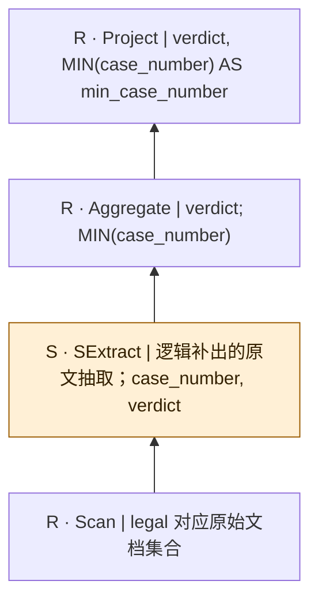

SQL本身只有结构化算子；SExtract是从原文到关系的分析性补充，不是源SQL的显式调用，也不表明每个字段必须由LLM抽取。字段类型、NULL及一对多抽取契约须在执行前固定。

## bench-u/Legal/Agg/agg_queries_Legal/2

来源：[原件](</Volumes/Element/Github2/semantic-workload-bench/data/semantic-query-discovery-20260908/bench-u/checkout/Query/Legal/Agg/agg_queries_Legal.sql>) · `sql_plus_proposed_extraction` · `logical_only` · `substantive_relational`

```sql

SELECT nationality_for_applicant, COUNT(judge_name) AS count_judge_name FROM legal GROUP BY nationality_for_applicant;

```

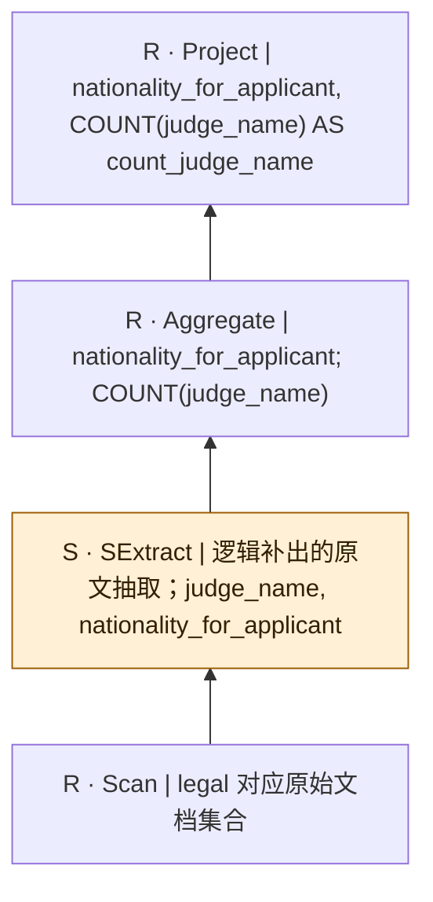

SQL本身只有结构化算子；SExtract是从原文到关系的分析性补充，不是源SQL的显式调用，也不表明每个字段必须由LLM抽取。字段类型、NULL及一对多抽取契约须在执行前固定。

## bench-u/Legal/Agg/agg_queries_Legal/3

来源：[原件](</Volumes/Element/Github2/semantic-workload-bench/data/semantic-query-discovery-20260908/bench-u/checkout/Query/Legal/Agg/agg_queries_Legal.sql>) · `sql_plus_proposed_extraction` · `logical_only` · `substantive_relational`

```sql

SELECT nationality_for_applicant, AVG(legal_basis_num) AS avg_legal_basis_num FROM legal GROUP BY nationality_for_applicant;

```

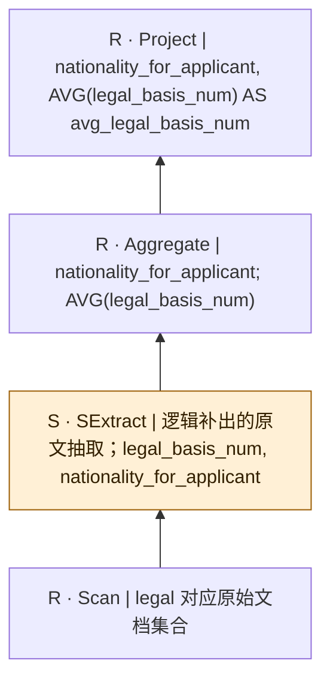

SQL本身只有结构化算子；SExtract是从原文到关系的分析性补充，不是源SQL的显式调用，也不表明每个字段必须由LLM抽取。字段类型、NULL及一对多抽取契约须在执行前固定。

## bench-u/Legal/Agg/agg_queries_Legal/4

来源：[原件](</Volumes/Element/Github2/semantic-workload-bench/data/semantic-query-discovery-20260908/bench-u/checkout/Query/Legal/Agg/agg_queries_Legal.sql>) · `sql_plus_proposed_extraction` · `logical_only` · `substantive_relational`

```sql

SELECT nationality_for_applicant, MAX(legal_basis_num) AS max_legal_basis_num FROM legal GROUP BY nationality_for_applicant;

```

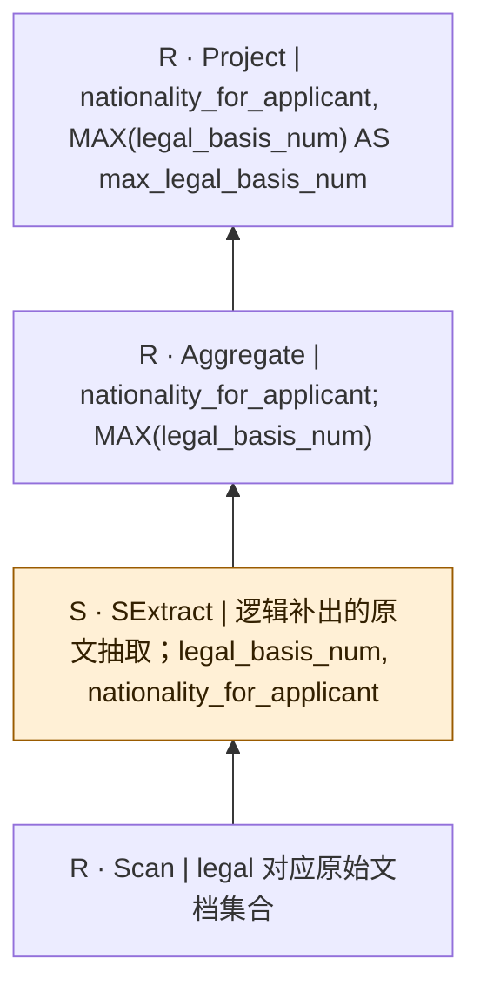

SQL本身只有结构化算子；SExtract是从原文到关系的分析性补充，不是源SQL的显式调用，也不表明每个字段必须由LLM抽取。字段类型、NULL及一对多抽取契约须在执行前固定。

## bench-u/Legal/Agg/agg_queries_Legal/5

来源：[原件](</Volumes/Element/Github2/semantic-workload-bench/data/semantic-query-discovery-20260908/bench-u/checkout/Query/Legal/Agg/agg_queries_Legal.sql>) · `sql_plus_proposed_extraction` · `logical_only` · `substantive_relational`

```sql

SELECT nationality_for_applicant, COUNT(defendant_current_status) AS count_defendant_current_status FROM legal GROUP BY nationality_for_applicant;

```

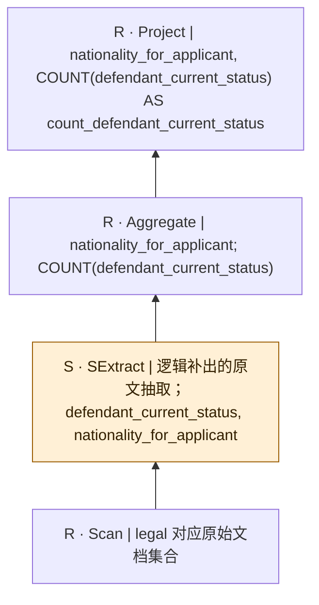

SQL本身只有结构化算子；SExtract是从原文到关系的分析性补充，不是源SQL的显式调用，也不表明每个字段必须由LLM抽取。字段类型、NULL及一对多抽取契约须在执行前固定。

## bench-u/Legal/Agg/agg_queries_Legal/6

来源：[原件](</Volumes/Element/Github2/semantic-workload-bench/data/semantic-query-discovery-20260908/bench-u/checkout/Query/Legal/Agg/agg_queries_Legal.sql>) · `sql_plus_proposed_extraction` · `logical_only` · `substantive_relational`

```sql

SELECT verdict, MIN(legal_basis_num) AS min_legal_basis_num FROM legal GROUP BY verdict;

```

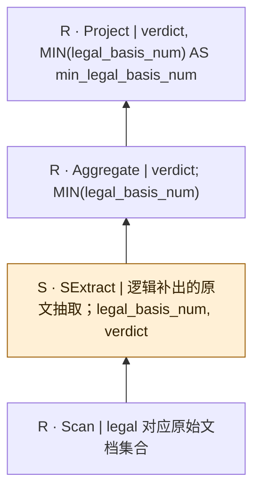

SQL本身只有结构化算子；SExtract是从原文到关系的分析性补充，不是源SQL的显式调用，也不表明每个字段必须由LLM抽取。字段类型、NULL及一对多抽取契约须在执行前固定。

## bench-u/Legal/Agg/agg_queries_Legal/7

来源：[原件](</Volumes/Element/Github2/semantic-workload-bench/data/semantic-query-discovery-20260908/bench-u/checkout/Query/Legal/Agg/agg_queries_Legal.sql>) · `sql_plus_proposed_extraction` · `logical_only` · `substantive_relational`

```sql

SELECT nationality_for_applicant, MAX(legal_basis_num) AS max_legal_basis_num FROM legal GROUP BY nationality_for_applicant;

```


SQL本身只有结构化算子；SExtract是从原文到关系的分析性补充，不是源SQL的显式调用，也不表明每个字段必须由LLM抽取。字段类型、NULL及一对多抽取契约须在执行前固定。

## bench-u/Legal/Agg/agg_queries_Legal/8

来源：[原件](</Volumes/Element/Github2/semantic-workload-bench/data/semantic-query-discovery-20260908/bench-u/checkout/Query/Legal/Agg/agg_queries_Legal.sql>) · `sql_plus_proposed_extraction` · `logical_only` · `substantive_relational`

```sql

SELECT case_type, SUM(legal_basis_num) AS sum_legal_basis_num FROM legal GROUP BY case_type;

```

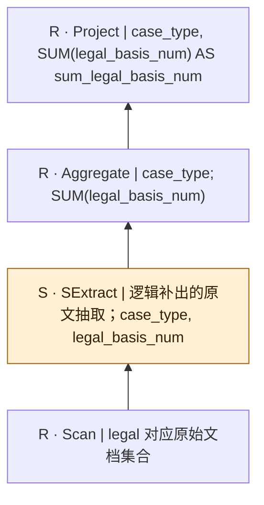

SQL本身只有结构化算子；SExtract是从原文到关系的分析性补充，不是源SQL的显式调用，也不表明每个字段必须由LLM抽取。字段类型、NULL及一对多抽取契约须在执行前固定。

## bench-u/Legal/Agg/agg_queries_Legal/9

来源：[原件](</Volumes/Element/Github2/semantic-workload-bench/data/semantic-query-discovery-20260908/bench-u/checkout/Query/Legal/Agg/agg_queries_Legal.sql>) · `sql_plus_proposed_extraction` · `logical_only` · `substantive_relational`

```sql

SELECT case_type, COUNT(evidence) AS count_evidence FROM legal GROUP BY case_type;

```

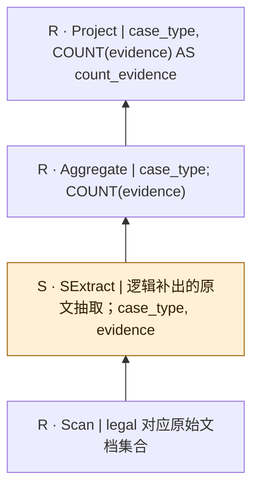

SQL本身只有结构化算子；SExtract是从原文到关系的分析性补充，不是源SQL的显式调用，也不表明每个字段必须由LLM抽取。字段类型、NULL及一对多抽取契约须在执行前固定。

## bench-u/Legal/Agg/agg_queries_Legal/10

来源：[原件](</Volumes/Element/Github2/semantic-workload-bench/data/semantic-query-discovery-20260908/bench-u/checkout/Query/Legal/Agg/agg_queries_Legal.sql>) · `sql_plus_proposed_extraction` · `logical_only` · `substantive_relational`

```sql

SELECT case_type, COUNT(case_number) AS count_case_number FROM legal GROUP BY case_type;

```

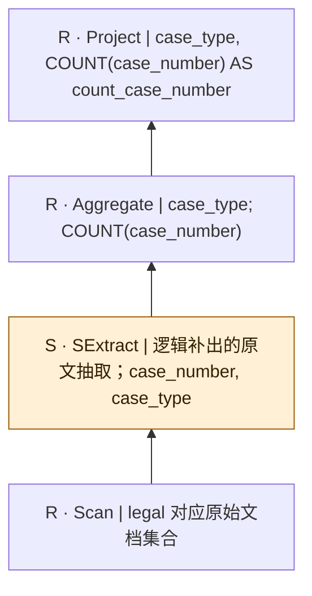

SQL本身只有结构化算子；SExtract是从原文到关系的分析性补充，不是源SQL的显式调用，也不表明每个字段必须由LLM抽取。字段类型、NULL及一对多抽取契约须在执行前固定。

## bench-u/Legal/Filter/filter_queries_Legal/1

来源：[原件](</Volumes/Element/Github2/semantic-workload-bench/data/semantic-query-discovery-20260908/bench-u/checkout/Query/Legal/Filter/filter_queries_Legal.sql>) · `sql_plus_proposed_extraction` · `logical_only` · `substantive_relational`

```sql

SELECT nationality_for_applicant, fine_amount, hearing_year FROM Legal_Case WHERE fine_amount = 20000.00;

```

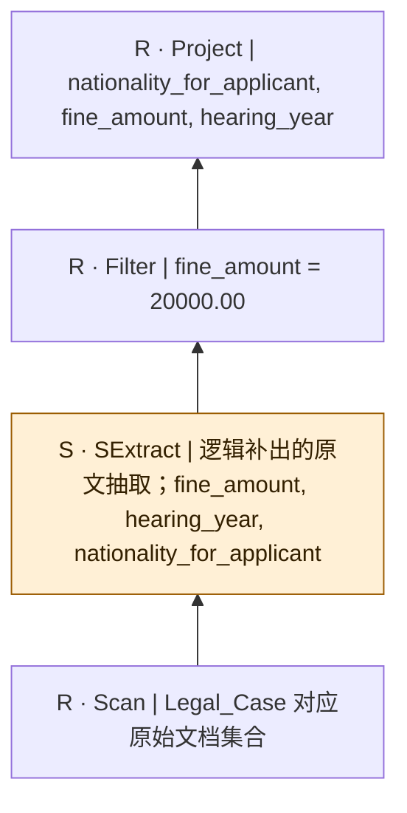

SQL本身只有结构化算子；SExtract是从原文到关系的分析性补充，不是源SQL的显式调用，也不表明每个字段必须由LLM抽取。字段类型、NULL及一对多抽取契约须在执行前固定。

## bench-u/Legal/Filter/filter_queries_Legal/2

来源：[原件](</Volumes/Element/Github2/semantic-workload-bench/data/semantic-query-discovery-20260908/bench-u/checkout/Query/Legal/Filter/filter_queries_Legal.sql>) · `sql_plus_proposed_extraction` · `logical_only` · `substantive_relational`

```sql

SELECT counsel_for_respondent, judgment_year, verdict FROM Legal_Case WHERE verdict = 'Not Guilty';

```

```mermaid
flowchart BT
  n0["R · Project | counsel_for_respondent, judgment_year, verdict"]
  n1["R · Filter | verdict = &#x27;Not Guilty&#x27;"]
  n2["S · SExtract | 逻辑补出的原文抽取；counsel_for_respondent, judgment_year, verdict"]
  n3["R · Scan | Legal_Case 对应原始文档集合"]
  n3 --> n2
  n2 --> n1
  n1 --> n0
  classDef semantic fill:#fff0d6,stroke:#9a5b00,color:#332000;
  class n2 semantic;
```

SQL本身只有结构化算子；SExtract是从原文到关系的分析性补充，不是源SQL的显式调用，也不表明每个字段必须由LLM抽取。字段类型、NULL及一对多抽取契约须在执行前固定。

## bench-u/Legal/Filter/filter_queries_Legal/3

来源：[原件](</Volumes/Element/Github2/semantic-workload-bench/data/semantic-query-discovery-20260908/bench-u/checkout/Query/Legal/Filter/filter_queries_Legal.sql>) · `sql_plus_proposed_extraction` · `logical_only` · `substantive_relational`

```sql

SELECT evidence, plaintiff, fine_amount FROM Legal_Case WHERE plaintiff != 'Deputy Commissioner of Taxation';

```

```mermaid
flowchart BT
  n0["R · Project | evidence, plaintiff, fine_amount"]
  n1["R · Filter | plaintiff &lt;&gt; &#x27;Deputy Commissioner of Taxation&#x27;"]
  n2["S · SExtract | 逻辑补出的原文抽取；evidence, fine_amount, plaintiff"]
  n3["R · Scan | Legal_Case 对应原始文档集合"]
  n3 --> n2
  n2 --> n1
  n1 --> n0
  classDef semantic fill:#fff0d6,stroke:#9a5b00,color:#332000;
  class n2 semantic;
```

SQL本身只有结构化算子；SExtract是从原文到关系的分析性补充，不是源SQL的显式调用，也不表明每个字段必须由LLM抽取。字段类型、NULL及一对多抽取契约须在执行前固定。

## bench-u/Legal/Filter/filter_queries_Legal/4

来源：[原件](</Volumes/Element/Github2/semantic-workload-bench/data/semantic-query-discovery-20260908/bench-u/checkout/Query/Legal/Filter/filter_queries_Legal.sql>) · `sql_plus_proposed_extraction` · `logical_only` · `substantive_relational`

```sql

SELECT verdict, defendant, legal_basis_num FROM Legal_Case WHERE legal_basis_num != 4;

```

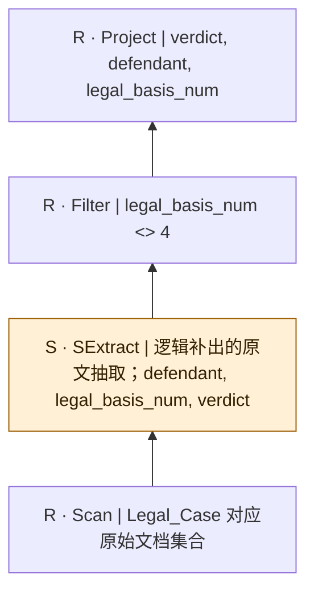

SQL本身只有结构化算子；SExtract是从原文到关系的分析性补充，不是源SQL的显式调用，也不表明每个字段必须由LLM抽取。字段类型、NULL及一对多抽取契约须在执行前固定。

## bench-u/Legal/Filter/filter_queries_Legal/5

来源：[原件](</Volumes/Element/Github2/semantic-workload-bench/data/semantic-query-discovery-20260908/bench-u/checkout/Query/Legal/Filter/filter_queries_Legal.sql>) · `sql_plus_proposed_extraction` · `logical_only` · `substantive_relational`

```sql

SELECT evidence, hearing_year, verdict FROM Legal_Case WHERE hearing_year = 2007;

```

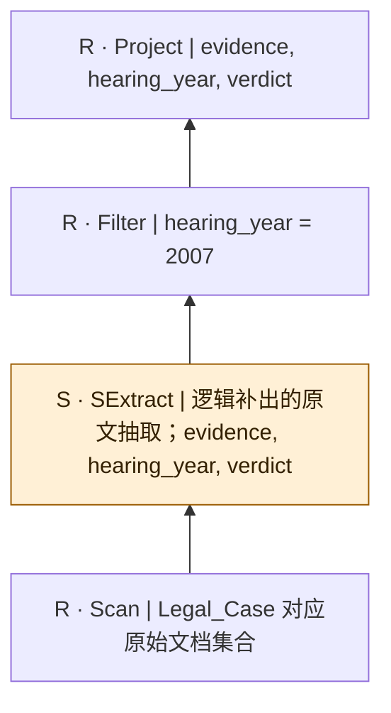

SQL本身只有结构化算子；SExtract是从原文到关系的分析性补充，不是源SQL的显式调用，也不表明每个字段必须由LLM抽取。字段类型、NULL及一对多抽取契约须在执行前固定。

## bench-u/Legal/Filter/filter_queries_Legal/6

来源：[原件](</Volumes/Element/Github2/semantic-workload-bench/data/semantic-query-discovery-20260908/bench-u/checkout/Query/Legal/Filter/filter_queries_Legal.sql>) · `sql_plus_proposed_extraction` · `logical_only` · `substantive_relational`

```sql

SELECT defendant_current_status, defendant, plaintiff_current_status FROM Legal_Case WHERE defendant = 'Darrell Lea Chocolate Shops Pty Ltd';

```

```mermaid
flowchart BT
  n0["R · Project | defendant_current_status, defendant, plaintiff_current_status"]
  n1["R · Filter | defendant = &#x27;Darrell Lea Chocolate Shops Pty Ltd&#x27;"]
  n2["S · SExtract | 逻辑补出的原文抽取；defendant, defendant_current_status, plaintiff_current_status"]
  n3["R · Scan | Legal_Case 对应原始文档集合"]
  n3 --> n2
  n2 --> n1
  n1 --> n0
  classDef semantic fill:#fff0d6,stroke:#9a5b00,color:#332000;
  class n2 semantic;
```

SQL本身只有结构化算子；SExtract是从原文到关系的分析性补充，不是源SQL的显式调用，也不表明每个字段必须由LLM抽取。字段类型、NULL及一对多抽取契约须在执行前固定。

## bench-u/Legal/Filter/filter_queries_Legal/7

来源：[原件](</Volumes/Element/Github2/semantic-workload-bench/data/semantic-query-discovery-20260908/bench-u/checkout/Query/Legal/Filter/filter_queries_Legal.sql>) · `sql_plus_proposed_extraction` · `logical_only` · `substantive_relational`

```sql

SELECT case_number, plaintiff_current_status, plaintiff FROM Legal_Case WHERE case_number <= 5;

```

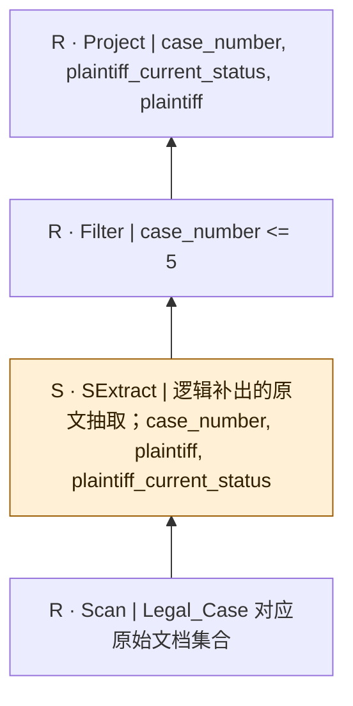

SQL本身只有结构化算子；SExtract是从原文到关系的分析性补充，不是源SQL的显式调用，也不表明每个字段必须由LLM抽取。字段类型、NULL及一对多抽取契约须在执行前固定。

## bench-u/Legal/Filter/filter_queries_Legal/8

来源：[原件](</Volumes/Element/Github2/semantic-workload-bench/data/semantic-query-discovery-20260908/bench-u/checkout/Query/Legal/Filter/filter_queries_Legal.sql>) · `sql_plus_proposed_extraction` · `logical_only` · `substantive_relational`

```sql

SELECT verdict, counsel_for_respondent, plaintiff FROM Legal_Case WHERE counsel_for_respondent = 'Mr BJ Sullivan SC';

```

```mermaid
flowchart BT
  n0["R · Project | verdict, counsel_for_respondent, plaintiff"]
  n1["R · Filter | counsel_for_respondent = &#x27;Mr BJ Sullivan SC&#x27;"]
  n2["S · SExtract | 逻辑补出的原文抽取；counsel_for_respondent, plaintiff, verdict"]
  n3["R · Scan | Legal_Case 对应原始文档集合"]
  n3 --> n2
  n2 --> n1
  n1 --> n0
  classDef semantic fill:#fff0d6,stroke:#9a5b00,color:#332000;
  class n2 semantic;
```

SQL本身只有结构化算子；SExtract是从原文到关系的分析性补充，不是源SQL的显式调用，也不表明每个字段必须由LLM抽取。字段类型、NULL及一对多抽取契约须在执行前固定。

## bench-u/Legal/Filter/filter_queries_Legal/9

来源：[原件](</Volumes/Element/Github2/semantic-workload-bench/data/semantic-query-discovery-20260908/bench-u/checkout/Query/Legal/Filter/filter_queries_Legal.sql>) · `sql_plus_proposed_extraction` · `logical_only` · `substantive_relational`

```sql

SELECT hearing_year, legal_basis_num, defendant_current_status FROM Legal_Case WHERE defendant_current_status = 'Workplace Inspecto';

```

```mermaid
flowchart BT
  n0["R · Project | hearing_year, legal_basis_num, defendant_current_status"]
  n1["R · Filter | defendant_current_status = &#x27;Workplace Inspecto&#x27;"]
  n2["S · SExtract | 逻辑补出的原文抽取；defendant_current_status, hearing_year, legal_basis_num"]
  n3["R · Scan | Legal_Case 对应原始文档集合"]
  n3 --> n2
  n2 --> n1
  n1 --> n0
  classDef semantic fill:#fff0d6,stroke:#9a5b00,color:#332000;
  class n2 semantic;
```

SQL本身只有结构化算子；SExtract是从原文到关系的分析性补充，不是源SQL的显式调用，也不表明每个字段必须由LLM抽取。字段类型、NULL及一对多抽取契约须在执行前固定。

## bench-u/Legal/Filter/filter_queries_Legal/10

来源：[原件](</Volumes/Element/Github2/semantic-workload-bench/data/semantic-query-discovery-20260908/bench-u/checkout/Query/Legal/Filter/filter_queries_Legal.sql>) · `sql_plus_proposed_extraction` · `logical_only` · `substantive_relational`

```sql

SELECT legal_fees, judge_name, charges FROM Legal_Case WHERE judge_name != 'Black';

```

```mermaid
flowchart BT
  n0["R · Project | legal_fees, judge_name, charges"]
  n1["R · Filter | judge_name &lt;&gt; &#x27;Black&#x27;"]
  n2["S · SExtract | 逻辑补出的原文抽取；charges, judge_name, legal_fees"]
  n3["R · Scan | Legal_Case 对应原始文档集合"]
  n3 --> n2
  n2 --> n1
  n1 --> n0
  classDef semantic fill:#fff0d6,stroke:#9a5b00,color:#332000;
  class n2 semantic;
```

SQL本身只有结构化算子；SExtract是从原文到关系的分析性补充，不是源SQL的显式调用，也不表明每个字段必须由LLM抽取。字段类型、NULL及一对多抽取契约须在执行前固定。

## bench-u/Legal/Filter/filter_queries_Legal/11

来源：[原件](</Volumes/Element/Github2/semantic-workload-bench/data/semantic-query-discovery-20260908/bench-u/checkout/Query/Legal/Filter/filter_queries_Legal.sql>) · `sql_plus_proposed_extraction` · `logical_only` · `substantive_relational`

```sql

SELECT plaintiff_current_status, legal_fees, plaintiff FROM Legal_Case WHERE legal_fees != '7500' AND charges != 'Abuse of process';

```

```mermaid
flowchart BT
  n0["R · Project | plaintiff_current_status, legal_fees, plaintiff"]
  n1["R · Filter | legal_fees &lt;&gt; &#x27;7500&#x27; AND charges &lt;&gt; &#x27;Abuse of process&#x27;"]
  n2["S · SExtract | 逻辑补出的原文抽取；charges, legal_fees, plaintiff, plaintiff_current_status"]
  n3["R · Scan | Legal_Case 对应原始文档集合"]
  n3 --> n2
  n2 --> n1
  n1 --> n0
  classDef semantic fill:#fff0d6,stroke:#9a5b00,color:#332000;
  class n2 semantic;
```

SQL本身只有结构化算子；SExtract是从原文到关系的分析性补充，不是源SQL的显式调用，也不表明每个字段必须由LLM抽取。字段类型、NULL及一对多抽取契约须在执行前固定。

## bench-u/Legal/Filter/filter_queries_Legal/12

来源：[原件](</Volumes/Element/Github2/semantic-workload-bench/data/semantic-query-discovery-20260908/bench-u/checkout/Query/Legal/Filter/filter_queries_Legal.sql>) · `sql_plus_proposed_extraction` · `logical_only` · `substantive_relational`

```sql

SELECT defendant_current_status, verdict, counsel_for_applicant FROM Legal_Case WHERE counsel_for_applicant = 'M D Wyles' AND case_number >= 17;

```

```mermaid
flowchart BT
  n0["R · Project | defendant_current_status, verdict, counsel_for_applicant"]
  n1["R · Filter | counsel_for_applicant = &#x27;M D Wyles&#x27; AND case_number &gt;= 17"]
  n2["S · SExtract | 逻辑补出的原文抽取；case_number, counsel_for_applicant, defendant_current_status, verdict"]
  n3["R · Scan | Legal_Case 对应原始文档集合"]
  n3 --> n2
  n2 --> n1
  n1 --> n0
  classDef semantic fill:#fff0d6,stroke:#9a5b00,color:#332000;
  class n2 semantic;
```

SQL本身只有结构化算子；SExtract是从原文到关系的分析性补充，不是源SQL的显式调用，也不表明每个字段必须由LLM抽取。字段类型、NULL及一对多抽取契约须在执行前固定。

## bench-u/Legal/Filter/filter_queries_Legal/13

来源：[原件](</Volumes/Element/Github2/semantic-workload-bench/data/semantic-query-discovery-20260908/bench-u/checkout/Query/Legal/Filter/filter_queries_Legal.sql>) · `sql_plus_proposed_extraction` · `logical_only` · `substantive_relational`

```sql

SELECT fine_amount, counsel_for_applicant, legal_basis_num FROM Legal_Case WHERE fine_amount != 210000.00 AND nationality_for_applicant != 'Bangladesh';

```

```mermaid
flowchart BT
  n0["R · Project | fine_amount, counsel_for_applicant, legal_basis_num"]
  n1["R · Filter | fine_amount &lt;&gt; 210000.00 AND nationality_for_applicant &lt;&gt; &#x27;Bangladesh&#x27;"]
  n2["S · SExtract | 逻辑补出的原文抽取；counsel_for_applicant, fine_amount, legal_basis_num, nationality_for_applicant"]
  n3["R · Scan | Legal_Case 对应原始文档集合"]
  n3 --> n2
  n2 --> n1
  n1 --> n0
  classDef semantic fill:#fff0d6,stroke:#9a5b00,color:#332000;
  class n2 semantic;
```

SQL本身只有结构化算子；SExtract是从原文到关系的分析性补充，不是源SQL的显式调用，也不表明每个字段必须由LLM抽取。字段类型、NULL及一对多抽取契约须在执行前固定。

## bench-u/Legal/Filter/filter_queries_Legal/14

来源：[原件](</Volumes/Element/Github2/semantic-workload-bench/data/semantic-query-discovery-20260908/bench-u/checkout/Query/Legal/Filter/filter_queries_Legal.sql>) · `sql_plus_proposed_extraction` · `logical_only` · `substantive_relational`

```sql

SELECT verdict, hearing_year, defendant_current_status FROM Legal_Case WHERE verdict != 'Not Guilty' AND defendant_current_status != 'Company';

```

```mermaid
flowchart BT
  n0["R · Project | verdict, hearing_year, defendant_current_status"]
  n1["R · Filter | verdict &lt;&gt; &#x27;Not Guilty&#x27; AND defendant_current_status &lt;&gt; &#x27;Company&#x27;"]
  n2["S · SExtract | 逻辑补出的原文抽取；defendant_current_status, hearing_year, verdict"]
  n3["R · Scan | Legal_Case 对应原始文档集合"]
  n3 --> n2
  n2 --> n1
  n1 --> n0
  classDef semantic fill:#fff0d6,stroke:#9a5b00,color:#332000;
  class n2 semantic;
```

SQL本身只有结构化算子；SExtract是从原文到关系的分析性补充，不是源SQL的显式调用，也不表明每个字段必须由LLM抽取。字段类型、NULL及一对多抽取契约须在执行前固定。

## bench-u/Legal/Filter/filter_queries_Legal/15

来源：[原件](</Volumes/Element/Github2/semantic-workload-bench/data/semantic-query-discovery-20260908/bench-u/checkout/Query/Legal/Filter/filter_queries_Legal.sql>) · `sql_plus_proposed_extraction` · `logical_only` · `substantive_relational`

```sql

SELECT case_number, first_judge, hearing_year FROM Legal_Case WHERE hearing_year = 2007 AND case_number >= 17;

```

```mermaid
flowchart BT
  n0["R · Project | case_number, first_judge, hearing_year"]
  n1["R · Filter | hearing_year = 2007 AND case_number &gt;= 17"]
  n2["S · SExtract | 逻辑补出的原文抽取；case_number, first_judge, hearing_year"]
  n3["R · Scan | Legal_Case 对应原始文档集合"]
  n3 --> n2
  n2 --> n1
  n1 --> n0
  classDef semantic fill:#fff0d6,stroke:#9a5b00,color:#332000;
  class n2 semantic;
```

SQL本身只有结构化算子；SExtract是从原文到关系的分析性补充，不是源SQL的显式调用，也不表明每个字段必须由LLM抽取。字段类型、NULL及一对多抽取契约须在执行前固定。

## bench-u/Legal/Filter/filter_queries_Legal/16

来源：[原件](</Volumes/Element/Github2/semantic-workload-bench/data/semantic-query-discovery-20260908/bench-u/checkout/Query/Legal/Filter/filter_queries_Legal.sql>) · `sql_plus_proposed_extraction` · `logical_only` · `substantive_relational`

```sql

SELECT hearing_year, nationality_for_applicant, counsel_for_respondent FROM Legal_Case WHERE hearing_year != 2008 AND counsel_for_respondent = 'R Knowles';

```

```mermaid
flowchart BT
  n0["R · Project | hearing_year, nationality_for_applicant, counsel_for_respondent"]
  n1["R · Filter | hearing_year &lt;&gt; 2008 AND counsel_for_respondent = &#x27;R Knowles&#x27;"]
  n2["S · SExtract | 逻辑补出的原文抽取；counsel_for_respondent, hearing_year, nationality_for_applicant"]
  n3["R · Scan | Legal_Case 对应原始文档集合"]
  n3 --> n2
  n2 --> n1
  n1 --> n0
  classDef semantic fill:#fff0d6,stroke:#9a5b00,color:#332000;
  class n2 semantic;
```

SQL本身只有结构化算子；SExtract是从原文到关系的分析性补充，不是源SQL的显式调用，也不表明每个字段必须由LLM抽取。字段类型、NULL及一对多抽取契约须在执行前固定。

## bench-u/Legal/Filter/filter_queries_Legal/17

来源：[原件](</Volumes/Element/Github2/semantic-workload-bench/data/semantic-query-discovery-20260908/bench-u/checkout/Query/Legal/Filter/filter_queries_Legal.sql>) · `sql_plus_proposed_extraction` · `logical_only` · `substantive_relational`

```sql

SELECT judgment_year, case_type, counsel_for_applicant FROM Legal_Case WHERE judgment_year != 2006 AND case_number < 17;

```

```mermaid
flowchart BT
  n0["R · Project | judgment_year, case_type, counsel_for_applicant"]
  n1["R · Filter | judgment_year &lt;&gt; 2006 AND case_number &lt; 17"]
  n2["S · SExtract | 逻辑补出的原文抽取；case_number, case_type, counsel_for_applicant, judgment_year"]
  n3["R · Scan | Legal_Case 对应原始文档集合"]
  n3 --> n2
  n2 --> n1
  n1 --> n0
  classDef semantic fill:#fff0d6,stroke:#9a5b00,color:#332000;
  class n2 semantic;
```

SQL本身只有结构化算子；SExtract是从原文到关系的分析性补充，不是源SQL的显式调用，也不表明每个字段必须由LLM抽取。字段类型、NULL及一对多抽取契约须在执行前固定。

## bench-u/Legal/Filter/filter_queries_Legal/18

来源：[原件](</Volumes/Element/Github2/semantic-workload-bench/data/semantic-query-discovery-20260908/bench-u/checkout/Query/Legal/Filter/filter_queries_Legal.sql>) · `sql_plus_proposed_extraction` · `logical_only` · `substantive_relational`

```sql

SELECT nationality_for_applicant, plaintiff_current_status, verdict FROM Legal_Case WHERE verdict = 'Guilty' AND case_number >= 5;

```

```mermaid
flowchart BT
  n0["R · Project | nationality_for_applicant, plaintiff_current_status, verdict"]
  n1["R · Filter | verdict = &#x27;Guilty&#x27; AND case_number &gt;= 5"]
  n2["S · SExtract | 逻辑补出的原文抽取；case_number, nationality_for_applicant, plaintiff_current_status, verdict"]
  n3["R · Scan | Legal_Case 对应原始文档集合"]
  n3 --> n2
  n2 --> n1
  n1 --> n0
  classDef semantic fill:#fff0d6,stroke:#9a5b00,color:#332000;
  class n2 semantic;
```

SQL本身只有结构化算子；SExtract是从原文到关系的分析性补充，不是源SQL的显式调用，也不表明每个字段必须由LLM抽取。字段类型、NULL及一对多抽取契约须在执行前固定。

## bench-u/Legal/Filter/filter_queries_Legal/19

来源：[原件](</Volumes/Element/Github2/semantic-workload-bench/data/semantic-query-discovery-20260908/bench-u/checkout/Query/Legal/Filter/filter_queries_Legal.sql>) · `sql_plus_proposed_extraction` · `logical_only` · `substantive_relational`

```sql

SELECT legal_fees, first_judge, defendant_current_status FROM Legal_Case WHERE legal_fees != '1300' AND legal_basis_num >= 4;

```

```mermaid
flowchart BT
  n0["R · Project | legal_fees, first_judge, defendant_current_status"]
  n1["R · Filter | legal_fees &lt;&gt; &#x27;1300&#x27; AND legal_basis_num &gt;= 4"]
  n2["S · SExtract | 逻辑补出的原文抽取；defendant_current_status, first_judge, legal_basis_num, legal_fees"]
  n3["R · Scan | Legal_Case 对应原始文档集合"]
  n3 --> n2
  n2 --> n1
  n1 --> n0
  classDef semantic fill:#fff0d6,stroke:#9a5b00,color:#332000;
  class n2 semantic;
```

SQL本身只有结构化算子；SExtract是从原文到关系的分析性补充，不是源SQL的显式调用，也不表明每个字段必须由LLM抽取。字段类型、NULL及一对多抽取契约须在执行前固定。

## bench-u/Legal/Filter/filter_queries_Legal/20

来源：[原件](</Volumes/Element/Github2/semantic-workload-bench/data/semantic-query-discovery-20260908/bench-u/checkout/Query/Legal/Filter/filter_queries_Legal.sql>) · `sql_plus_proposed_extraction` · `logical_only` · `substantive_relational`

```sql

SELECT nationality_for_applicant, counsel_for_applicant, hearing_year FROM Legal_Case WHERE hearing_year = 2008 AND plaintiff_current_status != 'Fisherman';

```

```mermaid
flowchart BT
  n0["R · Project | nationality_for_applicant, counsel_for_applicant, hearing_year"]
  n1["R · Filter | hearing_year = 2008 AND plaintiff_current_status &lt;&gt; &#x27;Fisherman&#x27;"]
  n2["S · SExtract | 逻辑补出的原文抽取；counsel_for_applicant, hearing_year, nationality_for_applicant, plaintiff_current_status"]
  n3["R · Scan | Legal_Case 对应原始文档集合"]
  n3 --> n2
  n2 --> n1
  n1 --> n0
  classDef semantic fill:#fff0d6,stroke:#9a5b00,color:#332000;
  class n2 semantic;
```

SQL本身只有结构化算子；SExtract是从原文到关系的分析性补充，不是源SQL的显式调用，也不表明每个字段必须由LLM抽取。字段类型、NULL及一对多抽取契约须在执行前固定。

## bench-u/Legal/Filter/filter_queries_Legal/21

来源：[原件](</Volumes/Element/Github2/semantic-workload-bench/data/semantic-query-discovery-20260908/bench-u/checkout/Query/Legal/Filter/filter_queries_Legal.sql>) · `sql_plus_proposed_extraction` · `logical_only` · `substantive_relational`

```sql

SELECT judgment_year, defendant, case_number FROM Legal_Case WHERE judgment_year != 2006 OR case_number > 17;

```

```mermaid
flowchart BT
  n0["R · Project | judgment_year, defendant, case_number"]
  n1["R · Filter | judgment_year &lt;&gt; 2006 OR case_number &gt; 17"]
  n2["S · SExtract | 逻辑补出的原文抽取；case_number, defendant, judgment_year"]
  n3["R · Scan | Legal_Case 对应原始文档集合"]
  n3 --> n2
  n2 --> n1
  n1 --> n0
  classDef semantic fill:#fff0d6,stroke:#9a5b00,color:#332000;
  class n2 semantic;
```

SQL本身只有结构化算子；SExtract是从原文到关系的分析性补充，不是源SQL的显式调用，也不表明每个字段必须由LLM抽取。字段类型、NULL及一对多抽取契约须在执行前固定。

## bench-u/Legal/Filter/filter_queries_Legal/22

来源：[原件](</Volumes/Element/Github2/semantic-workload-bench/data/semantic-query-discovery-20260908/bench-u/checkout/Query/Legal/Filter/filter_queries_Legal.sql>) · `sql_plus_proposed_extraction` · `logical_only` · `substantive_relational`

```sql

SELECT plaintiff_current_status, verdict, legal_fees FROM Legal_Case WHERE plaintiff_current_status != 'An Active Member Of The Bharatiya Janta Party In Kerala State' OR defendant_current_status != 'The trustee of Mr Boensch__ bankrupt estate';

```

```mermaid
flowchart BT
  n0["R · Project | plaintiff_current_status, verdict, legal_fees"]
  n1["R · Filter | plaintiff_current_status &lt;&gt; &#x27;An Active Member Of The Bharatiya Janta Party In Kerala State&#x27; OR defendant_current_status &lt;&gt; &#x27;The trustee of Mr Boensch__ bankrupt estate&#x27;"]
  n2["S · SExtract | 逻辑补出的原文抽取；defendant_current_status, legal_fees, plaintiff_current_status, verdict"]
  n3["R · Scan | Legal_Case 对应原始文档集合"]
  n3 --> n2
  n2 --> n1
  n1 --> n0
  classDef semantic fill:#fff0d6,stroke:#9a5b00,color:#332000;
  class n2 semantic;
```

SQL本身只有结构化算子；SExtract是从原文到关系的分析性补充，不是源SQL的显式调用，也不表明每个字段必须由LLM抽取。字段类型、NULL及一对多抽取契约须在执行前固定。

## bench-u/Legal/Filter/filter_queries_Legal/23

来源：[原件](</Volumes/Element/Github2/semantic-workload-bench/data/semantic-query-discovery-20260908/bench-u/checkout/Query/Legal/Filter/filter_queries_Legal.sql>) · `sql_plus_proposed_extraction` · `logical_only` · `substantive_relational`

```sql

SELECT first_judge, judgment_year, evidence FROM Legal_Case WHERE evidence != 1 OR charges != 'Application forudicial review of a decision to deny a Remaining Relative visa';

```

```mermaid
flowchart BT
  n0["R · Project | first_judge, judgment_year, evidence"]
  n1["R · Filter | evidence &lt;&gt; 1 OR charges &lt;&gt; &#x27;Application forudicial review of a decision to deny a Remaining Relative visa&#x27;"]
  n2["S · SExtract | 逻辑补出的原文抽取；charges, evidence, first_judge, judgment_year"]
  n3["R · Scan | Legal_Case 对应原始文档集合"]
  n3 --> n2
  n2 --> n1
  n1 --> n0
  classDef semantic fill:#fff0d6,stroke:#9a5b00,color:#332000;
  class n2 semantic;
```

SQL本身只有结构化算子；SExtract是从原文到关系的分析性补充，不是源SQL的显式调用，也不表明每个字段必须由LLM抽取。字段类型、NULL及一对多抽取契约须在执行前固定。

## bench-u/Legal/Filter/filter_queries_Legal/24

来源：[原件](</Volumes/Element/Github2/semantic-workload-bench/data/semantic-query-discovery-20260908/bench-u/checkout/Query/Legal/Filter/filter_queries_Legal.sql>) · `sql_plus_proposed_extraction` · `logical_only` · `substantive_relational`

```sql

SELECT first_judge, hearing_year, defendant FROM Legal_Case WHERE defendant = 'Siminton' OR counsel_for_respondent != 'T Wong';

```

```mermaid
flowchart BT
  n0["R · Project | first_judge, hearing_year, defendant"]
  n1["R · Filter | defendant = &#x27;Siminton&#x27; OR counsel_for_respondent &lt;&gt; &#x27;T Wong&#x27;"]
  n2["S · SExtract | 逻辑补出的原文抽取；counsel_for_respondent, defendant, first_judge, hearing_year"]
  n3["R · Scan | Legal_Case 对应原始文档集合"]
  n3 --> n2
  n2 --> n1
  n1 --> n0
  classDef semantic fill:#fff0d6,stroke:#9a5b00,color:#332000;
  class n2 semantic;
```

SQL本身只有结构化算子；SExtract是从原文到关系的分析性补充，不是源SQL的显式调用，也不表明每个字段必须由LLM抽取。字段类型、NULL及一对多抽取契约须在执行前固定。

## bench-u/Legal/Filter/filter_queries_Legal/25

来源：[原件](</Volumes/Element/Github2/semantic-workload-bench/data/semantic-query-discovery-20260908/bench-u/checkout/Query/Legal/Filter/filter_queries_Legal.sql>) · `sql_plus_proposed_extraction` · `logical_only` · `substantive_relational`

```sql

SELECT evidence, fine_amount, nationality_for_applicant FROM Legal_Case WHERE fine_amount != 20000.00 OR defendant_current_status = 'Distribution of counterfeit goods saler';

```

```mermaid
flowchart BT
  n0["R · Project | evidence, fine_amount, nationality_for_applicant"]
  n1["R · Filter | fine_amount &lt;&gt; 20000.00 OR defendant_current_status = &#x27;Distribution of counterfeit goods saler&#x27;"]
  n2["S · SExtract | 逻辑补出的原文抽取；defendant_current_status, evidence, fine_amount, nationality_for_applicant"]
  n3["R · Scan | Legal_Case 对应原始文档集合"]
  n3 --> n2
  n2 --> n1
  n1 --> n0
  classDef semantic fill:#fff0d6,stroke:#9a5b00,color:#332000;
  class n2 semantic;
```

SQL本身只有结构化算子；SExtract是从原文到关系的分析性补充，不是源SQL的显式调用，也不表明每个字段必须由LLM抽取。字段类型、NULL及一对多抽取契约须在执行前固定。

## bench-u/Legal/Filter/filter_queries_Legal/26

来源：[原件](</Volumes/Element/Github2/semantic-workload-bench/data/semantic-query-discovery-20260908/bench-u/checkout/Query/Legal/Filter/filter_queries_Legal.sql>) · `sql_plus_proposed_extraction` · `logical_only` · `substantive_relational`

```sql

SELECT counsel_for_respondent, case_type, legal_basis_num FROM Legal_Case WHERE case_type != 'Commercial Case' OR judge_name != 'Gyles';

```

```mermaid
flowchart BT
  n0["R · Project | counsel_for_respondent, case_type, legal_basis_num"]
  n1["R · Filter | case_type &lt;&gt; &#x27;Commercial Case&#x27; OR judge_name &lt;&gt; &#x27;Gyles&#x27;"]
  n2["S · SExtract | 逻辑补出的原文抽取；case_type, counsel_for_respondent, judge_name, legal_basis_num"]
  n3["R · Scan | Legal_Case 对应原始文档集合"]
  n3 --> n2
  n2 --> n1
  n1 --> n0
  classDef semantic fill:#fff0d6,stroke:#9a5b00,color:#332000;
  class n2 semantic;
```

SQL本身只有结构化算子；SExtract是从原文到关系的分析性补充，不是源SQL的显式调用，也不表明每个字段必须由LLM抽取。字段类型、NULL及一对多抽取契约须在执行前固定。

## bench-u/Legal/Filter/filter_queries_Legal/27

来源：[原件](</Volumes/Element/Github2/semantic-workload-bench/data/semantic-query-discovery-20260908/bench-u/checkout/Query/Legal/Filter/filter_queries_Legal.sql>) · `sql_plus_proposed_extraction` · `logical_only` · `substantive_relational`

```sql

SELECT verdict, fine_amount, legal_fees FROM Legal_Case WHERE verdict != 'Guilty' OR nationality_for_applicant = 'Philippines';

```

```mermaid
flowchart BT
  n0["R · Project | verdict, fine_amount, legal_fees"]
  n1["R · Filter | verdict &lt;&gt; &#x27;Guilty&#x27; OR nationality_for_applicant = &#x27;Philippines&#x27;"]
  n2["S · SExtract | 逻辑补出的原文抽取；fine_amount, legal_fees, nationality_for_applicant, verdict"]
  n3["R · Scan | Legal_Case 对应原始文档集合"]
  n3 --> n2
  n2 --> n1
  n1 --> n0
  classDef semantic fill:#fff0d6,stroke:#9a5b00,color:#332000;
  class n2 semantic;
```

SQL本身只有结构化算子；SExtract是从原文到关系的分析性补充，不是源SQL的显式调用，也不表明每个字段必须由LLM抽取。字段类型、NULL及一对多抽取契约须在执行前固定。

## bench-u/Legal/Filter/filter_queries_Legal/28

来源：[原件](</Volumes/Element/Github2/semantic-workload-bench/data/semantic-query-discovery-20260908/bench-u/checkout/Query/Legal/Filter/filter_queries_Legal.sql>) · `sql_plus_proposed_extraction` · `logical_only` · `substantive_relational`

```sql

SELECT counsel_for_respondent, case_type, defendant FROM Legal_Case WHERE defendant = 'IPM Operation and Maintenance Loy Yang Pty Ltd' OR judge_name != 'Weinbergj';

```

```mermaid
flowchart BT
  n0["R · Project | counsel_for_respondent, case_type, defendant"]
  n1["R · Filter | defendant = &#x27;IPM Operation and Maintenance Loy Yang Pty Ltd&#x27; OR judge_name &lt;&gt; &#x27;Weinbergj&#x27;"]
  n2["S · SExtract | 逻辑补出的原文抽取；case_type, counsel_for_respondent, defendant, judge_name"]
  n3["R · Scan | Legal_Case 对应原始文档集合"]
  n3 --> n2
  n2 --> n1
  n1 --> n0
  classDef semantic fill:#fff0d6,stroke:#9a5b00,color:#332000;
  class n2 semantic;
```

SQL本身只有结构化算子；SExtract是从原文到关系的分析性补充，不是源SQL的显式调用，也不表明每个字段必须由LLM抽取。字段类型、NULL及一对多抽取契约须在执行前固定。

## bench-u/Legal/Filter/filter_queries_Legal/29

来源：[原件](</Volumes/Element/Github2/semantic-workload-bench/data/semantic-query-discovery-20260908/bench-u/checkout/Query/Legal/Filter/filter_queries_Legal.sql>) · `sql_plus_proposed_extraction` · `logical_only` · `substantive_relational`

```sql

SELECT verdict, nationality_for_applicant, counsel_for_respondent FROM Legal_Case WHERE verdict != 'Approved' OR evidence != 1;

```

```mermaid
flowchart BT
  n0["R · Project | verdict, nationality_for_applicant, counsel_for_respondent"]
  n1["R · Filter | verdict &lt;&gt; &#x27;Approved&#x27; OR evidence &lt;&gt; 1"]
  n2["S · SExtract | 逻辑补出的原文抽取；counsel_for_respondent, evidence, nationality_for_applicant, verdict"]
  n3["R · Scan | Legal_Case 对应原始文档集合"]
  n3 --> n2
  n2 --> n1
  n1 --> n0
  classDef semantic fill:#fff0d6,stroke:#9a5b00,color:#332000;
  class n2 semantic;
```

SQL本身只有结构化算子；SExtract是从原文到关系的分析性补充，不是源SQL的显式调用，也不表明每个字段必须由LLM抽取。字段类型、NULL及一对多抽取契约须在执行前固定。

## bench-u/Legal/Filter/filter_queries_Legal/30

来源：[原件](</Volumes/Element/Github2/semantic-workload-bench/data/semantic-query-discovery-20260908/bench-u/checkout/Query/Legal/Filter/filter_queries_Legal.sql>) · `sql_plus_proposed_extraction` · `logical_only` · `substantive_relational`

```sql

SELECT charges, counsel_for_respondent, nationality_for_applicant FROM Legal_Case WHERE counsel_for_respondent = 'Mr R Richter QC' OR hearing_year = 2007;

```

```mermaid
flowchart BT
  n0["R · Project | charges, counsel_for_respondent, nationality_for_applicant"]
  n1["R · Filter | counsel_for_respondent = &#x27;Mr R Richter QC&#x27; OR hearing_year = 2007"]
  n2["S · SExtract | 逻辑补出的原文抽取；charges, counsel_for_respondent, hearing_year, nationality_for_applicant"]
  n3["R · Scan | Legal_Case 对应原始文档集合"]
  n3 --> n2
  n2 --> n1
  n1 --> n0
  classDef semantic fill:#fff0d6,stroke:#9a5b00,color:#332000;
  class n2 semantic;
```

SQL本身只有结构化算子；SExtract是从原文到关系的分析性补充，不是源SQL的显式调用，也不表明每个字段必须由LLM抽取。字段类型、NULL及一对多抽取契约须在执行前固定。

## bench-u/Legal/Filter/filter_queries_Legal/31

来源：[原件](</Volumes/Element/Github2/semantic-workload-bench/data/semantic-query-discovery-20260908/bench-u/checkout/Query/Legal/Filter/filter_queries_Legal.sql>) · `sql_plus_proposed_extraction` · `logical_only` · `substantive_relational`

```sql

SELECT first_judge, fine_amount, legal_fees FROM Legal_Case WHERE fine_amount = 210000.00 AND defendant_current_status != 'A workplace inspector' AND nationality_for_applicant != 'China' AND counsel_for_respondent != 'S Ricketson';

```

```mermaid
flowchart BT
  n0["R · Project | first_judge, fine_amount, legal_fees"]
  n1["R · Filter | fine_amount = 210000.00 AND defendant_current_status &lt;&gt; &#x27;A workplace inspector&#x27; AND nationality_for_applicant &lt;&gt; &#x27;China&#x27; AND counsel_for_respondent &lt;&gt; &#x27;S Ricketson&#x27;"]
  n2["S · SExtract | 逻辑补出的原文抽取；counsel_for_respondent, defendant_current_status, fine_amount, first_judge, legal_fees, nationality_for_applicant"]
  n3["R · Scan | Legal_Case 对应原始文档集合"]
  n3 --> n2
  n2 --> n1
  n1 --> n0
  classDef semantic fill:#fff0d6,stroke:#9a5b00,color:#332000;
  class n2 semantic;
```

SQL本身只有结构化算子；SExtract是从原文到关系的分析性补充，不是源SQL的显式调用，也不表明每个字段必须由LLM抽取。字段类型、NULL及一对多抽取契约须在执行前固定。

## bench-u/Legal/Filter/filter_queries_Legal/32

来源：[原件](</Volumes/Element/Github2/semantic-workload-bench/data/semantic-query-discovery-20260908/bench-u/checkout/Query/Legal/Filter/filter_queries_Legal.sql>) · `sql_plus_proposed_extraction` · `logical_only` · `substantive_relational`

```sql

SELECT plaintiff, first_judge, defendant_current_status FROM Legal_Case WHERE first_judge = 1 AND charges != 'Costs related to the benefit of a Himalaya clause' AND case_type != 'Others' AND legal_basis_num < 4;

```

```mermaid
flowchart BT
  n0["R · Project | plaintiff, first_judge, defendant_current_status"]
  n1["R · Filter | first_judge = 1 AND charges &lt;&gt; &#x27;Costs related to the benefit of a Himalaya clause&#x27; AND case_type &lt;&gt; &#x27;Others&#x27; AND legal_basis_num &lt; 4"]
  n2["S · SExtract | 逻辑补出的原文抽取；case_type, charges, defendant_current_status, first_judge, legal_basis_num, plaintiff"]
  n3["R · Scan | Legal_Case 对应原始文档集合"]
  n3 --> n2
  n2 --> n1
  n1 --> n0
  classDef semantic fill:#fff0d6,stroke:#9a5b00,color:#332000;
  class n2 semantic;
```

SQL本身只有结构化算子；SExtract是从原文到关系的分析性补充，不是源SQL的显式调用，也不表明每个字段必须由LLM抽取。字段类型、NULL及一对多抽取契约须在执行前固定。

## bench-u/Legal/Filter/filter_queries_Legal/33

来源：[原件](</Volumes/Element/Github2/semantic-workload-bench/data/semantic-query-discovery-20260908/bench-u/checkout/Query/Legal/Filter/filter_queries_Legal.sql>) · `sql_plus_proposed_extraction` · `logical_only` · `substantive_relational`

```sql

SELECT evidence, verdict, judgment_year FROM Legal_Case WHERE verdict = 'Not Guilty' AND case_type != 'Administrative Case' AND evidence >= 1 AND counsel_for_respondent != 'T Reilly';

```

```mermaid
flowchart BT
  n0["R · Project | evidence, verdict, judgment_year"]
  n1["R · Filter | verdict = &#x27;Not Guilty&#x27; AND case_type &lt;&gt; &#x27;Administrative Case&#x27; AND evidence &gt;= 1 AND counsel_for_respondent &lt;&gt; &#x27;T Reilly&#x27;"]
  n2["S · SExtract | 逻辑补出的原文抽取；case_type, counsel_for_respondent, evidence, judgment_year, verdict"]
  n3["R · Scan | Legal_Case 对应原始文档集合"]
  n3 --> n2
  n2 --> n1
  n1 --> n0
  classDef semantic fill:#fff0d6,stroke:#9a5b00,color:#332000;
  class n2 semantic;
```

SQL本身只有结构化算子；SExtract是从原文到关系的分析性补充，不是源SQL的显式调用，也不表明每个字段必须由LLM抽取。字段类型、NULL及一对多抽取契约须在执行前固定。

## bench-u/Legal/Filter/filter_queries_Legal/34

来源：[原件](</Volumes/Element/Github2/semantic-workload-bench/data/semantic-query-discovery-20260908/bench-u/checkout/Query/Legal/Filter/filter_queries_Legal.sql>) · `sql_plus_proposed_extraction` · `logical_only` · `substantive_relational`

```sql

SELECT nationality_for_applicant, counsel_for_respondent, hearing_year FROM Legal_Case WHERE nationality_for_applicant != 'Vietnam' AND first_judge != 1 AND hearing_year = 2008 AND first_judge = 0;

```

```mermaid
flowchart BT
  n0["R · Project | nationality_for_applicant, counsel_for_respondent, hearing_year"]
  n1["R · Filter | nationality_for_applicant &lt;&gt; &#x27;Vietnam&#x27; AND first_judge &lt;&gt; 1 AND hearing_year = 2008 AND first_judge = 0"]
  n2["S · SExtract | 逻辑补出的原文抽取；counsel_for_respondent, first_judge, hearing_year, nationality_for_applicant"]
  n3["R · Scan | Legal_Case 对应原始文档集合"]
  n3 --> n2
  n2 --> n1
  n1 --> n0
  classDef semantic fill:#fff0d6,stroke:#9a5b00,color:#332000;
  class n2 semantic;
```

SQL本身只有结构化算子；SExtract是从原文到关系的分析性补充，不是源SQL的显式调用，也不表明每个字段必须由LLM抽取。字段类型、NULL及一对多抽取契约须在执行前固定。

## bench-u/Legal/Filter/filter_queries_Legal/35

来源：[原件](</Volumes/Element/Github2/semantic-workload-bench/data/semantic-query-discovery-20260908/bench-u/checkout/Query/Legal/Filter/filter_queries_Legal.sql>) · `sql_plus_proposed_extraction` · `logical_only` · `substantive_relational`

```sql

SELECT defendant, hearing_year, nationality_for_applicant FROM Legal_Case WHERE hearing_year != 2006 AND defendant_current_status = 'Producer and distributor of the documentary' AND verdict = 'Approved' AND nationality_for_applicant = 'India';

```

```mermaid
flowchart BT
  n0["R · Project | defendant, hearing_year, nationality_for_applicant"]
  n1["R · Filter | hearing_year &lt;&gt; 2006 AND defendant_current_status = &#x27;Producer and distributor of the documentary&#x27; AND verdict = &#x27;Approved&#x27; AND nationality_for_applicant = &#x27;India&#x27;"]
  n2["S · SExtract | 逻辑补出的原文抽取；defendant, defendant_current_status, hearing_year, nationality_for_applicant, verdict"]
  n3["R · Scan | Legal_Case 对应原始文档集合"]
  n3 --> n2
  n2 --> n1
  n1 --> n0
  classDef semantic fill:#fff0d6,stroke:#9a5b00,color:#332000;
  class n2 semantic;
```

SQL本身只有结构化算子；SExtract是从原文到关系的分析性补充，不是源SQL的显式调用，也不表明每个字段必须由LLM抽取。字段类型、NULL及一对多抽取契约须在执行前固定。

## bench-u/Legal/Filter/filter_queries_Legal/36

来源：[原件](</Volumes/Element/Github2/semantic-workload-bench/data/semantic-query-discovery-20260908/bench-u/checkout/Query/Legal/Filter/filter_queries_Legal.sql>) · `sql_plus_proposed_extraction` · `logical_only` · `substantive_relational`

```sql

SELECT charges, nationality_for_applicant, case_number FROM Legal_Case WHERE charges != 'Sequestration orders against the estates of the applicants' AND nationality_for_applicant != 'Romania' AND hearing_year = 2009 AND hearing_year = 2008;

```

```mermaid
flowchart BT
  n0["R · Project | charges, nationality_for_applicant, case_number"]
  n1["R · Filter | charges &lt;&gt; &#x27;Sequestration orders against the estates of the applicants&#x27; AND nationality_for_applicant &lt;&gt; &#x27;Romania&#x27; AND hearing_year = 2009 AND hearing_year = 2008"]
  n2["S · SExtract | 逻辑补出的原文抽取；case_number, charges, hearing_year, nationality_for_applicant"]
  n3["R · Scan | Legal_Case 对应原始文档集合"]
  n3 --> n2
  n2 --> n1
  n1 --> n0
  classDef semantic fill:#fff0d6,stroke:#9a5b00,color:#332000;
  class n2 semantic;
```

SQL本身只有结构化算子；SExtract是从原文到关系的分析性补充，不是源SQL的显式调用，也不表明每个字段必须由LLM抽取。字段类型、NULL及一对多抽取契约须在执行前固定。

## bench-u/Legal/Filter/filter_queries_Legal/37

来源：[原件](</Volumes/Element/Github2/semantic-workload-bench/data/semantic-query-discovery-20260908/bench-u/checkout/Query/Legal/Filter/filter_queries_Legal.sql>) · `sql_plus_proposed_extraction` · `logical_only` · `substantive_relational`

```sql

SELECT first_judge, case_type, fine_amount FROM Legal_Case WHERE first_judge != 1 AND case_number < 10 AND defendant_current_status = 'Professor of Surgery in the University of Western Australia (UWA)' AND fine_amount = 944120.00;

```

```mermaid
flowchart BT
  n0["R · Project | first_judge, case_type, fine_amount"]
  n1["R · Filter | first_judge &lt;&gt; 1 AND case_number &lt; 10 AND defendant_current_status = &#x27;Professor of Surgery in the University of Western Australia (UWA)&#x27; AND fine_amount = 944120.00"]
  n2["S · SExtract | 逻辑补出的原文抽取；case_number, case_type, defendant_current_status, fine_amount, first_judge"]
  n3["R · Scan | Legal_Case 对应原始文档集合"]
  n3 --> n2
  n2 --> n1
  n1 --> n0
  classDef semantic fill:#fff0d6,stroke:#9a5b00,color:#332000;
  class n2 semantic;
```

SQL本身只有结构化算子；SExtract是从原文到关系的分析性补充，不是源SQL的显式调用，也不表明每个字段必须由LLM抽取。字段类型、NULL及一对多抽取契约须在执行前固定。

## bench-u/Legal/Filter/filter_queries_Legal/38

来源：[原件](</Volumes/Element/Github2/semantic-workload-bench/data/semantic-query-discovery-20260908/bench-u/checkout/Query/Legal/Filter/filter_queries_Legal.sql>) · `sql_plus_proposed_extraction` · `logical_only` · `substantive_relational`

```sql

SELECT nationality_for_applicant, judge_name, defendant FROM Legal_Case WHERE judge_name != 'Dowsett' AND case_number = 17 AND counsel_for_applicant != 'Mr R Lilley SC' AND legal_basis_num >= 2;

```

```mermaid
flowchart BT
  n0["R · Project | nationality_for_applicant, judge_name, defendant"]
  n1["R · Filter | judge_name &lt;&gt; &#x27;Dowsett&#x27; AND case_number = 17 AND counsel_for_applicant &lt;&gt; &#x27;Mr R Lilley SC&#x27; AND legal_basis_num &gt;= 2"]
  n2["S · SExtract | 逻辑补出的原文抽取；case_number, counsel_for_applicant, defendant, judge_name, legal_basis_num, nationality_for_applicant"]
  n3["R · Scan | Legal_Case 对应原始文档集合"]
  n3 --> n2
  n2 --> n1
  n1 --> n0
  classDef semantic fill:#fff0d6,stroke:#9a5b00,color:#332000;
  class n2 semantic;
```

SQL本身只有结构化算子；SExtract是从原文到关系的分析性补充，不是源SQL的显式调用，也不表明每个字段必须由LLM抽取。字段类型、NULL及一对多抽取契约须在执行前固定。

## bench-u/Legal/Filter/filter_queries_Legal/39

来源：[原件](</Volumes/Element/Github2/semantic-workload-bench/data/semantic-query-discovery-20260908/bench-u/checkout/Query/Legal/Filter/filter_queries_Legal.sql>) · `sql_plus_proposed_extraction` · `logical_only` · `substantive_relational`

```sql

SELECT case_type, verdict, case_number FROM Legal_Case WHERE case_number != 17 AND plaintiff != 'Shen' AND legal_fees = '1300' AND verdict = 'Others';

```

```mermaid
flowchart BT
  n0["R · Project | case_type, verdict, case_number"]
  n1["R · Filter | case_number &lt;&gt; 17 AND plaintiff &lt;&gt; &#x27;Shen&#x27; AND legal_fees = &#x27;1300&#x27; AND verdict = &#x27;Others&#x27;"]
  n2["S · SExtract | 逻辑补出的原文抽取；case_number, case_type, legal_fees, plaintiff, verdict"]
  n3["R · Scan | Legal_Case 对应原始文档集合"]
  n3 --> n2
  n2 --> n1
  n1 --> n0
  classDef semantic fill:#fff0d6,stroke:#9a5b00,color:#332000;
  class n2 semantic;
```

SQL本身只有结构化算子；SExtract是从原文到关系的分析性补充，不是源SQL的显式调用，也不表明每个字段必须由LLM抽取。字段类型、NULL及一对多抽取契约须在执行前固定。

## bench-u/Legal/Filter/filter_queries_Legal/40

来源：[原件](</Volumes/Element/Github2/semantic-workload-bench/data/semantic-query-discovery-20260908/bench-u/checkout/Query/Legal/Filter/filter_queries_Legal.sql>) · `sql_plus_proposed_extraction` · `logical_only` · `substantive_relational`

```sql

SELECT fine_amount, plaintiff_current_status, legal_basis_num FROM Legal_Case WHERE legal_basis_num >= 2 AND plaintiff_current_status != 'Bussiness Man' AND plaintiff_current_status != 'Employee' AND evidence <= 1;

```

```mermaid
flowchart BT
  n0["R · Project | fine_amount, plaintiff_current_status, legal_basis_num"]
  n1["R · Filter | legal_basis_num &gt;= 2 AND plaintiff_current_status &lt;&gt; &#x27;Bussiness Man&#x27; AND plaintiff_current_status &lt;&gt; &#x27;Employee&#x27; AND evidence &lt;= 1"]
  n2["S · SExtract | 逻辑补出的原文抽取；evidence, fine_amount, legal_basis_num, plaintiff_current_status"]
  n3["R · Scan | Legal_Case 对应原始文档集合"]
  n3 --> n2
  n2 --> n1
  n1 --> n0
  classDef semantic fill:#fff0d6,stroke:#9a5b00,color:#332000;
  class n2 semantic;
```

SQL本身只有结构化算子；SExtract是从原文到关系的分析性补充，不是源SQL的显式调用，也不表明每个字段必须由LLM抽取。字段类型、NULL及一对多抽取契约须在执行前固定。

## bench-u/Legal/Filter/filter_queries_Legal/41

来源：[原件](</Volumes/Element/Github2/semantic-workload-bench/data/semantic-query-discovery-20260908/bench-u/checkout/Query/Legal/Filter/filter_queries_Legal.sql>) · `sql_plus_proposed_extraction` · `logical_only` · `substantive_relational`

```sql

SELECT nationality_for_applicant, verdict, counsel_for_respondent FROM Legal_Case WHERE verdict != 'Guilty' OR hearing_year != 2007 OR plaintiff != 'Australian Prudential Regulation Authority' OR defendant_current_status = 'Professor of Surgery in the University of Western Australia (UWA)';

```

```mermaid
flowchart BT
  n0["R · Project | nationality_for_applicant, verdict, counsel_for_respondent"]
  n1["R · Filter | verdict &lt;&gt; &#x27;Guilty&#x27; OR hearing_year &lt;&gt; 2007 OR plaintiff &lt;&gt; &#x27;Australian Prudential Regulation Authority&#x27; OR defendant_current_status = &#x27;Professor of Surgery in the University of Western Australia (UWA)&#x27;"]
  n2["S · SExtract | 逻辑补出的原文抽取；counsel_for_respondent, defendant_current_status, hearing_year, nationality_for_applicant, plaintiff, verdict"]
  n3["R · Scan | Legal_Case 对应原始文档集合"]
  n3 --> n2
  n2 --> n1
  n1 --> n0
  classDef semantic fill:#fff0d6,stroke:#9a5b00,color:#332000;
  class n2 semantic;
```

SQL本身只有结构化算子；SExtract是从原文到关系的分析性补充，不是源SQL的显式调用，也不表明每个字段必须由LLM抽取。字段类型、NULL及一对多抽取契约须在执行前固定。

## bench-u/Legal/Filter/filter_queries_Legal/42

来源：[原件](</Volumes/Element/Github2/semantic-workload-bench/data/semantic-query-discovery-20260908/bench-u/checkout/Query/Legal/Filter/filter_queries_Legal.sql>) · `sql_plus_proposed_extraction` · `logical_only` · `substantive_relational`

```sql

SELECT defendant_current_status, plaintiff, case_type FROM Legal_Case WHERE case_type = 'Others' OR judgment_year = 2007 OR legal_fees != '2960' OR case_type != 'Others';

```

```mermaid
flowchart BT
  n0["R · Project | defendant_current_status, plaintiff, case_type"]
  n1["R · Filter | case_type = &#x27;Others&#x27; OR judgment_year = 2007 OR legal_fees &lt;&gt; &#x27;2960&#x27; OR case_type &lt;&gt; &#x27;Others&#x27;"]
  n2["S · SExtract | 逻辑补出的原文抽取；case_type, defendant_current_status, judgment_year, legal_fees, plaintiff"]
  n3["R · Scan | Legal_Case 对应原始文档集合"]
  n3 --> n2
  n2 --> n1
  n1 --> n0
  classDef semantic fill:#fff0d6,stroke:#9a5b00,color:#332000;
  class n2 semantic;
```

SQL本身只有结构化算子；SExtract是从原文到关系的分析性补充，不是源SQL的显式调用，也不表明每个字段必须由LLM抽取。字段类型、NULL及一对多抽取契约须在执行前固定。

## bench-u/Legal/Filter/filter_queries_Legal/43

来源：[原件](</Volumes/Element/Github2/semantic-workload-bench/data/semantic-query-discovery-20260908/bench-u/checkout/Query/Legal/Filter/filter_queries_Legal.sql>) · `sql_plus_proposed_extraction` · `logical_only` · `substantive_relational`

```sql

SELECT first_judge, case_number, plaintiff FROM Legal_Case WHERE first_judge = 0 OR case_number != 10 OR verdict != 'Not Guilty' OR charges != 'Failure to consider the applicant''s refugee claims and failure to comply with s 424A(1)(a) of the Migration Act 1958';

```

```mermaid
flowchart BT
  n0["R · Project | first_judge, case_number, plaintiff"]
  n1["R · Filter | first_judge = 0 OR case_number &lt;&gt; 10 OR verdict &lt;&gt; &#x27;Not Guilty&#x27; OR charges &lt;&gt; &#x27;Failure to consider the applicant&#x27;&#x27;s refugee claims and failure to comply with s 424A(1)(a) of the Migration Act 1958&#x27;"]
  n2["S · SExtract | 逻辑补出的原文抽取；case_number, charges, first_judge, plaintiff, verdict"]
  n3["R · Scan | Legal_Case 对应原始文档集合"]
  n3 --> n2
  n2 --> n1
  n1 --> n0
  classDef semantic fill:#fff0d6,stroke:#9a5b00,color:#332000;
  class n2 semantic;
```

SQL本身只有结构化算子；SExtract是从原文到关系的分析性补充，不是源SQL的显式调用，也不表明每个字段必须由LLM抽取。字段类型、NULL及一对多抽取契约须在执行前固定。

## bench-u/Legal/Filter/filter_queries_Legal/44

来源：[原件](</Volumes/Element/Github2/semantic-workload-bench/data/semantic-query-discovery-20260908/bench-u/checkout/Query/Legal/Filter/filter_queries_Legal.sql>) · `sql_plus_proposed_extraction` · `logical_only` · `substantive_relational`

```sql

SELECT plaintiff_current_status, case_type, judgment_year FROM Legal_Case WHERE case_type != 'Others' OR judge_name != 'Greenwood' OR defendant_current_status = 'Company' OR evidence > 1;

```

```mermaid
flowchart BT
  n0["R · Project | plaintiff_current_status, case_type, judgment_year"]
  n1["R · Filter | case_type &lt;&gt; &#x27;Others&#x27; OR judge_name &lt;&gt; &#x27;Greenwood&#x27; OR defendant_current_status = &#x27;Company&#x27; OR evidence &gt; 1"]
  n2["S · SExtract | 逻辑补出的原文抽取；case_type, defendant_current_status, evidence, judge_name, judgment_year, plaintiff_current_status"]
  n3["R · Scan | Legal_Case 对应原始文档集合"]
  n3 --> n2
  n2 --> n1
  n1 --> n0
  classDef semantic fill:#fff0d6,stroke:#9a5b00,color:#332000;
  class n2 semantic;
```

SQL本身只有结构化算子；SExtract是从原文到关系的分析性补充，不是源SQL的显式调用，也不表明每个字段必须由LLM抽取。字段类型、NULL及一对多抽取契约须在执行前固定。

## bench-u/Legal/Filter/filter_queries_Legal/45

来源：[原件](</Volumes/Element/Github2/semantic-workload-bench/data/semantic-query-discovery-20260908/bench-u/checkout/Query/Legal/Filter/filter_queries_Legal.sql>) · `sql_plus_proposed_extraction` · `logical_only` · `substantive_relational`

```sql

SELECT verdict, first_judge, case_number FROM Legal_Case WHERE verdict = 'Others' OR plaintiff_current_status = 'Deputy Commissioner Of Taxation' OR plaintiff_current_status != 'Employee' OR counsel_for_respondent != 'Mr J D Smith';

```

```mermaid
flowchart BT
  n0["R · Project | verdict, first_judge, case_number"]
  n1["R · Filter | verdict = &#x27;Others&#x27; OR plaintiff_current_status = &#x27;Deputy Commissioner Of Taxation&#x27; OR plaintiff_current_status &lt;&gt; &#x27;Employee&#x27; OR counsel_for_respondent &lt;&gt; &#x27;Mr J D Smith&#x27;"]
  n2["S · SExtract | 逻辑补出的原文抽取；case_number, counsel_for_respondent, first_judge, plaintiff_current_status, verdict"]
  n3["R · Scan | Legal_Case 对应原始文档集合"]
  n3 --> n2
  n2 --> n1
  n1 --> n0
  classDef semantic fill:#fff0d6,stroke:#9a5b00,color:#332000;
  class n2 semantic;
```

SQL本身只有结构化算子；SExtract是从原文到关系的分析性补充，不是源SQL的显式调用，也不表明每个字段必须由LLM抽取。字段类型、NULL及一对多抽取契约须在执行前固定。

## bench-u/Legal/Filter/filter_queries_Legal/46

来源：[原件](</Volumes/Element/Github2/semantic-workload-bench/data/semantic-query-discovery-20260908/bench-u/checkout/Query/Legal/Filter/filter_queries_Legal.sql>) · `sql_plus_proposed_extraction` · `logical_only` · `substantive_relational`

```sql

SELECT counsel_for_respondent, first_judge, charges FROM Legal_Case WHERE counsel_for_respondent != 'Mr S Lloyd' OR fine_amount != 20000.00 OR plaintiff != 'Australian Communications and Media Authority' OR first_judge != 1;

```

```mermaid
flowchart BT
  n0["R · Project | counsel_for_respondent, first_judge, charges"]
  n1["R · Filter | counsel_for_respondent &lt;&gt; &#x27;Mr S Lloyd&#x27; OR fine_amount &lt;&gt; 20000.00 OR plaintiff &lt;&gt; &#x27;Australian Communications and Media Authority&#x27; OR first_judge &lt;&gt; 1"]
  n2["S · SExtract | 逻辑补出的原文抽取；charges, counsel_for_respondent, fine_amount, first_judge, plaintiff"]
  n3["R · Scan | Legal_Case 对应原始文档集合"]
  n3 --> n2
  n2 --> n1
  n1 --> n0
  classDef semantic fill:#fff0d6,stroke:#9a5b00,color:#332000;
  class n2 semantic;
```

SQL本身只有结构化算子；SExtract是从原文到关系的分析性补充，不是源SQL的显式调用，也不表明每个字段必须由LLM抽取。字段类型、NULL及一对多抽取契约须在执行前固定。

## bench-u/Legal/Filter/filter_queries_Legal/47

来源：[原件](</Volumes/Element/Github2/semantic-workload-bench/data/semantic-query-discovery-20260908/bench-u/checkout/Query/Legal/Filter/filter_queries_Legal.sql>) · `sql_plus_proposed_extraction` · `logical_only` · `substantive_relational`

```sql

SELECT fine_amount, judge_name, charges FROM Legal_Case WHERE fine_amount = 944120.00 OR case_number < 5 OR judge_name != 'Kiefel' OR fine_amount != 5000.00;

```

```mermaid
flowchart BT
  n0["R · Project | fine_amount, judge_name, charges"]
  n1["R · Filter | fine_amount = 944120.00 OR case_number &lt; 5 OR judge_name &lt;&gt; &#x27;Kiefel&#x27; OR fine_amount &lt;&gt; 5000.00"]
  n2["S · SExtract | 逻辑补出的原文抽取；case_number, charges, fine_amount, judge_name"]
  n3["R · Scan | Legal_Case 对应原始文档集合"]
  n3 --> n2
  n2 --> n1
  n1 --> n0
  classDef semantic fill:#fff0d6,stroke:#9a5b00,color:#332000;
  class n2 semantic;
```

SQL本身只有结构化算子；SExtract是从原文到关系的分析性补充，不是源SQL的显式调用，也不表明每个字段必须由LLM抽取。字段类型、NULL及一对多抽取契约须在执行前固定。

## bench-u/Legal/Filter/filter_queries_Legal/48

来源：[原件](</Volumes/Element/Github2/semantic-workload-bench/data/semantic-query-discovery-20260908/bench-u/checkout/Query/Legal/Filter/filter_queries_Legal.sql>) · `sql_plus_proposed_extraction` · `logical_only` · `substantive_relational`

```sql

SELECT fine_amount, evidence, hearing_year FROM Legal_Case WHERE hearing_year != 2007 OR plaintiff != 'Roadshow Films Pty Ltd' OR case_number > 10 OR case_number > 17;

```

```mermaid
flowchart BT
  n0["R · Project | fine_amount, evidence, hearing_year"]
  n1["R · Filter | hearing_year &lt;&gt; 2007 OR plaintiff &lt;&gt; &#x27;Roadshow Films Pty Ltd&#x27; OR case_number &gt; 10 OR case_number &gt; 17"]
  n2["S · SExtract | 逻辑补出的原文抽取；case_number, evidence, fine_amount, hearing_year, plaintiff"]
  n3["R · Scan | Legal_Case 对应原始文档集合"]
  n3 --> n2
  n2 --> n1
  n1 --> n0
  classDef semantic fill:#fff0d6,stroke:#9a5b00,color:#332000;
  class n2 semantic;
```

SQL本身只有结构化算子；SExtract是从原文到关系的分析性补充，不是源SQL的显式调用，也不表明每个字段必须由LLM抽取。字段类型、NULL及一对多抽取契约须在执行前固定。

## bench-u/Legal/Filter/filter_queries_Legal/49

来源：[原件](</Volumes/Element/Github2/semantic-workload-bench/data/semantic-query-discovery-20260908/bench-u/checkout/Query/Legal/Filter/filter_queries_Legal.sql>) · `sql_plus_proposed_extraction` · `logical_only` · `substantive_relational`

```sql

SELECT case_number, hearing_year, counsel_for_respondent FROM Legal_Case WHERE case_number <= 2 OR case_number >= 17 OR defendant_current_status = 'Business operator' OR case_number = 5;

```

```mermaid
flowchart BT
  n0["R · Project | case_number, hearing_year, counsel_for_respondent"]
  n1["R · Filter | case_number &lt;= 2 OR case_number &gt;= 17 OR defendant_current_status = &#x27;Business operator&#x27; OR case_number = 5"]
  n2["S · SExtract | 逻辑补出的原文抽取；case_number, counsel_for_respondent, defendant_current_status, hearing_year"]
  n3["R · Scan | Legal_Case 对应原始文档集合"]
  n3 --> n2
  n2 --> n1
  n1 --> n0
  classDef semantic fill:#fff0d6,stroke:#9a5b00,color:#332000;
  class n2 semantic;
```

SQL本身只有结构化算子；SExtract是从原文到关系的分析性补充，不是源SQL的显式调用，也不表明每个字段必须由LLM抽取。字段类型、NULL及一对多抽取契约须在执行前固定。

## bench-u/Legal/Filter/filter_queries_Legal/50

来源：[原件](</Volumes/Element/Github2/semantic-workload-bench/data/semantic-query-discovery-20260908/bench-u/checkout/Query/Legal/Filter/filter_queries_Legal.sql>) · `sql_plus_proposed_extraction` · `logical_only` · `substantive_relational`

```sql

SELECT plaintiff_current_status, evidence, judge_name FROM Legal_Case WHERE plaintiff_current_status != 'Fisherman' OR fine_amount = 20000.00 OR judgment_year != 2009 OR nationality_for_applicant != 'India';

```

```mermaid
flowchart BT
  n0["R · Project | plaintiff_current_status, evidence, judge_name"]
  n1["R · Filter | plaintiff_current_status &lt;&gt; &#x27;Fisherman&#x27; OR fine_amount = 20000.00 OR judgment_year &lt;&gt; 2009 OR nationality_for_applicant &lt;&gt; &#x27;India&#x27;"]
  n2["S · SExtract | 逻辑补出的原文抽取；evidence, fine_amount, judge_name, judgment_year, nationality_for_applicant, plaintiff_current_status"]
  n3["R · Scan | Legal_Case 对应原始文档集合"]
  n3 --> n2
  n2 --> n1
  n1 --> n0
  classDef semantic fill:#fff0d6,stroke:#9a5b00,color:#332000;
  class n2 semantic;
```

SQL本身只有结构化算子；SExtract是从原文到关系的分析性补充，不是源SQL的显式调用，也不表明每个字段必须由LLM抽取。字段类型、NULL及一对多抽取契约须在执行前固定。

## bench-u/Legal/Filter/filter_queries_Legal/51

来源：[原件](</Volumes/Element/Github2/semantic-workload-bench/data/semantic-query-discovery-20260908/bench-u/checkout/Query/Legal/Filter/filter_queries_Legal.sql>) · `sql_plus_proposed_extraction` · `logical_only` · `substantive_relational`

```sql

SELECT legal_basis_num, charges, first_judge FROM Legal_Case WHERE (charges = 'Unconscionable conduct under s 51AA of the Trade Practices Act 1976' AND counsel_for_applicant = 'Dr J Azzi') OR (nationality_for_applicant != 'Lebanon' AND fine_amount != 210000.00);

```

```mermaid
flowchart BT
  n0["R · Project | legal_basis_num, charges, first_judge"]
  n1["R · Filter | (charges = &#x27;Unconscionable conduct under s 51AA of the Trade Practices Act 1976&#x27; AND counsel_for_applicant = &#x27;Dr J Azzi&#x27;) OR (nationality_for_applicant &lt;&gt; &#x27;Lebanon&#x27; AND fine_amount &lt;&gt; 210000.00)"]
  n2["S · SExtract | 逻辑补出的原文抽取；charges, counsel_for_applicant, fine_amount, first_judge, legal_basis_num, nationality_for_applicant"]
  n3["R · Scan | Legal_Case 对应原始文档集合"]
  n3 --> n2
  n2 --> n1
  n1 --> n0
  classDef semantic fill:#fff0d6,stroke:#9a5b00,color:#332000;
  class n2 semantic;
```

SQL本身只有结构化算子；SExtract是从原文到关系的分析性补充，不是源SQL的显式调用，也不表明每个字段必须由LLM抽取。字段类型、NULL及一对多抽取契约须在执行前固定。

## bench-u/Legal/Filter/filter_queries_Legal/52

来源：[原件](</Volumes/Element/Github2/semantic-workload-bench/data/semantic-query-discovery-20260908/bench-u/checkout/Query/Legal/Filter/filter_queries_Legal.sql>) · `sql_plus_proposed_extraction` · `logical_only` · `substantive_relational`

```sql

SELECT defendant_current_status, charges, judge_name FROM Legal_Case WHERE (charges != 'Application for constitutional writs in respect of the Tribunal''s decision' AND case_type != 'Others') OR (first_judge = 0 AND hearing_year = 2009);

```

```mermaid
flowchart BT
  n0["R · Project | defendant_current_status, charges, judge_name"]
  n1["R · Filter | (charges &lt;&gt; &#x27;Application for constitutional writs in respect of the Tribunal&#x27;&#x27;s decision&#x27; AND case_type &lt;&gt; &#x27;Others&#x27;) OR (first_judge = 0 AND hearing_year = 2009)"]
  n2["S · SExtract | 逻辑补出的原文抽取；case_type, charges, defendant_current_status, first_judge, hearing_year, judge_name"]
  n3["R · Scan | Legal_Case 对应原始文档集合"]
  n3 --> n2
  n2 --> n1
  n1 --> n0
  classDef semantic fill:#fff0d6,stroke:#9a5b00,color:#332000;
  class n2 semantic;
```

SQL本身只有结构化算子；SExtract是从原文到关系的分析性补充，不是源SQL的显式调用，也不表明每个字段必须由LLM抽取。字段类型、NULL及一对多抽取契约须在执行前固定。

## bench-u/Legal/Filter/filter_queries_Legal/53

来源：[原件](</Volumes/Element/Github2/semantic-workload-bench/data/semantic-query-discovery-20260908/bench-u/checkout/Query/Legal/Filter/filter_queries_Legal.sql>) · `sql_plus_proposed_extraction` · `logical_only` · `substantive_relational`

```sql

SELECT evidence, verdict, counsel_for_respondent FROM Legal_Case WHERE (verdict = 'Others' AND fine_amount = 210000.00) OR (evidence != 1 AND case_number < 2);

```

```mermaid
flowchart BT
  n0["R · Project | evidence, verdict, counsel_for_respondent"]
  n1["R · Filter | (verdict = &#x27;Others&#x27; AND fine_amount = 210000.00) OR (evidence &lt;&gt; 1 AND case_number &lt; 2)"]
  n2["S · SExtract | 逻辑补出的原文抽取；case_number, counsel_for_respondent, evidence, fine_amount, verdict"]
  n3["R · Scan | Legal_Case 对应原始文档集合"]
  n3 --> n2
  n2 --> n1
  n1 --> n0
  classDef semantic fill:#fff0d6,stroke:#9a5b00,color:#332000;
  class n2 semantic;
```

SQL本身只有结构化算子；SExtract是从原文到关系的分析性补充，不是源SQL的显式调用，也不表明每个字段必须由LLM抽取。字段类型、NULL及一对多抽取契约须在执行前固定。

## bench-u/Legal/Filter/filter_queries_Legal/54

来源：[原件](</Volumes/Element/Github2/semantic-workload-bench/data/semantic-query-discovery-20260908/bench-u/checkout/Query/Legal/Filter/filter_queries_Legal.sql>) · `sql_plus_proposed_extraction` · `logical_only` · `substantive_relational`

```sql

SELECT judgment_year, plaintiff, plaintiff_current_status FROM Legal_Case WHERE (plaintiff_current_status = 'Former Employee' AND counsel_for_applicant = 'Dr J Renwick') OR (first_judge != 0 AND judgment_year != 2009);

```

```mermaid
flowchart BT
  n0["R · Project | judgment_year, plaintiff, plaintiff_current_status"]
  n1["R · Filter | (plaintiff_current_status = &#x27;Former Employee&#x27; AND counsel_for_applicant = &#x27;Dr J Renwick&#x27;) OR (first_judge &lt;&gt; 0 AND judgment_year &lt;&gt; 2009)"]
  n2["S · SExtract | 逻辑补出的原文抽取；counsel_for_applicant, first_judge, judgment_year, plaintiff, plaintiff_current_status"]
  n3["R · Scan | Legal_Case 对应原始文档集合"]
  n3 --> n2
  n2 --> n1
  n1 --> n0
  classDef semantic fill:#fff0d6,stroke:#9a5b00,color:#332000;
  class n2 semantic;
```

SQL本身只有结构化算子；SExtract是从原文到关系的分析性补充，不是源SQL的显式调用，也不表明每个字段必须由LLM抽取。字段类型、NULL及一对多抽取契约须在执行前固定。

## bench-u/Legal/Filter/filter_queries_Legal/55

来源：[原件](</Volumes/Element/Github2/semantic-workload-bench/data/semantic-query-discovery-20260908/bench-u/checkout/Query/Legal/Filter/filter_queries_Legal.sql>) · `sql_plus_proposed_extraction` · `logical_only` · `substantive_relational`

```sql

SELECT hearing_year, legal_fees, verdict FROM Legal_Case WHERE (hearing_year != 2007 AND verdict != 'Guilty') OR (verdict != 'Not Guilty' AND evidence != 1);

```

```mermaid
flowchart BT
  n0["R · Project | hearing_year, legal_fees, verdict"]
  n1["R · Filter | (hearing_year &lt;&gt; 2007 AND verdict &lt;&gt; &#x27;Guilty&#x27;) OR (verdict &lt;&gt; &#x27;Not Guilty&#x27; AND evidence &lt;&gt; 1)"]
  n2["S · SExtract | 逻辑补出的原文抽取；evidence, hearing_year, legal_fees, verdict"]
  n3["R · Scan | Legal_Case 对应原始文档集合"]
  n3 --> n2
  n2 --> n1
  n1 --> n0
  classDef semantic fill:#fff0d6,stroke:#9a5b00,color:#332000;
  class n2 semantic;
```

SQL本身只有结构化算子；SExtract是从原文到关系的分析性补充，不是源SQL的显式调用，也不表明每个字段必须由LLM抽取。字段类型、NULL及一对多抽取契约须在执行前固定。

## bench-u/Legal/Filter/filter_queries_Legal/56

来源：[原件](</Volumes/Element/Github2/semantic-workload-bench/data/semantic-query-discovery-20260908/bench-u/checkout/Query/Legal/Filter/filter_queries_Legal.sql>) · `sql_plus_proposed_extraction` · `logical_only` · `substantive_relational`

```sql

SELECT charges, hearing_year, case_type FROM Legal_Case WHERE (hearing_year = 2009 AND legal_fees = '3200') OR (first_judge != 1 AND case_type != 'Others');

```

```mermaid
flowchart BT
  n0["R · Project | charges, hearing_year, case_type"]
  n1["R · Filter | (hearing_year = 2009 AND legal_fees = &#x27;3200&#x27;) OR (first_judge &lt;&gt; 1 AND case_type &lt;&gt; &#x27;Others&#x27;)"]
  n2["S · SExtract | 逻辑补出的原文抽取；case_type, charges, first_judge, hearing_year, legal_fees"]
  n3["R · Scan | Legal_Case 对应原始文档集合"]
  n3 --> n2
  n2 --> n1
  n1 --> n0
  classDef semantic fill:#fff0d6,stroke:#9a5b00,color:#332000;
  class n2 semantic;
```

SQL本身只有结构化算子；SExtract是从原文到关系的分析性补充，不是源SQL的显式调用，也不表明每个字段必须由LLM抽取。字段类型、NULL及一对多抽取契约须在执行前固定。

## bench-u/Legal/Filter/filter_queries_Legal/57

来源：[原件](</Volumes/Element/Github2/semantic-workload-bench/data/semantic-query-discovery-20260908/bench-u/checkout/Query/Legal/Filter/filter_queries_Legal.sql>) · `sql_plus_proposed_extraction` · `logical_only` · `substantive_relational`

```sql

SELECT nationality_for_applicant, fine_amount, counsel_for_applicant FROM Legal_Case WHERE (fine_amount = 210000.00 AND legal_basis_num < 4) OR (counsel_for_applicant = 'Mr L Karp' AND plaintiff != 'Churche');

```

```mermaid
flowchart BT
  n0["R · Project | nationality_for_applicant, fine_amount, counsel_for_applicant"]
  n1["R · Filter | (fine_amount = 210000.00 AND legal_basis_num &lt; 4) OR (counsel_for_applicant = &#x27;Mr L Karp&#x27; AND plaintiff &lt;&gt; &#x27;Churche&#x27;)"]
  n2["S · SExtract | 逻辑补出的原文抽取；counsel_for_applicant, fine_amount, legal_basis_num, nationality_for_applicant, plaintiff"]
  n3["R · Scan | Legal_Case 对应原始文档集合"]
  n3 --> n2
  n2 --> n1
  n1 --> n0
  classDef semantic fill:#fff0d6,stroke:#9a5b00,color:#332000;
  class n2 semantic;
```

SQL本身只有结构化算子；SExtract是从原文到关系的分析性补充，不是源SQL的显式调用，也不表明每个字段必须由LLM抽取。字段类型、NULL及一对多抽取契约须在执行前固定。

## bench-u/Legal/Filter/filter_queries_Legal/58

来源：[原件](</Volumes/Element/Github2/semantic-workload-bench/data/semantic-query-discovery-20260908/bench-u/checkout/Query/Legal/Filter/filter_queries_Legal.sql>) · `sql_plus_proposed_extraction` · `logical_only` · `substantive_relational`

```sql

SELECT defendant, legal_basis_num, counsel_for_applicant FROM Legal_Case WHERE (defendant != 'Minister for Immigration and Multicultural Affairs and Refugee Review Tribunal' AND counsel_for_applicant != 'Mr R Dalton') OR (counsel_for_respondent != 'Ms M Allars' AND hearing_year != 2007);

```

```mermaid
flowchart BT
  n0["R · Project | defendant, legal_basis_num, counsel_for_applicant"]
  n1["R · Filter | (defendant &lt;&gt; &#x27;Minister for Immigration and Multicultural Affairs and Refugee Review Tribunal&#x27; AND counsel_for_applicant &lt;&gt; &#x27;Mr R Dalton&#x27;) OR (counsel_for_respondent &lt;&gt; &#x27;Ms M Allars&#x27; AND hearing_year &lt;&gt; 2007)"]
  n2["S · SExtract | 逻辑补出的原文抽取；counsel_for_applicant, counsel_for_respondent, defendant, hearing_year, legal_basis_num"]
  n3["R · Scan | Legal_Case 对应原始文档集合"]
  n3 --> n2
  n2 --> n1
  n1 --> n0
  classDef semantic fill:#fff0d6,stroke:#9a5b00,color:#332000;
  class n2 semantic;
```

SQL本身只有结构化算子；SExtract是从原文到关系的分析性补充，不是源SQL的显式调用，也不表明每个字段必须由LLM抽取。字段类型、NULL及一对多抽取契约须在执行前固定。

## bench-u/Legal/Filter/filter_queries_Legal/59

来源：[原件](</Volumes/Element/Github2/semantic-workload-bench/data/semantic-query-discovery-20260908/bench-u/checkout/Query/Legal/Filter/filter_queries_Legal.sql>) · `sql_plus_proposed_extraction` · `logical_only` · `substantive_relational`

```sql

SELECT fine_amount, plaintiff, verdict FROM Legal_Case WHERE (fine_amount = 944120.00 AND evidence > 1) OR (charges != 'Application for constitutional writs in respect of the Tribunal''s decision' AND verdict != 'Not Guilty');

```

```mermaid
flowchart BT
  n0["R · Project | fine_amount, plaintiff, verdict"]
  n1["R · Filter | (fine_amount = 944120.00 AND evidence &gt; 1) OR (charges &lt;&gt; &#x27;Application for constitutional writs in respect of the Tribunal&#x27;&#x27;s decision&#x27; AND verdict &lt;&gt; &#x27;Not Guilty&#x27;)"]
  n2["S · SExtract | 逻辑补出的原文抽取；charges, evidence, fine_amount, plaintiff, verdict"]
  n3["R · Scan | Legal_Case 对应原始文档集合"]
  n3 --> n2
  n2 --> n1
  n1 --> n0
  classDef semantic fill:#fff0d6,stroke:#9a5b00,color:#332000;
  class n2 semantic;
```

SQL本身只有结构化算子；SExtract是从原文到关系的分析性补充，不是源SQL的显式调用，也不表明每个字段必须由LLM抽取。字段类型、NULL及一对多抽取契约须在执行前固定。

## bench-u/Legal/Filter/filter_queries_Legal/60

来源：[原件](</Volumes/Element/Github2/semantic-workload-bench/data/semantic-query-discovery-20260908/bench-u/checkout/Query/Legal/Filter/filter_queries_Legal.sql>) · `sql_plus_proposed_extraction` · `logical_only` · `substantive_relational`

```sql

SELECT case_type, case_number, fine_amount FROM Legal_Case WHERE (fine_amount != 20000.00 AND first_judge = 1) OR (nationality_for_applicant = 'Philippines' AND first_judge = 1);

```

```mermaid
flowchart BT
  n0["R · Project | case_type, case_number, fine_amount"]
  n1["R · Filter | (fine_amount &lt;&gt; 20000.00 AND first_judge = 1) OR (nationality_for_applicant = &#x27;Philippines&#x27; AND first_judge = 1)"]
  n2["S · SExtract | 逻辑补出的原文抽取；case_number, case_type, fine_amount, first_judge, nationality_for_applicant"]
  n3["R · Scan | Legal_Case 对应原始文档集合"]
  n3 --> n2
  n2 --> n1
  n1 --> n0
  classDef semantic fill:#fff0d6,stroke:#9a5b00,color:#332000;
  class n2 semantic;
```

SQL本身只有结构化算子；SExtract是从原文到关系的分析性补充，不是源SQL的显式调用，也不表明每个字段必须由LLM抽取。字段类型、NULL及一对多抽取契约须在执行前固定。

## bench-u/Legal/Mixed/mixed_queries/1

来源：[原件](</Volumes/Element/Github2/semantic-workload-bench/data/semantic-query-discovery-20260908/bench-u/checkout/Query/Legal/Mixed/mixed_queries.sql>) · `sql_plus_proposed_extraction` · `logical_only` · `substantive_relational`

```sql

SELECT verdict, MIN(case_number) AS min_case_number FROM legal WHERE plaintiff_current_status != 'Activist' GROUP BY verdict;

```

```mermaid
flowchart BT
  n0["R · Project | verdict, MIN(case_number) AS min_case_number"]
  n1["R · Aggregate | verdict; MIN(case_number)"]
  n2["R · Filter | plaintiff_current_status &lt;&gt; &#x27;Activist&#x27;"]
  n3["S · SExtract | 逻辑补出的原文抽取；case_number, plaintiff_current_status, verdict"]
  n4["R · Scan | legal 对应原始文档集合"]
  n4 --> n3
  n3 --> n2
  n2 --> n1
  n1 --> n0
  classDef semantic fill:#fff0d6,stroke:#9a5b00,color:#332000;
  class n3 semantic;
```

SQL本身只有结构化算子；SExtract是从原文到关系的分析性补充，不是源SQL的显式调用，也不表明每个字段必须由LLM抽取。字段类型、NULL及一对多抽取契约须在执行前固定。

## bench-u/Legal/Mixed/mixed_queries/2

来源：[原件](</Volumes/Element/Github2/semantic-workload-bench/data/semantic-query-discovery-20260908/bench-u/checkout/Query/Legal/Mixed/mixed_queries.sql>) · `sql_plus_proposed_extraction` · `logical_only` · `substantive_relational`

```sql

SELECT nationality_for_applicant, MAX(case_number) AS max_case_number FROM legal WHERE defendant_current_status != 'Company' AND legal_basis_num >= 1 GROUP BY nationality_for_applicant;

```

```mermaid
flowchart BT
  n0["R · Project | nationality_for_applicant, MAX(case_number) AS max_case_number"]
  n1["R · Aggregate | nationality_for_applicant; MAX(case_number)"]
  n2["R · Filter | defendant_current_status &lt;&gt; &#x27;Company&#x27; AND legal_basis_num &gt;= 1"]
  n3["S · SExtract | 逻辑补出的原文抽取；case_number, defendant_current_status, legal_basis_num, nationality_for_applicant"]
  n4["R · Scan | legal 对应原始文档集合"]
  n4 --> n3
  n3 --> n2
  n2 --> n1
  n1 --> n0
  classDef semantic fill:#fff0d6,stroke:#9a5b00,color:#332000;
  class n3 semantic;
```

SQL本身只有结构化算子；SExtract是从原文到关系的分析性补充，不是源SQL的显式调用，也不表明每个字段必须由LLM抽取。字段类型、NULL及一对多抽取契约须在执行前固定。

## bench-u/Legal/Mixed/mixed_queries/3

来源：[原件](</Volumes/Element/Github2/semantic-workload-bench/data/semantic-query-discovery-20260908/bench-u/checkout/Query/Legal/Mixed/mixed_queries.sql>) · `sql_plus_proposed_extraction` · `logical_only` · `substantive_relational`

```sql

SELECT nationality_for_applicant, MAX(legal_basis_num) AS max_legal_basis_num FROM legal WHERE verdict != 'Dismissed' OR first_judge != 0 GROUP BY nationality_for_applicant;

```

```mermaid
flowchart BT
  n0["R · Project | nationality_for_applicant, MAX(legal_basis_num) AS max_legal_basis_num"]
  n1["R · Aggregate | nationality_for_applicant; MAX(legal_basis_num)"]
  n2["R · Filter | verdict &lt;&gt; &#x27;Dismissed&#x27; OR first_judge &lt;&gt; 0"]
  n3["S · SExtract | 逻辑补出的原文抽取；first_judge, legal_basis_num, nationality_for_applicant, verdict"]
  n4["R · Scan | legal 对应原始文档集合"]
  n4 --> n3
  n3 --> n2
  n2 --> n1
  n1 --> n0
  classDef semantic fill:#fff0d6,stroke:#9a5b00,color:#332000;
  class n3 semantic;
```

SQL本身只有结构化算子；SExtract是从原文到关系的分析性补充，不是源SQL的显式调用，也不表明每个字段必须由LLM抽取。字段类型、NULL及一对多抽取契约须在执行前固定。

## bench-u/Legal/Mixed/mixed_queries/4

来源：[原件](</Volumes/Element/Github2/semantic-workload-bench/data/semantic-query-discovery-20260908/bench-u/checkout/Query/Legal/Mixed/mixed_queries.sql>) · `sql_plus_proposed_extraction` · `logical_only` · `substantive_relational`

```sql

SELECT verdict, MIN(legal_basis_num) AS min_legal_basis_num FROM legal WHERE legal_fees = '3265' AND defendant != 'Construction, Forestry, Mining and Energy Union' AND legal_fees != '2000' GROUP BY verdict;

```

```mermaid
flowchart BT
  n0["R · Project | verdict, MIN(legal_basis_num) AS min_legal_basis_num"]
  n1["R · Aggregate | verdict; MIN(legal_basis_num)"]
  n2["R · Filter | legal_fees = &#x27;3265&#x27; AND defendant &lt;&gt; &#x27;Construction, Forestry, Mining and Energy Union&#x27; AND legal_fees &lt;&gt; &#x27;2000&#x27;"]
  n3["S · SExtract | 逻辑补出的原文抽取；defendant, legal_basis_num, legal_fees, verdict"]
  n4["R · Scan | legal 对应原始文档集合"]
  n4 --> n3
  n3 --> n2
  n2 --> n1
  n1 --> n0
  classDef semantic fill:#fff0d6,stroke:#9a5b00,color:#332000;
  class n3 semantic;
```

SQL本身只有结构化算子；SExtract是从原文到关系的分析性补充，不是源SQL的显式调用，也不表明每个字段必须由LLM抽取。字段类型、NULL及一对多抽取契约须在执行前固定。

## bench-u/Legal/Mixed/mixed_queries/5

来源：[原件](</Volumes/Element/Github2/semantic-workload-bench/data/semantic-query-discovery-20260908/bench-u/checkout/Query/Legal/Mixed/mixed_queries.sql>) · `sql_plus_proposed_extraction` · `logical_only` · `substantive_relational`

```sql

SELECT nationality_for_applicant, MAX(case_number) AS max_case_number FROM legal WHERE first_judge != 0 OR evidence < 1 OR defendant = 'Secretary, Department of Employment and Workplace Relations' GROUP BY nationality_for_applicant;

```

```mermaid
flowchart BT
  n0["R · Project | nationality_for_applicant, MAX(case_number) AS max_case_number"]
  n1["R · Aggregate | nationality_for_applicant; MAX(case_number)"]
  n2["R · Filter | first_judge &lt;&gt; 0 OR evidence &lt; 1 OR defendant = &#x27;Secretary, Department of Employment and Workplace Relations&#x27;"]
  n3["S · SExtract | 逻辑补出的原文抽取；case_number, defendant, evidence, first_judge, nationality_for_applicant"]
  n4["R · Scan | legal 对应原始文档集合"]
  n4 --> n3
  n3 --> n2
  n2 --> n1
  n1 --> n0
  classDef semantic fill:#fff0d6,stroke:#9a5b00,color:#332000;
  class n3 semantic;
```

SQL本身只有结构化算子；SExtract是从原文到关系的分析性补充，不是源SQL的显式调用，也不表明每个字段必须由LLM抽取。字段类型、NULL及一对多抽取契约须在执行前固定。

## bench-u/Legal/Mixed/mixed_queries/6

来源：[原件](</Volumes/Element/Github2/semantic-workload-bench/data/semantic-query-discovery-20260908/bench-u/checkout/Query/Legal/Mixed/mixed_queries.sql>) · `sql_plus_proposed_extraction` · `logical_only` · `substantive_relational`

```sql

SELECT case_type, SUM(legal_basis_num) AS sum_legal_basis_num FROM legal WHERE (judgment_year = 2009 AND plaintiff != 'Telstra Corporation Limited') OR (verdict != 'Others' AND counsel_for_applicant = 'Dr J G Azzi') GROUP BY case_type;

```

```mermaid
flowchart BT
  n0["R · Project | case_type, SUM(legal_basis_num) AS sum_legal_basis_num"]
  n1["R · Aggregate | case_type; SUM(legal_basis_num)"]
  n2["R · Filter | (judgment_year = 2009 AND plaintiff &lt;&gt; &#x27;Telstra Corporation Limited&#x27;) OR (verdict &lt;&gt; &#x27;Others&#x27; AND counsel_for_applicant = &#x27;Dr J G Azzi&#x27;)"]
  n3["S · SExtract | 逻辑补出的原文抽取；case_type, counsel_for_applicant, judgment_year, legal_basis_num, plaintiff, verdict"]
  n4["R · Scan | legal 对应原始文档集合"]
  n4 --> n3
  n3 --> n2
  n2 --> n1
  n1 --> n0
  classDef semantic fill:#fff0d6,stroke:#9a5b00,color:#332000;
  class n3 semantic;
```

SQL本身只有结构化算子；SExtract是从原文到关系的分析性补充，不是源SQL的显式调用，也不表明每个字段必须由LLM抽取。字段类型、NULL及一对多抽取契约须在执行前固定。

## bench-u/Legal/Select/select_queries/1

来源：[原件](</Volumes/Element/Github2/semantic-workload-bench/data/semantic-query-discovery-20260908/bench-u/checkout/Query/Legal/Select/select_queries.sql>) · `sql_plus_proposed_extraction` · `logical_only` · `scan_projection_only`

```sql

SELECT nationality_for_applicant, plaintiff, fine_amount, plaintiff_current_status, legal_basis_num FROM legal;

```

```mermaid
flowchart BT
  n0["R · Project | nationality_for_applicant, plaintiff, fine_amount, plaintiff_current_status, legal_basis_num"]
  n1["S · SExtract | 逻辑补出的原文抽取；fine_amount, legal_basis_num, nationality_for_applicant, plaintiff, plaintiff_current_status"]
  n2["R · Scan | legal 对应原始文档集合"]
  n2 --> n1
  n1 --> n0
  classDef semantic fill:#fff0d6,stroke:#9a5b00,color:#332000;
  class n1 semantic;
```

SQL本身只有结构化算子；SExtract是从原文到关系的分析性补充，不是源SQL的显式调用，也不表明每个字段必须由LLM抽取。字段类型、NULL及一对多抽取契约须在执行前固定。

## bench-u/Legal/Select/select_queries/2

来源：[原件](</Volumes/Element/Github2/semantic-workload-bench/data/semantic-query-discovery-20260908/bench-u/checkout/Query/Legal/Select/select_queries.sql>) · `sql_plus_proposed_extraction` · `logical_only` · `scan_projection_only`

```sql

SELECT judge_name, legal_basis_num, hearing_year FROM legal;

```

```mermaid
flowchart BT
  n0["R · Project | judge_name, legal_basis_num, hearing_year"]
  n1["S · SExtract | 逻辑补出的原文抽取；hearing_year, judge_name, legal_basis_num"]
  n2["R · Scan | legal 对应原始文档集合"]
  n2 --> n1
  n1 --> n0
  classDef semantic fill:#fff0d6,stroke:#9a5b00,color:#332000;
  class n1 semantic;
```

SQL本身只有结构化算子；SExtract是从原文到关系的分析性补充，不是源SQL的显式调用，也不表明每个字段必须由LLM抽取。字段类型、NULL及一对多抽取契约须在执行前固定。

## bench-u/Legal/Select/select_queries/3

来源：[原件](</Volumes/Element/Github2/semantic-workload-bench/data/semantic-query-discovery-20260908/bench-u/checkout/Query/Legal/Select/select_queries.sql>) · `sql_plus_proposed_extraction` · `logical_only` · `scan_projection_only`

```sql

SELECT case_number, plaintiff FROM legal;

```

```mermaid
flowchart BT
  n0["R · Project | case_number, plaintiff"]
  n1["S · SExtract | 逻辑补出的原文抽取；case_number, plaintiff"]
  n2["R · Scan | legal 对应原始文档集合"]
  n2 --> n1
  n1 --> n0
  classDef semantic fill:#fff0d6,stroke:#9a5b00,color:#332000;
  class n1 semantic;
```

SQL本身只有结构化算子；SExtract是从原文到关系的分析性补充，不是源SQL的显式调用，也不表明每个字段必须由LLM抽取。字段类型、NULL及一对多抽取契约须在执行前固定。

## bench-u/Legal/Select/select_queries/4

来源：[原件](</Volumes/Element/Github2/semantic-workload-bench/data/semantic-query-discovery-20260908/bench-u/checkout/Query/Legal/Select/select_queries.sql>) · `sql_plus_proposed_extraction` · `logical_only` · `scan_projection_only`

```sql

SELECT first_judge FROM legal;

```

```mermaid
flowchart BT
  n0["R · Project | first_judge"]
  n1["S · SExtract | 逻辑补出的原文抽取；first_judge"]
  n2["R · Scan | legal 对应原始文档集合"]
  n2 --> n1
  n1 --> n0
  classDef semantic fill:#fff0d6,stroke:#9a5b00,color:#332000;
  class n1 semantic;
```

SQL本身只有结构化算子；SExtract是从原文到关系的分析性补充，不是源SQL的显式调用，也不表明每个字段必须由LLM抽取。字段类型、NULL及一对多抽取契约须在执行前固定。

## bench-u/Legal/Select/select_queries/5

来源：[原件](</Volumes/Element/Github2/semantic-workload-bench/data/semantic-query-discovery-20260908/bench-u/checkout/Query/Legal/Select/select_queries.sql>) · `sql_plus_proposed_extraction` · `logical_only` · `scan_projection_only`

```sql

SELECT hearing_year FROM legal;

```

```mermaid
flowchart BT
  n0["R · Project | hearing_year"]
  n1["S · SExtract | 逻辑补出的原文抽取；hearing_year"]
  n2["R · Scan | legal 对应原始文档集合"]
  n2 --> n1
  n1 --> n0
  classDef semantic fill:#fff0d6,stroke:#9a5b00,color:#332000;
  class n1 semantic;
```

SQL本身只有结构化算子；SExtract是从原文到关系的分析性补充，不是源SQL的显式调用，也不表明每个字段必须由LLM抽取。字段类型、NULL及一对多抽取契约须在执行前固定。

## bench-u/Legal/Select/select_queries/6

来源：[原件](</Volumes/Element/Github2/semantic-workload-bench/data/semantic-query-discovery-20260908/bench-u/checkout/Query/Legal/Select/select_queries.sql>) · `sql_plus_proposed_extraction` · `logical_only` · `scan_projection_only`

```sql

SELECT judge_name, charges, counsel_for_respondent, first_judge, nationality_for_applicant FROM legal;

```

```mermaid
flowchart BT
  n0["R · Project | judge_name, charges, counsel_for_respondent, first_judge, nationality_for_applicant"]
  n1["S · SExtract | 逻辑补出的原文抽取；charges, counsel_for_respondent, first_judge, judge_name, nationality_for_applicant"]
  n2["R · Scan | legal 对应原始文档集合"]
  n2 --> n1
  n1 --> n0
  classDef semantic fill:#fff0d6,stroke:#9a5b00,color:#332000;
  class n1 semantic;
```

SQL本身只有结构化算子；SExtract是从原文到关系的分析性补充，不是源SQL的显式调用，也不表明每个字段必须由LLM抽取。字段类型、NULL及一对多抽取契约须在执行前固定。

## bench-u/Legal/Select/select_queries/7

来源：[原件](</Volumes/Element/Github2/semantic-workload-bench/data/semantic-query-discovery-20260908/bench-u/checkout/Query/Legal/Select/select_queries.sql>) · `sql_plus_proposed_extraction` · `logical_only` · `scan_projection_only`

```sql

SELECT case_number, judge_name FROM legal;

```

```mermaid
flowchart BT
  n0["R · Project | case_number, judge_name"]
  n1["S · SExtract | 逻辑补出的原文抽取；case_number, judge_name"]
  n2["R · Scan | legal 对应原始文档集合"]
  n2 --> n1
  n1 --> n0
  classDef semantic fill:#fff0d6,stroke:#9a5b00,color:#332000;
  class n1 semantic;
```

SQL本身只有结构化算子；SExtract是从原文到关系的分析性补充，不是源SQL的显式调用，也不表明每个字段必须由LLM抽取。字段类型、NULL及一对多抽取契约须在执行前固定。

## bench-u/Legal/Select/select_queries/8

来源：[原件](</Volumes/Element/Github2/semantic-workload-bench/data/semantic-query-discovery-20260908/bench-u/checkout/Query/Legal/Select/select_queries.sql>) · `sql_plus_proposed_extraction` · `logical_only` · `scan_projection_only`

```sql

SELECT charges, plaintiff FROM legal;

```

```mermaid
flowchart BT
  n0["R · Project | charges, plaintiff"]
  n1["S · SExtract | 逻辑补出的原文抽取；charges, plaintiff"]
  n2["R · Scan | legal 对应原始文档集合"]
  n2 --> n1
  n1 --> n0
  classDef semantic fill:#fff0d6,stroke:#9a5b00,color:#332000;
  class n1 semantic;
```

SQL本身只有结构化算子；SExtract是从原文到关系的分析性补充，不是源SQL的显式调用，也不表明每个字段必须由LLM抽取。字段类型、NULL及一对多抽取契约须在执行前固定。

## bench-u/Legal/Select/select_queries/9

来源：[原件](</Volumes/Element/Github2/semantic-workload-bench/data/semantic-query-discovery-20260908/bench-u/checkout/Query/Legal/Select/select_queries.sql>) · `sql_plus_proposed_extraction` · `logical_only` · `scan_projection_only`

```sql

SELECT evidence, judge_name FROM legal;

```

```mermaid
flowchart BT
  n0["R · Project | evidence, judge_name"]
  n1["S · SExtract | 逻辑补出的原文抽取；evidence, judge_name"]
  n2["R · Scan | legal 对应原始文档集合"]
  n2 --> n1
  n1 --> n0
  classDef semantic fill:#fff0d6,stroke:#9a5b00,color:#332000;
  class n1 semantic;
```

SQL本身只有结构化算子；SExtract是从原文到关系的分析性补充，不是源SQL的显式调用，也不表明每个字段必须由LLM抽取。字段类型、NULL及一对多抽取契约须在执行前固定。

## bench-u/Legal/Select/select_queries/10

来源：[原件](</Volumes/Element/Github2/semantic-workload-bench/data/semantic-query-discovery-20260908/bench-u/checkout/Query/Legal/Select/select_queries.sql>) · `sql_plus_proposed_extraction` · `logical_only` · `scan_projection_only`

```sql

SELECT judge_name, case_number FROM legal;

```

```mermaid
flowchart BT
  n0["R · Project | judge_name, case_number"]
  n1["S · SExtract | 逻辑补出的原文抽取；case_number, judge_name"]
  n2["R · Scan | legal 对应原始文档集合"]
  n2 --> n1
  n1 --> n0
  classDef semantic fill:#fff0d6,stroke:#9a5b00,color:#332000;
  class n1 semantic;
```

SQL本身只有结构化算子；SExtract是从原文到关系的分析性补充，不是源SQL的显式调用，也不表明每个字段必须由LLM抽取。字段类型、NULL及一对多抽取契约须在执行前固定。
