# uda-med：逐查询逻辑计划

[返回总表](README.md)

图从下往上读：输入 → 算子 → 输出。S为语义算子；R为确定性关系/辅助步骤。检索与未决节点在标签中单独注明。

## bench-u/Med/Agg/agg_queries_drug/1

来源：[原件](</Volumes/Element/Github2/semantic-workload-bench/data/semantic-query-discovery-20260908/bench-u/checkout/Query/Med/Agg/agg_queries_drug.sql>) · `sql_plus_proposed_extraction` · `logical_only` · `substantive_relational`

```sql

SELECT prescription_status, MIN(dosage_frequency) AS min_dosage_frequency FROM drug GROUP BY prescription_status;

```

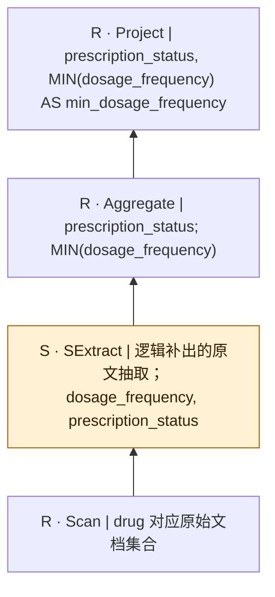

SQL本身只有结构化算子；SExtract是从原文到关系的分析性补充，不是源SQL的显式调用，也不表明每个字段必须由LLM抽取。字段类型、NULL及一对多抽取契约须在执行前固定。

## bench-u/Med/Agg/agg_queries_drug/2

来源：[原件](</Volumes/Element/Github2/semantic-workload-bench/data/semantic-query-discovery-20260908/bench-u/checkout/Query/Med/Agg/agg_queries_drug.sql>) · `sql_plus_proposed_extraction` · `logical_only` · `substantive_relational`

```sql

SELECT prescription_status, COUNT(generic_name) AS count_generic_name FROM drug GROUP BY prescription_status;

```

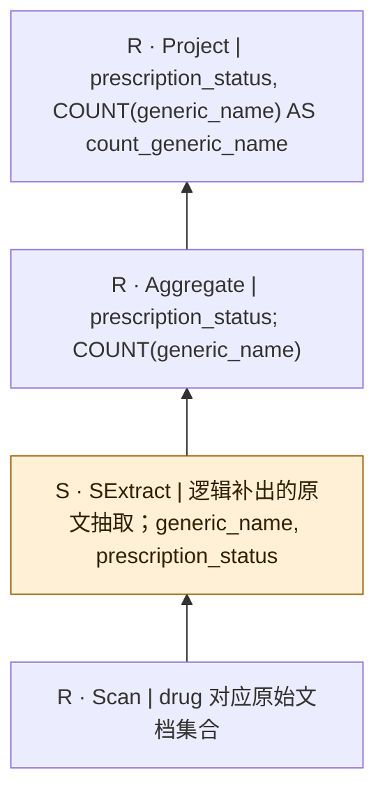

SQL本身只有结构化算子；SExtract是从原文到关系的分析性补充，不是源SQL的显式调用，也不表明每个字段必须由LLM抽取。字段类型、NULL及一对多抽取契约须在执行前固定。

## bench-u/Med/Agg/agg_queries_drug/3

来源：[原件](</Volumes/Element/Github2/semantic-workload-bench/data/semantic-query-discovery-20260908/bench-u/checkout/Query/Med/Agg/agg_queries_drug.sql>) · `sql_plus_proposed_extraction` · `logical_only` · `substantive_relational`

```sql

SELECT prescription_status, AVG(recommended_usage) AS avg_recommended_usage FROM drug GROUP BY prescription_status;

```

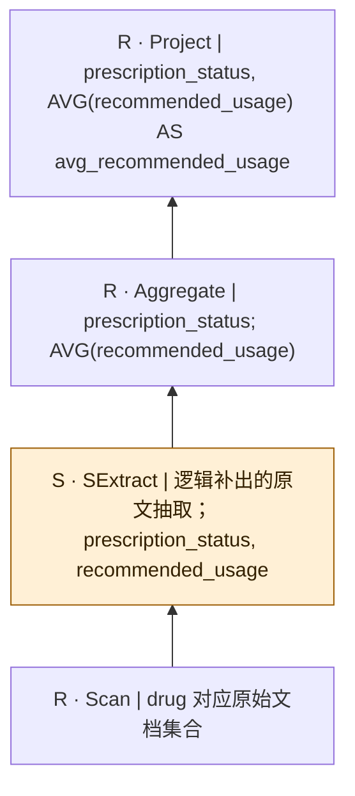

SQL本身只有结构化算子；SExtract是从原文到关系的分析性补充，不是源SQL的显式调用，也不表明每个字段必须由LLM抽取。字段类型、NULL及一对多抽取契约须在执行前固定。

## bench-u/Med/Agg/agg_queries_drug/4

来源：[原件](</Volumes/Element/Github2/semantic-workload-bench/data/semantic-query-discovery-20260908/bench-u/checkout/Query/Med/Agg/agg_queries_drug.sql>) · `sql_plus_proposed_extraction` · `logical_only` · `substantive_relational`

```sql

SELECT prescription_status, MAX(recommended_usage) AS max_recommended_usage FROM drug GROUP BY prescription_status;

```

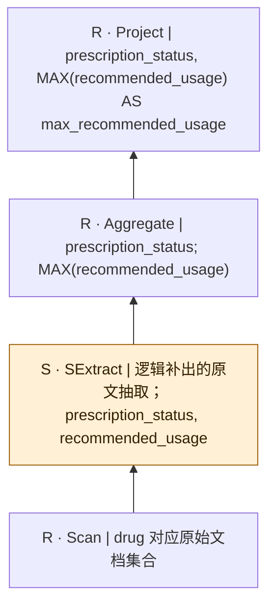

SQL本身只有结构化算子；SExtract是从原文到关系的分析性补充，不是源SQL的显式调用，也不表明每个字段必须由LLM抽取。字段类型、NULL及一对多抽取契约须在执行前固定。

## bench-u/Med/Agg/agg_queries_drug/5

来源：[原件](</Volumes/Element/Github2/semantic-workload-bench/data/semantic-query-discovery-20260908/bench-u/checkout/Query/Med/Agg/agg_queries_drug.sql>) · `sql_plus_proposed_extraction` · `logical_only` · `substantive_relational`

```sql

SELECT prescription_status, COUNT(storage_conditions) AS count_storage_conditions FROM drug GROUP BY prescription_status;

```

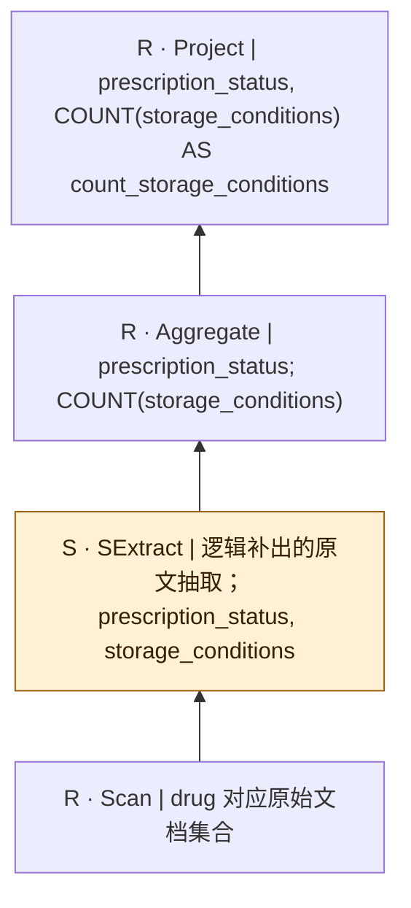

SQL本身只有结构化算子；SExtract是从原文到关系的分析性补充，不是源SQL的显式调用，也不表明每个字段必须由LLM抽取。字段类型、NULL及一对多抽取契约须在执行前固定。

## bench-u/Med/Agg/agg_queries_drug/6

来源：[原件](</Volumes/Element/Github2/semantic-workload-bench/data/semantic-query-discovery-20260908/bench-u/checkout/Query/Med/Agg/agg_queries_drug.sql>) · `sql_plus_proposed_extraction` · `logical_only` · `substantive_relational`

```sql

SELECT prescription_status, MIN(recommended_usage) AS min_recommended_usage FROM drug GROUP BY prescription_status;

```

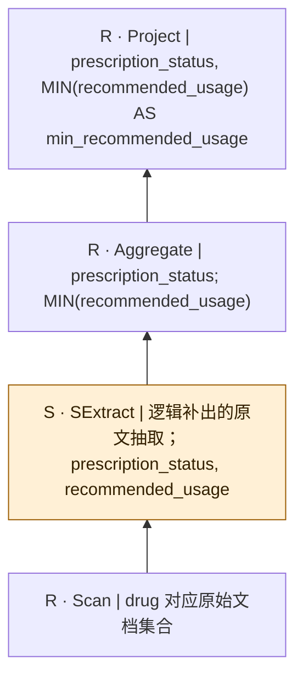

SQL本身只有结构化算子；SExtract是从原文到关系的分析性补充，不是源SQL的显式调用，也不表明每个字段必须由LLM抽取。字段类型、NULL及一对多抽取契约须在执行前固定。

## bench-u/Med/Agg/agg_queries_drug/7

来源：[原件](</Volumes/Element/Github2/semantic-workload-bench/data/semantic-query-discovery-20260908/bench-u/checkout/Query/Med/Agg/agg_queries_drug.sql>) · `sql_plus_proposed_extraction` · `logical_only` · `substantive_relational`

```sql

SELECT prescription_status, MAX(recommended_usage) AS max_recommended_usage FROM drug GROUP BY prescription_status;

```


SQL本身只有结构化算子；SExtract是从原文到关系的分析性补充，不是源SQL的显式调用，也不表明每个字段必须由LLM抽取。字段类型、NULL及一对多抽取契约须在执行前固定。

## bench-u/Med/Agg/agg_queries_drug/8

来源：[原件](</Volumes/Element/Github2/semantic-workload-bench/data/semantic-query-discovery-20260908/bench-u/checkout/Query/Med/Agg/agg_queries_drug.sql>) · `sql_plus_proposed_extraction` · `logical_only` · `substantive_relational`

```sql

SELECT prescription_status, SUM(recommended_usage) AS sum_recommended_usage FROM drug GROUP BY prescription_status;

```


SQL本身只有结构化算子；SExtract是从原文到关系的分析性补充，不是源SQL的显式调用，也不表明每个字段必须由LLM抽取。字段类型、NULL及一对多抽取契约须在执行前固定。

## bench-u/Med/Agg/agg_queries_institution/1

来源：[原件](</Volumes/Element/Github2/semantic-workload-bench/data/semantic-query-discovery-20260908/bench-u/checkout/Query/Med/Agg/agg_queries_institution.sql>) · `sql_plus_proposed_extraction` · `logical_only` · `substantive_relational`

```sql

SELECT research_fields, MIN(institution_country) AS min_institution_country FROM institution GROUP BY research_fields;

```

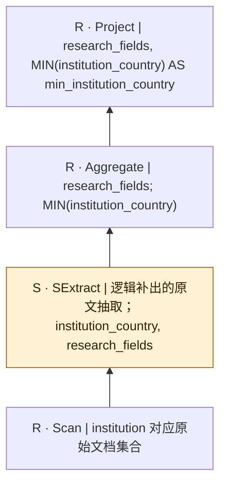

SQL本身只有结构化算子；SExtract是从原文到关系的分析性补充，不是源SQL的显式调用，也不表明每个字段必须由LLM抽取。字段类型、NULL及一对多抽取契约须在执行前固定。

## bench-u/Med/Agg/agg_queries_institution/2

来源：[原件](</Volumes/Element/Github2/semantic-workload-bench/data/semantic-query-discovery-20260908/bench-u/checkout/Query/Med/Agg/agg_queries_institution.sql>) · `sql_plus_proposed_extraction` · `logical_only` · `substantive_relational`

```sql

SELECT institution_type, COUNT(institution_name) AS count_institution_name FROM institution GROUP BY institution_type;

```

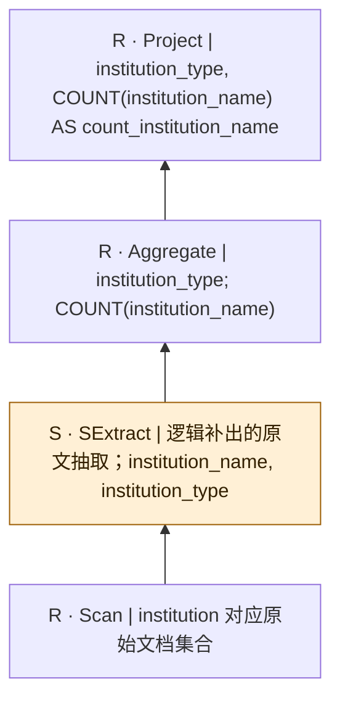

SQL本身只有结构化算子；SExtract是从原文到关系的分析性补充，不是源SQL的显式调用，也不表明每个字段必须由LLM抽取。字段类型、NULL及一对多抽取契约须在执行前固定。

## bench-u/Med/Filter/filter_queries_disease/1

来源：[原件](</Volumes/Element/Github2/semantic-workload-bench/data/semantic-query-discovery-20260908/bench-u/checkout/Query/Med/Filter/filter_queries_disease.sql>) · `sql_plus_proposed_extraction` · `logical_only` · `substantive_relational`

```sql

SELECT epidemiology, risk_factors, etiology FROM disease WHERE risk_factors != 'infection';

```

```mermaid
flowchart BT
  n0["R · Project | epidemiology, risk_factors, etiology"]
  n1["R · Filter | risk_factors &lt;&gt; &#x27;infection&#x27;"]
  n2["S · SExtract | 逻辑补出的原文抽取；epidemiology, etiology, risk_factors"]
  n3["R · Scan | disease 对应原始文档集合"]
  n3 --> n2
  n2 --> n1
  n1 --> n0
  classDef semantic fill:#fff0d6,stroke:#9a5b00,color:#332000;
  class n2 semantic;
```

SQL本身只有结构化算子；SExtract是从原文到关系的分析性补充，不是源SQL的显式调用，也不表明每个字段必须由LLM抽取。字段类型、NULL及一对多抽取契约须在执行前固定。

## bench-u/Med/Filter/filter_queries_disease/2

来源：[原件](</Volumes/Element/Github2/semantic-workload-bench/data/semantic-query-discovery-20260908/bench-u/checkout/Query/Med/Filter/filter_queries_disease.sql>) · `sql_plus_proposed_extraction` · `logical_only` · `substantive_relational`

```sql

SELECT sequelae, diagnostic_methods, affected_organs FROM disease WHERE affected_organs = 'ligaments';

```

```mermaid
flowchart BT
  n0["R · Project | sequelae, diagnostic_methods, affected_organs"]
  n1["R · Filter | affected_organs = &#x27;ligaments&#x27;"]
  n2["S · SExtract | 逻辑补出的原文抽取；affected_organs, diagnostic_methods, sequelae"]
  n3["R · Scan | disease 对应原始文档集合"]
  n3 --> n2
  n2 --> n1
  n1 --> n0
  classDef semantic fill:#fff0d6,stroke:#9a5b00,color:#332000;
  class n2 semantic;
```

SQL本身只有结构化算子；SExtract是从原文到关系的分析性补充，不是源SQL的显式调用，也不表明每个字段必须由LLM抽取。字段类型、NULL及一对多抽取契约须在执行前固定。

## bench-u/Med/Filter/filter_queries_disease/3

来源：[原件](</Volumes/Element/Github2/semantic-workload-bench/data/semantic-query-discovery-20260908/bench-u/checkout/Query/Med/Filter/filter_queries_disease.sql>) · `sql_plus_proposed_extraction` · `logical_only` · `substantive_relational`

```sql

SELECT treatment_challenges, disease_type, risk_factors FROM disease WHERE disease_type != 'others';

```

```mermaid
flowchart BT
  n0["R · Project | treatment_challenges, disease_type, risk_factors"]
  n1["R · Filter | disease_type &lt;&gt; &#x27;others&#x27;"]
  n2["S · SExtract | 逻辑补出的原文抽取；disease_type, risk_factors, treatment_challenges"]
  n3["R · Scan | disease 对应原始文档集合"]
  n3 --> n2
  n2 --> n1
  n1 --> n0
  classDef semantic fill:#fff0d6,stroke:#9a5b00,color:#332000;
  class n2 semantic;
```

SQL本身只有结构化算子；SExtract是从原文到关系的分析性补充，不是源SQL的显式调用，也不表明每个字段必须由LLM抽取。字段类型、NULL及一对多抽取契约须在执行前固定。

## bench-u/Med/Filter/filter_queries_disease/4

来源：[原件](</Volumes/Element/Github2/semantic-workload-bench/data/semantic-query-discovery-20260908/bench-u/checkout/Query/Med/Filter/filter_queries_disease.sql>) · `sql_plus_proposed_extraction` · `logical_only` · `substantive_relational`

```sql

SELECT affected_organs, pathogenesis, treatments FROM disease WHERE treatments = 'stem cell transplantation';

```

```mermaid
flowchart BT
  n0["R · Project | affected_organs, pathogenesis, treatments"]
  n1["R · Filter | treatments = &#x27;stem cell transplantation&#x27;"]
  n2["S · SExtract | 逻辑补出的原文抽取；affected_organs, pathogenesis, treatments"]
  n3["R · Scan | disease 对应原始文档集合"]
  n3 --> n2
  n2 --> n1
  n1 --> n0
  classDef semantic fill:#fff0d6,stroke:#9a5b00,color:#332000;
  class n2 semantic;
```

SQL本身只有结构化算子；SExtract是从原文到关系的分析性补充，不是源SQL的显式调用，也不表明每个字段必须由LLM抽取。字段类型、NULL及一对多抽取契约须在执行前固定。

## bench-u/Med/Filter/filter_queries_disease/5

来源：[原件](</Volumes/Element/Github2/semantic-workload-bench/data/semantic-query-discovery-20260908/bench-u/checkout/Query/Med/Filter/filter_queries_disease.sql>) · `sql_plus_proposed_extraction` · `logical_only` · `substantive_relational`

```sql

SELECT diagnosis_challenges, preventive_measures, disease_type FROM disease WHERE preventive_measures != 'exercise' AND common_symptoms != 'nausea';

```

```mermaid
flowchart BT
  n0["R · Project | diagnosis_challenges, preventive_measures, disease_type"]
  n1["R · Filter | preventive_measures &lt;&gt; &#x27;exercise&#x27; AND common_symptoms &lt;&gt; &#x27;nausea&#x27;"]
  n2["S · SExtract | 逻辑补出的原文抽取；common_symptoms, diagnosis_challenges, disease_type, preventive_measures"]
  n3["R · Scan | disease 对应原始文档集合"]
  n3 --> n2
  n2 --> n1
  n1 --> n0
  classDef semantic fill:#fff0d6,stroke:#9a5b00,color:#332000;
  class n2 semantic;
```

SQL本身只有结构化算子；SExtract是从原文到关系的分析性补充，不是源SQL的显式调用，也不表明每个字段必须由LLM抽取。字段类型、NULL及一对多抽取契约须在执行前固定。

## bench-u/Med/Filter/filter_queries_disease/6

来源：[原件](</Volumes/Element/Github2/semantic-workload-bench/data/semantic-query-discovery-20260908/bench-u/checkout/Query/Med/Filter/filter_queries_disease.sql>) · `sql_plus_proposed_extraction` · `logical_only` · `substantive_relational`

```sql

SELECT diagnostic_methods, prognosis, affected_organs FROM disease WHERE prognosis = 'high_mortality' AND drugs = 'phenytoin';

```

```mermaid
flowchart BT
  n0["R · Project | diagnostic_methods, prognosis, affected_organs"]
  n1["R · Filter | prognosis = &#x27;high_mortality&#x27; AND drugs = &#x27;phenytoin&#x27;"]
  n2["S · SExtract | 逻辑补出的原文抽取；affected_organs, diagnostic_methods, drugs, prognosis"]
  n3["R · Scan | disease 对应原始文档集合"]
  n3 --> n2
  n2 --> n1
  n1 --> n0
  classDef semantic fill:#fff0d6,stroke:#9a5b00,color:#332000;
  class n2 semantic;
```

SQL本身只有结构化算子；SExtract是从原文到关系的分析性补充，不是源SQL的显式调用，也不表明每个字段必须由LLM抽取。字段类型、NULL及一对多抽取契约须在执行前固定。

## bench-u/Med/Filter/filter_queries_disease/7

来源：[原件](</Volumes/Element/Github2/semantic-workload-bench/data/semantic-query-discovery-20260908/bench-u/checkout/Query/Med/Filter/filter_queries_disease.sql>) · `sql_plus_proposed_extraction` · `logical_only` · `substantive_relational`

```sql

SELECT risk_factors, prognosis, treatments FROM disease WHERE risk_factors != 'chronic pain' AND prognosis != 'asymptomatic';

```

```mermaid
flowchart BT
  n0["R · Project | risk_factors, prognosis, treatments"]
  n1["R · Filter | risk_factors &lt;&gt; &#x27;chronic pain&#x27; AND prognosis &lt;&gt; &#x27;asymptomatic&#x27;"]
  n2["S · SExtract | 逻辑补出的原文抽取；prognosis, risk_factors, treatments"]
  n3["R · Scan | disease 对应原始文档集合"]
  n3 --> n2
  n2 --> n1
  n1 --> n0
  classDef semantic fill:#fff0d6,stroke:#9a5b00,color:#332000;
  class n2 semantic;
```

SQL本身只有结构化算子；SExtract是从原文到关系的分析性补充，不是源SQL的显式调用，也不表明每个字段必须由LLM抽取。字段类型、NULL及一对多抽取契约须在执行前固定。

## bench-u/Med/Filter/filter_queries_disease/8

来源：[原件](</Volumes/Element/Github2/semantic-workload-bench/data/semantic-query-discovery-20260908/bench-u/checkout/Query/Med/Filter/filter_queries_disease.sql>) · `sql_plus_proposed_extraction` · `logical_only` · `substantive_relational`

```sql

SELECT treatments, affected_organs, etiology FROM disease WHERE affected_organs != 'cervix' AND epidemiology = 'occurs most often among Caucasian women';

```

```mermaid
flowchart BT
  n0["R · Project | treatments, affected_organs, etiology"]
  n1["R · Filter | affected_organs &lt;&gt; &#x27;cervix&#x27; AND epidemiology = &#x27;occurs most often among Caucasian women&#x27;"]
  n2["S · SExtract | 逻辑补出的原文抽取；affected_organs, epidemiology, etiology, treatments"]
  n3["R · Scan | disease 对应原始文档集合"]
  n3 --> n2
  n2 --> n1
  n1 --> n0
  classDef semantic fill:#fff0d6,stroke:#9a5b00,color:#332000;
  class n2 semantic;
```

SQL本身只有结构化算子；SExtract是从原文到关系的分析性补充，不是源SQL的显式调用，也不表明每个字段必须由LLM抽取。字段类型、NULL及一对多抽取契约须在执行前固定。

## bench-u/Med/Filter/filter_queries_disease/9

来源：[原件](</Volumes/Element/Github2/semantic-workload-bench/data/semantic-query-discovery-20260908/bench-u/checkout/Query/Med/Filter/filter_queries_disease.sql>) · `sql_plus_proposed_extraction` · `logical_only` · `substantive_relational`

```sql

SELECT diagnostic_methods, pathogenesis, drugs FROM disease WHERE diagnostic_methods != 'screening' OR drugs != 'acyclovir';

```

```mermaid
flowchart BT
  n0["R · Project | diagnostic_methods, pathogenesis, drugs"]
  n1["R · Filter | diagnostic_methods &lt;&gt; &#x27;screening&#x27; OR drugs &lt;&gt; &#x27;acyclovir&#x27;"]
  n2["S · SExtract | 逻辑补出的原文抽取；diagnostic_methods, drugs, pathogenesis"]
  n3["R · Scan | disease 对应原始文档集合"]
  n3 --> n2
  n2 --> n1
  n1 --> n0
  classDef semantic fill:#fff0d6,stroke:#9a5b00,color:#332000;
  class n2 semantic;
```

SQL本身只有结构化算子；SExtract是从原文到关系的分析性补充，不是源SQL的显式调用，也不表明每个字段必须由LLM抽取。字段类型、NULL及一对多抽取契约须在执行前固定。

## bench-u/Med/Filter/filter_queries_disease/10

来源：[原件](</Volumes/Element/Github2/semantic-workload-bench/data/semantic-query-discovery-20260908/bench-u/checkout/Query/Med/Filter/filter_queries_disease.sql>) · `sql_plus_proposed_extraction` · `logical_only` · `substantive_relational`

```sql

SELECT diagnosis_challenges, affected_organs, preventive_measures FROM disease WHERE diagnosis_challenges != 'difficult to find early' OR treatment_challenges != 'no clear silver bullet for therapy';

```

```mermaid
flowchart BT
  n0["R · Project | diagnosis_challenges, affected_organs, preventive_measures"]
  n1["R · Filter | diagnosis_challenges &lt;&gt; &#x27;difficult to find early&#x27; OR treatment_challenges &lt;&gt; &#x27;no clear silver bullet for therapy&#x27;"]
  n2["S · SExtract | 逻辑补出的原文抽取；affected_organs, diagnosis_challenges, preventive_measures, treatment_challenges"]
  n3["R · Scan | disease 对应原始文档集合"]
  n3 --> n2
  n2 --> n1
  n1 --> n0
  classDef semantic fill:#fff0d6,stroke:#9a5b00,color:#332000;
  class n2 semantic;
```

SQL本身只有结构化算子；SExtract是从原文到关系的分析性补充，不是源SQL的显式调用，也不表明每个字段必须由LLM抽取。字段类型、NULL及一对多抽取契约须在执行前固定。

## bench-u/Med/Filter/filter_queries_disease/11

来源：[原件](</Volumes/Element/Github2/semantic-workload-bench/data/semantic-query-discovery-20260908/bench-u/checkout/Query/Med/Filter/filter_queries_disease.sql>) · `sql_plus_proposed_extraction` · `logical_only` · `substantive_relational`

```sql

SELECT diagnostic_methods, common_symptoms, quality_of_life_impact FROM disease WHERE quality_of_life_impact = 'mobility_impairment' OR etiology != 'pneumonia';

```

```mermaid
flowchart BT
  n0["R · Project | diagnostic_methods, common_symptoms, quality_of_life_impact"]
  n1["R · Filter | quality_of_life_impact = &#x27;mobility_impairment&#x27; OR etiology &lt;&gt; &#x27;pneumonia&#x27;"]
  n2["S · SExtract | 逻辑补出的原文抽取；common_symptoms, diagnostic_methods, etiology, quality_of_life_impact"]
  n3["R · Scan | disease 对应原始文档集合"]
  n3 --> n2
  n2 --> n1
  n1 --> n0
  classDef semantic fill:#fff0d6,stroke:#9a5b00,color:#332000;
  class n2 semantic;
```

SQL本身只有结构化算子；SExtract是从原文到关系的分析性补充，不是源SQL的显式调用，也不表明每个字段必须由LLM抽取。字段类型、NULL及一对多抽取契约须在执行前固定。

## bench-u/Med/Filter/filter_queries_disease/12

来源：[原件](</Volumes/Element/Github2/semantic-workload-bench/data/semantic-query-discovery-20260908/bench-u/checkout/Query/Med/Filter/filter_queries_disease.sql>) · `sql_plus_proposed_extraction` · `logical_only` · `substantive_relational`

```sql

SELECT quality_of_life_impact, etiology, pathogenesis FROM disease WHERE pathogenesis = 'congenital' OR sequelae != 'chronic pain';

```

```mermaid
flowchart BT
  n0["R · Project | quality_of_life_impact, etiology, pathogenesis"]
  n1["R · Filter | pathogenesis = &#x27;congenital&#x27; OR sequelae &lt;&gt; &#x27;chronic pain&#x27;"]
  n2["S · SExtract | 逻辑补出的原文抽取；etiology, pathogenesis, quality_of_life_impact, sequelae"]
  n3["R · Scan | disease 对应原始文档集合"]
  n3 --> n2
  n2 --> n1
  n1 --> n0
  classDef semantic fill:#fff0d6,stroke:#9a5b00,color:#332000;
  class n2 semantic;
```

SQL本身只有结构化算子；SExtract是从原文到关系的分析性补充，不是源SQL的显式调用，也不表明每个字段必须由LLM抽取。字段类型、NULL及一对多抽取契约须在执行前固定。

## bench-u/Med/Filter/filter_queries_disease/13

来源：[原件](</Volumes/Element/Github2/semantic-workload-bench/data/semantic-query-discovery-20260908/bench-u/checkout/Query/Med/Filter/filter_queries_disease.sql>) · `sql_plus_proposed_extraction` · `logical_only` · `substantive_relational`

```sql

SELECT quality_of_life_impact, risk_factors, preventive_measures FROM disease WHERE risk_factors != 'sedentary_lifestyle' AND affected_organs != 'bone' AND epidemiology != 'very common sexually transmitted infection' AND sequelae != 'blindness';

```

```mermaid
flowchart BT
  n0["R · Project | quality_of_life_impact, risk_factors, preventive_measures"]
  n1["R · Filter | risk_factors &lt;&gt; &#x27;sedentary_lifestyle&#x27; AND affected_organs &lt;&gt; &#x27;bone&#x27; AND epidemiology &lt;&gt; &#x27;very common sexually transmitted infection&#x27; AND sequelae &lt;&gt; &#x27;blindness&#x27;"]
  n2["S · SExtract | 逻辑补出的原文抽取；affected_organs, epidemiology, preventive_measures, quality_of_life_impact, risk_factors, sequelae"]
  n3["R · Scan | disease 对应原始文档集合"]
  n3 --> n2
  n2 --> n1
  n1 --> n0
  classDef semantic fill:#fff0d6,stroke:#9a5b00,color:#332000;
  class n2 semantic;
```

SQL本身只有结构化算子；SExtract是从原文到关系的分析性补充，不是源SQL的显式调用，也不表明每个字段必须由LLM抽取。字段类型、NULL及一对多抽取契约须在执行前固定。

## bench-u/Med/Filter/filter_queries_disease/14

来源：[原件](</Volumes/Element/Github2/semantic-workload-bench/data/semantic-query-discovery-20260908/bench-u/checkout/Query/Med/Filter/filter_queries_disease.sql>) · `sql_plus_proposed_extraction` · `logical_only` · `substantive_relational`

```sql

SELECT treatment_challenges, common_symptoms, disease_type FROM disease WHERE disease_type = 'iatrogenic' AND common_symptoms != 'tenderness' AND complications != 'chlamydial conjunctivitis' AND treatments != 'immunotherapy';

```

```mermaid
flowchart BT
  n0["R · Project | treatment_challenges, common_symptoms, disease_type"]
  n1["R · Filter | disease_type = &#x27;iatrogenic&#x27; AND common_symptoms &lt;&gt; &#x27;tenderness&#x27; AND complications &lt;&gt; &#x27;chlamydial conjunctivitis&#x27; AND treatments &lt;&gt; &#x27;immunotherapy&#x27;"]
  n2["S · SExtract | 逻辑补出的原文抽取；common_symptoms, complications, disease_type, treatment_challenges, treatments"]
  n3["R · Scan | disease 对应原始文档集合"]
  n3 --> n2
  n2 --> n1
  n1 --> n0
  classDef semantic fill:#fff0d6,stroke:#9a5b00,color:#332000;
  class n2 semantic;
```

SQL本身只有结构化算子；SExtract是从原文到关系的分析性补充，不是源SQL的显式调用，也不表明每个字段必须由LLM抽取。字段类型、NULL及一对多抽取契约须在执行前固定。

## bench-u/Med/Filter/filter_queries_disease/15

来源：[原件](</Volumes/Element/Github2/semantic-workload-bench/data/semantic-query-discovery-20260908/bench-u/checkout/Query/Med/Filter/filter_queries_disease.sql>) · `sql_plus_proposed_extraction` · `logical_only` · `substantive_relational`

```sql

SELECT affected_organs, complications, diagnostic_methods FROM disease WHERE affected_organs = 'abdomen' AND complications != 'panic disorders' AND quality_of_life_impact != 'social_isolation' AND diagnostic_methods != 'clinical_evaluation';

```

```mermaid
flowchart BT
  n0["R · Project | affected_organs, complications, diagnostic_methods"]
  n1["R · Filter | affected_organs = &#x27;abdomen&#x27; AND complications &lt;&gt; &#x27;panic disorders&#x27; AND quality_of_life_impact &lt;&gt; &#x27;social_isolation&#x27; AND diagnostic_methods &lt;&gt; &#x27;clinical_evaluation&#x27;"]
  n2["S · SExtract | 逻辑补出的原文抽取；affected_organs, complications, diagnostic_methods, quality_of_life_impact"]
  n3["R · Scan | disease 对应原始文档集合"]
  n3 --> n2
  n2 --> n1
  n1 --> n0
  classDef semantic fill:#fff0d6,stroke:#9a5b00,color:#332000;
  class n2 semantic;
```

SQL本身只有结构化算子；SExtract是从原文到关系的分析性补充，不是源SQL的显式调用，也不表明每个字段必须由LLM抽取。字段类型、NULL及一对多抽取契约须在执行前固定。

## bench-u/Med/Filter/filter_queries_disease/16

来源：[原件](</Volumes/Element/Github2/semantic-workload-bench/data/semantic-query-discovery-20260908/bench-u/checkout/Query/Med/Filter/filter_queries_disease.sql>) · `sql_plus_proposed_extraction` · `logical_only` · `substantive_relational`

```sql

SELECT epidemiology, sequelae, etiology FROM disease WHERE epidemiology != '3,500 to 4,000 children worldwide; up to 80% mortality' AND disease_type != 'autoimmune' AND epidemiology = 'reported in almost every state' AND disease_name != 'Chlamydia';

```

```mermaid
flowchart BT
  n0["R · Project | epidemiology, sequelae, etiology"]
  n1["R · Filter | epidemiology &lt;&gt; &#x27;3,500 to 4,000 children worldwide; up to 80% mortality&#x27; AND disease_type &lt;&gt; &#x27;autoimmune&#x27; AND epidemiology = &#x27;reported in almost every state&#x27; AND disease_name &lt;&gt; &#x27;Chlamydia&#x27;"]
  n2["S · SExtract | 逻辑补出的原文抽取；disease_name, disease_type, epidemiology, etiology, sequelae"]
  n3["R · Scan | disease 对应原始文档集合"]
  n3 --> n2
  n2 --> n1
  n1 --> n0
  classDef semantic fill:#fff0d6,stroke:#9a5b00,color:#332000;
  class n2 semantic;
```

SQL本身只有结构化算子；SExtract是从原文到关系的分析性补充，不是源SQL的显式调用，也不表明每个字段必须由LLM抽取。字段类型、NULL及一对多抽取契约须在执行前固定。

## bench-u/Med/Filter/filter_queries_disease/17

来源：[原件](</Volumes/Element/Github2/semantic-workload-bench/data/semantic-query-discovery-20260908/bench-u/checkout/Query/Med/Filter/filter_queries_disease.sql>) · `sql_plus_proposed_extraction` · `logical_only` · `substantive_relational`

```sql

SELECT epidemiology, affected_organs, sequelae FROM disease WHERE affected_organs != 'toes' OR etiology = 'genetic predisposition' OR treatment_challenges != 'limited options' OR pathogenesis != 'infectious_fungal';

```

```mermaid
flowchart BT
  n0["R · Project | epidemiology, affected_organs, sequelae"]
  n1["R · Filter | affected_organs &lt;&gt; &#x27;toes&#x27; OR etiology = &#x27;genetic predisposition&#x27; OR treatment_challenges &lt;&gt; &#x27;limited options&#x27; OR pathogenesis &lt;&gt; &#x27;infectious_fungal&#x27;"]
  n2["S · SExtract | 逻辑补出的原文抽取；affected_organs, epidemiology, etiology, pathogenesis, sequelae, treatment_challenges"]
  n3["R · Scan | disease 对应原始文档集合"]
  n3 --> n2
  n2 --> n1
  n1 --> n0
  classDef semantic fill:#fff0d6,stroke:#9a5b00,color:#332000;
  class n2 semantic;
```

SQL本身只有结构化算子；SExtract是从原文到关系的分析性补充，不是源SQL的显式调用，也不表明每个字段必须由LLM抽取。字段类型、NULL及一对多抽取契约须在执行前固定。

## bench-u/Med/Filter/filter_queries_disease/18

来源：[原件](</Volumes/Element/Github2/semantic-workload-bench/data/semantic-query-discovery-20260908/bench-u/checkout/Query/Med/Filter/filter_queries_disease.sql>) · `sql_plus_proposed_extraction` · `logical_only` · `substantive_relational`

```sql

SELECT treatment_challenges, disease_type, complications FROM disease WHERE complications = 'cervicitis' OR diagnostic_methods != 'laboratory_test' OR disease_name = 'Opioid Addiction' OR complications = 'heart related complications';

```

```mermaid
flowchart BT
  n0["R · Project | treatment_challenges, disease_type, complications"]
  n1["R · Filter | complications = &#x27;cervicitis&#x27; OR diagnostic_methods &lt;&gt; &#x27;laboratory_test&#x27; OR disease_name = &#x27;Opioid Addiction&#x27; OR complications = &#x27;heart related complications&#x27;"]
  n2["S · SExtract | 逻辑补出的原文抽取；complications, diagnostic_methods, disease_name, disease_type, treatment_challenges"]
  n3["R · Scan | disease 对应原始文档集合"]
  n3 --> n2
  n2 --> n1
  n1 --> n0
  classDef semantic fill:#fff0d6,stroke:#9a5b00,color:#332000;
  class n2 semantic;
```

SQL本身只有结构化算子；SExtract是从原文到关系的分析性补充，不是源SQL的显式调用，也不表明每个字段必须由LLM抽取。字段类型、NULL及一对多抽取契约须在执行前固定。

## bench-u/Med/Filter/filter_queries_disease/19

来源：[原件](</Volumes/Element/Github2/semantic-workload-bench/data/semantic-query-discovery-20260908/bench-u/checkout/Query/Med/Filter/filter_queries_disease.sql>) · `sql_plus_proposed_extraction` · `logical_only` · `substantive_relational`

```sql

SELECT disease_type, drugs, treatment_challenges FROM disease WHERE disease_type != 'allergic' OR diagnostic_methods = 'endoscopy' OR drugs != 'antidepressants' OR preventive_measures = 'vaccination';

```

```mermaid
flowchart BT
  n0["R · Project | disease_type, drugs, treatment_challenges"]
  n1["R · Filter | disease_type &lt;&gt; &#x27;allergic&#x27; OR diagnostic_methods = &#x27;endoscopy&#x27; OR drugs &lt;&gt; &#x27;antidepressants&#x27; OR preventive_measures = &#x27;vaccination&#x27;"]
  n2["S · SExtract | 逻辑补出的原文抽取；diagnostic_methods, disease_type, drugs, preventive_measures, treatment_challenges"]
  n3["R · Scan | disease 对应原始文档集合"]
  n3 --> n2
  n2 --> n1
  n1 --> n0
  classDef semantic fill:#fff0d6,stroke:#9a5b00,color:#332000;
  class n2 semantic;
```

SQL本身只有结构化算子；SExtract是从原文到关系的分析性补充，不是源SQL的显式调用，也不表明每个字段必须由LLM抽取。字段类型、NULL及一对多抽取契约须在执行前固定。

## bench-u/Med/Filter/filter_queries_disease/20

来源：[原件](</Volumes/Element/Github2/semantic-workload-bench/data/semantic-query-discovery-20260908/bench-u/checkout/Query/Med/Filter/filter_queries_disease.sql>) · `sql_plus_proposed_extraction` · `logical_only` · `substantive_relational`

```sql

SELECT diagnosis_challenges, complications, diagnostic_methods FROM disease WHERE complications != 'large_blood_vessel_damage' OR disease_name != 'Pleural Effusion' OR treatment_challenges = 'financial_burden' OR quality_of_life_impact = 'dietary_restriction';

```

```mermaid
flowchart BT
  n0["R · Project | diagnosis_challenges, complications, diagnostic_methods"]
  n1["R · Filter | complications &lt;&gt; &#x27;large_blood_vessel_damage&#x27; OR disease_name &lt;&gt; &#x27;Pleural Effusion&#x27; OR treatment_challenges = &#x27;financial_burden&#x27; OR quality_of_life_impact = &#x27;dietary_restriction&#x27;"]
  n2["S · SExtract | 逻辑补出的原文抽取；complications, diagnosis_challenges, diagnostic_methods, disease_name, quality_of_life_impact, treatment_challenges"]
  n3["R · Scan | disease 对应原始文档集合"]
  n3 --> n2
  n2 --> n1
  n1 --> n0
  classDef semantic fill:#fff0d6,stroke:#9a5b00,color:#332000;
  class n2 semantic;
```

SQL本身只有结构化算子；SExtract是从原文到关系的分析性补充，不是源SQL的显式调用，也不表明每个字段必须由LLM抽取。字段类型、NULL及一对多抽取契约须在执行前固定。

## bench-u/Med/Filter/filter_queries_disease/21

来源：[原件](</Volumes/Element/Github2/semantic-workload-bench/data/semantic-query-discovery-20260908/bench-u/checkout/Query/Med/Filter/filter_queries_disease.sql>) · `sql_plus_proposed_extraction` · `logical_only` · `substantive_relational`

```sql

SELECT treatments, common_symptoms, quality_of_life_impact FROM disease WHERE (common_symptoms = 'constipation' AND prognosis = 'variable') OR (epidemiology != '741 DR-TB cases in Ethiopia in 2018' AND risk_factors != 'immunosuppression');

```

```mermaid
flowchart BT
  n0["R · Project | treatments, common_symptoms, quality_of_life_impact"]
  n1["R · Filter | (common_symptoms = &#x27;constipation&#x27; AND prognosis = &#x27;variable&#x27;) OR (epidemiology &lt;&gt; &#x27;741 DR-TB cases in Ethiopia in 2018&#x27; AND risk_factors &lt;&gt; &#x27;immunosuppression&#x27;)"]
  n2["S · SExtract | 逻辑补出的原文抽取；common_symptoms, epidemiology, prognosis, quality_of_life_impact, risk_factors, treatments"]
  n3["R · Scan | disease 对应原始文档集合"]
  n3 --> n2
  n2 --> n1
  n1 --> n0
  classDef semantic fill:#fff0d6,stroke:#9a5b00,color:#332000;
  class n2 semantic;
```

SQL本身只有结构化算子；SExtract是从原文到关系的分析性补充，不是源SQL的显式调用，也不表明每个字段必须由LLM抽取。字段类型、NULL及一对多抽取契约须在执行前固定。

## bench-u/Med/Filter/filter_queries_disease/22

来源：[原件](</Volumes/Element/Github2/semantic-workload-bench/data/semantic-query-discovery-20260908/bench-u/checkout/Query/Med/Filter/filter_queries_disease.sql>) · `sql_plus_proposed_extraction` · `logical_only` · `substantive_relational`

```sql

SELECT disease_name, preventive_measures, common_symptoms FROM disease WHERE (common_symptoms != 'decreased appetite' AND complications != 'cardiovascular_disorders') OR (disease_type = 'infectious' AND disease_type = 'genetic');

```

```mermaid
flowchart BT
  n0["R · Project | disease_name, preventive_measures, common_symptoms"]
  n1["R · Filter | (common_symptoms &lt;&gt; &#x27;decreased appetite&#x27; AND complications &lt;&gt; &#x27;cardiovascular_disorders&#x27;) OR (disease_type = &#x27;infectious&#x27; AND disease_type = &#x27;genetic&#x27;)"]
  n2["S · SExtract | 逻辑补出的原文抽取；common_symptoms, complications, disease_name, disease_type, preventive_measures"]
  n3["R · Scan | disease 对应原始文档集合"]
  n3 --> n2
  n2 --> n1
  n1 --> n0
  classDef semantic fill:#fff0d6,stroke:#9a5b00,color:#332000;
  class n2 semantic;
```

SQL本身只有结构化算子；SExtract是从原文到关系的分析性补充，不是源SQL的显式调用，也不表明每个字段必须由LLM抽取。字段类型、NULL及一对多抽取契约须在执行前固定。

## bench-u/Med/Filter/filter_queries_disease/23

来源：[原件](</Volumes/Element/Github2/semantic-workload-bench/data/semantic-query-discovery-20260908/bench-u/checkout/Query/Med/Filter/filter_queries_disease.sql>) · `sql_plus_proposed_extraction` · `logical_only` · `substantive_relational`

```sql

SELECT affected_organs, quality_of_life_impact, sequelae FROM disease WHERE (affected_organs = 'nervous system' AND risk_factors != 'hyperlipidemia') OR (etiology = 'insulin resistance' AND diagnostic_methods != 'screening');

```

```mermaid
flowchart BT
  n0["R · Project | affected_organs, quality_of_life_impact, sequelae"]
  n1["R · Filter | (affected_organs = &#x27;nervous system&#x27; AND risk_factors &lt;&gt; &#x27;hyperlipidemia&#x27;) OR (etiology = &#x27;insulin resistance&#x27; AND diagnostic_methods &lt;&gt; &#x27;screening&#x27;)"]
  n2["S · SExtract | 逻辑补出的原文抽取；affected_organs, diagnostic_methods, etiology, quality_of_life_impact, risk_factors, sequelae"]
  n3["R · Scan | disease 对应原始文档集合"]
  n3 --> n2
  n2 --> n1
  n1 --> n0
  classDef semantic fill:#fff0d6,stroke:#9a5b00,color:#332000;
  class n2 semantic;
```

SQL本身只有结构化算子；SExtract是从原文到关系的分析性补充，不是源SQL的显式调用，也不表明每个字段必须由LLM抽取。字段类型、NULL及一对多抽取契约须在执行前固定。

## bench-u/Med/Filter/filter_queries_disease/24

来源：[原件](</Volumes/Element/Github2/semantic-workload-bench/data/semantic-query-discovery-20260908/bench-u/checkout/Query/Med/Filter/filter_queries_disease.sql>) · `sql_plus_proposed_extraction` · `logical_only` · `substantive_relational`

```sql

SELECT diagnostic_methods, disease_type, diagnosis_challenges FROM disease WHERE (diagnosis_challenges = 'difficult to define onset after opioid initiation' AND prognosis = 'stable') OR (risk_factors != 'genetic_predisposition' AND diagnostic_methods = 'genetic_testing');

```

```mermaid
flowchart BT
  n0["R · Project | diagnostic_methods, disease_type, diagnosis_challenges"]
  n1["R · Filter | (diagnosis_challenges = &#x27;difficult to define onset after opioid initiation&#x27; AND prognosis = &#x27;stable&#x27;) OR (risk_factors &lt;&gt; &#x27;genetic_predisposition&#x27; AND diagnostic_methods = &#x27;genetic_testing&#x27;)"]
  n2["S · SExtract | 逻辑补出的原文抽取；diagnosis_challenges, diagnostic_methods, disease_type, prognosis, risk_factors"]
  n3["R · Scan | disease 对应原始文档集合"]
  n3 --> n2
  n2 --> n1
  n1 --> n0
  classDef semantic fill:#fff0d6,stroke:#9a5b00,color:#332000;
  class n2 semantic;
```

SQL本身只有结构化算子；SExtract是从原文到关系的分析性补充，不是源SQL的显式调用，也不表明每个字段必须由LLM抽取。字段类型、NULL及一对多抽取契约须在执行前固定。

## bench-u/Med/Filter/filter_queries_drug/1

来源：[原件](</Volumes/Element/Github2/semantic-workload-bench/data/semantic-query-discovery-20260908/bench-u/checkout/Query/Med/Filter/filter_queries_drug.sql>) · `sql_plus_proposed_extraction` · `logical_only` · `substantive_relational`

```sql

SELECT manufacturer, activation_conditions, indication FROM drug WHERE activation_conditions = 'requires stimulation';

```

```mermaid
flowchart BT
  n0["R · Project | manufacturer, activation_conditions, indication"]
  n1["R · Filter | activation_conditions = &#x27;requires stimulation&#x27;"]
  n2["S · SExtract | 逻辑补出的原文抽取；activation_conditions, indication, manufacturer"]
  n3["R · Scan | drug 对应原始文档集合"]
  n3 --> n2
  n2 --> n1
  n1 --> n0
  classDef semantic fill:#fff0d6,stroke:#9a5b00,color:#332000;
  class n2 semantic;
```

SQL本身只有结构化算子；SExtract是从原文到关系的分析性补充，不是源SQL的显式调用，也不表明每个字段必须由LLM抽取。字段类型、NULL及一对多抽取契约须在执行前固定。

## bench-u/Med/Filter/filter_queries_drug/2

来源：[原件](</Volumes/Element/Github2/semantic-workload-bench/data/semantic-query-discovery-20260908/bench-u/checkout/Query/Med/Filter/filter_queries_drug.sql>) · `sql_plus_proposed_extraction` · `logical_only` · `substantive_relational`

```sql

SELECT pharmaceutical_form, active_ingredients, administration_route FROM drug WHERE administration_route = 'injection';

```

```mermaid
flowchart BT
  n0["R · Project | pharmaceutical_form, active_ingredients, administration_route"]
  n1["R · Filter | administration_route = &#x27;injection&#x27;"]
  n2["S · SExtract | 逻辑补出的原文抽取；active_ingredients, administration_route, pharmaceutical_form"]
  n3["R · Scan | drug 对应原始文档集合"]
  n3 --> n2
  n2 --> n1
  n1 --> n0
  classDef semantic fill:#fff0d6,stroke:#9a5b00,color:#332000;
  class n2 semantic;
```

SQL本身只有结构化算子；SExtract是从原文到关系的分析性补充，不是源SQL的显式调用，也不表明每个字段必须由LLM抽取。字段类型、NULL及一对多抽取契约须在执行前固定。

## bench-u/Med/Filter/filter_queries_drug/3

来源：[原件](</Volumes/Element/Github2/semantic-workload-bench/data/semantic-query-discovery-20260908/bench-u/checkout/Query/Med/Filter/filter_queries_drug.sql>) · `sql_plus_proposed_extraction` · `logical_only` · `substantive_relational`

```sql

SELECT manufacturer, brand_name, activation_conditions FROM drug WHERE brand_name != 'Actipraz 40 Mg Tablet';

```

```mermaid
flowchart BT
  n0["R · Project | manufacturer, brand_name, activation_conditions"]
  n1["R · Filter | brand_name &lt;&gt; &#x27;Actipraz 40 Mg Tablet&#x27;"]
  n2["S · SExtract | 逻辑补出的原文抽取；activation_conditions, brand_name, manufacturer"]
  n3["R · Scan | drug 对应原始文档集合"]
  n3 --> n2
  n2 --> n1
  n1 --> n0
  classDef semantic fill:#fff0d6,stroke:#9a5b00,color:#332000;
  class n2 semantic;
```

SQL本身只有结构化算子；SExtract是从原文到关系的分析性补充，不是源SQL的显式调用，也不表明每个字段必须由LLM抽取。字段类型、NULL及一对多抽取契约须在执行前固定。

## bench-u/Med/Filter/filter_queries_drug/4

来源：[原件](</Volumes/Element/Github2/semantic-workload-bench/data/semantic-query-discovery-20260908/bench-u/checkout/Query/Med/Filter/filter_queries_drug.sql>) · `sql_plus_proposed_extraction` · `logical_only` · `substantive_relational`

```sql

SELECT indication, disease_name, recommended_usage FROM drug WHERE recommended_usage = 'take as prescribed';

```

```mermaid
flowchart BT
  n0["R · Project | indication, disease_name, recommended_usage"]
  n1["R · Filter | recommended_usage = &#x27;take as prescribed&#x27;"]
  n2["S · SExtract | 逻辑补出的原文抽取；disease_name, indication, recommended_usage"]
  n3["R · Scan | drug 对应原始文档集合"]
  n3 --> n2
  n2 --> n1
  n1 --> n0
  classDef semantic fill:#fff0d6,stroke:#9a5b00,color:#332000;
  class n2 semantic;
```

SQL本身只有结构化算子；SExtract是从原文到关系的分析性补充，不是源SQL的显式调用，也不表明每个字段必须由LLM抽取。字段类型、NULL及一对多抽取契约须在执行前固定。

## bench-u/Med/Filter/filter_queries_drug/5

来源：[原件](</Volumes/Element/Github2/semantic-workload-bench/data/semantic-query-discovery-20260908/bench-u/checkout/Query/Med/Filter/filter_queries_drug.sql>) · `sql_plus_proposed_extraction` · `logical_only` · `substantive_relational`

```sql

SELECT prescription_status, side_effects, brand_name FROM drug WHERE prescription_status < 'unclassified' AND pharmaceutical_form != 'capsule';

```

```mermaid
flowchart BT
  n0["R · Project | prescription_status, side_effects, brand_name"]
  n1["R · Filter | prescription_status &lt; &#x27;unclassified&#x27; AND pharmaceutical_form &lt;&gt; &#x27;capsule&#x27;"]
  n2["S · SExtract | 逻辑补出的原文抽取；brand_name, pharmaceutical_form, prescription_status, side_effects"]
  n3["R · Scan | drug 对应原始文档集合"]
  n3 --> n2
  n2 --> n1
  n1 --> n0
  classDef semantic fill:#fff0d6,stroke:#9a5b00,color:#332000;
  class n2 semantic;
```

SQL本身只有结构化算子；SExtract是从原文到关系的分析性补充，不是源SQL的显式调用，也不表明每个字段必须由LLM抽取。字段类型、NULL及一对多抽取契约须在执行前固定。

## bench-u/Med/Filter/filter_queries_drug/6

来源：[原件](</Volumes/Element/Github2/semantic-workload-bench/data/semantic-query-discovery-20260908/bench-u/checkout/Query/Med/Filter/filter_queries_drug.sql>) · `sql_plus_proposed_extraction` · `logical_only` · `substantive_relational`

```sql

SELECT recommended_usage, administration_route, dosage_frequency FROM drug WHERE dosage_frequency > 'every 4 to 6 hours as needed' AND active_ingredients != 'azithromycin';

```

```mermaid
flowchart BT
  n0["R · Project | recommended_usage, administration_route, dosage_frequency"]
  n1["R · Filter | dosage_frequency &gt; &#x27;every 4 to 6 hours as needed&#x27; AND active_ingredients &lt;&gt; &#x27;azithromycin&#x27;"]
  n2["S · SExtract | 逻辑补出的原文抽取；active_ingredients, administration_route, dosage_frequency, recommended_usage"]
  n3["R · Scan | drug 对应原始文档集合"]
  n3 --> n2
  n2 --> n1
  n1 --> n0
  classDef semantic fill:#fff0d6,stroke:#9a5b00,color:#332000;
  class n2 semantic;
```

SQL本身只有结构化算子；SExtract是从原文到关系的分析性补充，不是源SQL的显式调用，也不表明每个字段必须由LLM抽取。字段类型、NULL及一对多抽取契约须在执行前固定。

## bench-u/Med/Filter/filter_queries_drug/7

来源：[原件](</Volumes/Element/Github2/semantic-workload-bench/data/semantic-query-discovery-20260908/bench-u/checkout/Query/Med/Filter/filter_queries_drug.sql>) · `sql_plus_proposed_extraction` · `logical_only` · `substantive_relational`

```sql

SELECT activation_conditions, single_dose, recommended_usage FROM drug WHERE activation_conditions != 'take with food' AND dosage_frequency <= 'every 8 hours';

```

```mermaid
flowchart BT
  n0["R · Project | activation_conditions, single_dose, recommended_usage"]
  n1["R · Filter | activation_conditions &lt;&gt; &#x27;take with food&#x27; AND dosage_frequency &lt;= &#x27;every 8 hours&#x27;"]
  n2["S · SExtract | 逻辑补出的原文抽取；activation_conditions, dosage_frequency, recommended_usage, single_dose"]
  n3["R · Scan | drug 对应原始文档集合"]
  n3 --> n2
  n2 --> n1
  n1 --> n0
  classDef semantic fill:#fff0d6,stroke:#9a5b00,color:#332000;
  class n2 semantic;
```

SQL本身只有结构化算子；SExtract是从原文到关系的分析性补充，不是源SQL的显式调用，也不表明每个字段必须由LLM抽取。字段类型、NULL及一对多抽取契约须在执行前固定。

## bench-u/Med/Filter/filter_queries_drug/8

来源：[原件](</Volumes/Element/Github2/semantic-workload-bench/data/semantic-query-discovery-20260908/bench-u/checkout/Query/Med/Filter/filter_queries_drug.sql>) · `sql_plus_proposed_extraction` · `logical_only` · `substantive_relational`

```sql

SELECT administration_route, indication, recommended_usage FROM drug WHERE administration_route != 'injection' AND storage_conditions < 'protect from light';

```

```mermaid
flowchart BT
  n0["R · Project | administration_route, indication, recommended_usage"]
  n1["R · Filter | administration_route &lt;&gt; &#x27;injection&#x27; AND storage_conditions &lt; &#x27;protect from light&#x27;"]
  n2["S · SExtract | 逻辑补出的原文抽取；administration_route, indication, recommended_usage, storage_conditions"]
  n3["R · Scan | drug 对应原始文档集合"]
  n3 --> n2
  n2 --> n1
  n1 --> n0
  classDef semantic fill:#fff0d6,stroke:#9a5b00,color:#332000;
  class n2 semantic;
```

SQL本身只有结构化算子；SExtract是从原文到关系的分析性补充，不是源SQL的显式调用，也不表明每个字段必须由LLM抽取。字段类型、NULL及一对多抽取契约须在执行前固定。

## bench-u/Med/Filter/filter_queries_drug/9

来源：[原件](</Volumes/Element/Github2/semantic-workload-bench/data/semantic-query-discovery-20260908/bench-u/checkout/Query/Med/Filter/filter_queries_drug.sql>) · `sql_plus_proposed_extraction` · `logical_only` · `substantive_relational`

```sql

SELECT active_ingredients, brand_name, single_dose FROM drug WHERE active_ingredients != 'Antihistamines' OR single_dose != 'children 2-5 years 36 mcg';

```

```mermaid
flowchart BT
  n0["R · Project | active_ingredients, brand_name, single_dose"]
  n1["R · Filter | active_ingredients &lt;&gt; &#x27;Antihistamines&#x27; OR single_dose &lt;&gt; &#x27;children 2-5 years 36 mcg&#x27;"]
  n2["S · SExtract | 逻辑补出的原文抽取；active_ingredients, brand_name, single_dose"]
  n3["R · Scan | drug 对应原始文档集合"]
  n3 --> n2
  n2 --> n1
  n1 --> n0
  classDef semantic fill:#fff0d6,stroke:#9a5b00,color:#332000;
  class n2 semantic;
```

SQL本身只有结构化算子；SExtract是从原文到关系的分析性补充，不是源SQL的显式调用，也不表明每个字段必须由LLM抽取。字段类型、NULL及一对多抽取契约须在执行前固定。

## bench-u/Med/Filter/filter_queries_drug/10

来源：[原件](</Volumes/Element/Github2/semantic-workload-bench/data/semantic-query-discovery-20260908/bench-u/checkout/Query/Med/Filter/filter_queries_drug.sql>) · `sql_plus_proposed_extraction` · `logical_only` · `substantive_relational`

```sql

SELECT unsuitable_population, administration_route, storage_conditions FROM drug WHERE unsuitable_population != 'patients with cyst on the ovary' OR storage_conditions > 'avoid freezing';

```

```mermaid
flowchart BT
  n0["R · Project | unsuitable_population, administration_route, storage_conditions"]
  n1["R · Filter | unsuitable_population &lt;&gt; &#x27;patients with cyst on the ovary&#x27; OR storage_conditions &gt; &#x27;avoid freezing&#x27;"]
  n2["S · SExtract | 逻辑补出的原文抽取；administration_route, storage_conditions, unsuitable_population"]
  n3["R · Scan | drug 对应原始文档集合"]
  n3 --> n2
  n2 --> n1
  n1 --> n0
  classDef semantic fill:#fff0d6,stroke:#9a5b00,color:#332000;
  class n2 semantic;
```

SQL本身只有结构化算子；SExtract是从原文到关系的分析性补充，不是源SQL的显式调用，也不表明每个字段必须由LLM抽取。字段类型、NULL及一对多抽取契约须在执行前固定。

## bench-u/Med/Filter/filter_queries_drug/11

来源：[原件](</Volumes/Element/Github2/semantic-workload-bench/data/semantic-query-discovery-20260908/bench-u/checkout/Query/Med/Filter/filter_queries_drug.sql>) · `sql_plus_proposed_extraction` · `logical_only` · `substantive_relational`

```sql

SELECT brand_name, pharmaceutical_form, active_ingredients FROM drug WHERE active_ingredients = 'mepolizumab' OR activation_conditions != 'before meals';

```

```mermaid
flowchart BT
  n0["R · Project | brand_name, pharmaceutical_form, active_ingredients"]
  n1["R · Filter | active_ingredients = &#x27;mepolizumab&#x27; OR activation_conditions &lt;&gt; &#x27;before meals&#x27;"]
  n2["S · SExtract | 逻辑补出的原文抽取；activation_conditions, active_ingredients, brand_name, pharmaceutical_form"]
  n3["R · Scan | drug 对应原始文档集合"]
  n3 --> n2
  n2 --> n1
  n1 --> n0
  classDef semantic fill:#fff0d6,stroke:#9a5b00,color:#332000;
  class n2 semantic;
```

SQL本身只有结构化算子；SExtract是从原文到关系的分析性补充，不是源SQL的显式调用，也不表明每个字段必须由LLM抽取。字段类型、NULL及一对多抽取契约须在执行前固定。

## bench-u/Med/Filter/filter_queries_drug/12

来源：[原件](</Volumes/Element/Github2/semantic-workload-bench/data/semantic-query-discovery-20260908/bench-u/checkout/Query/Med/Filter/filter_queries_drug.sql>) · `sql_plus_proposed_extraction` · `logical_only` · `substantive_relational`

```sql

SELECT indication, prescription_status, disease_name FROM drug WHERE disease_name = 'Parkinson''s disease' OR mechanism_of_action != 'improving metabolic profile';

```

```mermaid
flowchart BT
  n0["R · Project | indication, prescription_status, disease_name"]
  n1["R · Filter | disease_name = &#x27;Parkinson&#x27;&#x27;s disease&#x27; OR mechanism_of_action &lt;&gt; &#x27;improving metabolic profile&#x27;"]
  n2["S · SExtract | 逻辑补出的原文抽取；disease_name, indication, mechanism_of_action, prescription_status"]
  n3["R · Scan | drug 对应原始文档集合"]
  n3 --> n2
  n2 --> n1
  n1 --> n0
  classDef semantic fill:#fff0d6,stroke:#9a5b00,color:#332000;
  class n2 semantic;
```

SQL本身只有结构化算子；SExtract是从原文到关系的分析性补充，不是源SQL的显式调用，也不表明每个字段必须由LLM抽取。字段类型、NULL及一对多抽取契约须在执行前固定。

## bench-u/Med/Filter/filter_queries_drug/13

来源：[原件](</Volumes/Element/Github2/semantic-workload-bench/data/semantic-query-discovery-20260908/bench-u/checkout/Query/Med/Filter/filter_queries_drug.sql>) · `sql_plus_proposed_extraction` · `logical_only` · `substantive_relational`

```sql

SELECT prescription_status, activation_conditions, storage_conditions FROM drug WHERE activation_conditions = 'before meals' AND storage_conditions < 'protect from moisture' AND side_effects != 'headache' AND mechanism_of_action != 'induces loss of consciousness';

```

```mermaid
flowchart BT
  n0["R · Project | prescription_status, activation_conditions, storage_conditions"]
  n1["R · Filter | activation_conditions = &#x27;before meals&#x27; AND storage_conditions &lt; &#x27;protect from moisture&#x27; AND side_effects &lt;&gt; &#x27;headache&#x27; AND mechanism_of_action &lt;&gt; &#x27;induces loss of consciousness&#x27;"]
  n2["S · SExtract | 逻辑补出的原文抽取；activation_conditions, mechanism_of_action, prescription_status, side_effects, storage_conditions"]
  n3["R · Scan | drug 对应原始文档集合"]
  n3 --> n2
  n2 --> n1
  n1 --> n0
  classDef semantic fill:#fff0d6,stroke:#9a5b00,color:#332000;
  class n2 semantic;
```

SQL本身只有结构化算子；SExtract是从原文到关系的分析性补充，不是源SQL的显式调用，也不表明每个字段必须由LLM抽取。字段类型、NULL及一对多抽取契约须在执行前固定。

## bench-u/Med/Filter/filter_queries_drug/14

来源：[原件](</Volumes/Element/Github2/semantic-workload-bench/data/semantic-query-discovery-20260908/bench-u/checkout/Query/Med/Filter/filter_queries_drug.sql>) · `sql_plus_proposed_extraction` · `logical_only` · `substantive_relational`

```sql

SELECT disease_name, pharmaceutical_form, brand_name FROM drug WHERE brand_name = 'Omlek-D' AND pharmaceutical_form = 'gel' AND disease_name != 'Herpes simplex' AND indication != 'infections';

```

```mermaid
flowchart BT
  n0["R · Project | disease_name, pharmaceutical_form, brand_name"]
  n1["R · Filter | brand_name = &#x27;Omlek-D&#x27; AND pharmaceutical_form = &#x27;gel&#x27; AND disease_name &lt;&gt; &#x27;Herpes simplex&#x27; AND indication &lt;&gt; &#x27;infections&#x27;"]
  n2["S · SExtract | 逻辑补出的原文抽取；brand_name, disease_name, indication, pharmaceutical_form"]
  n3["R · Scan | drug 对应原始文档集合"]
  n3 --> n2
  n2 --> n1
  n1 --> n0
  classDef semantic fill:#fff0d6,stroke:#9a5b00,color:#332000;
  class n2 semantic;
```

SQL本身只有结构化算子；SExtract是从原文到关系的分析性补充，不是源SQL的显式调用，也不表明每个字段必须由LLM抽取。字段类型、NULL及一对多抽取契约须在执行前固定。

## bench-u/Med/Filter/filter_queries_drug/15

来源：[原件](</Volumes/Element/Github2/semantic-workload-bench/data/semantic-query-discovery-20260908/bench-u/checkout/Query/Med/Filter/filter_queries_drug.sql>) · `sql_plus_proposed_extraction` · `logical_only` · `substantive_relational`

```sql

SELECT mechanism_of_action, active_ingredients, administration_route FROM drug WHERE administration_route = 'injection' AND manufacturer != 'Astra Zeneca' AND mechanism_of_action != 'enhancing glucose metabolism' AND administration_route != 'oral';

```

```mermaid
flowchart BT
  n0["R · Project | mechanism_of_action, active_ingredients, administration_route"]
  n1["R · Filter | administration_route = &#x27;injection&#x27; AND manufacturer &lt;&gt; &#x27;Astra Zeneca&#x27; AND mechanism_of_action &lt;&gt; &#x27;enhancing glucose metabolism&#x27; AND administration_route &lt;&gt; &#x27;oral&#x27;"]
  n2["S · SExtract | 逻辑补出的原文抽取；active_ingredients, administration_route, manufacturer, mechanism_of_action"]
  n3["R · Scan | drug 对应原始文档集合"]
  n3 --> n2
  n2 --> n1
  n1 --> n0
  classDef semantic fill:#fff0d6,stroke:#9a5b00,color:#332000;
  class n2 semantic;
```

SQL本身只有结构化算子；SExtract是从原文到关系的分析性补充，不是源SQL的显式调用，也不表明每个字段必须由LLM抽取。字段类型、NULL及一对多抽取契约须在执行前固定。

## bench-u/Med/Filter/filter_queries_drug/16

来源：[原件](</Volumes/Element/Github2/semantic-workload-bench/data/semantic-query-discovery-20260908/bench-u/checkout/Query/Med/Filter/filter_queries_drug.sql>) · `sql_plus_proposed_extraction` · `logical_only` · `substantive_relational`

```sql

SELECT single_dose, mechanism_of_action, side_effects FROM drug WHERE side_effects = 'fever' AND storage_conditions = 'store below 25C or 77F' AND mechanism_of_action != 'broken down into 6-thioguanine nucleotides to exert immunosuppressive effects' AND active_ingredients = 'Omeprazole';

```

```mermaid
flowchart BT
  n0["R · Project | single_dose, mechanism_of_action, side_effects"]
  n1["R · Filter | side_effects = &#x27;fever&#x27; AND storage_conditions = &#x27;store below 25C or 77F&#x27; AND mechanism_of_action &lt;&gt; &#x27;broken down into 6-thioguanine nucleotides to exert immunosuppressive effects&#x27; AND active_ingredients = &#x27;Omeprazole&#x27;"]
  n2["S · SExtract | 逻辑补出的原文抽取；active_ingredients, mechanism_of_action, side_effects, single_dose, storage_conditions"]
  n3["R · Scan | drug 对应原始文档集合"]
  n3 --> n2
  n2 --> n1
  n1 --> n0
  classDef semantic fill:#fff0d6,stroke:#9a5b00,color:#332000;
  class n2 semantic;
```

SQL本身只有结构化算子；SExtract是从原文到关系的分析性补充，不是源SQL的显式调用，也不表明每个字段必须由LLM抽取。字段类型、NULL及一对多抽取契约须在执行前固定。

## bench-u/Med/Filter/filter_queries_drug/17

来源：[原件](</Volumes/Element/Github2/semantic-workload-bench/data/semantic-query-discovery-20260908/bench-u/checkout/Query/Med/Filter/filter_queries_drug.sql>) · `sql_plus_proposed_extraction` · `logical_only` · `substantive_relational`

```sql

SELECT administration_route, side_effects, mechanism_of_action FROM drug WHERE administration_route != 'injection' OR indication = 'heartburn' OR storage_conditions > 'store in a tight, light-resistant container' OR recommended_usage = 'other';

```

```mermaid
flowchart BT
  n0["R · Project | administration_route, side_effects, mechanism_of_action"]
  n1["R · Filter | administration_route &lt;&gt; &#x27;injection&#x27; OR indication = &#x27;heartburn&#x27; OR storage_conditions &gt; &#x27;store in a tight, light-resistant container&#x27; OR recommended_usage = &#x27;other&#x27;"]
  n2["S · SExtract | 逻辑补出的原文抽取；administration_route, indication, mechanism_of_action, recommended_usage, side_effects, storage_conditions"]
  n3["R · Scan | drug 对应原始文档集合"]
  n3 --> n2
  n2 --> n1
  n1 --> n0
  classDef semantic fill:#fff0d6,stroke:#9a5b00,color:#332000;
  class n2 semantic;
```

SQL本身只有结构化算子；SExtract是从原文到关系的分析性补充，不是源SQL的显式调用，也不表明每个字段必须由LLM抽取。字段类型、NULL及一对多抽取契约须在执行前固定。

## bench-u/Med/Filter/filter_queries_drug/18

来源：[原件](</Volumes/Element/Github2/semantic-workload-bench/data/semantic-query-discovery-20260908/bench-u/checkout/Query/Med/Filter/filter_queries_drug.sql>) · `sql_plus_proposed_extraction` · `logical_only` · `substantive_relational`

```sql

SELECT brand_name, manufacturer, disease_name FROM drug WHERE manufacturer = 'Astellas' OR active_ingredients != 'Pravastatin sodium salt' OR generic_name = 'Pramipexole dihydrochloride' OR manufacturer = 'Preferred Pharmaceuticals, Inc.';

```

```mermaid
flowchart BT
  n0["R · Project | brand_name, manufacturer, disease_name"]
  n1["R · Filter | manufacturer = &#x27;Astellas&#x27; OR active_ingredients &lt;&gt; &#x27;Pravastatin sodium salt&#x27; OR generic_name = &#x27;Pramipexole dihydrochloride&#x27; OR manufacturer = &#x27;Preferred Pharmaceuticals, Inc.&#x27;"]
  n2["S · SExtract | 逻辑补出的原文抽取；active_ingredients, brand_name, disease_name, generic_name, manufacturer"]
  n3["R · Scan | drug 对应原始文档集合"]
  n3 --> n2
  n2 --> n1
  n1 --> n0
  classDef semantic fill:#fff0d6,stroke:#9a5b00,color:#332000;
  class n2 semantic;
```

SQL本身只有结构化算子；SExtract是从原文到关系的分析性补充，不是源SQL的显式调用，也不表明每个字段必须由LLM抽取。字段类型、NULL及一对多抽取契约须在执行前固定。

## bench-u/Med/Filter/filter_queries_drug/19

来源：[原件](</Volumes/Element/Github2/semantic-workload-bench/data/semantic-query-discovery-20260908/bench-u/checkout/Query/Med/Filter/filter_queries_drug.sql>) · `sql_plus_proposed_extraction` · `logical_only` · `substantive_relational`

```sql

SELECT brand_name, single_dose, active_ingredients FROM drug WHERE brand_name != 'Duaklir Genuair' OR active_ingredients = 'Milnacipran' OR single_dose != 'adults 10-40 mg once a day' OR prescription_status = 'unclassified';

```

```mermaid
flowchart BT
  n0["R · Project | brand_name, single_dose, active_ingredients"]
  n1["R · Filter | brand_name &lt;&gt; &#x27;Duaklir Genuair&#x27; OR active_ingredients = &#x27;Milnacipran&#x27; OR single_dose &lt;&gt; &#x27;adults 10-40 mg once a day&#x27; OR prescription_status = &#x27;unclassified&#x27;"]
  n2["S · SExtract | 逻辑补出的原文抽取；active_ingredients, brand_name, prescription_status, single_dose"]
  n3["R · Scan | drug 对应原始文档集合"]
  n3 --> n2
  n2 --> n1
  n1 --> n0
  classDef semantic fill:#fff0d6,stroke:#9a5b00,color:#332000;
  class n2 semantic;
```

SQL本身只有结构化算子；SExtract是从原文到关系的分析性补充，不是源SQL的显式调用，也不表明每个字段必须由LLM抽取。字段类型、NULL及一对多抽取契约须在执行前固定。

## bench-u/Med/Filter/filter_queries_drug/20

来源：[原件](</Volumes/Element/Github2/semantic-workload-bench/data/semantic-query-discovery-20260908/bench-u/checkout/Query/Med/Filter/filter_queries_drug.sql>) · `sql_plus_proposed_extraction` · `logical_only` · `substantive_relational`

```sql

SELECT administration_route, manufacturer, active_ingredients FROM drug WHERE manufacturer != 'Cipla' OR generic_name != 'Ropinirole' OR storage_conditions >= 'store at room temperature' OR brand_name = 'Omlek-D';

```

```mermaid
flowchart BT
  n0["R · Project | administration_route, manufacturer, active_ingredients"]
  n1["R · Filter | manufacturer &lt;&gt; &#x27;Cipla&#x27; OR generic_name &lt;&gt; &#x27;Ropinirole&#x27; OR storage_conditions &gt;= &#x27;store at room temperature&#x27; OR brand_name = &#x27;Omlek-D&#x27;"]
  n2["S · SExtract | 逻辑补出的原文抽取；active_ingredients, administration_route, brand_name, generic_name, manufacturer, storage_conditions"]
  n3["R · Scan | drug 对应原始文档集合"]
  n3 --> n2
  n2 --> n1
  n1 --> n0
  classDef semantic fill:#fff0d6,stroke:#9a5b00,color:#332000;
  class n2 semantic;
```

SQL本身只有结构化算子；SExtract是从原文到关系的分析性补充，不是源SQL的显式调用，也不表明每个字段必须由LLM抽取。字段类型、NULL及一对多抽取契约须在执行前固定。

## bench-u/Med/Filter/filter_queries_drug/21

来源：[原件](</Volumes/Element/Github2/semantic-workload-bench/data/semantic-query-discovery-20260908/bench-u/checkout/Query/Med/Filter/filter_queries_drug.sql>) · `sql_plus_proposed_extraction` · `logical_only` · `substantive_relational`

```sql

SELECT recommended_usage, pharmaceutical_form, disease_name FROM drug WHERE (pharmaceutical_form = 'spray' AND dosage_frequency = 'twice daily') OR (side_effects != 'weight loss' AND activation_conditions != 'before meals');

```

```mermaid
flowchart BT
  n0["R · Project | recommended_usage, pharmaceutical_form, disease_name"]
  n1["R · Filter | (pharmaceutical_form = &#x27;spray&#x27; AND dosage_frequency = &#x27;twice daily&#x27;) OR (side_effects &lt;&gt; &#x27;weight loss&#x27; AND activation_conditions &lt;&gt; &#x27;before meals&#x27;)"]
  n2["S · SExtract | 逻辑补出的原文抽取；activation_conditions, disease_name, dosage_frequency, pharmaceutical_form, recommended_usage, side_effects"]
  n3["R · Scan | drug 对应原始文档集合"]
  n3 --> n2
  n2 --> n1
  n1 --> n0
  classDef semantic fill:#fff0d6,stroke:#9a5b00,color:#332000;
  class n2 semantic;
```

SQL本身只有结构化算子；SExtract是从原文到关系的分析性补充，不是源SQL的显式调用，也不表明每个字段必须由LLM抽取。字段类型、NULL及一对多抽取契约须在执行前固定。

## bench-u/Med/Filter/filter_queries_drug/22

来源：[原件](</Volumes/Element/Github2/semantic-workload-bench/data/semantic-query-discovery-20260908/bench-u/checkout/Query/Med/Filter/filter_queries_drug.sql>) · `sql_plus_proposed_extraction` · `logical_only` · `substantive_relational`

```sql

SELECT recommended_usage, pharmaceutical_form, generic_name FROM drug WHERE (pharmaceutical_form != 'granule' AND manufacturer != 'Avanir Pharmaceuticals') OR (brand_name = 'PEG-Intron' AND brand_name = 'Nexium');

```

```mermaid
flowchart BT
  n0["R · Project | recommended_usage, pharmaceutical_form, generic_name"]
  n1["R · Filter | (pharmaceutical_form &lt;&gt; &#x27;granule&#x27; AND manufacturer &lt;&gt; &#x27;Avanir Pharmaceuticals&#x27;) OR (brand_name = &#x27;PEG-Intron&#x27; AND brand_name = &#x27;Nexium&#x27;)"]
  n2["S · SExtract | 逻辑补出的原文抽取；brand_name, generic_name, manufacturer, pharmaceutical_form, recommended_usage"]
  n3["R · Scan | drug 对应原始文档集合"]
  n3 --> n2
  n2 --> n1
  n1 --> n0
  classDef semantic fill:#fff0d6,stroke:#9a5b00,color:#332000;
  class n2 semantic;
```

SQL本身只有结构化算子；SExtract是从原文到关系的分析性补充，不是源SQL的显式调用，也不表明每个字段必须由LLM抽取。字段类型、NULL及一对多抽取契约须在执行前固定。

## bench-u/Med/Filter/filter_queries_drug/23

来源：[原件](</Volumes/Element/Github2/semantic-workload-bench/data/semantic-query-discovery-20260908/bench-u/checkout/Query/Med/Filter/filter_queries_drug.sql>) · `sql_plus_proposed_extraction` · `logical_only` · `substantive_relational`

```sql

SELECT unsuitable_population, mechanism_of_action, administration_route FROM drug WHERE (administration_route = 'nasal' AND activation_conditions != 'requires stimulation') OR (indication = 'severe asthma' AND active_ingredients != 'Psilocybin');

```

```mermaid
flowchart BT
  n0["R · Project | unsuitable_population, mechanism_of_action, administration_route"]
  n1["R · Filter | (administration_route = &#x27;nasal&#x27; AND activation_conditions &lt;&gt; &#x27;requires stimulation&#x27;) OR (indication = &#x27;severe asthma&#x27; AND active_ingredients &lt;&gt; &#x27;Psilocybin&#x27;)"]
  n2["S · SExtract | 逻辑补出的原文抽取；activation_conditions, active_ingredients, administration_route, indication, mechanism_of_action, unsuitable_population"]
  n3["R · Scan | drug 对应原始文档集合"]
  n3 --> n2
  n2 --> n1
  n1 --> n0
  classDef semantic fill:#fff0d6,stroke:#9a5b00,color:#332000;
  class n2 semantic;
```

SQL本身只有结构化算子；SExtract是从原文到关系的分析性补充，不是源SQL的显式调用，也不表明每个字段必须由LLM抽取。字段类型、NULL及一对多抽取契约须在执行前固定。

## bench-u/Med/Filter/filter_queries_drug/24

来源：[原件](</Volumes/Element/Github2/semantic-workload-bench/data/semantic-query-discovery-20260908/bench-u/checkout/Query/Med/Filter/filter_queries_drug.sql>) · `sql_plus_proposed_extraction` · `logical_only` · `substantive_relational`

```sql

SELECT disease_name, brand_name, unsuitable_population FROM drug WHERE (unsuitable_population = 'patients with stomach/intestinal problems' AND dosage_frequency = 'every 8 hours') OR (activation_conditions = 'requires stimulation' AND mechanism_of_action != 'produces relaxation to relieve pain');

```

```mermaid
flowchart BT
  n0["R · Project | disease_name, brand_name, unsuitable_population"]
  n1["R · Filter | (unsuitable_population = &#x27;patients with stomach/intestinal problems&#x27; AND dosage_frequency = &#x27;every 8 hours&#x27;) OR (activation_conditions = &#x27;requires stimulation&#x27; AND mechanism_of_action &lt;&gt; &#x27;produces relaxation to relieve pain&#x27;)"]
  n2["S · SExtract | 逻辑补出的原文抽取；activation_conditions, brand_name, disease_name, dosage_frequency, mechanism_of_action, unsuitable_population"]
  n3["R · Scan | drug 对应原始文档集合"]
  n3 --> n2
  n2 --> n1
  n1 --> n0
  classDef semantic fill:#fff0d6,stroke:#9a5b00,color:#332000;
  class n2 semantic;
```

SQL本身只有结构化算子；SExtract是从原文到关系的分析性补充，不是源SQL的显式调用，也不表明每个字段必须由LLM抽取。字段类型、NULL及一对多抽取契约须在执行前固定。

## bench-u/Med/Filter/filter_queries_institution/1

来源：[原件](</Volumes/Element/Github2/semantic-workload-bench/data/semantic-query-discovery-20260908/bench-u/checkout/Query/Med/Filter/filter_queries_institution.sql>) · `sql_plus_proposed_extraction` · `logical_only` · `substantive_relational`

```sql

SELECT key_technologies, institution_country, international_collaboration FROM institution WHERE technology_application != 'FDA drug approval';

```

```mermaid
flowchart BT
  n0["R · Project | key_technologies, institution_country, international_collaboration"]
  n1["R · Filter | technology_application &lt;&gt; &#x27;FDA drug approval&#x27;"]
  n2["S · SExtract | 逻辑补出的原文抽取；institution_country, international_collaboration, key_technologies, technology_application"]
  n3["R · Scan | institution 对应原始文档集合"]
  n3 --> n2
  n2 --> n1
  n1 --> n0
  classDef semantic fill:#fff0d6,stroke:#9a5b00,color:#332000;
  class n2 semantic;
```

SQL本身只有结构化算子；SExtract是从原文到关系的分析性补充，不是源SQL的显式调用，也不表明每个字段必须由LLM抽取。字段类型、NULL及一对多抽取契约须在执行前固定。

## bench-u/Med/Filter/filter_queries_institution/2

来源：[原件](</Volumes/Element/Github2/semantic-workload-bench/data/semantic-query-discovery-20260908/bench-u/checkout/Query/Med/Filter/filter_queries_institution.sql>) · `sql_plus_proposed_extraction` · `logical_only` · `substantive_relational`

```sql

SELECT leadership, parent_organization, establishment_year FROM institution WHERE leadership = 'Tanja Gruber';

```

```mermaid
flowchart BT
  n0["R · Project | leadership, parent_organization, establishment_year"]
  n1["R · Filter | leadership = &#x27;Tanja Gruber&#x27;"]
  n2["S · SExtract | 逻辑补出的原文抽取；establishment_year, leadership, parent_organization"]
  n3["R · Scan | institution 对应原始文档集合"]
  n3 --> n2
  n2 --> n1
  n1 --> n0
  classDef semantic fill:#fff0d6,stroke:#9a5b00,color:#332000;
  class n2 semantic;
```

SQL本身只有结构化算子；SExtract是从原文到关系的分析性补充，不是源SQL的显式调用，也不表明每个字段必须由LLM抽取。字段类型、NULL及一对多抽取契约须在执行前固定。

## bench-u/Med/Filter/filter_queries_institution/3

来源：[原件](</Volumes/Element/Github2/semantic-workload-bench/data/semantic-query-discovery-20260908/bench-u/checkout/Query/Med/Filter/filter_queries_institution.sql>) · `sql_plus_proposed_extraction` · `logical_only` · `substantive_relational`

```sql

SELECT institution_city, international_collaboration, institution_name FROM institution WHERE research_fields != 'molecular_biology' AND funding_sources = 'university grant';

```

```mermaid
flowchart BT
  n0["R · Project | institution_city, international_collaboration, institution_name"]
  n1["R · Filter | research_fields &lt;&gt; &#x27;molecular_biology&#x27; AND funding_sources = &#x27;university grant&#x27;"]
  n2["S · SExtract | 逻辑补出的原文抽取；funding_sources, institution_city, institution_name, international_collaboration, research_fields"]
  n3["R · Scan | institution 对应原始文档集合"]
  n3 --> n2
  n2 --> n1
  n1 --> n0
  classDef semantic fill:#fff0d6,stroke:#9a5b00,color:#332000;
  class n2 semantic;
```

SQL本身只有结构化算子；SExtract是从原文到关系的分析性补充，不是源SQL的显式调用，也不表明每个字段必须由LLM抽取。字段类型、NULL及一对多抽取契约须在执行前固定。

## bench-u/Med/Filter/filter_queries_institution/4

来源：[原件](</Volumes/Element/Github2/semantic-workload-bench/data/semantic-query-discovery-20260908/bench-u/checkout/Query/Med/Filter/filter_queries_institution.sql>) · `sql_plus_proposed_extraction` · `logical_only` · `substantive_relational`

```sql

SELECT leadership, research_fields, international_collaboration FROM institution WHERE technology_application = 'early diagnosis of cardiac TTR amyloidosis using DPD scintigraphy' AND key_technologies = 'navigation for insertion of screws';

```

```mermaid
flowchart BT
  n0["R · Project | leadership, research_fields, international_collaboration"]
  n1["R · Filter | technology_application = &#x27;early diagnosis of cardiac TTR amyloidosis using DPD scintigraphy&#x27; AND key_technologies = &#x27;navigation for insertion of screws&#x27;"]
  n2["S · SExtract | 逻辑补出的原文抽取；international_collaboration, key_technologies, leadership, research_fields, technology_application"]
  n3["R · Scan | institution 对应原始文档集合"]
  n3 --> n2
  n2 --> n1
  n1 --> n0
  classDef semantic fill:#fff0d6,stroke:#9a5b00,color:#332000;
  class n2 semantic;
```

SQL本身只有结构化算子；SExtract是从原文到关系的分析性补充，不是源SQL的显式调用，也不表明每个字段必须由LLM抽取。字段类型、NULL及一对多抽取契约须在执行前固定。

## bench-u/Med/Filter/filter_queries_institution/5

来源：[原件](</Volumes/Element/Github2/semantic-workload-bench/data/semantic-query-discovery-20260908/bench-u/checkout/Query/Med/Filter/filter_queries_institution.sql>) · `sql_plus_proposed_extraction` · `logical_only` · `substantive_relational`

```sql

SELECT number_of_staff, parent_organization, key_technologies FROM institution WHERE international_collaboration = 'NCI cancer centers in the United States' OR institution_country != 'China';

```

```mermaid
flowchart BT
  n0["R · Project | number_of_staff, parent_organization, key_technologies"]
  n1["R · Filter | international_collaboration = &#x27;NCI cancer centers in the United States&#x27; OR institution_country &lt;&gt; &#x27;China&#x27;"]
  n2["S · SExtract | 逻辑补出的原文抽取；institution_country, international_collaboration, key_technologies, number_of_staff, parent_organization"]
  n3["R · Scan | institution 对应原始文档集合"]
  n3 --> n2
  n2 --> n1
  n1 --> n0
  classDef semantic fill:#fff0d6,stroke:#9a5b00,color:#332000;
  class n2 semantic;
```

SQL本身只有结构化算子；SExtract是从原文到关系的分析性补充，不是源SQL的显式调用，也不表明每个字段必须由LLM抽取。字段类型、NULL及一对多抽取契约须在执行前固定。

## bench-u/Med/Filter/filter_queries_institution/6

来源：[原件](</Volumes/Element/Github2/semantic-workload-bench/data/semantic-query-discovery-20260908/bench-u/checkout/Query/Med/Filter/filter_queries_institution.sql>) · `sql_plus_proposed_extraction` · `logical_only` · `substantive_relational`

```sql

SELECT institution_city, establishment_year, technology_application FROM institution WHERE research_fields != 'molecular_biology' OR international_collaboration != 'collaboration with research centres throughout Europe and the UK';

```

```mermaid
flowchart BT
  n0["R · Project | institution_city, establishment_year, technology_application"]
  n1["R · Filter | research_fields &lt;&gt; &#x27;molecular_biology&#x27; OR international_collaboration &lt;&gt; &#x27;collaboration with research centres throughout Europe and the UK&#x27;"]
  n2["S · SExtract | 逻辑补出的原文抽取；establishment_year, institution_city, international_collaboration, research_fields, technology_application"]
  n3["R · Scan | institution 对应原始文档集合"]
  n3 --> n2
  n2 --> n1
  n1 --> n0
  classDef semantic fill:#fff0d6,stroke:#9a5b00,color:#332000;
  class n2 semantic;
```

SQL本身只有结构化算子；SExtract是从原文到关系的分析性补充，不是源SQL的显式调用，也不表明每个字段必须由LLM抽取。字段类型、NULL及一对多抽取契约须在执行前固定。

## bench-u/Med/Filter/filter_queries_institution/7

来源：[原件](</Volumes/Element/Github2/semantic-workload-bench/data/semantic-query-discovery-20260908/bench-u/checkout/Query/Med/Filter/filter_queries_institution.sql>) · `sql_plus_proposed_extraction` · `logical_only` · `substantive_relational`

```sql

SELECT technology_application, institution_country, institution_city FROM institution WHERE research_diseases = 'portal hypertensive gastropathy' AND key_technologies != 'bacteriological culture' AND research_diseases != 'chronic pain' AND institution_city != 'Ferndale';

```

```mermaid
flowchart BT
  n0["R · Project | technology_application, institution_country, institution_city"]
  n1["R · Filter | research_diseases = &#x27;portal hypertensive gastropathy&#x27; AND key_technologies &lt;&gt; &#x27;bacteriological culture&#x27; AND research_diseases &lt;&gt; &#x27;chronic pain&#x27; AND institution_city &lt;&gt; &#x27;Ferndale&#x27;"]
  n2["S · SExtract | 逻辑补出的原文抽取；institution_city, institution_country, key_technologies, research_diseases, technology_application"]
  n3["R · Scan | institution 对应原始文档集合"]
  n3 --> n2
  n2 --> n1
  n1 --> n0
  classDef semantic fill:#fff0d6,stroke:#9a5b00,color:#332000;
  class n2 semantic;
```

SQL本身只有结构化算子；SExtract是从原文到关系的分析性补充，不是源SQL的显式调用，也不表明每个字段必须由LLM抽取。字段类型、NULL及一对多抽取契约须在执行前固定。

## bench-u/Med/Filter/filter_queries_institution/8

来源：[原件](</Volumes/Element/Github2/semantic-workload-bench/data/semantic-query-discovery-20260908/bench-u/checkout/Query/Med/Filter/filter_queries_institution.sql>) · `sql_plus_proposed_extraction` · `logical_only` · `substantive_relational`

```sql

SELECT institution_name, research_fields, research_diseases FROM institution WHERE key_achievements = 'post-graduate education in gastroenterology' AND parent_organization != 'University of Texas' AND leadership != 'K Persson Waller' AND institution_country > 'Vietnam';

```

```mermaid
flowchart BT
  n0["R · Project | institution_name, research_fields, research_diseases"]
  n1["R · Filter | key_achievements = &#x27;post-graduate education in gastroenterology&#x27; AND parent_organization &lt;&gt; &#x27;University of Texas&#x27; AND leadership &lt;&gt; &#x27;K Persson Waller&#x27; AND institution_country &gt; &#x27;Vietnam&#x27;"]
  n2["S · SExtract | 逻辑补出的原文抽取；institution_country, institution_name, key_achievements, leadership, parent_organization, research_diseases, research_fields"]
  n3["R · Scan | institution 对应原始文档集合"]
  n3 --> n2
  n2 --> n1
  n1 --> n0
  classDef semantic fill:#fff0d6,stroke:#9a5b00,color:#332000;
  class n2 semantic;
```

SQL本身只有结构化算子；SExtract是从原文到关系的分析性补充，不是源SQL的显式调用，也不表明每个字段必须由LLM抽取。字段类型、NULL及一对多抽取契约须在执行前固定。

## bench-u/Med/Filter/filter_queries_institution/9

来源：[原件](</Volumes/Element/Github2/semantic-workload-bench/data/semantic-query-discovery-20260908/bench-u/checkout/Query/Med/Filter/filter_queries_institution.sql>) · `sql_plus_proposed_extraction` · `logical_only` · `substantive_relational`

```sql

SELECT establishment_year, international_collaboration, leadership FROM institution WHERE leadership != 'John Niederhuber' OR research_fields != 'surgery' OR institution_name != 'Emory University' OR key_technologies = 'antibacterial photodynamic treatment (aPDT)';

```

```mermaid
flowchart BT
  n0["R · Project | establishment_year, international_collaboration, leadership"]
  n1["R · Filter | leadership &lt;&gt; &#x27;John Niederhuber&#x27; OR research_fields &lt;&gt; &#x27;surgery&#x27; OR institution_name &lt;&gt; &#x27;Emory University&#x27; OR key_technologies = &#x27;antibacterial photodynamic treatment (aPDT)&#x27;"]
  n2["S · SExtract | 逻辑补出的原文抽取；establishment_year, institution_name, international_collaboration, key_technologies, leadership, research_fields"]
  n3["R · Scan | institution 对应原始文档集合"]
  n3 --> n2
  n2 --> n1
  n1 --> n0
  classDef semantic fill:#fff0d6,stroke:#9a5b00,color:#332000;
  class n2 semantic;
```

SQL本身只有结构化算子；SExtract是从原文到关系的分析性补充，不是源SQL的显式调用，也不表明每个字段必须由LLM抽取。字段类型、NULL及一对多抽取契约须在执行前固定。

## bench-u/Med/Filter/filter_queries_institution/10

来源：[原件](</Volumes/Element/Github2/semantic-workload-bench/data/semantic-query-discovery-20260908/bench-u/checkout/Query/Med/Filter/filter_queries_institution.sql>) · `sql_plus_proposed_extraction` · `logical_only` · `substantive_relational`

```sql

SELECT international_collaboration, establishment_year, key_achievements FROM institution WHERE leadership = 'K Persson Waller' OR parent_organization != 'UNSW Sydney' OR institution_name = 'Flushing Hospital Medical Center' OR technology_application != 'individual counseling';

```

```mermaid
flowchart BT
  n0["R · Project | international_collaboration, establishment_year, key_achievements"]
  n1["R · Filter | leadership = &#x27;K Persson Waller&#x27; OR parent_organization &lt;&gt; &#x27;UNSW Sydney&#x27; OR institution_name = &#x27;Flushing Hospital Medical Center&#x27; OR technology_application &lt;&gt; &#x27;individual counseling&#x27;"]
  n2["S · SExtract | 逻辑补出的原文抽取；establishment_year, institution_name, international_collaboration, key_achievements, leadership, parent_organization, technology_application"]
  n3["R · Scan | institution 对应原始文档集合"]
  n3 --> n2
  n2 --> n1
  n1 --> n0
  classDef semantic fill:#fff0d6,stroke:#9a5b00,color:#332000;
  class n2 semantic;
```

SQL本身只有结构化算子；SExtract是从原文到关系的分析性补充，不是源SQL的显式调用，也不表明每个字段必须由LLM抽取。字段类型、NULL及一对多抽取契约须在执行前固定。

## bench-u/Med/Filter/filter_queries_institution/11

来源：[原件](</Volumes/Element/Github2/semantic-workload-bench/data/semantic-query-discovery-20260908/bench-u/checkout/Query/Med/Filter/filter_queries_institution.sql>) · `sql_plus_proposed_extraction` · `logical_only` · `substantive_relational`

```sql

SELECT number_of_staff, parent_organization, technology_application FROM institution WHERE (parent_organization = 'Shanghai Jiao Tong University School of Medicine' AND institution_city = 'London') OR (research_diseases != 'lower limb complications of diabetes' AND technology_application != 'intensive case management');

```

```mermaid
flowchart BT
  n0["R · Project | number_of_staff, parent_organization, technology_application"]
  n1["R · Filter | (parent_organization = &#x27;Shanghai Jiao Tong University School of Medicine&#x27; AND institution_city = &#x27;London&#x27;) OR (research_diseases &lt;&gt; &#x27;lower limb complications of diabetes&#x27; AND technology_application &lt;&gt; &#x27;intensive case management&#x27;)"]
  n2["S · SExtract | 逻辑补出的原文抽取；institution_city, number_of_staff, parent_organization, research_diseases, technology_application"]
  n3["R · Scan | institution 对应原始文档集合"]
  n3 --> n2
  n2 --> n1
  n1 --> n0
  classDef semantic fill:#fff0d6,stroke:#9a5b00,color:#332000;
  class n2 semantic;
```

SQL本身只有结构化算子；SExtract是从原文到关系的分析性补充，不是源SQL的显式调用，也不表明每个字段必须由LLM抽取。字段类型、NULL及一对多抽取契约须在执行前固定。

## bench-u/Med/Filter/filter_queries_institution/12

来源：[原件](</Volumes/Element/Github2/semantic-workload-bench/data/semantic-query-discovery-20260908/bench-u/checkout/Query/Med/Filter/filter_queries_institution.sql>) · `sql_plus_proposed_extraction` · `logical_only` · `substantive_relational`

```sql

SELECT parent_organization, key_achievements, international_collaboration FROM institution WHERE (technology_application = 'inpatient psychiatric treatment' AND key_technologies = 'blood sample collection') OR (funding_sources != 'industry grant' AND key_achievements = 'Largest neuroscience study of mindfulness for addiction');

```

```mermaid
flowchart BT
  n0["R · Project | parent_organization, key_achievements, international_collaboration"]
  n1["R · Filter | (technology_application = &#x27;inpatient psychiatric treatment&#x27; AND key_technologies = &#x27;blood sample collection&#x27;) OR (funding_sources &lt;&gt; &#x27;industry grant&#x27; AND key_achievements = &#x27;Largest neuroscience study of mindfulness for addiction&#x27;)"]
  n2["S · SExtract | 逻辑补出的原文抽取；funding_sources, international_collaboration, key_achievements, key_technologies, parent_organization, technology_application"]
  n3["R · Scan | institution 对应原始文档集合"]
  n3 --> n2
  n2 --> n1
  n1 --> n0
  classDef semantic fill:#fff0d6,stroke:#9a5b00,color:#332000;
  class n2 semantic;
```

SQL本身只有结构化算子；SExtract是从原文到关系的分析性补充，不是源SQL的显式调用，也不表明每个字段必须由LLM抽取。字段类型、NULL及一对多抽取契约须在执行前固定。

## bench-u/Med/Join/join_queries/1

来源：[原件](</Volumes/Element/Github2/semantic-workload-bench/data/semantic-query-discovery-20260908/bench-u/checkout/Query/Med/Join/join_queries.sql>) · `sql_plus_proposed_extraction` · `logical_only` · `substantive_relational`

```sql

SELECT disease.diagnostic_methods, drug.manufacturer, drug.brand_name, disease.disease_name FROM drug JOIN disease ON drug.disease_name = disease.disease_name;

```

```mermaid
flowchart BT
  n0["R · Project | disease.diagnostic_methods, drug.manufacturer, drug.brand_name, disease.disease_name"]
  n1["R · Join |  drug.disease_name = disease.disease_name"]
  n2["S · SExtract | 逻辑补出的原文抽取；brand_name, disease_name, manufacturer"]
  n3["R · Scan | drug 对应原始文档集合"]
  n4["S · SExtract | 逻辑补出的原文抽取；diagnostic_methods, disease_name"]
  n5["R · Scan | disease 对应原始文档集合"]
  n3 --> n2
  n2 --> n1
  n5 --> n4
  n4 --> n1
  n1 --> n0
  classDef semantic fill:#fff0d6,stroke:#9a5b00,color:#332000;
  class n2,n4 semantic;
```

SQL本身只有结构化算子；SExtract是从原文到关系的分析性补充，不是源SQL的显式调用，也不表明每个字段必须由LLM抽取。字段类型、NULL及一对多抽取契约须在执行前固定。

## bench-u/Med/Join/join_queries/2

来源：[原件](</Volumes/Element/Github2/semantic-workload-bench/data/semantic-query-discovery-20260908/bench-u/checkout/Query/Med/Join/join_queries.sql>) · `sql_plus_proposed_extraction` · `logical_only` · `substantive_relational`

```sql

SELECT drug.mechanism_of_action, drug.storage_conditions, disease.diagnosis_challenges, disease.disease_name FROM drug JOIN disease ON drug.disease_name = disease.disease_name;

```

```mermaid
flowchart BT
  n0["R · Project | drug.mechanism_of_action, drug.storage_conditions, disease.diagnosis_challenges, disease.disease_name"]
  n1["R · Join |  drug.disease_name = disease.disease_name"]
  n2["S · SExtract | 逻辑补出的原文抽取；disease_name, mechanism_of_action, storage_conditions"]
  n3["R · Scan | drug 对应原始文档集合"]
  n4["S · SExtract | 逻辑补出的原文抽取；diagnosis_challenges, disease_name"]
  n5["R · Scan | disease 对应原始文档集合"]
  n3 --> n2
  n2 --> n1
  n5 --> n4
  n4 --> n1
  n1 --> n0
  classDef semantic fill:#fff0d6,stroke:#9a5b00,color:#332000;
  class n2,n4 semantic;
```

SQL本身只有结构化算子；SExtract是从原文到关系的分析性补充，不是源SQL的显式调用，也不表明每个字段必须由LLM抽取。字段类型、NULL及一对多抽取契约须在执行前固定。

## bench-u/Med/Join/join_queries/3

来源：[原件](</Volumes/Element/Github2/semantic-workload-bench/data/semantic-query-discovery-20260908/bench-u/checkout/Query/Med/Join/join_queries.sql>) · `sql_plus_proposed_extraction` · `logical_only` · `substantive_relational`

```sql

SELECT drug.single_dose, disease.pathogenesis, drug.recommended_usage, disease.diagnosis_challenges FROM drug JOIN disease ON drug.disease_name = disease.disease_name;

```

```mermaid
flowchart BT
  n0["R · Project | drug.single_dose, disease.pathogenesis, drug.recommended_usage, disease.diagnosis_challenges"]
  n1["R · Join |  drug.disease_name = disease.disease_name"]
  n2["S · SExtract | 逻辑补出的原文抽取；disease_name, recommended_usage, single_dose"]
  n3["R · Scan | drug 对应原始文档集合"]
  n4["S · SExtract | 逻辑补出的原文抽取；diagnosis_challenges, disease_name, pathogenesis"]
  n5["R · Scan | disease 对应原始文档集合"]
  n3 --> n2
  n2 --> n1
  n5 --> n4
  n4 --> n1
  n1 --> n0
  classDef semantic fill:#fff0d6,stroke:#9a5b00,color:#332000;
  class n2,n4 semantic;
```

SQL本身只有结构化算子；SExtract是从原文到关系的分析性补充，不是源SQL的显式调用，也不表明每个字段必须由LLM抽取。字段类型、NULL及一对多抽取契约须在执行前固定。

## bench-u/Med/Join/join_queries/4

来源：[原件](</Volumes/Element/Github2/semantic-workload-bench/data/semantic-query-discovery-20260908/bench-u/checkout/Query/Med/Join/join_queries.sql>) · `sql_plus_proposed_extraction` · `logical_only` · `substantive_relational`

```sql

SELECT disease.treatments, disease.epidemiology, drug.prescription_status, drug.storage_conditions FROM drug JOIN disease ON drug.disease_name = disease.disease_name;

```

```mermaid
flowchart BT
  n0["R · Project | disease.treatments, disease.epidemiology, drug.prescription_status, drug.storage_conditions"]
  n1["R · Join |  drug.disease_name = disease.disease_name"]
  n2["S · SExtract | 逻辑补出的原文抽取；disease_name, prescription_status, storage_conditions"]
  n3["R · Scan | drug 对应原始文档集合"]
  n4["S · SExtract | 逻辑补出的原文抽取；disease_name, epidemiology, treatments"]
  n5["R · Scan | disease 对应原始文档集合"]
  n3 --> n2
  n2 --> n1
  n5 --> n4
  n4 --> n1
  n1 --> n0
  classDef semantic fill:#fff0d6,stroke:#9a5b00,color:#332000;
  class n2,n4 semantic;
```

SQL本身只有结构化算子；SExtract是从原文到关系的分析性补充，不是源SQL的显式调用，也不表明每个字段必须由LLM抽取。字段类型、NULL及一对多抽取契约须在执行前固定。

## bench-u/Med/Join/join_queries/5

来源：[原件](</Volumes/Element/Github2/semantic-workload-bench/data/semantic-query-discovery-20260908/bench-u/checkout/Query/Med/Join/join_queries.sql>) · `sql_plus_proposed_extraction` · `logical_only` · `substantive_relational`

```sql

SELECT disease.diagnostic_methods, disease.preventive_measures, drug.mechanism_of_action, drug.recommended_usage FROM drug JOIN disease ON drug.disease_name = disease.disease_name;

```

```mermaid
flowchart BT
  n0["R · Project | disease.diagnostic_methods, disease.preventive_measures, drug.mechanism_of_action, drug.recommended_usage"]
  n1["R · Join |  drug.disease_name = disease.disease_name"]
  n2["S · SExtract | 逻辑补出的原文抽取；disease_name, mechanism_of_action, recommended_usage"]
  n3["R · Scan | drug 对应原始文档集合"]
  n4["S · SExtract | 逻辑补出的原文抽取；diagnostic_methods, disease_name, preventive_measures"]
  n5["R · Scan | disease 对应原始文档集合"]
  n3 --> n2
  n2 --> n1
  n5 --> n4
  n4 --> n1
  n1 --> n0
  classDef semantic fill:#fff0d6,stroke:#9a5b00,color:#332000;
  class n2,n4 semantic;
```

SQL本身只有结构化算子；SExtract是从原文到关系的分析性补充，不是源SQL的显式调用，也不表明每个字段必须由LLM抽取。字段类型、NULL及一对多抽取契约须在执行前固定。

## bench-u/Med/Join/join_queries/6

来源：[原件](</Volumes/Element/Github2/semantic-workload-bench/data/semantic-query-discovery-20260908/bench-u/checkout/Query/Med/Join/join_queries.sql>) · `sql_plus_proposed_extraction` · `logical_only` · `substantive_relational`

```sql

SELECT drug.manufacturer, disease.complications, drug.pharmaceutical_form, disease.preventive_measures FROM drug JOIN disease ON drug.disease_name = disease.disease_name;

```

```mermaid
flowchart BT
  n0["R · Project | drug.manufacturer, disease.complications, drug.pharmaceutical_form, disease.preventive_measures"]
  n1["R · Join |  drug.disease_name = disease.disease_name"]
  n2["S · SExtract | 逻辑补出的原文抽取；disease_name, manufacturer, pharmaceutical_form"]
  n3["R · Scan | drug 对应原始文档集合"]
  n4["S · SExtract | 逻辑补出的原文抽取；complications, disease_name, preventive_measures"]
  n5["R · Scan | disease 对应原始文档集合"]
  n3 --> n2
  n2 --> n1
  n5 --> n4
  n4 --> n1
  n1 --> n0
  classDef semantic fill:#fff0d6,stroke:#9a5b00,color:#332000;
  class n2,n4 semantic;
```

SQL本身只有结构化算子；SExtract是从原文到关系的分析性补充，不是源SQL的显式调用，也不表明每个字段必须由LLM抽取。字段类型、NULL及一对多抽取契约须在执行前固定。

## bench-u/Med/Join/join_queries/7

来源：[原件](</Volumes/Element/Github2/semantic-workload-bench/data/semantic-query-discovery-20260908/bench-u/checkout/Query/Med/Join/join_queries.sql>) · `sql_plus_proposed_extraction` · `logical_only` · `substantive_relational`

```sql

SELECT drug.brand_name, drug.unsuitable_population, disease.preventive_measures, disease.diagnosis_challenges FROM drug JOIN disease ON drug.disease_name = disease.disease_name;

```

```mermaid
flowchart BT
  n0["R · Project | drug.brand_name, drug.unsuitable_population, disease.preventive_measures, disease.diagnosis_challenges"]
  n1["R · Join |  drug.disease_name = disease.disease_name"]
  n2["S · SExtract | 逻辑补出的原文抽取；brand_name, disease_name, unsuitable_population"]
  n3["R · Scan | drug 对应原始文档集合"]
  n4["S · SExtract | 逻辑补出的原文抽取；diagnosis_challenges, disease_name, preventive_measures"]
  n5["R · Scan | disease 对应原始文档集合"]
  n3 --> n2
  n2 --> n1
  n5 --> n4
  n4 --> n1
  n1 --> n0
  classDef semantic fill:#fff0d6,stroke:#9a5b00,color:#332000;
  class n2,n4 semantic;
```

SQL本身只有结构化算子；SExtract是从原文到关系的分析性补充，不是源SQL的显式调用，也不表明每个字段必须由LLM抽取。字段类型、NULL及一对多抽取契约须在执行前固定。

## bench-u/Med/Join/join_queries/8

来源：[原件](</Volumes/Element/Github2/semantic-workload-bench/data/semantic-query-discovery-20260908/bench-u/checkout/Query/Med/Join/join_queries.sql>) · `sql_plus_proposed_extraction` · `logical_only` · `substantive_relational`

```sql

SELECT drug.administration_route, disease.pathogenesis, disease.etiology, drug.mechanism_of_action FROM drug JOIN disease ON drug.disease_name = disease.disease_name;

```

```mermaid
flowchart BT
  n0["R · Project | drug.administration_route, disease.pathogenesis, disease.etiology, drug.mechanism_of_action"]
  n1["R · Join |  drug.disease_name = disease.disease_name"]
  n2["S · SExtract | 逻辑补出的原文抽取；administration_route, disease_name, mechanism_of_action"]
  n3["R · Scan | drug 对应原始文档集合"]
  n4["S · SExtract | 逻辑补出的原文抽取；disease_name, etiology, pathogenesis"]
  n5["R · Scan | disease 对应原始文档集合"]
  n3 --> n2
  n2 --> n1
  n5 --> n4
  n4 --> n1
  n1 --> n0
  classDef semantic fill:#fff0d6,stroke:#9a5b00,color:#332000;
  class n2,n4 semantic;
```

SQL本身只有结构化算子；SExtract是从原文到关系的分析性补充，不是源SQL的显式调用，也不表明每个字段必须由LLM抽取。字段类型、NULL及一对多抽取契约须在执行前固定。

## bench-u/Med/Join/join_queries/9

来源：[原件](</Volumes/Element/Github2/semantic-workload-bench/data/semantic-query-discovery-20260908/bench-u/checkout/Query/Med/Join/join_queries.sql>) · `sql_plus_proposed_extraction` · `logical_only` · `substantive_relational`

```sql

SELECT disease.epidemiology, disease.sequelae, drug.indication, drug.activation_conditions FROM drug JOIN disease ON drug.disease_name = disease.disease_name;

```

```mermaid
flowchart BT
  n0["R · Project | disease.epidemiology, disease.sequelae, drug.indication, drug.activation_conditions"]
  n1["R · Join |  drug.disease_name = disease.disease_name"]
  n2["S · SExtract | 逻辑补出的原文抽取；activation_conditions, disease_name, indication"]
  n3["R · Scan | drug 对应原始文档集合"]
  n4["S · SExtract | 逻辑补出的原文抽取；disease_name, epidemiology, sequelae"]
  n5["R · Scan | disease 对应原始文档集合"]
  n3 --> n2
  n2 --> n1
  n5 --> n4
  n4 --> n1
  n1 --> n0
  classDef semantic fill:#fff0d6,stroke:#9a5b00,color:#332000;
  class n2,n4 semantic;
```

SQL本身只有结构化算子；SExtract是从原文到关系的分析性补充，不是源SQL的显式调用，也不表明每个字段必须由LLM抽取。字段类型、NULL及一对多抽取契约须在执行前固定。

## bench-u/Med/Join/join_queries/10

来源：[原件](</Volumes/Element/Github2/semantic-workload-bench/data/semantic-query-discovery-20260908/bench-u/checkout/Query/Med/Join/join_queries.sql>) · `sql_plus_proposed_extraction` · `logical_only` · `substantive_relational`

```sql

SELECT disease.treatment_challenges, disease.diagnostic_methods, drug.administration_route, drug.generic_name FROM drug JOIN disease ON drug.disease_name = disease.disease_name;

```

```mermaid
flowchart BT
  n0["R · Project | disease.treatment_challenges, disease.diagnostic_methods, drug.administration_route, drug.generic_name"]
  n1["R · Join |  drug.disease_name = disease.disease_name"]
  n2["S · SExtract | 逻辑补出的原文抽取；administration_route, disease_name, generic_name"]
  n3["R · Scan | drug 对应原始文档集合"]
  n4["S · SExtract | 逻辑补出的原文抽取；diagnostic_methods, disease_name, treatment_challenges"]
  n5["R · Scan | disease 对应原始文档集合"]
  n3 --> n2
  n2 --> n1
  n5 --> n4
  n4 --> n1
  n1 --> n0
  classDef semantic fill:#fff0d6,stroke:#9a5b00,color:#332000;
  class n2,n4 semantic;
```

SQL本身只有结构化算子；SExtract是从原文到关系的分析性补充，不是源SQL的显式调用，也不表明每个字段必须由LLM抽取。字段类型、NULL及一对多抽取契约须在执行前固定。

## bench-u/Med/Join/join_queries/11

来源：[原件](</Volumes/Element/Github2/semantic-workload-bench/data/semantic-query-discovery-20260908/bench-u/checkout/Query/Med/Join/join_queries.sql>) · `sql_plus_proposed_extraction` · `logical_only` · `substantive_relational`

```sql

SELECT disease.treatments, institution.establishment_year, institution.parent_organization, institution.number_of_staff, drug.unsuitable_population FROM drug JOIN disease ON drug.disease_name = disease.disease_name JOIN institution ON disease.disease_name = institution.research_diseases;

```

```mermaid
flowchart BT
  n0["R · Project | disease.treatments, institution.establishment_year, institution.parent_organization, institution.number_of_staff, drug.unsuitable_population"]
  n1["R · Join |  disease.disease_name = institution.research_diseases"]
  n2["R · Join |  drug.disease_name = disease.disease_name"]
  n3["S · SExtract | 逻辑补出的原文抽取；disease_name, unsuitable_population"]
  n4["R · Scan | drug 对应原始文档集合"]
  n5["S · SExtract | 逻辑补出的原文抽取；disease_name, treatments"]
  n6["R · Scan | disease 对应原始文档集合"]
  n7["S · SExtract | 逻辑补出的原文抽取；establishment_year, number_of_staff, parent_organization, research_diseases"]
  n8["R · Scan | institution 对应原始文档集合"]
  n4 --> n3
  n3 --> n2
  n6 --> n5
  n5 --> n2
  n2 --> n1
  n8 --> n7
  n7 --> n1
  n1 --> n0
  classDef semantic fill:#fff0d6,stroke:#9a5b00,color:#332000;
  class n3,n5,n7 semantic;
```

SQL本身只有结构化算子；SExtract是从原文到关系的分析性补充，不是源SQL的显式调用，也不表明每个字段必须由LLM抽取。字段类型、NULL及一对多抽取契约须在执行前固定。

## bench-u/Med/Join/join_queries/12

来源：[原件](</Volumes/Element/Github2/semantic-workload-bench/data/semantic-query-discovery-20260908/bench-u/checkout/Query/Med/Join/join_queries.sql>) · `sql_plus_proposed_extraction` · `logical_only` · `substantive_relational`

```sql

SELECT institution.research_diseases, disease.risk_factors, drug.mechanism_of_action, disease.disease_name, drug.unsuitable_population FROM drug JOIN disease ON drug.disease_name = disease.disease_name JOIN institution ON disease.disease_name = institution.research_diseases;

```

```mermaid
flowchart BT
  n0["R · Project | institution.research_diseases, disease.risk_factors, drug.mechanism_of_action, disease.disease_name, drug.unsuitable_population"]
  n1["R · Join |  disease.disease_name = institution.research_diseases"]
  n2["R · Join |  drug.disease_name = disease.disease_name"]
  n3["S · SExtract | 逻辑补出的原文抽取；disease_name, mechanism_of_action, unsuitable_population"]
  n4["R · Scan | drug 对应原始文档集合"]
  n5["S · SExtract | 逻辑补出的原文抽取；disease_name, risk_factors"]
  n6["R · Scan | disease 对应原始文档集合"]
  n7["S · SExtract | 逻辑补出的原文抽取；research_diseases"]
  n8["R · Scan | institution 对应原始文档集合"]
  n4 --> n3
  n3 --> n2
  n6 --> n5
  n5 --> n2
  n2 --> n1
  n8 --> n7
  n7 --> n1
  n1 --> n0
  classDef semantic fill:#fff0d6,stroke:#9a5b00,color:#332000;
  class n3,n5,n7 semantic;
```

SQL本身只有结构化算子；SExtract是从原文到关系的分析性补充，不是源SQL的显式调用，也不表明每个字段必须由LLM抽取。字段类型、NULL及一对多抽取契约须在执行前固定。

## bench-u/Med/Join/join_queries/13

来源：[原件](</Volumes/Element/Github2/semantic-workload-bench/data/semantic-query-discovery-20260908/bench-u/checkout/Query/Med/Join/join_queries.sql>) · `sql_plus_proposed_extraction` · `logical_only` · `substantive_relational`

```sql

SELECT institution.key_technologies, disease.etiology, drug.indication, disease.prognosis, drug.unsuitable_population FROM drug JOIN disease ON drug.disease_name = disease.disease_name JOIN institution ON disease.disease_name = institution.research_diseases;

```

```mermaid
flowchart BT
  n0["R · Project | institution.key_technologies, disease.etiology, drug.indication, disease.prognosis, drug.unsuitable_population"]
  n1["R · Join |  disease.disease_name = institution.research_diseases"]
  n2["R · Join |  drug.disease_name = disease.disease_name"]
  n3["S · SExtract | 逻辑补出的原文抽取；disease_name, indication, unsuitable_population"]
  n4["R · Scan | drug 对应原始文档集合"]
  n5["S · SExtract | 逻辑补出的原文抽取；disease_name, etiology, prognosis"]
  n6["R · Scan | disease 对应原始文档集合"]
  n7["S · SExtract | 逻辑补出的原文抽取；key_technologies, research_diseases"]
  n8["R · Scan | institution 对应原始文档集合"]
  n4 --> n3
  n3 --> n2
  n6 --> n5
  n5 --> n2
  n2 --> n1
  n8 --> n7
  n7 --> n1
  n1 --> n0
  classDef semantic fill:#fff0d6,stroke:#9a5b00,color:#332000;
  class n3,n5,n7 semantic;
```

SQL本身只有结构化算子；SExtract是从原文到关系的分析性补充，不是源SQL的显式调用，也不表明每个字段必须由LLM抽取。字段类型、NULL及一对多抽取契约须在执行前固定。

## bench-u/Med/Join/join_queries/14

来源：[原件](</Volumes/Element/Github2/semantic-workload-bench/data/semantic-query-discovery-20260908/bench-u/checkout/Query/Med/Join/join_queries.sql>) · `sql_plus_proposed_extraction` · `logical_only` · `substantive_relational`

```sql

SELECT drug.unsuitable_population, disease.disease_type, drug.recommended_usage, institution.institution_city, disease.sequelae FROM drug JOIN disease ON drug.disease_name = disease.disease_name JOIN institution ON disease.disease_name = institution.research_diseases;

```

```mermaid
flowchart BT
  n0["R · Project | drug.unsuitable_population, disease.disease_type, drug.recommended_usage, institution.institution_city, disease.sequelae"]
  n1["R · Join |  disease.disease_name = institution.research_diseases"]
  n2["R · Join |  drug.disease_name = disease.disease_name"]
  n3["S · SExtract | 逻辑补出的原文抽取；disease_name, recommended_usage, unsuitable_population"]
  n4["R · Scan | drug 对应原始文档集合"]
  n5["S · SExtract | 逻辑补出的原文抽取；disease_name, disease_type, sequelae"]
  n6["R · Scan | disease 对应原始文档集合"]
  n7["S · SExtract | 逻辑补出的原文抽取；institution_city, research_diseases"]
  n8["R · Scan | institution 对应原始文档集合"]
  n4 --> n3
  n3 --> n2
  n6 --> n5
  n5 --> n2
  n2 --> n1
  n8 --> n7
  n7 --> n1
  n1 --> n0
  classDef semantic fill:#fff0d6,stroke:#9a5b00,color:#332000;
  class n3,n5,n7 semantic;
```

SQL本身只有结构化算子；SExtract是从原文到关系的分析性补充，不是源SQL的显式调用，也不表明每个字段必须由LLM抽取。字段类型、NULL及一对多抽取契约须在执行前固定。

## bench-u/Med/Join/join_queries/15

来源：[原件](</Volumes/Element/Github2/semantic-workload-bench/data/semantic-query-discovery-20260908/bench-u/checkout/Query/Med/Join/join_queries.sql>) · `sql_plus_proposed_extraction` · `logical_only` · `substantive_relational`

```sql

SELECT disease.diagnostic_methods, disease.disease_type, institution.number_of_staff, drug.disease_name, institution.international_collaboration FROM drug JOIN disease ON drug.disease_name = disease.disease_name JOIN institution ON disease.disease_name = institution.research_diseases;

```

```mermaid
flowchart BT
  n0["R · Project | disease.diagnostic_methods, disease.disease_type, institution.number_of_staff, drug.disease_name, institution.international_collaboration"]
  n1["R · Join |  disease.disease_name = institution.research_diseases"]
  n2["R · Join |  drug.disease_name = disease.disease_name"]
  n3["S · SExtract | 逻辑补出的原文抽取；disease_name"]
  n4["R · Scan | drug 对应原始文档集合"]
  n5["S · SExtract | 逻辑补出的原文抽取；diagnostic_methods, disease_name, disease_type"]
  n6["R · Scan | disease 对应原始文档集合"]
  n7["S · SExtract | 逻辑补出的原文抽取；international_collaboration, number_of_staff, research_diseases"]
  n8["R · Scan | institution 对应原始文档集合"]
  n4 --> n3
  n3 --> n2
  n6 --> n5
  n5 --> n2
  n2 --> n1
  n8 --> n7
  n7 --> n1
  n1 --> n0
  classDef semantic fill:#fff0d6,stroke:#9a5b00,color:#332000;
  class n3,n5,n7 semantic;
```

SQL本身只有结构化算子；SExtract是从原文到关系的分析性补充，不是源SQL的显式调用，也不表明每个字段必须由LLM抽取。字段类型、NULL及一对多抽取契约须在执行前固定。

## bench-u/Med/Join/join_queries/16

来源：[原件](</Volumes/Element/Github2/semantic-workload-bench/data/semantic-query-discovery-20260908/bench-u/checkout/Query/Med/Join/join_queries.sql>) · `sql_plus_proposed_extraction` · `logical_only` · `substantive_relational`

```sql

SELECT institution.key_achievements, drug.storage_conditions, disease.prognosis, institution.institution_country, institution.number_of_staff FROM drug JOIN disease ON drug.disease_name = disease.disease_name JOIN institution ON disease.disease_name = institution.research_diseases;

```

```mermaid
flowchart BT
  n0["R · Project | institution.key_achievements, drug.storage_conditions, disease.prognosis, institution.institution_country, institution.number_of_staff"]
  n1["R · Join |  disease.disease_name = institution.research_diseases"]
  n2["R · Join |  drug.disease_name = disease.disease_name"]
  n3["S · SExtract | 逻辑补出的原文抽取；disease_name, storage_conditions"]
  n4["R · Scan | drug 对应原始文档集合"]
  n5["S · SExtract | 逻辑补出的原文抽取；disease_name, prognosis"]
  n6["R · Scan | disease 对应原始文档集合"]
  n7["S · SExtract | 逻辑补出的原文抽取；institution_country, key_achievements, number_of_staff, research_diseases"]
  n8["R · Scan | institution 对应原始文档集合"]
  n4 --> n3
  n3 --> n2
  n6 --> n5
  n5 --> n2
  n2 --> n1
  n8 --> n7
  n7 --> n1
  n1 --> n0
  classDef semantic fill:#fff0d6,stroke:#9a5b00,color:#332000;
  class n3,n5,n7 semantic;
```

SQL本身只有结构化算子；SExtract是从原文到关系的分析性补充，不是源SQL的显式调用，也不表明每个字段必须由LLM抽取。字段类型、NULL及一对多抽取契约须在执行前固定。

## bench-u/Med/Join/join_queries/17

来源：[原件](</Volumes/Element/Github2/semantic-workload-bench/data/semantic-query-discovery-20260908/bench-u/checkout/Query/Med/Join/join_queries.sql>) · `sql_plus_proposed_extraction` · `logical_only` · `substantive_relational`

```sql

SELECT institution.technology_application, drug.mechanism_of_action, disease.epidemiology, drug.brand_name, disease.quality_of_life_impact FROM drug JOIN disease ON drug.disease_name = disease.disease_name JOIN institution ON disease.disease_name = institution.research_diseases;

```

```mermaid
flowchart BT
  n0["R · Project | institution.technology_application, drug.mechanism_of_action, disease.epidemiology, drug.brand_name, disease.quality_of_life_impact"]
  n1["R · Join |  disease.disease_name = institution.research_diseases"]
  n2["R · Join |  drug.disease_name = disease.disease_name"]
  n3["S · SExtract | 逻辑补出的原文抽取；brand_name, disease_name, mechanism_of_action"]
  n4["R · Scan | drug 对应原始文档集合"]
  n5["S · SExtract | 逻辑补出的原文抽取；disease_name, epidemiology, quality_of_life_impact"]
  n6["R · Scan | disease 对应原始文档集合"]
  n7["S · SExtract | 逻辑补出的原文抽取；research_diseases, technology_application"]
  n8["R · Scan | institution 对应原始文档集合"]
  n4 --> n3
  n3 --> n2
  n6 --> n5
  n5 --> n2
  n2 --> n1
  n8 --> n7
  n7 --> n1
  n1 --> n0
  classDef semantic fill:#fff0d6,stroke:#9a5b00,color:#332000;
  class n3,n5,n7 semantic;
```

SQL本身只有结构化算子；SExtract是从原文到关系的分析性补充，不是源SQL的显式调用，也不表明每个字段必须由LLM抽取。字段类型、NULL及一对多抽取契约须在执行前固定。

## bench-u/Med/Join/join_queries/18

来源：[原件](</Volumes/Element/Github2/semantic-workload-bench/data/semantic-query-discovery-20260908/bench-u/checkout/Query/Med/Join/join_queries.sql>) · `sql_plus_proposed_extraction` · `logical_only` · `substantive_relational`

```sql

SELECT disease.common_symptoms, institution.institution_city, institution.technology_application, disease.diagnostic_methods, drug.brand_name FROM drug JOIN disease ON drug.disease_name = disease.disease_name JOIN institution ON disease.disease_name = institution.research_diseases;

```

```mermaid
flowchart BT
  n0["R · Project | disease.common_symptoms, institution.institution_city, institution.technology_application, disease.diagnostic_methods, drug.brand_name"]
  n1["R · Join |  disease.disease_name = institution.research_diseases"]
  n2["R · Join |  drug.disease_name = disease.disease_name"]
  n3["S · SExtract | 逻辑补出的原文抽取；brand_name, disease_name"]
  n4["R · Scan | drug 对应原始文档集合"]
  n5["S · SExtract | 逻辑补出的原文抽取；common_symptoms, diagnostic_methods, disease_name"]
  n6["R · Scan | disease 对应原始文档集合"]
  n7["S · SExtract | 逻辑补出的原文抽取；institution_city, research_diseases, technology_application"]
  n8["R · Scan | institution 对应原始文档集合"]
  n4 --> n3
  n3 --> n2
  n6 --> n5
  n5 --> n2
  n2 --> n1
  n8 --> n7
  n7 --> n1
  n1 --> n0
  classDef semantic fill:#fff0d6,stroke:#9a5b00,color:#332000;
  class n3,n5,n7 semantic;
```

SQL本身只有结构化算子；SExtract是从原文到关系的分析性补充，不是源SQL的显式调用，也不表明每个字段必须由LLM抽取。字段类型、NULL及一对多抽取契约须在执行前固定。

## bench-u/Med/Join/join_queries/19

来源：[原件](</Volumes/Element/Github2/semantic-workload-bench/data/semantic-query-discovery-20260908/bench-u/checkout/Query/Med/Join/join_queries.sql>) · `sql_plus_proposed_extraction` · `logical_only` · `substantive_relational`

```sql

SELECT disease.epidemiology, disease.diagnosis_challenges, institution.institution_name, institution.key_technologies, drug.brand_name FROM drug JOIN disease ON drug.disease_name = disease.disease_name JOIN institution ON disease.disease_name = institution.research_diseases;

```

```mermaid
flowchart BT
  n0["R · Project | disease.epidemiology, disease.diagnosis_challenges, institution.institution_name, institution.key_technologies, drug.brand_name"]
  n1["R · Join |  disease.disease_name = institution.research_diseases"]
  n2["R · Join |  drug.disease_name = disease.disease_name"]
  n3["S · SExtract | 逻辑补出的原文抽取；brand_name, disease_name"]
  n4["R · Scan | drug 对应原始文档集合"]
  n5["S · SExtract | 逻辑补出的原文抽取；diagnosis_challenges, disease_name, epidemiology"]
  n6["R · Scan | disease 对应原始文档集合"]
  n7["S · SExtract | 逻辑补出的原文抽取；institution_name, key_technologies, research_diseases"]
  n8["R · Scan | institution 对应原始文档集合"]
  n4 --> n3
  n3 --> n2
  n6 --> n5
  n5 --> n2
  n2 --> n1
  n8 --> n7
  n7 --> n1
  n1 --> n0
  classDef semantic fill:#fff0d6,stroke:#9a5b00,color:#332000;
  class n3,n5,n7 semantic;
```

SQL本身只有结构化算子；SExtract是从原文到关系的分析性补充，不是源SQL的显式调用，也不表明每个字段必须由LLM抽取。字段类型、NULL及一对多抽取契约须在执行前固定。

## bench-u/Med/Join/join_queries/20

来源：[原件](</Volumes/Element/Github2/semantic-workload-bench/data/semantic-query-discovery-20260908/bench-u/checkout/Query/Med/Join/join_queries.sql>) · `sql_plus_proposed_extraction` · `logical_only` · `substantive_relational`

```sql

SELECT disease.epidemiology, disease.treatments, drug.pharmaceutical_form, institution.number_of_staff, institution.institution_type FROM drug JOIN disease ON drug.disease_name = disease.disease_name JOIN institution ON disease.disease_name = institution.research_diseases;

```

```mermaid
flowchart BT
  n0["R · Project | disease.epidemiology, disease.treatments, drug.pharmaceutical_form, institution.number_of_staff, institution.institution_type"]
  n1["R · Join |  disease.disease_name = institution.research_diseases"]
  n2["R · Join |  drug.disease_name = disease.disease_name"]
  n3["S · SExtract | 逻辑补出的原文抽取；disease_name, pharmaceutical_form"]
  n4["R · Scan | drug 对应原始文档集合"]
  n5["S · SExtract | 逻辑补出的原文抽取；disease_name, epidemiology, treatments"]
  n6["R · Scan | disease 对应原始文档集合"]
  n7["S · SExtract | 逻辑补出的原文抽取；institution_type, number_of_staff, research_diseases"]
  n8["R · Scan | institution 对应原始文档集合"]
  n4 --> n3
  n3 --> n2
  n6 --> n5
  n5 --> n2
  n2 --> n1
  n8 --> n7
  n7 --> n1
  n1 --> n0
  classDef semantic fill:#fff0d6,stroke:#9a5b00,color:#332000;
  class n3,n5,n7 semantic;
```

SQL本身只有结构化算子；SExtract是从原文到关系的分析性补充，不是源SQL的显式调用，也不表明每个字段必须由LLM抽取。字段类型、NULL及一对多抽取契约须在执行前固定。

## bench-u/Med/Mixed/mixed_queries_agg_join/1

来源：[原件](</Volumes/Element/Github2/semantic-workload-bench/data/semantic-query-discovery-20260908/bench-u/checkout/Query/Med/Mixed/mixed_queries_agg_join.sql>) · `sql_plus_proposed_extraction` · `unresolved_binding` · `substantive_relational`

```sql

SELECT Med_drug.prescription_status, MIN(Med_drug.recommended_usage) AS min_Med_drug_recommended_usage FROM disease JOIN drug ON disease.disease_name = drug.disease_name GROUP BY Med_drug.prescription_status;

```

```mermaid
flowchart BT
  n0["R · Project | Med_drug.prescription_status, MIN(Med_drug.recommended_usage) AS min_Med_drug_recommended_usage"]
  n1["R · Aggregate | Med_drug.prescription_status; MIN(Med_drug.recommended_usage)"]
  n2["R · Join |  disease.disease_name = drug.disease_name"]
  n3["S · SExtract | 逻辑补出的原文抽取；disease_name"]
  n4["R · Scan | disease 对应原始文档集合"]
  n5["S · SExtract | 逻辑补出的原文抽取；disease_name"]
  n6["R · Scan | drug 对应原始文档集合"]
  n4 --> n3
  n3 --> n2
  n6 --> n5
  n5 --> n2
  n2 --> n1
  n1 --> n0
  classDef semantic fill:#fff0d6,stroke:#9a5b00,color:#332000;
  class n3,n5 semantic;
```

SQL本身只有结构化算子；SExtract是从原文到关系的分析性补充，不是源SQL的显式调用，也不表明每个字段必须由LLM抽取。字段类型、NULL及一对多抽取契约须在执行前固定。 源SQL存在未绑定表限定符：Med_drug；图原样保留，字段归属待核，不能直接执行。所需字段：Med_drug.prescription_status, Med_drug.recommended_usage, disease.disease_name, drug.disease_name

## bench-u/Med/Mixed/mixed_queries_agg_join/2

来源：[原件](</Volumes/Element/Github2/semantic-workload-bench/data/semantic-query-discovery-20260908/bench-u/checkout/Query/Med/Mixed/mixed_queries_agg_join.sql>) · `sql_plus_proposed_extraction` · `unresolved_binding` · `substantive_relational`

```sql

SELECT Med_institution.institution_type, MIN(Med_drug.recommended_usage) AS min_Med_drug_recommended_usage FROM disease JOIN institution ON disease.disease_name = institution.research_diseases JOIN drug ON disease.disease_name = drug.disease_name GROUP BY Med_institution.institution_type;

```

```mermaid
flowchart BT
  n0["R · Project | Med_institution.institution_type, MIN(Med_drug.recommended_usage) AS min_Med_drug_recommended_usage"]
  n1["R · Aggregate | Med_institution.institution_type; MIN(Med_drug.recommended_usage)"]
  n2["R · Join |  disease.disease_name = drug.disease_name"]
  n3["R · Join |  disease.disease_name = institution.research_diseases"]
  n4["S · SExtract | 逻辑补出的原文抽取；disease_name"]
  n5["R · Scan | disease 对应原始文档集合"]
  n6["S · SExtract | 逻辑补出的原文抽取；research_diseases"]
  n7["R · Scan | institution 对应原始文档集合"]
  n8["S · SExtract | 逻辑补出的原文抽取；disease_name"]
  n9["R · Scan | drug 对应原始文档集合"]
  n5 --> n4
  n4 --> n3
  n7 --> n6
  n6 --> n3
  n3 --> n2
  n9 --> n8
  n8 --> n2
  n2 --> n1
  n1 --> n0
  classDef semantic fill:#fff0d6,stroke:#9a5b00,color:#332000;
  class n4,n6,n8 semantic;
```

SQL本身只有结构化算子；SExtract是从原文到关系的分析性补充，不是源SQL的显式调用，也不表明每个字段必须由LLM抽取。字段类型、NULL及一对多抽取契约须在执行前固定。 源SQL存在未绑定表限定符：Med_drug, Med_institution；图原样保留，字段归属待核，不能直接执行。所需字段：Med_drug.recommended_usage, Med_institution.institution_type, disease.disease_name, drug.disease_name, institution.research_diseases

## bench-u/Med/Mixed/mixed_queries_filter_agg/1

来源：[原件](</Volumes/Element/Github2/semantic-workload-bench/data/semantic-query-discovery-20260908/bench-u/checkout/Query/Med/Mixed/mixed_queries_filter_agg.sql>) · `sql_plus_proposed_extraction` · `logical_only` · `substantive_relational`

```sql

SELECT research_fields, MIN(institution_country) AS min_institution_country FROM institution WHERE research_diseases != 'post-traumatic stress disorder' GROUP BY research_fields;

```

```mermaid
flowchart BT
  n0["R · Project | research_fields, MIN(institution_country) AS min_institution_country"]
  n1["R · Aggregate | research_fields; MIN(institution_country)"]
  n2["R · Filter | research_diseases &lt;&gt; &#x27;post-traumatic stress disorder&#x27;"]
  n3["S · SExtract | 逻辑补出的原文抽取；institution_country, research_diseases, research_fields"]
  n4["R · Scan | institution 对应原始文档集合"]
  n4 --> n3
  n3 --> n2
  n2 --> n1
  n1 --> n0
  classDef semantic fill:#fff0d6,stroke:#9a5b00,color:#332000;
  class n3 semantic;
```

SQL本身只有结构化算子；SExtract是从原文到关系的分析性补充，不是源SQL的显式调用，也不表明每个字段必须由LLM抽取。字段类型、NULL及一对多抽取契约须在执行前固定。

## bench-u/Med/Mixed/mixed_queries_filter_agg/2

来源：[原件](</Volumes/Element/Github2/semantic-workload-bench/data/semantic-query-discovery-20260908/bench-u/checkout/Query/Med/Mixed/mixed_queries_filter_agg.sql>) · `sql_plus_proposed_extraction` · `logical_only` · `substantive_relational`

```sql

SELECT institution_type, SUM(institution_country) AS sum_institution_country FROM institution WHERE parent_organization = 'University of Wisconsin' AND funding_sources != 'other' GROUP BY institution_type;

```

```mermaid
flowchart BT
  n0["R · Project | institution_type, SUM(institution_country) AS sum_institution_country"]
  n1["R · Aggregate | institution_type; SUM(institution_country)"]
  n2["R · Filter | parent_organization = &#x27;University of Wisconsin&#x27; AND funding_sources &lt;&gt; &#x27;other&#x27;"]
  n3["S · SExtract | 逻辑补出的原文抽取；funding_sources, institution_country, institution_type, parent_organization"]
  n4["R · Scan | institution 对应原始文档集合"]
  n4 --> n3
  n3 --> n2
  n2 --> n1
  n1 --> n0
  classDef semantic fill:#fff0d6,stroke:#9a5b00,color:#332000;
  class n3 semantic;
```

SQL本身只有结构化算子；SExtract是从原文到关系的分析性补充，不是源SQL的显式调用，也不表明每个字段必须由LLM抽取。字段类型、NULL及一对多抽取契约须在执行前固定。

## bench-u/Med/Mixed/mixed_queries_filter_agg/3

来源：[原件](</Volumes/Element/Github2/semantic-workload-bench/data/semantic-query-discovery-20260908/bench-u/checkout/Query/Med/Mixed/mixed_queries_filter_agg.sql>) · `sql_plus_proposed_extraction` · `logical_only` · `substantive_relational`

```sql

SELECT prescription_status, COUNT(manufacturer) AS count_manufacturer FROM drug WHERE brand_name = 'Savella' OR recommended_usage >= 'oral' GROUP BY prescription_status;

```

```mermaid
flowchart BT
  n0["R · Project | prescription_status, COUNT(manufacturer) AS count_manufacturer"]
  n1["R · Aggregate | prescription_status; COUNT(manufacturer)"]
  n2["R · Filter | brand_name = &#x27;Savella&#x27; OR recommended_usage &gt;= &#x27;oral&#x27;"]
  n3["S · SExtract | 逻辑补出的原文抽取；brand_name, manufacturer, prescription_status, recommended_usage"]
  n4["R · Scan | drug 对应原始文档集合"]
  n4 --> n3
  n3 --> n2
  n2 --> n1
  n1 --> n0
  classDef semantic fill:#fff0d6,stroke:#9a5b00,color:#332000;
  class n3 semantic;
```

SQL本身只有结构化算子；SExtract是从原文到关系的分析性补充，不是源SQL的显式调用，也不表明每个字段必须由LLM抽取。字段类型、NULL及一对多抽取契约须在执行前固定。

## bench-u/Med/Mixed/mixed_queries_filter_agg/4

来源：[原件](</Volumes/Element/Github2/semantic-workload-bench/data/semantic-query-discovery-20260908/bench-u/checkout/Query/Med/Mixed/mixed_queries_filter_agg.sql>) · `sql_plus_proposed_extraction` · `logical_only` · `substantive_relational`

```sql

SELECT prescription_status, MAX(dosage_frequency) AS max_dosage_frequency FROM drug WHERE mechanism_of_action != 'competitive inhibition of HMG-CoA reductase, reduces cholesterol synthesis, increases LDL receptor expression, increases LDL catabolism, inhibits VLDL synthesis' AND mechanism_of_action = 'relieve watery eyes, itchy eyes/nose/throat, runny nose, and sneezing' AND pharmaceutical_form != 'gel' GROUP BY prescription_status;

```

```mermaid
flowchart BT
  n0["R · Project | prescription_status, MAX(dosage_frequency) AS max_dosage_frequency"]
  n1["R · Aggregate | prescription_status; MAX(dosage_frequency)"]
  n2["R · Filter | mechanism_of_action &lt;&gt; &#x27;competitive inhibition of HMG-CoA reductase, reduces cholesterol synthesis, increases LDL receptor expression, increases LDL catabolism, inhibits VLDL synthesis&#x27; AND mechanism_of_action = &#x27;relieve watery eyes, itchy eyes/nose/throat, runny nose, and sneezing&#x27; AND pharmaceutical_form &lt;&gt; &#x27;gel&#x27;"]
  n3["S · SExtract | 逻辑补出的原文抽取；dosage_frequency, mechanism_of_action, pharmaceutical_form, prescription_status"]
  n4["R · Scan | drug 对应原始文档集合"]
  n4 --> n3
  n3 --> n2
  n2 --> n1
  n1 --> n0
  classDef semantic fill:#fff0d6,stroke:#9a5b00,color:#332000;
  class n3 semantic;
```

SQL本身只有结构化算子；SExtract是从原文到关系的分析性补充，不是源SQL的显式调用，也不表明每个字段必须由LLM抽取。字段类型、NULL及一对多抽取契约须在执行前固定。

## bench-u/Med/Mixed/mixed_queries_filter_agg/5

来源：[原件](</Volumes/Element/Github2/semantic-workload-bench/data/semantic-query-discovery-20260908/bench-u/checkout/Query/Med/Mixed/mixed_queries_filter_agg.sql>) · `sql_plus_proposed_extraction` · `logical_only` · `substantive_relational`

```sql

SELECT prescription_status, AVG(storage_conditions) AS avg_storage_conditions FROM drug WHERE single_dose = 'adults 25 mg' OR unsuitable_population != 'patients with diabetes' OR recommended_usage != 'intravenous' GROUP BY prescription_status;

```

```mermaid
flowchart BT
  n0["R · Project | prescription_status, AVG(storage_conditions) AS avg_storage_conditions"]
  n1["R · Aggregate | prescription_status; AVG(storage_conditions)"]
  n2["R · Filter | single_dose = &#x27;adults 25 mg&#x27; OR unsuitable_population &lt;&gt; &#x27;patients with diabetes&#x27; OR recommended_usage &lt;&gt; &#x27;intravenous&#x27;"]
  n3["S · SExtract | 逻辑补出的原文抽取；prescription_status, recommended_usage, single_dose, storage_conditions, unsuitable_population"]
  n4["R · Scan | drug 对应原始文档集合"]
  n4 --> n3
  n3 --> n2
  n2 --> n1
  n1 --> n0
  classDef semantic fill:#fff0d6,stroke:#9a5b00,color:#332000;
  class n3 semantic;
```

SQL本身只有结构化算子；SExtract是从原文到关系的分析性补充，不是源SQL的显式调用，也不表明每个字段必须由LLM抽取。字段类型、NULL及一对多抽取契约须在执行前固定。

## bench-u/Med/Mixed/mixed_queries_filter_agg/6

来源：[原件](</Volumes/Element/Github2/semantic-workload-bench/data/semantic-query-discovery-20260908/bench-u/checkout/Query/Med/Mixed/mixed_queries_filter_agg.sql>) · `sql_plus_proposed_extraction` · `logical_only` · `substantive_relational`

```sql

SELECT prescription_status, MIN(storage_conditions) AS min_storage_conditions FROM drug WHERE (prescription_status < 'unclassified' AND side_effects != 'hair loss') OR (disease_name != 'Chronic Obstructive Pulmonary Disease' AND administration_route = 'intravenous') GROUP BY prescription_status;

```

```mermaid
flowchart BT
  n0["R · Project | prescription_status, MIN(storage_conditions) AS min_storage_conditions"]
  n1["R · Aggregate | prescription_status; MIN(storage_conditions)"]
  n2["R · Filter | (prescription_status &lt; &#x27;unclassified&#x27; AND side_effects &lt;&gt; &#x27;hair loss&#x27;) OR (disease_name &lt;&gt; &#x27;Chronic Obstructive Pulmonary Disease&#x27; AND administration_route = &#x27;intravenous&#x27;)"]
  n3["S · SExtract | 逻辑补出的原文抽取；administration_route, disease_name, prescription_status, side_effects, storage_conditions"]
  n4["R · Scan | drug 对应原始文档集合"]
  n4 --> n3
  n3 --> n2
  n2 --> n1
  n1 --> n0
  classDef semantic fill:#fff0d6,stroke:#9a5b00,color:#332000;
  class n3 semantic;
```

SQL本身只有结构化算子；SExtract是从原文到关系的分析性补充，不是源SQL的显式调用，也不表明每个字段必须由LLM抽取。字段类型、NULL及一对多抽取契约须在执行前固定。

## bench-u/Med/Mixed/mixed_queries_filter_agg_join/1

来源：[原件](</Volumes/Element/Github2/semantic-workload-bench/data/semantic-query-discovery-20260908/bench-u/checkout/Query/Med/Mixed/mixed_queries_filter_agg_join.sql>) · `sql_plus_proposed_extraction` · `unresolved_binding` · `substantive_relational`

```sql

SELECT Med_drug.prescription_status, MIN(Med_drug.recommended_usage) AS min_Med_drug_recommended_usage FROM disease JOIN drug ON disease.disease_name = drug.disease_name WHERE Med_drug.manufacturer != 'GSK' GROUP BY Med_drug.prescription_status;

```

```mermaid
flowchart BT
  n0["R · Project | Med_drug.prescription_status, MIN(Med_drug.recommended_usage) AS min_Med_drug_recommended_usage"]
  n1["R · Aggregate | Med_drug.prescription_status; MIN(Med_drug.recommended_usage)"]
  n2["R · Filter | Med_drug.manufacturer &lt;&gt; &#x27;GSK&#x27;"]
  n3["R · Join |  disease.disease_name = drug.disease_name"]
  n4["S · SExtract | 逻辑补出的原文抽取；disease_name"]
  n5["R · Scan | disease 对应原始文档集合"]
  n6["S · SExtract | 逻辑补出的原文抽取；disease_name"]
  n7["R · Scan | drug 对应原始文档集合"]
  n5 --> n4
  n4 --> n3
  n7 --> n6
  n6 --> n3
  n3 --> n2
  n2 --> n1
  n1 --> n0
  classDef semantic fill:#fff0d6,stroke:#9a5b00,color:#332000;
  class n4,n6 semantic;
```

SQL本身只有结构化算子；SExtract是从原文到关系的分析性补充，不是源SQL的显式调用，也不表明每个字段必须由LLM抽取。字段类型、NULL及一对多抽取契约须在执行前固定。 源SQL存在未绑定表限定符：Med_drug；图原样保留，字段归属待核，不能直接执行。所需字段：Med_drug.manufacturer, Med_drug.prescription_status, Med_drug.recommended_usage, disease.disease_name, drug.disease_name

## bench-u/Med/Mixed/mixed_queries_filter_agg_join/2

来源：[原件](</Volumes/Element/Github2/semantic-workload-bench/data/semantic-query-discovery-20260908/bench-u/checkout/Query/Med/Mixed/mixed_queries_filter_agg_join.sql>) · `sql_plus_proposed_extraction` · `unresolved_binding` · `substantive_relational`

```sql

SELECT Med_institution.research_fields, MAX(Med_disease.quality_of_life_impact) AS max_Med_disease_quality_of_life_impact FROM disease JOIN institution ON disease.disease_name = institution.research_diseases JOIN drug ON disease.disease_name = drug.disease_name WHERE Med_institution.leadership = 'Pierre-Yves Marcy' GROUP BY Med_institution.research_fields;

```

```mermaid
flowchart BT
  n0["R · Project | Med_institution.research_fields, MAX(Med_disease.quality_of_life_impact) AS max_Med_disease_quality_of_life_impact"]
  n1["R · Aggregate | Med_institution.research_fields; MAX(Med_disease.quality_of_life_impact)"]
  n2["R · Filter | Med_institution.leadership = &#x27;Pierre-Yves Marcy&#x27;"]
  n3["R · Join |  disease.disease_name = drug.disease_name"]
  n4["R · Join |  disease.disease_name = institution.research_diseases"]
  n5["S · SExtract | 逻辑补出的原文抽取；disease_name"]
  n6["R · Scan | disease 对应原始文档集合"]
  n7["S · SExtract | 逻辑补出的原文抽取；research_diseases"]
  n8["R · Scan | institution 对应原始文档集合"]
  n9["S · SExtract | 逻辑补出的原文抽取；disease_name"]
  n10["R · Scan | drug 对应原始文档集合"]
  n6 --> n5
  n5 --> n4
  n8 --> n7
  n7 --> n4
  n4 --> n3
  n10 --> n9
  n9 --> n3
  n3 --> n2
  n2 --> n1
  n1 --> n0
  classDef semantic fill:#fff0d6,stroke:#9a5b00,color:#332000;
  class n5,n7,n9 semantic;
```

SQL本身只有结构化算子；SExtract是从原文到关系的分析性补充，不是源SQL的显式调用，也不表明每个字段必须由LLM抽取。字段类型、NULL及一对多抽取契约须在执行前固定。 源SQL存在未绑定表限定符：Med_disease, Med_institution；图原样保留，字段归属待核，不能直接执行。所需字段：Med_disease.quality_of_life_impact, Med_institution.leadership, Med_institution.research_fields, disease.disease_name, drug.disease_name, institution.research_diseases

## bench-u/Med/Mixed/mixed_queries_filter_agg_join/3

来源：[原件](</Volumes/Element/Github2/semantic-workload-bench/data/semantic-query-discovery-20260908/bench-u/checkout/Query/Med/Mixed/mixed_queries_filter_agg_join.sql>) · `sql_plus_proposed_extraction` · `unresolved_binding` · `substantive_relational`

```sql

SELECT Med_drug.prescription_status, AVG(Med_disease.quality_of_life_impact) AS avg_Med_disease_quality_of_life_impact FROM disease JOIN drug ON disease.disease_name = drug.disease_name WHERE Med_disease.treatment_challenges != 'only_one_drug_available' AND Med_disease.drugs != 'diuretics' GROUP BY Med_drug.prescription_status;

```

```mermaid
flowchart BT
  n0["R · Project | Med_drug.prescription_status, AVG(Med_disease.quality_of_life_impact) AS avg_Med_disease_quality_of_life_impact"]
  n1["R · Aggregate | Med_drug.prescription_status; AVG(Med_disease.quality_of_life_impact)"]
  n2["R · Filter | Med_disease.treatment_challenges &lt;&gt; &#x27;only_one_drug_available&#x27; AND Med_disease.drugs &lt;&gt; &#x27;diuretics&#x27;"]
  n3["R · Join |  disease.disease_name = drug.disease_name"]
  n4["S · SExtract | 逻辑补出的原文抽取；disease_name"]
  n5["R · Scan | disease 对应原始文档集合"]
  n6["S · SExtract | 逻辑补出的原文抽取；disease_name"]
  n7["R · Scan | drug 对应原始文档集合"]
  n5 --> n4
  n4 --> n3
  n7 --> n6
  n6 --> n3
  n3 --> n2
  n2 --> n1
  n1 --> n0
  classDef semantic fill:#fff0d6,stroke:#9a5b00,color:#332000;
  class n4,n6 semantic;
```

SQL本身只有结构化算子；SExtract是从原文到关系的分析性补充，不是源SQL的显式调用，也不表明每个字段必须由LLM抽取。字段类型、NULL及一对多抽取契约须在执行前固定。 源SQL存在未绑定表限定符：Med_disease, Med_drug；图原样保留，字段归属待核，不能直接执行。所需字段：Med_disease.drugs, Med_disease.quality_of_life_impact, Med_disease.treatment_challenges, Med_drug.prescription_status, disease.disease_name, drug.disease_name

## bench-u/Med/Mixed/mixed_queries_filter_agg_join/4

来源：[原件](</Volumes/Element/Github2/semantic-workload-bench/data/semantic-query-discovery-20260908/bench-u/checkout/Query/Med/Mixed/mixed_queries_filter_agg_join.sql>) · `sql_plus_proposed_extraction` · `unresolved_binding` · `substantive_relational`

```sql

SELECT Med_institution.research_fields, MAX(Med_disease.diagnosis_challenges) AS max_Med_disease_diagnosis_challenges FROM disease JOIN institution ON disease.disease_name = institution.research_diseases JOIN drug ON disease.disease_name = drug.disease_name WHERE Med_institution.institution_country = 'United Kingdom' AND Med_institution.research_fields != 'gastroenterology' GROUP BY Med_institution.research_fields;

```

```mermaid
flowchart BT
  n0["R · Project | Med_institution.research_fields, MAX(Med_disease.diagnosis_challenges) AS max_Med_disease_diagnosis_challenges"]
  n1["R · Aggregate | Med_institution.research_fields; MAX(Med_disease.diagnosis_challenges)"]
  n2["R · Filter | Med_institution.institution_country = &#x27;United Kingdom&#x27; AND Med_institution.research_fields &lt;&gt; &#x27;gastroenterology&#x27;"]
  n3["R · Join |  disease.disease_name = drug.disease_name"]
  n4["R · Join |  disease.disease_name = institution.research_diseases"]
  n5["S · SExtract | 逻辑补出的原文抽取；disease_name"]
  n6["R · Scan | disease 对应原始文档集合"]
  n7["S · SExtract | 逻辑补出的原文抽取；research_diseases"]
  n8["R · Scan | institution 对应原始文档集合"]
  n9["S · SExtract | 逻辑补出的原文抽取；disease_name"]
  n10["R · Scan | drug 对应原始文档集合"]
  n6 --> n5
  n5 --> n4
  n8 --> n7
  n7 --> n4
  n4 --> n3
  n10 --> n9
  n9 --> n3
  n3 --> n2
  n2 --> n1
  n1 --> n0
  classDef semantic fill:#fff0d6,stroke:#9a5b00,color:#332000;
  class n5,n7,n9 semantic;
```

SQL本身只有结构化算子；SExtract是从原文到关系的分析性补充，不是源SQL的显式调用，也不表明每个字段必须由LLM抽取。字段类型、NULL及一对多抽取契约须在执行前固定。 源SQL存在未绑定表限定符：Med_disease, Med_institution；图原样保留，字段归属待核，不能直接执行。所需字段：Med_disease.diagnosis_challenges, Med_institution.institution_country, Med_institution.research_fields, disease.disease_name, drug.disease_name, institution.research_diseases

## bench-u/Med/Mixed/mixed_queries_filter_agg_join/5

来源：[原件](</Volumes/Element/Github2/semantic-workload-bench/data/semantic-query-discovery-20260908/bench-u/checkout/Query/Med/Mixed/mixed_queries_filter_agg_join.sql>) · `sql_plus_proposed_extraction` · `unresolved_binding` · `substantive_relational`

```sql

SELECT Med_drug.prescription_status, AVG(Med_disease.quality_of_life_impact) AS avg_Med_disease_quality_of_life_impact FROM disease JOIN drug ON disease.disease_name = drug.disease_name WHERE Med_drug.brand_name = 'Nucala' OR Med_disease.diagnostic_methods = 'genetic_testing' GROUP BY Med_drug.prescription_status;

```

```mermaid
flowchart BT
  n0["R · Project | Med_drug.prescription_status, AVG(Med_disease.quality_of_life_impact) AS avg_Med_disease_quality_of_life_impact"]
  n1["R · Aggregate | Med_drug.prescription_status; AVG(Med_disease.quality_of_life_impact)"]
  n2["R · Filter | Med_drug.brand_name = &#x27;Nucala&#x27; OR Med_disease.diagnostic_methods = &#x27;genetic_testing&#x27;"]
  n3["R · Join |  disease.disease_name = drug.disease_name"]
  n4["S · SExtract | 逻辑补出的原文抽取；disease_name"]
  n5["R · Scan | disease 对应原始文档集合"]
  n6["S · SExtract | 逻辑补出的原文抽取；disease_name"]
  n7["R · Scan | drug 对应原始文档集合"]
  n5 --> n4
  n4 --> n3
  n7 --> n6
  n6 --> n3
  n3 --> n2
  n2 --> n1
  n1 --> n0
  classDef semantic fill:#fff0d6,stroke:#9a5b00,color:#332000;
  class n4,n6 semantic;
```

SQL本身只有结构化算子；SExtract是从原文到关系的分析性补充，不是源SQL的显式调用，也不表明每个字段必须由LLM抽取。字段类型、NULL及一对多抽取契约须在执行前固定。 源SQL存在未绑定表限定符：Med_disease, Med_drug；图原样保留，字段归属待核，不能直接执行。所需字段：Med_disease.diagnostic_methods, Med_disease.quality_of_life_impact, Med_drug.brand_name, Med_drug.prescription_status, disease.disease_name, drug.disease_name

## bench-u/Med/Mixed/mixed_queries_filter_agg_join/6

来源：[原件](</Volumes/Element/Github2/semantic-workload-bench/data/semantic-query-discovery-20260908/bench-u/checkout/Query/Med/Mixed/mixed_queries_filter_agg_join.sql>) · `sql_plus_proposed_extraction` · `unresolved_binding` · `substantive_relational`

```sql

SELECT Med_institution.institution_type, AVG(Med_disease.epidemiology) AS avg_Med_disease_epidemiology FROM disease JOIN institution ON disease.disease_name = institution.research_diseases JOIN drug ON disease.disease_name = drug.disease_name WHERE Med_drug.brand_name != 'Daliresp' OR Med_disease.common_symptoms != 'back pain' GROUP BY Med_institution.institution_type;

```

```mermaid
flowchart BT
  n0["R · Project | Med_institution.institution_type, AVG(Med_disease.epidemiology) AS avg_Med_disease_epidemiology"]
  n1["R · Aggregate | Med_institution.institution_type; AVG(Med_disease.epidemiology)"]
  n2["R · Filter | Med_drug.brand_name &lt;&gt; &#x27;Daliresp&#x27; OR Med_disease.common_symptoms &lt;&gt; &#x27;back pain&#x27;"]
  n3["R · Join |  disease.disease_name = drug.disease_name"]
  n4["R · Join |  disease.disease_name = institution.research_diseases"]
  n5["S · SExtract | 逻辑补出的原文抽取；disease_name"]
  n6["R · Scan | disease 对应原始文档集合"]
  n7["S · SExtract | 逻辑补出的原文抽取；research_diseases"]
  n8["R · Scan | institution 对应原始文档集合"]
  n9["S · SExtract | 逻辑补出的原文抽取；disease_name"]
  n10["R · Scan | drug 对应原始文档集合"]
  n6 --> n5
  n5 --> n4
  n8 --> n7
  n7 --> n4
  n4 --> n3
  n10 --> n9
  n9 --> n3
  n3 --> n2
  n2 --> n1
  n1 --> n0
  classDef semantic fill:#fff0d6,stroke:#9a5b00,color:#332000;
  class n5,n7,n9 semantic;
```

SQL本身只有结构化算子；SExtract是从原文到关系的分析性补充，不是源SQL的显式调用，也不表明每个字段必须由LLM抽取。字段类型、NULL及一对多抽取契约须在执行前固定。 源SQL存在未绑定表限定符：Med_disease, Med_drug, Med_institution；图原样保留，字段归属待核，不能直接执行。所需字段：Med_disease.common_symptoms, Med_disease.epidemiology, Med_drug.brand_name, Med_institution.institution_type, disease.disease_name, drug.disease_name, institution.research_diseases

## bench-u/Med/Mixed/mixed_queries_filter_agg_join/7

来源：[原件](</Volumes/Element/Github2/semantic-workload-bench/data/semantic-query-discovery-20260908/bench-u/checkout/Query/Med/Mixed/mixed_queries_filter_agg_join.sql>) · `sql_plus_proposed_extraction` · `unresolved_binding` · `substantive_relational`

```sql

SELECT Med_drug.prescription_status, AVG(Med_disease.epidemiology) AS avg_Med_disease_epidemiology FROM disease JOIN drug ON disease.disease_name = drug.disease_name WHERE Med_drug.pharmaceutical_form = 'tablet' AND Med_drug.indication != 'Runny nose' AND Med_disease.preventive_measures = 'meditation' GROUP BY Med_drug.prescription_status;

```

```mermaid
flowchart BT
  n0["R · Project | Med_drug.prescription_status, AVG(Med_disease.epidemiology) AS avg_Med_disease_epidemiology"]
  n1["R · Aggregate | Med_drug.prescription_status; AVG(Med_disease.epidemiology)"]
  n2["R · Filter | Med_drug.pharmaceutical_form = &#x27;tablet&#x27; AND Med_drug.indication &lt;&gt; &#x27;Runny nose&#x27; AND Med_disease.preventive_measures = &#x27;meditation&#x27;"]
  n3["R · Join |  disease.disease_name = drug.disease_name"]
  n4["S · SExtract | 逻辑补出的原文抽取；disease_name"]
  n5["R · Scan | disease 对应原始文档集合"]
  n6["S · SExtract | 逻辑补出的原文抽取；disease_name"]
  n7["R · Scan | drug 对应原始文档集合"]
  n5 --> n4
  n4 --> n3
  n7 --> n6
  n6 --> n3
  n3 --> n2
  n2 --> n1
  n1 --> n0
  classDef semantic fill:#fff0d6,stroke:#9a5b00,color:#332000;
  class n4,n6 semantic;
```

SQL本身只有结构化算子；SExtract是从原文到关系的分析性补充，不是源SQL的显式调用，也不表明每个字段必须由LLM抽取。字段类型、NULL及一对多抽取契约须在执行前固定。 源SQL存在未绑定表限定符：Med_disease, Med_drug；图原样保留，字段归属待核，不能直接执行。所需字段：Med_disease.epidemiology, Med_disease.preventive_measures, Med_drug.indication, Med_drug.pharmaceutical_form, Med_drug.prescription_status, disease.disease_name, drug.disease_name

## bench-u/Med/Mixed/mixed_queries_filter_agg_join/8

来源：[原件](</Volumes/Element/Github2/semantic-workload-bench/data/semantic-query-discovery-20260908/bench-u/checkout/Query/Med/Mixed/mixed_queries_filter_agg_join.sql>) · `sql_plus_proposed_extraction` · `unresolved_binding` · `substantive_relational`

```sql

SELECT Med_institution.institution_type, AVG(Med_drug.dosage_frequency) AS avg_Med_drug_dosage_frequency FROM disease JOIN institution ON disease.disease_name = institution.research_diseases JOIN drug ON disease.disease_name = drug.disease_name WHERE Med_drug.generic_name != 'Linaclotide' AND Med_disease.common_symptoms != 'headache' AND Med_institution.key_achievements = 'Less than 1% perioperative infection and readmission rates following spinal surgery' GROUP BY Med_institution.institution_type;

```

```mermaid
flowchart BT
  n0["R · Project | Med_institution.institution_type, AVG(Med_drug.dosage_frequency) AS avg_Med_drug_dosage_frequency"]
  n1["R · Aggregate | Med_institution.institution_type; AVG(Med_drug.dosage_frequency)"]
  n2["R · Filter | Med_drug.generic_name &lt;&gt; &#x27;Linaclotide&#x27; AND Med_disease.common_symptoms &lt;&gt; &#x27;headache&#x27; AND Med_institution.key_achievements = &#x27;Less than 1% perioperative infection and readmission rates following spinal surgery&#x27;"]
  n3["R · Join |  disease.disease_name = drug.disease_name"]
  n4["R · Join |  disease.disease_name = institution.research_diseases"]
  n5["S · SExtract | 逻辑补出的原文抽取；disease_name"]
  n6["R · Scan | disease 对应原始文档集合"]
  n7["S · SExtract | 逻辑补出的原文抽取；research_diseases"]
  n8["R · Scan | institution 对应原始文档集合"]
  n9["S · SExtract | 逻辑补出的原文抽取；disease_name"]
  n10["R · Scan | drug 对应原始文档集合"]
  n6 --> n5
  n5 --> n4
  n8 --> n7
  n7 --> n4
  n4 --> n3
  n10 --> n9
  n9 --> n3
  n3 --> n2
  n2 --> n1
  n1 --> n0
  classDef semantic fill:#fff0d6,stroke:#9a5b00,color:#332000;
  class n5,n7,n9 semantic;
```

SQL本身只有结构化算子；SExtract是从原文到关系的分析性补充，不是源SQL的显式调用，也不表明每个字段必须由LLM抽取。字段类型、NULL及一对多抽取契约须在执行前固定。 源SQL存在未绑定表限定符：Med_disease, Med_drug, Med_institution；图原样保留，字段归属待核，不能直接执行。所需字段：Med_disease.common_symptoms, Med_drug.dosage_frequency, Med_drug.generic_name, Med_institution.institution_type, Med_institution.key_achievements, disease.disease_name, drug.disease_name, institution.research_diseases

## bench-u/Med/Mixed/mixed_queries_filter_agg_join/9

来源：[原件](</Volumes/Element/Github2/semantic-workload-bench/data/semantic-query-discovery-20260908/bench-u/checkout/Query/Med/Mixed/mixed_queries_filter_agg_join.sql>) · `sql_plus_proposed_extraction` · `unresolved_binding` · `substantive_relational`

```sql

SELECT Med_drug.prescription_status, COUNT(Med_disease.common_symptoms) AS count_Med_disease_common_symptoms FROM disease JOIN drug ON disease.disease_name = drug.disease_name WHERE Med_disease.diagnostic_methods = 'genetic_testing' OR Med_disease.pathogenesis = 'traumatic' OR Med_drug.mechanism_of_action = 'PDE4 inhibitor that blocks the action of PDE4, reducing inflammation and relaxing smooth muscle in the airways' GROUP BY Med_drug.prescription_status;

```

```mermaid
flowchart BT
  n0["R · Project | Med_drug.prescription_status, COUNT(Med_disease.common_symptoms) AS count_Med_disease_common_symptoms"]
  n1["R · Aggregate | Med_drug.prescription_status; COUNT(Med_disease.common_symptoms)"]
  n2["R · Filter | Med_disease.diagnostic_methods = &#x27;genetic_testing&#x27; OR Med_disease.pathogenesis = &#x27;traumatic&#x27; OR Med_drug.mechanism_of_action = &#x27;PDE4 inhibitor that blocks the action of PDE4, reducing inflammation and relaxing smooth muscle in the airways&#x27;"]
  n3["R · Join |  disease.disease_name = drug.disease_name"]
  n4["S · SExtract | 逻辑补出的原文抽取；disease_name"]
  n5["R · Scan | disease 对应原始文档集合"]
  n6["S · SExtract | 逻辑补出的原文抽取；disease_name"]
  n7["R · Scan | drug 对应原始文档集合"]
  n5 --> n4
  n4 --> n3
  n7 --> n6
  n6 --> n3
  n3 --> n2
  n2 --> n1
  n1 --> n0
  classDef semantic fill:#fff0d6,stroke:#9a5b00,color:#332000;
  class n4,n6 semantic;
```

SQL本身只有结构化算子；SExtract是从原文到关系的分析性补充，不是源SQL的显式调用，也不表明每个字段必须由LLM抽取。字段类型、NULL及一对多抽取契约须在执行前固定。 源SQL存在未绑定表限定符：Med_disease, Med_drug；图原样保留，字段归属待核，不能直接执行。所需字段：Med_disease.common_symptoms, Med_disease.diagnostic_methods, Med_disease.pathogenesis, Med_drug.mechanism_of_action, Med_drug.prescription_status, disease.disease_name, drug.disease_name

## bench-u/Med/Mixed/mixed_queries_filter_agg_join/10

来源：[原件](</Volumes/Element/Github2/semantic-workload-bench/data/semantic-query-discovery-20260908/bench-u/checkout/Query/Med/Mixed/mixed_queries_filter_agg_join.sql>) · `sql_plus_proposed_extraction` · `unresolved_binding` · `substantive_relational`

```sql

SELECT Med_drug.prescription_status, SUM(Med_institution.institution_country) AS sum_Med_institution_institution_country FROM disease JOIN institution ON disease.disease_name = institution.research_diseases JOIN drug ON disease.disease_name = drug.disease_name WHERE Med_disease.diagnosis_challenges = 'lack of early recognition' OR Med_disease.disease_name = 'Acute Intermittent Porphyria' OR Med_disease.epidemiology = '27% of constipated patients relate constipation to medications' GROUP BY Med_drug.prescription_status;

```

```mermaid
flowchart BT
  n0["R · Project | Med_drug.prescription_status, SUM(Med_institution.institution_country) AS sum_Med_institution_institution_country"]
  n1["R · Aggregate | Med_drug.prescription_status; SUM(Med_institution.institution_country)"]
  n2["R · Filter | Med_disease.diagnosis_challenges = &#x27;lack of early recognition&#x27; OR Med_disease.disease_name = &#x27;Acute Intermittent Porphyria&#x27; OR Med_disease.epidemiology = &#x27;27% of constipated patients relate constipation to medications&#x27;"]
  n3["R · Join |  disease.disease_name = drug.disease_name"]
  n4["R · Join |  disease.disease_name = institution.research_diseases"]
  n5["S · SExtract | 逻辑补出的原文抽取；disease_name"]
  n6["R · Scan | disease 对应原始文档集合"]
  n7["S · SExtract | 逻辑补出的原文抽取；research_diseases"]
  n8["R · Scan | institution 对应原始文档集合"]
  n9["S · SExtract | 逻辑补出的原文抽取；disease_name"]
  n10["R · Scan | drug 对应原始文档集合"]
  n6 --> n5
  n5 --> n4
  n8 --> n7
  n7 --> n4
  n4 --> n3
  n10 --> n9
  n9 --> n3
  n3 --> n2
  n2 --> n1
  n1 --> n0
  classDef semantic fill:#fff0d6,stroke:#9a5b00,color:#332000;
  class n5,n7,n9 semantic;
```

SQL本身只有结构化算子；SExtract是从原文到关系的分析性补充，不是源SQL的显式调用，也不表明每个字段必须由LLM抽取。字段类型、NULL及一对多抽取契约须在执行前固定。 源SQL存在未绑定表限定符：Med_disease, Med_drug, Med_institution；图原样保留，字段归属待核，不能直接执行。所需字段：Med_disease.diagnosis_challenges, Med_disease.disease_name, Med_disease.epidemiology, Med_drug.prescription_status, Med_institution.institution_country, disease.disease_name, drug.disease_name, institution.research_diseases

## bench-u/Med/Mixed/mixed_queries_filter_agg_join/11

来源：[原件](</Volumes/Element/Github2/semantic-workload-bench/data/semantic-query-discovery-20260908/bench-u/checkout/Query/Med/Mixed/mixed_queries_filter_agg_join.sql>) · `sql_plus_proposed_extraction` · `unresolved_binding` · `substantive_relational`

```sql

SELECT Med_drug.prescription_status, SUM(Med_disease.treatment_challenges) AS sum_Med_disease_treatment_challenges FROM disease JOIN drug ON disease.disease_name = drug.disease_name WHERE (Med_disease.treatments != 'radiotherapy' AND Med_drug.brand_name != 'Lo Loestrin FE') OR (Med_drug.brand_name = 'Nucala' AND Med_disease.risk_factors != 'diabetes') GROUP BY Med_drug.prescription_status;

```

```mermaid
flowchart BT
  n0["R · Project | Med_drug.prescription_status, SUM(Med_disease.treatment_challenges) AS sum_Med_disease_treatment_challenges"]
  n1["R · Aggregate | Med_drug.prescription_status; SUM(Med_disease.treatment_challenges)"]
  n2["R · Filter | (Med_disease.treatments &lt;&gt; &#x27;radiotherapy&#x27; AND Med_drug.brand_name &lt;&gt; &#x27;Lo Loestrin FE&#x27;) OR (Med_drug.brand_name = &#x27;Nucala&#x27; AND Med_disease.risk_factors &lt;&gt; &#x27;diabetes&#x27;)"]
  n3["R · Join |  disease.disease_name = drug.disease_name"]
  n4["S · SExtract | 逻辑补出的原文抽取；disease_name"]
  n5["R · Scan | disease 对应原始文档集合"]
  n6["S · SExtract | 逻辑补出的原文抽取；disease_name"]
  n7["R · Scan | drug 对应原始文档集合"]
  n5 --> n4
  n4 --> n3
  n7 --> n6
  n6 --> n3
  n3 --> n2
  n2 --> n1
  n1 --> n0
  classDef semantic fill:#fff0d6,stroke:#9a5b00,color:#332000;
  class n4,n6 semantic;
```

SQL本身只有结构化算子；SExtract是从原文到关系的分析性补充，不是源SQL的显式调用，也不表明每个字段必须由LLM抽取。字段类型、NULL及一对多抽取契约须在执行前固定。 源SQL存在未绑定表限定符：Med_disease, Med_drug；图原样保留，字段归属待核，不能直接执行。所需字段：Med_disease.risk_factors, Med_disease.treatment_challenges, Med_disease.treatments, Med_drug.brand_name, Med_drug.prescription_status, disease.disease_name, drug.disease_name

## bench-u/Med/Mixed/mixed_queries_filter_agg_join/12

来源：[原件](</Volumes/Element/Github2/semantic-workload-bench/data/semantic-query-discovery-20260908/bench-u/checkout/Query/Med/Mixed/mixed_queries_filter_agg_join.sql>) · `sql_plus_proposed_extraction` · `unresolved_binding` · `substantive_relational`

```sql

SELECT Med_institution.institution_type, MIN(Med_disease.diagnosis_challenges) AS min_Med_disease_diagnosis_challenges FROM disease JOIN institution ON disease.disease_name = institution.research_diseases JOIN drug ON disease.disease_name = drug.disease_name WHERE (Med_drug.side_effects = 'diarrhea' AND Med_drug.generic_name = 'Esomeprazole') OR (Med_institution.research_diseases = 'Gut Microbiome Imbalance' AND Med_disease.pathogenesis = 'infectious_fungal') GROUP BY Med_institution.institution_type;

```

```mermaid
flowchart BT
  n0["R · Project | Med_institution.institution_type, MIN(Med_disease.diagnosis_challenges) AS min_Med_disease_diagnosis_challenges"]
  n1["R · Aggregate | Med_institution.institution_type; MIN(Med_disease.diagnosis_challenges)"]
  n2["R · Filter | (Med_drug.side_effects = &#x27;diarrhea&#x27; AND Med_drug.generic_name = &#x27;Esomeprazole&#x27;) OR (Med_institution.research_diseases = &#x27;Gut Microbiome Imbalance&#x27; AND Med_disease.pathogenesis = &#x27;infectious_fungal&#x27;)"]
  n3["R · Join |  disease.disease_name = drug.disease_name"]
  n4["R · Join |  disease.disease_name = institution.research_diseases"]
  n5["S · SExtract | 逻辑补出的原文抽取；disease_name"]
  n6["R · Scan | disease 对应原始文档集合"]
  n7["S · SExtract | 逻辑补出的原文抽取；research_diseases"]
  n8["R · Scan | institution 对应原始文档集合"]
  n9["S · SExtract | 逻辑补出的原文抽取；disease_name"]
  n10["R · Scan | drug 对应原始文档集合"]
  n6 --> n5
  n5 --> n4
  n8 --> n7
  n7 --> n4
  n4 --> n3
  n10 --> n9
  n9 --> n3
  n3 --> n2
  n2 --> n1
  n1 --> n0
  classDef semantic fill:#fff0d6,stroke:#9a5b00,color:#332000;
  class n5,n7,n9 semantic;
```

SQL本身只有结构化算子；SExtract是从原文到关系的分析性补充，不是源SQL的显式调用，也不表明每个字段必须由LLM抽取。字段类型、NULL及一对多抽取契约须在执行前固定。 源SQL存在未绑定表限定符：Med_disease, Med_drug, Med_institution；图原样保留，字段归属待核，不能直接执行。所需字段：Med_disease.diagnosis_challenges, Med_disease.pathogenesis, Med_drug.generic_name, Med_drug.side_effects, Med_institution.institution_type, Med_institution.research_diseases, disease.disease_name, drug.disease_name, institution.research_diseases

## bench-u/Med/Mixed/mixed_queries_filter_join/1

来源：[原件](</Volumes/Element/Github2/semantic-workload-bench/data/semantic-query-discovery-20260908/bench-u/checkout/Query/Med/Mixed/mixed_queries_filter_join.sql>) · `sql_plus_proposed_extraction` · `unresolved_binding` · `substantive_relational`

```sql

SELECT Med_disease.epidemiology, Med_drug.brand_name, Med_disease.risk_factors, Med_drug.recommended_usage FROM disease JOIN drug ON disease.disease_name = drug.disease_name WHERE Med_drug.manufacturer != 'GSK';

```

```mermaid
flowchart BT
  n0["R · Project | Med_disease.epidemiology, Med_drug.brand_name, Med_disease.risk_factors, Med_drug.recommended_usage"]
  n1["R · Filter | Med_drug.manufacturer &lt;&gt; &#x27;GSK&#x27;"]
  n2["R · Join |  disease.disease_name = drug.disease_name"]
  n3["S · SExtract | 逻辑补出的原文抽取；disease_name"]
  n4["R · Scan | disease 对应原始文档集合"]
  n5["S · SExtract | 逻辑补出的原文抽取；disease_name"]
  n6["R · Scan | drug 对应原始文档集合"]
  n4 --> n3
  n3 --> n2
  n6 --> n5
  n5 --> n2
  n2 --> n1
  n1 --> n0
  classDef semantic fill:#fff0d6,stroke:#9a5b00,color:#332000;
  class n3,n5 semantic;
```

SQL本身只有结构化算子；SExtract是从原文到关系的分析性补充，不是源SQL的显式调用，也不表明每个字段必须由LLM抽取。字段类型、NULL及一对多抽取契约须在执行前固定。 源SQL存在未绑定表限定符：Med_disease, Med_drug；图原样保留，字段归属待核，不能直接执行。所需字段：Med_disease.epidemiology, Med_disease.risk_factors, Med_drug.brand_name, Med_drug.manufacturer, Med_drug.recommended_usage, disease.disease_name, drug.disease_name

## bench-u/Med/Mixed/mixed_queries_filter_join/2

来源：[原件](</Volumes/Element/Github2/semantic-workload-bench/data/semantic-query-discovery-20260908/bench-u/checkout/Query/Med/Mixed/mixed_queries_filter_join.sql>) · `sql_plus_proposed_extraction` · `unresolved_binding` · `substantive_relational`

```sql

SELECT Med_institution.key_achievements, Med_drug.manufacturer, Med_institution.funding_sources, Med_disease.disease_type FROM disease JOIN institution ON disease.disease_name = institution.research_diseases JOIN drug ON disease.disease_name = drug.disease_name WHERE Med_disease.pathogenesis = 'congenital';

```

```mermaid
flowchart BT
  n0["R · Project | Med_institution.key_achievements, Med_drug.manufacturer, Med_institution.funding_sources, Med_disease.disease_type"]
  n1["R · Filter | Med_disease.pathogenesis = &#x27;congenital&#x27;"]
  n2["R · Join |  disease.disease_name = drug.disease_name"]
  n3["R · Join |  disease.disease_name = institution.research_diseases"]
  n4["S · SExtract | 逻辑补出的原文抽取；disease_name"]
  n5["R · Scan | disease 对应原始文档集合"]
  n6["S · SExtract | 逻辑补出的原文抽取；research_diseases"]
  n7["R · Scan | institution 对应原始文档集合"]
  n8["S · SExtract | 逻辑补出的原文抽取；disease_name"]
  n9["R · Scan | drug 对应原始文档集合"]
  n5 --> n4
  n4 --> n3
  n7 --> n6
  n6 --> n3
  n3 --> n2
  n9 --> n8
  n8 --> n2
  n2 --> n1
  n1 --> n0
  classDef semantic fill:#fff0d6,stroke:#9a5b00,color:#332000;
  class n4,n6,n8 semantic;
```

SQL本身只有结构化算子；SExtract是从原文到关系的分析性补充，不是源SQL的显式调用，也不表明每个字段必须由LLM抽取。字段类型、NULL及一对多抽取契约须在执行前固定。 源SQL存在未绑定表限定符：Med_disease, Med_drug, Med_institution；图原样保留，字段归属待核，不能直接执行。所需字段：Med_disease.disease_type, Med_disease.pathogenesis, Med_drug.manufacturer, Med_institution.funding_sources, Med_institution.key_achievements, disease.disease_name, drug.disease_name, institution.research_diseases

## bench-u/Med/Mixed/mixed_queries_filter_join/3

来源：[原件](</Volumes/Element/Github2/semantic-workload-bench/data/semantic-query-discovery-20260908/bench-u/checkout/Query/Med/Mixed/mixed_queries_filter_join.sql>) · `sql_plus_proposed_extraction` · `unresolved_binding` · `substantive_relational`

```sql

SELECT Med_disease.drugs, Med_drug.disease_name, Med_disease.treatments, Med_drug.unsuitable_population FROM disease JOIN drug ON disease.disease_name = drug.disease_name WHERE Med_drug.brand_name = 'REQUIP XL' AND Med_drug.activation_conditions != 'before meals';

```

```mermaid
flowchart BT
  n0["R · Project | Med_disease.drugs, Med_drug.disease_name, Med_disease.treatments, Med_drug.unsuitable_population"]
  n1["R · Filter | Med_drug.brand_name = &#x27;REQUIP XL&#x27; AND Med_drug.activation_conditions &lt;&gt; &#x27;before meals&#x27;"]
  n2["R · Join |  disease.disease_name = drug.disease_name"]
  n3["S · SExtract | 逻辑补出的原文抽取；disease_name"]
  n4["R · Scan | disease 对应原始文档集合"]
  n5["S · SExtract | 逻辑补出的原文抽取；disease_name"]
  n6["R · Scan | drug 对应原始文档集合"]
  n4 --> n3
  n3 --> n2
  n6 --> n5
  n5 --> n2
  n2 --> n1
  n1 --> n0
  classDef semantic fill:#fff0d6,stroke:#9a5b00,color:#332000;
  class n3,n5 semantic;
```

SQL本身只有结构化算子；SExtract是从原文到关系的分析性补充，不是源SQL的显式调用，也不表明每个字段必须由LLM抽取。字段类型、NULL及一对多抽取契约须在执行前固定。 源SQL存在未绑定表限定符：Med_disease, Med_drug；图原样保留，字段归属待核，不能直接执行。所需字段：Med_disease.drugs, Med_disease.treatments, Med_drug.activation_conditions, Med_drug.brand_name, Med_drug.disease_name, Med_drug.unsuitable_population, disease.disease_name, drug.disease_name

## bench-u/Med/Mixed/mixed_queries_filter_join/4

来源：[原件](</Volumes/Element/Github2/semantic-workload-bench/data/semantic-query-discovery-20260908/bench-u/checkout/Query/Med/Mixed/mixed_queries_filter_join.sql>) · `sql_plus_proposed_extraction` · `unresolved_binding` · `substantive_relational`

```sql

SELECT Med_drug.side_effects, Med_disease.treatments, Med_institution.key_technologies, Med_drug.mechanism_of_action FROM disease JOIN institution ON disease.disease_name = institution.research_diseases JOIN drug ON disease.disease_name = drug.disease_name WHERE Med_disease.treatment_challenges != 'only_one_drug_available' AND Med_disease.drugs != 'diuretics';

```

```mermaid
flowchart BT
  n0["R · Project | Med_drug.side_effects, Med_disease.treatments, Med_institution.key_technologies, Med_drug.mechanism_of_action"]
  n1["R · Filter | Med_disease.treatment_challenges &lt;&gt; &#x27;only_one_drug_available&#x27; AND Med_disease.drugs &lt;&gt; &#x27;diuretics&#x27;"]
  n2["R · Join |  disease.disease_name = drug.disease_name"]
  n3["R · Join |  disease.disease_name = institution.research_diseases"]
  n4["S · SExtract | 逻辑补出的原文抽取；disease_name"]
  n5["R · Scan | disease 对应原始文档集合"]
  n6["S · SExtract | 逻辑补出的原文抽取；research_diseases"]
  n7["R · Scan | institution 对应原始文档集合"]
  n8["S · SExtract | 逻辑补出的原文抽取；disease_name"]
  n9["R · Scan | drug 对应原始文档集合"]
  n5 --> n4
  n4 --> n3
  n7 --> n6
  n6 --> n3
  n3 --> n2
  n9 --> n8
  n8 --> n2
  n2 --> n1
  n1 --> n0
  classDef semantic fill:#fff0d6,stroke:#9a5b00,color:#332000;
  class n4,n6,n8 semantic;
```

SQL本身只有结构化算子；SExtract是从原文到关系的分析性补充，不是源SQL的显式调用，也不表明每个字段必须由LLM抽取。字段类型、NULL及一对多抽取契约须在执行前固定。 源SQL存在未绑定表限定符：Med_disease, Med_drug, Med_institution；图原样保留，字段归属待核，不能直接执行。所需字段：Med_disease.drugs, Med_disease.treatment_challenges, Med_disease.treatments, Med_drug.mechanism_of_action, Med_drug.side_effects, Med_institution.key_technologies, disease.disease_name, drug.disease_name, institution.research_diseases

## bench-u/Med/Mixed/mixed_queries_filter_join/5

来源：[原件](</Volumes/Element/Github2/semantic-workload-bench/data/semantic-query-discovery-20260908/bench-u/checkout/Query/Med/Mixed/mixed_queries_filter_join.sql>) · `sql_plus_proposed_extraction` · `unresolved_binding` · `substantive_relational`

```sql

SELECT Med_disease.disease_type, Med_disease.diagnosis_challenges, Med_drug.prescription_status, Med_drug.unsuitable_population FROM disease JOIN drug ON disease.disease_name = drug.disease_name WHERE Med_drug.activation_conditions != 'no special condition' OR Med_drug.dosage_frequency = 'once or twice a day';

```

```mermaid
flowchart BT
  n0["R · Project | Med_disease.disease_type, Med_disease.diagnosis_challenges, Med_drug.prescription_status, Med_drug.unsuitable_population"]
  n1["R · Filter | Med_drug.activation_conditions &lt;&gt; &#x27;no special condition&#x27; OR Med_drug.dosage_frequency = &#x27;once or twice a day&#x27;"]
  n2["R · Join |  disease.disease_name = drug.disease_name"]
  n3["S · SExtract | 逻辑补出的原文抽取；disease_name"]
  n4["R · Scan | disease 对应原始文档集合"]
  n5["S · SExtract | 逻辑补出的原文抽取；disease_name"]
  n6["R · Scan | drug 对应原始文档集合"]
  n4 --> n3
  n3 --> n2
  n6 --> n5
  n5 --> n2
  n2 --> n1
  n1 --> n0
  classDef semantic fill:#fff0d6,stroke:#9a5b00,color:#332000;
  class n3,n5 semantic;
```

SQL本身只有结构化算子；SExtract是从原文到关系的分析性补充，不是源SQL的显式调用，也不表明每个字段必须由LLM抽取。字段类型、NULL及一对多抽取契约须在执行前固定。 源SQL存在未绑定表限定符：Med_disease, Med_drug；图原样保留，字段归属待核，不能直接执行。所需字段：Med_disease.diagnosis_challenges, Med_disease.disease_type, Med_drug.activation_conditions, Med_drug.dosage_frequency, Med_drug.prescription_status, Med_drug.unsuitable_population, disease.disease_name, drug.disease_name

## bench-u/Med/Mixed/mixed_queries_filter_join/6

来源：[原件](</Volumes/Element/Github2/semantic-workload-bench/data/semantic-query-discovery-20260908/bench-u/checkout/Query/Med/Mixed/mixed_queries_filter_join.sql>) · `sql_plus_proposed_extraction` · `unresolved_binding` · `substantive_relational`

```sql

SELECT Med_institution.institution_country, Med_drug.manufacturer, Med_drug.indication, Med_disease.risk_factors FROM disease JOIN institution ON disease.disease_name = institution.research_diseases JOIN drug ON disease.disease_name = drug.disease_name WHERE Med_drug.single_dose != 'adults 10 mg' OR Med_drug.active_ingredients = 'Roflumilast';

```

```mermaid
flowchart BT
  n0["R · Project | Med_institution.institution_country, Med_drug.manufacturer, Med_drug.indication, Med_disease.risk_factors"]
  n1["R · Filter | Med_drug.single_dose &lt;&gt; &#x27;adults 10 mg&#x27; OR Med_drug.active_ingredients = &#x27;Roflumilast&#x27;"]
  n2["R · Join |  disease.disease_name = drug.disease_name"]
  n3["R · Join |  disease.disease_name = institution.research_diseases"]
  n4["S · SExtract | 逻辑补出的原文抽取；disease_name"]
  n5["R · Scan | disease 对应原始文档集合"]
  n6["S · SExtract | 逻辑补出的原文抽取；research_diseases"]
  n7["R · Scan | institution 对应原始文档集合"]
  n8["S · SExtract | 逻辑补出的原文抽取；disease_name"]
  n9["R · Scan | drug 对应原始文档集合"]
  n5 --> n4
  n4 --> n3
  n7 --> n6
  n6 --> n3
  n3 --> n2
  n9 --> n8
  n8 --> n2
  n2 --> n1
  n1 --> n0
  classDef semantic fill:#fff0d6,stroke:#9a5b00,color:#332000;
  class n4,n6,n8 semantic;
```

SQL本身只有结构化算子；SExtract是从原文到关系的分析性补充，不是源SQL的显式调用，也不表明每个字段必须由LLM抽取。字段类型、NULL及一对多抽取契约须在执行前固定。 源SQL存在未绑定表限定符：Med_disease, Med_drug, Med_institution；图原样保留，字段归属待核，不能直接执行。所需字段：Med_disease.risk_factors, Med_drug.active_ingredients, Med_drug.indication, Med_drug.manufacturer, Med_drug.single_dose, Med_institution.institution_country, disease.disease_name, drug.disease_name, institution.research_diseases

## bench-u/Med/Mixed/mixed_queries_filter_join/7

来源：[原件](</Volumes/Element/Github2/semantic-workload-bench/data/semantic-query-discovery-20260908/bench-u/checkout/Query/Med/Mixed/mixed_queries_filter_join.sql>) · `sql_plus_proposed_extraction` · `unresolved_binding` · `substantive_relational`

```sql

SELECT Med_disease.drugs, Med_drug.disease_name, Med_drug.indication, Med_disease.prognosis FROM disease JOIN drug ON disease.disease_name = drug.disease_name WHERE Med_drug.brand_name = 'Nucala' AND Med_disease.diagnostic_methods = 'genetic_testing' AND Med_drug.activation_conditions = 'requires co-administration with other drugs';

```

```mermaid
flowchart BT
  n0["R · Project | Med_disease.drugs, Med_drug.disease_name, Med_drug.indication, Med_disease.prognosis"]
  n1["R · Filter | Med_drug.brand_name = &#x27;Nucala&#x27; AND Med_disease.diagnostic_methods = &#x27;genetic_testing&#x27; AND Med_drug.activation_conditions = &#x27;requires co-administration with other drugs&#x27;"]
  n2["R · Join |  disease.disease_name = drug.disease_name"]
  n3["S · SExtract | 逻辑补出的原文抽取；disease_name"]
  n4["R · Scan | disease 对应原始文档集合"]
  n5["S · SExtract | 逻辑补出的原文抽取；disease_name"]
  n6["R · Scan | drug 对应原始文档集合"]
  n4 --> n3
  n3 --> n2
  n6 --> n5
  n5 --> n2
  n2 --> n1
  n1 --> n0
  classDef semantic fill:#fff0d6,stroke:#9a5b00,color:#332000;
  class n3,n5 semantic;
```

SQL本身只有结构化算子；SExtract是从原文到关系的分析性补充，不是源SQL的显式调用，也不表明每个字段必须由LLM抽取。字段类型、NULL及一对多抽取契约须在执行前固定。 源SQL存在未绑定表限定符：Med_disease, Med_drug；图原样保留，字段归属待核，不能直接执行。所需字段：Med_disease.diagnostic_methods, Med_disease.drugs, Med_disease.prognosis, Med_drug.activation_conditions, Med_drug.brand_name, Med_drug.disease_name, Med_drug.indication, disease.disease_name, drug.disease_name

## bench-u/Med/Mixed/mixed_queries_filter_join/8

来源：[原件](</Volumes/Element/Github2/semantic-workload-bench/data/semantic-query-discovery-20260908/bench-u/checkout/Query/Med/Mixed/mixed_queries_filter_join.sql>) · `sql_plus_proposed_extraction` · `unresolved_binding` · `substantive_relational`

```sql

SELECT Med_disease.common_symptoms, Med_drug.pharmaceutical_form, Med_institution.funding_sources, Med_drug.dosage_frequency FROM disease JOIN institution ON disease.disease_name = institution.research_diseases JOIN drug ON disease.disease_name = drug.disease_name WHERE Med_disease.prognosis != 'partial_recovery' AND Med_drug.active_ingredients != 'bendamustine' AND Med_drug.manufacturer = 'Astellas';

```

```mermaid
flowchart BT
  n0["R · Project | Med_disease.common_symptoms, Med_drug.pharmaceutical_form, Med_institution.funding_sources, Med_drug.dosage_frequency"]
  n1["R · Filter | Med_disease.prognosis &lt;&gt; &#x27;partial_recovery&#x27; AND Med_drug.active_ingredients &lt;&gt; &#x27;bendamustine&#x27; AND Med_drug.manufacturer = &#x27;Astellas&#x27;"]
  n2["R · Join |  disease.disease_name = drug.disease_name"]
  n3["R · Join |  disease.disease_name = institution.research_diseases"]
  n4["S · SExtract | 逻辑补出的原文抽取；disease_name"]
  n5["R · Scan | disease 对应原始文档集合"]
  n6["S · SExtract | 逻辑补出的原文抽取；research_diseases"]
  n7["R · Scan | institution 对应原始文档集合"]
  n8["S · SExtract | 逻辑补出的原文抽取；disease_name"]
  n9["R · Scan | drug 对应原始文档集合"]
  n5 --> n4
  n4 --> n3
  n7 --> n6
  n6 --> n3
  n3 --> n2
  n9 --> n8
  n8 --> n2
  n2 --> n1
  n1 --> n0
  classDef semantic fill:#fff0d6,stroke:#9a5b00,color:#332000;
  class n4,n6,n8 semantic;
```

SQL本身只有结构化算子；SExtract是从原文到关系的分析性补充，不是源SQL的显式调用，也不表明每个字段必须由LLM抽取。字段类型、NULL及一对多抽取契约须在执行前固定。 源SQL存在未绑定表限定符：Med_disease, Med_drug, Med_institution；图原样保留，字段归属待核，不能直接执行。所需字段：Med_disease.common_symptoms, Med_disease.prognosis, Med_drug.active_ingredients, Med_drug.dosage_frequency, Med_drug.manufacturer, Med_drug.pharmaceutical_form, Med_institution.funding_sources, disease.disease_name, drug.disease_name, institution.research_diseases

## bench-u/Med/Mixed/mixed_queries_filter_join/9

来源：[原件](</Volumes/Element/Github2/semantic-workload-bench/data/semantic-query-discovery-20260908/bench-u/checkout/Query/Med/Mixed/mixed_queries_filter_join.sql>) · `sql_plus_proposed_extraction` · `unresolved_binding` · `substantive_relational`

```sql

SELECT Med_drug.active_ingredients, Med_disease.disease_name, Med_disease.sequelae, Med_drug.side_effects FROM disease JOIN drug ON disease.disease_name = drug.disease_name WHERE Med_disease.disease_name = 'Metastatic Colorectal Cancer' OR Med_drug.administration_route != 'injection' OR Med_drug.recommended_usage = 'after meals';

```

```mermaid
flowchart BT
  n0["R · Project | Med_drug.active_ingredients, Med_disease.disease_name, Med_disease.sequelae, Med_drug.side_effects"]
  n1["R · Filter | Med_disease.disease_name = &#x27;Metastatic Colorectal Cancer&#x27; OR Med_drug.administration_route &lt;&gt; &#x27;injection&#x27; OR Med_drug.recommended_usage = &#x27;after meals&#x27;"]
  n2["R · Join |  disease.disease_name = drug.disease_name"]
  n3["S · SExtract | 逻辑补出的原文抽取；disease_name"]
  n4["R · Scan | disease 对应原始文档集合"]
  n5["S · SExtract | 逻辑补出的原文抽取；disease_name"]
  n6["R · Scan | drug 对应原始文档集合"]
  n4 --> n3
  n3 --> n2
  n6 --> n5
  n5 --> n2
  n2 --> n1
  n1 --> n0
  classDef semantic fill:#fff0d6,stroke:#9a5b00,color:#332000;
  class n3,n5 semantic;
```

SQL本身只有结构化算子；SExtract是从原文到关系的分析性补充，不是源SQL的显式调用，也不表明每个字段必须由LLM抽取。字段类型、NULL及一对多抽取契约须在执行前固定。 源SQL存在未绑定表限定符：Med_disease, Med_drug；图原样保留，字段归属待核，不能直接执行。所需字段：Med_disease.disease_name, Med_disease.sequelae, Med_drug.active_ingredients, Med_drug.administration_route, Med_drug.recommended_usage, Med_drug.side_effects, disease.disease_name, drug.disease_name

## bench-u/Med/Mixed/mixed_queries_filter_join/10

来源：[原件](</Volumes/Element/Github2/semantic-workload-bench/data/semantic-query-discovery-20260908/bench-u/checkout/Query/Med/Mixed/mixed_queries_filter_join.sql>) · `sql_plus_proposed_extraction` · `unresolved_binding` · `substantive_relational`

```sql

SELECT Med_disease.sequelae, Med_drug.brand_name, Med_drug.pharmaceutical_form, Med_institution.parent_organization FROM disease JOIN institution ON disease.disease_name = institution.research_diseases JOIN drug ON disease.disease_name = drug.disease_name WHERE Med_drug.pharmaceutical_form = 'tablet' OR Med_drug.indication != 'Runny nose' OR Med_disease.preventive_measures = 'meditation';

```

```mermaid
flowchart BT
  n0["R · Project | Med_disease.sequelae, Med_drug.brand_name, Med_drug.pharmaceutical_form, Med_institution.parent_organization"]
  n1["R · Filter | Med_drug.pharmaceutical_form = &#x27;tablet&#x27; OR Med_drug.indication &lt;&gt; &#x27;Runny nose&#x27; OR Med_disease.preventive_measures = &#x27;meditation&#x27;"]
  n2["R · Join |  disease.disease_name = drug.disease_name"]
  n3["R · Join |  disease.disease_name = institution.research_diseases"]
  n4["S · SExtract | 逻辑补出的原文抽取；disease_name"]
  n5["R · Scan | disease 对应原始文档集合"]
  n6["S · SExtract | 逻辑补出的原文抽取；research_diseases"]
  n7["R · Scan | institution 对应原始文档集合"]
  n8["S · SExtract | 逻辑补出的原文抽取；disease_name"]
  n9["R · Scan | drug 对应原始文档集合"]
  n5 --> n4
  n4 --> n3
  n7 --> n6
  n6 --> n3
  n3 --> n2
  n9 --> n8
  n8 --> n2
  n2 --> n1
  n1 --> n0
  classDef semantic fill:#fff0d6,stroke:#9a5b00,color:#332000;
  class n4,n6,n8 semantic;
```

SQL本身只有结构化算子；SExtract是从原文到关系的分析性补充，不是源SQL的显式调用，也不表明每个字段必须由LLM抽取。字段类型、NULL及一对多抽取契约须在执行前固定。 源SQL存在未绑定表限定符：Med_disease, Med_drug, Med_institution；图原样保留，字段归属待核，不能直接执行。所需字段：Med_disease.preventive_measures, Med_disease.sequelae, Med_drug.brand_name, Med_drug.indication, Med_drug.pharmaceutical_form, Med_institution.parent_organization, disease.disease_name, drug.disease_name, institution.research_diseases

## bench-u/Med/Mixed/mixed_queries_filter_join/11

来源：[原件](</Volumes/Element/Github2/semantic-workload-bench/data/semantic-query-discovery-20260908/bench-u/checkout/Query/Med/Mixed/mixed_queries_filter_join.sql>) · `sql_plus_proposed_extraction` · `unresolved_binding` · `substantive_relational`

```sql

SELECT Med_drug.recommended_usage, Med_disease.preventive_measures, Med_drug.unsuitable_population, Med_disease.disease_type FROM disease JOIN drug ON disease.disease_name = drug.disease_name WHERE (Med_drug.dosage_frequency != '2 or 3 times daily' AND Med_disease.sequelae != 'disability') OR (Med_disease.epidemiology != 'especially amongst young men and women' AND Med_drug.active_ingredients = 'Clomiphene');

```

```mermaid
flowchart BT
  n0["R · Project | Med_drug.recommended_usage, Med_disease.preventive_measures, Med_drug.unsuitable_population, Med_disease.disease_type"]
  n1["R · Filter | (Med_drug.dosage_frequency &lt;&gt; &#x27;2 or 3 times daily&#x27; AND Med_disease.sequelae &lt;&gt; &#x27;disability&#x27;) OR (Med_disease.epidemiology &lt;&gt; &#x27;especially amongst young men and women&#x27; AND Med_drug.active_ingredients = &#x27;Clomiphene&#x27;)"]
  n2["R · Join |  disease.disease_name = drug.disease_name"]
  n3["S · SExtract | 逻辑补出的原文抽取；disease_name"]
  n4["R · Scan | disease 对应原始文档集合"]
  n5["S · SExtract | 逻辑补出的原文抽取；disease_name"]
  n6["R · Scan | drug 对应原始文档集合"]
  n4 --> n3
  n3 --> n2
  n6 --> n5
  n5 --> n2
  n2 --> n1
  n1 --> n0
  classDef semantic fill:#fff0d6,stroke:#9a5b00,color:#332000;
  class n3,n5 semantic;
```

SQL本身只有结构化算子；SExtract是从原文到关系的分析性补充，不是源SQL的显式调用，也不表明每个字段必须由LLM抽取。字段类型、NULL及一对多抽取契约须在执行前固定。 源SQL存在未绑定表限定符：Med_disease, Med_drug；图原样保留，字段归属待核，不能直接执行。所需字段：Med_disease.disease_type, Med_disease.epidemiology, Med_disease.preventive_measures, Med_disease.sequelae, Med_drug.active_ingredients, Med_drug.dosage_frequency, Med_drug.recommended_usage, Med_drug.unsuitable_population, disease.disease_name, drug.disease_name

## bench-u/Med/Mixed/mixed_queries_filter_join/12

来源：[原件](</Volumes/Element/Github2/semantic-workload-bench/data/semantic-query-discovery-20260908/bench-u/checkout/Query/Med/Mixed/mixed_queries_filter_join.sql>) · `sql_plus_proposed_extraction` · `unresolved_binding` · `substantive_relational`

```sql

SELECT Med_drug.indication, Med_institution.international_collaboration, Med_disease.prognosis, Med_drug.recommended_usage FROM disease JOIN institution ON disease.disease_name = institution.research_diseases JOIN drug ON disease.disease_name = drug.disease_name WHERE (Med_drug.indication != 'constipation' AND Med_disease.diagnosis_challenges != 'lack of accurate diagnostic test') OR (Med_drug.single_dose = 'adult patients with EGPA 3x100 mg' AND Med_disease.sequelae != 'gangrene');

```

```mermaid
flowchart BT
  n0["R · Project | Med_drug.indication, Med_institution.international_collaboration, Med_disease.prognosis, Med_drug.recommended_usage"]
  n1["R · Filter | (Med_drug.indication &lt;&gt; &#x27;constipation&#x27; AND Med_disease.diagnosis_challenges &lt;&gt; &#x27;lack of accurate diagnostic test&#x27;) OR (Med_drug.single_dose = &#x27;adult patients with EGPA 3x100 mg&#x27; AND Med_disease.sequelae &lt;&gt; &#x27;gangrene&#x27;)"]
  n2["R · Join |  disease.disease_name = drug.disease_name"]
  n3["R · Join |  disease.disease_name = institution.research_diseases"]
  n4["S · SExtract | 逻辑补出的原文抽取；disease_name"]
  n5["R · Scan | disease 对应原始文档集合"]
  n6["S · SExtract | 逻辑补出的原文抽取；research_diseases"]
  n7["R · Scan | institution 对应原始文档集合"]
  n8["S · SExtract | 逻辑补出的原文抽取；disease_name"]
  n9["R · Scan | drug 对应原始文档集合"]
  n5 --> n4
  n4 --> n3
  n7 --> n6
  n6 --> n3
  n3 --> n2
  n9 --> n8
  n8 --> n2
  n2 --> n1
  n1 --> n0
  classDef semantic fill:#fff0d6,stroke:#9a5b00,color:#332000;
  class n4,n6,n8 semantic;
```

SQL本身只有结构化算子；SExtract是从原文到关系的分析性补充，不是源SQL的显式调用，也不表明每个字段必须由LLM抽取。字段类型、NULL及一对多抽取契约须在执行前固定。 源SQL存在未绑定表限定符：Med_disease, Med_drug, Med_institution；图原样保留，字段归属待核，不能直接执行。所需字段：Med_disease.diagnosis_challenges, Med_disease.prognosis, Med_disease.sequelae, Med_drug.indication, Med_drug.recommended_usage, Med_drug.single_dose, Med_institution.international_collaboration, disease.disease_name, drug.disease_name, institution.research_diseases

## bench-u/Med/Select/select_queries_disease/1

来源：[原件](</Volumes/Element/Github2/semantic-workload-bench/data/semantic-query-discovery-20260908/bench-u/checkout/Query/Med/Select/select_queries_disease.sql>) · `sql_plus_proposed_extraction` · `logical_only` · `scan_projection_only`

```sql

SELECT risk_factors, epidemiology FROM disease;

```

```mermaid
flowchart BT
  n0["R · Project | risk_factors, epidemiology"]
  n1["S · SExtract | 逻辑补出的原文抽取；epidemiology, risk_factors"]
  n2["R · Scan | disease 对应原始文档集合"]
  n2 --> n1
  n1 --> n0
  classDef semantic fill:#fff0d6,stroke:#9a5b00,color:#332000;
  class n1 semantic;
```

SQL本身只有结构化算子；SExtract是从原文到关系的分析性补充，不是源SQL的显式调用，也不表明每个字段必须由LLM抽取。字段类型、NULL及一对多抽取契约须在执行前固定。

## bench-u/Med/Select/select_queries_disease/2

来源：[原件](</Volumes/Element/Github2/semantic-workload-bench/data/semantic-query-discovery-20260908/bench-u/checkout/Query/Med/Select/select_queries_disease.sql>) · `sql_plus_proposed_extraction` · `logical_only` · `scan_projection_only`

```sql

SELECT disease_name, treatments, etiology FROM disease;

```

```mermaid
flowchart BT
  n0["R · Project | disease_name, treatments, etiology"]
  n1["S · SExtract | 逻辑补出的原文抽取；disease_name, etiology, treatments"]
  n2["R · Scan | disease 对应原始文档集合"]
  n2 --> n1
  n1 --> n0
  classDef semantic fill:#fff0d6,stroke:#9a5b00,color:#332000;
  class n1 semantic;
```

SQL本身只有结构化算子；SExtract是从原文到关系的分析性补充，不是源SQL的显式调用，也不表明每个字段必须由LLM抽取。字段类型、NULL及一对多抽取契约须在执行前固定。

## bench-u/Med/Select/select_queries_disease/3

来源：[原件](</Volumes/Element/Github2/semantic-workload-bench/data/semantic-query-discovery-20260908/bench-u/checkout/Query/Med/Select/select_queries_disease.sql>) · `sql_plus_proposed_extraction` · `logical_only` · `scan_projection_only`

```sql

SELECT drugs, disease_type FROM disease;

```

```mermaid
flowchart BT
  n0["R · Project | drugs, disease_type"]
  n1["S · SExtract | 逻辑补出的原文抽取；disease_type, drugs"]
  n2["R · Scan | disease 对应原始文档集合"]
  n2 --> n1
  n1 --> n0
  classDef semantic fill:#fff0d6,stroke:#9a5b00,color:#332000;
  class n1 semantic;
```

SQL本身只有结构化算子；SExtract是从原文到关系的分析性补充，不是源SQL的显式调用，也不表明每个字段必须由LLM抽取。字段类型、NULL及一对多抽取契约须在执行前固定。

## bench-u/Med/Select/select_queries_disease/4

来源：[原件](</Volumes/Element/Github2/semantic-workload-bench/data/semantic-query-discovery-20260908/bench-u/checkout/Query/Med/Select/select_queries_disease.sql>) · `sql_plus_proposed_extraction` · `logical_only` · `scan_projection_only`

```sql

SELECT disease_type FROM disease;

```

```mermaid
flowchart BT
  n0["R · Project | disease_type"]
  n1["S · SExtract | 逻辑补出的原文抽取；disease_type"]
  n2["R · Scan | disease 对应原始文档集合"]
  n2 --> n1
  n1 --> n0
  classDef semantic fill:#fff0d6,stroke:#9a5b00,color:#332000;
  class n1 semantic;
```

SQL本身只有结构化算子；SExtract是从原文到关系的分析性补充，不是源SQL的显式调用，也不表明每个字段必须由LLM抽取。字段类型、NULL及一对多抽取契约须在执行前固定。

## bench-u/Med/Select/select_queries_drug/1

来源：[原件](</Volumes/Element/Github2/semantic-workload-bench/data/semantic-query-discovery-20260908/bench-u/checkout/Query/Med/Select/select_queries_drug.sql>) · `sql_plus_proposed_extraction` · `logical_only` · `scan_projection_only`

```sql

SELECT side_effects, generic_name, activation_conditions, active_ingredients FROM drug;

```

```mermaid
flowchart BT
  n0["R · Project | side_effects, generic_name, activation_conditions, active_ingredients"]
  n1["S · SExtract | 逻辑补出的原文抽取；activation_conditions, active_ingredients, generic_name, side_effects"]
  n2["R · Scan | drug 对应原始文档集合"]
  n2 --> n1
  n1 --> n0
  classDef semantic fill:#fff0d6,stroke:#9a5b00,color:#332000;
  class n1 semantic;
```

SQL本身只有结构化算子；SExtract是从原文到关系的分析性补充，不是源SQL的显式调用，也不表明每个字段必须由LLM抽取。字段类型、NULL及一对多抽取契约须在执行前固定。

## bench-u/Med/Select/select_queries_drug/2

来源：[原件](</Volumes/Element/Github2/semantic-workload-bench/data/semantic-query-discovery-20260908/bench-u/checkout/Query/Med/Select/select_queries_drug.sql>) · `sql_plus_proposed_extraction` · `logical_only` · `scan_projection_only`

```sql

SELECT active_ingredients, mechanism_of_action, indication, generic_name FROM drug;

```

```mermaid
flowchart BT
  n0["R · Project | active_ingredients, mechanism_of_action, indication, generic_name"]
  n1["S · SExtract | 逻辑补出的原文抽取；active_ingredients, generic_name, indication, mechanism_of_action"]
  n2["R · Scan | drug 对应原始文档集合"]
  n2 --> n1
  n1 --> n0
  classDef semantic fill:#fff0d6,stroke:#9a5b00,color:#332000;
  class n1 semantic;
```

SQL本身只有结构化算子；SExtract是从原文到关系的分析性补充，不是源SQL的显式调用，也不表明每个字段必须由LLM抽取。字段类型、NULL及一对多抽取契约须在执行前固定。

## bench-u/Med/Select/select_queries_drug/3

来源：[原件](</Volumes/Element/Github2/semantic-workload-bench/data/semantic-query-discovery-20260908/bench-u/checkout/Query/Med/Select/select_queries_drug.sql>) · `sql_plus_proposed_extraction` · `logical_only` · `scan_projection_only`

```sql

SELECT single_dose FROM drug;

```

```mermaid
flowchart BT
  n0["R · Project | single_dose"]
  n1["S · SExtract | 逻辑补出的原文抽取；single_dose"]
  n2["R · Scan | drug 对应原始文档集合"]
  n2 --> n1
  n1 --> n0
  classDef semantic fill:#fff0d6,stroke:#9a5b00,color:#332000;
  class n1 semantic;
```

SQL本身只有结构化算子；SExtract是从原文到关系的分析性补充，不是源SQL的显式调用，也不表明每个字段必须由LLM抽取。字段类型、NULL及一对多抽取契约须在执行前固定。

## bench-u/Med/Select/select_queries_drug/4

来源：[原件](</Volumes/Element/Github2/semantic-workload-bench/data/semantic-query-discovery-20260908/bench-u/checkout/Query/Med/Select/select_queries_drug.sql>) · `sql_plus_proposed_extraction` · `logical_only` · `scan_projection_only`

```sql

SELECT brand_name FROM drug;

```

```mermaid
flowchart BT
  n0["R · Project | brand_name"]
  n1["S · SExtract | 逻辑补出的原文抽取；brand_name"]
  n2["R · Scan | drug 对应原始文档集合"]
  n2 --> n1
  n1 --> n0
  classDef semantic fill:#fff0d6,stroke:#9a5b00,color:#332000;
  class n1 semantic;
```

SQL本身只有结构化算子；SExtract是从原文到关系的分析性补充，不是源SQL的显式调用，也不表明每个字段必须由LLM抽取。字段类型、NULL及一对多抽取契约须在执行前固定。

## bench-u/Med/Select/select_queries_institution/1

来源：[原件](</Volumes/Element/Github2/semantic-workload-bench/data/semantic-query-discovery-20260908/bench-u/checkout/Query/Med/Select/select_queries_institution.sql>) · `sql_plus_proposed_extraction` · `logical_only` · `scan_projection_only`

```sql

SELECT international_collaboration, funding_sources, institution_country FROM institution;

```

```mermaid
flowchart BT
  n0["R · Project | international_collaboration, funding_sources, institution_country"]
  n1["S · SExtract | 逻辑补出的原文抽取；funding_sources, institution_country, international_collaboration"]
  n2["R · Scan | institution 对应原始文档集合"]
  n2 --> n1
  n1 --> n0
  classDef semantic fill:#fff0d6,stroke:#9a5b00,color:#332000;
  class n1 semantic;
```

SQL本身只有结构化算子；SExtract是从原文到关系的分析性补充，不是源SQL的显式调用，也不表明每个字段必须由LLM抽取。字段类型、NULL及一对多抽取契约须在执行前固定。

## bench-u/Med/Select/select_queries_institution/2

来源：[原件](</Volumes/Element/Github2/semantic-workload-bench/data/semantic-query-discovery-20260908/bench-u/checkout/Query/Med/Select/select_queries_institution.sql>) · `sql_plus_proposed_extraction` · `logical_only` · `scan_projection_only`

```sql

SELECT key_technologies, institution_type, institution_name FROM institution;

```

```mermaid
flowchart BT
  n0["R · Project | key_technologies, institution_type, institution_name"]
  n1["S · SExtract | 逻辑补出的原文抽取；institution_name, institution_type, key_technologies"]
  n2["R · Scan | institution 对应原始文档集合"]
  n2 --> n1
  n1 --> n0
  classDef semantic fill:#fff0d6,stroke:#9a5b00,color:#332000;
  class n1 semantic;
```

SQL本身只有结构化算子；SExtract是从原文到关系的分析性补充，不是源SQL的显式调用，也不表明每个字段必须由LLM抽取。字段类型、NULL及一对多抽取契约须在执行前固定。
