# uda-player：逐查询逻辑计划

[返回总表](README.md)

图从下往上读：输入 → 算子 → 输出。S为语义算子；R为确定性关系/辅助步骤。检索与未决节点在标签中单独注明。

## bench-u/Player/Agg/agg_queries/1

来源：[原件](</Volumes/Element/Github2/semantic-workload-bench/data/semantic-query-discovery-20260908/bench-u/checkout/Query/Player/Agg/agg_queries.sql>) · `sql_plus_proposed_extraction` · `logical_only` · `substantive_relational`

```sql

SELECT position, MIN(olympic_gold_medals) AS min_olympic_gold_medals FROM player GROUP BY position;

```

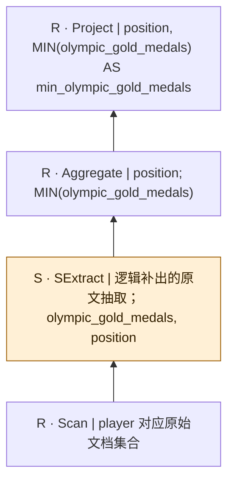

SQL本身只有结构化算子；SExtract是从原文到关系的分析性补充，不是源SQL的显式调用，也不表明每个字段必须由LLM抽取。字段类型、NULL及一对多抽取契约须在执行前固定。

## bench-u/Player/Agg/agg_queries/2

来源：[原件](</Volumes/Element/Github2/semantic-workload-bench/data/semantic-query-discovery-20260908/bench-u/checkout/Query/Player/Agg/agg_queries.sql>) · `sql_plus_proposed_extraction` · `logical_only` · `substantive_relational`

```sql

SELECT nationality, COUNT(*) AS count_all FROM player GROUP BY nationality;

```

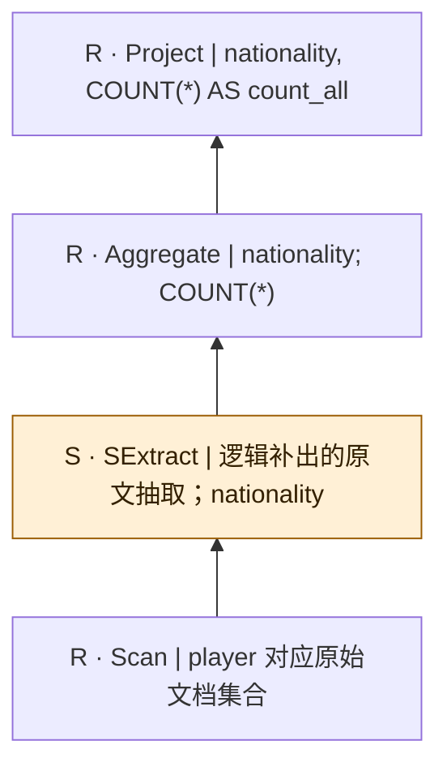

SQL本身只有结构化算子；SExtract是从原文到关系的分析性补充，不是源SQL的显式调用，也不表明每个字段必须由LLM抽取。字段类型、NULL及一对多抽取契约须在执行前固定。

## bench-u/Player/Agg/agg_queries/3

来源：[原件](</Volumes/Element/Github2/semantic-workload-bench/data/semantic-query-discovery-20260908/bench-u/checkout/Query/Player/Agg/agg_queries.sql>) · `sql_plus_proposed_extraction` · `logical_only` · `substantive_relational`

```sql

SELECT position, AVG(age) AS avg_age FROM player GROUP BY position;

```

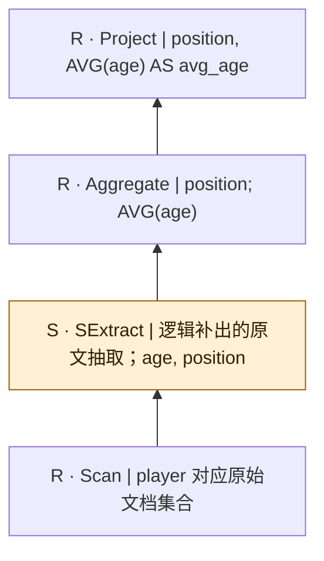

SQL本身只有结构化算子；SExtract是从原文到关系的分析性补充，不是源SQL的显式调用，也不表明每个字段必须由LLM抽取。字段类型、NULL及一对多抽取契约须在执行前固定。

## bench-u/Player/Agg/agg_queries/4

来源：[原件](</Volumes/Element/Github2/semantic-workload-bench/data/semantic-query-discovery-20260908/bench-u/checkout/Query/Player/Agg/agg_queries.sql>) · `sql_plus_proposed_extraction` · `logical_only` · `substantive_relational`

```sql

SELECT nationality, MAX(age) AS max_age FROM player GROUP BY nationality;

```

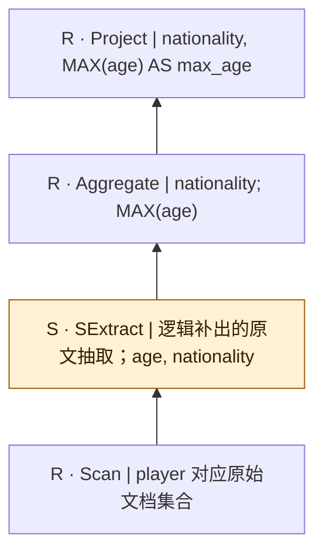

SQL本身只有结构化算子；SExtract是从原文到关系的分析性补充，不是源SQL的显式调用，也不表明每个字段必须由LLM抽取。字段类型、NULL及一对多抽取契约须在执行前固定。

## bench-u/Player/Agg/agg_queries/5

来源：[原件](</Volumes/Element/Github2/semantic-workload-bench/data/semantic-query-discovery-20260908/bench-u/checkout/Query/Player/Agg/agg_queries.sql>) · `sql_plus_proposed_extraction` · `logical_only` · `substantive_relational`

```sql

SELECT nationality, COUNT(*) AS count_all FROM player GROUP BY nationality;

```


SQL本身只有结构化算子；SExtract是从原文到关系的分析性补充，不是源SQL的显式调用，也不表明每个字段必须由LLM抽取。字段类型、NULL及一对多抽取契约须在执行前固定。

## bench-u/Player/Agg/agg_queries/6

来源：[原件](</Volumes/Element/Github2/semantic-workload-bench/data/semantic-query-discovery-20260908/bench-u/checkout/Query/Player/Agg/agg_queries.sql>) · `sql_plus_proposed_extraction` · `logical_only` · `substantive_relational`

```sql

SELECT nationality, MIN(age) AS min_age FROM player GROUP BY nationality;

```


SQL本身只有结构化算子；SExtract是从原文到关系的分析性补充，不是源SQL的显式调用，也不表明每个字段必须由LLM抽取。字段类型、NULL及一对多抽取契约须在执行前固定。

## bench-u/Player/Agg/agg_queries/7

来源：[原件](</Volumes/Element/Github2/semantic-workload-bench/data/semantic-query-discovery-20260908/bench-u/checkout/Query/Player/Agg/agg_queries.sql>) · `sql_plus_proposed_extraction` · `logical_only` · `substantive_relational`

```sql

SELECT nationality, AVG(age) AS avg_age FROM player GROUP BY nationality;

```


SQL本身只有结构化算子；SExtract是从原文到关系的分析性补充，不是源SQL的显式调用，也不表明每个字段必须由LLM抽取。字段类型、NULL及一对多抽取契约须在执行前固定。

## bench-u/Player/Agg/agg_queries/8

来源：[原件](</Volumes/Element/Github2/semantic-workload-bench/data/semantic-query-discovery-20260908/bench-u/checkout/Query/Player/Agg/agg_queries.sql>) · `sql_plus_proposed_extraction` · `logical_only` · `substantive_relational`

```sql

SELECT nationality, MIN(age) AS min_age FROM manager GROUP BY nationality;

```

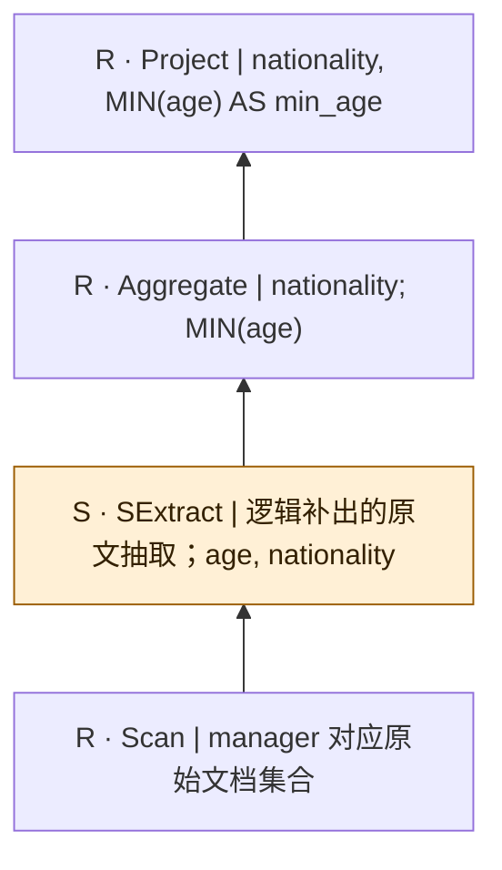

SQL本身只有结构化算子；SExtract是从原文到关系的分析性补充，不是源SQL的显式调用，也不表明每个字段必须由LLM抽取。字段类型、NULL及一对多抽取契约须在执行前固定。

## bench-u/Player/Agg/agg_queries/9

来源：[原件](</Volumes/Element/Github2/semantic-workload-bench/data/semantic-query-discovery-20260908/bench-u/checkout/Query/Player/Agg/agg_queries.sql>) · `sql_plus_proposed_extraction` · `logical_only` · `substantive_relational`

```sql

SELECT nationality, COUNT(*) AS count_all FROM manager GROUP BY nationality;

```

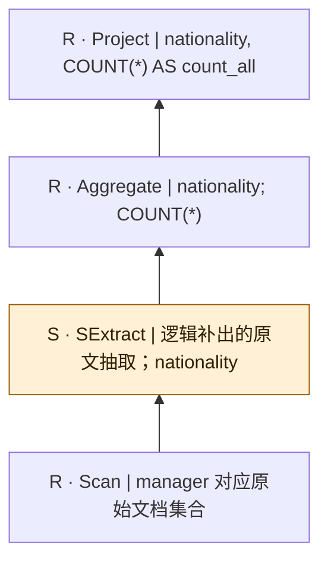

SQL本身只有结构化算子；SExtract是从原文到关系的分析性补充，不是源SQL的显式调用，也不表明每个字段必须由LLM抽取。字段类型、NULL及一对多抽取契约须在执行前固定。

## bench-u/Player/Agg/agg_queries/10

来源：[原件](</Volumes/Element/Github2/semantic-workload-bench/data/semantic-query-discovery-20260908/bench-u/checkout/Query/Player/Agg/agg_queries.sql>) · `sql_plus_proposed_extraction` · `logical_only` · `substantive_relational`

```sql

SELECT nationality, AVG(age) AS avg_age FROM manager GROUP BY nationality;

```


SQL本身只有结构化算子；SExtract是从原文到关系的分析性补充，不是源SQL的显式调用，也不表明每个字段必须由LLM抽取。字段类型、NULL及一对多抽取契约须在执行前固定。

## bench-u/Player/Filter/filter_queries_city/1

来源：[原件](</Volumes/Element/Github2/semantic-workload-bench/data/semantic-query-discovery-20260908/bench-u/checkout/Query/Player/Filter/filter_queries_city.sql>) · `sql_plus_proposed_extraction` · `logical_only` · `substantive_relational`

```sql

SELECT state_name, area, city_name FROM city WHERE area = 375.78;

```

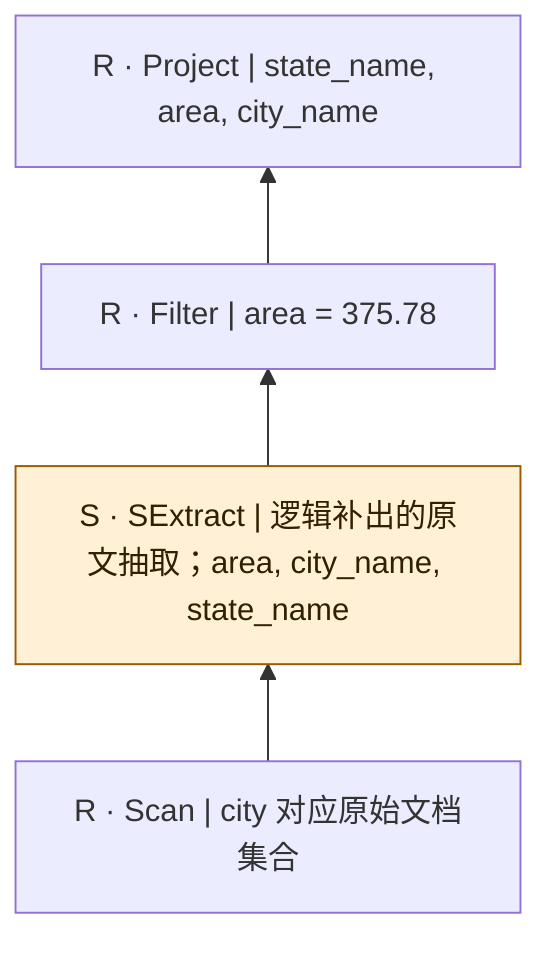

SQL本身只有结构化算子；SExtract是从原文到关系的分析性补充，不是源SQL的显式调用，也不表明每个字段必须由LLM抽取。字段类型、NULL及一对多抽取契约须在执行前固定。

## bench-u/Player/Filter/filter_queries_city/2

来源：[原件](</Volumes/Element/Github2/semantic-workload-bench/data/semantic-query-discovery-20260908/bench-u/checkout/Query/Player/Filter/filter_queries_city.sql>) · `sql_plus_proposed_extraction` · `logical_only` · `substantive_relational`

```sql

SELECT state_name, area, city_name FROM city WHERE area <= 1314.80 AND population > '887642';

```

```mermaid
flowchart BT
  n0["R · Project | state_name, area, city_name"]
  n1["R · Filter | area &lt;= 1314.80 AND population &gt; &#x27;887642&#x27;"]
  n2["S · SExtract | 逻辑补出的原文抽取；area, city_name, population, state_name"]
  n3["R · Scan | city 对应原始文档集合"]
  n3 --> n2
  n2 --> n1
  n1 --> n0
  classDef semantic fill:#fff0d6,stroke:#9a5b00,color:#332000;
  class n2 semantic;
```

SQL本身只有结构化算子；SExtract是从原文到关系的分析性补充，不是源SQL的显式调用，也不表明每个字段必须由LLM抽取。字段类型、NULL及一对多抽取契约须在执行前固定。

## bench-u/Player/Filter/filter_queries_city/3

来源：[原件](</Volumes/Element/Github2/semantic-workload-bench/data/semantic-query-discovery-20260908/bench-u/checkout/Query/Player/Filter/filter_queries_city.sql>) · `sql_plus_proposed_extraction` · `logical_only` · `substantive_relational`

```sql

SELECT state_name, city_name, population FROM city WHERE state_name != 'Indiana' OR population >= '372,624';

```

```mermaid
flowchart BT
  n0["R · Project | state_name, city_name, population"]
  n1["R · Filter | state_name &lt;&gt; &#x27;Indiana&#x27; OR population &gt;= &#x27;372,624&#x27;"]
  n2["S · SExtract | 逻辑补出的原文抽取；city_name, population, state_name"]
  n3["R · Scan | city 对应原始文档集合"]
  n3 --> n2
  n2 --> n1
  n1 --> n0
  classDef semantic fill:#fff0d6,stroke:#9a5b00,color:#332000;
  class n2 semantic;
```

SQL本身只有结构化算子；SExtract是从原文到关系的分析性补充，不是源SQL的显式调用，也不表明每个字段必须由LLM抽取。字段类型、NULL及一对多抽取契约须在执行前固定。

## bench-u/Player/Filter/filter_queries_city/4

来源：[原件](</Volumes/Element/Github2/semantic-workload-bench/data/semantic-query-discovery-20260908/bench-u/checkout/Query/Player/Filter/filter_queries_city.sql>) · `sql_plus_proposed_extraction` · `logical_only` · `substantive_relational`

```sql

SELECT gdp, area, state_name FROM city WHERE area >= 976.15 AND state_name != 'Oregon' AND area = 375.78 AND population = '808988';

```

```mermaid
flowchart BT
  n0["R · Project | gdp, area, state_name"]
  n1["R · Filter | area &gt;= 976.15 AND state_name &lt;&gt; &#x27;Oregon&#x27; AND area = 375.78 AND population = &#x27;808988&#x27;"]
  n2["S · SExtract | 逻辑补出的原文抽取；area, gdp, population, state_name"]
  n3["R · Scan | city 对应原始文档集合"]
  n3 --> n2
  n2 --> n1
  n1 --> n0
  classDef semantic fill:#fff0d6,stroke:#9a5b00,color:#332000;
  class n2 semantic;
```

SQL本身只有结构化算子；SExtract是从原文到关系的分析性补充，不是源SQL的显式调用，也不表明每个字段必须由LLM抽取。字段类型、NULL及一对多抽取契约须在执行前固定。

## bench-u/Player/Filter/filter_queries_city/5

来源：[原件](</Volumes/Element/Github2/semantic-workload-bench/data/semantic-query-discovery-20260908/bench-u/checkout/Query/Player/Filter/filter_queries_city.sql>) · `sql_plus_proposed_extraction` · `logical_only` · `substantive_relational`

```sql

SELECT gdp, state_name, population FROM city WHERE state_name != 'Ontario' OR city_name = 'Minneapolis' OR gdp != '689000' OR gdp != '344.9';

```

```mermaid
flowchart BT
  n0["R · Project | gdp, state_name, population"]
  n1["R · Filter | state_name &lt;&gt; &#x27;Ontario&#x27; OR city_name = &#x27;Minneapolis&#x27; OR gdp &lt;&gt; &#x27;689000&#x27; OR gdp &lt;&gt; &#x27;344.9&#x27;"]
  n2["S · SExtract | 逻辑补出的原文抽取；city_name, gdp, population, state_name"]
  n3["R · Scan | city 对应原始文档集合"]
  n3 --> n2
  n2 --> n1
  n1 --> n0
  classDef semantic fill:#fff0d6,stroke:#9a5b00,color:#332000;
  class n2 semantic;
```

SQL本身只有结构化算子；SExtract是从原文到关系的分析性补充，不是源SQL的显式调用，也不表明每个字段必须由LLM抽取。字段类型、NULL及一对多抽取契约须在执行前固定。

## bench-u/Player/Filter/filter_queries_city/6

来源：[原件](</Volumes/Element/Github2/semantic-workload-bench/data/semantic-query-discovery-20260908/bench-u/checkout/Query/Player/Filter/filter_queries_city.sql>) · `sql_plus_proposed_extraction` · `logical_only` · `substantive_relational`

```sql

SELECT population, state_name, city_name FROM city WHERE (state_name = 'Minnesota' AND population = '887642') OR (area >= 976.15 AND area >= 976.15);

```

```mermaid
flowchart BT
  n0["R · Project | population, state_name, city_name"]
  n1["R · Filter | (state_name = &#x27;Minnesota&#x27; AND population = &#x27;887642&#x27;) OR (area &gt;= 976.15 AND area &gt;= 976.15)"]
  n2["S · SExtract | 逻辑补出的原文抽取；area, city_name, population, state_name"]
  n3["R · Scan | city 对应原始文档集合"]
  n3 --> n2
  n2 --> n1
  n1 --> n0
  classDef semantic fill:#fff0d6,stroke:#9a5b00,color:#332000;
  class n2 semantic;
```

SQL本身只有结构化算子；SExtract是从原文到关系的分析性补充，不是源SQL的显式调用，也不表明每个字段必须由LLM抽取。字段类型、NULL及一对多抽取契约须在执行前固定。

## bench-u/Player/Filter/filter_queries_manager/1

来源：[原件](</Volumes/Element/Github2/semantic-workload-bench/data/semantic-query-discovery-20260908/bench-u/checkout/Query/Player/Filter/filter_queries_manager.sql>) · `sql_plus_proposed_extraction` · `logical_only` · `substantive_relational`

```sql

SELECT age, nba_team, name FROM manager WHERE nba_team != 'Cleveland Cavaliers';

```

```mermaid
flowchart BT
  n0["R · Project | age, nba_team, name"]
  n1["R · Filter | nba_team &lt;&gt; &#x27;Cleveland Cavaliers&#x27;"]
  n2["S · SExtract | 逻辑补出的原文抽取；age, name, nba_team"]
  n3["R · Scan | manager 对应原始文档集合"]
  n3 --> n2
  n2 --> n1
  n1 --> n0
  classDef semantic fill:#fff0d6,stroke:#9a5b00,color:#332000;
  class n2 semantic;
```

SQL本身只有结构化算子；SExtract是从原文到关系的分析性补充，不是源SQL的显式调用，也不表明每个字段必须由LLM抽取。字段类型、NULL及一对多抽取契约须在执行前固定。

## bench-u/Player/Filter/filter_queries_manager/2

来源：[原件](</Volumes/Element/Github2/semantic-workload-bench/data/semantic-query-discovery-20260908/bench-u/checkout/Query/Player/Filter/filter_queries_manager.sql>) · `sql_plus_proposed_extraction` · `logical_only` · `substantive_relational`

```sql

SELECT age, nba_team, name FROM manager WHERE nba_team != 'Golden State Warriors' AND age >= 67;

```

```mermaid
flowchart BT
  n0["R · Project | age, nba_team, name"]
  n1["R · Filter | nba_team &lt;&gt; &#x27;Golden State Warriors&#x27; AND age &gt;= 67"]
  n2["S · SExtract | 逻辑补出的原文抽取；age, name, nba_team"]
  n3["R · Scan | manager 对应原始文档集合"]
  n3 --> n2
  n2 --> n1
  n1 --> n0
  classDef semantic fill:#fff0d6,stroke:#9a5b00,color:#332000;
  class n2 semantic;
```

SQL本身只有结构化算子；SExtract是从原文到关系的分析性补充，不是源SQL的显式调用，也不表明每个字段必须由LLM抽取。字段类型、NULL及一对多抽取契约须在执行前固定。

## bench-u/Player/Filter/filter_queries_manager/3

来源：[原件](</Volumes/Element/Github2/semantic-workload-bench/data/semantic-query-discovery-20260908/bench-u/checkout/Query/Player/Filter/filter_queries_manager.sql>) · `sql_plus_proposed_extraction` · `logical_only` · `substantive_relational`

```sql

SELECT age, name, nationality FROM manager WHERE age < 65 OR nationality != 'Israeli-American';

```

```mermaid
flowchart BT
  n0["R · Project | age, name, nationality"]
  n1["R · Filter | age &lt; 65 OR nationality &lt;&gt; &#x27;Israeli-American&#x27;"]
  n2["S · SExtract | 逻辑补出的原文抽取；age, name, nationality"]
  n3["R · Scan | manager 对应原始文档集合"]
  n3 --> n2
  n2 --> n1
  n1 --> n0
  classDef semantic fill:#fff0d6,stroke:#9a5b00,color:#332000;
  class n2 semantic;
```

SQL本身只有结构化算子；SExtract是从原文到关系的分析性补充，不是源SQL的显式调用，也不表明每个字段必须由LLM抽取。字段类型、NULL及一对多抽取契约须在执行前固定。

## bench-u/Player/Filter/filter_queries_manager/4

来源：[原件](</Volumes/Element/Github2/semantic-workload-bench/data/semantic-query-discovery-20260908/bench-u/checkout/Query/Player/Filter/filter_queries_manager.sql>) · `sql_plus_proposed_extraction` · `logical_only` · `substantive_relational`

```sql

SELECT own_year, nba_team, age FROM manager WHERE nba_team = 'Miami Heat' AND own_year >= 2008 AND nba_team = 'Philadelphia 76ers' AND nationality = 'Taiwanese-Canadian';

```

```mermaid
flowchart BT
  n0["R · Project | own_year, nba_team, age"]
  n1["R · Filter | nba_team = &#x27;Miami Heat&#x27; AND own_year &gt;= 2008 AND nba_team = &#x27;Philadelphia 76ers&#x27; AND nationality = &#x27;Taiwanese-Canadian&#x27;"]
  n2["S · SExtract | 逻辑补出的原文抽取；age, nationality, nba_team, own_year"]
  n3["R · Scan | manager 对应原始文档集合"]
  n3 --> n2
  n2 --> n1
  n1 --> n0
  classDef semantic fill:#fff0d6,stroke:#9a5b00,color:#332000;
  class n2 semantic;
```

SQL本身只有结构化算子；SExtract是从原文到关系的分析性补充，不是源SQL的显式调用，也不表明每个字段必须由LLM抽取。字段类型、NULL及一对多抽取契约须在执行前固定。

## bench-u/Player/Filter/filter_queries_manager/5

来源：[原件](</Volumes/Element/Github2/semantic-workload-bench/data/semantic-query-discovery-20260908/bench-u/checkout/Query/Player/Filter/filter_queries_manager.sql>) · `sql_plus_proposed_extraction` · `logical_only` · `substantive_relational`

```sql

SELECT own_year, age, nationality FROM manager WHERE age <= 76 OR name = 'Joseph Chung-Hsin Tsai' OR own_year > 2013 OR nationality = 'American';

```

```mermaid
flowchart BT
  n0["R · Project | own_year, age, nationality"]
  n1["R · Filter | age &lt;= 76 OR name = &#x27;Joseph Chung-Hsin Tsai&#x27; OR own_year &gt; 2013 OR nationality = &#x27;American&#x27;"]
  n2["S · SExtract | 逻辑补出的原文抽取；age, name, nationality, own_year"]
  n3["R · Scan | manager 对应原始文档集合"]
  n3 --> n2
  n2 --> n1
  n1 --> n0
  classDef semantic fill:#fff0d6,stroke:#9a5b00,color:#332000;
  class n2 semantic;
```

SQL本身只有结构化算子；SExtract是从原文到关系的分析性补充，不是源SQL的显式调用，也不表明每个字段必须由LLM抽取。字段类型、NULL及一对多抽取契约须在执行前固定。

## bench-u/Player/Filter/filter_queries_manager/6

来源：[原件](</Volumes/Element/Github2/semantic-workload-bench/data/semantic-query-discovery-20260908/bench-u/checkout/Query/Player/Filter/filter_queries_manager.sql>) · `sql_plus_proposed_extraction` · `logical_only` · `substantive_relational`

```sql

SELECT nationality, age, name FROM manager WHERE (age >= 65 AND age = 65) OR (nba_team != 'Indiana Pacers' AND nba_team != 'New Orleans Pelicans');

```

```mermaid
flowchart BT
  n0["R · Project | nationality, age, name"]
  n1["R · Filter | (age &gt;= 65 AND age = 65) OR (nba_team &lt;&gt; &#x27;Indiana Pacers&#x27; AND nba_team &lt;&gt; &#x27;New Orleans Pelicans&#x27;)"]
  n2["S · SExtract | 逻辑补出的原文抽取；age, name, nationality, nba_team"]
  n3["R · Scan | manager 对应原始文档集合"]
  n3 --> n2
  n2 --> n1
  n1 --> n0
  classDef semantic fill:#fff0d6,stroke:#9a5b00,color:#332000;
  class n2 semantic;
```

SQL本身只有结构化算子；SExtract是从原文到关系的分析性补充，不是源SQL的显式调用，也不表明每个字段必须由LLM抽取。字段类型、NULL及一对多抽取契约须在执行前固定。

## bench-u/Player/Filter/filter_queries_player/1

来源：[原件](</Volumes/Element/Github2/semantic-workload-bench/data/semantic-query-discovery-20260908/bench-u/checkout/Query/Player/Filter/filter_queries_player.sql>) · `sql_plus_proposed_extraction` · `logical_only` · `substantive_relational`

```sql

SELECT mvp_awards, draft_pick, fiba_world_cup FROM player WHERE fiba_world_cup >= 0;

```

```mermaid
flowchart BT
  n0["R · Project | mvp_awards, draft_pick, fiba_world_cup"]
  n1["R · Filter | fiba_world_cup &gt;= 0"]
  n2["S · SExtract | 逻辑补出的原文抽取；draft_pick, fiba_world_cup, mvp_awards"]
  n3["R · Scan | player 对应原始文档集合"]
  n3 --> n2
  n2 --> n1
  n1 --> n0
  classDef semantic fill:#fff0d6,stroke:#9a5b00,color:#332000;
  class n2 semantic;
```

SQL本身只有结构化算子；SExtract是从原文到关系的分析性补充，不是源SQL的显式调用，也不表明每个字段必须由LLM抽取。字段类型、NULL及一对多抽取契约须在执行前固定。

## bench-u/Player/Filter/filter_queries_player/2

来源：[原件](</Volumes/Element/Github2/semantic-workload-bench/data/semantic-query-discovery-20260908/bench-u/checkout/Query/Player/Filter/filter_queries_player.sql>) · `sql_plus_proposed_extraction` · `logical_only` · `substantive_relational`

```sql

SELECT position, nationality, age FROM player WHERE age < 78;

```

```mermaid
flowchart BT
  n0["R · Project | position, nationality, age"]
  n1["R · Filter | age &lt; 78"]
  n2["S · SExtract | 逻辑补出的原文抽取；age, nationality, position"]
  n3["R · Scan | player 对应原始文档集合"]
  n3 --> n2
  n2 --> n1
  n1 --> n0
  classDef semantic fill:#fff0d6,stroke:#9a5b00,color:#332000;
  class n2 semantic;
```

SQL本身只有结构化算子；SExtract是从原文到关系的分析性补充，不是源SQL的显式调用，也不表明每个字段必须由LLM抽取。字段类型、NULL及一对多抽取契约须在执行前固定。

## bench-u/Player/Filter/filter_queries_player/3

来源：[原件](</Volumes/Element/Github2/semantic-workload-bench/data/semantic-query-discovery-20260908/bench-u/checkout/Query/Player/Filter/filter_queries_player.sql>) · `sql_plus_proposed_extraction` · `logical_only` · `substantive_relational`

```sql

SELECT mvp_awards, draft_pick, name FROM player WHERE mvp_awards >= 1;

```

```mermaid
flowchart BT
  n0["R · Project | mvp_awards, draft_pick, name"]
  n1["R · Filter | mvp_awards &gt;= 1"]
  n2["S · SExtract | 逻辑补出的原文抽取；draft_pick, mvp_awards, name"]
  n3["R · Scan | player 对应原始文档集合"]
  n3 --> n2
  n2 --> n1
  n1 --> n0
  classDef semantic fill:#fff0d6,stroke:#9a5b00,color:#332000;
  class n2 semantic;
```

SQL本身只有结构化算子；SExtract是从原文到关系的分析性补充，不是源SQL的显式调用，也不表明每个字段必须由LLM抽取。字段类型、NULL及一对多抽取契约须在执行前固定。

## bench-u/Player/Filter/filter_queries_player/4

来源：[原件](</Volumes/Element/Github2/semantic-workload-bench/data/semantic-query-discovery-20260908/bench-u/checkout/Query/Player/Filter/filter_queries_player.sql>) · `sql_plus_proposed_extraction` · `logical_only` · `substantive_relational`

```sql

SELECT age, birth_date, team FROM player WHERE team = 'Cedevita Olimpija';

```

```mermaid
flowchart BT
  n0["R · Project | age, birth_date, team"]
  n1["R · Filter | team = &#x27;Cedevita Olimpija&#x27;"]
  n2["S · SExtract | 逻辑补出的原文抽取；age, birth_date, team"]
  n3["R · Scan | player 对应原始文档集合"]
  n3 --> n2
  n2 --> n1
  n1 --> n0
  classDef semantic fill:#fff0d6,stroke:#9a5b00,color:#332000;
  class n2 semantic;
```

SQL本身只有结构化算子；SExtract是从原文到关系的分析性补充，不是源SQL的显式调用，也不表明每个字段必须由LLM抽取。字段类型、NULL及一对多抽取契约须在执行前固定。

## bench-u/Player/Filter/filter_queries_player/5

来源：[原件](</Volumes/Element/Github2/semantic-workload-bench/data/semantic-query-discovery-20260908/bench-u/checkout/Query/Player/Filter/filter_queries_player.sql>) · `sql_plus_proposed_extraction` · `logical_only` · `substantive_relational`

```sql

SELECT fiba_world_cup, nba_championships, birth_date FROM player WHERE nba_championships = 0;

```

```mermaid
flowchart BT
  n0["R · Project | fiba_world_cup, nba_championships, birth_date"]
  n1["R · Filter | nba_championships = 0"]
  n2["S · SExtract | 逻辑补出的原文抽取；birth_date, fiba_world_cup, nba_championships"]
  n3["R · Scan | player 对应原始文档集合"]
  n3 --> n2
  n2 --> n1
  n1 --> n0
  classDef semantic fill:#fff0d6,stroke:#9a5b00,color:#332000;
  class n2 semantic;
```

SQL本身只有结构化算子；SExtract是从原文到关系的分析性补充，不是源SQL的显式调用，也不表明每个字段必须由LLM抽取。字段类型、NULL及一对多抽取契约须在执行前固定。

## bench-u/Player/Filter/filter_queries_player/6

来源：[原件](</Volumes/Element/Github2/semantic-workload-bench/data/semantic-query-discovery-20260908/bench-u/checkout/Query/Player/Filter/filter_queries_player.sql>) · `sql_plus_proposed_extraction` · `logical_only` · `substantive_relational`

```sql

SELECT college, birth_date, draft_year FROM player WHERE birth_date = '1973/11/25';

```

```mermaid
flowchart BT
  n0["R · Project | college, birth_date, draft_year"]
  n1["R · Filter | birth_date = &#x27;1973/11/25&#x27;"]
  n2["S · SExtract | 逻辑补出的原文抽取；birth_date, college, draft_year"]
  n3["R · Scan | player 对应原始文档集合"]
  n3 --> n2
  n2 --> n1
  n1 --> n0
  classDef semantic fill:#fff0d6,stroke:#9a5b00,color:#332000;
  class n2 semantic;
```

SQL本身只有结构化算子；SExtract是从原文到关系的分析性补充，不是源SQL的显式调用，也不表明每个字段必须由LLM抽取。字段类型、NULL及一对多抽取契约须在执行前固定。

## bench-u/Player/Filter/filter_queries_player/7

来源：[原件](</Volumes/Element/Github2/semantic-workload-bench/data/semantic-query-discovery-20260908/bench-u/checkout/Query/Player/Filter/filter_queries_player.sql>) · `sql_plus_proposed_extraction` · `logical_only` · `substantive_relational`

```sql

SELECT fiba_world_cup, draft_year, name FROM player WHERE draft_year <= 2018 AND fiba_world_cup > 0;

```

```mermaid
flowchart BT
  n0["R · Project | fiba_world_cup, draft_year, name"]
  n1["R · Filter | draft_year &lt;= 2018 AND fiba_world_cup &gt; 0"]
  n2["S · SExtract | 逻辑补出的原文抽取；draft_year, fiba_world_cup, name"]
  n3["R · Scan | player 对应原始文档集合"]
  n3 --> n2
  n2 --> n1
  n1 --> n0
  classDef semantic fill:#fff0d6,stroke:#9a5b00,color:#332000;
  class n2 semantic;
```

SQL本身只有结构化算子；SExtract是从原文到关系的分析性补充，不是源SQL的显式调用，也不表明每个字段必须由LLM抽取。字段类型、NULL及一对多抽取契约须在执行前固定。

## bench-u/Player/Filter/filter_queries_player/8

来源：[原件](</Volumes/Element/Github2/semantic-workload-bench/data/semantic-query-discovery-20260908/bench-u/checkout/Query/Player/Filter/filter_queries_player.sql>) · `sql_plus_proposed_extraction` · `logical_only` · `substantive_relational`

```sql

SELECT position, nba_championships, fiba_world_cup FROM player WHERE fiba_world_cup > 0 AND nationality != 'Azerbaijani';

```

```mermaid
flowchart BT
  n0["R · Project | position, nba_championships, fiba_world_cup"]
  n1["R · Filter | fiba_world_cup &gt; 0 AND nationality &lt;&gt; &#x27;Azerbaijani&#x27;"]
  n2["S · SExtract | 逻辑补出的原文抽取；fiba_world_cup, nationality, nba_championships, position"]
  n3["R · Scan | player 对应原始文档集合"]
  n3 --> n2
  n2 --> n1
  n1 --> n0
  classDef semantic fill:#fff0d6,stroke:#9a5b00,color:#332000;
  class n2 semantic;
```

SQL本身只有结构化算子；SExtract是从原文到关系的分析性补充，不是源SQL的显式调用，也不表明每个字段必须由LLM抽取。字段类型、NULL及一对多抽取契约须在执行前固定。

## bench-u/Player/Filter/filter_queries_player/9

来源：[原件](</Volumes/Element/Github2/semantic-workload-bench/data/semantic-query-discovery-20260908/bench-u/checkout/Query/Player/Filter/filter_queries_player.sql>) · `sql_plus_proposed_extraction` · `logical_only` · `substantive_relational`

```sql

SELECT draft_pick, nba_championships, team FROM player WHERE draft_pick < 24 AND draft_pick >= 10;

```

```mermaid
flowchart BT
  n0["R · Project | draft_pick, nba_championships, team"]
  n1["R · Filter | draft_pick &lt; 24 AND draft_pick &gt;= 10"]
  n2["S · SExtract | 逻辑补出的原文抽取；draft_pick, nba_championships, team"]
  n3["R · Scan | player 对应原始文档集合"]
  n3 --> n2
  n2 --> n1
  n1 --> n0
  classDef semantic fill:#fff0d6,stroke:#9a5b00,color:#332000;
  class n2 semantic;
```

SQL本身只有结构化算子；SExtract是从原文到关系的分析性补充，不是源SQL的显式调用，也不表明每个字段必须由LLM抽取。字段类型、NULL及一对多抽取契约须在执行前固定。

## bench-u/Player/Filter/filter_queries_player/10

来源：[原件](</Volumes/Element/Github2/semantic-workload-bench/data/semantic-query-discovery-20260908/bench-u/checkout/Query/Player/Filter/filter_queries_player.sql>) · `sql_plus_proposed_extraction` · `logical_only` · `substantive_relational`

```sql

SELECT age, birth_date, college FROM player WHERE age > 78 AND mvp_awards > 0;

```

```mermaid
flowchart BT
  n0["R · Project | age, birth_date, college"]
  n1["R · Filter | age &gt; 78 AND mvp_awards &gt; 0"]
  n2["S · SExtract | 逻辑补出的原文抽取；age, birth_date, college, mvp_awards"]
  n3["R · Scan | player 对应原始文档集合"]
  n3 --> n2
  n2 --> n1
  n1 --> n0
  classDef semantic fill:#fff0d6,stroke:#9a5b00,color:#332000;
  class n2 semantic;
```

SQL本身只有结构化算子；SExtract是从原文到关系的分析性补充，不是源SQL的显式调用，也不表明每个字段必须由LLM抽取。字段类型、NULL及一对多抽取契约须在执行前固定。

## bench-u/Player/Filter/filter_queries_player/11

来源：[原件](</Volumes/Element/Github2/semantic-workload-bench/data/semantic-query-discovery-20260908/bench-u/checkout/Query/Player/Filter/filter_queries_player.sql>) · `sql_plus_proposed_extraction` · `logical_only` · `substantive_relational`

```sql

SELECT fiba_world_cup, birth_date, nba_championships FROM player WHERE birth_date != '1959/6/10' AND birth_date != '1964/2/15';

```

```mermaid
flowchart BT
  n0["R · Project | fiba_world_cup, birth_date, nba_championships"]
  n1["R · Filter | birth_date &lt;&gt; &#x27;1959/6/10&#x27; AND birth_date &lt;&gt; &#x27;1964/2/15&#x27;"]
  n2["S · SExtract | 逻辑补出的原文抽取；birth_date, fiba_world_cup, nba_championships"]
  n3["R · Scan | player 对应原始文档集合"]
  n3 --> n2
  n2 --> n1
  n1 --> n0
  classDef semantic fill:#fff0d6,stroke:#9a5b00,color:#332000;
  class n2 semantic;
```

SQL本身只有结构化算子；SExtract是从原文到关系的分析性补充，不是源SQL的显式调用，也不表明每个字段必须由LLM抽取。字段类型、NULL及一对多抽取契约须在执行前固定。

## bench-u/Player/Filter/filter_queries_player/12

来源：[原件](</Volumes/Element/Github2/semantic-workload-bench/data/semantic-query-discovery-20260908/bench-u/checkout/Query/Player/Filter/filter_queries_player.sql>) · `sql_plus_proposed_extraction` · `logical_only` · `substantive_relational`

```sql

SELECT olympic_gold_medals, position, birth_date FROM player WHERE olympic_gold_medals < 1 AND draft_pick = 24;

```

```mermaid
flowchart BT
  n0["R · Project | olympic_gold_medals, position, birth_date"]
  n1["R · Filter | olympic_gold_medals &lt; 1 AND draft_pick = 24"]
  n2["S · SExtract | 逻辑补出的原文抽取；birth_date, draft_pick, olympic_gold_medals, position"]
  n3["R · Scan | player 对应原始文档集合"]
  n3 --> n2
  n2 --> n1
  n1 --> n0
  classDef semantic fill:#fff0d6,stroke:#9a5b00,color:#332000;
  class n2 semantic;
```

SQL本身只有结构化算子；SExtract是从原文到关系的分析性补充，不是源SQL的显式调用，也不表明每个字段必须由LLM抽取。字段类型、NULL及一对多抽取契约须在执行前固定。

## bench-u/Player/Filter/filter_queries_player/13

来源：[原件](</Volumes/Element/Github2/semantic-workload-bench/data/semantic-query-discovery-20260908/bench-u/checkout/Query/Player/Filter/filter_queries_player.sql>) · `sql_plus_proposed_extraction` · `logical_only` · `substantive_relational`

```sql

SELECT team, nationality, mvp_awards FROM player WHERE mvp_awards < 1 OR birth_date = '1995/10/2';

```

```mermaid
flowchart BT
  n0["R · Project | team, nationality, mvp_awards"]
  n1["R · Filter | mvp_awards &lt; 1 OR birth_date = &#x27;1995/10/2&#x27;"]
  n2["S · SExtract | 逻辑补出的原文抽取；birth_date, mvp_awards, nationality, team"]
  n3["R · Scan | player 对应原始文档集合"]
  n3 --> n2
  n2 --> n1
  n1 --> n0
  classDef semantic fill:#fff0d6,stroke:#9a5b00,color:#332000;
  class n2 semantic;
```

SQL本身只有结构化算子；SExtract是从原文到关系的分析性补充，不是源SQL的显式调用，也不表明每个字段必须由LLM抽取。字段类型、NULL及一对多抽取契约须在执行前固定。

## bench-u/Player/Filter/filter_queries_player/14

来源：[原件](</Volumes/Element/Github2/semantic-workload-bench/data/semantic-query-discovery-20260908/bench-u/checkout/Query/Player/Filter/filter_queries_player.sql>) · `sql_plus_proposed_extraction` · `logical_only` · `substantive_relational`

```sql

SELECT draft_year, age, fiba_world_cup FROM player WHERE draft_year <= 2018 OR olympic_gold_medals >= 0;

```

```mermaid
flowchart BT
  n0["R · Project | draft_year, age, fiba_world_cup"]
  n1["R · Filter | draft_year &lt;= 2018 OR olympic_gold_medals &gt;= 0"]
  n2["S · SExtract | 逻辑补出的原文抽取；age, draft_year, fiba_world_cup, olympic_gold_medals"]
  n3["R · Scan | player 对应原始文档集合"]
  n3 --> n2
  n2 --> n1
  n1 --> n0
  classDef semantic fill:#fff0d6,stroke:#9a5b00,color:#332000;
  class n2 semantic;
```

SQL本身只有结构化算子；SExtract是从原文到关系的分析性补充，不是源SQL的显式调用，也不表明每个字段必须由LLM抽取。字段类型、NULL及一对多抽取契约须在执行前固定。

## bench-u/Player/Filter/filter_queries_player/15

来源：[原件](</Volumes/Element/Github2/semantic-workload-bench/data/semantic-query-discovery-20260908/bench-u/checkout/Query/Player/Filter/filter_queries_player.sql>) · `sql_plus_proposed_extraction` · `logical_only` · `substantive_relational`

```sql

SELECT fiba_world_cup, nationality, college FROM player WHERE college = 'University of Connecticut' OR birth_date != '1971/12/3';

```

```mermaid
flowchart BT
  n0["R · Project | fiba_world_cup, nationality, college"]
  n1["R · Filter | college = &#x27;University of Connecticut&#x27; OR birth_date &lt;&gt; &#x27;1971/12/3&#x27;"]
  n2["S · SExtract | 逻辑补出的原文抽取；birth_date, college, fiba_world_cup, nationality"]
  n3["R · Scan | player 对应原始文档集合"]
  n3 --> n2
  n2 --> n1
  n1 --> n0
  classDef semantic fill:#fff0d6,stroke:#9a5b00,color:#332000;
  class n2 semantic;
```

SQL本身只有结构化算子；SExtract是从原文到关系的分析性补充，不是源SQL的显式调用，也不表明每个字段必须由LLM抽取。字段类型、NULL及一对多抽取契约须在执行前固定。

## bench-u/Player/Filter/filter_queries_player/16

来源：[原件](</Volumes/Element/Github2/semantic-workload-bench/data/semantic-query-discovery-20260908/bench-u/checkout/Query/Player/Filter/filter_queries_player.sql>) · `sql_plus_proposed_extraction` · `logical_only` · `substantive_relational`

```sql

SELECT olympic_gold_medals, fiba_world_cup, birth_date FROM player WHERE birth_date = '1994/4/25' OR position != 'Frontcourt';

```

```mermaid
flowchart BT
  n0["R · Project | olympic_gold_medals, fiba_world_cup, birth_date"]
  n1["R · Filter | birth_date = &#x27;1994/4/25&#x27; OR position &lt;&gt; &#x27;Frontcourt&#x27;"]
  n2["S · SExtract | 逻辑补出的原文抽取；birth_date, fiba_world_cup, olympic_gold_medals, position"]
  n3["R · Scan | player 对应原始文档集合"]
  n3 --> n2
  n2 --> n1
  n1 --> n0
  classDef semantic fill:#fff0d6,stroke:#9a5b00,color:#332000;
  class n2 semantic;
```

SQL本身只有结构化算子；SExtract是从原文到关系的分析性补充，不是源SQL的显式调用，也不表明每个字段必须由LLM抽取。字段类型、NULL及一对多抽取契约须在执行前固定。

## bench-u/Player/Filter/filter_queries_player/17

来源：[原件](</Volumes/Element/Github2/semantic-workload-bench/data/semantic-query-discovery-20260908/bench-u/checkout/Query/Player/Filter/filter_queries_player.sql>) · `sql_plus_proposed_extraction` · `logical_only` · `substantive_relational`

```sql

SELECT college, draft_pick, fiba_world_cup FROM player WHERE draft_pick <= 10 OR college = 'Michigan State University';

```

```mermaid
flowchart BT
  n0["R · Project | college, draft_pick, fiba_world_cup"]
  n1["R · Filter | draft_pick &lt;= 10 OR college = &#x27;Michigan State University&#x27;"]
  n2["S · SExtract | 逻辑补出的原文抽取；college, draft_pick, fiba_world_cup"]
  n3["R · Scan | player 对应原始文档集合"]
  n3 --> n2
  n2 --> n1
  n1 --> n0
  classDef semantic fill:#fff0d6,stroke:#9a5b00,color:#332000;
  class n2 semantic;
```

SQL本身只有结构化算子；SExtract是从原文到关系的分析性补充，不是源SQL的显式调用，也不表明每个字段必须由LLM抽取。字段类型、NULL及一对多抽取契约须在执行前固定。

## bench-u/Player/Filter/filter_queries_player/18

来源：[原件](</Volumes/Element/Github2/semantic-workload-bench/data/semantic-query-discovery-20260908/bench-u/checkout/Query/Player/Filter/filter_queries_player.sql>) · `sql_plus_proposed_extraction` · `logical_only` · `substantive_relational`

```sql

SELECT olympic_gold_medals, nba_championships, age FROM player WHERE olympic_gold_medals > 1 OR position != 'Frontcourt';

```

```mermaid
flowchart BT
  n0["R · Project | olympic_gold_medals, nba_championships, age"]
  n1["R · Filter | olympic_gold_medals &gt; 1 OR position &lt;&gt; &#x27;Frontcourt&#x27;"]
  n2["S · SExtract | 逻辑补出的原文抽取；age, nba_championships, olympic_gold_medals, position"]
  n3["R · Scan | player 对应原始文档集合"]
  n3 --> n2
  n2 --> n1
  n1 --> n0
  classDef semantic fill:#fff0d6,stroke:#9a5b00,color:#332000;
  class n2 semantic;
```

SQL本身只有结构化算子；SExtract是从原文到关系的分析性补充，不是源SQL的显式调用，也不表明每个字段必须由LLM抽取。字段类型、NULL及一对多抽取契约须在执行前固定。

## bench-u/Player/Filter/filter_queries_player/19

来源：[原件](</Volumes/Element/Github2/semantic-workload-bench/data/semantic-query-discovery-20260908/bench-u/checkout/Query/Player/Filter/filter_queries_player.sql>) · `sql_plus_proposed_extraction` · `logical_only` · `substantive_relational`

```sql

SELECT fiba_world_cup, draft_pick, draft_year FROM player WHERE draft_pick >= 24 AND age >= 42 AND mvp_awards >= 0 AND mvp_awards < 1;

```

```mermaid
flowchart BT
  n0["R · Project | fiba_world_cup, draft_pick, draft_year"]
  n1["R · Filter | draft_pick &gt;= 24 AND age &gt;= 42 AND mvp_awards &gt;= 0 AND mvp_awards &lt; 1"]
  n2["S · SExtract | 逻辑补出的原文抽取；age, draft_pick, draft_year, fiba_world_cup, mvp_awards"]
  n3["R · Scan | player 对应原始文档集合"]
  n3 --> n2
  n2 --> n1
  n1 --> n0
  classDef semantic fill:#fff0d6,stroke:#9a5b00,color:#332000;
  class n2 semantic;
```

SQL本身只有结构化算子；SExtract是从原文到关系的分析性补充，不是源SQL的显式调用，也不表明每个字段必须由LLM抽取。字段类型、NULL及一对多抽取契约须在执行前固定。

## bench-u/Player/Filter/filter_queries_player/20

来源：[原件](</Volumes/Element/Github2/semantic-workload-bench/data/semantic-query-discovery-20260908/bench-u/checkout/Query/Player/Filter/filter_queries_player.sql>) · `sql_plus_proposed_extraction` · `logical_only` · `substantive_relational`

```sql

SELECT name, nba_championships, college FROM player WHERE nba_championships > 2 AND olympic_gold_medals >= 0 AND olympic_gold_medals != 1 AND name != 'Toby Kimball';

```

```mermaid
flowchart BT
  n0["R · Project | name, nba_championships, college"]
  n1["R · Filter | nba_championships &gt; 2 AND olympic_gold_medals &gt;= 0 AND olympic_gold_medals &lt;&gt; 1 AND name &lt;&gt; &#x27;Toby Kimball&#x27;"]
  n2["S · SExtract | 逻辑补出的原文抽取；college, name, nba_championships, olympic_gold_medals"]
  n3["R · Scan | player 对应原始文档集合"]
  n3 --> n2
  n2 --> n1
  n1 --> n0
  classDef semantic fill:#fff0d6,stroke:#9a5b00,color:#332000;
  class n2 semantic;
```

SQL本身只有结构化算子；SExtract是从原文到关系的分析性补充，不是源SQL的显式调用，也不表明每个字段必须由LLM抽取。字段类型、NULL及一对多抽取契约须在执行前固定。

## bench-u/Player/Filter/filter_queries_player/21

来源：[原件](</Volumes/Element/Github2/semantic-workload-bench/data/semantic-query-discovery-20260908/bench-u/checkout/Query/Player/Filter/filter_queries_player.sql>) · `sql_plus_proposed_extraction` · `logical_only` · `substantive_relational`

```sql

SELECT age, olympic_gold_medals, mvp_awards FROM player WHERE olympic_gold_medals >= 1 AND college = 'University of Connecticut' AND draft_year > 2014 AND fiba_world_cup >= 0;

```

```mermaid
flowchart BT
  n0["R · Project | age, olympic_gold_medals, mvp_awards"]
  n1["R · Filter | olympic_gold_medals &gt;= 1 AND college = &#x27;University of Connecticut&#x27; AND draft_year &gt; 2014 AND fiba_world_cup &gt;= 0"]
  n2["S · SExtract | 逻辑补出的原文抽取；age, college, draft_year, fiba_world_cup, mvp_awards, olympic_gold_medals"]
  n3["R · Scan | player 对应原始文档集合"]
  n3 --> n2
  n2 --> n1
  n1 --> n0
  classDef semantic fill:#fff0d6,stroke:#9a5b00,color:#332000;
  class n2 semantic;
```

SQL本身只有结构化算子；SExtract是从原文到关系的分析性补充，不是源SQL的显式调用，也不表明每个字段必须由LLM抽取。字段类型、NULL及一对多抽取契约须在执行前固定。

## bench-u/Player/Filter/filter_queries_player/22

来源：[原件](</Volumes/Element/Github2/semantic-workload-bench/data/semantic-query-discovery-20260908/bench-u/checkout/Query/Player/Filter/filter_queries_player.sql>) · `sql_plus_proposed_extraction` · `logical_only` · `substantive_relational`

```sql

SELECT draft_pick, olympic_gold_medals, position FROM player WHERE olympic_gold_medals > 0 AND birth_date != '1943/12/23' AND nba_championships < 2 AND birth_date = '1992/12/17';

```

```mermaid
flowchart BT
  n0["R · Project | draft_pick, olympic_gold_medals, position"]
  n1["R · Filter | olympic_gold_medals &gt; 0 AND birth_date &lt;&gt; &#x27;1943/12/23&#x27; AND nba_championships &lt; 2 AND birth_date = &#x27;1992/12/17&#x27;"]
  n2["S · SExtract | 逻辑补出的原文抽取；birth_date, draft_pick, nba_championships, olympic_gold_medals, position"]
  n3["R · Scan | player 对应原始文档集合"]
  n3 --> n2
  n2 --> n1
  n1 --> n0
  classDef semantic fill:#fff0d6,stroke:#9a5b00,color:#332000;
  class n2 semantic;
```

SQL本身只有结构化算子；SExtract是从原文到关系的分析性补充，不是源SQL的显式调用，也不表明每个字段必须由LLM抽取。字段类型、NULL及一对多抽取契约须在执行前固定。

## bench-u/Player/Filter/filter_queries_player/23

来源：[原件](</Volumes/Element/Github2/semantic-workload-bench/data/semantic-query-discovery-20260908/bench-u/checkout/Query/Player/Filter/filter_queries_player.sql>) · `sql_plus_proposed_extraction` · `logical_only` · `substantive_relational`

```sql

SELECT fiba_world_cup, birth_date, draft_pick FROM player WHERE birth_date != '1950/1/29' AND college = 'Oregon State University' AND age != 42 AND name = 'Walter Berry';

```

```mermaid
flowchart BT
  n0["R · Project | fiba_world_cup, birth_date, draft_pick"]
  n1["R · Filter | birth_date &lt;&gt; &#x27;1950/1/29&#x27; AND college = &#x27;Oregon State University&#x27; AND age &lt;&gt; 42 AND name = &#x27;Walter Berry&#x27;"]
  n2["S · SExtract | 逻辑补出的原文抽取；age, birth_date, college, draft_pick, fiba_world_cup, name"]
  n3["R · Scan | player 对应原始文档集合"]
  n3 --> n2
  n2 --> n1
  n1 --> n0
  classDef semantic fill:#fff0d6,stroke:#9a5b00,color:#332000;
  class n2 semantic;
```

SQL本身只有结构化算子；SExtract是从原文到关系的分析性补充，不是源SQL的显式调用，也不表明每个字段必须由LLM抽取。字段类型、NULL及一对多抽取契约须在执行前固定。

## bench-u/Player/Filter/filter_queries_player/24

来源：[原件](</Volumes/Element/Github2/semantic-workload-bench/data/semantic-query-discovery-20260908/bench-u/checkout/Query/Player/Filter/filter_queries_player.sql>) · `sql_plus_proposed_extraction` · `logical_only` · `substantive_relational`

```sql

SELECT nationality, draft_pick, team FROM player WHERE nationality != 'German' AND olympic_gold_medals > 0 AND olympic_gold_medals != 0 AND mvp_awards = 0;

```

```mermaid
flowchart BT
  n0["R · Project | nationality, draft_pick, team"]
  n1["R · Filter | nationality &lt;&gt; &#x27;German&#x27; AND olympic_gold_medals &gt; 0 AND olympic_gold_medals &lt;&gt; 0 AND mvp_awards = 0"]
  n2["S · SExtract | 逻辑补出的原文抽取；draft_pick, mvp_awards, nationality, olympic_gold_medals, team"]
  n3["R · Scan | player 对应原始文档集合"]
  n3 --> n2
  n2 --> n1
  n1 --> n0
  classDef semantic fill:#fff0d6,stroke:#9a5b00,color:#332000;
  class n2 semantic;
```

SQL本身只有结构化算子；SExtract是从原文到关系的分析性补充，不是源SQL的显式调用，也不表明每个字段必须由LLM抽取。字段类型、NULL及一对多抽取契约须在执行前固定。

## bench-u/Player/Filter/filter_queries_player/25

来源：[原件](</Volumes/Element/Github2/semantic-workload-bench/data/semantic-query-discovery-20260908/bench-u/checkout/Query/Player/Filter/filter_queries_player.sql>) · `sql_plus_proposed_extraction` · `logical_only` · `substantive_relational`

```sql

SELECT draft_pick, age, position FROM player WHERE age <= 62 OR birth_date = '1997/8/7' OR college != 'Oregon State University' OR nba_championships = 2;

```

```mermaid
flowchart BT
  n0["R · Project | draft_pick, age, position"]
  n1["R · Filter | age &lt;= 62 OR birth_date = &#x27;1997/8/7&#x27; OR college &lt;&gt; &#x27;Oregon State University&#x27; OR nba_championships = 2"]
  n2["S · SExtract | 逻辑补出的原文抽取；age, birth_date, college, draft_pick, nba_championships, position"]
  n3["R · Scan | player 对应原始文档集合"]
  n3 --> n2
  n2 --> n1
  n1 --> n0
  classDef semantic fill:#fff0d6,stroke:#9a5b00,color:#332000;
  class n2 semantic;
```

SQL本身只有结构化算子；SExtract是从原文到关系的分析性补充，不是源SQL的显式调用，也不表明每个字段必须由LLM抽取。字段类型、NULL及一对多抽取契约须在执行前固定。

## bench-u/Player/Filter/filter_queries_player/26

来源：[原件](</Volumes/Element/Github2/semantic-workload-bench/data/semantic-query-discovery-20260908/bench-u/checkout/Query/Player/Filter/filter_queries_player.sql>) · `sql_plus_proposed_extraction` · `logical_only` · `substantive_relational`

```sql

SELECT olympic_gold_medals, college, age FROM player WHERE age > 42 OR name != 'Fran Curran Francis Hugh Curran Sr.' OR name = 'Dewayne "D. J." White, Jr.' OR fiba_world_cup = 1;

```

```mermaid
flowchart BT
  n0["R · Project | olympic_gold_medals, college, age"]
  n1["R · Filter | age &gt; 42 OR name &lt;&gt; &#x27;Fran Curran Francis Hugh Curran Sr.&#x27; OR name = &#x27;Dewayne &quot;D. J.&quot; White, Jr.&#x27; OR fiba_world_cup = 1"]
  n2["S · SExtract | 逻辑补出的原文抽取；age, college, fiba_world_cup, name, olympic_gold_medals"]
  n3["R · Scan | player 对应原始文档集合"]
  n3 --> n2
  n2 --> n1
  n1 --> n0
  classDef semantic fill:#fff0d6,stroke:#9a5b00,color:#332000;
  class n2 semantic;
```

SQL本身只有结构化算子；SExtract是从原文到关系的分析性补充，不是源SQL的显式调用，也不表明每个字段必须由LLM抽取。字段类型、NULL及一对多抽取契约须在执行前固定。

## bench-u/Player/Filter/filter_queries_player/27

来源：[原件](</Volumes/Element/Github2/semantic-workload-bench/data/semantic-query-discovery-20260908/bench-u/checkout/Query/Player/Filter/filter_queries_player.sql>) · `sql_plus_proposed_extraction` · `logical_only` · `substantive_relational`

```sql

SELECT nba_championships, name, olympic_gold_medals FROM player WHERE nba_championships = 0 OR team != 'Brooklyn Nets' OR nationality = 'French' OR team != 'Indiana Pacers';

```

```mermaid
flowchart BT
  n0["R · Project | nba_championships, name, olympic_gold_medals"]
  n1["R · Filter | nba_championships = 0 OR team &lt;&gt; &#x27;Brooklyn Nets&#x27; OR nationality = &#x27;French&#x27; OR team &lt;&gt; &#x27;Indiana Pacers&#x27;"]
  n2["S · SExtract | 逻辑补出的原文抽取；name, nationality, nba_championships, olympic_gold_medals, team"]
  n3["R · Scan | player 对应原始文档集合"]
  n3 --> n2
  n2 --> n1
  n1 --> n0
  classDef semantic fill:#fff0d6,stroke:#9a5b00,color:#332000;
  class n2 semantic;
```

SQL本身只有结构化算子；SExtract是从原文到关系的分析性补充，不是源SQL的显式调用，也不表明每个字段必须由LLM抽取。字段类型、NULL及一对多抽取契约须在执行前固定。

## bench-u/Player/Filter/filter_queries_player/28

来源：[原件](</Volumes/Element/Github2/semantic-workload-bench/data/semantic-query-discovery-20260908/bench-u/checkout/Query/Player/Filter/filter_queries_player.sql>) · `sql_plus_proposed_extraction` · `logical_only` · `substantive_relational`

```sql

SELECT draft_year, age, nationality FROM player WHERE age <= 78 OR team = 'Capitanes de Arecibo' OR mvp_awards = 0 OR olympic_gold_medals > 1;

```

```mermaid
flowchart BT
  n0["R · Project | draft_year, age, nationality"]
  n1["R · Filter | age &lt;= 78 OR team = &#x27;Capitanes de Arecibo&#x27; OR mvp_awards = 0 OR olympic_gold_medals &gt; 1"]
  n2["S · SExtract | 逻辑补出的原文抽取；age, draft_year, mvp_awards, nationality, olympic_gold_medals, team"]
  n3["R · Scan | player 对应原始文档集合"]
  n3 --> n2
  n2 --> n1
  n1 --> n0
  classDef semantic fill:#fff0d6,stroke:#9a5b00,color:#332000;
  class n2 semantic;
```

SQL本身只有结构化算子；SExtract是从原文到关系的分析性补充，不是源SQL的显式调用，也不表明每个字段必须由LLM抽取。字段类型、NULL及一对多抽取契约须在执行前固定。

## bench-u/Player/Filter/filter_queries_player/29

来源：[原件](</Volumes/Element/Github2/semantic-workload-bench/data/semantic-query-discovery-20260908/bench-u/checkout/Query/Player/Filter/filter_queries_player.sql>) · `sql_plus_proposed_extraction` · `logical_only` · `substantive_relational`

```sql

SELECT olympic_gold_medals, age, team FROM player WHERE age >= 42 OR team != 'Philadelphia 76ers' OR nba_championships >= 0 OR nba_championships > 0;

```

```mermaid
flowchart BT
  n0["R · Project | olympic_gold_medals, age, team"]
  n1["R · Filter | age &gt;= 42 OR team &lt;&gt; &#x27;Philadelphia 76ers&#x27; OR nba_championships &gt;= 0 OR nba_championships &gt; 0"]
  n2["S · SExtract | 逻辑补出的原文抽取；age, nba_championships, olympic_gold_medals, team"]
  n3["R · Scan | player 对应原始文档集合"]
  n3 --> n2
  n2 --> n1
  n1 --> n0
  classDef semantic fill:#fff0d6,stroke:#9a5b00,color:#332000;
  class n2 semantic;
```

SQL本身只有结构化算子；SExtract是从原文到关系的分析性补充，不是源SQL的显式调用，也不表明每个字段必须由LLM抽取。字段类型、NULL及一对多抽取契约须在执行前固定。

## bench-u/Player/Filter/filter_queries_player/30

来源：[原件](</Volumes/Element/Github2/semantic-workload-bench/data/semantic-query-discovery-20260908/bench-u/checkout/Query/Player/Filter/filter_queries_player.sql>) · `sql_plus_proposed_extraction` · `logical_only` · `substantive_relational`

```sql

SELECT position, nationality, olympic_gold_medals FROM player WHERE position != 'Frontcourt' OR draft_pick > 10 OR olympic_gold_medals > 0 OR mvp_awards = 0;

```

```mermaid
flowchart BT
  n0["R · Project | position, nationality, olympic_gold_medals"]
  n1["R · Filter | position &lt;&gt; &#x27;Frontcourt&#x27; OR draft_pick &gt; 10 OR olympic_gold_medals &gt; 0 OR mvp_awards = 0"]
  n2["S · SExtract | 逻辑补出的原文抽取；draft_pick, mvp_awards, nationality, olympic_gold_medals, position"]
  n3["R · Scan | player 对应原始文档集合"]
  n3 --> n2
  n2 --> n1
  n1 --> n0
  classDef semantic fill:#fff0d6,stroke:#9a5b00,color:#332000;
  class n2 semantic;
```

SQL本身只有结构化算子；SExtract是从原文到关系的分析性补充，不是源SQL的显式调用，也不表明每个字段必须由LLM抽取。字段类型、NULL及一对多抽取契约须在执行前固定。

## bench-u/Player/Filter/filter_queries_player/31

来源：[原件](</Volumes/Element/Github2/semantic-workload-bench/data/semantic-query-discovery-20260908/bench-u/checkout/Query/Player/Filter/filter_queries_player.sql>) · `sql_plus_proposed_extraction` · `logical_only` · `substantive_relational`

```sql

SELECT team, nationality, fiba_world_cup FROM player WHERE (nationality = 'Nigerian-American' AND position = 'Frontcourt') OR (draft_pick >= 24 AND draft_pick >= 24);

```

```mermaid
flowchart BT
  n0["R · Project | team, nationality, fiba_world_cup"]
  n1["R · Filter | (nationality = &#x27;Nigerian-American&#x27; AND position = &#x27;Frontcourt&#x27;) OR (draft_pick &gt;= 24 AND draft_pick &gt;= 24)"]
  n2["S · SExtract | 逻辑补出的原文抽取；draft_pick, fiba_world_cup, nationality, position, team"]
  n3["R · Scan | player 对应原始文档集合"]
  n3 --> n2
  n2 --> n1
  n1 --> n0
  classDef semantic fill:#fff0d6,stroke:#9a5b00,color:#332000;
  class n2 semantic;
```

SQL本身只有结构化算子；SExtract是从原文到关系的分析性补充，不是源SQL的显式调用，也不表明每个字段必须由LLM抽取。字段类型、NULL及一对多抽取契约须在执行前固定。

## bench-u/Player/Filter/filter_queries_player/32

来源：[原件](</Volumes/Element/Github2/semantic-workload-bench/data/semantic-query-discovery-20260908/bench-u/checkout/Query/Player/Filter/filter_queries_player.sql>) · `sql_plus_proposed_extraction` · `logical_only` · `substantive_relational`

```sql

SELECT nationality, olympic_gold_medals, fiba_world_cup FROM player WHERE (fiba_world_cup != 0 AND name = 'Erick Strickland') OR (birth_date != '1973/11/25' AND nba_championships >= 0);

```

```mermaid
flowchart BT
  n0["R · Project | nationality, olympic_gold_medals, fiba_world_cup"]
  n1["R · Filter | (fiba_world_cup &lt;&gt; 0 AND name = &#x27;Erick Strickland&#x27;) OR (birth_date &lt;&gt; &#x27;1973/11/25&#x27; AND nba_championships &gt;= 0)"]
  n2["S · SExtract | 逻辑补出的原文抽取；birth_date, fiba_world_cup, name, nationality, nba_championships, olympic_gold_medals"]
  n3["R · Scan | player 对应原始文档集合"]
  n3 --> n2
  n2 --> n1
  n1 --> n0
  classDef semantic fill:#fff0d6,stroke:#9a5b00,color:#332000;
  class n2 semantic;
```

SQL本身只有结构化算子；SExtract是从原文到关系的分析性补充，不是源SQL的显式调用，也不表明每个字段必须由LLM抽取。字段类型、NULL及一对多抽取契约须在执行前固定。

## bench-u/Player/Filter/filter_queries_player/33

来源：[原件](</Volumes/Element/Github2/semantic-workload-bench/data/semantic-query-discovery-20260908/bench-u/checkout/Query/Player/Filter/filter_queries_player.sql>) · `sql_plus_proposed_extraction` · `logical_only` · `substantive_relational`

```sql

SELECT college, age, position FROM player WHERE (age < 42 AND olympic_gold_medals <= 1) OR (team = 'Detroit Pistons' AND college = 'Temple University');

```

```mermaid
flowchart BT
  n0["R · Project | college, age, position"]
  n1["R · Filter | (age &lt; 42 AND olympic_gold_medals &lt;= 1) OR (team = &#x27;Detroit Pistons&#x27; AND college = &#x27;Temple University&#x27;)"]
  n2["S · SExtract | 逻辑补出的原文抽取；age, college, olympic_gold_medals, position, team"]
  n3["R · Scan | player 对应原始文档集合"]
  n3 --> n2
  n2 --> n1
  n1 --> n0
  classDef semantic fill:#fff0d6,stroke:#9a5b00,color:#332000;
  class n2 semantic;
```

SQL本身只有结构化算子；SExtract是从原文到关系的分析性补充，不是源SQL的显式调用，也不表明每个字段必须由LLM抽取。字段类型、NULL及一对多抽取契约须在执行前固定。

## bench-u/Player/Filter/filter_queries_player/34

来源：[原件](</Volumes/Element/Github2/semantic-workload-bench/data/semantic-query-discovery-20260908/bench-u/checkout/Query/Player/Filter/filter_queries_player.sql>) · `sql_plus_proposed_extraction` · `logical_only` · `substantive_relational`

```sql

SELECT nationality, name, draft_year FROM player WHERE (draft_year != 2018 AND nationality != 'German') OR (name = 'Donta Hall' AND nba_championships != 0);

```

```mermaid
flowchart BT
  n0["R · Project | nationality, name, draft_year"]
  n1["R · Filter | (draft_year &lt;&gt; 2018 AND nationality &lt;&gt; &#x27;German&#x27;) OR (name = &#x27;Donta Hall&#x27; AND nba_championships &lt;&gt; 0)"]
  n2["S · SExtract | 逻辑补出的原文抽取；draft_year, name, nationality, nba_championships"]
  n3["R · Scan | player 对应原始文档集合"]
  n3 --> n2
  n2 --> n1
  n1 --> n0
  classDef semantic fill:#fff0d6,stroke:#9a5b00,color:#332000;
  class n2 semantic;
```

SQL本身只有结构化算子；SExtract是从原文到关系的分析性补充，不是源SQL的显式调用，也不表明每个字段必须由LLM抽取。字段类型、NULL及一对多抽取契约须在执行前固定。

## bench-u/Player/Filter/filter_queries_player/35

来源：[原件](</Volumes/Element/Github2/semantic-workload-bench/data/semantic-query-discovery-20260908/bench-u/checkout/Query/Player/Filter/filter_queries_player.sql>) · `sql_plus_proposed_extraction` · `logical_only` · `substantive_relational`

```sql

SELECT birth_date, olympic_gold_medals, mvp_awards FROM player WHERE (birth_date = '1973/11/25' AND olympic_gold_medals != 0) OR (team = 'San Antonio Spurs' AND nationality = 'Slovenian');

```

```mermaid
flowchart BT
  n0["R · Project | birth_date, olympic_gold_medals, mvp_awards"]
  n1["R · Filter | (birth_date = &#x27;1973/11/25&#x27; AND olympic_gold_medals &lt;&gt; 0) OR (team = &#x27;San Antonio Spurs&#x27; AND nationality = &#x27;Slovenian&#x27;)"]
  n2["S · SExtract | 逻辑补出的原文抽取；birth_date, mvp_awards, nationality, olympic_gold_medals, team"]
  n3["R · Scan | player 对应原始文档集合"]
  n3 --> n2
  n2 --> n1
  n1 --> n0
  classDef semantic fill:#fff0d6,stroke:#9a5b00,color:#332000;
  class n2 semantic;
```

SQL本身只有结构化算子；SExtract是从原文到关系的分析性补充，不是源SQL的显式调用，也不表明每个字段必须由LLM抽取。字段类型、NULL及一对多抽取契约须在执行前固定。

## bench-u/Player/Filter/filter_queries_player/36

来源：[原件](</Volumes/Element/Github2/semantic-workload-bench/data/semantic-query-discovery-20260908/bench-u/checkout/Query/Player/Filter/filter_queries_player.sql>) · `sql_plus_proposed_extraction` · `logical_only` · `substantive_relational`

```sql

SELECT nationality, birth_date, age FROM player WHERE (birth_date != '1994/6/6' AND nationality = 'Slovenian') OR (nba_championships <= 2 AND age > 78);

```

```mermaid
flowchart BT
  n0["R · Project | nationality, birth_date, age"]
  n1["R · Filter | (birth_date &lt;&gt; &#x27;1994/6/6&#x27; AND nationality = &#x27;Slovenian&#x27;) OR (nba_championships &lt;= 2 AND age &gt; 78)"]
  n2["S · SExtract | 逻辑补出的原文抽取；age, birth_date, nationality, nba_championships"]
  n3["R · Scan | player 对应原始文档集合"]
  n3 --> n2
  n2 --> n1
  n1 --> n0
  classDef semantic fill:#fff0d6,stroke:#9a5b00,color:#332000;
  class n2 semantic;
```

SQL本身只有结构化算子；SExtract是从原文到关系的分析性补充，不是源SQL的显式调用，也不表明每个字段必须由LLM抽取。字段类型、NULL及一对多抽取契约须在执行前固定。

## bench-u/Player/Filter/filter_queries_team/1

来源：[原件](</Volumes/Element/Github2/semantic-workload-bench/data/semantic-query-discovery-20260908/bench-u/checkout/Query/Player/Filter/filter_queries_team.sql>) · `sql_plus_proposed_extraction` · `logical_only` · `substantive_relational`

```sql

SELECT founded_year, ownership, team_name FROM team WHERE ownership != 'William Chisholm';

```

```mermaid
flowchart BT
  n0["R · Project | founded_year, ownership, team_name"]
  n1["R · Filter | ownership &lt;&gt; &#x27;William Chisholm&#x27;"]
  n2["S · SExtract | 逻辑补出的原文抽取；founded_year, ownership, team_name"]
  n3["R · Scan | team 对应原始文档集合"]
  n3 --> n2
  n2 --> n1
  n1 --> n0
  classDef semantic fill:#fff0d6,stroke:#9a5b00,color:#332000;
  class n2 semantic;
```

SQL本身只有结构化算子；SExtract是从原文到关系的分析性补充，不是源SQL的显式调用，也不表明每个字段必须由LLM抽取。字段类型、NULL及一对多抽取契约须在执行前固定。

## bench-u/Player/Filter/filter_queries_team/2

来源：[原件](</Volumes/Element/Github2/semantic-workload-bench/data/semantic-query-discovery-20260908/bench-u/checkout/Query/Player/Filter/filter_queries_team.sql>) · `sql_plus_proposed_extraction` · `logical_only` · `substantive_relational`

```sql

SELECT ownership, championship, founded_year FROM team WHERE founded_year < 1989;

```

```mermaid
flowchart BT
  n0["R · Project | ownership, championship, founded_year"]
  n1["R · Filter | founded_year &lt; 1989"]
  n2["S · SExtract | 逻辑补出的原文抽取；championship, founded_year, ownership"]
  n3["R · Scan | team 对应原始文档集合"]
  n3 --> n2
  n2 --> n1
  n1 --> n0
  classDef semantic fill:#fff0d6,stroke:#9a5b00,color:#332000;
  class n2 semantic;
```

SQL本身只有结构化算子；SExtract是从原文到关系的分析性补充，不是源SQL的显式调用，也不表明每个字段必须由LLM抽取。字段类型、NULL及一对多抽取契约须在执行前固定。

## bench-u/Player/Filter/filter_queries_team/3

来源：[原件](</Volumes/Element/Github2/semantic-workload-bench/data/semantic-query-discovery-20260908/bench-u/checkout/Query/Player/Filter/filter_queries_team.sql>) · `sql_plus_proposed_extraction` · `logical_only` · `substantive_relational`

```sql

SELECT founded_year, ownership, team_name FROM team WHERE ownership != 'Jim Morris' AND founded_year >= 1967;

```

```mermaid
flowchart BT
  n0["R · Project | founded_year, ownership, team_name"]
  n1["R · Filter | ownership &lt;&gt; &#x27;Jim Morris&#x27; AND founded_year &gt;= 1967"]
  n2["S · SExtract | 逻辑补出的原文抽取；founded_year, ownership, team_name"]
  n3["R · Scan | team 对应原始文档集合"]
  n3 --> n2
  n2 --> n1
  n1 --> n0
  classDef semantic fill:#fff0d6,stroke:#9a5b00,color:#332000;
  class n2 semantic;
```

SQL本身只有结构化算子；SExtract是从原文到关系的分析性补充，不是源SQL的显式调用，也不表明每个字段必须由LLM抽取。字段类型、NULL及一对多抽取契约须在执行前固定。

## bench-u/Player/Filter/filter_queries_team/4

来源：[原件](</Volumes/Element/Github2/semantic-workload-bench/data/semantic-query-discovery-20260908/bench-u/checkout/Query/Player/Filter/filter_queries_team.sql>) · `sql_plus_proposed_extraction` · `logical_only` · `substantive_relational`

```sql

SELECT championship, founded_year, location FROM team WHERE location = 'Brooklyn' AND location = 'Memphis';

```

```mermaid
flowchart BT
  n0["R · Project | championship, founded_year, location"]
  n1["R · Filter | location = &#x27;Brooklyn&#x27; AND location = &#x27;Memphis&#x27;"]
  n2["S · SExtract | 逻辑补出的原文抽取；championship, founded_year, location"]
  n3["R · Scan | team 对应原始文档集合"]
  n3 --> n2
  n2 --> n1
  n1 --> n0
  classDef semantic fill:#fff0d6,stroke:#9a5b00,color:#332000;
  class n2 semantic;
```

SQL本身只有结构化算子；SExtract是从原文到关系的分析性补充，不是源SQL的显式调用，也不表明每个字段必须由LLM抽取。字段类型、NULL及一对多抽取契约须在执行前固定。

## bench-u/Player/Filter/filter_queries_team/5

来源：[原件](</Volumes/Element/Github2/semantic-workload-bench/data/semantic-query-discovery-20260908/bench-u/checkout/Query/Player/Filter/filter_queries_team.sql>) · `sql_plus_proposed_extraction` · `logical_only` · `substantive_relational`

```sql

SELECT founded_year, team_name, location FROM team WHERE founded_year < 1949 OR location != 'Oklahoma City';

```

```mermaid
flowchart BT
  n0["R · Project | founded_year, team_name, location"]
  n1["R · Filter | founded_year &lt; 1949 OR location &lt;&gt; &#x27;Oklahoma City&#x27;"]
  n2["S · SExtract | 逻辑补出的原文抽取；founded_year, location, team_name"]
  n3["R · Scan | team 对应原始文档集合"]
  n3 --> n2
  n2 --> n1
  n1 --> n0
  classDef semantic fill:#fff0d6,stroke:#9a5b00,color:#332000;
  class n2 semantic;
```

SQL本身只有结构化算子；SExtract是从原文到关系的分析性补充，不是源SQL的显式调用，也不表明每个字段必须由LLM抽取。字段类型、NULL及一对多抽取契约须在执行前固定。

## bench-u/Player/Filter/filter_queries_team/6

来源：[原件](</Volumes/Element/Github2/semantic-workload-bench/data/semantic-query-discovery-20260908/bench-u/checkout/Query/Player/Filter/filter_queries_team.sql>) · `sql_plus_proposed_extraction` · `logical_only` · `substantive_relational`

```sql

SELECT ownership, founded_year, championship FROM team WHERE ownership != 'Herb Simon' OR championship = 3;

```

```mermaid
flowchart BT
  n0["R · Project | ownership, founded_year, championship"]
  n1["R · Filter | ownership &lt;&gt; &#x27;Herb Simon&#x27; OR championship = 3"]
  n2["S · SExtract | 逻辑补出的原文抽取；championship, founded_year, ownership"]
  n3["R · Scan | team 对应原始文档集合"]
  n3 --> n2
  n2 --> n1
  n1 --> n0
  classDef semantic fill:#fff0d6,stroke:#9a5b00,color:#332000;
  class n2 semantic;
```

SQL本身只有结构化算子；SExtract是从原文到关系的分析性补充，不是源SQL的显式调用，也不表明每个字段必须由LLM抽取。字段类型、NULL及一对多抽取契约须在执行前固定。

## bench-u/Player/Filter/filter_queries_team/7

来源：[原件](</Volumes/Element/Github2/semantic-workload-bench/data/semantic-query-discovery-20260908/bench-u/checkout/Query/Player/Filter/filter_queries_team.sql>) · `sql_plus_proposed_extraction` · `logical_only` · `substantive_relational`

```sql

SELECT championship, ownership, founded_year FROM team WHERE ownership = 'Paul Allen' AND championship >= 1 AND ownership = 'Professional Basketball Club LLC' AND location = 'Houston';

```

```mermaid
flowchart BT
  n0["R · Project | championship, ownership, founded_year"]
  n1["R · Filter | ownership = &#x27;Paul Allen&#x27; AND championship &gt;= 1 AND ownership = &#x27;Professional Basketball Club LLC&#x27; AND location = &#x27;Houston&#x27;"]
  n2["S · SExtract | 逻辑补出的原文抽取；championship, founded_year, location, ownership"]
  n3["R · Scan | team 对应原始文档集合"]
  n3 --> n2
  n2 --> n1
  n1 --> n0
  classDef semantic fill:#fff0d6,stroke:#9a5b00,color:#332000;
  class n2 semantic;
```

SQL本身只有结构化算子；SExtract是从原文到关系的分析性补充，不是源SQL的显式调用，也不表明每个字段必须由LLM抽取。字段类型、NULL及一对多抽取契约须在执行前固定。

## bench-u/Player/Filter/filter_queries_team/8

来源：[原件](</Volumes/Element/Github2/semantic-workload-bench/data/semantic-query-discovery-20260908/bench-u/checkout/Query/Player/Filter/filter_queries_team.sql>) · `sql_plus_proposed_extraction` · `logical_only` · `substantive_relational`

```sql

SELECT team_name, championship, location FROM team WHERE championship > 6 AND championship >= 1 AND founded_year = 1989 AND championship <= 1;

```

```mermaid
flowchart BT
  n0["R · Project | team_name, championship, location"]
  n1["R · Filter | championship &gt; 6 AND championship &gt;= 1 AND founded_year = 1989 AND championship &lt;= 1"]
  n2["S · SExtract | 逻辑补出的原文抽取；championship, founded_year, location, team_name"]
  n3["R · Scan | team 对应原始文档集合"]
  n3 --> n2
  n2 --> n1
  n1 --> n0
  classDef semantic fill:#fff0d6,stroke:#9a5b00,color:#332000;
  class n2 semantic;
```

SQL本身只有结构化算子；SExtract是从原文到关系的分析性补充，不是源SQL的显式调用，也不表明每个字段必须由LLM抽取。字段类型、NULL及一对多抽取契约须在执行前固定。

## bench-u/Player/Filter/filter_queries_team/9

来源：[原件](</Volumes/Element/Github2/semantic-workload-bench/data/semantic-query-discovery-20260908/bench-u/checkout/Query/Player/Filter/filter_queries_team.sql>) · `sql_plus_proposed_extraction` · `logical_only` · `substantive_relational`

```sql

SELECT championship, founded_year, location FROM team WHERE founded_year <= 1978 OR team_name = 'Dallas Mavericks' OR championship > 3 OR location = 'Atlanta';

```

```mermaid
flowchart BT
  n0["R · Project | championship, founded_year, location"]
  n1["R · Filter | founded_year &lt;= 1978 OR team_name = &#x27;Dallas Mavericks&#x27; OR championship &gt; 3 OR location = &#x27;Atlanta&#x27;"]
  n2["S · SExtract | 逻辑补出的原文抽取；championship, founded_year, location, team_name"]
  n3["R · Scan | team 对应原始文档集合"]
  n3 --> n2
  n2 --> n1
  n1 --> n0
  classDef semantic fill:#fff0d6,stroke:#9a5b00,color:#332000;
  class n2 semantic;
```

SQL本身只有结构化算子；SExtract是从原文到关系的分析性补充，不是源SQL的显式调用，也不表明每个字段必须由LLM抽取。字段类型、NULL及一对多抽取契约须在执行前固定。

## bench-u/Player/Filter/filter_queries_team/10

来源：[原件](</Volumes/Element/Github2/semantic-workload-bench/data/semantic-query-discovery-20260908/bench-u/checkout/Query/Player/Filter/filter_queries_team.sql>) · `sql_plus_proposed_extraction` · `logical_only` · `substantive_relational`

```sql

SELECT team_name, founded_year, ownership FROM team WHERE founded_year > 1967 OR team_name != 'Charlotte Hornets' OR team_name = 'Detroit Pistons' OR founded_year >= 1989;

```

```mermaid
flowchart BT
  n0["R · Project | team_name, founded_year, ownership"]
  n1["R · Filter | founded_year &gt; 1967 OR team_name &lt;&gt; &#x27;Charlotte Hornets&#x27; OR team_name = &#x27;Detroit Pistons&#x27; OR founded_year &gt;= 1989"]
  n2["S · SExtract | 逻辑补出的原文抽取；founded_year, ownership, team_name"]
  n3["R · Scan | team 对应原始文档集合"]
  n3 --> n2
  n2 --> n1
  n1 --> n0
  classDef semantic fill:#fff0d6,stroke:#9a5b00,color:#332000;
  class n2 semantic;
```

SQL本身只有结构化算子；SExtract是从原文到关系的分析性补充，不是源SQL的显式调用，也不表明每个字段必须由LLM抽取。字段类型、NULL及一对多抽取契约须在执行前固定。

## bench-u/Player/Filter/filter_queries_team/11

来源：[原件](</Volumes/Element/Github2/semantic-workload-bench/data/semantic-query-discovery-20260908/bench-u/checkout/Query/Player/Filter/filter_queries_team.sql>) · `sql_plus_proposed_extraction` · `logical_only` · `substantive_relational`

```sql

SELECT location, founded_year, team_name FROM team WHERE (founded_year >= 1949 AND founded_year = 1949) OR (ownership != 'Ted Leonsis' AND ownership != 'Professional Basketball Club LLC');

```

```mermaid
flowchart BT
  n0["R · Project | location, founded_year, team_name"]
  n1["R · Filter | (founded_year &gt;= 1949 AND founded_year = 1949) OR (ownership &lt;&gt; &#x27;Ted Leonsis&#x27; AND ownership &lt;&gt; &#x27;Professional Basketball Club LLC&#x27;)"]
  n2["S · SExtract | 逻辑补出的原文抽取；founded_year, location, ownership, team_name"]
  n3["R · Scan | team 对应原始文档集合"]
  n3 --> n2
  n2 --> n1
  n1 --> n0
  classDef semantic fill:#fff0d6,stroke:#9a5b00,color:#332000;
  class n2 semantic;
```

SQL本身只有结构化算子；SExtract是从原文到关系的分析性补充，不是源SQL的显式调用，也不表明每个字段必须由LLM抽取。字段类型、NULL及一对多抽取契约须在执行前固定。

## bench-u/Player/Filter/filter_queries_team/12

来源：[原件](</Volumes/Element/Github2/semantic-workload-bench/data/semantic-query-discovery-20260908/bench-u/checkout/Query/Player/Filter/filter_queries_team.sql>) · `sql_plus_proposed_extraction` · `logical_only` · `substantive_relational`

```sql

SELECT location, founded_year, team_name FROM team WHERE (founded_year > 1989 AND ownership != 'Gabe Plotkin and Rick Schnall') OR (ownership = 'Atlanta Spirit LLC' AND founded_year = 1967);

```

```mermaid
flowchart BT
  n0["R · Project | location, founded_year, team_name"]
  n1["R · Filter | (founded_year &gt; 1989 AND ownership &lt;&gt; &#x27;Gabe Plotkin and Rick Schnall&#x27;) OR (ownership = &#x27;Atlanta Spirit LLC&#x27; AND founded_year = 1967)"]
  n2["S · SExtract | 逻辑补出的原文抽取；founded_year, location, ownership, team_name"]
  n3["R · Scan | team 对应原始文档集合"]
  n3 --> n2
  n2 --> n1
  n1 --> n0
  classDef semantic fill:#fff0d6,stroke:#9a5b00,color:#332000;
  class n2 semantic;
```

SQL本身只有结构化算子；SExtract是从原文到关系的分析性补充，不是源SQL的显式调用，也不表明每个字段必须由LLM抽取。字段类型、NULL及一对多抽取契约须在执行前固定。

## bench-u/Player/Join/join_queries/1

来源：[原件](</Volumes/Element/Github2/semantic-workload-bench/data/semantic-query-discovery-20260908/bench-u/checkout/Query/Player/Join/join_queries.sql>) · `sql_plus_proposed_extraction` · `logical_only` · `substantive_relational`

```sql

SELECT team.championships, team.location, player.age, player.olympic_gold_medals FROM player JOIN team ON player.team = team.team_name;

```

```mermaid
flowchart BT
  n0["R · Project | team.championships, team.location, player.age, player.olympic_gold_medals"]
  n1["R · Join |  player.team = team.team_name"]
  n2["S · SExtract | 逻辑补出的原文抽取；age, olympic_gold_medals, team"]
  n3["R · Scan | player 对应原始文档集合"]
  n4["S · SExtract | 逻辑补出的原文抽取；championships, location, team_name"]
  n5["R · Scan | team 对应原始文档集合"]
  n3 --> n2
  n2 --> n1
  n5 --> n4
  n4 --> n1
  n1 --> n0
  classDef semantic fill:#fff0d6,stroke:#9a5b00,color:#332000;
  class n2,n4 semantic;
```

SQL本身只有结构化算子；SExtract是从原文到关系的分析性补充，不是源SQL的显式调用，也不表明每个字段必须由LLM抽取。字段类型、NULL及一对多抽取契约须在执行前固定。

## bench-u/Player/Join/join_queries/2

来源：[原件](</Volumes/Element/Github2/semantic-workload-bench/data/semantic-query-discovery-20260908/bench-u/checkout/Query/Player/Join/join_queries.sql>) · `sql_plus_proposed_extraction` · `logical_only` · `substantive_relational`

```sql

SELECT team.founded_year, team.team_name, player.name, player.team FROM player JOIN team ON player.team = team.team_name;

```

```mermaid
flowchart BT
  n0["R · Project | team.founded_year, team.team_name, player.name, player.team"]
  n1["R · Join |  player.team = team.team_name"]
  n2["S · SExtract | 逻辑补出的原文抽取；name, team"]
  n3["R · Scan | player 对应原始文档集合"]
  n4["S · SExtract | 逻辑补出的原文抽取；founded_year, team_name"]
  n5["R · Scan | team 对应原始文档集合"]
  n3 --> n2
  n2 --> n1
  n5 --> n4
  n4 --> n1
  n1 --> n0
  classDef semantic fill:#fff0d6,stroke:#9a5b00,color:#332000;
  class n2,n4 semantic;
```

SQL本身只有结构化算子；SExtract是从原文到关系的分析性补充，不是源SQL的显式调用，也不表明每个字段必须由LLM抽取。字段类型、NULL及一对多抽取契约须在执行前固定。

## bench-u/Player/Join/join_queries/3

来源：[原件](</Volumes/Element/Github2/semantic-workload-bench/data/semantic-query-discovery-20260908/bench-u/checkout/Query/Player/Join/join_queries.sql>) · `sql_plus_proposed_extraction` · `logical_only` · `substantive_relational`

```sql

SELECT team.ownership, player.name, player.mvp_awards, team.championships FROM player JOIN team ON player.team = team.team_name;

```

```mermaid
flowchart BT
  n0["R · Project | team.ownership, player.name, player.mvp_awards, team.championships"]
  n1["R · Join |  player.team = team.team_name"]
  n2["S · SExtract | 逻辑补出的原文抽取；mvp_awards, name, team"]
  n3["R · Scan | player 对应原始文档集合"]
  n4["S · SExtract | 逻辑补出的原文抽取；championships, ownership, team_name"]
  n5["R · Scan | team 对应原始文档集合"]
  n3 --> n2
  n2 --> n1
  n5 --> n4
  n4 --> n1
  n1 --> n0
  classDef semantic fill:#fff0d6,stroke:#9a5b00,color:#332000;
  class n2,n4 semantic;
```

SQL本身只有结构化算子；SExtract是从原文到关系的分析性补充，不是源SQL的显式调用，也不表明每个字段必须由LLM抽取。字段类型、NULL及一对多抽取契约须在执行前固定。

## bench-u/Player/Join/join_queries/4

来源：[原件](</Volumes/Element/Github2/semantic-workload-bench/data/semantic-query-discovery-20260908/bench-u/checkout/Query/Player/Join/join_queries.sql>) · `sql_plus_proposed_extraction` · `logical_only` · `substantive_relational`

```sql

SELECT player.nationality, player.age, team.location, team.team_name FROM player JOIN team ON player.team = team.team_name;

```

```mermaid
flowchart BT
  n0["R · Project | player.nationality, player.age, team.location, team.team_name"]
  n1["R · Join |  player.team = team.team_name"]
  n2["S · SExtract | 逻辑补出的原文抽取；age, nationality, team"]
  n3["R · Scan | player 对应原始文档集合"]
  n4["S · SExtract | 逻辑补出的原文抽取；location, team_name"]
  n5["R · Scan | team 对应原始文档集合"]
  n3 --> n2
  n2 --> n1
  n5 --> n4
  n4 --> n1
  n1 --> n0
  classDef semantic fill:#fff0d6,stroke:#9a5b00,color:#332000;
  class n2,n4 semantic;
```

SQL本身只有结构化算子；SExtract是从原文到关系的分析性补充，不是源SQL的显式调用，也不表明每个字段必须由LLM抽取。字段类型、NULL及一对多抽取契约须在执行前固定。

## bench-u/Player/Join/join_queries/5

来源：[原件](</Volumes/Element/Github2/semantic-workload-bench/data/semantic-query-discovery-20260908/bench-u/checkout/Query/Player/Join/join_queries.sql>) · `sql_plus_proposed_extraction` · `logical_only` · `substantive_relational`

```sql

SELECT city.city_name, city.population, team.founded_year, team.location FROM team JOIN city ON team.location = city.city_name;

```

```mermaid
flowchart BT
  n0["R · Project | city.city_name, city.population, team.founded_year, team.location"]
  n1["R · Join |  team.location = city.city_name"]
  n2["S · SExtract | 逻辑补出的原文抽取；founded_year, location"]
  n3["R · Scan | team 对应原始文档集合"]
  n4["S · SExtract | 逻辑补出的原文抽取；city_name, population"]
  n5["R · Scan | city 对应原始文档集合"]
  n3 --> n2
  n2 --> n1
  n5 --> n4
  n4 --> n1
  n1 --> n0
  classDef semantic fill:#fff0d6,stroke:#9a5b00,color:#332000;
  class n2,n4 semantic;
```

SQL本身只有结构化算子；SExtract是从原文到关系的分析性补充，不是源SQL的显式调用，也不表明每个字段必须由LLM抽取。字段类型、NULL及一对多抽取契约须在执行前固定。

## bench-u/Player/Join/join_queries/6

来源：[原件](</Volumes/Element/Github2/semantic-workload-bench/data/semantic-query-discovery-20260908/bench-u/checkout/Query/Player/Join/join_queries.sql>) · `sql_plus_proposed_extraction` · `logical_only` · `substantive_relational`

```sql

SELECT city.state_name, city.area, team.founded_year, team.championships FROM team JOIN city ON team.location = city.city_name;

```

```mermaid
flowchart BT
  n0["R · Project | city.state_name, city.area, team.founded_year, team.championships"]
  n1["R · Join |  team.location = city.city_name"]
  n2["S · SExtract | 逻辑补出的原文抽取；championships, founded_year, location"]
  n3["R · Scan | team 对应原始文档集合"]
  n4["S · SExtract | 逻辑补出的原文抽取；area, city_name, state_name"]
  n5["R · Scan | city 对应原始文档集合"]
  n3 --> n2
  n2 --> n1
  n5 --> n4
  n4 --> n1
  n1 --> n0
  classDef semantic fill:#fff0d6,stroke:#9a5b00,color:#332000;
  class n2,n4 semantic;
```

SQL本身只有结构化算子；SExtract是从原文到关系的分析性补充，不是源SQL的显式调用，也不表明每个字段必须由LLM抽取。字段类型、NULL及一对多抽取契约须在执行前固定。

## bench-u/Player/Join/join_queries/7

来源：[原件](</Volumes/Element/Github2/semantic-workload-bench/data/semantic-query-discovery-20260908/bench-u/checkout/Query/Player/Join/join_queries.sql>) · `sql_plus_proposed_extraction` · `logical_only` · `substantive_relational`

```sql

SELECT manager.nba_team, team.location, team.founded_year, manager.name FROM team JOIN manager ON team.ownership = manager.name;

```

```mermaid
flowchart BT
  n0["R · Project | manager.nba_team, team.location, team.founded_year, manager.name"]
  n1["R · Join |  team.ownership = manager.name"]
  n2["S · SExtract | 逻辑补出的原文抽取；founded_year, location, ownership"]
  n3["R · Scan | team 对应原始文档集合"]
  n4["S · SExtract | 逻辑补出的原文抽取；name, nba_team"]
  n5["R · Scan | manager 对应原始文档集合"]
  n3 --> n2
  n2 --> n1
  n5 --> n4
  n4 --> n1
  n1 --> n0
  classDef semantic fill:#fff0d6,stroke:#9a5b00,color:#332000;
  class n2,n4 semantic;
```

SQL本身只有结构化算子；SExtract是从原文到关系的分析性补充，不是源SQL的显式调用，也不表明每个字段必须由LLM抽取。字段类型、NULL及一对多抽取契约须在执行前固定。

## bench-u/Player/Join/join_queries/8

来源：[原件](</Volumes/Element/Github2/semantic-workload-bench/data/semantic-query-discovery-20260908/bench-u/checkout/Query/Player/Join/join_queries.sql>) · `sql_plus_proposed_extraction` · `logical_only` · `substantive_relational`

```sql

SELECT manager.name, manager.own_year, team.team_name, team.founded_year FROM team JOIN manager ON team.ownership = manager.name;

```

```mermaid
flowchart BT
  n0["R · Project | manager.name, manager.own_year, team.team_name, team.founded_year"]
  n1["R · Join |  team.ownership = manager.name"]
  n2["S · SExtract | 逻辑补出的原文抽取；founded_year, ownership, team_name"]
  n3["R · Scan | team 对应原始文档集合"]
  n4["S · SExtract | 逻辑补出的原文抽取；name, own_year"]
  n5["R · Scan | manager 对应原始文档集合"]
  n3 --> n2
  n2 --> n1
  n5 --> n4
  n4 --> n1
  n1 --> n0
  classDef semantic fill:#fff0d6,stroke:#9a5b00,color:#332000;
  class n2,n4 semantic;
```

SQL本身只有结构化算子；SExtract是从原文到关系的分析性补充，不是源SQL的显式调用，也不表明每个字段必须由LLM抽取。字段类型、NULL及一对多抽取契约须在执行前固定。

## bench-u/Player/Join/join_queries/9

来源：[原件](</Volumes/Element/Github2/semantic-workload-bench/data/semantic-query-discovery-20260908/bench-u/checkout/Query/Player/Join/join_queries.sql>) · `sql_plus_proposed_extraction` · `logical_only` · `substantive_relational`

```sql

SELECT manager.nba_team, team.team_name, team.founded_year, manager.nationality FROM team JOIN manager ON team.ownership = manager.name;

```

```mermaid
flowchart BT
  n0["R · Project | manager.nba_team, team.team_name, team.founded_year, manager.nationality"]
  n1["R · Join |  team.ownership = manager.name"]
  n2["S · SExtract | 逻辑补出的原文抽取；founded_year, ownership, team_name"]
  n3["R · Scan | team 对应原始文档集合"]
  n4["S · SExtract | 逻辑补出的原文抽取；name, nationality, nba_team"]
  n5["R · Scan | manager 对应原始文档集合"]
  n3 --> n2
  n2 --> n1
  n5 --> n4
  n4 --> n1
  n1 --> n0
  classDef semantic fill:#fff0d6,stroke:#9a5b00,color:#332000;
  class n2,n4 semantic;
```

SQL本身只有结构化算子；SExtract是从原文到关系的分析性补充，不是源SQL的显式调用，也不表明每个字段必须由LLM抽取。字段类型、NULL及一对多抽取契约须在执行前固定。

## bench-u/Player/Join/join_queries/10

来源：[原件](</Volumes/Element/Github2/semantic-workload-bench/data/semantic-query-discovery-20260908/bench-u/checkout/Query/Player/Join/join_queries.sql>) · `sql_plus_proposed_extraction` · `logical_only` · `substantive_relational`

```sql

SELECT manager.nba_team, team.location, manager.name, team.team_name FROM team JOIN manager ON team.ownership = manager.name;

```

```mermaid
flowchart BT
  n0["R · Project | manager.nba_team, team.location, manager.name, team.team_name"]
  n1["R · Join |  team.ownership = manager.name"]
  n2["S · SExtract | 逻辑补出的原文抽取；location, ownership, team_name"]
  n3["R · Scan | team 对应原始文档集合"]
  n4["S · SExtract | 逻辑补出的原文抽取；name, nba_team"]
  n5["R · Scan | manager 对应原始文档集合"]
  n3 --> n2
  n2 --> n1
  n5 --> n4
  n4 --> n1
  n1 --> n0
  classDef semantic fill:#fff0d6,stroke:#9a5b00,color:#332000;
  class n2,n4 semantic;
```

SQL本身只有结构化算子；SExtract是从原文到关系的分析性补充，不是源SQL的显式调用，也不表明每个字段必须由LLM抽取。字段类型、NULL及一对多抽取契约须在执行前固定。

## bench-u/Player/Join/join_queries/11

来源：[原件](</Volumes/Element/Github2/semantic-workload-bench/data/semantic-query-discovery-20260908/bench-u/checkout/Query/Player/Join/join_queries.sql>) · `sql_plus_proposed_extraction` · `logical_only` · `substantive_relational`

```sql

SELECT player.fiba_world_cup, player.name, team.team_name, team.ownership, city.state_name FROM player JOIN team ON player.team = team.team_name JOIN city ON team.location = city.city_name;

```

```mermaid
flowchart BT
  n0["R · Project | player.fiba_world_cup, player.name, team.team_name, team.ownership, city.state_name"]
  n1["R · Join |  team.location = city.city_name"]
  n2["R · Join |  player.team = team.team_name"]
  n3["S · SExtract | 逻辑补出的原文抽取；fiba_world_cup, name, team"]
  n4["R · Scan | player 对应原始文档集合"]
  n5["S · SExtract | 逻辑补出的原文抽取；location, ownership, team_name"]
  n6["R · Scan | team 对应原始文档集合"]
  n7["S · SExtract | 逻辑补出的原文抽取；city_name, state_name"]
  n8["R · Scan | city 对应原始文档集合"]
  n4 --> n3
  n3 --> n2
  n6 --> n5
  n5 --> n2
  n2 --> n1
  n8 --> n7
  n7 --> n1
  n1 --> n0
  classDef semantic fill:#fff0d6,stroke:#9a5b00,color:#332000;
  class n3,n5,n7 semantic;
```

SQL本身只有结构化算子；SExtract是从原文到关系的分析性补充，不是源SQL的显式调用，也不表明每个字段必须由LLM抽取。字段类型、NULL及一对多抽取契约须在执行前固定。

## bench-u/Player/Join/join_queries/12

来源：[原件](</Volumes/Element/Github2/semantic-workload-bench/data/semantic-query-discovery-20260908/bench-u/checkout/Query/Player/Join/join_queries.sql>) · `sql_plus_proposed_extraction` · `logical_only` · `substantive_relational`

```sql

SELECT city.state_name, player.name, player.college, team.founded_year, team.team_name FROM player JOIN team ON player.team = team.team_name JOIN city ON team.location = city.city_name;

```

```mermaid
flowchart BT
  n0["R · Project | city.state_name, player.name, player.college, team.founded_year, team.team_name"]
  n1["R · Join |  team.location = city.city_name"]
  n2["R · Join |  player.team = team.team_name"]
  n3["S · SExtract | 逻辑补出的原文抽取；college, name, team"]
  n4["R · Scan | player 对应原始文档集合"]
  n5["S · SExtract | 逻辑补出的原文抽取；founded_year, location, team_name"]
  n6["R · Scan | team 对应原始文档集合"]
  n7["S · SExtract | 逻辑补出的原文抽取；city_name, state_name"]
  n8["R · Scan | city 对应原始文档集合"]
  n4 --> n3
  n3 --> n2
  n6 --> n5
  n5 --> n2
  n2 --> n1
  n8 --> n7
  n7 --> n1
  n1 --> n0
  classDef semantic fill:#fff0d6,stroke:#9a5b00,color:#332000;
  class n3,n5,n7 semantic;
```

SQL本身只有结构化算子；SExtract是从原文到关系的分析性补充，不是源SQL的显式调用，也不表明每个字段必须由LLM抽取。字段类型、NULL及一对多抽取契约须在执行前固定。

## bench-u/Player/Join/join_queries/13

来源：[原件](</Volumes/Element/Github2/semantic-workload-bench/data/semantic-query-discovery-20260908/bench-u/checkout/Query/Player/Join/join_queries.sql>) · `sql_plus_proposed_extraction` · `logical_only` · `substantive_relational`

```sql

SELECT city.population, player.position, city.city_name, team.founded_year, player.name FROM player JOIN team ON player.team = team.team_name JOIN city ON team.location = city.city_name;

```

```mermaid
flowchart BT
  n0["R · Project | city.population, player.position, city.city_name, team.founded_year, player.name"]
  n1["R · Join |  team.location = city.city_name"]
  n2["R · Join |  player.team = team.team_name"]
  n3["S · SExtract | 逻辑补出的原文抽取；name, position, team"]
  n4["R · Scan | player 对应原始文档集合"]
  n5["S · SExtract | 逻辑补出的原文抽取；founded_year, location, team_name"]
  n6["R · Scan | team 对应原始文档集合"]
  n7["S · SExtract | 逻辑补出的原文抽取；city_name, population"]
  n8["R · Scan | city 对应原始文档集合"]
  n4 --> n3
  n3 --> n2
  n6 --> n5
  n5 --> n2
  n2 --> n1
  n8 --> n7
  n7 --> n1
  n1 --> n0
  classDef semantic fill:#fff0d6,stroke:#9a5b00,color:#332000;
  class n3,n5,n7 semantic;
```

SQL本身只有结构化算子；SExtract是从原文到关系的分析性补充，不是源SQL的显式调用，也不表明每个字段必须由LLM抽取。字段类型、NULL及一对多抽取契约须在执行前固定。

## bench-u/Player/Join/join_queries/14

来源：[原件](</Volumes/Element/Github2/semantic-workload-bench/data/semantic-query-discovery-20260908/bench-u/checkout/Query/Player/Join/join_queries.sql>) · `sql_plus_proposed_extraction` · `logical_only` · `substantive_relational`

```sql

SELECT team.championships, city.gdp, player.team, team.team_name, city.city_name FROM player JOIN team ON player.team = team.team_name JOIN city ON team.location = city.city_name;

```

```mermaid
flowchart BT
  n0["R · Project | team.championships, city.gdp, player.team, team.team_name, city.city_name"]
  n1["R · Join |  team.location = city.city_name"]
  n2["R · Join |  player.team = team.team_name"]
  n3["S · SExtract | 逻辑补出的原文抽取；team"]
  n4["R · Scan | player 对应原始文档集合"]
  n5["S · SExtract | 逻辑补出的原文抽取；championships, location, team_name"]
  n6["R · Scan | team 对应原始文档集合"]
  n7["S · SExtract | 逻辑补出的原文抽取；city_name, gdp"]
  n8["R · Scan | city 对应原始文档集合"]
  n4 --> n3
  n3 --> n2
  n6 --> n5
  n5 --> n2
  n2 --> n1
  n8 --> n7
  n7 --> n1
  n1 --> n0
  classDef semantic fill:#fff0d6,stroke:#9a5b00,color:#332000;
  class n3,n5,n7 semantic;
```

SQL本身只有结构化算子；SExtract是从原文到关系的分析性补充，不是源SQL的显式调用，也不表明每个字段必须由LLM抽取。字段类型、NULL及一对多抽取契约须在执行前固定。

## bench-u/Player/Join/join_queries/15

来源：[原件](</Volumes/Element/Github2/semantic-workload-bench/data/semantic-query-discovery-20260908/bench-u/checkout/Query/Player/Join/join_queries.sql>) · `sql_plus_proposed_extraction` · `logical_only` · `substantive_relational`

```sql

SELECT manager.name, team.founded_year, team.location, manager.age, player.nationality FROM player JOIN team ON player.team = team.team_name JOIN manager ON team.ownership = manager.name;

```

```mermaid
flowchart BT
  n0["R · Project | manager.name, team.founded_year, team.location, manager.age, player.nationality"]
  n1["R · Join |  team.ownership = manager.name"]
  n2["R · Join |  player.team = team.team_name"]
  n3["S · SExtract | 逻辑补出的原文抽取；nationality, team"]
  n4["R · Scan | player 对应原始文档集合"]
  n5["S · SExtract | 逻辑补出的原文抽取；founded_year, location, ownership, team_name"]
  n6["R · Scan | team 对应原始文档集合"]
  n7["S · SExtract | 逻辑补出的原文抽取；age, name"]
  n8["R · Scan | manager 对应原始文档集合"]
  n4 --> n3
  n3 --> n2
  n6 --> n5
  n5 --> n2
  n2 --> n1
  n8 --> n7
  n7 --> n1
  n1 --> n0
  classDef semantic fill:#fff0d6,stroke:#9a5b00,color:#332000;
  class n3,n5,n7 semantic;
```

SQL本身只有结构化算子；SExtract是从原文到关系的分析性补充，不是源SQL的显式调用，也不表明每个字段必须由LLM抽取。字段类型、NULL及一对多抽取契约须在执行前固定。

## bench-u/Player/Join/join_queries/16

来源：[原件](</Volumes/Element/Github2/semantic-workload-bench/data/semantic-query-discovery-20260908/bench-u/checkout/Query/Player/Join/join_queries.sql>) · `sql_plus_proposed_extraction` · `logical_only` · `substantive_relational`

```sql

SELECT player.college, manager.name, player.position, team.championships, player.fiba_world_cup FROM player JOIN team ON player.team = team.team_name JOIN manager ON team.ownership = manager.name;

```

```mermaid
flowchart BT
  n0["R · Project | player.college, manager.name, player.position, team.championships, player.fiba_world_cup"]
  n1["R · Join |  team.ownership = manager.name"]
  n2["R · Join |  player.team = team.team_name"]
  n3["S · SExtract | 逻辑补出的原文抽取；college, fiba_world_cup, position, team"]
  n4["R · Scan | player 对应原始文档集合"]
  n5["S · SExtract | 逻辑补出的原文抽取；championships, ownership, team_name"]
  n6["R · Scan | team 对应原始文档集合"]
  n7["S · SExtract | 逻辑补出的原文抽取；name"]
  n8["R · Scan | manager 对应原始文档集合"]
  n4 --> n3
  n3 --> n2
  n6 --> n5
  n5 --> n2
  n2 --> n1
  n8 --> n7
  n7 --> n1
  n1 --> n0
  classDef semantic fill:#fff0d6,stroke:#9a5b00,color:#332000;
  class n3,n5,n7 semantic;
```

SQL本身只有结构化算子；SExtract是从原文到关系的分析性补充，不是源SQL的显式调用，也不表明每个字段必须由LLM抽取。字段类型、NULL及一对多抽取契约须在执行前固定。

## bench-u/Player/Join/join_queries/17

来源：[原件](</Volumes/Element/Github2/semantic-workload-bench/data/semantic-query-discovery-20260908/bench-u/checkout/Query/Player/Join/join_queries.sql>) · `sql_plus_proposed_extraction` · `logical_only` · `substantive_relational`

```sql

SELECT team.championships, manager.age, player.team, player.draft_year, player.age FROM player JOIN team ON player.team = team.team_name JOIN manager ON team.ownership = manager.name;

```

```mermaid
flowchart BT
  n0["R · Project | team.championships, manager.age, player.team, player.draft_year, player.age"]
  n1["R · Join |  team.ownership = manager.name"]
  n2["R · Join |  player.team = team.team_name"]
  n3["S · SExtract | 逻辑补出的原文抽取；age, draft_year, team"]
  n4["R · Scan | player 对应原始文档集合"]
  n5["S · SExtract | 逻辑补出的原文抽取；championships, ownership, team_name"]
  n6["R · Scan | team 对应原始文档集合"]
  n7["S · SExtract | 逻辑补出的原文抽取；age, name"]
  n8["R · Scan | manager 对应原始文档集合"]
  n4 --> n3
  n3 --> n2
  n6 --> n5
  n5 --> n2
  n2 --> n1
  n8 --> n7
  n7 --> n1
  n1 --> n0
  classDef semantic fill:#fff0d6,stroke:#9a5b00,color:#332000;
  class n3,n5,n7 semantic;
```

SQL本身只有结构化算子；SExtract是从原文到关系的分析性补充，不是源SQL的显式调用，也不表明每个字段必须由LLM抽取。字段类型、NULL及一对多抽取契约须在执行前固定。

## bench-u/Player/Join/join_queries/18

来源：[原件](</Volumes/Element/Github2/semantic-workload-bench/data/semantic-query-discovery-20260908/bench-u/checkout/Query/Player/Join/join_queries.sql>) · `sql_plus_proposed_extraction` · `logical_only` · `substantive_relational`

```sql

SELECT player.nationality, player.olympic_gold_medals, team.location, manager.nba_team, player.draft_pick FROM player JOIN team ON player.team = team.team_name JOIN manager ON team.ownership = manager.name;

```

```mermaid
flowchart BT
  n0["R · Project | player.nationality, player.olympic_gold_medals, team.location, manager.nba_team, player.draft_pick"]
  n1["R · Join |  team.ownership = manager.name"]
  n2["R · Join |  player.team = team.team_name"]
  n3["S · SExtract | 逻辑补出的原文抽取；draft_pick, nationality, olympic_gold_medals, team"]
  n4["R · Scan | player 对应原始文档集合"]
  n5["S · SExtract | 逻辑补出的原文抽取；location, ownership, team_name"]
  n6["R · Scan | team 对应原始文档集合"]
  n7["S · SExtract | 逻辑补出的原文抽取；name, nba_team"]
  n8["R · Scan | manager 对应原始文档集合"]
  n4 --> n3
  n3 --> n2
  n6 --> n5
  n5 --> n2
  n2 --> n1
  n8 --> n7
  n7 --> n1
  n1 --> n0
  classDef semantic fill:#fff0d6,stroke:#9a5b00,color:#332000;
  class n3,n5,n7 semantic;
```

SQL本身只有结构化算子；SExtract是从原文到关系的分析性补充，不是源SQL的显式调用，也不表明每个字段必须由LLM抽取。字段类型、NULL及一对多抽取契约须在执行前固定。

## bench-u/Player/Join/join_queries/19

来源：[原件](</Volumes/Element/Github2/semantic-workload-bench/data/semantic-query-discovery-20260908/bench-u/checkout/Query/Player/Join/join_queries.sql>) · `sql_plus_proposed_extraction` · `logical_only` · `substantive_relational`

```sql

SELECT city.state_name, player.olympic_gold_medals, team.team_name, player.college, manager.own_year FROM player JOIN team ON player.team = team.team_name JOIN manager ON team.ownership = manager.name JOIN city ON team.location = city.city_name;

```

```mermaid
flowchart BT
  n0["R · Project | city.state_name, player.olympic_gold_medals, team.team_name, player.college, manager.own_year"]
  n1["R · Join |  team.location = city.city_name"]
  n2["R · Join |  team.ownership = manager.name"]
  n3["R · Join |  player.team = team.team_name"]
  n4["S · SExtract | 逻辑补出的原文抽取；college, olympic_gold_medals, team"]
  n5["R · Scan | player 对应原始文档集合"]
  n6["S · SExtract | 逻辑补出的原文抽取；location, ownership, team_name"]
  n7["R · Scan | team 对应原始文档集合"]
  n8["S · SExtract | 逻辑补出的原文抽取；name, own_year"]
  n9["R · Scan | manager 对应原始文档集合"]
  n10["S · SExtract | 逻辑补出的原文抽取；city_name, state_name"]
  n11["R · Scan | city 对应原始文档集合"]
  n5 --> n4
  n4 --> n3
  n7 --> n6
  n6 --> n3
  n3 --> n2
  n9 --> n8
  n8 --> n2
  n2 --> n1
  n11 --> n10
  n10 --> n1
  n1 --> n0
  classDef semantic fill:#fff0d6,stroke:#9a5b00,color:#332000;
  class n4,n6,n8,n10 semantic;
```

SQL本身只有结构化算子；SExtract是从原文到关系的分析性补充，不是源SQL的显式调用，也不表明每个字段必须由LLM抽取。字段类型、NULL及一对多抽取契约须在执行前固定。

## bench-u/Player/Join/join_queries/20

来源：[原件](</Volumes/Element/Github2/semantic-workload-bench/data/semantic-query-discovery-20260908/bench-u/checkout/Query/Player/Join/join_queries.sql>) · `sql_plus_proposed_extraction` · `logical_only` · `substantive_relational`

```sql

SELECT team.championships, manager.nationality, city.population, player.nationality, player.college FROM player JOIN team ON player.team = team.team_name JOIN manager ON team.ownership = manager.name JOIN city ON team.location = city.city_name;

```

```mermaid
flowchart BT
  n0["R · Project | team.championships, manager.nationality, city.population, player.nationality, player.college"]
  n1["R · Join |  team.location = city.city_name"]
  n2["R · Join |  team.ownership = manager.name"]
  n3["R · Join |  player.team = team.team_name"]
  n4["S · SExtract | 逻辑补出的原文抽取；college, nationality, team"]
  n5["R · Scan | player 对应原始文档集合"]
  n6["S · SExtract | 逻辑补出的原文抽取；championships, location, ownership, team_name"]
  n7["R · Scan | team 对应原始文档集合"]
  n8["S · SExtract | 逻辑补出的原文抽取；name, nationality"]
  n9["R · Scan | manager 对应原始文档集合"]
  n10["S · SExtract | 逻辑补出的原文抽取；city_name, population"]
  n11["R · Scan | city 对应原始文档集合"]
  n5 --> n4
  n4 --> n3
  n7 --> n6
  n6 --> n3
  n3 --> n2
  n9 --> n8
  n8 --> n2
  n2 --> n1
  n11 --> n10
  n10 --> n1
  n1 --> n0
  classDef semantic fill:#fff0d6,stroke:#9a5b00,color:#332000;
  class n4,n6,n8,n10 semantic;
```

SQL本身只有结构化算子；SExtract是从原文到关系的分析性补充，不是源SQL的显式调用，也不表明每个字段必须由LLM抽取。字段类型、NULL及一对多抽取契约须在执行前固定。

## bench-u/Player/Mixed/mixed_queries_agg_join/1

来源：[原件](</Volumes/Element/Github2/semantic-workload-bench/data/semantic-query-discovery-20260908/bench-u/checkout/Query/Player/Mixed/mixed_queries_agg_join.sql>) · `sql_plus_proposed_extraction` · `logical_only` · `substantive_relational`

```sql

SELECT player.team, MIN(player.olympic_gold_medals) AS min_player_olympic_gold_medals FROM player JOIN team ON player.team = team.team_name GROUP BY player.team;

```

```mermaid
flowchart BT
  n0["R · Project | player.team, MIN(player.olympic_gold_medals) AS min_player_olympic_gold_medals"]
  n1["R · Aggregate | player.team; MIN(player.olympic_gold_medals)"]
  n2["R · Join |  player.team = team.team_name"]
  n3["S · SExtract | 逻辑补出的原文抽取；olympic_gold_medals, team"]
  n4["R · Scan | player 对应原始文档集合"]
  n5["S · SExtract | 逻辑补出的原文抽取；team_name"]
  n6["R · Scan | team 对应原始文档集合"]
  n4 --> n3
  n3 --> n2
  n6 --> n5
  n5 --> n2
  n2 --> n1
  n1 --> n0
  classDef semantic fill:#fff0d6,stroke:#9a5b00,color:#332000;
  class n3,n5 semantic;
```

SQL本身只有结构化算子；SExtract是从原文到关系的分析性补充，不是源SQL的显式调用，也不表明每个字段必须由LLM抽取。字段类型、NULL及一对多抽取契约须在执行前固定。

## bench-u/Player/Mixed/mixed_queries_agg_join/2

来源：[原件](</Volumes/Element/Github2/semantic-workload-bench/data/semantic-query-discovery-20260908/bench-u/checkout/Query/Player/Mixed/mixed_queries_agg_join.sql>) · `sql_plus_proposed_extraction` · `logical_only` · `substantive_relational`

```sql

SELECT manager.nationality, MIN(city.population) AS min_city_population FROM player JOIN team ON player.team = team.team_name JOIN manager ON team.ownership = manager.name JOIN city ON team.location = city.city_name GROUP BY manager.nationality;

```

```mermaid
flowchart BT
  n0["R · Project | manager.nationality, MIN(city.population) AS min_city_population"]
  n1["R · Aggregate | manager.nationality; MIN(city.population)"]
  n2["R · Join |  team.location = city.city_name"]
  n3["R · Join |  team.ownership = manager.name"]
  n4["R · Join |  player.team = team.team_name"]
  n5["S · SExtract | 逻辑补出的原文抽取；team"]
  n6["R · Scan | player 对应原始文档集合"]
  n7["S · SExtract | 逻辑补出的原文抽取；location, ownership, team_name"]
  n8["R · Scan | team 对应原始文档集合"]
  n9["S · SExtract | 逻辑补出的原文抽取；name, nationality"]
  n10["R · Scan | manager 对应原始文档集合"]
  n11["S · SExtract | 逻辑补出的原文抽取；city_name, population"]
  n12["R · Scan | city 对应原始文档集合"]
  n6 --> n5
  n5 --> n4
  n8 --> n7
  n7 --> n4
  n4 --> n3
  n10 --> n9
  n9 --> n3
  n3 --> n2
  n12 --> n11
  n11 --> n2
  n2 --> n1
  n1 --> n0
  classDef semantic fill:#fff0d6,stroke:#9a5b00,color:#332000;
  class n5,n7,n9,n11 semantic;
```

SQL本身只有结构化算子；SExtract是从原文到关系的分析性补充，不是源SQL的显式调用，也不表明每个字段必须由LLM抽取。字段类型、NULL及一对多抽取契约须在执行前固定。

## bench-u/Player/Mixed/mixed_queries_filter_agg_join/1

来源：[原件](</Volumes/Element/Github2/semantic-workload-bench/data/semantic-query-discovery-20260908/bench-u/checkout/Query/Player/Mixed/mixed_queries_filter_agg_join.sql>) · `sql_plus_proposed_extraction` · `logical_only` · `substantive_relational`

```sql

SELECT player.team, MIN(player.olympic_gold_medals) AS min_player_olympic_gold_medals FROM player JOIN team ON player.team = team.team_name WHERE player.fiba_world_cup < 0 GROUP BY player.team;

```

```mermaid
flowchart BT
  n0["R · Project | player.team, MIN(player.olympic_gold_medals) AS min_player_olympic_gold_medals"]
  n1["R · Aggregate | player.team; MIN(player.olympic_gold_medals)"]
  n2["R · Filter | player.fiba_world_cup &lt; 0"]
  n3["R · Join |  player.team = team.team_name"]
  n4["S · SExtract | 逻辑补出的原文抽取；fiba_world_cup, olympic_gold_medals, team"]
  n5["R · Scan | player 对应原始文档集合"]
  n6["S · SExtract | 逻辑补出的原文抽取；team_name"]
  n7["R · Scan | team 对应原始文档集合"]
  n5 --> n4
  n4 --> n3
  n7 --> n6
  n6 --> n3
  n3 --> n2
  n2 --> n1
  n1 --> n0
  classDef semantic fill:#fff0d6,stroke:#9a5b00,color:#332000;
  class n4,n6 semantic;
```

SQL本身只有结构化算子；SExtract是从原文到关系的分析性补充，不是源SQL的显式调用，也不表明每个字段必须由LLM抽取。字段类型、NULL及一对多抽取契约须在执行前固定。

## bench-u/Player/Mixed/mixed_queries_filter_agg_join/2

来源：[原件](</Volumes/Element/Github2/semantic-workload-bench/data/semantic-query-discovery-20260908/bench-u/checkout/Query/Player/Mixed/mixed_queries_filter_agg_join.sql>) · `sql_plus_proposed_extraction` · `logical_only` · `substantive_relational`

```sql

SELECT player.position, MAX(team.championship) AS max_team_championship FROM player JOIN team ON player.team = team.team_name JOIN manager ON team.ownership = manager.name JOIN city ON team.location = city.city_name WHERE city.state_name = 'Utah' GROUP BY player.position;

```

```mermaid
flowchart BT
  n0["R · Project | player.position, MAX(team.championship) AS max_team_championship"]
  n1["R · Aggregate | player.position; MAX(team.championship)"]
  n2["R · Filter | city.state_name = &#x27;Utah&#x27;"]
  n3["R · Join |  team.location = city.city_name"]
  n4["R · Join |  team.ownership = manager.name"]
  n5["R · Join |  player.team = team.team_name"]
  n6["S · SExtract | 逻辑补出的原文抽取；position, team"]
  n7["R · Scan | player 对应原始文档集合"]
  n8["S · SExtract | 逻辑补出的原文抽取；championship, location, ownership, team_name"]
  n9["R · Scan | team 对应原始文档集合"]
  n10["S · SExtract | 逻辑补出的原文抽取；name"]
  n11["R · Scan | manager 对应原始文档集合"]
  n12["S · SExtract | 逻辑补出的原文抽取；city_name, state_name"]
  n13["R · Scan | city 对应原始文档集合"]
  n7 --> n6
  n6 --> n5
  n9 --> n8
  n8 --> n5
  n5 --> n4
  n11 --> n10
  n10 --> n4
  n4 --> n3
  n13 --> n12
  n12 --> n3
  n3 --> n2
  n2 --> n1
  n1 --> n0
  classDef semantic fill:#fff0d6,stroke:#9a5b00,color:#332000;
  class n6,n8,n10,n12 semantic;
```

SQL本身只有结构化算子；SExtract是从原文到关系的分析性补充，不是源SQL的显式调用，也不表明每个字段必须由LLM抽取。字段类型、NULL及一对多抽取契约须在执行前固定。

## bench-u/Player/Mixed/mixed_queries_filter_agg_join/3

来源：[原件](</Volumes/Element/Github2/semantic-workload-bench/data/semantic-query-discovery-20260908/bench-u/checkout/Query/Player/Mixed/mixed_queries_filter_agg_join.sql>) · `sql_plus_proposed_extraction` · `logical_only` · `substantive_relational`

```sql

SELECT player.team, AVG(player.mvp_awards) AS avg_player_mvp_awards FROM player JOIN team ON player.team = team.team_name WHERE player.college = 'Michigan State University' AND player.age <= 62 GROUP BY player.team;

```

```mermaid
flowchart BT
  n0["R · Project | player.team, AVG(player.mvp_awards) AS avg_player_mvp_awards"]
  n1["R · Aggregate | player.team; AVG(player.mvp_awards)"]
  n2["R · Filter | player.college = &#x27;Michigan State University&#x27; AND player.age &lt;= 62"]
  n3["R · Join |  player.team = team.team_name"]
  n4["S · SExtract | 逻辑补出的原文抽取；age, college, mvp_awards, team"]
  n5["R · Scan | player 对应原始文档集合"]
  n6["S · SExtract | 逻辑补出的原文抽取；team_name"]
  n7["R · Scan | team 对应原始文档集合"]
  n5 --> n4
  n4 --> n3
  n7 --> n6
  n6 --> n3
  n3 --> n2
  n2 --> n1
  n1 --> n0
  classDef semantic fill:#fff0d6,stroke:#9a5b00,color:#332000;
  class n4,n6 semantic;
```

SQL本身只有结构化算子；SExtract是从原文到关系的分析性补充，不是源SQL的显式调用，也不表明每个字段必须由LLM抽取。字段类型、NULL及一对多抽取契约须在执行前固定。

## bench-u/Player/Mixed/mixed_queries_filter_agg_join/4

来源：[原件](</Volumes/Element/Github2/semantic-workload-bench/data/semantic-query-discovery-20260908/bench-u/checkout/Query/Player/Mixed/mixed_queries_filter_agg_join.sql>) · `sql_plus_proposed_extraction` · `logical_only` · `substantive_relational`

```sql

SELECT player.team, MAX(player.olympic_gold_medals) AS max_player_olympic_gold_medals FROM player JOIN team ON player.team = team.team_name JOIN manager ON team.ownership = manager.name JOIN city ON team.location = city.city_name WHERE city.state_name = 'Arizona' AND city.area >= 1314.80 GROUP BY player.team;

```

```mermaid
flowchart BT
  n0["R · Project | player.team, MAX(player.olympic_gold_medals) AS max_player_olympic_gold_medals"]
  n1["R · Aggregate | player.team; MAX(player.olympic_gold_medals)"]
  n2["R · Filter | city.state_name = &#x27;Arizona&#x27; AND city.area &gt;= 1314.80"]
  n3["R · Join |  team.location = city.city_name"]
  n4["R · Join |  team.ownership = manager.name"]
  n5["R · Join |  player.team = team.team_name"]
  n6["S · SExtract | 逻辑补出的原文抽取；olympic_gold_medals, team"]
  n7["R · Scan | player 对应原始文档集合"]
  n8["S · SExtract | 逻辑补出的原文抽取；location, ownership, team_name"]
  n9["R · Scan | team 对应原始文档集合"]
  n10["S · SExtract | 逻辑补出的原文抽取；name"]
  n11["R · Scan | manager 对应原始文档集合"]
  n12["S · SExtract | 逻辑补出的原文抽取；area, city_name, state_name"]
  n13["R · Scan | city 对应原始文档集合"]
  n7 --> n6
  n6 --> n5
  n9 --> n8
  n8 --> n5
  n5 --> n4
  n11 --> n10
  n10 --> n4
  n4 --> n3
  n13 --> n12
  n12 --> n3
  n3 --> n2
  n2 --> n1
  n1 --> n0
  classDef semantic fill:#fff0d6,stroke:#9a5b00,color:#332000;
  class n6,n8,n10,n12 semantic;
```

SQL本身只有结构化算子；SExtract是从原文到关系的分析性补充，不是源SQL的显式调用，也不表明每个字段必须由LLM抽取。字段类型、NULL及一对多抽取契约须在执行前固定。

## bench-u/Player/Mixed/mixed_queries_filter_agg_join/5

来源：[原件](</Volumes/Element/Github2/semantic-workload-bench/data/semantic-query-discovery-20260908/bench-u/checkout/Query/Player/Mixed/mixed_queries_filter_agg_join.sql>) · `sql_plus_proposed_extraction` · `logical_only` · `substantive_relational`

```sql

SELECT player.team, AVG(player.fiba_world_cup) AS avg_player_fiba_world_cup FROM player JOIN team ON player.team = team.team_name WHERE player.nba_championships < 0 OR player.age >= 42 GROUP BY player.team;

```

```mermaid
flowchart BT
  n0["R · Project | player.team, AVG(player.fiba_world_cup) AS avg_player_fiba_world_cup"]
  n1["R · Aggregate | player.team; AVG(player.fiba_world_cup)"]
  n2["R · Filter | player.nba_championships &lt; 0 OR player.age &gt;= 42"]
  n3["R · Join |  player.team = team.team_name"]
  n4["S · SExtract | 逻辑补出的原文抽取；age, fiba_world_cup, nba_championships, team"]
  n5["R · Scan | player 对应原始文档集合"]
  n6["S · SExtract | 逻辑补出的原文抽取；team_name"]
  n7["R · Scan | team 对应原始文档集合"]
  n5 --> n4
  n4 --> n3
  n7 --> n6
  n6 --> n3
  n3 --> n2
  n2 --> n1
  n1 --> n0
  classDef semantic fill:#fff0d6,stroke:#9a5b00,color:#332000;
  class n4,n6 semantic;
```

SQL本身只有结构化算子；SExtract是从原文到关系的分析性补充，不是源SQL的显式调用，也不表明每个字段必须由LLM抽取。字段类型、NULL及一对多抽取契约须在执行前固定。

## bench-u/Player/Mixed/mixed_queries_filter_agg_join/6

来源：[原件](</Volumes/Element/Github2/semantic-workload-bench/data/semantic-query-discovery-20260908/bench-u/checkout/Query/Player/Mixed/mixed_queries_filter_agg_join.sql>) · `sql_plus_proposed_extraction` · `logical_only` · `substantive_relational`

```sql

SELECT player.position, AVG(player.age) AS avg_player_age FROM player JOIN team ON player.team = team.team_name JOIN manager ON team.ownership = manager.name JOIN city ON team.location = city.city_name WHERE player.nba_championships <= 2 OR player.mvp_awards < 1 GROUP BY player.position;

```

```mermaid
flowchart BT
  n0["R · Project | player.position, AVG(player.age) AS avg_player_age"]
  n1["R · Aggregate | player.position; AVG(player.age)"]
  n2["R · Filter | player.nba_championships &lt;= 2 OR player.mvp_awards &lt; 1"]
  n3["R · Join |  team.location = city.city_name"]
  n4["R · Join |  team.ownership = manager.name"]
  n5["R · Join |  player.team = team.team_name"]
  n6["S · SExtract | 逻辑补出的原文抽取；age, mvp_awards, nba_championships, position, team"]
  n7["R · Scan | player 对应原始文档集合"]
  n8["S · SExtract | 逻辑补出的原文抽取；location, ownership, team_name"]
  n9["R · Scan | team 对应原始文档集合"]
  n10["S · SExtract | 逻辑补出的原文抽取；name"]
  n11["R · Scan | manager 对应原始文档集合"]
  n12["S · SExtract | 逻辑补出的原文抽取；city_name"]
  n13["R · Scan | city 对应原始文档集合"]
  n7 --> n6
  n6 --> n5
  n9 --> n8
  n8 --> n5
  n5 --> n4
  n11 --> n10
  n10 --> n4
  n4 --> n3
  n13 --> n12
  n12 --> n3
  n3 --> n2
  n2 --> n1
  n1 --> n0
  classDef semantic fill:#fff0d6,stroke:#9a5b00,color:#332000;
  class n6,n8,n10,n12 semantic;
```

SQL本身只有结构化算子；SExtract是从原文到关系的分析性补充，不是源SQL的显式调用，也不表明每个字段必须由LLM抽取。字段类型、NULL及一对多抽取契约须在执行前固定。

## bench-u/Player/Mixed/mixed_queries_filter_agg_join/7

来源：[原件](</Volumes/Element/Github2/semantic-workload-bench/data/semantic-query-discovery-20260908/bench-u/checkout/Query/Player/Mixed/mixed_queries_filter_agg_join.sql>) · `sql_plus_proposed_extraction` · `logical_only` · `substantive_relational`

```sql

SELECT player.team, AVG(player.fiba_world_cup) AS avg_player_fiba_world_cup FROM player JOIN team ON player.team = team.team_name WHERE player.olympic_gold_medals = 0 AND player.position != 'Backcourt' AND team.founded_year != 1989 GROUP BY player.team;

```

```mermaid
flowchart BT
  n0["R · Project | player.team, AVG(player.fiba_world_cup) AS avg_player_fiba_world_cup"]
  n1["R · Aggregate | player.team; AVG(player.fiba_world_cup)"]
  n2["R · Filter | player.olympic_gold_medals = 0 AND player.position &lt;&gt; &#x27;Backcourt&#x27; AND team.founded_year &lt;&gt; 1989"]
  n3["R · Join |  player.team = team.team_name"]
  n4["S · SExtract | 逻辑补出的原文抽取；fiba_world_cup, olympic_gold_medals, position, team"]
  n5["R · Scan | player 对应原始文档集合"]
  n6["S · SExtract | 逻辑补出的原文抽取；founded_year, team_name"]
  n7["R · Scan | team 对应原始文档集合"]
  n5 --> n4
  n4 --> n3
  n7 --> n6
  n6 --> n3
  n3 --> n2
  n2 --> n1
  n1 --> n0
  classDef semantic fill:#fff0d6,stroke:#9a5b00,color:#332000;
  class n4,n6 semantic;
```

SQL本身只有结构化算子；SExtract是从原文到关系的分析性补充，不是源SQL的显式调用，也不表明每个字段必须由LLM抽取。字段类型、NULL及一对多抽取契约须在执行前固定。

## bench-u/Player/Mixed/mixed_queries_filter_agg_join/8

来源：[原件](</Volumes/Element/Github2/semantic-workload-bench/data/semantic-query-discovery-20260908/bench-u/checkout/Query/Player/Mixed/mixed_queries_filter_agg_join.sql>) · `sql_plus_proposed_extraction` · `logical_only` · `substantive_relational`

```sql

SELECT player.position, AVG(city.area) AS avg_city_area FROM player JOIN team ON player.team = team.team_name JOIN manager ON team.ownership = manager.name JOIN city ON team.location = city.city_name WHERE manager.age = 76 AND team.founded_year > 1989 AND team.team_name = 'Philadelphia 76ers' GROUP BY player.position;

```

```mermaid
flowchart BT
  n0["R · Project | player.position, AVG(city.area) AS avg_city_area"]
  n1["R · Aggregate | player.position; AVG(city.area)"]
  n2["R · Filter | manager.age = 76 AND team.founded_year &gt; 1989 AND team.team_name = &#x27;Philadelphia 76ers&#x27;"]
  n3["R · Join |  team.location = city.city_name"]
  n4["R · Join |  team.ownership = manager.name"]
  n5["R · Join |  player.team = team.team_name"]
  n6["S · SExtract | 逻辑补出的原文抽取；position, team"]
  n7["R · Scan | player 对应原始文档集合"]
  n8["S · SExtract | 逻辑补出的原文抽取；founded_year, location, ownership, team_name"]
  n9["R · Scan | team 对应原始文档集合"]
  n10["S · SExtract | 逻辑补出的原文抽取；age, name"]
  n11["R · Scan | manager 对应原始文档集合"]
  n12["S · SExtract | 逻辑补出的原文抽取；area, city_name"]
  n13["R · Scan | city 对应原始文档集合"]
  n7 --> n6
  n6 --> n5
  n9 --> n8
  n8 --> n5
  n5 --> n4
  n11 --> n10
  n10 --> n4
  n4 --> n3
  n13 --> n12
  n12 --> n3
  n3 --> n2
  n2 --> n1
  n1 --> n0
  classDef semantic fill:#fff0d6,stroke:#9a5b00,color:#332000;
  class n6,n8,n10,n12 semantic;
```

SQL本身只有结构化算子；SExtract是从原文到关系的分析性补充，不是源SQL的显式调用，也不表明每个字段必须由LLM抽取。字段类型、NULL及一对多抽取契约须在执行前固定。

## bench-u/Player/Mixed/mixed_queries_filter_agg_join/9

来源：[原件](</Volumes/Element/Github2/semantic-workload-bench/data/semantic-query-discovery-20260908/bench-u/checkout/Query/Player/Mixed/mixed_queries_filter_agg_join.sql>) · `sql_plus_proposed_extraction` · `logical_only` · `substantive_relational`

```sql

SELECT player.nationality, COUNT(player.nationality) AS count_player_nationality FROM player JOIN team ON player.team = team.team_name WHERE player.nationality = 'British' OR player.birth_date = '1972/3/6' OR player.age >= 42 GROUP BY player.nationality;

```

```mermaid
flowchart BT
  n0["R · Project | player.nationality, COUNT(player.nationality) AS count_player_nationality"]
  n1["R · Aggregate | player.nationality; COUNT(player.nationality)"]
  n2["R · Filter | player.nationality = &#x27;British&#x27; OR player.birth_date = &#x27;1972/3/6&#x27; OR player.age &gt;= 42"]
  n3["R · Join |  player.team = team.team_name"]
  n4["S · SExtract | 逻辑补出的原文抽取；age, birth_date, nationality, team"]
  n5["R · Scan | player 对应原始文档集合"]
  n6["S · SExtract | 逻辑补出的原文抽取；team_name"]
  n7["R · Scan | team 对应原始文档集合"]
  n5 --> n4
  n4 --> n3
  n7 --> n6
  n6 --> n3
  n3 --> n2
  n2 --> n1
  n1 --> n0
  classDef semantic fill:#fff0d6,stroke:#9a5b00,color:#332000;
  class n4,n6 semantic;
```

SQL本身只有结构化算子；SExtract是从原文到关系的分析性补充，不是源SQL的显式调用，也不表明每个字段必须由LLM抽取。字段类型、NULL及一对多抽取契约须在执行前固定。

## bench-u/Player/Mixed/mixed_queries_filter_agg_join/10

来源：[原件](</Volumes/Element/Github2/semantic-workload-bench/data/semantic-query-discovery-20260908/bench-u/checkout/Query/Player/Mixed/mixed_queries_filter_agg_join.sql>) · `sql_plus_proposed_extraction` · `logical_only` · `substantive_relational`

```sql

SELECT player.team, SUM(city.area) AS sum_city_area FROM player JOIN team ON player.team = team.team_name JOIN manager ON team.ownership = manager.name JOIN city ON team.location = city.city_name WHERE player.draft_year <= 2005 OR player.position = 'Backcourt' OR player.draft_pick <= 41 GROUP BY player.team;

```

```mermaid
flowchart BT
  n0["R · Project | player.team, SUM(city.area) AS sum_city_area"]
  n1["R · Aggregate | player.team; SUM(city.area)"]
  n2["R · Filter | player.draft_year &lt;= 2005 OR player.position = &#x27;Backcourt&#x27; OR player.draft_pick &lt;= 41"]
  n3["R · Join |  team.location = city.city_name"]
  n4["R · Join |  team.ownership = manager.name"]
  n5["R · Join |  player.team = team.team_name"]
  n6["S · SExtract | 逻辑补出的原文抽取；draft_pick, draft_year, position, team"]
  n7["R · Scan | player 对应原始文档集合"]
  n8["S · SExtract | 逻辑补出的原文抽取；location, ownership, team_name"]
  n9["R · Scan | team 对应原始文档集合"]
  n10["S · SExtract | 逻辑补出的原文抽取；name"]
  n11["R · Scan | manager 对应原始文档集合"]
  n12["S · SExtract | 逻辑补出的原文抽取；area, city_name"]
  n13["R · Scan | city 对应原始文档集合"]
  n7 --> n6
  n6 --> n5
  n9 --> n8
  n8 --> n5
  n5 --> n4
  n11 --> n10
  n10 --> n4
  n4 --> n3
  n13 --> n12
  n12 --> n3
  n3 --> n2
  n2 --> n1
  n1 --> n0
  classDef semantic fill:#fff0d6,stroke:#9a5b00,color:#332000;
  class n6,n8,n10,n12 semantic;
```

SQL本身只有结构化算子；SExtract是从原文到关系的分析性补充，不是源SQL的显式调用，也不表明每个字段必须由LLM抽取。字段类型、NULL及一对多抽取契约须在执行前固定。

## bench-u/Player/Mixed/mixed_queries_filter_agg_join/11

来源：[原件](</Volumes/Element/Github2/semantic-workload-bench/data/semantic-query-discovery-20260908/bench-u/checkout/Query/Player/Mixed/mixed_queries_filter_agg_join.sql>) · `sql_plus_proposed_extraction` · `logical_only` · `substantive_relational`

```sql

SELECT player.position, SUM(player.mvp_awards) AS sum_player_mvp_awards FROM player JOIN team ON player.team = team.team_name WHERE (player.team != 'Houston Rockets' AND player.nba_championships > 2) OR (team.founded_year != 1949 AND team.championship != 1) GROUP BY player.position;

```

```mermaid
flowchart BT
  n0["R · Project | player.position, SUM(player.mvp_awards) AS sum_player_mvp_awards"]
  n1["R · Aggregate | player.position; SUM(player.mvp_awards)"]
  n2["R · Filter | (player.team &lt;&gt; &#x27;Houston Rockets&#x27; AND player.nba_championships &gt; 2) OR (team.founded_year &lt;&gt; 1949 AND team.championship &lt;&gt; 1)"]
  n3["R · Join |  player.team = team.team_name"]
  n4["S · SExtract | 逻辑补出的原文抽取；mvp_awards, nba_championships, position, team"]
  n5["R · Scan | player 对应原始文档集合"]
  n6["S · SExtract | 逻辑补出的原文抽取；championship, founded_year, team_name"]
  n7["R · Scan | team 对应原始文档集合"]
  n5 --> n4
  n4 --> n3
  n7 --> n6
  n6 --> n3
  n3 --> n2
  n2 --> n1
  n1 --> n0
  classDef semantic fill:#fff0d6,stroke:#9a5b00,color:#332000;
  class n4,n6 semantic;
```

SQL本身只有结构化算子；SExtract是从原文到关系的分析性补充，不是源SQL的显式调用，也不表明每个字段必须由LLM抽取。字段类型、NULL及一对多抽取契约须在执行前固定。

## bench-u/Player/Mixed/mixed_queries_filter_agg_join/12

来源：[原件](</Volumes/Element/Github2/semantic-workload-bench/data/semantic-query-discovery-20260908/bench-u/checkout/Query/Player/Mixed/mixed_queries_filter_agg_join.sql>) · `sql_plus_proposed_extraction` · `logical_only` · `substantive_relational`

```sql

SELECT manager.nationality, MIN(player.olympic_gold_medals) AS min_player_olympic_gold_medals FROM player JOIN team ON player.team = team.team_name JOIN manager ON team.ownership = manager.name JOIN city ON team.location = city.city_name WHERE (team.location = 'Brooklyn' AND player.nba_championships < 0) OR (player.team != 'Detroit Pistons' AND player.draft_pick != 41) GROUP BY manager.nationality;

```

```mermaid
flowchart BT
  n0["R · Project | manager.nationality, MIN(player.olympic_gold_medals) AS min_player_olympic_gold_medals"]
  n1["R · Aggregate | manager.nationality; MIN(player.olympic_gold_medals)"]
  n2["R · Filter | (team.location = &#x27;Brooklyn&#x27; AND player.nba_championships &lt; 0) OR (player.team &lt;&gt; &#x27;Detroit Pistons&#x27; AND player.draft_pick &lt;&gt; 41)"]
  n3["R · Join |  team.location = city.city_name"]
  n4["R · Join |  team.ownership = manager.name"]
  n5["R · Join |  player.team = team.team_name"]
  n6["S · SExtract | 逻辑补出的原文抽取；draft_pick, nba_championships, olympic_gold_medals, team"]
  n7["R · Scan | player 对应原始文档集合"]
  n8["S · SExtract | 逻辑补出的原文抽取；location, ownership, team_name"]
  n9["R · Scan | team 对应原始文档集合"]
  n10["S · SExtract | 逻辑补出的原文抽取；name, nationality"]
  n11["R · Scan | manager 对应原始文档集合"]
  n12["S · SExtract | 逻辑补出的原文抽取；city_name"]
  n13["R · Scan | city 对应原始文档集合"]
  n7 --> n6
  n6 --> n5
  n9 --> n8
  n8 --> n5
  n5 --> n4
  n11 --> n10
  n10 --> n4
  n4 --> n3
  n13 --> n12
  n12 --> n3
  n3 --> n2
  n2 --> n1
  n1 --> n0
  classDef semantic fill:#fff0d6,stroke:#9a5b00,color:#332000;
  class n6,n8,n10,n12 semantic;
```

SQL本身只有结构化算子；SExtract是从原文到关系的分析性补充，不是源SQL的显式调用，也不表明每个字段必须由LLM抽取。字段类型、NULL及一对多抽取契约须在执行前固定。

## bench-u/Player/Mixed/mixed_queries_filter_agg_player/1

来源：[原件](</Volumes/Element/Github2/semantic-workload-bench/data/semantic-query-discovery-20260908/bench-u/checkout/Query/Player/Mixed/mixed_queries_filter_agg_player.sql>) · `sql_plus_proposed_extraction` · `logical_only` · `substantive_relational`

```sql

SELECT team, MIN(olympic_gold_medals) AS min_olympic_gold_medals FROM player WHERE draft_pick < 3 GROUP BY team;

```

```mermaid
flowchart BT
  n0["R · Project | team, MIN(olympic_gold_medals) AS min_olympic_gold_medals"]
  n1["R · Aggregate | team; MIN(olympic_gold_medals)"]
  n2["R · Filter | draft_pick &lt; 3"]
  n3["S · SExtract | 逻辑补出的原文抽取；draft_pick, olympic_gold_medals, team"]
  n4["R · Scan | player 对应原始文档集合"]
  n4 --> n3
  n3 --> n2
  n2 --> n1
  n1 --> n0
  classDef semantic fill:#fff0d6,stroke:#9a5b00,color:#332000;
  class n3 semantic;
```

SQL本身只有结构化算子；SExtract是从原文到关系的分析性补充，不是源SQL的显式调用，也不表明每个字段必须由LLM抽取。字段类型、NULL及一对多抽取契约须在执行前固定。

## bench-u/Player/Mixed/mixed_queries_filter_agg_player/2

来源：[原件](</Volumes/Element/Github2/semantic-workload-bench/data/semantic-query-discovery-20260908/bench-u/checkout/Query/Player/Mixed/mixed_queries_filter_agg_player.sql>) · `sql_plus_proposed_extraction` · `logical_only` · `substantive_relational`

```sql

SELECT nationality, SUM(olympic_gold_medals) AS sum_olympic_gold_medals FROM player WHERE nationality = 'Bahamian' AND olympic_gold_medals <= 0 GROUP BY nationality;

```

```mermaid
flowchart BT
  n0["R · Project | nationality, SUM(olympic_gold_medals) AS sum_olympic_gold_medals"]
  n1["R · Aggregate | nationality; SUM(olympic_gold_medals)"]
  n2["R · Filter | nationality = &#x27;Bahamian&#x27; AND olympic_gold_medals &lt;= 0"]
  n3["S · SExtract | 逻辑补出的原文抽取；nationality, olympic_gold_medals"]
  n4["R · Scan | player 对应原始文档集合"]
  n4 --> n3
  n3 --> n2
  n2 --> n1
  n1 --> n0
  classDef semantic fill:#fff0d6,stroke:#9a5b00,color:#332000;
  class n3 semantic;
```

SQL本身只有结构化算子；SExtract是从原文到关系的分析性补充，不是源SQL的显式调用，也不表明每个字段必须由LLM抽取。字段类型、NULL及一对多抽取契约须在执行前固定。

## bench-u/Player/Mixed/mixed_queries_filter_agg_player/3

来源：[原件](</Volumes/Element/Github2/semantic-workload-bench/data/semantic-query-discovery-20260908/bench-u/checkout/Query/Player/Mixed/mixed_queries_filter_agg_player.sql>) · `sql_plus_proposed_extraction` · `logical_only` · `substantive_relational`

```sql

SELECT nationality, COUNT(age) AS count_age FROM player WHERE name = 'Antonius Cleveland' OR nba_championships >= 0 GROUP BY nationality;

```

```mermaid
flowchart BT
  n0["R · Project | nationality, COUNT(age) AS count_age"]
  n1["R · Aggregate | nationality; COUNT(age)"]
  n2["R · Filter | name = &#x27;Antonius Cleveland&#x27; OR nba_championships &gt;= 0"]
  n3["S · SExtract | 逻辑补出的原文抽取；age, name, nationality, nba_championships"]
  n4["R · Scan | player 对应原始文档集合"]
  n4 --> n3
  n3 --> n2
  n2 --> n1
  n1 --> n0
  classDef semantic fill:#fff0d6,stroke:#9a5b00,color:#332000;
  class n3 semantic;
```

SQL本身只有结构化算子；SExtract是从原文到关系的分析性补充，不是源SQL的显式调用，也不表明每个字段必须由LLM抽取。字段类型、NULL及一对多抽取契约须在执行前固定。

## bench-u/Player/Mixed/mixed_queries_filter_agg_player/4

来源：[原件](</Volumes/Element/Github2/semantic-workload-bench/data/semantic-query-discovery-20260908/bench-u/checkout/Query/Player/Mixed/mixed_queries_filter_agg_player.sql>) · `sql_plus_proposed_extraction` · `logical_only` · `substantive_relational`

```sql

SELECT position, MAX(mvp_awards) AS max_mvp_awards FROM player WHERE nba_championships = 0 AND draft_year > 2014 AND nba_championships != 2 GROUP BY position;

```

```mermaid
flowchart BT
  n0["R · Project | position, MAX(mvp_awards) AS max_mvp_awards"]
  n1["R · Aggregate | position; MAX(mvp_awards)"]
  n2["R · Filter | nba_championships = 0 AND draft_year &gt; 2014 AND nba_championships &lt;&gt; 2"]
  n3["S · SExtract | 逻辑补出的原文抽取；draft_year, mvp_awards, nba_championships, position"]
  n4["R · Scan | player 对应原始文档集合"]
  n4 --> n3
  n3 --> n2
  n2 --> n1
  n1 --> n0
  classDef semantic fill:#fff0d6,stroke:#9a5b00,color:#332000;
  class n3 semantic;
```

SQL本身只有结构化算子；SExtract是从原文到关系的分析性补充，不是源SQL的显式调用，也不表明每个字段必须由LLM抽取。字段类型、NULL及一对多抽取契约须在执行前固定。

## bench-u/Player/Mixed/mixed_queries_filter_agg_player/5

来源：[原件](</Volumes/Element/Github2/semantic-workload-bench/data/semantic-query-discovery-20260908/bench-u/checkout/Query/Player/Mixed/mixed_queries_filter_agg_player.sql>) · `sql_plus_proposed_extraction` · `logical_only` · `substantive_relational`

```sql

SELECT team, AVG(fiba_world_cup) AS avg_fiba_world_cup FROM player WHERE team = 'Boston Celtics' OR nba_championships <= 0 OR fiba_world_cup < 0 GROUP BY team;

```

```mermaid
flowchart BT
  n0["R · Project | team, AVG(fiba_world_cup) AS avg_fiba_world_cup"]
  n1["R · Aggregate | team; AVG(fiba_world_cup)"]
  n2["R · Filter | team = &#x27;Boston Celtics&#x27; OR nba_championships &lt;= 0 OR fiba_world_cup &lt; 0"]
  n3["S · SExtract | 逻辑补出的原文抽取；fiba_world_cup, nba_championships, team"]
  n4["R · Scan | player 对应原始文档集合"]
  n4 --> n3
  n3 --> n2
  n2 --> n1
  n1 --> n0
  classDef semantic fill:#fff0d6,stroke:#9a5b00,color:#332000;
  class n3 semantic;
```

SQL本身只有结构化算子；SExtract是从原文到关系的分析性补充，不是源SQL的显式调用，也不表明每个字段必须由LLM抽取。字段类型、NULL及一对多抽取契约须在执行前固定。

## bench-u/Player/Mixed/mixed_queries_filter_agg_player/6

来源：[原件](</Volumes/Element/Github2/semantic-workload-bench/data/semantic-query-discovery-20260908/bench-u/checkout/Query/Player/Mixed/mixed_queries_filter_agg_player.sql>) · `sql_plus_proposed_extraction` · `logical_only` · `substantive_relational`

```sql

SELECT team, MIN(fiba_world_cup) AS min_fiba_world_cup FROM player WHERE (fiba_world_cup < 0 AND mvp_awards <= 0) OR (age < 78 AND fiba_world_cup >= 0) GROUP BY team;

```

```mermaid
flowchart BT
  n0["R · Project | team, MIN(fiba_world_cup) AS min_fiba_world_cup"]
  n1["R · Aggregate | team; MIN(fiba_world_cup)"]
  n2["R · Filter | (fiba_world_cup &lt; 0 AND mvp_awards &lt;= 0) OR (age &lt; 78 AND fiba_world_cup &gt;= 0)"]
  n3["S · SExtract | 逻辑补出的原文抽取；age, fiba_world_cup, mvp_awards, team"]
  n4["R · Scan | player 对应原始文档集合"]
  n4 --> n3
  n3 --> n2
  n2 --> n1
  n1 --> n0
  classDef semantic fill:#fff0d6,stroke:#9a5b00,color:#332000;
  class n3 semantic;
```

SQL本身只有结构化算子；SExtract是从原文到关系的分析性补充，不是源SQL的显式调用，也不表明每个字段必须由LLM抽取。字段类型、NULL及一对多抽取契约须在执行前固定。

## bench-u/Player/Mixed/mixed_queries_filter_join/1

来源：[原件](</Volumes/Element/Github2/semantic-workload-bench/data/semantic-query-discovery-20260908/bench-u/checkout/Query/Player/Mixed/mixed_queries_filter_join.sql>) · `sql_plus_proposed_extraction` · `logical_only` · `substantive_relational`

```sql

SELECT player.draft_pick, team.team_name, player.fiba_world_cup, team.location FROM player JOIN team ON player.team = team.team_name WHERE player.fiba_world_cup < 0;

```

```mermaid
flowchart BT
  n0["R · Project | player.draft_pick, team.team_name, player.fiba_world_cup, team.location"]
  n1["R · Filter | player.fiba_world_cup &lt; 0"]
  n2["R · Join |  player.team = team.team_name"]
  n3["S · SExtract | 逻辑补出的原文抽取；draft_pick, fiba_world_cup, team"]
  n4["R · Scan | player 对应原始文档集合"]
  n5["S · SExtract | 逻辑补出的原文抽取；location, team_name"]
  n6["R · Scan | team 对应原始文档集合"]
  n4 --> n3
  n3 --> n2
  n6 --> n5
  n5 --> n2
  n2 --> n1
  n1 --> n0
  classDef semantic fill:#fff0d6,stroke:#9a5b00,color:#332000;
  class n3,n5 semantic;
```

SQL本身只有结构化算子；SExtract是从原文到关系的分析性补充，不是源SQL的显式调用，也不表明每个字段必须由LLM抽取。字段类型、NULL及一对多抽取契约须在执行前固定。

## bench-u/Player/Mixed/mixed_queries_filter_join/2

来源：[原件](</Volumes/Element/Github2/semantic-workload-bench/data/semantic-query-discovery-20260908/bench-u/checkout/Query/Player/Mixed/mixed_queries_filter_join.sql>) · `sql_plus_proposed_extraction` · `logical_only` · `substantive_relational`

```sql

SELECT manager.age, team.founded_year, player.name, city.city_name FROM player JOIN team ON player.team = team.team_name JOIN manager ON team.ownership = manager.name JOIN city ON team.location = city.city_name WHERE player.birth_date = '1994/2/2';

```

```mermaid
flowchart BT
  n0["R · Project | manager.age, team.founded_year, player.name, city.city_name"]
  n1["R · Filter | player.birth_date = &#x27;1994/2/2&#x27;"]
  n2["R · Join |  team.location = city.city_name"]
  n3["R · Join |  team.ownership = manager.name"]
  n4["R · Join |  player.team = team.team_name"]
  n5["S · SExtract | 逻辑补出的原文抽取；birth_date, name, team"]
  n6["R · Scan | player 对应原始文档集合"]
  n7["S · SExtract | 逻辑补出的原文抽取；founded_year, location, ownership, team_name"]
  n8["R · Scan | team 对应原始文档集合"]
  n9["S · SExtract | 逻辑补出的原文抽取；age, name"]
  n10["R · Scan | manager 对应原始文档集合"]
  n11["S · SExtract | 逻辑补出的原文抽取；city_name"]
  n12["R · Scan | city 对应原始文档集合"]
  n6 --> n5
  n5 --> n4
  n8 --> n7
  n7 --> n4
  n4 --> n3
  n10 --> n9
  n9 --> n3
  n3 --> n2
  n12 --> n11
  n11 --> n2
  n2 --> n1
  n1 --> n0
  classDef semantic fill:#fff0d6,stroke:#9a5b00,color:#332000;
  class n5,n7,n9,n11 semantic;
```

SQL本身只有结构化算子；SExtract是从原文到关系的分析性补充，不是源SQL的显式调用，也不表明每个字段必须由LLM抽取。字段类型、NULL及一对多抽取契约须在执行前固定。

## bench-u/Player/Mixed/mixed_queries_filter_join/3

来源：[原件](</Volumes/Element/Github2/semantic-workload-bench/data/semantic-query-discovery-20260908/bench-u/checkout/Query/Player/Mixed/mixed_queries_filter_join.sql>) · `sql_plus_proposed_extraction` · `logical_only` · `substantive_relational`

```sql

SELECT player.team, team.location, player.college, team.team_name FROM player JOIN team ON player.team = team.team_name WHERE player.nba_championships < 0 AND player.nationality != 'Dutch';

```

```mermaid
flowchart BT
  n0["R · Project | player.team, team.location, player.college, team.team_name"]
  n1["R · Filter | player.nba_championships &lt; 0 AND player.nationality &lt;&gt; &#x27;Dutch&#x27;"]
  n2["R · Join |  player.team = team.team_name"]
  n3["S · SExtract | 逻辑补出的原文抽取；college, nationality, nba_championships, team"]
  n4["R · Scan | player 对应原始文档集合"]
  n5["S · SExtract | 逻辑补出的原文抽取；location, team_name"]
  n6["R · Scan | team 对应原始文档集合"]
  n4 --> n3
  n3 --> n2
  n6 --> n5
  n5 --> n2
  n2 --> n1
  n1 --> n0
  classDef semantic fill:#fff0d6,stroke:#9a5b00,color:#332000;
  class n3,n5 semantic;
```

SQL本身只有结构化算子；SExtract是从原文到关系的分析性补充，不是源SQL的显式调用，也不表明每个字段必须由LLM抽取。字段类型、NULL及一对多抽取契约须在执行前固定。

## bench-u/Player/Mixed/mixed_queries_filter_join/4

来源：[原件](</Volumes/Element/Github2/semantic-workload-bench/data/semantic-query-discovery-20260908/bench-u/checkout/Query/Player/Mixed/mixed_queries_filter_join.sql>) · `sql_plus_proposed_extraction` · `logical_only` · `substantive_relational`

```sql

SELECT manager.age, city.area, team.location, player.team FROM player JOIN team ON player.team = team.team_name JOIN manager ON team.ownership = manager.name JOIN city ON team.location = city.city_name WHERE player.college = 'Michigan State University' AND city.state_name != 'Ohio';

```

```mermaid
flowchart BT
  n0["R · Project | manager.age, city.area, team.location, player.team"]
  n1["R · Filter | player.college = &#x27;Michigan State University&#x27; AND city.state_name &lt;&gt; &#x27;Ohio&#x27;"]
  n2["R · Join |  team.location = city.city_name"]
  n3["R · Join |  team.ownership = manager.name"]
  n4["R · Join |  player.team = team.team_name"]
  n5["S · SExtract | 逻辑补出的原文抽取；college, team"]
  n6["R · Scan | player 对应原始文档集合"]
  n7["S · SExtract | 逻辑补出的原文抽取；location, ownership, team_name"]
  n8["R · Scan | team 对应原始文档集合"]
  n9["S · SExtract | 逻辑补出的原文抽取；age, name"]
  n10["R · Scan | manager 对应原始文档集合"]
  n11["S · SExtract | 逻辑补出的原文抽取；area, city_name, state_name"]
  n12["R · Scan | city 对应原始文档集合"]
  n6 --> n5
  n5 --> n4
  n8 --> n7
  n7 --> n4
  n4 --> n3
  n10 --> n9
  n9 --> n3
  n3 --> n2
  n12 --> n11
  n11 --> n2
  n2 --> n1
  n1 --> n0
  classDef semantic fill:#fff0d6,stroke:#9a5b00,color:#332000;
  class n5,n7,n9,n11 semantic;
```

SQL本身只有结构化算子；SExtract是从原文到关系的分析性补充，不是源SQL的显式调用，也不表明每个字段必须由LLM抽取。字段类型、NULL及一对多抽取契约须在执行前固定。

## bench-u/Player/Mixed/mixed_queries_filter_join/5

来源：[原件](</Volumes/Element/Github2/semantic-workload-bench/data/semantic-query-discovery-20260908/bench-u/checkout/Query/Player/Mixed/mixed_queries_filter_join.sql>) · `sql_plus_proposed_extraction` · `logical_only` · `substantive_relational`

```sql

SELECT player.mvp_awards, team.championship, player.draft_year, team.team_name FROM player JOIN team ON player.team = team.team_name WHERE team.location != 'Los Angeles' OR team.founded_year < 1967;

```

```mermaid
flowchart BT
  n0["R · Project | player.mvp_awards, team.championship, player.draft_year, team.team_name"]
  n1["R · Filter | team.location &lt;&gt; &#x27;Los Angeles&#x27; OR team.founded_year &lt; 1967"]
  n2["R · Join |  player.team = team.team_name"]
  n3["S · SExtract | 逻辑补出的原文抽取；draft_year, mvp_awards, team"]
  n4["R · Scan | player 对应原始文档集合"]
  n5["S · SExtract | 逻辑补出的原文抽取；championship, founded_year, location, team_name"]
  n6["R · Scan | team 对应原始文档集合"]
  n4 --> n3
  n3 --> n2
  n6 --> n5
  n5 --> n2
  n2 --> n1
  n1 --> n0
  classDef semantic fill:#fff0d6,stroke:#9a5b00,color:#332000;
  class n3,n5 semantic;
```

SQL本身只有结构化算子；SExtract是从原文到关系的分析性补充，不是源SQL的显式调用，也不表明每个字段必须由LLM抽取。字段类型、NULL及一对多抽取契约须在执行前固定。

## bench-u/Player/Mixed/mixed_queries_filter_join/6

来源：[原件](</Volumes/Element/Github2/semantic-workload-bench/data/semantic-query-discovery-20260908/bench-u/checkout/Query/Player/Mixed/mixed_queries_filter_join.sql>) · `sql_plus_proposed_extraction` · `logical_only` · `substantive_relational`

```sql

SELECT manager.nba_team, team.ownership, player.fiba_world_cup, city.city_name FROM player JOIN team ON player.team = team.team_name JOIN manager ON team.ownership = manager.name JOIN city ON team.location = city.city_name WHERE manager.age <= 65 OR player.olympic_gold_medals <= 1;

```

```mermaid
flowchart BT
  n0["R · Project | manager.nba_team, team.ownership, player.fiba_world_cup, city.city_name"]
  n1["R · Filter | manager.age &lt;= 65 OR player.olympic_gold_medals &lt;= 1"]
  n2["R · Join |  team.location = city.city_name"]
  n3["R · Join |  team.ownership = manager.name"]
  n4["R · Join |  player.team = team.team_name"]
  n5["S · SExtract | 逻辑补出的原文抽取；fiba_world_cup, olympic_gold_medals, team"]
  n6["R · Scan | player 对应原始文档集合"]
  n7["S · SExtract | 逻辑补出的原文抽取；location, ownership, team_name"]
  n8["R · Scan | team 对应原始文档集合"]
  n9["S · SExtract | 逻辑补出的原文抽取；age, name, nba_team"]
  n10["R · Scan | manager 对应原始文档集合"]
  n11["S · SExtract | 逻辑补出的原文抽取；city_name"]
  n12["R · Scan | city 对应原始文档集合"]
  n6 --> n5
  n5 --> n4
  n8 --> n7
  n7 --> n4
  n4 --> n3
  n10 --> n9
  n9 --> n3
  n3 --> n2
  n12 --> n11
  n11 --> n2
  n2 --> n1
  n1 --> n0
  classDef semantic fill:#fff0d6,stroke:#9a5b00,color:#332000;
  class n5,n7,n9,n11 semantic;
```

SQL本身只有结构化算子；SExtract是从原文到关系的分析性补充，不是源SQL的显式调用，也不表明每个字段必须由LLM抽取。字段类型、NULL及一对多抽取契约须在执行前固定。

## bench-u/Player/Mixed/mixed_queries_filter_join/7

来源：[原件](</Volumes/Element/Github2/semantic-workload-bench/data/semantic-query-discovery-20260908/bench-u/checkout/Query/Player/Mixed/mixed_queries_filter_join.sql>) · `sql_plus_proposed_extraction` · `logical_only` · `substantive_relational`

```sql

SELECT team.location, player.nba_championships, team.team_name, player.team FROM player JOIN team ON player.team = team.team_name WHERE player.nba_championships < 0 AND player.age >= 42 AND player.nationality = 'Slovenian';

```

```mermaid
flowchart BT
  n0["R · Project | team.location, player.nba_championships, team.team_name, player.team"]
  n1["R · Filter | player.nba_championships &lt; 0 AND player.age &gt;= 42 AND player.nationality = &#x27;Slovenian&#x27;"]
  n2["R · Join |  player.team = team.team_name"]
  n3["S · SExtract | 逻辑补出的原文抽取；age, nationality, nba_championships, team"]
  n4["R · Scan | player 对应原始文档集合"]
  n5["S · SExtract | 逻辑补出的原文抽取；location, team_name"]
  n6["R · Scan | team 对应原始文档集合"]
  n4 --> n3
  n3 --> n2
  n6 --> n5
  n5 --> n2
  n2 --> n1
  n1 --> n0
  classDef semantic fill:#fff0d6,stroke:#9a5b00,color:#332000;
  class n3,n5 semantic;
```

SQL本身只有结构化算子；SExtract是从原文到关系的分析性补充，不是源SQL的显式调用，也不表明每个字段必须由LLM抽取。字段类型、NULL及一对多抽取契约须在执行前固定。

## bench-u/Player/Mixed/mixed_queries_filter_join/8

来源：[原件](</Volumes/Element/Github2/semantic-workload-bench/data/semantic-query-discovery-20260908/bench-u/checkout/Query/Player/Mixed/mixed_queries_filter_join.sql>) · `sql_plus_proposed_extraction` · `logical_only` · `substantive_relational`

```sql

SELECT player.nationality, manager.nationality, city.population, team.championship FROM player JOIN team ON player.team = team.team_name JOIN manager ON team.ownership = manager.name JOIN city ON team.location = city.city_name WHERE player.position != 'Backcourt' AND player.draft_year >= 2005 AND city.city_name != 'Minneapolis';

```

```mermaid
flowchart BT
  n0["R · Project | player.nationality, manager.nationality, city.population, team.championship"]
  n1["R · Filter | player.position &lt;&gt; &#x27;Backcourt&#x27; AND player.draft_year &gt;= 2005 AND city.city_name &lt;&gt; &#x27;Minneapolis&#x27;"]
  n2["R · Join |  team.location = city.city_name"]
  n3["R · Join |  team.ownership = manager.name"]
  n4["R · Join |  player.team = team.team_name"]
  n5["S · SExtract | 逻辑补出的原文抽取；draft_year, nationality, position, team"]
  n6["R · Scan | player 对应原始文档集合"]
  n7["S · SExtract | 逻辑补出的原文抽取；championship, location, ownership, team_name"]
  n8["R · Scan | team 对应原始文档集合"]
  n9["S · SExtract | 逻辑补出的原文抽取；name, nationality"]
  n10["R · Scan | manager 对应原始文档集合"]
  n11["S · SExtract | 逻辑补出的原文抽取；city_name, population"]
  n12["R · Scan | city 对应原始文档集合"]
  n6 --> n5
  n5 --> n4
  n8 --> n7
  n7 --> n4
  n4 --> n3
  n10 --> n9
  n9 --> n3
  n3 --> n2
  n12 --> n11
  n11 --> n2
  n2 --> n1
  n1 --> n0
  classDef semantic fill:#fff0d6,stroke:#9a5b00,color:#332000;
  class n5,n7,n9,n11 semantic;
```

SQL本身只有结构化算子；SExtract是从原文到关系的分析性补充，不是源SQL的显式调用，也不表明每个字段必须由LLM抽取。字段类型、NULL及一对多抽取契约须在执行前固定。

## bench-u/Player/Mixed/mixed_queries_filter_join/9

来源：[原件](</Volumes/Element/Github2/semantic-workload-bench/data/semantic-query-discovery-20260908/bench-u/checkout/Query/Player/Mixed/mixed_queries_filter_join.sql>) · `sql_plus_proposed_extraction` · `logical_only` · `substantive_relational`

```sql

SELECT player.name, player.position, team.championship, team.founded_year FROM player JOIN team ON player.team = team.team_name WHERE player.name = 'Kobe Bean Bryant' OR player.fiba_world_cup >= 0 OR team.championship != 3;

```

```mermaid
flowchart BT
  n0["R · Project | player.name, player.position, team.championship, team.founded_year"]
  n1["R · Filter | player.name = &#x27;Kobe Bean Bryant&#x27; OR player.fiba_world_cup &gt;= 0 OR team.championship &lt;&gt; 3"]
  n2["R · Join |  player.team = team.team_name"]
  n3["S · SExtract | 逻辑补出的原文抽取；fiba_world_cup, name, position, team"]
  n4["R · Scan | player 对应原始文档集合"]
  n5["S · SExtract | 逻辑补出的原文抽取；championship, founded_year, team_name"]
  n6["R · Scan | team 对应原始文档集合"]
  n4 --> n3
  n3 --> n2
  n6 --> n5
  n5 --> n2
  n2 --> n1
  n1 --> n0
  classDef semantic fill:#fff0d6,stroke:#9a5b00,color:#332000;
  class n3,n5 semantic;
```

SQL本身只有结构化算子；SExtract是从原文到关系的分析性补充，不是源SQL的显式调用，也不表明每个字段必须由LLM抽取。字段类型、NULL及一对多抽取契约须在执行前固定。

## bench-u/Player/Mixed/mixed_queries_filter_join/10

来源：[原件](</Volumes/Element/Github2/semantic-workload-bench/data/semantic-query-discovery-20260908/bench-u/checkout/Query/Player/Mixed/mixed_queries_filter_join.sql>) · `sql_plus_proposed_extraction` · `logical_only` · `substantive_relational`

```sql

SELECT player.position, manager.age, team.championship, city.city_name FROM player JOIN team ON player.team = team.team_name JOIN manager ON team.ownership = manager.name JOIN city ON team.location = city.city_name WHERE player.olympic_gold_medals = 0 OR player.position != 'Backcourt' OR city.gdp = '252200';

```

```mermaid
flowchart BT
  n0["R · Project | player.position, manager.age, team.championship, city.city_name"]
  n1["R · Filter | player.olympic_gold_medals = 0 OR player.position &lt;&gt; &#x27;Backcourt&#x27; OR city.gdp = &#x27;252200&#x27;"]
  n2["R · Join |  team.location = city.city_name"]
  n3["R · Join |  team.ownership = manager.name"]
  n4["R · Join |  player.team = team.team_name"]
  n5["S · SExtract | 逻辑补出的原文抽取；olympic_gold_medals, position, team"]
  n6["R · Scan | player 对应原始文档集合"]
  n7["S · SExtract | 逻辑补出的原文抽取；championship, location, ownership, team_name"]
  n8["R · Scan | team 对应原始文档集合"]
  n9["S · SExtract | 逻辑补出的原文抽取；age, name"]
  n10["R · Scan | manager 对应原始文档集合"]
  n11["S · SExtract | 逻辑补出的原文抽取；city_name, gdp"]
  n12["R · Scan | city 对应原始文档集合"]
  n6 --> n5
  n5 --> n4
  n8 --> n7
  n7 --> n4
  n4 --> n3
  n10 --> n9
  n9 --> n3
  n3 --> n2
  n12 --> n11
  n11 --> n2
  n2 --> n1
  n1 --> n0
  classDef semantic fill:#fff0d6,stroke:#9a5b00,color:#332000;
  class n5,n7,n9,n11 semantic;
```

SQL本身只有结构化算子；SExtract是从原文到关系的分析性补充，不是源SQL的显式调用，也不表明每个字段必须由LLM抽取。字段类型、NULL及一对多抽取契约须在执行前固定。

## bench-u/Player/Mixed/mixed_queries_filter_join/11

来源：[原件](</Volumes/Element/Github2/semantic-workload-bench/data/semantic-query-discovery-20260908/bench-u/checkout/Query/Player/Mixed/mixed_queries_filter_join.sql>) · `sql_plus_proposed_extraction` · `logical_only` · `substantive_relational`

```sql

SELECT team.location, player.draft_year, team.ownership, player.name FROM player JOIN team ON player.team = team.team_name WHERE (team.founded_year <= 1989 AND player.college = 'University of Connecticut') OR (player.fiba_world_cup >= 1 AND player.team != 'Milwaukee Bucks');

```

```mermaid
flowchart BT
  n0["R · Project | team.location, player.draft_year, team.ownership, player.name"]
  n1["R · Filter | (team.founded_year &lt;= 1989 AND player.college = &#x27;University of Connecticut&#x27;) OR (player.fiba_world_cup &gt;= 1 AND player.team &lt;&gt; &#x27;Milwaukee Bucks&#x27;)"]
  n2["R · Join |  player.team = team.team_name"]
  n3["S · SExtract | 逻辑补出的原文抽取；college, draft_year, fiba_world_cup, name, team"]
  n4["R · Scan | player 对应原始文档集合"]
  n5["S · SExtract | 逻辑补出的原文抽取；founded_year, location, ownership, team_name"]
  n6["R · Scan | team 对应原始文档集合"]
  n4 --> n3
  n3 --> n2
  n6 --> n5
  n5 --> n2
  n2 --> n1
  n1 --> n0
  classDef semantic fill:#fff0d6,stroke:#9a5b00,color:#332000;
  class n3,n5 semantic;
```

SQL本身只有结构化算子；SExtract是从原文到关系的分析性补充，不是源SQL的显式调用，也不表明每个字段必须由LLM抽取。字段类型、NULL及一对多抽取契约须在执行前固定。

## bench-u/Player/Mixed/mixed_queries_filter_join/12

来源：[原件](</Volumes/Element/Github2/semantic-workload-bench/data/semantic-query-discovery-20260908/bench-u/checkout/Query/Player/Mixed/mixed_queries_filter_join.sql>) · `sql_plus_proposed_extraction` · `logical_only` · `substantive_relational`

```sql

SELECT team.team_name, city.area, player.position, manager.own_year FROM player JOIN team ON player.team = team.team_name JOIN manager ON team.ownership = manager.name JOIN city ON team.location = city.city_name WHERE (player.mvp_awards <= 1 AND team.championship <= 1) OR (manager.nationality = 'Taiwanese-Canadian' AND player.mvp_awards < 0);

```

```mermaid
flowchart BT
  n0["R · Project | team.team_name, city.area, player.position, manager.own_year"]
  n1["R · Filter | (player.mvp_awards &lt;= 1 AND team.championship &lt;= 1) OR (manager.nationality = &#x27;Taiwanese-Canadian&#x27; AND player.mvp_awards &lt; 0)"]
  n2["R · Join |  team.location = city.city_name"]
  n3["R · Join |  team.ownership = manager.name"]
  n4["R · Join |  player.team = team.team_name"]
  n5["S · SExtract | 逻辑补出的原文抽取；mvp_awards, position, team"]
  n6["R · Scan | player 对应原始文档集合"]
  n7["S · SExtract | 逻辑补出的原文抽取；championship, location, ownership, team_name"]
  n8["R · Scan | team 对应原始文档集合"]
  n9["S · SExtract | 逻辑补出的原文抽取；name, nationality, own_year"]
  n10["R · Scan | manager 对应原始文档集合"]
  n11["S · SExtract | 逻辑补出的原文抽取；area, city_name"]
  n12["R · Scan | city 对应原始文档集合"]
  n6 --> n5
  n5 --> n4
  n8 --> n7
  n7 --> n4
  n4 --> n3
  n10 --> n9
  n9 --> n3
  n3 --> n2
  n12 --> n11
  n11 --> n2
  n2 --> n1
  n1 --> n0
  classDef semantic fill:#fff0d6,stroke:#9a5b00,color:#332000;
  class n5,n7,n9,n11 semantic;
```

SQL本身只有结构化算子；SExtract是从原文到关系的分析性补充，不是源SQL的显式调用，也不表明每个字段必须由LLM抽取。字段类型、NULL及一对多抽取契约须在执行前固定。

## bench-u/Player/Select/select_queries_city/1

来源：[原件](</Volumes/Element/Github2/semantic-workload-bench/data/semantic-query-discovery-20260908/bench-u/checkout/Query/Player/Select/select_queries_city.sql>) · `sql_plus_proposed_extraction` · `logical_only` · `scan_projection_only`

```sql

SELECT area, city_name, gdp FROM city;

```

```mermaid
flowchart BT
  n0["R · Project | area, city_name, gdp"]
  n1["S · SExtract | 逻辑补出的原文抽取；area, city_name, gdp"]
  n2["R · Scan | city 对应原始文档集合"]
  n2 --> n1
  n1 --> n0
  classDef semantic fill:#fff0d6,stroke:#9a5b00,color:#332000;
  class n1 semantic;
```

SQL本身只有结构化算子；SExtract是从原文到关系的分析性补充，不是源SQL的显式调用，也不表明每个字段必须由LLM抽取。字段类型、NULL及一对多抽取契约须在执行前固定。

## bench-u/Player/Select/select_queries_manager/1

来源：[原件](</Volumes/Element/Github2/semantic-workload-bench/data/semantic-query-discovery-20260908/bench-u/checkout/Query/Player/Select/select_queries_manager.sql>) · `sql_plus_proposed_extraction` · `logical_only` · `scan_projection_only`

```sql

SELECT nba_team, name, own_year FROM manager;

```

```mermaid
flowchart BT
  n0["R · Project | nba_team, name, own_year"]
  n1["S · SExtract | 逻辑补出的原文抽取；name, nba_team, own_year"]
  n2["R · Scan | manager 对应原始文档集合"]
  n2 --> n1
  n1 --> n0
  classDef semantic fill:#fff0d6,stroke:#9a5b00,color:#332000;
  class n1 semantic;
```

SQL本身只有结构化算子；SExtract是从原文到关系的分析性补充，不是源SQL的显式调用，也不表明每个字段必须由LLM抽取。字段类型、NULL及一对多抽取契约须在执行前固定。

## bench-u/Player/Select/select_queries_player/1

来源：[原件](</Volumes/Element/Github2/semantic-workload-bench/data/semantic-query-discovery-20260908/bench-u/checkout/Query/Player/Select/select_queries_player.sql>) · `sql_plus_proposed_extraction` · `logical_only` · `scan_projection_only`

```sql

SELECT draft_pick FROM player;

```

```mermaid
flowchart BT
  n0["R · Project | draft_pick"]
  n1["S · SExtract | 逻辑补出的原文抽取；draft_pick"]
  n2["R · Scan | player 对应原始文档集合"]
  n2 --> n1
  n1 --> n0
  classDef semantic fill:#fff0d6,stroke:#9a5b00,color:#332000;
  class n1 semantic;
```

SQL本身只有结构化算子；SExtract是从原文到关系的分析性补充，不是源SQL的显式调用，也不表明每个字段必须由LLM抽取。字段类型、NULL及一对多抽取契约须在执行前固定。

## bench-u/Player/Select/select_queries_player/2

来源：[原件](</Volumes/Element/Github2/semantic-workload-bench/data/semantic-query-discovery-20260908/bench-u/checkout/Query/Player/Select/select_queries_player.sql>) · `sql_plus_proposed_extraction` · `logical_only` · `scan_projection_only`

```sql

SELECT team, name, mvp_awards, birth_date FROM player;

```

```mermaid
flowchart BT
  n0["R · Project | team, name, mvp_awards, birth_date"]
  n1["S · SExtract | 逻辑补出的原文抽取；birth_date, mvp_awards, name, team"]
  n2["R · Scan | player 对应原始文档集合"]
  n2 --> n1
  n1 --> n0
  classDef semantic fill:#fff0d6,stroke:#9a5b00,color:#332000;
  class n1 semantic;
```

SQL本身只有结构化算子；SExtract是从原文到关系的分析性补充，不是源SQL的显式调用，也不表明每个字段必须由LLM抽取。字段类型、NULL及一对多抽取契约须在执行前固定。

## bench-u/Player/Select/select_queries_player/3

来源：[原件](</Volumes/Element/Github2/semantic-workload-bench/data/semantic-query-discovery-20260908/bench-u/checkout/Query/Player/Select/select_queries_player.sql>) · `sql_plus_proposed_extraction` · `logical_only` · `scan_projection_only`

```sql

SELECT olympic_gold_medals FROM player;

```

```mermaid
flowchart BT
  n0["R · Project | olympic_gold_medals"]
  n1["S · SExtract | 逻辑补出的原文抽取；olympic_gold_medals"]
  n2["R · Scan | player 对应原始文档集合"]
  n2 --> n1
  n1 --> n0
  classDef semantic fill:#fff0d6,stroke:#9a5b00,color:#332000;
  class n1 semantic;
```

SQL本身只有结构化算子；SExtract是从原文到关系的分析性补充，不是源SQL的显式调用，也不表明每个字段必须由LLM抽取。字段类型、NULL及一对多抽取契约须在执行前固定。

## bench-u/Player/Select/select_queries_player/4

来源：[原件](</Volumes/Element/Github2/semantic-workload-bench/data/semantic-query-discovery-20260908/bench-u/checkout/Query/Player/Select/select_queries_player.sql>) · `sql_plus_proposed_extraction` · `logical_only` · `scan_projection_only`

```sql

SELECT nba_championships, name, fiba_world_cup FROM player;

```

```mermaid
flowchart BT
  n0["R · Project | nba_championships, name, fiba_world_cup"]
  n1["S · SExtract | 逻辑补出的原文抽取；fiba_world_cup, name, nba_championships"]
  n2["R · Scan | player 对应原始文档集合"]
  n2 --> n1
  n1 --> n0
  classDef semantic fill:#fff0d6,stroke:#9a5b00,color:#332000;
  class n1 semantic;
```

SQL本身只有结构化算子；SExtract是从原文到关系的分析性补充，不是源SQL的显式调用，也不表明每个字段必须由LLM抽取。字段类型、NULL及一对多抽取契约须在执行前固定。

## bench-u/Player/Select/select_queries_player/5

来源：[原件](</Volumes/Element/Github2/semantic-workload-bench/data/semantic-query-discovery-20260908/bench-u/checkout/Query/Player/Select/select_queries_player.sql>) · `sql_plus_proposed_extraction` · `logical_only` · `scan_projection_only`

```sql

SELECT olympic_gold_medals, birth_date FROM player;

```

```mermaid
flowchart BT
  n0["R · Project | olympic_gold_medals, birth_date"]
  n1["S · SExtract | 逻辑补出的原文抽取；birth_date, olympic_gold_medals"]
  n2["R · Scan | player 对应原始文档集合"]
  n2 --> n1
  n1 --> n0
  classDef semantic fill:#fff0d6,stroke:#9a5b00,color:#332000;
  class n1 semantic;
```

SQL本身只有结构化算子；SExtract是从原文到关系的分析性补充，不是源SQL的显式调用，也不表明每个字段必须由LLM抽取。字段类型、NULL及一对多抽取契约须在执行前固定。

## bench-u/Player/Select/select_queries_player/6

来源：[原件](</Volumes/Element/Github2/semantic-workload-bench/data/semantic-query-discovery-20260908/bench-u/checkout/Query/Player/Select/select_queries_player.sql>) · `sql_plus_proposed_extraction` · `logical_only` · `scan_projection_only`

```sql

SELECT fiba_world_cup, draft_pick, mvp_awards, name FROM player;

```

```mermaid
flowchart BT
  n0["R · Project | fiba_world_cup, draft_pick, mvp_awards, name"]
  n1["S · SExtract | 逻辑补出的原文抽取；draft_pick, fiba_world_cup, mvp_awards, name"]
  n2["R · Scan | player 对应原始文档集合"]
  n2 --> n1
  n1 --> n0
  classDef semantic fill:#fff0d6,stroke:#9a5b00,color:#332000;
  class n1 semantic;
```

SQL本身只有结构化算子；SExtract是从原文到关系的分析性补充，不是源SQL的显式调用，也不表明每个字段必须由LLM抽取。字段类型、NULL及一对多抽取契约须在执行前固定。

## bench-u/Player/Select/select_queries_team/1

来源：[原件](</Volumes/Element/Github2/semantic-workload-bench/data/semantic-query-discovery-20260908/bench-u/checkout/Query/Player/Select/select_queries_team.sql>) · `sql_plus_proposed_extraction` · `logical_only` · `scan_projection_only`

```sql

SELECT ownership, team_name, championships, founded_year FROM team;

```

```mermaid
flowchart BT
  n0["R · Project | ownership, team_name, championships, founded_year"]
  n1["S · SExtract | 逻辑补出的原文抽取；championships, founded_year, ownership, team_name"]
  n2["R · Scan | team 对应原始文档集合"]
  n2 --> n1
  n1 --> n0
  classDef semantic fill:#fff0d6,stroke:#9a5b00,color:#332000;
  class n1 semantic;
```

SQL本身只有结构化算子；SExtract是从原文到关系的分析性补充，不是源SQL的显式调用，也不表明每个字段必须由LLM抽取。字段类型、NULL及一对多抽取契约须在执行前固定。

## bench-u/Player/Select/select_queries_team/2

来源：[原件](</Volumes/Element/Github2/semantic-workload-bench/data/semantic-query-discovery-20260908/bench-u/checkout/Query/Player/Select/select_queries_team.sql>) · `sql_plus_proposed_extraction` · `logical_only` · `scan_projection_only`

```sql

SELECT founded_year, location, team_name, championships FROM team;

```

```mermaid
flowchart BT
  n0["R · Project | founded_year, location, team_name, championships"]
  n1["S · SExtract | 逻辑补出的原文抽取；championships, founded_year, location, team_name"]
  n2["R · Scan | team 对应原始文档集合"]
  n2 --> n1
  n1 --> n0
  classDef semantic fill:#fff0d6,stroke:#9a5b00,color:#332000;
  class n1 semantic;
```

SQL本身只有结构化算子；SExtract是从原文到关系的分析性补充，不是源SQL的显式调用，也不表明每个字段必须由LLM抽取。字段类型、NULL及一对多抽取契约须在执行前固定。
