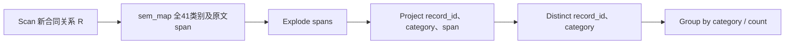
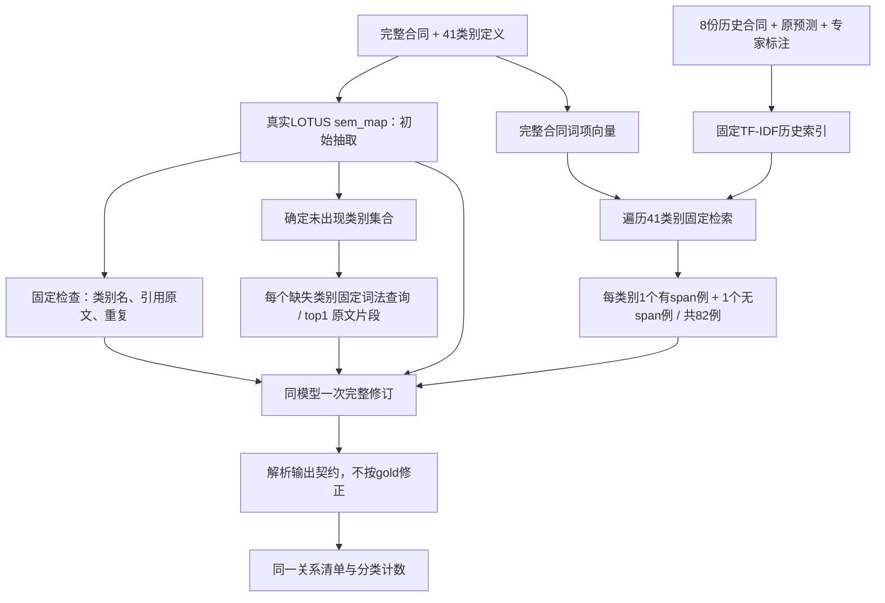

# CUAD 人工标注历史经验实验 v1

冻结时间：2026-09-05，首次新评测推理之前。用户要求实际检验人工校准经验，并列出固定DAG。当前只运行CUAD一个family，以避开BioDEX尚未修正的患者ADR/gold范围歧义；不将其作为两个family发布证据。

## 历史资源与新评测

H为此前8份CUAD开发合同、完整原文、旧LOTUS初始输出及官方人工专家监督标注。官方[来源说明](https://www.atticusprojectai.org/cuad/)称标注在有经验律师监督下人工完成。H包括全部8合同×41类别=328案例、312条人工span，既含正例也含无发布span案例；不是只挑原系统失败项。采用机械并列对照，不生成伪装成人工经验的AI解释，不声称专家重新审核了模型输出。个体标注时间和人工成本未知。旧初始模型7成功/1超时保留原状态；超时不是语义错误。

新R从同一锁定官方test102合同，以SHA256(`cuad-human-history-transfer-v1`+NUL+title)排序选8份；排除旧8合同、文件标题发行主体前缀相同者和与H/已选R的规范5词shingle Jaccard>=0.8者。选择只读取标题和完整输入，不按新gold或模型表现挑样本。记录选择锁、拒绝原因和最大相似度。新R各全文972–54,866字符，短文仍是完整发布context，不补造缺失页面或改选更难样本。H与R记录/发行主体代理分离；完整交易对手、模板来源和模型训练污染未确认，所以称新记录迁移pilot，不称完整独立确认。

资产：data/cuad-history-transfer-v1/history为授权公开H，evaluation/public为当前输入，evaluation/private为当前gold。旧快照和结果保持不变。H标签可以公开，R标签在模型退出后才供独立scorer使用。H来源commit67faa0e6023b04fcaae6cc09497ab00e5d63a2a2；CC BY4.0标注/数据范围沿用官方说明，本轮不外发。

## 固定外层DAG

所有比较臂保持同一输入、任务、span输出和下游关系语义。实际执行先产生逐合同预测；独立evaluator执行关系去重和分类计数。group/count不是额外模型推理。ABSTAIN留在全量分母，空span列表与ABSTAIN不同。

## 固定检索/复核DAG：B2

TF-IDF词项为小写英文连续字母、长度>=2；历史合同文档频率IDF=log((1+8)/(1+df))+1，TF=1+log(count)，L2归一化、cosine排序、case_id打破平局。每类别从同一排序取有标注和无发布span各1例，不足则依排序补齐。无当前gold、无模型生成查询、无按结果调整top-k。每个新合同82完整类别案例，检索payload约92,715–114,196字符，不截断人工span。所有H完整原文和案例对有H系统均可访问；固定程序实际使用上述冻结检索策略。

## 五个实际比较臂

| Arm | sem_map实现 | 主要比较 |
|---|---|---|
| lotus-map | 完整输入上的原生LOTUS一次抽取，无H | 初始静态质量 |
| fixed-no-history | 同一初始输出，固定检查/缺失类别搜索，一次修订，H空 | 控制额外复核收益 |
| fixed-history | 同一固定DAG，加上82历史案例，一次修订 | 与fixed-no-history比较资源价值 |
| codex-no-history | 实际Codex CLI完整批处理/代码/公开工具，无H | Agent自身对照 |
| codex-history | 同样Codex CLI，加同一个完整H和历史检索/读取工具 | 与codex-no-history比较历史价值；与fixed-history比较执行策略 |

两个fixed臂使用同一个修订提示，仅H数据有无不同。两个Codex臂的任务与预算相同，H可用性说明/工具随资源条件变化。所有review共享一次B0预测，初始失败同样传播。Codex可以批内共享计划、写代码和缓存，不能访问评分器、仓库、当前gold或外部网络。历史资源不是当前答案；它只能帮助解释类别适用性、漏抽与边界粒度。默认路径完整必要输入仍然存在。

保持gpt-5.4同一.env服务、temperature0、reasoning none、每调用maxoutput12000、无自动HTTP重试。固定臂使用RecordedChatClient/LOTUS1.2.4；Codex沿用已验证0.151.0离线Docker镜像和宿主受限broker，Responses vs旧ChatCompletions协议差别及代理快照不确定性保留。每Codex批次48模型请求、96,000累计output、2M已报告input后的下次请求停止、192包装工具调用、30分钟墙钟限制。任务必要字段和预算不因观察结果改变。最多两条模型执行流同时运行，报告实际并发和缓存。

## 评分、门槛和成本

主指标为既有CUAD exact-category最大一对一span Jaccard>0.15 macro合同F1；同时报告>0.5、coverage、引用、类别关系P/R/F1和分类计数误差。所有8份均计分，不把328历史类别案例或41类别当独立评测样本。配对bootstrap10,000次、seed20260905，描述性区间。

分别报告fixed-history − fixed-no-history、codex-history − codex-no-history、codex-history − fixed-history，以及相对B0的改正/退步。探索筛选沿用平均提升>=0.05且至少3份合同改善；支持Agent利用经验的完整正面线索需要资源对照和强固定对照都成立，不能只展示最好的一对。若固定历史DAG同样好，则资源有用但Agent优势未证实。若引用改善而主指标不变，不能改成仅引用/降成本故事。

每个arm独立token、工具、时间、错误、完整原始产物；共享B0只实际运行一次，standalone各加一次。H已有人工标注与历史初始推理属于准备成本：旧281,992已知模型tokens+一次未知usage超时，人工成本未知；另可报告预存在H的部署成本，但不混同零成本。词法索引无新增embedding调用；本轮模型、资源构造/检索与容器时间分开登记，未测CPU-seconds不填0。失败和Codex自我修正留在轨迹。没有B3/完整DocETL、history摘要消融或自动单轨迹提取，本轮不声称完成完整矩阵。
