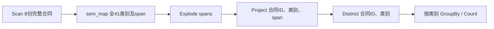
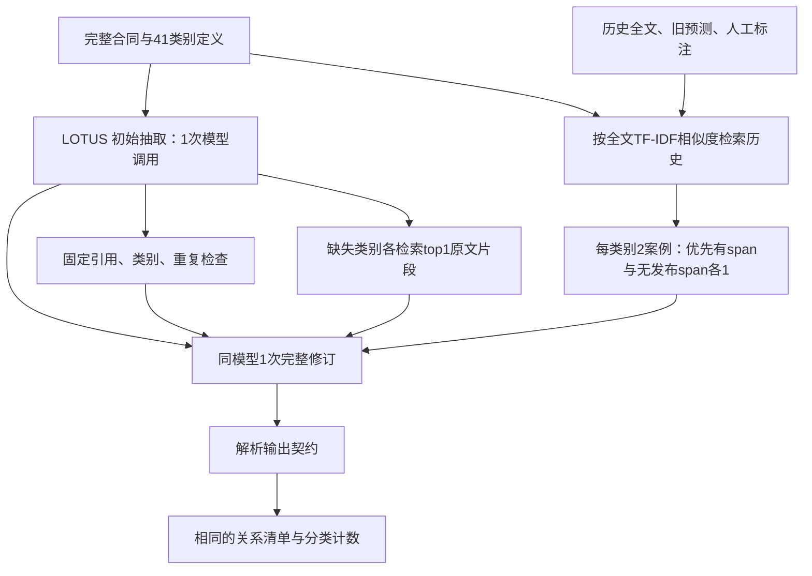

# 人工标注历史经验与固定DAG：实测结果

已完成CUAD同模型五组实验。历史经验让固定DAG的span F1微升，但没有提高Codex的F1；本轮未通过任何预设经验/Agent优势筛选。所有结果来自同一批8份新合同，coverage全部100%，61次模型请求全部成功。

历史材料是8份过去合同的原预测和[官方专家监督人工标注](https://www.atticusprojectai.org/cuad/)对照，共328类别案例、312span。没有新增人工审阅，也没有把AI归纳写成人工规则。因此本轮检验的是标注案例经验，未检验带人工解释及适用条件的规则库。

## 结果

| 比较臂 | span F1 >0.15（主） | span F1 >0.5 | 不匹配原文的引用 | 类别关系F1 | 分类计数总误差 |
|---|---:|---:|---:|---:|---:|
| LOTUS直接抽取 | 0.6767 | 0.5050 | 6 | 0.8227 | 23 |
| 固定DAG，无历史 | 0.6750 | 0.5254 | 5 | 0.8369 | 23 |
| 固定DAG，有历史 | 0.6810 | 0.5358 | 2 | 0.8369 | 23 |
| Codex CLI，无历史 | **0.7009** | 0.5242 | 0 | **0.8529** | **18** |
| Codex CLI，有历史 | 0.6936 | 0.5125 | 0 | 0.8467 | 19 |

| 配对差异 | 平均主指标差 | 改善/退步合同 | 描述性bootstrap 95%区间 |
|---|---:|---:|---:|
| 固定DAG：有H − 无H | +0.0059 | 3/2 | [−0.0233, +0.0333] |
| Codex：有H − 无H | −0.0073 | 1/2 | [−0.0365, +0.0186] |
| 有H：Codex − 固定DAG | +0.0126 | 3/3 | [−0.0136, +0.0395] |
| 无H：Codex − 固定DAG | +0.0259 | 4/1 | [−0.0006, +0.0527] |

Codex+H比直接LOTUS高0.0169，但无H的Codex已经更好，不能把这个差距归因于历史。预设筛选要求平均+0.05且至少3份改善；三个主要历史/策略对照都未通过。8份记录、单次模型执行与描述性bootstrap不支持总体结论或经验总是无效的推论。

## 对应的固定DAG

固定外层关系语义：

有历史的固定sem_map内部：

遍历全部41类别，固定检索共82案例/当前合同。不足的历史状态按相同排序补齐，不改任务判定。TF-IDF公式、排序/平局规则和工具参数见[冻结协议](contract-history-pilot.md)；[机器可读DAG](../workloads/cuad-clauses/history-dag.json)与实际代码对应。无历史固定臂保持相同检查、一次修订和提示，`historical_cases=[]`。8对HTTP请求经逐字核对，除历史payload外完全一致。

B0初始预测实际只运行一次，其余四臂共享；standalone成本分别加回初始。固定复核内部不让模型选查询、改top-k或增加轮次。Codex两臂保持外层任务，但可以自行规划、编程、选择读哪些历史、共享计算；它们不是这条固定检索程序的伪装。

## 经验实际上怎样被使用

H包含126个有span、202个无发布span案例；34类别有正例，7类别没有正例。固定H执行328次历史检索，返回656案例次、涉及224个不同案例。所有返回案例的原预测和人工span都完整进入修订上下文。

Codex+H直接用Python读取历史文件，没有调用包装的`search_history`。轨迹包含5条引用历史路径的命令，程序载入全部328案例，汇总各类别标注分布，并向模型展示了126个有span案例的228条引用片段；它自行限制为每案例最多3条span、每条最多500字符。程序读过整个JSON，不等于模型读完全部标注。可观察行为主要是查看标签分布/人工span，随后归纳span粒度，未显示逐例系统地分析过去错误的适用条件。这个观察不能替代因果消融。

具体改正与退步均保留：

| 新合同ID | 有H相对无H的Codex变化 | benchmark结果 |
|---|---|---|
| `cc774ffc26554666e0b96804` | 预测10→8span，删除`Post-Termination Services`等多余输出 | 匹配gold仍为6，少2个不匹配span，F1 +0.0602 |
| `c619fb4e8e3ce63ce9b79ad3` | 比无H组多保留`Audit Rights`、`Non-Transferable License` | 两类别未在该合同发布gold中，匹配数仍为7，F1 −0.0867 |
| `56626a19b85f66659d051b44` | 预测20→22span，类别集合不变 | 匹配数仍为14，F1 −0.0318 |

同一最后合同在固定DAG中，有H使匹配gold的span由13增加到15，F1 +0.0620。这说明局部纠错确实存在，但被其他退步抵消。以上是发布标注一致性，不是重新作出的法律判断，也不能证明某一历史条目直接导致某次修改。

## 成本与执行真实性

| 比较臂 | 本臂新增模型调用 | 本臂新增tokens | 含共享初始tokens | 本臂wall-clock秒 |
|---|---:|---:|---:|---:|
| LOTUS直接 | 8 | 62,261 | 62,261 | 298.06 |
| 固定无H | 8 | 170,823 | 233,084 | 402.30 |
| 固定有H | 8 | 377,827 | 440,088 | 547.98 |
| Codex无H | 20 | 1,061,178 | 1,123,439 | 459.13 |
| Codex有H | 17 | 946,295 | 1,008,556 | 614.45 |

本轮实际合计61次请求、2,618,384 tokens，无缺失usage，无新embedding调用，实际金额未知。H原模型准备另有281,992已知tokens和一次超时的未知usage；若计入历史模型准备，有H固定/有H Codex分别至少722,080/1,290,548 tokens。历史人工标注、整理审核的货币成本未知；本轮没有新人工标注。已存在H的部署情景与包含H准备的完整成本分别列出，不将原历史成本填0。

实际调用/返回模型均为同一服务的gpt-5.4；temperature0、reasoning none、maxoutput12000。Codex为真实CLI0.151.0，两个臂使用相同不可变Docker镜像`sha256:72e74581ce8b26cb6fe673ff76282ac76f9b32845202cd40879a469fb2ef9357`。无H25条完成shell命令（含2条失败后自我修正），有H30条、无非零退出shell命令；二者最终正常退出。静态是ChatCompletions、CLI是Responses；系统提示/批预算不同，代理权重快照未独立验证，所以不是等预算机制证明。

最多两条推理流同时运行；先B0，两个fixed臂重叠，fixed-no-H结束后开始Codex-no-H，fixed-H结束后开始Codex-H。时间受并发、服务缓存与响应缓冲影响，不作受控延迟排名。无客户端响应回放/自动模型重试，模型内存和generated code只在各自隔离批中复用。没有单独测CPU-seconds、CPU硬件折旧或人工整理工时，不能据tokens声称完整经济优势。

## 有效性和复现

H与R按记录、文件名发行主体代理和5词shingle近重复排除；输入独立选样，不按新gold或结果筛选。完整交易对手/模板和模型训练污染仍未确认。新R仅8份，包含972–54,866字符的完整发布context，是新记录迁移pilot。旧8份已明确转为历史，不再作为本次评测。

三份新快照、预测/轨迹/模型参数/input哈希均通过校验；61次请求的请求/返回模型一致；两个CLI公共输入字节相同，仅工具定义/H资源有差异；无H容器没有H目录，两个容器均没有当前gold、宿主密钥、仓库和网络访问。密钥扫描0匹配。28项离线测试通过，评分只在五臂全部退出后运行，过程中未调整提示/检索/gold。

[比较JSON](../runs/cuad-history-transfer-v1/comparison.json)、[固定信息条件核对](../runs/cuad-history-transfer-v1/fixed-information-condition-audit.json)、[历史访问审计](../runs/cuad-history-transfer-v1/native-history-access-audit.json)、[案例审计](../runs/cuad-history-transfer-v1/case-audit.json)、[验证收据](../runs/cuad-history-transfer-v1/validation.json)。每臂保留原始预测、请求、observable轨迹、代码与失败；构造和源选择在`data/cuad-history-transfer-v1`。

[复现脚本](../artifact/reproduce-contract-history.sh)：安装pilot依赖并具备原锁定源/历史8合同及旧LOTUS run后，使用PATH中的对应python：`SWB_HISTORY_OUTPUT=/absolute/unused/path bash artifact/reproduce-contract-history.sh`。脚本重新构造并串行运行五臂与评分，保留新输出目录。新source builder允许显式冻结的record IDs，默认旧选择行为保留。

本轮没有B3、完整DocETL、人工解释规则库消融、多个H集合或独立确认，也没有单轨迹自动提取。结果支持继续把“历史案例能纠正某些错误”与“Agent能可靠判断经验适用条件”分开检验，不能声称后者已经成立。
