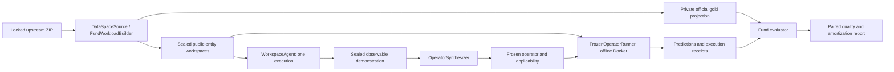

# DataSpace amortizable-exploration artifact

Protocol: [frozen development design](dataspace-amortization-pilot.md). This artifact implements source import, one entity's native Agent demonstration, one synthesis request, immutable Python operator, applicability-aware Docker execution and evaluator-only scoring. It is a development control, not a reproduced official DataSpace leaderboard result or a validated quality-gap workload.

## Inputs and runtime

Download the URL in [DataSpace source lock](../environments/dataspace/sources.lock.json). ZIP size2,878,651,222bytes, SHA256 `68f221fafcf0b50396eca55f8298af1ad73d586a6cac6995916afca535a560af`. The importer verifies the complete archive and selected task inventory before publishing. Public code metadata commits: DataSpace `6491caa4c70cc06cacb6103ba73cefb00746abfe`, dataset `96be19257d7aa251dbce4771d46a26fc36f6dc52`. Do not mount original source archives or reference directories into the Agent.

Use Python3.12 in an isolated environment. The locally observed dependency inventory is [runtime lock](../experiments/dataspace-runtime-requirements.lock.txt); clean installation of this entire inventory on a second machine has not been independently verified. The [LOTUS source lock](../experiments/dataspace-lotus.lock.json) additionally pins the commit and pipeline hash because upstream package metadata still reports1.2.4 for this newer agentic code. Download/extract its source ZIP and put that checkout before site-packages on PYTHONPATH. The runner refuses a mismatched native pipeline hash. Do not combine with PCB's NumPy2 vision environment.

The code-generation boundary uses the existing [Docker image definition](../artifact/Dockerfile.codex-pilot), built as `swb-codex-pilot:0.151.0`; Docker must be running. The locally tested image is `sha256:72e74581ce8b26cb6fe673ff76282ac76f9b32845202cd40879a469fb2ef9357`. Python/SQLite and shell tools run offline with read-only public inputs, no Docker socket, no host credentials or private gold. Generated code never executes on the host. Provider requests are brokered from the trusted host. The model env file uses BASE_URL/API_KEY as in prior pilots; never put it inside an artifact or container.

## End-to-end run

Set `python` to the isolated interpreter. Each invocation needs unused output directories. The script downloads nothing implicitly and does make real model requests.

```sh
export SWB_EXPERIMENT_DIR=/absolute/unused/experiment
export SWB_DATASPACE_ARCHIVE=/absolute/DataSpace-Benchmark.zip
export SWB_LOTUS_SOURCE=/absolute/lotus-136ae4f4a344a2f75d89f811e516dfcb0de30e46
export SWB_ENV_FILE=/absolute/model-service.env
bash artifact/reproduce-dataspace-amortization.sh
```

The script preserves predictions/trace/call receipts, runs1demonstration/16validation/300later entities, and scores only after model outputs are frozen. It explicitly executes both Chat and Responses LOTUS transports, native Codex on both validation and the full 300-record batch, and writes `study.json` plus `report/comparison.json`. Current code includes the adapter fixes; the reproduction does not intentionally repeat historical adapter bugs or require receipt reprojection. The default matrix covers traditional sem_map, native agentic Corpus.map with four-unit batching, native Codex batch, handwritten fixed SQL and trace-derived Python. It does not include the full B0–B7 research matrix or a no-trace synthesis ablation. Numerical reproduction is not guaranteed by the unverified gpt-5.4 service alias.

Individual commands:

```sh
export PYTHONPATH="$SWB_LOTUS_SOURCE:$PWD/src"
python -m semantic_workload_bench.cli amortization --help
python -m semantic_workload_bench.cli amortization run-operator   --operator runs/dataspace-fund-synthesis-v1/operator   --public data/dataspace-fund-v1/evaluation/public   --output /absolute/unused/operator-run
python -m semantic_workload_bench.cli amortization score   --private data/dataspace-fund-v1/evaluation/private   --run /absolute/unused/operator-run
```

The latter two commands require the locally generated artifacts. No source code depends on those historical directories: pass a fresh build/operator for a fresh experiment. Scoring rejects an existing metrics.json, prediction hash mismatch, wrong public snapshot and incomplete/duplicate identities. Semantic errors are scored as errors, not repaired. ABSTAIN remains in the full denominator. Current output tuple matching trims only outer whitespace and includes exact scope text; it is not a GPT judge.

## Boundaries and costs

The imported original task has six modalities; the transformed recurring workload uses three data types (SQLite, CSV, JSON), and all necessary evidence is in SQLite. This is not a multimodal resource-benefit test. Source grouping is by manager and fund identity; near-duplicate/training independence remains unknown. One-trace synthesis excludes all validation/evaluation gold and execution traces. Its artifact stores task/trace/input hashes, entry points, applicability and dependencies. A FROZEN state is an engineering state, not permission to claim scientific VALIDATED.

The first model-free execution receipt measured only the execution interval after snapshot verification/setup; a separate timing rerun of the identical frozen operator adds verification/setup/complete runner wall-clock. Neither is a controlled latency benchmark. Native Agent receipts currently measure the container run interval; do not compare mismatched timing boundaries as an end-to-end speedup. Token receipts include provider-reported usage and any reported cache counters, despite client cache being disabled. Actual monetary/CPU/GPU costs and manual research effort remain unknown.

The `cost-curve` subcommand accepts JSON keys `learning` (all four explicit phases demonstration/extraction/validation/shared_preprocess), `agent_per_record`, `operator_per_record` (including fallback), and `batch_sizes`. Analyze one dimension at a time. Any unknown cost returns UNKNOWN_COST; equal or greater operator unit cost returns NO_FINITE_BREAK_EVEN. Projected integer break-even is strictly cheaper-than and cannot establish quality retention.

Verification: `PYTHONPATH="$SWB_LOTUS_SOURCE:$PWD/src" python -m unittest discover -s tests -v` in the pinned runtime (45 tests passed locally). Without LOTUS, the two native adapter tests are skipped. Native runtime and actual source/model executions are separate from offline fixture tests. No commit, publication or independent-team reproduction is implied.


## Module ownership



Source construction and gold projection live in `dataspace.py`/`fund_workload.py`; execution in `workspace_agent.py`, `fund_experiment.py`, `fund_fixed.py` and `operator_synthesis.py`; prediction contracts in `workspace_contracts.py`; evaluator/diagnostics in `fund_analysis.py`; cost/quality mathematics in `amortization.py`; receipt aggregation in `amortization_report.py`. `amortization_cli.py` only dispatches commands. Inference transports record observable I/O and usage, never gold or domain judgments.

`lotus_receipt_replay.py` repairs a result-projection defect from already completed native LOTUS responses. It is analysis of real recorded inference, not fresh inference and not the B6 same-trace-summary/replay research arm. The step budget includes the native tool-free finalization call; a completed final answer remains scoreable. Genuine transport failures or missing final answers remain ABSTAIN. All original raw receipts and superseded projections are retained.

Final measured results: [2026-09-06 development report](dataspace-amortization-results-2026-09-06.md). The complete current script has been syntax-checked; its component commands were executed locally, but the assembled script has not been independently rerun end to end.
