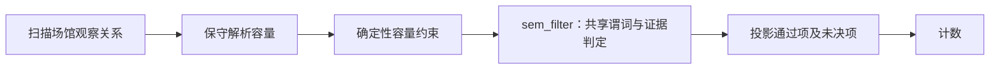

# MMQA-VenueLake v1：冻结数据湖、共享批任务与固定 DAG

当前已完成**数据物化和执行边界**，未完成语义 gold 或模型对比。它是第一标杆的候选环境，不是“Agent 优于静态算子”的实验结果。用户提出的总目标仍包括受控差异、执行轨迹、组件消融和动态算子库，这些没有被本次构造替代。

## 实际物化结果

来源为 [MultiModalQA 官方仓库](https://github.com/allenai/multimodalqa)，固定 commit `4dd14328c6d02a4daa357cc6032915a0b14602e3`。官方 README 初次发布日期为 2021-04-23；论文发表于 ICLR 2021。所有资源来自冻结文件，没有调用今天的 Wikipedia 来替换缺失内容。

| 对象 | 实际数量 | 边界 |
|---|---:|---|
| 文本资源 | 218,285 | 原始正文片段，保留全量背景语料 |
| 表格资源 | 10,042 | 只保留原始可见单元格和链接，不暴露问题生成 metadata |
| 图片 | 177 | 由场馆单元格的候选 URL 关联，已经下载原始字节；不保证都是球场图片 |
| 原始链接导出的边 | 134,945 | 单元格到可用资源，保留行/列与链接文字 |
| 容量观察记录 | 1,124 | 73 张表的所有行，不是 1,124 个独立球场 |
| 不同候选 URL | 778 | 可能包含城市、别名；尚未完成实体绑定 |
| 开发/验证/确认集 | 605 / 200 / 319 | 42 个连通组；同源页面、表、候选 URL 不跨集合 |

公开湖：`outputs/mmqa-venue-lake-v1/`。其 manifest SHA256 为 `db7decc4a4e996c8ee9d113c54f4b7c0ec1954bf928c72b6fdb48280c5a845b4`。可重新运行 `audit` 核查，不能仅引用本文数字。

源目录 `outputs/mmqa-source/` **不是运行环境**：它包含下载的 QA 文件。湖构造器根本不读取 QA，只投影 tables/texts/images 的可见字段。原始图像及数据的统一再分发许可尚未核实；当前产物留在被 git 忽略的本地输出目录。

## 候选关系的选择

选取所有具有一个 `Stadium` 或 `Home ground` 列，且有一个已审计容量列的表。容量列允许 `Capacity`、`Stadium Capacity`、`Stadium capacity`、`Capacity 1`；`% of Capacity` 是百分比，不属于容量列。保留所有来源行，包括缺链接、容量未确定及重复场馆的不同赛季观察。

每行保存来源表/页面、行号、原始单元格、候选链接及其文字、原容量字符串和保守解析的整数。整数解析只接受无附加限定的数字及千分位；69 行未成功解析，继续交给语义步骤，不自行猜测。198 行没有场馆单元格链接；72 行有多个链接。

需求目前是构造的“场馆目录筛选与核对”，并无已验证的客户请求。所有语义 gold 都需要进一步审定；不能将这个构造信息需求写成已经确认常见的生产 workload。

## 三个共享 batch questions

完整英文谓词、证据义务、状态和预算写在 [`tasks/mmqa-venue-lake-v1.json`](../tasks/mmqa-venue-lake-v1.json)。每个任务对整个候选关系使用同一个谓词，不包含逐行变化的 QA。

| 任务 | 共享问题 | 需语义判断的全量记录 | 当前作用 |
|---|---|---:|---|
| `venue-athletics-20k-v1` | 哪些记录的场馆容量至少 20,000，且有环绕主场地的室外椭圆田径跑道？ | 420 | 候选多模态筛选；固定图片/正文流程可能足够 |
| `venue-covered-stands-20k-v1` | 哪些记录的容量至少 20,000，且至少有一座永久屋顶覆盖的观众看台？ | 420 | 感知和证据充分性对照；局部照片不能证明没有屋顶 |
| `venue-capacity-conflict-v1` | 哪些容量记录与同一场馆、同一配置和同一时期的正文描述明确冲突？ | 1,124 | 候选实体/时序核对；需先排查是否几乎全部无法标注 |

前三个数量均为每任务记录数，不可相加后称为独立样本数。前两任务各有 704 行容量已明确低于门槛，可以依据合取逻辑直接判 FALSE；这是确定性前置筛选，不是静态语义算子或 Agent 的成功结果。必须分别报告**全 DAG 质量与残余语义子集质量**，不能用这些容易的负例掩盖关键节点问题。

## 固定 logical DAG 与运行边界



容量约束对任务三不排除任何行。只有 `sem_filter` 的物理实现可替换；任务语义、候选集合、确定性节点及下游输出固定。当前实现了输入准备及**已提供语义输出的回放**，没有内置或假冒模型调用。`execute` 不会自动完成语义判定。

`EvidenceLake` 提供只读 `search/open/resolve/neighbors`。运行 Agent、Coding Agent 和固定流程时，都应复用一个经过校验的持续工具会话；逐次启动 CLI 会重复校验全库，不能把这项成本误算为 Agent 的规划开销。图片读取须按内容识别格式：下载的 177 图中有 141 JPEG、36 PNG，部分上游后缀为 `.jpg` 的文件实际是 PNG。

状态区分：

- `UNANNOTATED`：标注工作未完成，不是 gold 标签。
- gold `UNKNOWN`：审定后确认冻结世界内证据不足。
- 执行 `ABSTAIN`：没有完成判定、工具出错或预算耗尽。
- `TRUE/FALSE`：必须有足够证据；回放器只校验引用存在，不能代替证据充分性评分。

每次进入工具/工作流时验证 manifest 中全部文件 SHA256 和大小，拒绝缺失、改动或额外文件。准备、标注与回放输出必须位于湖外。正式 runner 仍需要独立 public-only 文件挂载；Python 只读 API 和目录划分不等于操作系统权限隔离。

## 可复现命令

在仓库根目录执行；已有冻结输出禁止原地覆盖，重建请指定一个新目录。

```bash
python scripts/fetch_mmqa_snapshot.py --output outputs/mmqa-source
python -m semfilter_bench.lake plan --source outputs/mmqa-source --output outputs/mmqa-venue-plan
python scripts/fetch_mmqa_snapshot.py --output outputs/mmqa-source --image-paths outputs/mmqa-venue-plan/image_paths.json
python -m semfilter_bench.lake build --source outputs/mmqa-source --tasks tasks/mmqa-venue-lake-v1.json --output outputs/mmqa-venue-lake-v1
python -m semfilter_bench.lake audit --lake outputs/mmqa-venue-lake-v1
python -m semfilter_bench.lake search --lake outputs/mmqa-venue-lake-v1 --query 'Pittodrie capacity'
python -m semfilter_bench.lake prepare --lake outputs/mmqa-venue-lake-v1 --task venue-athletics-20k-v1 --split discovery --output outputs/mmqa-venue-batches/venue-athletics-20k-v1/discovery
python -m semfilter_bench.lake annotations --lake outputs/mmqa-venue-lake-v1 --task venue-athletics-20k-v1 --split all --output outputs/mmqa-venue-private/venue-athletics-20k-v1
```

另两个 task ID 替换同名参数即可。三个开发集输入与全量标注队列已经生成。`--split all` 仅供构造/标注/诊断，禁止用于策略发现。别名、重复图和未链接实体的跨集重叠仍待额外审计。

回放输入 JSONL 每行包含 `instance_id/task_id/snapshot_sha256/state/evidence_ids`；未决状态额外包含 `reason`。这个中间节点回放格式不等于仓库完整的模型 submission/usage/trace 合约。真实模型接入和统一成本、轨迹输出尚待实现，不能用回放时间替代模型时间。

```bash
python -m semfilter_bench.lake execute --lake outputs/mmqa-venue-lake-v1 --task venue-athletics-20k-v1 --split discovery --predictions outputs/mmqa-venue-smoke/predictions.jsonl --output outputs/mmqa-venue-smoke/new-replay
python -m pytest tests/test_venue_lake.py tests/test_mmqa_fetch.py
```

现有 `outputs/mmqa-venue-smoke/` 是明确标记的结构 smoke：191 条语义输入全部返回“未运行模型”的 ABSTAIN，合并 414 条确定性容量负例，总计 605 行，无行丢失。其质量和模型成本为 null，不能作为任何模型的 benchmark 结果。

## 已观察到的反证风险

构造审计见 `outputs/mmqa-venue-audit.json`，独立子 agent 的攻击和修复记录见 [`multimodal-lake-adversarial-review.md`](multimodal-lake-adversarial-review.md)。

全量 1,124 行中，80 行能通过候选 URL 同时关联图和文本，169 行仅图，100 行仅文本，775 行两者均无精确 URL 命中。前两任务残余的 420 行中，有图文 53、仅图 92、仅文本 53、无精确命中 222。**可关联不等于证据充分；无精确命中也不等于检索一定失败。**

真实例 `venue:4c8b5fbb13aec70e3cd6ff53aae413f5:0` 是 2013–14 Scottish Premiership 表中的 `Pittodrie Stadium, Aberdeen`，容量 `21,421`。该单元格同时链接球场和城市。球场可关联图片 `image:2e6f466769791227cf3cfeaa9d045de7` 及正文 `text:e29f2723163a6c4835119858445972e9`，但正文的容量句实际是 `With a seating capacity of ;`，数值已缺失。不能据此生成容量冲突 gold，更不能归因于算子能力不足。

这一观察改变下一步优先级：先在 discovery 集按上述资源覆盖和实体绑定歧义分层审核 30–50 条，确认能否获得足够的可核验正/负例及证据路径。任务三若大多无法确定配置与时期，应拒绝作为主任务，而非补造冲突。前三类固定流程与 batch-aware Agent 的比较必须等这一 gate 通过后进行。

仍未完成：真实需求验证、残余语义 gold、别名/重复图审计、模型与工具执行器、统一预算/轨迹记录、受控差异、轨迹提取、消融与跨数据集迁移。原研究目标保持开放。
